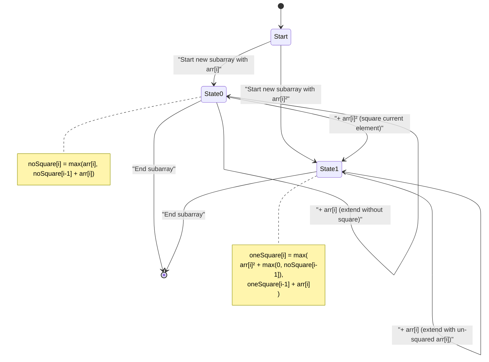
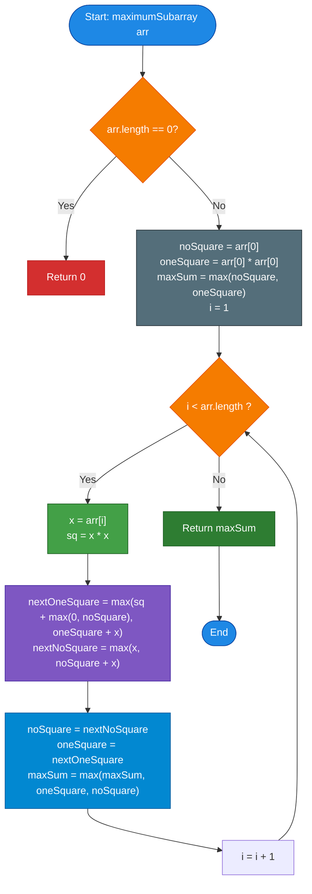

# GeeksforGeeks Problem of the Day: Maximum Subarray Sum with One Square Allowed

- **Problem Link:** [GeeksforGeeks - Maximum Subarray Sum with One Square Allowed](https://www.geeksforgeeks.org/problems/maximum-sum-subarray--143510/1)
- **Difficulty:** Medium
- **Topic Tags:** Dynamic Programming, Kadane's Algorithm, Arrays, Prefix/Suffix Sums, State Machine DP
- **Target Audience:** POTD Solvers, Computer Science Students, Competitive Programmers, Interview Preparation (FAANG/Tier-1 Tech)

---

## 1. Problem Statement

Given an array of integers `arr[]`, find the **maximum contiguous subarray sum** such that you are allowed to square **at most one** element in that subarray.

A subarray is a contiguous non-empty sequence of elements within an array. For any chosen subarray, you may:
1. Leave all elements as they are, or
2. Pick any single element $arr[k]$ inside the subarray and replace it with its square $(arr[k])^2$.

Return the maximum possible sum of such a subarray.

### Mathematical Formulation

For any subarray spanning indices from $i$ to $j$ ($0 \le i \le j < n$), let the standard sum be:
$$S(i, j) = \sum_{t=i}^{j} arr[t]$$

If we choose an index $k \in [i, j]$ to square, the modified sum becomes:
$$S_k(i, j) = \left( \sum_{t=i}^{j} arr[t] \right) - arr[k] + (arr[k])^2$$

The task is to compute:
$$\max_{0 \le i \le j < n} \left( \max \left( S(i, j), \; \max_{i \le k \le j} S_k(i, j) \right) \right)$$

> **Mathematical Note:** For any integer $x \in \mathbb{Z}$:
> $$x^2 - x = x(x - 1) \ge 0$$
> Since $x^2 \ge x$ is always true for integers (with equality only at $x = 0$ and $x = 1$), squaring an element **never decreases** the subarray sum. Thus, the optimal answer will always use the square operation on at least one element (or be equal to the un-squared sum).

---

## 2. Examples & Explanations

### Example 1
- **Input:** `arr[] = [-1, -2, 3, -2, 3]`
- **Output:** `10`
- **Explanation:**
  - Let us evaluate potential contiguous subarrays:
    - Subarray `[3, -2, 3]` from index $2$ to $4$:
      - Standard sum: $3 + (-2) + 3 = 4$.
      - If we square the first $3$ (at index $2$): $3^2 + (-2) + 3 = 9 - 2 + 3 = \mathbf{10}$.
      - If we square the second $3$ (at index $4$): $3 + (-2) + 3^2 = 3 - 2 + 9 = \mathbf{10}$.
      - If we square $-2$ (at index $3$): $3 + (-2)^2 + 3 = 3 + 4 + 3 = 10$.
  - Any other subarray gives a sum $\le 10$.
  - Therefore, the maximum subarray sum possible is **`10`**.

```text
Array indices:      0      1     [ 2      3      4 ]
Array values:     -1     -2      [ 3     -2      3 ]
Operation:                       [ 3²    -2      3 ]
Transformed:                     [ 9     -2      3 ] => Sum = 9 + (-2) + 3 = 10
```

---

### Example 2
- **Input:** `arr[] = [-4, -4, -2, 5, 2, -1]`
- **Output:** `27`
- **Explanation:**
  - Consider the contiguous subarray `[5, 2]` at indices $3$ and $4$.
  - If we square the element $5$:
    $$(5)^2 + 2 = 25 + 2 = \mathbf{27}$$
  - Let us check if including $-1$ helps: $25 + 2 + (-1) = 26 < 27$.
  - Including $-2$ on the left: $(-2) + 25 + 2 = 25 < 27$.
  - Squaring $-4$ alone gives $(-4)^2 = 16 < 27$.
  - Hence, the maximum possible sum is **`27`**.

```text
Array indices:      0      1      2     [ 3      4 ]     5
Array values:     -4     -4     -2      [ 5      2 ]    -1
Operation:                              [ 5²     2 ]
Transformed:                            [ 25     2 ] => Sum = 25 + 2 = 27
```

---

### Example 3 (All Negative Numbers)
- **Input:** `arr[] = [-5, -2, -8, -1]`
- **Output:** `64`
- **Explanation:**
  - Since every number is negative, picking a multi-element subarray without squares would only accumulate negative values.
  - However, squaring a negative number yields a positive value:
    - $(-5)^2 = 25$
    - $(-2)^2 = 4$
    - $(-8)^2 = \mathbf{64}$
    - $(-1)^2 = 1$
  - The single-element subarray `[-8]` with its element squared gives **`64`**, which is the maximum achievable.

---

### Example 4 (Single Element)
- **Input:** `arr[] = [-7]`
- **Output:** `49`
- **Explanation:**
  - The only subarray is `[-7]`. Squaring it gives $(-7)^2 = 49$.

---

## 3. Constraints

- $1 \le \text{arr.length} \le 10^5$
- $-10^4 \le \text{arr}[i] \le 10^4$
- **Expected Time Complexity:** $\mathcal{O}(n)$
- **Expected Auxiliary Space:** $\mathcal{O}(1)$
- **Result Range:** Since $-10^4 \le arr[i] \le 10^4$, the maximum squared value is $(10^4)^2 = 10^8$. Over an array of size $10^5$, the maximum cumulative sum is $\approx 10^5 \times 10^4 + 10^8 \approx 1.1 \times 10^9$, which safely fits within a standard 32-bit signed integer ($[-2^{31}, 2^{31}-1]$).

---

## 4. Visual Architecture & Dynamic Programming State Machine

Standard Kadane's algorithm keeps track of the maximum subarray sum ending at index $i$ without any special modifications.

Here, each position in our subarray can be in one of **two states**:
1. **State 0 (`noSquare`):** We are extending or starting a contiguous subarray, and **no element has been squared yet**.
2. **State 1 (`oneSquare`):** We are extending or starting a contiguous subarray, and **exactly one element has already been squared**.



### The Transition Equations

For each element $x = arr[i]$ as we iterate from left to right:

#### 1. Transition for `noSquare`:
A subarray ending at $i$ with no squares can either:
- Start fresh at index $i$ with value $x$, OR
- Extend the previous `noSquare` subarray with value $\text{noSquare} + x$.

$$\text{next\_noSquare} = \max(x, \; \text{noSquare} + x)$$

#### 2. Transition for `oneSquare`:
A subarray ending at $i$ with exactly one squared element can be formed in two ways:
- **Case A (Current element $x$ is the one squared):**
  We square $x$ to get $x^2$. We can either start fresh at index $i$ with $x^2$, or prepend the optimal previous un-squared subarray $\text{noSquare}$:
  $$\text{Option A} = x^2 + \max(0, \; \text{noSquare})$$
- **Case B (A previous element was already squared):**
  We extend the previous `oneSquare` subarray by simply adding the un-squared current element $x$:
  $$\text{Option B} = \text{oneSquare} + x$$

Combining both options:
$$\text{next\_oneSquare} = \max\Big( x^2 + \max(0, \; \text{noSquare}), \; \text{oneSquare} + x \Big)$$

#### 3. Global Maximum Update:
At every step, update the overall answer:
$$\text{maxSum} = \max(\text{maxSum}, \; \text{next\_noSquare}, \; \text{next\_oneSquare})$$

---

## 5. Step-by-Step Simulation & Trace Table

Let us trace the algorithm on **Example 1**: `arr = [-1, -2, 3, -2, 3]`

### Initialization:
- Index $i = 0$, $x = -1$:
  - $\text{noSquare} = -1$
  - $\text{oneSquare} = (-1)^2 = 1$
  - $\text{maxSum} = \max(-1, 1) = \mathbf{1}$

### Trace Table:

| Index $i$ | $x = arr[i]$ | $x^2$ | $\text{next\_noSquare} = \max(x, \text{noSq} + x)$ | $\text{next\_oneSquare} = \max(x^2 + \max(0, \text{noSq}), \text{oneSq} + x)$ | New `noSq` | New `oneSq` | `maxSum` Updated | Active Subarray for `oneSq` |
| :---: | :---: | :---: | :---: | :---: | :---: | :---: | :---: | :---: |
| **0** | $-1$ | $1$ | Initialized: $-1$ | Initialized: $1$ | $-1$ | $1$ | **1** | `[-1²]` = `[1]` |
| **1** | $-2$ | $4$ | $\max(-2, -1 + (-2)) = \mathbf{-2}$ | $\max(4 + \max(0, -1), 1 + (-2)) = \max(4, -1) = \mathbf{4}$ | $-2$ | $4$ | **4** | `[-2²]` = `[4]` |
| **2** | $3$ | $9$ | $\max(3, -2 + 3) = \mathbf{3}$ | $\max(9 + \max(0, -2), 4 + 3) = \max(9, 7) = \mathbf{9}$ | $3$ | $9$ | **9** | `[3²]` = `[9]` |
| **3** | $-2$ | $4$ | $\max(-2, 3 + (-2)) = \mathbf{1}$ | $\max(4 + \max(0, 3), 9 + (-2)) = \max(7, 7) = \mathbf{7}$ | $1$ | $7$ | **9** | `[3, -2²]` or `[3², -2]` |
| **4** | $3$ | $9$ | $\max(3, 1 + 3) = \mathbf{4}$ | $\max(9 + \max(0, 1), 7 + 3) = \max(10, 10) = \mathbf{10}$ | $4$ | $10$ | **10** | `[3², -2, 3]` = `10` |

### Final Result:
$$\mathbf{maxSum = 10}$$

---

## 6. Algorithm Flowchart



---

## 7. From Naive to Pro: Algorithmic Progression

### Method 1: Naive Brute Force ($\mathcal{O}(n^3)$ or $\mathcal{O}(n^2)$)
- **Concept:** Check every possible contiguous subarray `arr[i...j]` ($0 \le i \le j < n$). For each subarray, try squaring each element $k \in [i, j]$ (or none) and calculate the sum.
- **Why it is suboptimal:**
  - Number of subarrays is $\frac{n(n+1)}{2} = \mathcal{O}(n^2)$.
  - Testing each element to square takes $\mathcal{O}(n)$ per subarray.
  - Overall time is $\mathcal{O}(n^3)$. With $n = 10^5$, $n^3 = 10^{15}$ operations, which will cause a massive **Time Limit Exceeded (TLE)**.
- **Pseudocode:**
```text
function maximumSubarray_Naive(arr):
    n = arr.length
    maxSum = -INFINITY

    for i from 0 to n - 1:
        for j from i to n - 1:
            // Calculate base sum without squaring
            baseSum = sum(arr[i...j])
            maxSum = max(maxSum, baseSum)

            // Try squaring each element in the subarray
            for k from i to j:
                modifiedSum = baseSum - arr[k] + (arr[k] * arr[k])
                maxSum = max(maxSum, modifiedSum)

    return maxSum
```

---

### Method 2: Better Approach — Bidirectional Kadane / Prefix & Suffix DP ($\mathcal{O}(n)$ Time, $\mathcal{O}(n)$ Space)
- **Concept:**
  - Notice that if we choose $arr[i]$ as the element to square, the maximum subarray containing $arr[i]^2$ consists of:
    1. The maximum contiguous subarray sum ending at $i-1$ (`leftMax[i-1]`).
    2. The squared value $arr[i]^2$.
    3. The maximum contiguous subarray sum starting at $i+1$ (`rightMax[i+1]`).
  - If `leftMax[i-1] < 0`, we don't include it (take $\max(0, \text{leftMax}[i-1])$).
  - If `rightMax[i+1] < 0`, we don't include it (take $\max(0, \text{rightMax}[i+1])$).
  - Therefore, for a fixed squared index $i$:
    $$\text{best}(i) = \max(0, \text{leftMax}[i-1]) + arr[i]^2 + \max(0, \text{rightMax}[i+1])$$
- **Why it is better:**
  - Linear $\mathcal{O}(n)$ time complexity!
  - However, it allocates two auxiliary arrays of size $n$ (`leftMax` and `rightMax`), requiring $\mathcal{O}(n)$ extra space.
- **Pseudocode:**
```text
function maximumSubarray_Bidirectional(arr):
    n = arr.length
    leftMax = array of size n
    rightMax = array of size n

    // Forward Kadane (max sum ending at i)
    leftMax[0] = arr[0]
    for i from 1 to n - 1:
        leftMax[i] = max(arr[i], leftMax[i - 1] + arr[i])

    // Backward Kadane (max sum starting at i)
    rightMax[n - 1] = arr[n - 1]
    for i from n - 2 down to 0:
        rightMax[i] = max(arr[i], rightMax[i + 1] + arr[i])

    maxSum = -INFINITY
    for i from 0 to n - 1:
        leftContrib = (i > 0) ? max(0, leftMax[i - 1]) : 0
        rightContrib = (i < n - 1) ? max(0, rightMax[i + 1]) : 0
        current = leftContrib + (arr[i] * arr[i]) + rightContrib
        maxSum = max(maxSum, current)

    return maxSum
```

---

### Method 3: Pro Approach — State Machine DP / Kadane with 2 States ($\mathcal{O}(n)$ Time, $\mathcal{O}(1)$ Space)
- **The Core Strategy:**
  - We do not need to store entire history arrays!
  - At any index $i$, the decisions only depend on the states at index $i-1$.
  - We maintain two scalar accumulator variables:
    1. `noSquare`: Max subarray sum ending at the current index without any squared element.
    2. `oneSquare`: Max subarray sum ending at the current index with exactly one squared element.
  - In a single pass, we update these variables and track the global maximum.
  - Achieves optimal $\mathcal{O}(n)$ time and strictly $\mathcal{O}(1)$ auxiliary space.
- **Pseudocode:**
```text
function maximumSubarray_Optimal(arr):
    n = arr.length
    if n == 0: return 0

    noSquare = arr[0]
    oneSquare = arr[0] * arr[0]
    maxSum = max(noSquare, oneSquare)

    for i from 1 to n - 1:
        x = arr[i]
        
        // Transitions
        nextOneSquare = max(x * x + max(0, noSquare), oneSquare + x)
        nextNoSquare = max(x, noSquare + x)

        noSquare = nextNoSquare
        oneSquare = nextOneSquare

        maxSum = max(maxSum, noSquare, oneSquare)

    return maxSum
```

---

## 8. Complexity Comparison Table

| Metric | Method 1: Brute Force | Method 2: Prefix & Suffix Kadane | Method 3: Pro (2-State Kadane DP) |
| :--- | :--- | :--- | :--- |
| **Time Complexity** | $\mathcal{O}(n^3)$ or $\mathcal{O}(n^2)$ | $\mathcal{O}(n)$ | $\mathbf{\mathcal{O}(n)}$ (Single Pass) |
| **Auxiliary Space** | $\mathcal{O}(1)$ | $\mathcal{O}(n)$ (Two arrays of size $n$) | $\mathbf{\mathcal{O}(1)}$ (Only 3 scalar variables) |
| **Passes over Array** | Multiple nested loops | 3 passes (Left, Right, Evaluate) | **1 single forward pass** |
| **Cache Locality** | Extremely Poor | Moderate (3 separate passes) | **Optimal (L1/L2 cache-friendly)** |
| **Memory Allocations** | Zero | $\mathcal{O}(n)$ heap arrays | **Zero heap allocations** |
| **Interview Verdict** | TLE on $n \ge 10^3$ | Accepted, good stepping stone | **Gold Standard (FAANG/Tier-1 optimal)** |

---

## 9. Comprehensive Corner Cases Handled

1. **Single-Element Array ($n = 1$):**
   - Example: `arr = [-5]` $\implies (-5)^2 = 25$.
   - The loop runs $0$ times, returns $\max(-5, 25) = 25$. Correct.
2. **All Negative Elements:**
   - Example: `arr = [-9, -2, -10, -4]`.
   - Squaring $-10$ gives $(-10)^2 = 100$.
   - Any multi-element extension adds negative values and reduces the sum.
   - The recurrence $x^2 + \max(0, \text{noSquare})$ uses $\max(0, \text{negative}) = 0$, isolating $x^2 = 100$.
3. **All Positive Elements:**
   - Example: `arr = [1, 2, 3, 4]`.
   - Standard sum is $1 + 2 + 3 + 4 = 10$.
   - Squaring $4$ gives $1 + 2 + 3 + 16 = 22$.
   - Our algorithm seamlessly extends `oneSquare` across the entire array.
4. **Array with Zeros:**
   - Example: `arr = [0, 0, 0]`.
   - $0^2 = 0$, returns $0$.
5. **Alternating High Positive and Large Negative Numbers:**
   - Example: `arr = [1000, -2000, 1000]`.
   - If we square $-2000$: $(-2000)^2 = 4,000,000$.
   - The subarray becomes $[1000, 4000000, 1000]$ with sum $4,002,000$.
   - Handles large squares cleanly without sign errors.

---

## 10. Complete Multi-Language Implementations

### Java (21)

```java
class Solution {
    public int maximumSubarray(int[] arr) {
        int n = arr.length;
        if (n == 0) return 0;
        
        // noSquare tracks the max subarray sum ending at current index without squaring
        int noSquare = arr[0];
        // oneSquare tracks the max subarray sum ending at current index with one square
        int oneSquare = arr[0] * arr[0];
        // Global answer initialized with the best choice at index 0
        int maxSum = Math.max(noSquare, oneSquare);
        
        for (int i = 1; i < n; i++) {
            int x = arr[i];
            
            // If x is squared: either start at x or extend positive previous un-squared subarray.
            // If a previous element was squared: simply add x to previous oneSquare.
            int nextOneSquare = Math.max(x * x + Math.max(0, noSquare), oneSquare + x);
            
            // Standard Kadane's transition for un-squared subarray
            int nextNoSquare = Math.max(x, noSquare + x);
            
            noSquare = nextNoSquare;
            oneSquare = nextOneSquare;
            
            maxSum = Math.max(maxSum, Math.max(noSquare, oneSquare));
        }
        
        return maxSum;
    }
}
```

---

### Python3

```python
class Solution:

    def maximumSubarray(self, arr: list[int]) -> int:
        """
        Finds the maximum subarray sum allowing at most one element to be squared.
        Uses Kadane's Algorithm with 2 dynamic programming states:
        - no_square: max sum ending at current index with 0 squares
        - one_square: max sum ending at current index with 1 square
        Time Complexity: O(n)
        Space Complexity: O(1)
        """
        n = len(arr)
        if n == 0:
            return 0
        
        no_square = arr[0]
        one_square = arr[0] * arr[0]
        max_sum = max(no_square, one_square)
        
        for i in range(1, n):
            x = arr[i]
            
            # Transition 1: Square current x (start fresh or extend no_square)
            #               OR extend previous one_square without squaring x
            next_one_square = max(x * x + max(0, no_square), one_square + x)
            
            # Transition 2: Standard Kadane for un-squared subarray
            next_no_square = max(x, no_square + x)
            
            no_square = next_no_square
            one_square = next_one_square
            
            max_sum = max(max_sum, no_square, one_square)
            
        return max_sum
```

---

### C++ (17)

```cpp
#include <vector>
#include <algorithm>

using namespace std;

class Solution {
  public:
    int maximumSubarray(vector<int>& arr) {
        int n = arr.size();
        if (n == 0) return 0;
        
        // noSquare tracks the maximum subarray sum ending at current index with 0 operations
        int noSquare = arr[0];
        // oneSquare tracks the maximum subarray sum ending at current index with 1 square operation
        int oneSquare = arr[0] * arr[0];
        int maxSum = max(noSquare, oneSquare);
        
        for (int i = 1; i < n; i++) {
            int x = arr[i];
            
            // Transition:
            // Case 1: Square arr[i] -> x * x + max(0, previous noSquare)
            // Case 2: Extend previously squared subarray -> previous oneSquare + x
            int nextOneSquare = max(x * x + max(0, noSquare), oneSquare + x);
            
            // Standard Kadane transition:
            int nextNoSquare = max(x, noSquare + x);
            
            noSquare = nextNoSquare;
            oneSquare = nextOneSquare;
            
            maxSum = max({maxSum, noSquare, oneSquare});
        }
        
        return maxSum;
    }
};
```

---

### C#

```csharp
using System;

class Solution {
    public int maximumSubarray(int[] arr) {
        int n = arr.Length;
        if (n == 0) return 0;
        
        // noSquare tracks max subarray sum ending at index i without square
        int noSquare = arr[0];
        // oneSquare tracks max subarray sum ending at index i with 1 square
        int oneSquare = arr[0] * arr[0];
        int maxSum = Math.Max(noSquare, oneSquare);
        
        for (int i = 1; i < n; i++) {
            int x = arr[i];
            
            // Transitions
            int nextOneSquare = Math.Max(x * x + Math.Max(0, noSquare), oneSquare + x);
            int nextNoSquare = Math.Max(x, noSquare + x);
            
            noSquare = nextNoSquare;
            oneSquare = nextOneSquare;
            
            maxSum = Math.Max(maxSum, Math.Max(noSquare, oneSquare));
        }
        
        return maxSum;
    }
}
```

---

### Javascript (Node v22)

```javascript
/**
 * @param {number[]} arr
 * @return {number}
 */

class Solution {
    maximumSubarray(arr) {
        const n = arr.length;
        if (n === 0) return 0;
        
        // noSquare: max contiguous sum ending at current index without any square
        let noSquare = arr[0];
        // oneSquare: max contiguous sum ending at current index with exactly one square
        let oneSquare = arr[0] * arr[0];
        let maxSum = Math.max(noSquare, oneSquare);
        
        for (let i = 1; i < n; i++) {
            const x = arr[i];
            
            // Option A: square current element (start fresh or extend previous un-squared subarray)
            // Option B: extend previous subarray where an element was already squared
            const nextOneSquare = Math.max(x * x + Math.max(0, noSquare), oneSquare + x);
            
            // Standard Kadane's algorithm step
            const nextNoSquare = Math.max(x, noSquare + x);
            
            noSquare = nextNoSquare;
            oneSquare = nextOneSquare;
            
            maxSum = Math.max(maxSum, noSquare, oneSquare);
        }
        
        return maxSum;
    }
}
```

---

## 11. Key Takeaways & Interview Preparation Tips

1. **State Machine Dynamic Programming Pattern:**
   Whenever a problem asks for an optimal subarray / subsequence with **"at most $k$ modifications"** (e.g., at most one deletion, at most one square, at most one multiplication by $-1$), think of **Kadane's Algorithm generalized to a Finite State Automaton (FSA)**.
2. **Space Compression Invariant:**
   Notice how transitioning from Method 2 (bidirectional prefix/suffix arrays of size $\mathcal{O}(n)$) to Method 3 reduces memory to $\mathcal{O}(1)$ by observing that each state only depends on the immediate predecessor.
3. **Cross-Platform Equivalence:**
   This problem is also identical to **LeetCode 1746: Maximum Subarray Sum After One Operation**. Mastering the 2-state DP enables solving both with identical efficiency.
