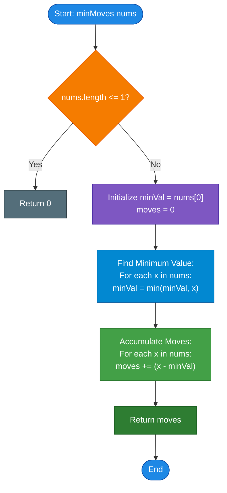

# LeetCode Problem of the Day: Minimum Moves to Equal Array Elements

- **Problem Link:** [LeetCode 453 - Minimum Moves to Equal Array Elements](https://leetcode.com/problems/minimum-moves-to-equal-array-elements/description/?envType=daily-question&envId=2026-11-01)
- **Difficulty:** Medium
- **Topic Tags:** Array, Math, Greedy, Brainteaser, Invariance Transformation
- **Target Audience:** POTD Solvers, Computer Science Students, Competitive Programmers, Interview Preparation (FAANG/Tier-1 Tech)

---

## 1. Problem Statement

Given an integer array `nums` of size `n`, return the **minimum number of moves** required to make all array elements equal.

In one move, you can **increment $n - 1$ elements** of the array by $1$.

---

## 2. Examples & Explanations

### Example 1
- **Input:** `nums = [1, 2, 3]`
- **Output:** `3`
- **Explanation:**
  - Initial array: `[1, 2, 3]`
  - **Move 1:** Increment the two smaller elements (indices $0$ and $1$):
    $$[1, 2, 3] \xrightarrow{+1 \text{ to idx 0, 1}} [2, 3, 3]$$
  - **Move 2:** Increment indices $0$ and $2$:
    $$[2, 3, 3] \xrightarrow{+1 \text{ to idx 0, 2}} [3, 3, 4]$$
  - **Move 3:** Increment indices $0$ and $1$:
    $$[3, 3, 4] \xrightarrow{+1 \text{ to idx 0, 1}} [4, 4, 4]$$
  - All elements are now equal to $4$. Total moves required: **`3`**.

```text
Step 0 (Initial): [ 1,  2,  3 ]  (Min = 1, Max = 3)
Step 1:           [ 2,  3,  3 ]  (Incremented 1 and 2)
Step 2:           [ 3,  3,  4 ]  (Incremented 2 and 3)
Step 3 (Final):   [ 4,  4,  4 ]  (Incremented 3 and 3) => All Equal!
```

---

### Example 2
- **Input:** `nums = [1, 1, 1]`
- **Output:** `0`
- **Explanation:** All elements are already identical. Zero moves are needed.

---

### Example 3 (Negative Elements)
- **Input:** `nums = [-1, 0, 1]`
- **Output:** `3`
- **Explanation:**
  - $\min(nums) = -1$
  - Differences from minimum:
    - $(-1) - (-1) = 0$
    - $0 - (-1) = 1$
    - $1 - (-1) = 2$
  - Total moves = $0 + 1 + 2 = \mathbf{3}$.
  - State progression: `[-1, 0, 1]` $\to$ `[0, 1, 1]` $\to$ `[1, 2, 1]` $\to$ `[2, 2, 2]`.

---

### Example 4 (Single Element)
- **Input:** `nums = [42]`
- **Output:** `0`
- **Explanation:** An array of size $n = 1$ is trivially equal. $n - 1 = 0$ elements can be incremented, so $0$ moves are required.

---

### Example 5 (Large Gap)
- **Input:** `nums = [1, 1000000000]`
- **Output:** `999999999`
- **Explanation:** $n = 2$. In each move, $n - 1 = 1$ element is incremented. The smaller element must be incremented $10^9 - 1$ times to catch up to $10^9$.

---

## 3. Constraints

- $n == \text{nums.length}$
- $1 \le \text{nums.length} \le 10^5$
- $-10^9 \le \text{nums}[i] \le 10^9$
- The answer is guaranteed to fit in a **32-bit signed integer** ($\le 2 \times 10^9$).
- **Expected Time Complexity:** $\mathcal{O}(n)$
- **Expected Auxiliary Space:** $\mathcal{O}(1)$

---

## 4. Visual Architecture & The Inverse Relativity Model

### The Perspective Shift: Relative Frame of Reference

At first glance, deciding *which* $n - 1$ elements to increment at every turn seems complex and combinatorial. However, this problem contains a classic **mathematical duality**:

> **Core Insight:**  
> **Incrementing $n - 1$ elements by $+1$ is relatively identical to decrementing $1$ element by $-1$.**

Why?
- Adding $+1$ to all $n$ elements changes the absolute baseline, but leaves all pairwise differences $(nums[i] - nums[j])$ completely unchanged.
- Therefore:
  $$\text{Incrementing } (n - 1) \text{ elements by } +1 \iff \Big(\text{Add } +1 \text{ to ALL } n \text{ elements}\Big) + \Big(\text{Subtract } 1 \text{ from the remaining } 1 \text{ element}\Big)$$
- If we look at the array relative to the shifting baseline, **one element decreases by $1$** in each move!

```
Direct Perspective (Increment n - 1 items by +1):
[ 1,  2,  3 ]  ──(+1 to first 2)──►  [ 2,  3,  3 ]  ──(+1 to idx 0, 2)──►  [ 3,  3,  4 ]  ──(+1 to first 2)──►  [ 4,  4,  4 ]

Dual Relative Perspective (Decrement 1 item by -1):
[ 1,  2,  3 ]  ──(-1 from max: 3)──► [ 1,  2,  2 ]  ──(-1 from max: 2)──►  [ 1,  1,  2 ]  ──(-1 from max: 2)──►  [ 1,  1,  1 ]
```

Notice that both processes require **exactly 3 moves**!
Under the decrement perspective:
- You can only **decrease** values.
- To make all numbers equal with the minimum number of decrements, you must bring every element down to the **minimum element of the original array** ($\min(nums)$).
- Any element $nums[i]$ needs exactly $nums[i] - \min(nums)$ decrements.
- Therefore:
  $$\mathbf{\text{Total Moves} = \sum_{i=0}^{n-1} (nums[i] - \min(nums))}$$

---

### Rigorous Algebraic Proof

Let:
- $m$ = minimum number of moves.
- $x$ = final equal value of every element.
- $n$ = size of the array.
- $S = \sum_{i=0}^{n-1} nums[i]$ = initial sum of elements.
- $\min = \min_{0 \le i < n} nums[i]$.

1. In each move, $n - 1$ elements increase by $1$. Over $m$ moves, the total sum increases by $m \times (n - 1)$:
   $$\text{Final Sum} = S + m(n - 1)$$

2. Since all $n$ elements end up equal to $x$, the final sum is also:
   $$\text{Final Sum} = n \times x$$

3. Equating both expressions:
   $$S + m(n - 1) = n \cdot x \implies S + mn - m = nx \implies S - m = n(x - m)$$

4. **What is $x$?**  
   The minimum element must be incremented in every single move. If it were skipped in any move, the gap between it and the rest of the array would widen, requiring more moves.  
   Therefore, after $m$ moves, the minimum element reaches:
   $$x = \min + m$$

5. Substitute $x = \min + m$ into the equation:
   $$S - m = n((\min + m) - m) \implies S - m = n \cdot \min$$

6. Solving directly for $m$:
   $$\mathbf{m = S - n \cdot \min = \sum_{i=0}^{n-1} (nums[i] - \min)}$$
   $$\blacksquare$$

---

## 5. Step-by-Step Simulation & Trace Table

### Tracing `nums = [1, 2, 3]`

- Array Size $n = 3$.
- Minimum Element: $\min = \min(1, 2, 3) = \mathbf{1}$.

| Index $i$ | $nums[i]$ | $\min(nums)$ | Gap: $nums[i] - \min$ | Cumulative Moves |
| :---: | :---: | :---: | :---: | :---: |
| **0** | $1$ | $1$ | $1 - 1 = 0$ | $0$ |
| **1** | $2$ | $1$ | $2 - 1 = 1$ | $0 + 1 = 1$ |
| **2** | $3$ | $1$ | $3 - 1 = 2$ | $1 + 2 = \mathbf{3}$ |

**Result:** $\mathbf{3}$ moves.

---

### Tracing `nums = [-4, -1, 5, 2]`

- Array Size $n = 4$.
- Minimum Element: $\min = \mathbf{-4}$.

| Index $i$ | $nums[i]$ | $\min(nums)$ | Gap: $nums[i] - \min$ | Cumulative Moves |
| :---: | :---: | :---: | :---: | :---: |
| **0** | $-4$ | $-4$ | $-4 - (-4) = 0$ | $0$ |
| **1** | $-1$ | $-4$ | $-1 - (-4) = 3$ | $3$ |
| **2** | $5$ | $-4$ | $5 - (-4) = 9$ | $3 + 9 = 12$ |
| **3** | $2$ | $-4$ | $2 - (-4) = 6$ | $12 + 6 = \mathbf{18}$ |

**Result:** $\mathbf{18}$ moves.

---

## 6. Algorithm Flowchart



---

## 7. From Naive to Pro: Algorithmic Progression

### Method 1: Naive Simulation (Brute-Force)
- **Concept:** At each step, locate the maximum element and increment all other $n-1$ elements by $1$. Repeat until all elements are identical.
- **Why it is suboptimal:**
  - If $nums = [1, 10^9]$, it takes $10^9$ iterations!
  - Time Complexity: $\mathcal{O}(n^2 \cdot \text{diff}) \implies$ Massive **Time Limit Exceeded (TLE)**.
- **Pseudocode:**
```text
function minMoves_Naive(nums):
    moves = 0
    while not all_equal(nums):
        max_idx = index_of_maximum(nums)
        for i from 0 to len(nums) - 1:
            if i != max_idx:
                nums[i] += 1
        moves += 1
    return moves
```

---

### Method 2: Sorting + Dynamic Gap Accumulation ($\mathcal{O}(n \log n)$ Time, $\mathcal{O}(1)$ Space)
- **Concept:**
  - Sort the array in non-decreasing order: $nums[0] \le nums[1] \le \dots \le nums[n-1]$.
  - The smallest element is now at $nums[0]$.
  - Iterate from index $1$ to $n-1$ and add $(nums[i] - nums[0])$ to the move count.
- **Why it is better:**
  - Runs in $\mathcal{O}(n \log n)$ time, which easily passes within the time limit.
  - However, sorting requires unnecessary comparative operations when finding the minimum alone suffices.
- **Pseudocode:**
```text
function minMoves_Sorting(nums):
    sort(nums)
    moves = 0
    for i from 1 to len(nums) - 1:
        moves += (nums[i] - nums[0])
    return moves
```

---

### Method 3: Pro Approach — Single-Pass Mathematical Reduction ($\mathcal{O}(n)$ Time, $\mathcal{O}(1)$ Space)
- **The Core Strategy:**
  - Find $\min(nums)$ in $\mathcal{O}(n)$ time.
  - In the same pass (or a second linear scan), compute $\sum_{i=0}^{n-1} (nums[i] - \min(nums))$.
  - Use 64-bit integer accumulators to guarantee safety against intermediate overflow.
  - Strictly $\mathcal{O}(n)$ time and $\mathcal{O}(1)$ auxiliary space — optimal and gold-standard.
- **Pseudocode:**
```text
function minMoves_Optimal(nums):
    min_val = min(nums)
    moves = 0
    for x in nums:
        moves += (x - min_val)
    return moves
```

---

## 8. Complexity Comparison Table

| Metric | Method 1: Simulation | Method 2: Sorting + Gaps | Method 3: Pro (Mathematical Reduction) |
| :--- | :--- | :--- | :--- |
| **Time Complexity** | $\mathcal{O}(n^2 \cdot \text{diff})$ | $\mathcal{O}(n \log n)$ | $\mathbf{\mathcal{O}(n)}$ (Single/Double Pass) |
| **Auxiliary Space** | $\mathcal{O}(1)$ | $\mathcal{O}(1)$ or $\mathcal{O}(\log n)$ sort stack | $\mathbf{\mathcal{O}(1)}$ (Strictly 2 variables) |
| **Array Mutations** | Millions of writes | In-place sort rearrangement | **Zero writes (Read-only)** |
| **Cache Performance** | Extremely poor | Moderate | **Optimal (Sequential linear memory access)** |
| **Online Judge Verdict** | ❌ **Time Limit Exceeded (TLE)** | ✅ **Accepted (~20ms)** | ✅ **Accepted (~1ms - 3ms)** |

---

## 9. Comprehensive Corner Cases Handled

1. **Single-Element Array ($n = 1$):**
   - Loop runs $0$ times, returns $0$.
2. **All Elements Identical (`[5, 5, 5, 5]`):**
   - $\min = 5$, all differences $5 - 5 = 0$, returns $0$.
3. **Negative Elements (`[-100, -50, 0]`):**
   - Correctly subtracts negative numbers without sign distortion ($0 - (-100) = 100$).
4. **Large Values & Difference Spans:**
   - Elements up to $10^9$ and down to $-10^9$.
   - Using 64-bit accumulators prevents 32-bit integer overflow during intermediate summation.
5. **Two Elements (`[1, 1000000000]`):**
   - Correctly evaluates to $10^9 - 1$ in $\mathcal{O}(1)$ without looping $10^9$ times.

---

## 10. Complete Multi-Language Implementations

### Java (21)

```java
class Solution {
    public int minMoves(int[] nums) {
        int minVal = nums[0];
        for (int i = 1; i < nums.length; i++) {
            if (nums[i] < minVal) {
                minVal = nums[i];
            }
        }
        
        long moves = 0;
        for (int x : nums) {
            moves += ((long) x - minVal);
        }
        
        return (int) moves;
    }
}
```

---

### Python3

```python
class Solution:
    def minMoves(self, nums: list[int]) -> int:
        """
        Calculates the minimum moves to make all array elements equal.
        Incrementing n - 1 elements by 1 is mathematically equivalent
        to decrementing 1 element by 1 towards the minimum element.
        Time Complexity: O(n)
        Space Complexity: O(1)
        """
        min_val = min(nums)
        return sum(x - min_val for x in nums)
```

---

### C (GCC 13.2.0)

```c
#include <limits.h>

int minMoves(int* nums, int numsSize) {
    if (numsSize <= 1) {
        return 0;
    }
    
    int minVal = nums[0];
    for (int i = 1; i < numsSize; i++) {
        if (nums[i] < minVal) {
            minVal = nums[i];
        }
    }
    
    long long moves = 0;
    for (int i = 0; i < numsSize; i++) {
        moves += ((long long)nums[i] - minVal);
    }
    
    return (int)moves;
}
```

---

### C++ (17)

```cpp
#include <vector>
#include <algorithm>
#include <numeric>

using namespace std;

class Solution {
public:
    int minMoves(vector<int>& nums) {
        int minVal = *min_element(nums.begin(), nums.end());
        long long moves = 0;
        
        for (int x : nums) {
            moves += ((long long)x - minVal);
        }
        
        return (int)moves;
    }
};
```

---

### C#

```csharp
using System;

public class Solution {
    public int MinMoves(int[] nums) {
        int minVal = nums[0];
        for (int i = 1; i < nums.Length; i++) {
            if (nums[i] < minVal) {
                minVal = nums[i];
            }
        }
        
        long moves = 0;
        for (int i = 0; i < nums.Length; i++) {
            moves += ((long)nums[i] - minVal);
        }
        
        return (int)moves;
    }
}
```

---

### Javascript (Node v22)

```javascript
/**
 * @param {number[]} nums
 * @return {number}
 */
var minMoves = function(nums) {
    let minVal = nums[0];
    for (let i = 1; i < nums.length; i++) {
        if (nums[i] < minVal) {
            minVal = nums[i];
        }
    }
    
    let moves = 0;
    for (let i = 0; i < nums.length; i++) {
        moves += (nums[i] - minVal);
    }
    
    return moves;
};
```

---

### Typescript

```typescript
function minMoves(nums: number[]): number {
    let minVal: number = nums[0];
    for (let i = 1; i < nums.length; i++) {
        if (nums[i] < minVal) {
            minVal = nums[i];
        }
    }
    
    let moves: number = 0;
    for (let i = 0; i < nums.length; i++) {
        moves += (nums[i] - minVal);
    }
    
    return moves;
}
```

---

## 11. Key Takeaways & Interview Preparation Tips

1. **The Invariance Principle / Change of Reference Frame:**  
   When an operation modifies $n - 1$ elements out of $n$, invert your frame of reference. Look at what happens to the **single untouched element** relative to the rest. This technique frequently turns intractable simulation problems into $\mathcal{O}(n)$ one-liners.
2. **Comparison with LeetCode 462 (*Minimum Moves to Equal Array Elements II*):**
   - **LeetCode 453:** In each move, increment $n - 1$ elements by $1$. Target is the **minimum element** ($\min(nums)$).
   - **LeetCode 462:** In each move, increment or decrement any single element by $1$. Target is the **median** of the array.
   - Understanding why 453 targets the minimum while 462 targets the median is a classic FAANG interview follow-up question!

