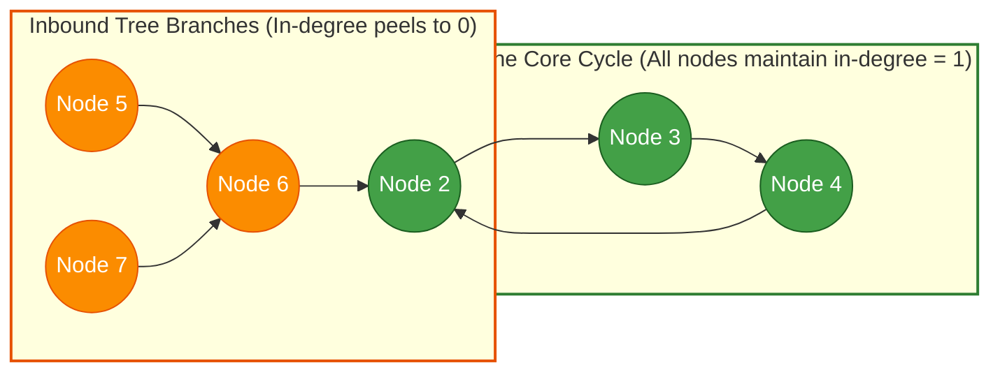
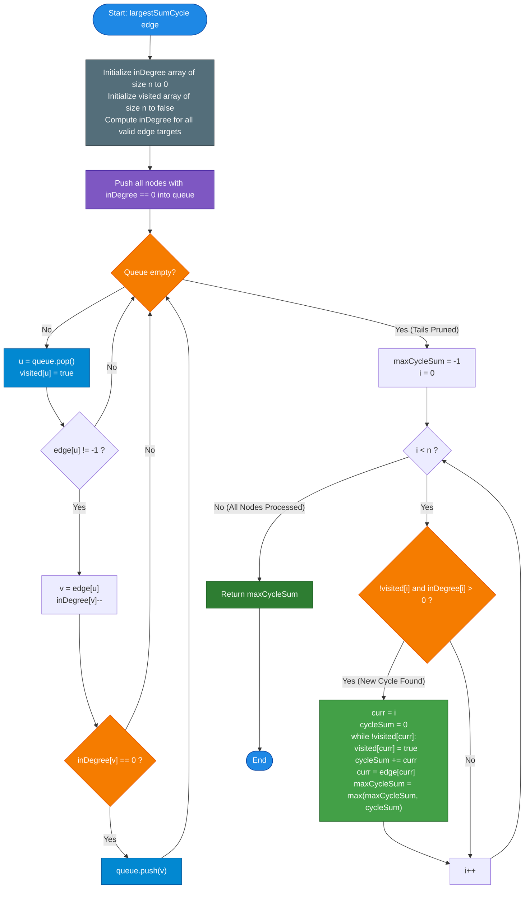

# GeeksforGeeks Problem of the Day: Largest Sum Cycle

- **Problem Link:** [GeeksforGeeks - Largest Sum Cycle](https://www.geeksforgeeks.org/problems/largest-sum-cycle--170645/1)
- **Difficulty:** Hard
- **Topic Tags:** Graph Theory, Functional Graphs (Pseudoforests), Directed Graphs, Cycle Detection, Topological Sort (Kahn's Algorithm), Depth First Search (DFS)
- **Target Audience:** POTD Solvers, Computer Science Students, Competitive Programmers, Interview Preparation (FAANG/Tier-1 Tech, Juspay Technical Assessment)

---

## 1. Problem Statement

Given an array `edge[]` of size $n$, representing $n$ cells numbered from $0$ to $n - 1$. Each cell has **at most one outgoing directed edge** pointing to another cell:
- `edge[i]` denotes the destination cell directly reachable from cell $i$.
- If `edge[i] == -1`, cell $i$ has no outgoing edge (it is a terminal dead-end node).

A **cycle** is defined as a directed path of cells where, by repeatedly following outgoing edges, you eventually return to the starting cell:
$$u_1 \to u_2 \to u_3 \to \dots \to u_k \to u_1$$

The **sum of a cycle** is the sum of the cell indices (labels) belonging to that cycle:
$$\text{Cycle Sum} = \sum_{j=1}^{k} u_j$$

Your task is to find the **maximum cycle sum** among all cycles present in the graph. If no cycle exists, return `-1`.

---

## 2. Examples & Explanations

### Example 1
- **Input:** `edge = [1, 2, 0, -1]`
- **Output:** `3`
- **Explanation:**
  - Let us trace the outgoing edges:
    - $0 \to 1$
    - $1 \to 2$
    - $2 \to 0$ (loops back to $0$!)
    - $3 \to -1$ (terminal node)
  - The cycle detected is:
    $$0 \to 1 \to 2 \to 0$$
  - The sum of cell indices in this cycle:
    $$\text{Sum} = 0 + 1 + 2 = \mathbf{3}$$
  - No other cycles exist. The result is **`3`**.

```text
    (0) ───► (1)
     ▲        │
     │        ▼
     └────── (2)        (3) ──► [DEAD END: -1]

Cycle nodes: {0, 1, 2}
Sum = 0 + 1 + 2 = 3
```

---

### Example 2
- **Input:** `edge = [2, 0, -1, 2]`
- **Output:** `-1`
- **Explanation:**
  - Let us trace the paths:
    - Node $1 \to 0 \to 2 \to -1$
    - Node $3 \to 2 \to -1$
  - Node $2$ has no outgoing edge (`edge[2] == -1`).
  - Every path terminates at node $2$ without looping back.
  - No cycle exists in the graph, so the output is **`-1`**.

```text
    (1) ───► (0) ───► (2) ◄─── (3)
                       │
                       ▼
                   [DEAD END: -1]

No closed directed cycle exists => Output = -1
```

---

### Example 3 (Multiple Disjoint Cycles with Inbound Branches)
- **Input:** `edge = [1, 0, 3, 4, 2, 6, -1]`
- **Output:** `9`
- **Explanation:**
  - Component 1:
    - $0 \to 1 \to 0$ forms a cycle of length 2: $\{0, 1\}$.
    - Sum = $0 + 1 = 1$.
  - Component 2:
    - $2 \to 3 \to 4 \to 2$ forms a cycle of length 3: $\{2, 3, 4\}$.
    - Sum = $2 + 3 + 4 = \mathbf{9}$.
  - Component 3:
    - $5 \to 6 \to -1$ forms an acyclic path ending at dead-end $6$.
  - Comparing cycle sums: $\max(1, 9) = \mathbf{9}$.

```text
Component 1:                Component 2:                 Component 3:
   (0) ◄───► (1)               (2) ───► (3)                 (5) ───► (6) ──► [-1]
                                ▲        │
   Cycle Sum = 1                │        ▼                  No cycle
                                └────── (4)
                                Cycle Sum = 9
```

---

## 3. Constraints

- $2 \le n \le 10^5$
- $-1 \le edge[i] < n$
- $edge[i] \ne i$ (No self-loops exist)
- **Expected Time Complexity:** $\mathcal{O}(n)$
- **Expected Auxiliary Space:** $\mathcal{O}(n)$
- **Index Arithmetic:** Since $n \le 10^5$, a cycle containing $10^5$ nodes could theoretically have a sum of up to $\approx \frac{10^5 \times 10^5}{2} \approx 5 \times 10^9$. 64-bit integer accumulators (`long` / `long long`) should be used to avoid intermediate overflow during cycle sum calculation before returning the final integer.

---

## 4. Visual Architecture & The Functional Graph Model

### The Anatomy of a Functional Graph (Pseudoforest)

Because **every node has an out-degree of at most 1**, this graph belongs to a special class of directed graphs called **Functional Graphs** (or **Successor Graphs** / **Pseudoforests**):

1. **At Most One Cycle Per Component:**  
   In any weakly connected component, because no node can branch into two directions, the component can contain **at most one simple directed cycle**.
2. **The $\rho$-Shape ("Tadpole" Topology):**  
   Every component consists of:
   - A **central directed cycle** (the "head" of the $\rho$), and
   - Zero or more **directed trees/branches** converging into the cycle (the "tail" of the $\rho$).
3. **Cycles are Strictly Vertex-Disjoint:**  
   Since every node has $\text{out-degree} \le 1$, cycles cannot intersect, merge, or share any vertices.



### The In-Degree Elimination Principle (Kahn's Pruning)

> **Theorem (Topological Tail Pruning):**  
> If we iteratively remove all nodes with **in-degree = 0** (using Kahn's algorithm for topological sorting):
> 1. Any node that is **not part of a cycle** will eventually have its in-degree reduced to $0$ and be eliminated.
> 2. Once the elimination queue becomes empty, **only pure cycles remain**.
> 3. Every remaining unvisited node has **in-degree = 1 and out-degree = 1**.
> 4. We can then simply traverse each remaining cycle in $\mathcal{O}(\text{cycle length})$ steps without any back-edges, recursion stacks, or visited-time tracking!

---

## 5. Step-by-Step Simulation & Trace Table

Let us trace the algorithm on **Example 3**:  
`edge = [1, 0, 3, 4, 2, 6, -1]` with $n = 7$.

### Phase 1: In-Degree Calculation
| Node | $0$ | $1$ | $2$ | $3$ | $4$ | $5$ | $6$ |
| :---: | :---: | :---: | :---: | :---: | :---: | :---: | :---: |
| Outgoing `edge[i]` | $1$ | $0$ | $3$ | $4$ | $2$ | $6$ | $-1$ |
| Initial $\text{in-degree}$ | **1** | **1** | **1** | **1** | **1** | **0** | **1** |

Nodes with $\text{in-degree} = 0$: **`[5]`**.

### Phase 2: Topological Pruning of Tree Branches
1. Pop `5`: Mark `visited[5] = true`. Outgoing target is `6`.
   - Decrement $\text{in-degree}[6]$ from $1 \to 0$.
   - Push `6` to queue.
2. Pop `6`: Mark `visited[6] = true`. Outgoing target is `-1`.
   - No target to decrement.
3. Queue is now empty!

### Status After Pruning:
| Node | $0$ | $1$ | $2$ | $3$ | $4$ | $5$ | $6$ |
| :---: | :---: | :---: | :---: | :---: | :---: | :---: | :---: |
| `visited` | `false` | `false` | `false` | `false` | `false` | `true` | `true` |
| $\text{in-degree}$ | $1$ | $1$ | $1$ | $1$ | $1$ | $0$ | $0$ |

### Phase 3: Cycle Traversal
1. Node $0$: Unvisited and $\text{in-degree}[0] > 0$.
   - Trace cycle: $0 \to 1 \to 0$.
   - Nodes visited: $\{0, 1\}$.
   - $\text{Sum} = 0 + 1 = \mathbf{1}$.
   - $\text{maxCycleSum} = \max(-1, 1) = \mathbf{1}$.
2. Node $1$: Already marked visited. Skip.
3. Node $2$: Unvisited and $\text{in-degree}[2] > 0$.
   - Trace cycle: $2 \to 3 \to 4 \to 2$.
   - Nodes visited: $\{2, 3, 4\}$.
   - $\text{Sum} = 2 + 3 + 4 = \mathbf{9}$.
   - $\text{maxCycleSum} = \max(1, 9) = \mathbf{9}$.
4. Nodes $3, 4, 5, 6$: All already marked visited. Skip.

### Final Output:
$$\mathbf{maxCycleSum = 9}$$

---

## 6. Algorithm Flowchart



---

## 7. From Naive to Pro: Algorithmic Progression

### Method 1: Naive DFS / Cycle Search from Every Node ($\mathcal{O}(n^2)$)
- **Concept:** From each node $i$, simulate following the outgoing edges for up to $n$ steps. If the path reaches a previously seen node in the current path, extract the cycle, compute the sum, and update `max_sum`.
- **Why it is suboptimal:**
  - Nodes on long tails leading to cycles are re-traversed repeatedly.
  - Worst-case time complexity: $\mathcal{O}(n^2)$. For $n = 10^5$, $n^2 = 10^{10}$ operations, resulting in **Time Limit Exceeded (TLE)**.
- **Pseudocode:**
```text
function largestSumCycle_Naive(edge):
    n = len(edge)
    maxSum = -1
    for i from 0 to n - 1:
        path = []
        curr = i
        while curr != -1 and curr not in path:
            path.append(curr)
            curr = edge[curr]
        if curr != -1: // Cycle detected!
            cycleStartIdx = path.indexOf(curr)
            sum = sum(path[cycleStartIdx...end])
            maxSum = max(maxSum, sum)
    return maxSum
```

---

### Method 2: DFS with 3-Color State Tracking ($\mathcal{O}(n)$ Time, $\mathcal{O}(n)$ Space)
- **Concept:** Mark each node with one of three states:
  - `0 (White)`: Unvisited
  - `1 (Grey)`: Visiting (in current active recursion stack)
  - `2 (Black)`: Visited (fully explored, cycle checked)
  - When following edges, if we encounter a node with state `1`, a cycle is detected! We traverse from that node back to itself and compute the sum.
- **Why it is good:** Linear $\mathcal{O}(n)$ time complexity.
- **Caveat:** If implemented recursively, $n = 10^5$ can cause a **StackOverflowError** in languages like Python (default recursion limit 1000) and Java/C++ without sufficient call stack allocation.

---

### Method 3: Pro Approach — Kahn's Algorithm / In-Degree Topological Pruning ($\mathcal{O}(n)$ Time, $\mathcal{O}(n)$ Space)
- **The Core Strategy:**
  - Purely iterative, queue-based, and **100% stack-safe**.
  - Compute in-degrees of all vertices.
  - Use a FIFO queue to strip away all vertices with in-degree $0$ and propagate decrements down their branches.
  - All non-cyclic nodes disappear into the queue.
  - What remains in the graph are **exclusively disjoint cycles**.
  - Simple linear scan over unvisited cyclic nodes traces each cycle once.
  - Every node is processed at most twice $\implies$ strictly $\mathcal{O}(n)$ time and $\mathcal{O}(n)$ space.
- **Pseudocode:**
```text
function largestSumCycle_Optimal(edge):
    n = len(edge)
    inDegree = array of size n initialized to 0
    for u from 0 to n - 1:
        if edge[u] != -1:
            inDegree[edge[u]]++

    queue = []
    for i from 0 to n - 1:
        if inDegree[i] == 0:
            queue.push(i)

    visited = array of size n initialized to false
    while queue is not empty:
        u = queue.pop()
        visited[u] = true
        v = edge[u]
        if v != -1:
            inDegree[v]--
            if inDegree[v] == 0:
                queue.push(v)

    maxCycleSum = -1
    for i from 0 to n - 1:
        if not visited[i] and inDegree[i] > 0:
            curr = i
            sum = 0
            while not visited[curr]:
                visited[curr] = true
                sum += curr
                curr = edge[curr]
            maxCycleSum = max(maxCycleSum, sum)

    return maxCycleSum
```

---

## 8. Complexity Comparison Table

| Metric | Method 1: Naive Traversal | Method 2: 3-Color DFS | Method 3: Pro (Kahn's Pruning) |
| :--- | :--- | :--- | :--- |
| **Time Complexity** | $\mathcal{O}(n^2)$ | $\mathcal{O}(n)$ | $\mathbf{\mathcal{O}(n)}$ (Optimal single-pass) |
| **Auxiliary Space** | $\mathcal{O}(n)$ | $\mathcal{O}(n)$ (Call stack + state array) | $\mathbf{\mathcal{O}(n)}$ (Queue + in-degree array) |
| **Call Stack Safety** | Safe (Iterative) | ⚠️ **Risk of StackOverflow** on $n=10^5$ | ✅ **100% Iterative & Stack-Safe** |
| **Tail / Branch Handling**| Repeatedly re-traversed | Backtracked via recursion | **Directly pruned in $\mathcal{O}(1)$ per node** |
| **Cycle Extraction** | List scanning $\mathcal{O}(n)$ | Traceback on recursion | **Direct cyclic follow $\mathcal{O}(k)$** |
| **Interview Verdict** | ❌ **Time Limit Exceeded** | ⚠️ Acceptable with caution | 🏆 **Gold Standard (FAANG / Juspay)** |

---

## 9. Comprehensive Corner Cases Handled

1. **Graph with No Cycles (Pure Trees / Forests):**  
   - Example: `edge = [2, 0, -1, 2]`.  
   - All nodes are successfully queued and visited during in-degree pruning. The second loop finds no unvisited nodes, cleanly returning `-1`.
2. **Entire Graph is a Single Large Cycle:**  
   - Example: `edge = [1, 2, 3, 0]`.  
   - Every node has initial in-degree 1. Queue starts empty. The cycle traversal visits all $n$ nodes in one loop, returning the total sum.
3. **Multiple Disjoint Cycles:**  
   - Example: Cycle A: $\{0, 1\}$, Cycle B: $\{2, 3, 4\}$.  
   - Both cycles survive tail pruning. Loop explores each cycle once, correctly recording the maximum sum.
4. **Long Inbound Chain Leading to a Small Cycle (The $\rho$-Graph):**  
   - Example: $1000$ nodes in a straight line ending at a 2-node cycle $\{1001, 1002\}$.  
   - All $1000$ chain nodes peel off into the queue. Only the 2-node cycle is summed.
5. **Disconnected Components with Dead Ends:**  
   - Nodes pointing to `-1` correctly do not attempt out-of-bounds decrements on `inDegree[-1]`.

---

## 10. Complete Multi-Language Implementations

### Java (21)

```java
class Solution {
    public int largestSumCycle(int[] edge) {
        int n = edge.length;
        int[] inDegree = new int[n];
        
        // Calculate in-degrees for all destination nodes
        for (int i = 0; i < n; i++) {
            if (edge[i] != -1) {
                inDegree[edge[i]]++;
            }
        }

        // Queue for nodes with in-degree 0 (cannot be part of any cycle)
        int[] queue = new int[n];
        int head = 0, tail = 0;
        for (int i = 0; i < n; i++) {
            if (inDegree[i] == 0) {
                queue[tail++] = i;
            }
        }

        // Peel off all non-cycle branches using Kahn's algorithm
        boolean[] visited = new boolean[n];
        while (head < tail) {
            int u = queue[head++];
            visited[u] = true;
            int v = edge[u];
            if (v != -1) {
                inDegree[v]--;
                if (inDegree[v] == 0) {
                    queue[tail++] = v;
                }
            }
        }

        // Remaining unvisited nodes with inDegree > 0 form pure cycles
        long maxCycleSum = -1;
        for (int i = 0; i < n; i++) {
            if (!visited[i] && inDegree[i] > 0) {
                long currentSum = 0;
                int curr = i;
                while (!visited[curr]) {
                    visited[curr] = true;
                    currentSum += curr;
                    curr = edge[curr];
                }
                if (currentSum > maxCycleSum) {
                    maxCycleSum = currentSum;
                }
            }
        }

        return (int) maxCycleSum;
    }
}
```

---

### Python3

```python
class Solution:
    def largestSumCycle(self, edge: list[int]) -> int:
        """
        Finds the largest sum cycle in a functional directed graph (out-degree <= 1).
        Uses Kahn's algorithm (topological pruning) to strip non-cyclic branches,
        then traverses remaining pure cycles in O(n) time and O(n) space.
        """
        n = len(edge)
        in_degree = [0] * n
        for v in edge:
            if v != -1:
                in_degree[v] += 1

        # Enqueue nodes with in-degree 0 (cannot belong to any cycle)
        queue = [i for i in range(n) if in_degree[i] == 0]
        visited = [False] * n

        # Peel off branches
        for u in queue:
            visited[u] = True
            v = edge[u]
            if v != -1:
                in_degree[v] -= 1
                if in_degree[v] == 0:
                    queue.append(v)

        # Traverse remaining disjoint cycles
        max_cycle_sum = -1
        for i in range(n):
            if not visited[i] and in_degree[i] > 0:
                current_sum = 0
                curr = i
                while not visited[curr]:
                    visited[curr] = True
                    current_sum += curr
                    curr = edge[curr]
                if current_sum > max_cycle_sum:
                    max_cycle_sum = current_sum

        return max_cycle_sum
```

---

### C++ (17)

```cpp
#include <vector>
#include <algorithm>

using namespace std;

class Solution {
  public:
    int largestSumCycle(vector<int>& edge) {
        int n = edge.size();
        vector<int> inDegree(n, 0);
        
        // Compute in-degrees of all nodes
        for (int i = 0; i < n; i++) {
            if (edge[i] != -1) {
                inDegree[edge[i]]++;
            }
        }

        // Initialize queue with all nodes having in-degree 0
        vector<int> queue;
        queue.reserve(n);
        for (int i = 0; i < n; i++) {
            if (inDegree[i] == 0) {
                queue.push_back(i);
            }
        }

        // Prune non-cyclic paths using BFS
        vector<bool> visited(n, false);
        for (size_t idx = 0; idx < queue.size(); idx++) {
            int u = queue[idx];
            visited[u] = true;
            int v = edge[u];
            if (v != -1) {
                inDegree[v]--;
                if (inDegree[v] == 0) {
                    queue.push_back(v);
                }
            }
        }

        // Find the maximum cycle sum among surviving cycles
        long long maxCycleSum = -1;
        for (int i = 0; i < n; i++) {
            if (!visited[i] && inDegree[i] > 0) {
                long long currentSum = 0;
                int curr = i;
                while (!visited[curr]) {
                    visited[curr] = true;
                    currentSum += curr;
                    curr = edge[curr];
                }
                if (currentSum > maxCycleSum) {
                    maxCycleSum = currentSum;
                }
            }
        }

        return maxCycleSum;
    }
};
```

---

### C#

```csharp
using System;
using System.Collections.Generic;

class Solution {
    public int largestSumCycle(int[] edge) {
        int n = edge.Length;
        int[] inDegree = new int[n];
        
        // Count in-degrees
        for (int i = 0; i < n; i++) {
            if (edge[i] != -1) {
                inDegree[edge[i]]++;
            }
        }

        // Queue all nodes with 0 incoming edges
        int[] queue = new int[n];
        int head = 0, tail = 0;
        for (int i = 0; i < n; i++) {
            if (inDegree[i] == 0) {
                queue[tail++] = i;
            }
        }

        // Topologically prune non-cyclic nodes
        bool[] visited = new bool[n];
        while (head < tail) {
            int u = queue[head++];
            visited[u] = true;
            int v = edge[u];
            if (v != -1) {
                inDegree[v]--;
                if (inDegree[v] == 0) {
                    queue[tail++] = v;
                }
            }
        }

        // Traverse remaining pure cycles
        long maxCycleSum = -1;
        for (int i = 0; i < n; i++) {
            if (!visited[i] && inDegree[i] > 0) {
                long currentSum = 0;
                int curr = i;
                while (!visited[curr]) {
                    visited[curr] = true;
                    currentSum += curr;
                    curr = edge[curr];
                }
                if (currentSum > maxCycleSum) {
                    maxCycleSum = currentSum;
                }
            }
        }

        return (int) maxCycleSum;
    }
}
```

---

### Javascript (Node v22)

```javascript
/**
 * @param {number[]} edge
 * @return {number}
 */

class Solution {
    largestSumCycle(edge) {
        const n = edge.length;
        const inDegree = new Int32Array(n);
        
        // Compute in-degrees
        for (let i = 0; i < n; i++) {
            if (edge[i] !== -1) {
                inDegree[edge[i]]++;
            }
        }

        // Collect all in-degree 0 nodes
        const queue = new Int32Array(n);
        let head = 0, tail = 0;
        for (let i = 0; i < n; i++) {
            if (inDegree[i] === 0) {
                queue[tail++] = i;
            }
        }

        // Peel tree branches using Kahn's topological pruning
        const visited = new Uint8Array(n);
        while (head < tail) {
            const u = queue[head++];
            visited[u] = 1;
            const v = edge[u];
            if (v !== -1) {
                inDegree[v]--;
                if (inDegree[v] === 0) {
                    queue[tail++] = v;
                }
            }
        }

        // Traverse surviving cycle vertices
        let maxCycleSum = -1;
        for (let i = 0; i < n; i++) {
            if (!visited[i] && inDegree[i] > 0) {
                let currentSum = 0;
                let curr = i;
                while (!visited[curr]) {
                    visited[curr] = 1;
                    currentSum += curr;
                    curr = edge[curr];
                }
                if (currentSum > maxCycleSum) {
                    maxCycleSum = currentSum;
                }
            }
        }

        return maxCycleSum;
    }
}
```

---

## 11. Key Takeaways & Interview Preparation Tips

1. **The Functional Graph / Successor Graph Paradigm:**  
   Whenever a directed graph has **$\text{out-degree} \le 1$**, always remember that every connected component has **at most one cycle**. The entire graph is a collection of disjoint cycles with incoming directed trees.
2. **Kahn's Topological Sort as a Tail Peeler:**  
   In general directed graphs, topological sort detects whether a cycle exists. In functional graphs, it goes a step further: it **cleanly strips away all incoming trees**, leaving behind pure, isolated cycles ready for effortless linear traversal.
3. **The Juspay Online Assessment Trilogy:**  
   This problem forms part of the famous Juspay OA graph trilogy:
   - *Maximum Weight Node*
   - *Nearest Meeting Cell*
   - *Largest Sum Cycle* (This problem)  
   Mastering Kahn's pruning and cycle decomposition ensures success across all variations of functional graph questions in tech interviews!

