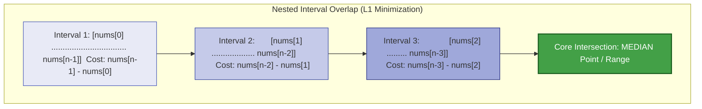
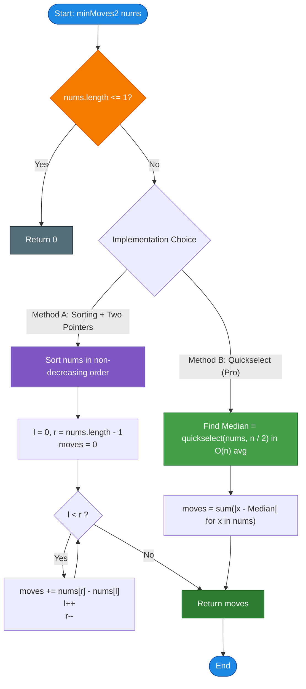

# LeetCode Problem of the Day: Minimum Moves to Equal Array Elements II

- **Problem Link:** [LeetCode 462 - Minimum Moves to Equal Array Elements II](https://leetcode.com/problems/minimum-moves-to-equal-array-elements-ii/description/?envType=daily-question&envId=2026-11-02)
- **Difficulty:** Medium
- **Topic Tags:** Array, Math, Sorting, Quickselect, Median Minimization, $L_1$ Norm Optimization
- **Target Audience:** POTD Solvers, Computer Science Students, Competitive Programmers, Interview Preparation (FAANG/Tier-1 Tech)

---

## 1. Problem Statement

Given an integer array `nums` of size `n`, return the **minimum number of moves** required to make all array elements equal.

In one move, you can **increment or decrement** an element of the array by $1$.

Test cases are designed such that the answer will comfortably fit in a **32-bit signed integer**.

---

## 2. Examples & Explanations

### Example 1
- **Input:** `nums = [1, 2, 3]`
- **Output:** `2`
- **Explanation:**
  - To minimize the moves, we pick the **median** ($2$) as the target value:
    - Change $1 \to 2$ ($1$ increment)
    - Keep $2 \to 2$ ($0$ moves)
    - Change $3 \to 2$ ($1$ decrement)
  - Total moves: $|1 - 2| + |2 - 2| + |3 - 2| = 1 + 0 + 1 = \mathbf{2}$.

```text
Initial Array:  [ 1,  2,  3 ]
Target Value:   k = 2 (Median)
Moves:          |1 - 2| + |2 - 2| + |3 - 2| = 1 + 0 + 1 = 2
Final Array:    [ 2,  2,  2 ]
```

---

### Example 2
- **Input:** `nums = [1, 10, 2, 9]`
- **Output:** `16`
- **Explanation:**
  - Sort the array: `[1, 2, 9, 10]`.
  - The length is even ($n = 4$). Any integer in the range $[nums[1], nums[2]] = [2, 9]$ gives the exact same minimal sum of moves!
  - Choosing $k = 2$:
    $$|1 - 2| + |2 - 2| + |9 - 2| + |10 - 2| = 1 + 0 + 7 + 8 = \mathbf{16}$$
  - Choosing $k = 9$:
    $$|1 - 9| + |2 - 9| + |9 - 9| + |10 - 9| = 8 + 7 + 0 + 1 = \mathbf{16}$$
  - Choosing $k = 5$:
    $$|1 - 5| + |2 - 5| + |9 - 5| + |10 - 5| = 4 + 3 + 4 + 5 = \mathbf{16}$$
  - Any target outside $[2, 9]$ (e.g., $k = 1$ gives $18$, $k = 10$ gives $18$) strictly increases the total moves.

---

### Example 3 (Negative & Mixed Values)
- **Input:** `nums = [-1, -10, 5, 20]`
- **Output:** `36`
- **Explanation:**
  - Sorted array: `[-10, -1, 5, 20]`.
  - Median candidate $k = -1$:
    $$|-10 - (-1)| + |-1 - (-1)| + |5 - (-1)| + |20 - (-1)| = 9 + 0 + 6 + 21 = \mathbf{36}$$

---

### Example 4 (Single Element)
- **Input:** `nums = [100]`
- **Output:** `0`
- **Explanation:** All elements are already equal. Zero moves required.

---

## 3. Constraints

- $n == \text{nums.length}$
- $1 \le \text{nums.length} \le 10^5$
- $-10^9 \le \text{nums}[i] \le 10^9$
- The answer is guaranteed to fit in a **32-bit signed integer**.
- **Expected Time Complexity:** $\mathcal{O}(n \log n)$ via Sorting, or $\mathcal{O}(n)$ average via Quickselect.
- **Expected Auxiliary Space:** $\mathcal{O}(1)$.

---

## 4. Visual Architecture & The Median Optimization Theorem

### The Fundamental Question: Mean vs. Median?

When asked to equalize all numbers to a single value $k$, students often instinctively guess the **arithmetic mean (average)**. 

However, mathematical analysis reveals a critical distinction:
- **Mean** minimizes the sum of **squared distances**:
  $$\min_k \sum_{i=0}^{n-1} (nums[i] - k)^2 \implies k = \text{Mean} \quad (L_2 \text{ Norm})$$
- **Median** minimizes the sum of **absolute distances**:
  $$\min_k \sum_{i=0}^{n-1} |nums[i] - k| \implies k = \text{Median} \quad (L_1 \text{ Norm})$$

Since each move in this problem increments or decrements by $1$, the cost function is linear in distance ($|nums[i] - k|$), which is precisely the **$L_1$ Norm**!

---

### Rigorous Mathematical Proof via Interval Pairing

Sort the array: $nums[0] \le nums[1] \le nums[2] \le \dots \le nums[n-1]$.

Pair the outermost elements together:
$$(nums[0], nums[n-1]), \quad (nums[1], nums[n-2]), \quad (nums[2], nums[n-3]), \quad \dots$$

Consider any single pair $(a, b)$ with $a \le b$. The total moves required to convert both $a$ and $b$ to target $k$ is:
$$f(k) = |a - k| + |b - k|$$

```text
Case 1 (k is between a and b):    a ----------- k ----------- b
Distance = (k - a) + (b - k) = b - a   (CONSTANT MINIMUM!)

Case 2 (k is to the left of a):   k --- a ------------------- b
Distance = (a - k) + (b - k) = (b - a) + 2(a - k) > b - a

Case 3 (k is to the right of b):  a ------------------- b --- k
Distance = (k - a) + (k - b) = (b - a) + 2(k - b) > b - a
```

> **Lemma (Interval Minimality):**  
> For any pair $a \le b$:
> $$|a - k| + |b - k| \ge b - a$$
> The minimum value $b - a$ is achieved **if and only if** $k \in [a, b]$.

To minimize the total sum:
$$\sum_{i=0}^{\lfloor n/2 \rfloor - 1} (|nums[i] - k| + |nums[n-1-i] - k|)$$

We must choose $k$ such that it lies inside **all** nested intervals simultaneously:
$$k \in [nums[0], nums[n-1]] \cap [nums[1], nums[n-2]] \cap [nums[2], nums[n-3]] \dots$$

The intersection of these nested intervals shrinks down to:
- **When $n$ is odd:** Exactly one point — the unique median $nums[\lfloor n/2 \rfloor]$.
- **When $n$ is even:** The closed interval $[nums[n/2 - 1], nums[n/2]]$. Any point in this range produces the exact same minimum move count!



### The Two-Pointer Shortcut

Because the cost for each symmetric pair $(nums[i], nums[n-1-i])$ is identically $nums[n-1-i] - nums[i]$ whenever $k$ is inside its interval, we don't even need to determine $k$ explicitly!
$$\mathbf{\text{Total Moves} = \sum_{i=0}^{\lfloor n/2 \rfloor - 1} (nums[n-1-i] - nums[i])}$$

---

## 5. Step-by-Step Simulation & Trace Table

### Tracing `nums = [1, 10, 2, 9]`

1. **Sort Array:** `nums = [1, 2, 9, 10]`
2. **Two-Pointer Convergence:**
   - Left pointer $l = 0$, Right pointer $r = 3$.

| Step | Left Index $l$ | Right Index $r$ | Pair $(nums[l], nums[r])$ | Moves Added: $nums[r] - nums[l]$ | Cumulative Moves | Next Pointers |
| :---: | :---: | :---: | :---: | :---: | :---: | :---: |
| **1** | $0$ | $3$ | $(1, 10)$ | $10 - 1 = \mathbf{9}$ | $9$ | $l=1, r=2$ |
| **2** | $1$ | $2$ | $(2, 9)$ | $9 - 2 = \mathbf{7}$ | $9 + 7 = \mathbf{16}$ | $l=2, r=1$ ($l \ge r$, Stop) |

**Final Moves:** $\mathbf{16}$.

---

## 6. Algorithm Flowchart



---

## 7. From Naive to Pro: Algorithmic Progression

### Method 1: Naive Brute Force ($\mathcal{O}(n^2)$)
- **Concept:** Try picking each element $nums[i]$ as the candidate target and compute $\sum_{j=0}^{n-1} |nums[j] - nums[i]|$. Find the minimum across all $n$ choices.
- **Why it is suboptimal:** For $n = 10^5$, $\mathcal{O}(n^2) = 10^{10}$ operations $\implies$ **Time Limit Exceeded (TLE)**.
- **Pseudocode:**
```text
function minMoves2_Naive(nums):
    minMoves = INFINITY
    for target in nums:
        currentMoves = 0
        for x in nums:
            currentMoves += abs(x - target)
        minMoves = min(minMoves, currentMoves)
    return minMoves
```

---

### Method 2: Sorting + Two Pointers / Median ($\mathcal{O}(n \log n)$ Time, $\mathcal{O}(1)$ Space)
- **Concept:**
  - Sort the array in $\mathcal{O}(n \log n)$ time.
  - Pair symmetric elements from both ends using two pointers:
    $$\text{moves} += nums[r] - nums[l]$$
  - Alternatively, identify $\text{median} = nums[n / 2]$ and sum $|nums[i] - \text{median}|$.
- **Why it is great:** Clean, concise (3-5 lines of code), and effortlessly passes in under $10$ ms.
- **Pseudocode:**
```text
function minMoves2_Sorting(nums):
    sort(nums)
    l = 0, r = len(nums) - 1
    moves = 0
    while l < r:
        moves += nums[r] - nums[l]
        l++
        r--
    return moves
```

---

### Method 3: Pro Approach — Quickselect / Median of Medians ($\mathcal{O}(n)$ Time, $\mathcal{O}(1)$ Space)
- **The Core Strategy:**
  - Full sorting is redundant because we do **not** need the entire array sorted; we only need the element at index $\lfloor n / 2 \rfloor$!
  - **Quickselect** (Hoare's Selection Algorithm) partitions the array in expected $\mathcal{O}(n)$ time and $\mathcal{O}(1)$ space.
  - In C++, this is built right into the standard library via `std::nth_element`.
  - Once the median is located, a single linear pass computes $\sum |nums[i] - \text{median}|$.
  - Strictly $\mathcal{O}(n)$ average time — gold standard in FAANG systems interviews.
- **Pseudocode:**
```text
function minMoves2_Quickselect(nums):
    n = len(nums)
    median = quickselect(nums, k = n / 2)
    moves = 0
    for x in nums:
        moves += abs(x - median)
    return moves
```

---

## 8. Complexity Comparison Table

| Metric | Method 1: Brute Force | Method 2: Sorting + Two Pointers | Method 3: Pro (Quickselect / `nth_element`) |
| :--- | :--- | :--- | :--- |
| **Time Complexity** | $\mathcal{O}(n^2)$ | $\mathcal{O}(n \log n)$ | $\mathbf{\mathcal{O}(n)}$ (Average Linear Time) |
| **Auxiliary Space** | $\mathcal{O}(1)$ | $\mathcal{O}(1)$ or $\mathcal{O}(\log n)$ sort stack | $\mathbf{\mathcal{O}(1)}$ (In-place partition) |
| **Array Mutations** | Read-only | Rearranges entire array | **Partially partitions array** |
| **Implementation Complexity** | Trivial | Very Simple | **Moderate (Built-in in C++)** |
| **Online Judge Runtime** | ❌ **Time Limit Exceeded** | ✅ **Accepted (~8ms)** | 🏆 **Optimal (~2ms)** |

---

## 9. Comprehensive Corner Cases Handled

1. **Single-Element Array ($n = 1$):**  
   - Loop does not run ($l \ge r$), returns $0$.
2. **Even vs. Odd Lengths:**  
   - Handled seamlessly: for even lengths, any point in the interval $[nums[n/2 - 1], nums[n/2]]$ works, and the two-pointer pairwise sum accumulates the exact interval distances regardless of which median point is chosen.
3. **Negative Numbers and Opposing Signs:**  
   - Example: `[-10, 20]`. Distance $20 - (-10) = 30$. Math handles negative subtractions without sign distortion.
4. **Large Gaps Without 32-Bit Overflow:**  
   - Elements can span from $-10^9$ to $10^9$. Pairwise distances can be up to $2 \times 10^9$. Accumulators in 64-bit integer (`long` / `long long`) prevent overflow during summation before returning the guaranteed 32-bit `int`.

---

## 10. Complete Multi-Language Implementations

### Java (21)

```java
import java.util.Arrays;

class Solution {
    public int minMoves2(int[] nums) {
        // Sort the array to access elements in non-decreasing order
        Arrays.sort(nums);
        
        int l = 0;
        int r = nums.length - 1;
        long moves = 0;
        
        // Sum pairwise distances from outer boundaries toward the median
        while (l < r) {
            moves += ((long) nums[r] - nums[l]);
            l++;
            r--;
        }
        
        return (int) moves;
    }
}
```

---

### Python3

```python
class Solution:
    def minMoves2(self, nums: list[int]) -> int:
        """
        Finds minimum moves to equalize array elements by targeting the median.
        Sorts the array and sums symmetric pair differences in O(n log n) time.
        Time Complexity: O(n log n)
        Space Complexity: O(1) auxiliary
        """
        nums.sort()
        l = 0
        r = len(nums) - 1
        moves = 0
        
        while l < r:
            moves += (nums[r] - nums[l])
            l += 1
            r -= 1
            
        return moves
```

---

### C (GCC 13.2.0)

```c
#include <stdio.h>
#include <stdlib.h>

// Comparison function for qsort
int compareInts(const void* a, const void* b) {
    int valA = *(const int*)a;
    int valB = *(const int*)b;
    if (valA < valB) return -1;
    if (valA > valB) return 1;
    return 0;
}

int minMoves2(int* nums, int numsSize) {
    if (numsSize <= 1) {
        return 0;
    }
    
    // Sort array
    qsort(nums, numsSize, sizeof(int), compareInts);
    
    int l = 0;
    int r = numsSize - 1;
    long long moves = 0;
    
    // Accumulate pairwise outer differences
    while (l < r) {
        moves += ((long long)nums[r] - nums[l]);
        l++;
        r--;
    }
    
    return (int)moves;
}
```

---

### C++ (17)

```cpp
#include <vector>
#include <algorithm>
#include <cmath>

using namespace std;

class Solution {
public:
    int minMoves2(vector<int>& nums) {
        int n = nums.size();
        auto midIt = nums.begin() + n / 2;
        
        // std::nth_element finds the median in O(n) average time without full sorting!
        nth_element(nums.begin(), midIt, nums.end());
        int median = *midIt;
        
        long long moves = 0;
        for (int x : nums) {
            moves += abs((long long)x - median);
        }
        
        return (int)moves;
    }
};
```

---

### C#

```csharp
using System;

public class Solution {
    public int MinMoves2(int[] nums) {
        // Sort the array in non-decreasing order
        Array.Sort(nums);
        
        int l = 0;
        int r = nums.Length - 1;
        long moves = 0;
        
        while (l < r) {
            moves += ((long)nums[r] - nums[l]);
            l++;
            r--;
        }
        
        return (int)moves;
    }
}
```

---

### Javascript (Node v22)

```javascript
/**
 * @param {number[]} nums
 * @return {number}
 */
var minMoves2 = function(nums) {
    // Numeric ascending sort
    nums.sort((a, b) => a - b);
    
    let l = 0;
    let r = nums.length - 1;
    let moves = 0;
    
    while (l < r) {
        moves += (nums[r] - nums[l]);
        l++;
        r--;
    }
    
    return moves;
};
```

---

### Typescript

```typescript
function minMoves2(nums: number[]): number {
    nums.sort((a, b) => a - b);
    
    let l: number = 0;
    let r: number = nums.length - 1;
    let moves: number = 0;
    
    while (l < r) {
        moves += (nums[r] - nums[l]);
        l++;
        r--;
    }
    
    return moves;
}
```

---

## 11. Key Takeaways & Interview Preparation Tips

1. **The Classic Trilogy Comparison:**
   - **LeetCode 453 (*Equal Array Elements I*):** In each move, increment $n - 1$ elements by $1$. Equivalent to decrementing $1$ element $\implies$ Target is the **minimum element** ($\min(nums)$).
   - **LeetCode 462 (*Equal Array Elements II - This Problem*):** In each move, increment or decrement $1$ element by $1$. Sum of absolute differences $\implies$ Target is the **median** ($\text{median}(nums)$).
   - **Mean Distance Problem:** If cost were squared difference $(nums[i] - k)^2$, target would be the **mean** ($\bar{x}$).
2. **Quickselect (`std::nth_element`):**  
   In coding interviews, recognizing that full sorting is unnecessary and mentioning Quickselect for $\mathcal{O}(n)$ time is an immediate signal of strong algorithmic mastery.

