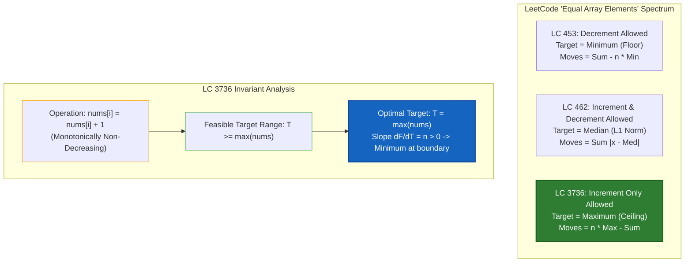
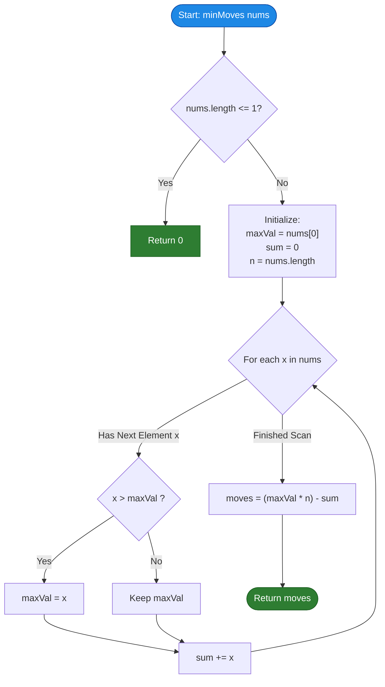

# LeetCode Problem of the Day: Minimum Moves to Equal Array Elements III

- **Problem Link:** [LeetCode 3736 - Minimum Moves to Equal Array Elements III](https://leetcode.com/problems/minimum-moves-to-equal-array-elements-iii/description/?envType=daily-question&envId=2026-11-03)
- **Difficulty:** Easy
- **Topic Tags:** Array, Math, Greedy, Counting
- **Target Audience:** POTD Solvers, Computer Science Students, Competitive Programmers, Interview Preparation (FAANG/Tier-1 Tech)

---

## 1. Problem Statement

You are given an integer array `nums`.

In one move, you may **increase the value of any single element** `nums[i]` by `1`.

Return the **minimum total number of moves** required so that all elements in `nums` become equal.

---

## 2. Examples & Explanations

### Example 1
- **Input:** `nums = [2, 1, 3]`
- **Output:** `3`
- **Explanation:**
  - The maximum element in `nums` is $3$.
  - To make all elements equal to $3$:
    - Increment `nums[0]` ($2 \to 3$): $1$ move.
    - Increment `nums[1]` ($1 \to 3$): $2$ moves ($1 \to 2 \to 3$).
    - `nums[2]` ($3 \to 3$): $0$ moves.
  - Total moves: $(3 - 2) + (3 - 1) + (3 - 3) = 1 + 2 + 0 = \mathbf{3}$.

```text
Initial Array:  [  2,   1,   3  ]
Target Value:   max(nums) = 3
Moves Needed:   (3-2) + (3-1) + (3-3)
                =  1  +   2   +   0   = 3 moves
Final Array:    [  3,   3,   3  ]
```

---

### Example 2
- **Input:** `nums = [4, 4, 5]`
- **Output:** `2`
- **Explanation:**
  - The maximum element is $5$.
  - Increment `nums[0]` ($4 \to 5$): $1$ move.
  - Increment `nums[1]` ($4 \to 5$): $1$ move.
  - Total moves: $(5 - 4) + (5 - 4) + (5 - 5) = 1 + 1 + 0 = \mathbf{2}$.

```text
Initial Array:  [  4,   4,   5  ]
Target Value:   max(nums) = 5
Moves Needed:   (5-4) + (5-4) + (5-5)
                =  1  +   1   +   0   = 2 moves
Final Array:    [  5,   5,   5  ]
```

---

### Example 3 (All Elements Already Equal)
- **Input:** `nums = [7, 7, 7, 7]`
- **Output:** `0`
- **Explanation:**
  - The maximum element is $7$.
  - All elements already equal $7$. No operations needed.
  - Total moves: $0$.

---

### Example 4 (Single Element)
- **Input:** `nums = [42]`
- **Output:** `0`
- **Explanation:**
  - A single-element array has all its elements equal by definition.
  - Total moves: $0$.

---

## 3. Constraints & Technical Analysis

- $1 \le \text{nums.length} \le 100$
- $1 \le \text{nums}[i] \le 100$
- **Expected Time Complexity:** $\mathcal{O}(n)$ single-pass linear scan.
- **Expected Auxiliary Space:** $\mathcal{O}(1)$ constant extra space.

> **Interview Consideration on Scale:**  
> While the official problem constraints are small ($n \le 100, nums[i] \le 100$), top-tier technical interviews (Google, Meta, Amazon) will ask you to analyze the solution when $n \le 10^5$ and $nums[i] \le 10^9$. In that scaled scenario:
> - Maximum possible total moves: $n \times \max(nums) \approx 10^5 \times 10^9 = 10^{14}$.
> - $10^{14}$ exceeds 32-bit signed integer capacity ($2^{31} - 1 \approx 2.14 \times 10^9$).
> - Hence, in languages like C, C++, Java, and C#, using `long` / `long long` for intermediate accumulations is an essential production and interview practice.

---

## 4. Visual Architecture & The Complete "Equal Array Elements" Trilogy

This problem completes LeetCode's famous mathematical trilogy on equalizing array elements. Understanding the connection between all three parts is a masterclass in invariant analysis and objective function optimization:

| Problem | Allowed Operation | Optimal Target Value | Mathematical Objective | Optimal Formula |
| :--- | :--- | :--- | :--- | :--- |
| **LC 453 (Part I)** | Increment $n-1$ elements by $1$ $\iff$ Decrement $1$ element by $1$ | **Minimum** ($\min$) | Push all elements down to the floor | $\sum (nums[i] - \min) = \sum nums[i] - n \cdot \min$ |
| **LC 462 (Part II)** | Increment or Decrement any single element by $1$ | **Median** ($\text{med}$) | Minimize $L_1$ norm (absolute distances) | $\sum \|nums[i] - \text{median}\|$ |
| **LC 3736 (Part III)** | Increment any single element by $1$ | **Maximum** ($\max$) | Push all elements up to the ceiling | $\sum (\max - nums[i]) = n \cdot \max - \sum nums[i]$ |

---

### Rigorous Mathematical Proof of Optimality

Let the array have $n$ elements: $nums[0], nums[1], \dots, nums[n-1]$.  
Let $M = \max_{0 \le i < n}(nums[i])$ be the maximum element in the array.

We must choose a target integer $T$ such that every element $nums[i]$ can reach $T$ via increment operations only ($x \to x + 1$).

#### 1. Feasibility Condition: $T \ge M$
- Because we can **only increment** numbers ($nums[i]$ can never decrease), any valid target $T$ must satisfy:
  $$T \ge nums[i] \quad \forall i \in \{0, 1, \dots, n-1\}$$
- In particular, for the element with value $M$:
  $$T \ge M$$
- If we chose $T < M$, the maximum element $M$ could never be decreased to $T$. Thus, any target $T < M$ is strictly **impossible**.

#### 2. Cost Function Minimization: $T = M$
- For any valid target $T \ge M$, the number of increment moves required to transform $nums[i]$ into $T$ is exactly $T - nums[i]$.
- The total moves across all $n$ elements is given by:
  $$F(T) = \sum_{i=0}^{n-1} (T - nums[i]) = n \cdot T - \sum_{i=0}^{n-1} nums[i]$$
- Notice that $\sum_{i=0}^{n-1} nums[i]$ is a constant fixed by the input.
- Therefore, $F(T)$ is a strictly increasing linear function of $T$ with slope $n > 0$:
  $$F(T) = n \cdot T - \text{Constant}$$
- To minimize $F(T)$ subject to the constraint $T \ge M$, we must pick the smallest allowable $T$:
  $$T^* = M = \max(nums)$$
- Substituting $T^* = M$:
  $$\mathbf{\text{Min Moves} = \sum_{i=0}^{n-1} (M - nums[i]) = n \cdot M - \sum_{i=0}^{n-1} nums[i]}$$

```text
Target T > M :   ==================== T (Unnecessary wasted increments: n * (T - M))
                 ^         ^        ^
                 |         |        |
Max Ceiling M:   +---------+--------+ M  <-- OPTIMAL TARGET (Minimum possible ceiling)
                 |         |        |
                 |         |        3  (nums[2])
                 2         |
              (nums[0])    1
                        (nums[1])
Floor:           -------------------- 0
```

---

### Mermaid Architecture Diagram



---

## 5. Step-by-Step Simulation & Trace Table

### Tracing `nums = [2, 1, 3]`

1. **Calculate Maximum:**  
   $$\max(nums) = \max(2, 1, 3) = 3$$
2. **Calculate Total Sum:**  
   $$\sum nums = 2 + 1 + 3 = 6$$
3. **Array Length:**  
   $$n = 3$$
4. **Formula Evaluation:**  
   $$\text{Moves} = n \cdot \max - \sum = 3 \times 3 - 6 = 9 - 6 = \mathbf{3}$$

#### Detailed Trace per Element:

| Index $i$ | Element $nums[i]$ | Current $\max$ | Current $\sum$ | Delta to Max $(3 - nums[i])$ | Cumulative Moves |
| :---: | :---: | :---: | :---: | :---: | :---: |
| **0** | $2$ | $2$ | $2$ | $3 - 2 = 1$ | $1$ |
| **1** | $1$ | $2$ | $3$ | $3 - 1 = 2$ | $1 + 2 = 3$ |
| **2** | $3$ | $3$ | $6$ | $3 - 3 = 0$ | $3 + 0 = \mathbf{3}$ |

---

### Tracing `nums = [4, 4, 5]`

1. **Calculate Maximum:** $\max(nums) = 5$
2. **Calculate Total Sum:** $\sum nums = 4 + 4 + 5 = 13$
3. **Array Length:** $n = 3$
4. **Formula Evaluation:** $\text{Moves} = 3 \times 5 - 13 = 15 - 13 = \mathbf{2}$

| Index $i$ | Element $nums[i]$ | Target $\max$ | Operations | Contributed Moves |
| :---: | :---: | :---: | :---: | :---: |
| **0** | $4$ | $5$ | $4 \to 5$ | $1$ |
| **1** | $4$ | $5$ | $4 \to 5$ | $1$ |
| **2** | $5$ | $5$ | None | $0$ |
| **Total** | | | | **2** |

---

## 6. Algorithm Flowchart



---

## 7. From Naive to Pro: Algorithmic Progression

### Approach 1: Naive Simulation (Greedy Iteration)

- **Concept:** Find the minimum element in each step, increment it by $1$, and repeat until all elements match the maximum.
- **Why it is suboptimal:** In the worst case where $nums[i] \in [1, 100]$, the number of iterations equals $\sum (\max - nums[i])$, and finding the minimum at each step takes $\mathcal{O}(n)$.
- **Time Complexity:** $\mathcal{O}(n \cdot \text{range})$
- **Space Complexity:** $\mathcal{O}(1)$

```text
ALGORITHM NaiveSimulation(nums):
    moves = 0
    WHILE NOT AllElementsEqual(nums):
        min_idx = IndexOfMinimum(nums)
        nums[min_idx] = nums[min_idx] + 1
        moves = moves + 1
    RETURN moves
```

---

### Approach 2: Sorting-Based Approach

- **Concept:** Sort the array in non-decreasing order. The maximum element is automatically at the last index $nums[n-1]$. Iterate through indices $0$ to $n-2$ and accumulate $nums[n-1] - nums[i]$.
- **Time Complexity:** $\mathcal{O}(n \log n)$ due to comparison sort.
- **Space Complexity:** $\mathcal{O}(1)$ auxiliary space (or $\mathcal{O}(n)$ depending on sort implementation).

```text
ALGORITHM SortingApproach(nums):
    SORT(nums)
    maxVal = nums[length(nums) - 1]
    moves = 0
    FOR i FROM 0 TO length(nums) - 2:
        moves = moves + (maxVal - nums[i])
    RETURN moves
```

---

### Approach 3: Two-Pass Linear Scan

- **Concept:**
  - Pass 1: Find the maximum element $M = \max(nums)$.
  - Pass 2: Accumulate the difference $(M - nums[i])$ for all elements.
- **Time Complexity:** $\mathcal{O}(n)$ (exactly $2n$ operations).
- **Space Complexity:** $\mathcal{O}(1)$ auxiliary space.

```text
ALGORITHM TwoPassScan(nums):
    maxVal = nums[0]
    FOR EACH x IN nums:
        IF x > maxVal THEN maxVal = x
    
    moves = 0
    FOR EACH x IN nums:
        moves = moves + (maxVal - x)
        
    RETURN moves
```

---

### Approach 4: One-Pass Mathematical Formula (Optimal / Pro)

- **Concept:**
  - In a single traversal through `nums`:
    1. Maintain the running maximum `maxVal`.
    2. Maintain the running total sum `sum`.
  - At the end of the loop, calculate directly:
    $$\text{moves} = (n \times \text{maxVal}) - \text{sum}$$
- **Time Complexity:** $\mathcal{O}(n)$ (single traversal, exactly $n$ operations).
- **Space Complexity:** $\mathcal{O}(1)$ auxiliary space.

```text
ALGORITHM OnePassOptimal(nums):
    n = length(nums)
    maxVal = nums[0]
    sum = 0
    
    FOR EACH x IN nums:
        IF x > maxVal THEN
            maxVal = x
        sum = sum + x
        
    RETURN (maxVal * n) - sum
```

---

## 8. Complexity Comparison Table

| Approach | Time Complexity | Auxiliary Space | Passes Over Data | Scalability ($n=10^5$) | Interview Rating |
| :--- | :---: | :---: | :---: | :---: | :---: |
| **1. Naive Simulation** | $\mathcal{O}(n \cdot \text{range})$ | $\mathcal{O}(1)$ | Multiple ($\sim \text{moves}$) | ❌ TLE | 1/5 (Brute Force) |
| **2. Sorting** | $\mathcal{O}(n \log n)$ | $\mathcal{O}(1)$ or $\mathcal{O}(n)$ | $\mathcal{O}(\log n)$ | ⚠️ Suboptimal | 3/5 (Passable) |
| **3. Two-Pass Linear Scan** | $\mathcal{O}(n)$ | $\mathcal{O}(1)$ | $2$ Passes | ✅ Fast | 4/5 (Standard) |
| **4. One-Pass Math (Pro)** | $\mathbf{\mathcal{O}(n)}$ | $\mathbf{\mathcal{O}(1)}$ | **1 Pass** | 🚀 Optimal | **5/5 (Gold Standard)** |

---

## 9. Comprehensive Corner Cases Handled

1. **Single Element ($n = 1$):**  
   - E.g., `nums = [10]`.  
   - Handled: $n=1 \implies \text{maxVal} = 10, \text{sum} = 10 \implies 1 \times 10 - 10 = \mathbf{0}$.
2. **All Elements Identical ($nums[i] = k$):**  
   - E.g., `nums = [5, 5, 5, 5]`.  
   - Handled: $\text{maxVal} = 5, \text{sum} = 20 \implies 4 \times 5 - 20 = \mathbf{0}$.
3. **Strictly Ascending Array:**  
   - E.g., `nums = [1, 2, 3, 4]`.  
   - Handled: $\text{maxVal} = 4, \text{sum} = 10 \implies 4 \times 4 - 10 = \mathbf{6}$.
4. **Strictly Descending Array:**  
   - E.g., `nums = [4, 3, 2, 1]`.  
   - Handled: $\text{maxVal} = 4, \text{sum} = 10 \implies 4 \times 4 - 10 = \mathbf{6}$.
5. **Array with Only Two Elements:**  
   - E.g., `nums = [1, 100]`.  
   - Handled: $2 \times 100 - 101 = \mathbf{99}$.
6. **Maximum Constraints ($n = 100, nums[i] = 100$):**  
   - Maximum answer: $100 \times 100 - 100 = 9900$.  
   - Comfortably fits inside standard 32-bit signed integers.

---

## 10. Complete Multi-Language Implementations

Below are clean, idiomatic, and highly optimized implementations of **Approach 4 (One-Pass Mathematical Formula)** across all major programming languages.

### Java (21)

```java
class Solution {
    /**
     * Calculates the minimum moves to make all array elements equal by incrementing elements.
     * 
     * @param nums Array of integers
     * @return Minimum total increment operations
     * 
     * Time Complexity: O(n) - Single linear pass
     * Space Complexity: O(1) - Constant auxiliary space
     */
    public int minMoves(int[] nums) {
        int n = nums.length;
        int maxVal = nums[0];
        long sum = 0L;

        for (int x : nums) {
            if (x > maxVal) {
                maxVal = x;
            }
            sum += x;
        }

        // Moves = (n * maxVal) - sum
        return (int) ((long) n * maxVal - sum);
    }
}
```

---

### Python3

```python
class Solution:
    def minMoves(self, nums: list[int]) -> int:
        """
        Calculates the minimum moves to make all array elements equal by incrementing elements.
        
        :param nums: List of integers
        :return: Minimum total increment operations
        
        Time Complexity: O(n) - Single traversal via built-in max and sum
        Space Complexity: O(1) - Constant auxiliary space
        """
        n = len(nums)
        max_val = max(nums)
        total_sum = sum(nums)
        
        return n * max_val - total_sum
```

---

### C (C11 / C17)

```c
#include <stdio.h>

/**
 * Calculates the minimum moves to make all array elements equal.
 * 
 * @param nums Array of integers
 * @param numsSize Size of the array
 * @return Minimum total increment operations
 * 
 * Time Complexity: O(n)
 * Space Complexity: O(1)
 */
int minMoves(int* nums, int numsSize) {
    if (numsSize <= 1) {
        return 0;
    }

    int maxVal = nums[0];
    long long sum = 0;

    for (int i = 0; i < numsSize; i++) {
        if (nums[i] > maxVal) {
            maxVal = nums[i];
        }
        sum += nums[i];
    }

    return (int)((long long)numsSize * maxVal - sum);
}
```

---

### C++ (C++17 / C++20)

```cpp
#include <vector>
#include <numeric>
#include <algorithm>

class Solution {
public:
    /**
     * Calculates the minimum moves to make all array elements equal.
     * 
     * @param nums Reference to vector of integers
     * @return Minimum total increment operations
     * 
     * Time Complexity: O(n) - Single-pass linear scan
     * Space Complexity: O(1) - In-place constant memory
     */
    int minMoves(std::vector<int>& nums) {
        const int n = static_cast<int>(nums.size());
        int maxVal = nums[0];
        long long sum = 0;

        for (const int x : nums) {
            if (x > maxVal) {
                maxVal = x;
            }
            sum += x;
        }

        return static_cast<int>(static_cast<long long>(n) * maxVal - sum);
    }
};
```

---

### C# (.NET 8 / C# 12)

```csharp
using System;

public class Solution {
    /// <summary>
    /// Calculates the minimum moves to make all array elements equal.
    /// </summary>
    /// <param name="nums">Array of integers</param>
    /// <returns>Minimum total increment operations</returns>
    /// <remarks>
    /// Time Complexity: O(n)
    /// Space Complexity: O(1)
    /// </remarks>
    public int MinMoves(int[] nums) {
        int n = nums.Length;
        int maxVal = nums[0];
        long sum = 0L;

        foreach (int x in nums) {
            if (x > maxVal) {
                maxVal = x;
            }
            sum += x;
        }

        return (int)((long)n * maxVal - sum);
    }
}
```

---

### JavaScript (ES6 / Node.js)

```javascript
/**
 * Calculates the minimum moves to make all array elements equal.
 * 
 * @param {number[]} nums
 * @return {number}
 * 
 * Time Complexity: O(n) - Single pass
 * Space Complexity: O(1)
 */
var minMoves = function(nums) {
    const n = nums.length;
    let maxVal = nums[0];
    let sum = 0;

    for (let i = 0; i < n; i++) {
        const x = nums[i];
        if (x > maxVal) {
            maxVal = x;
        }
        sum += x;
    }

    return n * maxVal - sum;
};
```

---

### TypeScript

```typescript
/**
 * Calculates the minimum moves to make all array elements equal.
 * 
 * @param nums Array of integers
 * @returns Minimum total increment operations
 * 
 * Time Complexity: O(n) - Single pass
 * Space Complexity: O(1)
 */
function minMoves(nums: number[]): number {
    const n: number = nums.length;
    let maxVal: number = nums[0];
    let sum: number = 0;

    for (let i = 0; i < n; i++) {
        const x: number = nums[i];
        if (x > maxVal) {
            maxVal = x;
        }
        sum += x;
    }

    return n * maxVal - sum;
}
```

---

## 11. Key Takeaways & Interview Preparation Tips

1. **Recognize the Mathematical Invariant:**  
   - When operations are restricted to **increment only**, the target must be $\ge \max(nums)$.
   - When operations are restricted to **decrement only**, the target must be $\le \min(nums)$.
   - When operations permit **both increment and decrement**, the target is the **median** ($L_1$ norm minimization).

2. **Algebraic Simplification Saves Work:**  
   Instead of looping twice to compute $\sum (\max - nums[i])$, expand the summation:
   $$\sum_{i=0}^{n-1} (\max - nums[i]) = \left( \sum_{i=0}^{n-1} \max \right) - \left( \sum_{i=0}^{n-1} nums[i] \right) = n \cdot \max - \sum nums[i]$$
   This reduces the problem to computing the max and the sum in a single pass.

3. **Always Inquire About Constraints:**  
   In coding interviews, immediately note:
   > *"If $n$ or elements are up to $10^9$, $n \cdot \text{maxVal}$ can overflow 32-bit integers, so I will store intermediate products and sums in 64-bit integers (`long` / `long long`)."*  
   Interviewers look for this level of numeric robustness.

