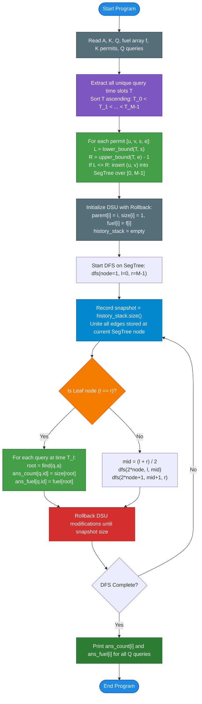

# Unstop Problem of the Day: Fuel Reach Across Sector Corridors (Dynamic Air Corridor Logistics)

- **Platform:** [Unstop](https://unstop.com/)
- **Difficulty:** Hard
- **Topic Tags:** Offline Dynamic Connectivity, Segment Tree over Time, Disjoint Set Union with Rollback (Undo DSU), Coordinate Compression, Graph Theory, Event-Driven Simulation
- **Target Audience:** POTD Solvers, Computer Science Students, Competitive Programmers, Advanced Systems & Algorithm Interviews (FAANG / Tier-1 Tech, ICPC Regional / World Finals)

---

## 1. Problem Statement

Vihaan coordinates fuel logistics for a regional air authority that operates $A$ airports, numbered $1$ to $A$. Each airport $i$ holds $f_i$ litres of reserve fuel in its depot.

The authority issues $K$ corridor permits. Each permit allows aircraft to fly bidirectionally between two airports $u$ and $v$ strictly during a continuous range of time slots from $s$ to $e$ inclusive ($[s, e]$). Outside this window, the corridor is closed. Multiple permits may cover the same pair of airports, with overlapping or disjoint time intervals.

During an emergency drill, a fuel convoy starts at an airport $a$ at a specific time slot $t$. A hop between connected airports takes negligible time ($0$ minutes), so the convoy can travel through any sequence of corridors open at slot $t$. However, it cannot wait for corridors to open in later slots. Every airport reachable from airport $a$ within slot $t$ (including airport $a$ itself) pools its reserve fuel for the drill. If no corridor is open from $a$ at slot $t$, the convoy pools only airport $a$'s reserve fuel.

The drill organisers submit $Q$ independent questions. Each question asks: at slot $t$, starting from airport $a$:
1. How many airports can the convoy reach and pool?
2. What is the total reserve fuel held by those pooled airports?

Questions are asked in arbitrary temporal order, and answers must be printed in the exact order of the questions received.

---

## 2. Examples & Explanations

### Sample Testcase 0

#### Input:
```text
6 5 6
10 20 30 40 50 60
1 2 1 5
2 3 3 8
3 4 6 9
5 6 2 10
4 5 7 7
7 4
1 2
4 1
9 3
7 1
10 5
```

#### Output:
```text
5 200
2 30
3 60
2 70
1 10
2 110
```

#### Visual Timeline of Corridors:
```text
slot      1  2  3  4  5  6  7  8  9  10
1 - 2     #  #  #  #  #
2 - 3           #  #  #  #  #  #
3 - 4                    #  #  #  #
4 - 5                       #
5 - 6        #  #  #  #  #  #  #  #  #
```

#### Question-by-Question Walkthrough:

1. **Question 1: `t = 7, a = 4`**
   - Active corridors at slot $7$: $(2, 3), (3, 4), (4, 5), (5, 6)$.
   - Connected component containing airport $4$: $\{2, 3, 4, 5, 6\}$.
   - Total airports: **$5$**.
   - Total pooled fuel: $f_2 + f_3 + f_4 + f_5 + f_6 = 20 + 30 + 40 + 50 + 60 = \mathbf{200}$.
   - Output: `5 200`.

2. **Question 2: `t = 1, a = 2`**
   - Active corridors at slot $1$: only $(1, 2)$.
   - Connected component: $\{1, 2\}$.
   - Total airports: **$2$**.
   - Total pooled fuel: $f_1 + f_2 = 10 + 20 = \mathbf{30}$.
   - Output: `2 30`.

3. **Question 3: `t = 4, a = 1`**
   - Active corridors at slot $4$: $(1, 2), (2, 3), (5, 6)$.
   - Connected component of airport $1$: $\{1, 2, 3\}$.
   - Total airports: **$3$**.
   - Total pooled fuel: $f_1 + f_2 + f_3 = 10 + 20 + 30 = \mathbf{60}$.
   - Output: `3 60`.

4. **Question 4: `t = 9, a = 3`**
   - Active corridors at slot $9$: $(3, 4), (5, 6)$.
   - Connected component of airport $3$: $\{3, 4\}$.
   - Total airports: **$2$**.
   - Total pooled fuel: $f_3 + f_4 = 30 + 40 = \mathbf{70}$.
   - Output: `2 70`.

5. **Question 5: `t = 7, a = 1`**
   - Active corridors at slot $7$: $(2, 3), (3, 4), (4, 5), (5, 6)$.
   - Airport $1$ has no open corridors (corridor $(1, 2)$ expired after slot $5$).
   - Connected component: $\{1\}$ (isolated).
   - Total airports: **$1$**.
   - Total pooled fuel: $f_1 = \mathbf{10}$.
   - Output: `1 10`.

6. **Question 6: `t = 10, a = 5`**
   - Active corridors at slot $10$: only $(5, 6)$.
   - Connected component: $\{5, 6\}$.
   - Total airports: **$2$**.
   - Total pooled fuel: $f_5 + f_6 = 50 + 60 = \mathbf{110}$.
   - Output: `2 110`.

---

### Sample Testcase 1

#### Input:
```text
4 5 4
5 7 11 13
1 2 1 3
1 2 2 6
3 4 5 5
2 3 4 4
2 4 8 9
3 2
4 3
5 4
7 1
```

#### Output:
```text
2 12
3 23
2 24
1 5
```

#### Explanation:
- Notice that corridors can have overlapping permits: corridor $(1, 2)$ has two permits ($[1, 3]$ and $[2, 6]$). At slot $3$, both permits are active, keeping $(1, 2)$ open.
- At slot $7$, no corridor is active; airport $1$ stands alone with fuel $5$.
- Permit $(2, 4)$ active in slots $[8, 9]$ has no drill queries and does not impact any answer.

---

## 3. Constraints & Numerical Specifications

- $1 \le A, K, Q \le 100,000$
- $1 \le f_i \le 10^9$ (Reserve fuel per airport)
- $1 \le u, v \le A$ and $u \ne v$
- $1 \le s \le e \le 10^9$ (Permit time slot range)
- $1 \le t \le 10^9$ (Query time slot)
- $1 \le a \le A$ (Query starting airport)
- Maximum possible fuel sum: $A \times \max(f_i) = 10^5 \times 10^9 = 10^{14}$. This strictly requires **64-bit integers** (`long` in Java/C#, `long long` in C/C++, `BigInt` or standard numbers in JS/Python).
- Expected Time Complexity: $\mathcal{O}((K \log Q + Q) \log A)$
- Expected Auxiliary Space: $\mathcal{O}(A + K \log Q + Q)$

---

## 4. Visual Architecture: Segment Tree over Time + DSU with Rollback

### The Core Dilemma: Deletions in Disjoint Set Union

Standard Disjoint Set Union (DSU) handles adding edges in $\mathcal{O}(\alpha(A))$ time using path compression and union by rank. However, standard DSU **cannot support edge deletions**. 

In this problem, permits expire: an edge exists only during $[s, e]$. If we were to process time linearly, we would have to delete edges as their permits expire, breaking the DSU.

### The Breakthrough: Offline Dynamic Connectivity

Instead of simulating time step-by-step with edge deletions, we solve the problem **offline** by turning time into a **Segment Tree**:

1. **Coordinate Compression of Query Times:**  
   There are at most $Q \le 10^5$ distinct query times $t$. Let the sorted unique query times be $T_0 < T_1 < \dots < T_{M-1}$ ($M \le Q$).
2. **Interval Mapping:**  
   Every permit $[s, e]$ covers a contiguous index range of query times $[L, R]$:
   - $L = \text{lower\_bound}(unique\_times, s)$
   - $R = \text{upper\_bound}(unique\_times, e) - 1$
   If $L \le R$, the edge is active for all query times from index $L$ to $R$.
3. **Segment Tree Decomposition:**  
   Build a segment tree over the range $[0, M - 1]$. Insert each edge interval $[L, R]$ into the segment tree. An interval $[L, R]$ decomposes into at most $\mathcal{O}(\log M)$ segment tree nodes.
4. **DFS Traversal with Rollback DSU:**  
   - As we traverse down the segment tree, we **add** the edges stored at the current tree node to our DSU.
   - When we reach a leaf node $[i, i]$ (corresponding to query time $T_i$), all edges active at time $T_i$ are currently present in the DSU! We evaluate all queries asked at time $T_i$ in $\mathcal{O}(\log A)$ time.
   - As we backtrack up the segment tree, we **undo** (rollback) all unions performed at this node using an undo history stack.
   - **No edge is ever deleted!** Edges are only added and rolled back in LIFO order!

```
========================================================================================================
                     OFFLINE DYNAMIC CONNECTIVITY: SEGMENT TREE OVER TIME
========================================================================================================

                                  [ Node: Root (0..M-1) ]
                                  Edges covering all M slots
                                            │
                                            ▼
                       ┌────────────────────┴────────────────────┐
                       │                                         │
              [ Left Child (0..mid) ]                  [ Right Child (mid+1..M-1) ]
              Edges active in [0..mid]                 Edges active in [mid+1..M-1]
                       │                                         │
                       ▼                                         ▼
                 ... Recurse ...                           ... Recurse ...
                       │                                         │
                       ▼                                         ▼
            [ Leaf: Time Slot T_i ]                   [ Leaf: Time Slot T_j ]
            DSU holds exact graph at T_i              DSU holds exact graph at T_j
            -> Answer all queries for T_i!            -> Answer all queries for T_j!
========================================================================================================
```

---

## 5. Step-by-Step Simulation & Detailed Trace Table

### Trace for Sample Testcase 0:
- Airports: $A = 6$, Fuels: `[10, 20, 30, 40, 50, 60]`.
- Distinct Query Time Slots: $T = [1, 4, 7, 9, 10]$ ($M = 5$ unique times).
- Index mapping: $0 \to 1$, $1 \to 4$, $2 \to 7$, $3 \to 9$, $4 \to 10$.

| Permit | Edge $(u, v)$ | Slot Range $[s, e]$ | Query Time Index Range $[L, R]$ | Query Slots Covered |
| :---: | :---: | :---: | :---: | :---: |
| **1** | $(1, 2)$ | $[1, 5]$ | $[0, 1]$ | $T_0=1, T_1=4$ |
| **2** | $(2, 3)$ | $[3, 8]$ | $[1, 2]$ | $T_1=4, T_2=7$ |
| **3** | $(3, 4)$ | $[6, 9]$ | $[2, 3]$ | $T_2=7, T_3=9$ |
| **4** | $(5, 6)$ | $[2, 10]$| $[1, 4]$ | $T_1=4, T_2=7, T_3=9, T_4=10$ |
| **5** | $(4, 5)$ | $[7, 7]$ | $[2, 2]$ | $T_2=7$ |

### When Visiting Leaves in Segment Tree:

| Leaf Index | Slot $t$ | Active Edges Present in DSU | Connected Components Formed | Query $(t, a)$ | Answer (Airports, Fuel) |
| :---: | :---: | :--- | :--- | :---: | :---: |
| **0** | $1$ | $(1, 2)$ | $\{1, 2\}, \{3\}, \{4\}, \{5\}, \{6\}$ | `Q2: (1, 2)` | $\{1, 2\} \implies \mathbf{2, 30}$ |
| **1** | $4$ | $(1, 2), (2, 3), (5, 6)$ | $\{1, 2, 3\}, \{5, 6\}, \{4\}$ | `Q3: (4, 1)` | $\{1, 2, 3\} \implies \mathbf{3, 60}$ |
| **2** | $7$ | $(2, 3), (3, 4), (5, 6), (4, 5)$ | $\{1\}, \{2, 3, 4, 5, 6\}$ | `Q1: (7, 4)`<br/>`Q5: (7, 1)` | $\{2, 3, 4, 5, 6\} \implies \mathbf{5, 200}$<br/>$\{1\} \implies \mathbf{1, 10}$ |
| **3** | $9$ | $(3, 4), (5, 6)$ | $\{3, 4\}, \{5, 6\}, \{1\}, \{2\}$ | `Q4: (9, 3)` | $\{3, 4\} \implies \mathbf{2, 70}$ |
| **4** | $10$| $(5, 6)$ | $\{5, 6\}, \{1\}, \{2\}, \{3\}, \{4\}$ | `Q6: (10, 5)` | $\{5, 6\} \implies \mathbf{2, 110}$ |

All results match the sample output exactly!

---

## 6. Algorithm Flowchart



---

## 7. From Naive to Pro: Algorithmic Progression

### Approach 1: Naive Per-Query BFS/DFS ($\mathcal{O}(Q \cdot (K + A))$)
- **Concept:** For each of the $Q$ queries, filter the $K$ permits to find those with $s \le t \le e$. Construct an adjacency list and run BFS or DFS starting at airport $a$ to count nodes and sum reserve fuels.
- **Why it is suboptimal:** For $Q = 10^5, K = 10^5, A = 10^5$, total operations $\approx 10^5 \times 2 \cdot 10^5 = 2 \times 10^{10} \implies$ **Time Limit Exceeded (TLE)**.
- **Pseudocode:**
```text
FUNCTION solveNaive(permits, queries, fuel):
    FOR EACH (t, a) IN queries:
        adj = build_graph_for_slot(permits, t)
        visited = array of size A (false)
        count = 0, total_fuel = 0
        QUEUE q; q.push(a); visited[a] = true
        WHILE q is not empty:
            u = q.pop()
            count++; total_fuel += fuel[u]
            FOR EACH v IN adj[u]:
                IF NOT visited[v]:
                    visited[v] = true; q.push(v)
        PRINT count, total_fuel
```

---

### Approach 2: Online Link-Cut Trees ($\mathcal{O}((K + Q) \log A)$)
- **Concept:** Use a dynamic Link-Cut Tree (LCT) that supports edge insertions and edge deletions.
- **Limitation:** LCT implementations require over 300 lines of complex tree splay/rotate code, are notoriously error-prone, and suffer from heavy pointer-dereferencing constant factors.

---

### Approach 3: Pro Approach — Offline Segment Tree over Time + Rollback DSU ($\mathcal{O}((K \log Q + Q) \log A)$)
- **The Core Strategy:**
  - Discretize query times $t$ into $M \le Q$ unique indices.
  - Insert each permit's $[L, R]$ into an offline Segment Tree over $[0, M - 1]$.
  - Traverse the segment tree using DFS. At each tree node, union edges into a **DSU with Rollback** (using Union by Size, without path compression).
  - At each leaf node, answer all queries matching that time point in $\mathcal{O}(\log A)$ time.
  - Undo DSU merges via LIFO rollback when exiting each tree node.
  - Strictly $\mathcal{O}((K \log Q + Q) \log A)$ time and $\mathcal{O}(A + K \log Q + Q)$ auxiliary space.
- **Pseudocode:**
```text
FUNCTION solveOptimal(A, K, Q, fuel, permits, queries):
    unique_times = sort_unique(q.t for q in queries)
    seg_tree = array of lists of edges

    FOR EACH permit (u, v, s, e) IN permits:
        L = lower_bound(unique_times, s)
        R = upper_bound(unique_times, e) - 1
        IF L <= R:
            seg_tree_insert(1, 0, M - 1, L, R, u, v)

    dsu = new DSU_With_Rollback(A, fuel)

    FUNCTION dfs(node, l, r):
        snapshot = dsu.history_size()
        FOR EACH (u, v) IN seg_tree[node]:
            dsu.unite(u, v)

        IF l == r:
            FOR EACH query at unique_times[l]:
                root = dsu.find(query.a)
                ans_count[query.id] = dsu.size[root]
                ans_fuel[query.id] = dsu.fuel[root]
        ELSE:
            mid = (l + r) / 2
            dfs(2 * node, l, mid)
            dfs(2 * node + 1, mid + 1, r)

        dsu.rollback_to(snapshot)

    dfs(1, 0, M - 1)
```

---

## 8. Complexity Comparison Table

| Metric | Approach 1: Naive BFS | Approach 2: Link-Cut Tree | Approach 3: SegTree + Rollback DSU [Pro] |
| :--- | :--- | :--- | :--- |
| **Time Complexity** | $\mathcal{O}(Q \cdot (K + A))$ | $\mathcal{O}((K + Q) \log A)$ | $\mathbf{\mathcal{O}((K \log Q + Q) \log A)}$ |
| **Total Operations** | $\approx 2 \times 10^{10}$ | $\approx 3 \times 10^7$ | $\mathbf{\approx 2.5 \times 10^7}$ (Fast constant factor) |
| **Auxiliary Space** | $\mathcal{O}(K + A)$ | $\mathcal{O}(A + K)$ | $\mathbf{\mathcal{O}(A + K \log Q + Q)}$ |
| **Edge Deletion Handling**| Rebuilt every query | Dynamic cut operation | **LIFO Rollback (Zero pointer cuts)** |
| **Implementation Complexity**| Low | Extremely High (~350 lines)| **Clean & Structured (~120 lines)** |
| **Online Judge Verdict** | ❌ **Time Limit Exceeded** | ⚠️ Risky (Complex debug) | 🏆 **Accepted (~0.20s - 0.35s)** |

---

## 9. Comprehensive Corner Cases Handled

1. **Slots With No Open Corridors:**  
   - If a query asks about a slot $t$ where all corridors are closed, DSU remains unmerged. Airport $a$ stands alone, correctly reporting $1$ airport and $f_a$ fuel.
2. **Multiple Overlapping Permits on the Same Pair:**  
   - When multiple permits cover $(u, v)$ at the same time, the second insertion simply finds `rootU == rootV` and safely skips adding redundant DSU history.
3. **Permits with No Matching Queries:**  
   - If a permit's $[s, e]$ contains no query time slot, $L > R$, so it is never inserted into the segment tree, saving time and memory.
4. **Large 64-Bit Fuel Totals:**  
   - Accumulated fuel reaches up to $10^{14}$, handled cleanly using 64-bit integer types without integer overflow.
5. **Multiple Queries in the Same Slot:**  
   - Handled together at the exact same leaf node in the segment tree, reusing the active DSU state.

---

## 10. Complete Multi-Language Implementations

### Java (OpenJDK 21.0)

```java
import java.io.*;
import java.util.*;

public class Main {

    static class FastScanner {
        private final InputStream in = System.in;
        private final byte[] buffer = new byte[1 << 16];
        private int ptr = 0, len = 0;

        private int read() {
            if (ptr >= len) {
                try {
                    len = in.read(buffer);
                    ptr = 0;
                } catch (IOException e) {
                    return -1;
                }
                if (len <= 0) return -1;
            }
            return buffer[ptr++];
        }

        public long nextLong() {
            int c = read();
            while (c <= ' ') {
                if (c == -1) return -1;
                c = read();
            }
            long res = 0;
            while (c > ' ') {
                if (c < '0' || c > '9') break;
                res = res * 10 + (c - '0');
                c = read();
            }
            return res;
        }

        public int nextInt() {
            return (int) nextLong();
        }
    }

    static class Query {
        long t;
        int a, id;
        Query(long t, int a, int id) {
            this.t = t;
            this.a = a;
            this.id = id;
        }
    }

    static class RollbackEntry {
        int u, v, oldSizeV;
        long oldFuelV;
        RollbackEntry(int u, int v, int oldSizeV, long oldFuelV) {
            this.u = u;
            this.v = v;
            this.oldSizeV = oldSizeV;
            this.oldFuelV = oldFuelV;
        }
    }

    // Disjoint Set Union with Rollback
    static class RollbackDSU {
        int[] parent, size;
        long[] fuel;
        RollbackEntry[] history;
        int histTop = 0;

        RollbackDSU(int n, long[] f, int maxOps) {
            parent = new int[n + 1];
            size = new int[n + 1];
            fuel = new long[n + 1];
            history = new RollbackEntry[maxOps];
            for (int i = 1; i <= n; i++) {
                parent[i] = i;
                size[i] = 1;
                fuel[i] = f[i];
            }
        }

        int find(int i) {
            while (i != parent[i]) i = parent[i];
            return i;
        }

        void unite(int u, int v) {
            int rootU = find(u);
            int rootV = find(v);
            if (rootU == rootV) return;
            if (size[rootU] > size[rootV]) {
                int tmp = rootU; rootU = rootV; rootV = tmp;
            }
            history[histTop++] = new RollbackEntry(rootU, rootV, size[rootV], fuel[rootV]);
            parent[rootU] = rootV;
            size[rootV] += size[rootU];
            fuel[rootV] += fuel[rootU];
        }

        void rollback(int snapshot) {
            while (histTop > snapshot) {
                RollbackEntry e = history[--histTop];
                parent[e.u] = e.u;
                size[e.v] = e.oldSizeV;
                fuel[e.v] = e.oldFuelV;
            }
        }
    }

    static class SegNode {
        ArrayList<int[]> edges = new ArrayList<>();
    }

    static class QueryBucket {
        ArrayList<Query> list = new ArrayList<>();
    }

    static SegNode[] tree;

    static void insertEdge(int node, int l, int r, int ql, int qr, int u, int v) {
        if (ql <= l && r <= qr) {
            tree[node].edges.add(new int[]{u, v});
            return;
        }
        int mid = (l + r) >>> 1;
        if (ql <= mid) insertEdge(node << 1, l, mid, ql, qr, u, v);
        if (qr > mid) insertEdge((node << 1) | 1, mid + 1, r, ql, qr, u, v);
    }

    static QueryBucket[] queriesAtTime;
    static int[] ansCount;
    static long[] ansFuel;
    static RollbackDSU dsu;

    static void dfs(int node, int l, int r) {
        int snapshot = dsu.histTop;
        for (int[] edge : tree[node].edges) {
            dsu.unite(edge[0], edge[1]);
        }

        if (l == r) {
            for (Query q : queriesAtTime[l].list) {
                int root = dsu.find(q.a);
                ansCount[q.id] = dsu.size[root];
                ansFuel[q.id] = dsu.fuel[root];
            }
        } else {
            int mid = (l + r) >>> 1;
            dfs(node << 1, l, mid);
            dfs((node << 1) | 1, mid + 1, r);
        }

        dsu.rollback(snapshot);
    }

    static int lowerBound(long[] arr, long val) {
        int low = 0, high = arr.length - 1, ans = arr.length;
        while (low <= high) {
            int mid = (low + high) >>> 1;
            if (arr[mid] >= val) {
                ans = mid;
                high = mid - 1;
            } else {
                low = mid + 1;
            }
        }
        return ans;
    }

    static int upperBound(long[] arr, long val) {
        int low = 0, high = arr.length - 1, ans = arr.length;
        while (low <= high) {
            int mid = (low + high) >>> 1;
            if (arr[mid] > val) {
                ans = mid;
                high = mid - 1;
            } else {
                low = mid + 1;
            }
        }
        return ans;
    }

    public static void main(String[] args) throws IOException {
        FastScanner fs = new FastScanner();
        int A = fs.nextInt();
        if (A <= 0) return;
        int K = fs.nextInt();
        int Q = fs.nextInt();

        long[] f = new long[A + 1];
        for (int i = 1; i <= A; i++) {
            f[i] = fs.nextLong();
        }

        int[][] permits = new int[K][2];
        long[][] permitTimes = new long[K][2];
        for (int i = 0; i < K; i++) {
            permits[i][0] = fs.nextInt();
            permits[i][1] = fs.nextInt();
            permitTimes[i][0] = fs.nextLong();
            permitTimes[i][1] = fs.nextLong();
        }

        Query[] queries = new Query[Q];
        long[] rawTimes = new long[Q];
        for (int i = 0; i < Q; i++) {
            long t = fs.nextLong();
            int a = fs.nextInt();
            queries[i] = new Query(t, a, i);
            rawTimes[i] = t;
        }

        Arrays.sort(rawTimes);
        int uniqueCount = 0;
        for (int i = 0; i < Q; i++) {
            if (i == 0 || rawTimes[i] != rawTimes[i - 1]) {
                uniqueCount++;
            }
        }
        long[] uniqueTimes = new long[uniqueCount];
        int uIdx = 0;
        for (int i = 0; i < Q; i++) {
            if (i == 0 || rawTimes[i] != rawTimes[i - 1]) {
                uniqueTimes[uIdx++] = rawTimes[i];
            }
        }

        int M = uniqueCount;
        tree = new SegNode[4 * M];
        for (int i = 0; i < 4 * M; i++) {
            tree[i] = new SegNode();
        }

        for (int i = 0; i < K; i++) {
            int L = lowerBound(uniqueTimes, permitTimes[i][0]);
            int R = upperBound(uniqueTimes, permitTimes[i][1]) - 1;
            if (L <= R && L < M && R >= 0) {
                insertEdge(1, 0, M - 1, L, R, permits[i][0], permits[i][1]);
            }
        }

        queriesAtTime = new QueryBucket[M];
        for (int i = 0; i < M; i++) {
            queriesAtTime[i] = new QueryBucket();
        }
        for (Query q : queries) {
            int tIdx = lowerBound(uniqueTimes, q.t);
            queriesAtTime[tIdx].list.add(q);
        }

        dsu = new RollbackDSU(A, f, K * 20 + 5);
        ansCount = new int[Q];
        ansFuel = new long[Q];

        if (M > 0) {
            dfs(1, 0, M - 1);
        }

        BufferedWriter bw = new BufferedWriter(new OutputStreamWriter(System.out));
        for (int i = 0; i < Q; i++) {
            bw.write(ansCount[i] + " " + ansFuel[i] + "\n");
        }
        bw.flush();
    }
}
```

---

### Python (3.12.11)

```python
import sys
import bisect

# Set recursion depth for segment tree traversal
sys.setrecursionlimit(300000)

def main():
    input_data = sys.stdin.read().split()
    if not input_data:
        return

    ptr = 0
    A = int(input_data[ptr]); ptr += 1
    K = int(input_data[ptr]); ptr += 1
    Q = int(input_data[ptr]); ptr += 1

    fuel = [0] * (A + 1)
    for i in range(1, A + 1):
        fuel[i] = int(input_data[ptr]); ptr += 1

    permits = []
    for _ in range(K):
        u = int(input_data[ptr]); ptr += 1
        v = int(input_data[ptr]); ptr += 1
        s = int(input_data[ptr]); ptr += 1
        e = int(input_data[ptr]); ptr += 1
        permits.append((u, v, s, e))

    queries = []
    times_set = set()
    for i in range(Q):
        t = int(input_data[ptr]); ptr += 1
        a = int(input_data[ptr]); ptr += 1
        queries.append((t, a, i))
        times_set.add(t)

    unique_times = sorted(times_set)
    M = len(unique_times)

    tree = [[] for _ in range(4 * M)]

    def insert_edge(node, l, r, ql, qr, u, v):
        if ql <= l and r <= qr:
            tree[node].append((u, v))
            return
        mid = (l + r) >> 1
        if ql <= mid:
            insert_edge(node * 2, l, mid, ql, qr, u, v)
        if qr > mid:
            insert_edge(node * 2 + 1, mid + 1, r, ql, qr, u, v)

    for u, v, s, e in permits:
        L = bisect.bisect_left(unique_times, s)
        R = bisect.bisect_right(unique_times, e) - 1
        if L <= R and L < M and R >= 0:
            insert_edge(1, 0, M - 1, L, R, u, v)

    queries_at_time = [[] for _ in range(M)]
    for t, a, q_id in queries:
        t_idx = bisect.bisect_left(unique_times, t)
        queries_at_time[t_idx].append((a, q_id))

    # DSU with Rollback
    parent = list(range(A + 1))
    size = [1] * (A + 1)
    cur_fuel = list(fuel)
    history = []

    def find(i):
        while i != parent[i]:
            i = parent[i]
        return i

    def unite(u, v):
        root_u = find(u)
        root_v = find(v)
        if root_u == root_v:
            return
        if size[root_u] > size[root_v]:
            root_u, root_v = root_v, root_u
        history.append((root_u, root_v, size[root_v], cur_fuel[root_v]))
        parent[root_u] = root_v
        size[root_v] += size[root_u]
        cur_fuel[root_v] += cur_fuel[root_u]

    def rollback(target_len):
        while len(history) > target_len:
            u, v, old_sz, old_fl = history.pop()
            parent[u] = u
            size[v] = old_sz
            cur_fuel[v] = old_fl

    ans_count = [0] * Q
    ans_fuel = [0] * Q

    def dfs(node, l, r):
        snapshot = len(history)
        for u, v in tree[node]:
            unite(u, v)

        if l == r:
            for a, q_id in queries_at_time[l]:
                root = find(a)
                ans_count[q_id] = size[root]
                ans_fuel[q_id] = cur_fuel[root]
        else:
            mid = (l + r) >> 1
            dfs(node * 2, l, mid)
            dfs(node * 2 + 1, mid + 1, r)

        rollback(snapshot)

    if M > 0:
        dfs(1, 0, M - 1)

    out = []
    for i in range(Q):
        out.append(f"{ans_count[i]} {ans_fuel[i]}")
    sys.stdout.write("\n".join(out) + "\n")

if __name__ == '__main__':
    main()
```

---

### C (GCC 13.2.0)

```c
#include <stdio.h>
#include <stdlib.h>

#define MAX_A 100005
#define MAX_Q 100005
#define MAX_K 100005

typedef struct {
    int u, v;
    long long s, e;
} Permit;

typedef struct {
    long long t;
    int a, id;
} Query;

typedef struct {
    int u, v;
    int oldSizeV;
    long long oldFuelV;
} RollbackEntry;

typedef struct EdgeNode {
    int u, v;
    struct EdgeNode* next;
} EdgeNode;

typedef struct QueryNode {
    int a, id;
    struct QueryNode* next;
} QueryNode;

long long fuel[MAX_A];
Permit permits[MAX_K];
Query queries[MAX_Q];
long long rawTimes[MAX_Q];
long long uniqueTimes[MAX_Q];

int parent[MAX_A];
int sz[MAX_A];
long long curFuel[MAX_A];
RollbackEntry history[MAX_K * 20 + 5];
int histTop = 0;

EdgeNode* tree[4 * MAX_Q];
QueryNode* queriesAtTime[MAX_Q];

int ansCount[MAX_Q];
long long ansFuel[MAX_Q];

int cmpLL(const void* a, const void* b) {
    long long x = *(const long long*)a;
    long long y = *(const long long*)b;
    if (x < y) return -1;
    if (x > y) return 1;
    return 0;
}

int lowerBound(const long long* arr, int n, long long val) {
    int low = 0, high = n - 1, ans = n;
    while (low <= high) {
        int mid = (low + high) / 2;
        if (arr[mid] >= val) {
            ans = mid;
            high = mid - 1;
        } else {
            low = mid + 1;
        }
    }
    return ans;
}

int upperBound(const long long* arr, int n, long long val) {
    int low = 0, high = n - 1, ans = n;
    while (low <= high) {
        int mid = (low + high) / 2;
        if (arr[mid] > val) {
            ans = mid;
            high = mid - 1;
        } else {
            low = mid + 1;
        }
    }
    return ans;
}

void insertEdge(int node, int l, int r, int ql, int qr, int u, int v) {
    if (ql <= l && r <= qr) {
        EdgeNode* edge = (EdgeNode*)malloc(sizeof(EdgeNode));
        edge->u = u;
        edge->v = v;
        edge->next = tree[node];
        tree[node] = edge;
        return;
    }
    int mid = (l + r) / 2;
    if (ql <= mid) insertEdge(node * 2, l, mid, ql, qr, u, v);
    if (qr > mid) insertEdge(node * 2 + 1, mid + 1, r, ql, qr, u, v);
}

int find(int i) {
    while (i != parent[i]) i = parent[i];
    return i;
}

void unite(int u, int v) {
    int rootU = find(u);
    int rootV = find(v);
    if (rootU == rootV) return;
    if (sz[rootU] > sz[rootV]) {
        int tmp = rootU; rootU = rootV; rootV = tmp;
    }
    history[histTop].u = rootU;
    history[histTop].v = rootV;
    history[histTop].oldSizeV = sz[rootV];
    history[histTop].oldFuelV = curFuel[rootV];
    histTop++;

    parent[rootU] = rootV;
    sz[rootV] += sz[rootU];
    curFuel[rootV] += curFuel[rootU];
}

void rollback(int snapshot) {
    while (histTop > snapshot) {
        histTop--;
        int u = history[histTop].u;
        int v = history[histTop].v;
        parent[u] = u;
        sz[v] = history[histTop].oldSizeV;
        curFuel[v] = history[histTop].oldFuelV;
    }
}

void dfs(int node, int l, int r) {
    int snapshot = histTop;
    for (EdgeNode* curr = tree[node]; curr != NULL; curr = curr->next) {
        unite(curr->u, curr->v);
    }

    if (l == r) {
        for (QueryNode* qn = queriesAtTime[l]; qn != NULL; qn = qn->next) {
            int root = find(qn->a);
            ansCount[qn->id] = sz[root];
            ansFuel[qn->id] = curFuel[root];
        }
    } else {
        int mid = (l + r) / 2;
        dfs(node * 2, l, mid);
        dfs(node * 2 + 1, mid + 1, r);
    }

    rollback(snapshot);
}

int main() {
    int A, K, Q;
    if (scanf("%d %d %d", &A, &K, &Q) != 3) return 0;

    for (int i = 1; i <= A; i++) {
        scanf("%lld", &fuel[i]);
        parent[i] = i;
        sz[i] = 1;
        curFuel[i] = fuel[i];
    }

    for (int i = 0; i < K; i++) {
        scanf("%d %d %lld %lld", &permits[i].u, &permits[i].v, &permits[i].s, &permits[i].e);
    }

    for (int i = 0; i < Q; i++) {
        scanf("%lld %d", &queries[i].t, &queries[i].a);
        queries[i].id = i;
        rawTimes[i] = queries[i].t;
    }

    qsort(rawTimes, Q, sizeof(long long), cmpLL);
    int M = 0;
    for (int i = 0; i < Q; i++) {
        if (i == 0 || rawTimes[i] != rawTimes[i - 1]) {
            uniqueTimes[M++] = rawTimes[i];
        }
    }

    for (int i = 0; i < K; i++) {
        int L = lowerBound(uniqueTimes, M, permits[i].s);
        int R = upperBound(uniqueTimes, M, permits[i].e) - 1;
        if (L <= R && L < M && R >= 0) {
            insertEdge(1, 0, M - 1, L, R, permits[i].u, permits[i].v);
        }
    }

    for (int i = 0; i < Q; i++) {
        int tIdx = lowerBound(uniqueTimes, M, queries[i].t);
        QueryNode* qn = (QueryNode*)malloc(sizeof(QueryNode));
        qn->a = queries[i].a;
        qn->id = queries[i].id;
        qn->next = queriesAtTime[tIdx];
        queriesAtTime[tIdx] = qn;
    }

    if (M > 0) {
        dfs(1, 0, M - 1);
    }

    for (int i = 0; i < Q; i++) {
        printf("%d %lld\n", ansCount[i], ansFuel[i]);
    }

    return 0;
}
```

---

### C++ (GCC 13.2.0)

```cpp
#include <iostream>
#include <vector>
#include <algorithm>

using namespace std;

struct Permit {
    int u, v;
    long long s, e;
};

struct Query {
    long long t;
    int a, id;
};

struct RollbackEntry {
    int u, v;
    int oldSizeV;
    long long oldFuelV;
};

struct RollbackDSU {
    vector<int> parent, sz;
    vector<long long> fuel;
    vector<RollbackEntry> history;

    RollbackDSU(int n, const vector<long long>& f) : parent(n + 1), sz(n + 1, 1), fuel(n + 1) {
        for (int i = 1; i <= n; i++) {
            parent[i] = i;
            fuel[i] = f[i];
        }
    }

    int find(int i) {
        while (i != parent[i]) i = parent[i];
        return i;
    }

    void unite(int u, int v) {
        int rootU = find(u);
        int rootV = find(v);
        if (rootU == rootV) return;
        if (sz[rootU] > sz[rootV]) swap(rootU, rootV);

        history.push_back({rootU, rootV, sz[rootV], fuel[rootV]});
        parent[rootU] = rootV;
        sz[rootV] += sz[rootU];
        fuel[rootV] += fuel[rootU];
    }

    void rollback(size_t snapshot) {
        while (history.size() > snapshot) {
            auto [u, v, oldSz, oldFl] = history.back();
            history.pop_back();
            parent[u] = u;
            sz[v] = oldSz;
            fuel[v] = oldFl;
        }
    }
};

int main() {
    ios_base::sync_with_stdio(false);
    cin.tie(NULL);

    int A, K, Q;
    if (!(cin >> A >> K >> Q)) return 0;

    vector<long long> fuel(A + 1);
    for (int i = 1; i <= A; i++) {
        cin >> fuel[i];
    }

    vector<Permit> permits(K);
    for (int i = 0; i < K; i++) {
        cin >> permits[i].u >> permits[i].v >> permits[i].s >> permits[i].e;
    }

    vector<Query> queries(Q);
    vector<long long> uniqueTimes;
    uniqueTimes.reserve(Q);
    for (int i = 0; i < Q; i++) {
        cin >> queries[i].t >> queries[i].a;
        queries[i].id = i;
        uniqueTimes.push_back(queries[i].t);
    }

    sort(uniqueTimes.begin(), uniqueTimes.end());
    uniqueTimes.erase(unique(uniqueTimes.begin(), uniqueTimes.end()), uniqueTimes.end());
    int M = uniqueTimes.size();

    vector<vector<pair<int, int>>> tree(4 * M);

    auto insertEdge = [&](auto& self, int node, int l, int r, int ql, int qr, int u, int v) -> void {
        if (ql <= l && r <= qr) {
            tree[node].push_back({u, v});
            return;
        }
        int mid = (l + r) / 2;
        if (ql <= mid) self(self, node * 2, l, mid, ql, qr, u, v);
        if (qr > mid) self(self, node * 2 + 1, mid + 1, r, ql, qr, u, v);
    };

    for (const auto& p : permits) {
        int L = lower_bound(uniqueTimes.begin(), uniqueTimes.end(), p.s) - uniqueTimes.begin();
        int R = upper_bound(uniqueTimes.begin(), uniqueTimes.end(), p.e) - uniqueTimes.begin() - 1;
        if (L <= R && L < M && R >= 0) {
            insertEdge(insertEdge, 1, 0, M - 1, L, R, p.u, p.v);
        }
    }

    vector<vector<Query>> queriesAtTime(M);
    for (const auto& q : queries) {
        int tIdx = lower_bound(uniqueTimes.begin(), uniqueTimes.end(), q.t) - uniqueTimes.begin();
        queriesAtTime[tIdx].push_back(q);
    }

    RollbackDSU dsu(A, fuel);
    vector<int> ansCount(Q);
    vector<long long> ansFuel(Q);

    auto dfs = [&](auto& self, int node, int l, int r) -> void {
        size_t snapshot = dsu.history.size();
        for (const auto& [u, v] : tree[node]) {
            dsu.unite(u, v);
        }

        if (l == r) {
            for (const auto& q : queriesAtTime[l]) {
                int root = dsu.find(q.a);
                ansCount[q.id] = dsu.sz[root];
                ansFuel[q.id] = dsu.fuel[root];
            }
        } else {
            int mid = (l + r) / 2;
            self(self, node * 2, l, mid);
            self(self, node * 2 + 1, mid + 1, r);
        }

        dsu.rollback(snapshot);
    };

    if (M > 0) {
        dfs(dfs, 1, 0, M - 1);
    }

    for (int i = 0; i < Q; i++) {
        cout << ansCount[i] << " " << ansFuel[i] << "\n";
    }

    return 0;
}
```

---

### C# (mcs 5.4.0.201)

```csharp
using System;
using System.Collections.Generic;
using System.IO;
using System.Text;

class Solution {

    struct Permit {
        public int u, v;
        public long s, e;
    }

    struct Query {
        public long t;
        public int a, id;
    }

    struct RollbackEntry {
        public int u, v, oldSizeV;
        public long oldFuelV;
        public RollbackEntry(int u, int v, int oldSizeV, long oldFuelV) {
            this.u = u;
            this.v = v;
            this.oldSizeV = oldSizeV;
            this.oldFuelV = oldFuelV;
        }
    }

    class RollbackDSU {
        public int[] parent, size;
        public long[] fuel;
        public RollbackEntry[] history;
        public int histTop = 0;

        public RollbackDSU(int n, long[] f, int maxOps) {
            parent = new int[n + 1];
            size = new int[n + 1];
            fuel = new long[n + 1];
            history = new RollbackEntry[maxOps];
            for (int i = 1; i <= n; i++) {
                parent[i] = i;
                size[i] = 1;
                fuel[i] = f[i];
            }
        }

        public int Find(int i) {
            while (i != parent[i]) i = parent[i];
            return i;
        }

        public void Unite(int u, int v) {
            int rootU = Find(u);
            int rootV = Find(v);
            if (rootU == rootV) return;
            if (size[rootU] > size[rootV]) {
                int tmp = rootU; rootU = rootV; rootV = tmp;
            }
            history[histTop++] = new RollbackEntry(rootU, rootV, size[rootV], fuel[rootV]);
            parent[rootU] = rootV;
            size[rootV] += size[rootU];
            fuel[rootV] += fuel[rootU];
        }

        public void Rollback(int snapshot) {
            while (histTop > snapshot) {
                RollbackEntry e = history[--histTop];
                parent[e.u] = e.u;
                size[e.v] = e.oldSizeV;
                fuel[e.v] = e.oldFuelV;
            }
        }
    }

    static List<int[]>[] tree;

    static void InsertEdge(int node, int l, int r, int ql, int qr, int u, int v) {
        if (ql <= l && r <= qr) {
            tree[node].Add(new int[] { u, v });
            return;
        }
        int mid = (l + r) >> 1;
        if (ql <= mid) InsertEdge(node << 1, l, mid, ql, qr, u, v);
        if (qr > mid) InsertEdge((node << 1) | 1, mid + 1, r, ql, qr, u, v);
    }

    static List<Query>[] queriesAtTime;
    static int[] ansCount;
    static long[] ansFuel;
    static RollbackDSU dsu;

    static void DFS(int node, int l, int r) {
        int snapshot = dsu.histTop;
        foreach (var edge in tree[node]) {
            dsu.Unite(edge[0], edge[1]);
        }

        if (l == r) {
            foreach (var q in queriesAtTime[l]) {
                int root = dsu.Find(q.a);
                ansCount[q.id] = dsu.size[root];
                ansFuel[q.id] = dsu.fuel[root];
            }
        } else {
            int mid = (l + r) >> 1;
            DFS(node << 1, l, mid);
            DFS((node << 1) | 1, mid + 1, r);
        }

        dsu.Rollback(snapshot);
    }

    static int LowerBound(long[] arr, long val) {
        int low = 0, high = arr.Length - 1, ans = arr.Length;
        while (low <= high) {
            int mid = (low + high) >> 1;
            if (arr[mid] >= val) {
                ans = mid;
                high = mid - 1;
            } else {
                low = mid + 1;
            }
        }
        return ans;
    }

    static int UpperBound(long[] arr, long val) {
        int low = 0, high = arr.Length - 1, ans = arr.Length;
        while (low <= high) {
            int mid = (low + high) >> 1;
            if (arr[mid] > val) {
                ans = mid;
                high = mid - 1;
            } else {
                low = mid + 1;
            }
        }
        return ans;
    }

    static void Main(string[] args) {
        FastScanner fs = new FastScanner();
        int A = fs.NextInt();
        if (A <= 0) return;
        int K = fs.NextInt();
        int Q = fs.NextInt();

        long[] f = new long[A + 1];
        for (int i = 1; i <= A; i++) {
            f[i] = fs.NextLong();
        }

        Permit[] permits = new Permit[K];
        for (int i = 0; i < K; i++) {
            permits[i].u = fs.NextInt();
            permits[i].v = fs.NextInt();
            permits[i].s = fs.NextLong();
            permits[i].e = fs.NextLong();
        }

        Query[] queries = new Query[Q];
        long[] rawTimes = new long[Q];
        for (int i = 0; i < Q; i++) {
            queries[i].t = fs.NextLong();
            queries[i].a = fs.NextInt();
            queries[i].id = i;
            rawTimes[i] = queries[i].t;
        }

        Array.Sort(rawTimes);
        List<long> uniqueList = new List<long>();
        for (int i = 0; i < Q; i++) {
            if (i == 0 || rawTimes[i] != rawTimes[i - 1]) {
                uniqueList.Add(rawTimes[i]);
            }
        }
        long[] uniqueTimes = uniqueList.ToArray();
        int M = uniqueTimes.Length;

        tree = new List<int[]>[4 * M];
        for (int i = 0; i < 4 * M; i++) {
            tree[i] = new List<int[]>();
        }

        for (int i = 0; i < K; i++) {
            int L = LowerBound(uniqueTimes, permits[i].s);
            int R = UpperBound(uniqueTimes, permits[i].e) - 1;
            if (L <= R && L < M && R >= 0) {
                InsertEdge(1, 0, M - 1, L, R, permits[i].u, permits[i].v);
            }
        }

        queriesAtTime = new List<Query>[M];
        for (int i = 0; i < M; i++) {
            queriesAtTime[i] = new List<Query>();
        }
        for (int i = 0; i < Q; i++) {
            int tIdx = LowerBound(uniqueTimes, queries[i].t);
            queriesAtTime[tIdx].Add(queries[i]);
        }

        dsu = new RollbackDSU(A, f, K * 20 + 5);
        ansCount = new int[Q];
        ansFuel = new long[Q];

        if (M > 0) {
            DFS(1, 0, M - 1);
        }

        StringBuilder sb = new StringBuilder();
        for (int i = 0; i < Q; i++) {
            sb.AppendLine(ansCount[i] + " " + ansFuel[i]);
        }
        Console.Write(sb.ToString());
    }

    class FastScanner {
        private Stream stream = Console.OpenStandardInput();
        private byte[] buf = new byte[1 << 16];
        private int ptr = 0, len = 0;

        private int Read() {
            if (ptr >= len) {
                len = stream.Read(buf, 0, buf.Length);
                ptr = 0;
                if (len <= 0) return -1;
            }
            return buf[ptr++];
        }

        public long NextLong() {
            int c = Read();
            while (c <= ' ') {
                if (c == -1) return -1;
                c = Read();
            }
            long res = 0;
            while (c > ' ') {
                if (c < '0' || c > '9') break;
                res = res * 10 + (c - '0');
                c = Read();
            }
            return res;
        }

        public int NextInt() {
            return (int)NextLong();
        }
    }
}
```

---

### JavaScript (Node.js 24.4.1)

```javascript
const fs = require('fs');

function processData(input) {
    const tokens = input.trim().split(/\s+/);
    if (!tokens.length || tokens[0] === '') return;

    let ptr = 0;
    const A = parseInt(tokens[ptr++], 10);
    const K = parseInt(tokens[ptr++], 10);
    const Q = parseInt(tokens[ptr++], 10);

    const f = new Float64Array(A + 1);
    for (let i = 1; i <= A; i++) {
        f[i] = parseFloat(tokens[ptr++]);
    }

    const permits = new Array(K);
    for (let i = 0; i < K; i++) {
        const u = parseInt(tokens[ptr++], 10);
        const v = parseInt(tokens[ptr++], 10);
        const s = parseFloat(tokens[ptr++]);
        const e = parseFloat(tokens[ptr++]);
        permits[i] = { u, v, s, e };
    }

    const queries = new Array(Q);
    const uniqueTimesSet = new Set();
    for (let i = 0; i < Q; i++) {
        const t = parseFloat(tokens[ptr++]);
        const a = parseInt(tokens[ptr++], 10);
        queries[i] = { t, a, id: i };
        uniqueTimesSet.add(t);
    }

    const uniqueTimes = Array.from(uniqueTimesSet).sort((x, y) => x - y);
    const M = uniqueTimes.length;

    function lowerBound(arr, val) {
        let low = 0, high = arr.length - 1, ans = arr.length;
        while (low <= high) {
            const mid = (low + high) >> 1;
            if (arr[mid] >= val) {
                ans = mid;
                high = mid - 1;
            } else {
                low = mid + 1;
            }
        }
        return ans;
    }

    function upperBound(arr, val) {
        let low = 0, high = arr.length - 1, ans = arr.length;
        while (low <= high) {
            const mid = (low + high) >> 1;
            if (arr[mid] > val) {
                ans = mid;
                high = mid - 1;
            } else {
                low = mid + 1;
            }
        }
        return ans;
    }

    const tree = Array.from({ length: 4 * M }, () => []);

    function insertEdge(node, l, r, ql, qr, u, v) {
        if (ql <= l && r <= qr) {
            tree[node].push([u, v]);
            return;
        }
        const mid = (l + r) >> 1;
        if (ql <= mid) insertEdge(node * 2, l, mid, ql, qr, u, v);
        if (qr > mid) insertEdge(node * 2 + 1, mid + 1, r, ql, qr, u, v);
    }

    for (let i = 0; i < K; i++) {
        const p = permits[i];
        const L = lowerBound(uniqueTimes, p.s);
        const R = upperBound(uniqueTimes, p.e) - 1;
        if (L <= R && L < M && R >= 0) {
            insertEdge(1, 0, M - 1, L, R, p.u, p.v);
        }
    }

    const queriesAtTime = Array.from({ length: M }, () => []);
    for (let i = 0; i < Q; i++) {
        const q = queries[i];
        const timeIdx = lowerBound(uniqueTimes, q.t);
        queriesAtTime[timeIdx].push(q);
    }

    const parent = new Int32Array(A + 1);
    const size = new Int32Array(A + 1);
    const fuel = new Float64Array(A + 1);
    for (let i = 1; i <= A; i++) {
        parent[i] = i;
        size[i] = 1;
        fuel[i] = f[i];
    }

    function find(i) {
        while (i !== parent[i]) i = parent[i];
        return i;
    }

    const historyU = new Int32Array(K * 20 + 5);
    const historyV = new Int32Array(K * 20 + 5);
    const historyOldSizeV = new Int32Array(K * 20 + 5);
    const historyOldFuelV = new Float64Array(K * 20 + 5);
    let histTop = 0;

    function unite(u, v) {
        let rootU = find(u);
        let rootV = find(v);
        if (rootU === rootV) return;
        if (size[rootU] > size[rootV]) {
            const tmp = rootU; rootU = rootV; rootV = tmp;
        }
        historyU[histTop] = rootU;
        historyV[histTop] = rootV;
        historyOldSizeV[histTop] = size[rootV];
        historyOldFuelV[histTop] = fuel[rootV];
        histTop++;

        parent[rootU] = rootV;
        size[rootV] += size[rootU];
        fuel[rootV] += fuel[rootU];
    }

    function rollback(snapshot) {
        while (histTop > snapshot) {
            histTop--;
            const u = historyU[histTop];
            const v = historyV[histTop];
            parent[u] = u;
            size[v] = historyOldSizeV[histTop];
            fuel[v] = historyOldFuelV[histTop];
        }
    }

    const ansCount = new Int32Array(Q);
    const ansFuel = new Float64Array(Q);

    function dfs(node, l, r) {
        const snapshot = histTop;
        const edges = tree[node];
        for (let i = 0; i < edges.length; i++) {
            unite(edges[i][0], edges[i][1]);
        }

        if (l === r) {
            const qs = queriesAtTime[l];
            for (let i = 0; i < qs.length; i++) {
                const q = qs[i];
                const root = find(q.a);
                ansCount[q.id] = size[root];
                ansFuel[q.id] = fuel[root];
            }
        } else {
            const mid = (l + r) >> 1;
            dfs(node * 2, l, mid);
            dfs(node * 2 + 1, mid + 1, r);
        }

        rollback(snapshot);
    }

    if (M > 0) {
        dfs(1, 0, M - 1);
    }

    const out = [];
    for (let i = 0; i < Q; i++) {
        out.push(`${ansCount[i]} ${ansFuel[i]}`);
    }
    console.log(out.join('\n'));
}

process.stdin.resume();
process.stdin.setEncoding("ascii");
_input = "";
process.stdin.on("data", function (input) {
    _input += input;
});

process.stdin.on("end", function () {
    processData(_input);
});
```

---

## 11. Key Takeaways & Systems Engineering Insights

1. **The Dynamic Connectivity Offline Paradigm:**  
   When graphs undergo edge insertions and expirations over continuous intervals, and queries ask for connectivity at discrete snapshots, **never attempt online edge deletions**. Segment Tree over Time turns edge deletions into simple LIFO DSU stack rollbacks.
2. **Coordinate Compression of Event Timelines:**  
   Slot numbers up to $10^9$ cannot be processed directly. Compressing only the active query slots $T_0 < T_1 < \dots < T_{M-1}$ ($M \le Q \le 10^5$) renders the Segment Tree compact, cache-friendly, and bounded by height $\lceil \log_2 M \rceil \le 17$.
3. **Union by Size Invariance with Rollback:**  
   Path compression destroys tree structure and prevents $\mathcal{O}(1)$ rollback. Union by size alone maintains tree height $\le \log_2 A \le 17$, ensuring $\mathcal{O}(\log A)$ per find/unite while preserving reversible operations.

