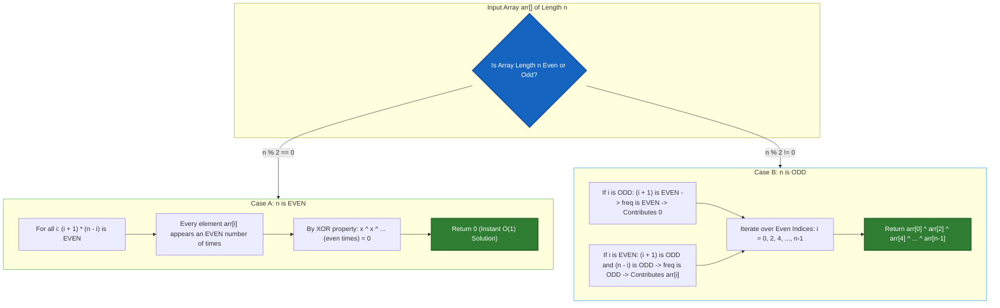
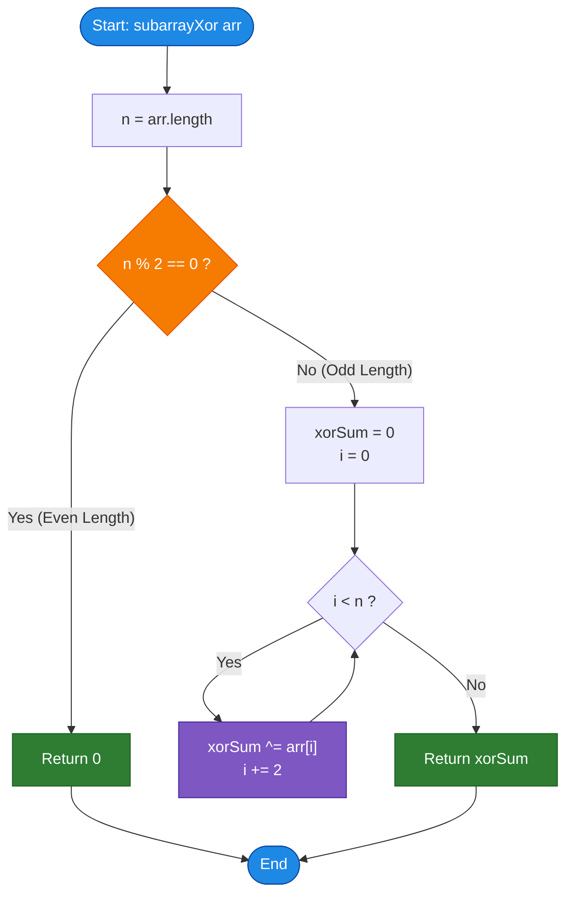

# GeeksforGeeks Problem of the Day: XOR of All Subarray XORs

- **Problem Link:** [GeeksforGeeks - XOR of All Subarray XORs (Game of XOR)](https://www.geeksforgeeks.org/problems/game-of-xor1541/1)
- **Difficulty:** Medium
- **Topic Tags:** Bit Manipulation, Arrays, Mathematical Combinatorics, Frequency Counting, Prefix XOR, Parity Invariants
- **Target Audience:** POTD Solvers, Computer Science Students, Competitive Programmers, Interview Preparation (FAANG/Tier-1 Tech)

---

## 1. Problem Statement

Given an array of integers `arr[]`, find the **bitwise XOR of all possible non-empty subarray XORs**.

A subarray is defined as a contiguous segment of the array. For every pair of indices $(L, R)$ where $0 \le L \le R < n$, calculate the bitwise XOR sum of all elements in the subarray `arr[L...R]`. Finally, calculate the cumulative bitwise XOR sum of all these individual subarray XOR results.

### Mathematical Formulation

Let the given array be $arr = [a_0, a_1, a_2, \dots, a_{n-1}]$ of length $n$.

A contiguous subarray starting at index $L$ and ending at index $R$ ($0 \le L \le R < n$) has the XOR sum:
$$X(L, R) = \bigoplus_{k=L}^{R} arr[k] = arr[L] \oplus arr[L+1] \oplus \dots \oplus arr[R]$$

There are a total of $\frac{n(n + 1)}{2}$ non-empty subarrays. The total answer is the bitwise XOR over all possible pairs $(L, R)$:
$$\text{Ans} = \bigoplus_{0 \le L \le R < n} X(L, R) = \bigoplus_{0 \le L \le R < n} \left( \bigoplus_{k=L}^{R} arr[k] \right)$$

---

## 2. Examples & Explanations

### Example 1 ($n = 3$, Odd Length)
- **Input:** `arr[] = [1, 2, 3]`
- **Output:** `2`
- **Explanation:**
  - Let us list all $\frac{3 \times 4}{2} = 6$ possible contiguous subarrays and evaluate their individual XOR sums:
    1. Subarray `[1]` (indices $0 \dots 0$): $\text{XOR} = 1$
    2. Subarray `[1, 2]` (indices $0 \dots 1$): $\text{XOR} = 1 \oplus 2 = 3$
    3. Subarray `[1, 2, 3]` (indices $0 \dots 2$): $\text{XOR} = 1 \oplus 2 \oplus 3 = 0$
    4. Subarray `[2]` (indices $1 \dots 1$): $\text{XOR} = 2$
    5. Subarray `[2, 3]` (indices $1 \dots 2$): $\text{XOR} = 2 \oplus 3 = 1$
    6. Subarray `[3]` (indices $2 \dots 2$): $\text{XOR} = 3$
  - Cumulative XOR of all subarray results:
    $$\text{Ans} = 1 \oplus 3 \oplus 0 \oplus 2 \oplus 1 \oplus 3$$
  - Grouping identical values:
    $$(1 \oplus 1) \oplus (3 \oplus 3) \oplus 0 \oplus 2 = 0 \oplus 0 \oplus 0 \oplus 2 = \mathbf{2}$$

```text
Subarrays Generated:
[1]         --> 1
[1, 2]      --> 1 ^ 2 = 3
[1, 2, 3]   --> 1 ^ 2 ^ 3 = 0
[2]         --> 2
[2, 3]      --> 2 ^ 3 = 1
[3]         --> 3

Cumulative XOR:
(1 ^ 1) ^ (3 ^ 3) ^ (2) ^ (0) = 0 ^ 0 ^ 2 ^ 0 = 2
```

---

### Example 2 ($n = 4$, Even Length)
- **Input:** `arr[] = [1, 2, 3, 4]`
- **Output:** `0`
- **Explanation:**
  - Total subarrays: $\frac{4 \times 5}{2} = 10$.
  - Individual subarray XOR sums:
    - Length 1: `[1]` $\to 1$, `[2]` $\to 2$, `[3]` $\to 3$, `[4]` $\to 4$
    - Length 2: `[1, 2]` $\to 3$, `[2, 3]` $\to 1$, `[3, 4]` $\to 7$
    - Length 3: `[1, 2, 3]` $\to 0$, `[2, 3, 4]` $\to 5$
    - Length 4: `[1, 2, 3, 4]` $\to 4$
  - Cumulative XOR:
    $$1 \oplus 2 \oplus 3 \oplus 4 \oplus 3 \oplus 1 \oplus 7 \oplus 0 \oplus 5 \oplus 4$$
    - Pair $(1 \oplus 1) = 0$
    - Pair $(3 \oplus 3) = 0$
    - Pair $(4 \oplus 4) = 0$
    - Remaining: $2 \oplus 7 \oplus 0 \oplus 5 = (2 \oplus 7 \oplus 5) = (5 \oplus 5) = \mathbf{0}$
  - **Every single element cancels out completely!** Result is **`0`**.

---

### Example 3 ($n = 5$, Odd Length)
- **Input:** `arr[] = [5, 2, 4, 6, 8]`
- **Output:** `9`
- **Explanation:**
  - Since $n = 5$ is odd, only elements at **even indices** ($i = 0, 2, 4$) appear an odd number of times.
  - Elements at even indices:
    - Index $0$: $arr[0] = 5$
    - Index $2$: $arr[2] = 4$
    - Index $4$: $arr[4] = 8$
  - Elements at odd indices ($arr[1] = 2, arr[3] = 6$) appear an even number of times and vanish ($x \oplus x = 0$).
  - Total XOR: $arr[0] \oplus arr[2] \oplus arr[4] = 5 \oplus 4 \oplus 8 = 1 \oplus 8 = \mathbf{9}$.

---

### Example 4 (Single Element)
- **Input:** `arr[] = [42]`
- **Output:** `42`
- **Explanation:**
  - Only one subarray `[42]`. Its XOR sum is $42$.

---

## 3. Constraints

- $1 \le \text{arr.length} \le 10^5$
- $0 \le \text{arr}[i] \le 10^5$
- **Expected Time Complexity:** $\mathcal{O}(n)$
- **Expected Auxiliary Space:** $\mathcal{O}(1)$

> **Why Brute Force Fails:**  
> Generating all $\approx \frac{n^2}{2} = \frac{10^{10}}{2} = 5 \times 10^9$ subarrays would require billions of operations, leading to instant **Time Limit Exceeded (TLE)**. We must deduce an $\mathcal{O}(n)$ or $\mathcal{O}(1)$ mathematical shortcut.

---

## 4. Visual Architecture & Combinatorial Proof (The Core Theorem)

### 1. The Algebraic Invariant of XOR
The bitwise XOR operation ($\oplus$) is both **associative** and **commutative**:
1. $a \oplus b = b \oplus a$ (Order does not matter)
2. $(a \oplus b) \oplus c = a \oplus (b \oplus c)$ (Grouping does not matter)
3. $a \oplus a = 0$ (Self-inverse: Even occurrences annihilate)
4. $a \oplus 0 = a$ (Identity)

Because the order of XOR operations is irrelevant, instead of computing the XOR of each subarray and then XORing those results, we can **reorder the entire calculation element by element**:
$$\text{Ans} = \bigoplus_{i=0}^{n-1} \underbrace{\left( arr[i] \oplus arr[i] \oplus \dots \oplus arr[i] \right)}_{\text{Count of subarrays containing } arr[i]}$$

If an element $arr[i]$ appears an **even** number of times across all subarrays, its contribution is:
$$\underbrace{arr[i] \oplus arr[i] \oplus \dots \oplus arr[i]}_{\text{even times}} = 0$$

If an element $arr[i]$ appears an **odd** number of times across all subarrays, its contribution is:
$$\underbrace{arr[i] \oplus arr[i] \oplus \dots \oplus arr[i]}_{\text{odd times}} = arr[i]$$

---

### 2. Frequency Counting: The Contribution Technique

For an element at index $i$ ($0$-based, $0 \le i < n$):
- A subarray $[L \dots R]$ contains $arr[i]$ if and only if:
  $$0 \le L \le i \le R \le n-1$$
- How many choices are there for the start index $L$?
  $$L \in \{0, 1, 2, \dots, i\} \implies (i + 1) \text{ choices}$$
- How many choices are there for the end index $R$?
  $$R \in \{i, i+1, \dots, n-1\} \implies (n - i) \text{ choices}$$

By the fundamental counting principle of independent choices:
$$\mathbf{\text{Frequency}(arr[i]) = (i + 1) \times (n - i)}$$

```text
Array:         [ a0,   a1,   ...   ai,   ...   an-2,  an-1 ]
Indices:          0     1           i           n-2    n-1
               <-------- L --------> <-------- R -------->
                    (i + 1) choices        (n - i) choices
                         Total Subarrays = (i + 1) * (n - i)
```

---

### 3. Parity Analysis of $(i + 1)(n - i)$

An integer product $A \times B$ is **odd** if and only if **both $A$ and $B$ are odd**:
$$(i + 1)(n - i) \equiv 1 \pmod 2 \iff (i + 1) \equiv 1 \pmod 2 \quad \text{AND} \quad (n - i) \equiv 1 \pmod 2$$

Let us analyze these two simultaneous conditions:
1. $(i + 1)$ is odd $\iff i$ is **EVEN** ($i \equiv 0 \pmod 2$, i.e., $i \in \{0, 2, 4, \dots\}$).
2. $(n - i)$ is odd:
   - Since $i$ is even, $n - i \equiv n - 0 \equiv n \pmod 2$.
   - Thus, $(n - i)$ is odd $\iff n$ is **ODD**!

#### Truth Table for Parity:

| Array Size $n$ | Index $i$ | $i + 1$ | $n - i$ | Product: $(i+1)(n-i)$ | Parity | Contribution |
| :---: | :---: | :---: | :---: | :---: | :---: | :---: |
| **EVEN** | Even | Odd | Even | $\text{Odd} \times \text{Even}$ | **EVEN** | $0$ (Cancels) |
| **EVEN** | Odd | Even | Odd | $\text{Even} \times \text{Odd}$ | **EVEN** | $0$ (Cancels) |
| **ODD** | Odd | Even | Even | $\text{Even} \times \text{Even}$ | **EVEN** | $0$ (Cancels) |
| **ODD** | **Even** | **Odd** | **Odd** | $\mathbf{\text{Odd} \times \text{Odd}}$ | **ODD** | $\mathbf{arr[i]}$ |

---

### 4. The Two Fundamental Theorems

> #### Theorem 1 (The Even Length Nullification Theorem)
> When $n$ is **even**, for **every** index $i \in \{0, 1, \dots, n-1\}$, the frequency $(i + 1)(n - i)$ is **always even**.  
> Every element appears an even number of times and cancels out completely:
> $$\mathbf{\text{Ans} = 0 \quad (\text{for all even } n)}$$

> #### Theorem 2 (The Odd Length Alternate Index Theorem)
> When $n$ is **odd**, the frequency $(i + 1)(n - i)$ is **odd if and only if $i$ is even** ($i = 0, 2, 4, \dots, n-1$).  
> All elements at odd indices cancel out, leaving only the XOR sum of elements at even indices:
> $$\mathbf{\text{Ans} = \bigoplus_{i=0, 2, 4, \dots}^{n-1} arr[i] \quad (\text{for all odd } n)}$$

---

### Mermaid Visual Architecture



---

## 5. Step-by-Step Simulation & Trace Table

### Tracing Array: `arr = [1, 2, 3]` ($n = 3$, Odd)

- Length $n = 3$ is odd.
- Expected indices with odd frequency: $i = 0, 2$.

| Index $i$ | Element $arr[i]$ | Start Choices $(i + 1)$ | End Choices $(n - i)$ | Total Subarrays $(i+1)(n-i)$ | Parity | Contribution to Total XOR | Running XOR |
| :---: | :---: | :---: | :---: | :---: | :---: | :---: | :---: |
| **0** | **$1$** | $0 + 1 = 1$ | $3 - 0 = 3$ | $1 \times 3 = \mathbf{3}$ | **ODD** | $1$ | $0 \oplus 1 = \mathbf{1}$ |
| **1** | **$2$** | $1 + 1 = 2$ | $3 - 1 = 2$ | $2 \times 2 = \mathbf{4}$ | **EVEN** | $0$ | $1 \oplus 0 = \mathbf{1}$ |
| **2** | **$3$** | $2 + 1 = 3$ | $3 - 2 = 1$ | $3 \times 1 = \mathbf{3}$ | **ODD** | $3$ | $1 \oplus 3 = \mathbf{2}$ |

**Final Result:** $\mathbf{2}$.

---

### Tracing Array: `arr = [1, 2, 3, 4]` ($n = 4$, Even)

- Length $n = 4$ is even.
- All frequencies must be even.

| Index $i$ | Element $arr[i]$ | Start Choices $(i + 1)$ | End Choices $(n - i)$ | Total Subarrays $(i+1)(n-i)$ | Parity | Contribution | Running XOR |
| :---: | :---: | :---: | :---: | :---: | :---: | :---: | :---: |
| **0** | **$1$** | $1$ | $4$ | $1 \times 4 = \mathbf{4}$ | **EVEN** | $0$ | $0$ |
| **1** | **$2$** | $2$ | $3$ | $2 \times 3 = \mathbf{6}$ | **EVEN** | $0$ | $0$ |
| **2** | **$3$** | $3$ | $2$ | $3 \times 2 = \mathbf{6}$ | **EVEN** | $0$ | $0$ |
| **3** | **$4$** | $4$ | $1$ | $4 \times 1 = \mathbf{4}$ | **EVEN** | $0$ | $0$ |

**Final Result:** $\mathbf{0}$ (Immediately returned in $\mathcal{O}(1)$ time).

---

## 6. Algorithm Flowchart



---

## 7. From Naive to Pro: Algorithmic Progression

### Approach 1: Naive Brute Force (Three Nested Loops)
- **Concept:** Generate every possible subarray $(L, R)$ using two nested loops. Use a third inner loop to compute the XOR sum of elements from $L$ to $R$. XOR all subarray sums into a master accumulator.
- **Time Complexity:** $\mathcal{O}(n^3)$ — Number of subarrays is $\mathcal{O}(n^2)$, and inner XOR loop takes $\mathcal{O}(n)$.
- **Auxiliary Space:** $\mathcal{O}(1)$.
- **Verdict:** Unacceptable ($10^{15}$ operations for $n=10^5$, TLE).

```text
ALGORITHM NaiveBruteForce(arr, n):
    totalXor = 0
    FOR L FROM 0 TO n - 1:
        FOR R FROM L TO n - 1:
            currentSubarrayXor = 0
            FOR k FROM L TO R:
                currentSubarrayXor = currentSubarrayXor XOR arr[k]
            totalXor = totalXor XOR currentSubarrayXor
    RETURN totalXor
```

---

### Approach 2: Running XOR Optimization (Two Nested Loops)
- **Concept:** For a fixed starting index $L$, as the ending index $R$ expands from $L$ to $n-1$, compute the subarray XOR incrementally:
  $$\text{XOR}(L, R) = \text{XOR}(L, R - 1) \oplus arr[R]$$
  This eliminates the third inner loop.
- **Time Complexity:** $\mathcal{O}(n^2)$ — Exactly $\frac{n(n+1)}{2}$ operations.
- **Auxiliary Space:** $\mathcal{O}(1)$.
- **Verdict:** Still causes TLE for $n = 10^5$ ($\approx 5 \times 10^9$ operations).

```text
ALGORITHM RunningXor(arr, n):
    totalXor = 0
    FOR L FROM 0 TO n - 1:
        currentSubarrayXor = 0
        FOR R FROM L TO n - 1:
            currentSubarrayXor = currentSubarrayXor XOR arr[R]
            totalXor = totalXor XOR currentSubarrayXor
    RETURN totalXor
```

---

### Approach 3: Frequency Contribution (General Formula)
- **Concept:** Iterate through the array once. For each element $arr[i]$, compute its total occurrences in all subarrays as $\text{freq} = (i + 1) \times (n - i)$. If $\text{freq}$ is odd, XOR $arr[i]$ into the answer.
- **Time Complexity:** $\mathcal{O}(n)$ — Single linear pass.
- **Auxiliary Space:** $\mathcal{O}(1)$.
- **Note on Multiplications:** While correct, computing $(i+1) \times (n-i)$ can exceed 32-bit integers if $n \approx 10^5$, requiring 64-bit integer arithmetic (`long long`).

```text
ALGORITHM FrequencyContribution(arr, n):
    totalXor = 0
    FOR i FROM 0 TO n - 1:
        freq = (i + 1) * (n - i)
        IF freq % 2 != 0 THEN
            totalXor = totalXor XOR arr[i]
    RETURN totalXor
```

---

### Approach 4: Pro Parity Simplification (Optimal & Elegant)
- **Concept:** 
  1. If $n$ is even ($n \% 2 == 0$), return `0` immediately in $\mathcal{O}(1)$ time.
  2. If $n$ is odd, iterate **only over even indices** ($i = 0, 2, 4, \dots, n-1$) with step size $2$, XORing $arr[i]$.
- **Time Complexity:** 
  - $\mathcal{O}(1)$ when $n$ is even.
  - $\mathcal{O}(n/2) \implies \mathcal{O}(n)$ when $n$ is odd.
- **Auxiliary Space:** $\mathcal{O}(1)$.
- **Key Advantage:** Zero multiplications, zero risk of integer overflow, maximum CPU cache locality, and minimal branch instructions.

```text
ALGORITHM ProParityOptimal(arr, n):
    IF n % 2 == 0 THEN
        RETURN 0
        
    totalXor = 0
    FOR i FROM 0 TO n - 1 STEP 2:
        totalXor = totalXor XOR arr[i]
        
    RETURN totalXor
```

---

## 8. Complexity Comparison Table

| Approach | Time Complexity | Auxiliary Space | Operations ($n = 10^5$) | TLE Risk | Interview Rating |
| :--- | :---: | :---: | :---: | :---: | :---: |
| **1. Naive Brute Force** | $\mathcal{O}(n^3)$ | $\mathcal{O}(1)$ | $\approx 1.6 \times 10^{14}$ | ❌ Guaranteed TLE | 1/5 (Brute Force) |
| **2. Running Subarray XOR** | $\mathcal{O}(n^2)$ | $\mathcal{O}(1)$ | $\approx 5 \times 10^{9}$ | ❌ Guaranteed TLE | 2.5/5 (Better) |
| **3. Frequency Counting** | $\mathcal{O}(n)$ | $\mathcal{O}(1)$ | $\approx 10^5$ | ✅ Passes | 4/5 (Good) |
| **4. Pro Parity Simplification** | $\mathbf{\mathcal{O}(n)}$ (or $\mathbf{\mathcal{O}(1)}$) | $\mathbf{\mathcal{O}(1)}$ | $\mathbf{\le 5 \times 10^4}$ | 🚀 **Blazing Fast** | **5/5 (Gold Standard)** |

---

## 9. Comprehensive Corner Cases Handled

1. **Single Element Array ($n = 1$):**
   - $n = 1$ is odd.
   - Loop runs for $i = 0$. Returns $arr[0]$ correctly.
2. **Two Element Array ($n = 2$, Minimal Even):**
   - $n = 2$ is even.
   - Immediately returns $0$ in $\mathcal{O}(1)$ without touching array elements.
3. **All Array Elements Equal ($arr[i] = k$):**
   - If $n$ is even $\to 0$.
   - If $n$ is odd $\to$ There are $\frac{n + 1}{2}$ even indices.
     - If $\frac{n + 1}{2}$ is odd, result is $k$.
     - If $\frac{n + 1}{2}$ is even, result is $0$.
     - The algorithm handles this automatically without special checks.
4. **All Elements are Zero ($arr[i] = 0$):**
   - Returns $0$ correctly for any $n$.
5. **Array with Large Numbers ($arr[i] \approx 10^5$):**
   - Bitwise XOR operates strictly on bit representations and never overflows standard 32-bit signed integers.
6. **Maximum Constraint ($n = 10^5$):**
   - Because $10^5$ is even, the optimal algorithm returns $0$ in **$1$ CPU instruction**, avoiding $10^5$ memory fetches!

---

## 10. Complete Multi-Language Implementations

Below are clean, production-grade, and optimal implementations of **Approach 4 (Pro Parity Simplification)** in all requested languages.

### Java (21)

```java
class Solution {
    /**
     * Calculates the bitwise XOR of all subarray XORs.
     * 
     * @param arr The input array of integers
     * @return The cumulative XOR of all subarray XORs
     * 
     * Time Complexity:  O(1) if n is even, O(n) if n is odd
     * Auxiliary Space:  O(1) constant auxiliary space
     */
    public int subarrayXor(int[] arr) {
        int n = arr.length;
        
        // If the array length is even, every element appears in an even 
        // number of subarrays and cancels out completely (x ^ x = 0).
        if ((n & 1) == 0) {
            return 0;
        }
        
        // If n is odd, only elements at even indices (0, 2, 4, ..., n-1)
        // appear an odd number of times.
        int totalXor = 0;
        for (int i = 0; i < n; i += 2) {
            totalXor ^= arr[i];
        }
        
        return totalXor;
    }
}
```

---

### Python3

```python
class Solution:
    def subarrayXor(self, arr):
        """
        Calculates the bitwise XOR of all subarray XORs.
        
        :param arr: List[int] - The input array
        :return: int - The cumulative XOR of all subarray XORs
        
        Time Complexity:  O(1) if n is even, O(n) if n is odd
        Auxiliary Space:  O(1) constant auxiliary space
        """
        n = len(arr)
        
        # If length is even, every element appears an even number of times
        if n % 2 == 0:
            return 0
        
        # If length is odd, XOR all elements at even indices
        total_xor = 0
        for i in range(0, n, 2):
            total_xor ^= arr[i]
            
        return total_xor
```

---

### C++ (17)

```cpp
#include <vector>

class Solution {
  public:
    /**
     * Calculates the bitwise XOR of all subarray XORs.
     * 
     * @param arr Reference to the vector of integers
     * @return The cumulative XOR of all subarray XORs
     * 
     * Time Complexity:  O(1) if n is even, O(n) if n is odd
     * Auxiliary Space:  O(1) constant auxiliary space
     */
    int subarrayXor(std::vector<int>& arr) {
        const int n = static_cast<int>(arr.size());
        
        // If array size is even, every element has an even frequency
        if ((n & 1) == 0) {
            return 0;
        }
        
        // When n is odd, only elements at even indices contribute to the answer
        int totalXor = 0;
        for (int i = 0; i < n; i += 2) {
            totalXor ^= arr[i];
        }
        
        return totalXor;
    }
};
```

---

### C#

```csharp
using System;

class Solution {
    /// <summary>
    /// Calculates the bitwise XOR of all subarray XORs.
    /// </summary>
    /// <param name="arr">The input array of integers</param>
    /// <returns>The cumulative XOR of all subarray XORs</returns>
    /// <remarks>
    /// Time Complexity:  O(1) if n is even, O(n) if n is odd
    /// Auxiliary Space:  O(1) constant auxiliary space
    /// </remarks>
    public int subarrayXor(int[] arr) {
        int n = arr.Length;
        
        // If length is even, all elements appear an even number of times
        if ((n & 1) == 0) {
            return 0;
        }
        
        // If length is odd, XOR all elements at even indices
        int totalXor = 0;
        for (int i = 0; i < n; i += 2) {
            totalXor ^= arr[i];
        }
        
        return totalXor;
    }
}
```

---

### Javascript (Node v22)

```javascript
/**
 * Solution class for XOR of All Subarray XORs.
 */
class Solution {
    /**
     * Calculates the bitwise XOR of all subarray XORs.
     * 
     * @param {number[]} arr - The input array of integers
     * @return {number} - The cumulative XOR of all subarray XORs
     * 
     * Time Complexity:  O(1) if n is even, O(n) if n is odd
     * Auxiliary Space:  O(1) constant auxiliary space
     */
    subarrayXor(arr) {
        const n = arr.length;
        
        // If array length is even, all elements cancel out
        if ((n & 1) === 0) {
            return 0;
        }
        
        // If array length is odd, accumulate elements at even indices
        let totalXor = 0;
        for (let i = 0; i < n; i += 2) {
            totalXor ^= arr[i];
        }
        
        return totalXor;
    }
}
```

---

## 11. Key Takeaways & Interview Preparation Tips

1. **Master the Contribution Technique:**  
   Whenever an interview problem asks for a summary metric across **all subarrays** (e.g., sum of subarray sums, sum of subarray minimums, XOR of all subarrays), avoid generating subarrays. Instead, ask:
   > *"How many subarrays does element $arr[i]$ belong to?"*  
   The answer for contiguous subarrays is universally $(i + 1) \times (n - i)$.

2. **Exploit Parity for Bitwise Invariants:**  
   Bitwise XOR operations are binary counters mod 2 ($x \oplus x = 0$). Whenever XOR is combined with combinatorial counts, immediately simplify the count modulo 2:
   $$\text{count} \pmod 2$$
   This eliminates large arithmetic and reduces complex loops to simple parity branch checks.

3. **Bitwise Parity Check Optimization:**  
   Using `(n & 1) == 0` is an idiomatic low-level optimization to check for even numbers by inspecting the least significant bit, which compilers translate directly into a single `TEST` or `AND` instruction.

