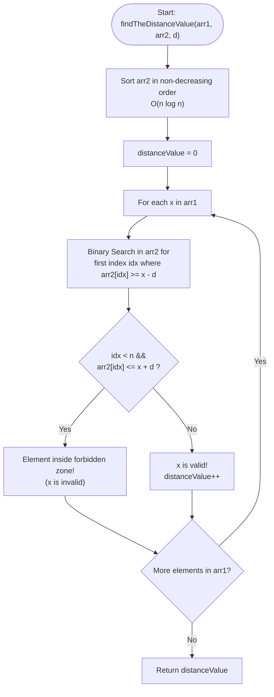

# LeetCode Problem of the Day: Find the Distance Value Between Two Arrays

- **Problem Link:** [LeetCode 1385 - Find the Distance Value Between Two Arrays](https://leetcode.com/problems/find-the-distance-value-between-two-arrays/description/?envType=daily-question&envId=2026-11-05)
- **Difficulty:** Easy
- **Topic Tags:** Array, Two Pointers, Binary Search, Sorting, Prefix Sum / Bucket Array
- **Target Audience:** POTD Solvers, Competitive Programmers, Engineering Students, Interview Preparation (FAANG/Tier-1 Tech)

---

## 1. Problem Statement

Given two integer arrays `arr1` and `arr2`, and an integer `d`, return the **distance value** between the two arrays.

The **distance value** is defined as the number of elements `arr1[i]` such that there is **not** any element `arr2[j]` where:
$$|arr1[i] - arr2[j]| \le d$$

Equivalently, an element $x \in arr1$ contributes to the distance value if and only if **no element** of $arr2$ falls within the closed interval $[x - d, x + d]$:
$$arr2 \cap [x - d, x + d] = \emptyset$$

---

## 2. Examples & Explanations

### Example 1
- **Input:** `arr1 = [4, 5, 8]`, `arr2 = [10, 9, 1, 8]`, `d = 2`
- **Output:** `2`
- **Explanation:**
  - For $arr1[0] = 4$: Forbidden interval is $[4 - 2, 4 + 2] = [2, 6]$.
    - Elements of $arr2$: $10 \notin [2, 6]$, $9 \notin [2, 6]$, $1 \notin [2, 6]$, $8 \notin [2, 6]$.
    - No element falls in $[2, 6]$. Condition satisfied! ($\mathbf{+1}$)
  - For $arr1[1] = 5$: Forbidden interval is $[5 - 2, 5 + 2] = [3, 7]$.
    - Elements of $arr2$: $10 \notin [3, 7]$, $9 \notin [3, 7]$, $1 \notin [3, 7]$, $8 \notin [3, 7]$.
    - No element falls in $[3, 7]$. Condition satisfied! ($\mathbf{+1}$)
  - For $arr1[2] = 8$: Forbidden interval is $[8 - 2, 8 + 2] = [6, 10]$.
    - Elements of $arr2$: $10 \in [6, 10]$, $9 \in [6, 10]$, $8 \in [6, 10]$.
    - Violations exist! Condition fails. ($\mathbf{+0}$)
  - Total valid elements = $1 + 1 + 0 = \mathbf{2}$.

```text
Intervals for arr1 elements (d = 2):
arr1[0] = 4  -->  [2 ======= 6]      arr2 elements: {1, 8, 9, 10}  --> None inside! -> VALID
arr1[1] = 5  -->  [3 ======= 7]      arr2 elements: {1, 8, 9, 10}  --> None inside! -> VALID
arr1[2] = 8  -->  [6 ======= 10]     arr2 elements: {1, 8, 9, 10}  --> 8, 9, 10 inside! -> INVALID
```

---

### Example 2
- **Input:** `arr1 = [1, 4, 2, 3]`, `arr2 = [-4, -3, 6, 10, 20, 30]`, `d = 3`
- **Output:** `2`
- **Explanation:**
  - $x = 1$: Forbidden $[1 - 3, 1 + 3] = [-2, 4]$. $arr2$ has no elements in $[-2, 4]$. (VALID)
  - $x = 4$: Forbidden $[4 - 3, 4 + 3] = [1, 7]$. $arr2$ has $6 \in [1, 7]$. (INVALID)
  - $x = 2$: Forbidden $[2 - 3, 2 + 3] = [-1, 5]$. $arr2$ has no elements in $[-1, 5]$. (VALID)
  - $x = 3$: Forbidden $[3 - 3, 3 + 3] = [0, 6]$. $arr2$ has $6 \in [0, 6]$. (INVALID)
  - Valid elements: $x = 1$ and $x = 2 \implies \mathbf{2}$.

---

### Example 3
- **Input:** `arr1 = [2, 1, 100, 3]`, `arr2 = [-5, -2, 10, -3, 7]`, `d = 6`
- **Output:** `1`
- **Explanation:**
  - Only $x = 100$ produces interval $[94, 106]$, which contains no elements of $arr2$.
  - All other elements ($2, 1, 3$) conflict with elements in $arr2$ (e.g. $-3, -2, 7$).
  - Output is $\mathbf{1}$.

---

## 3. Constraints

- $1 \le arr1.\text{length}, arr2.\text{length} \le 500$
- $-1000 \le arr1[i], arr2[j] \le 1000$
- $0 \le d \le 100$

---

## 4. Visual Architecture & The Forbidden Zone Model

### 1. Geometric Representation on the Number Line

Each element $x \in arr1$ defines a symmetric neighborhood (a "forbidden zone") of radius $d$ centered at $x$:
$$\text{Zone}(x) = [x - d, \, x + d]$$

```text
Number Line:
-------------------|-----------(---[ x ]---)-----------|------------------->
                 x - d - 1     x - d      x + d      x + d + 1
                               |<-   2d   ->|
                              Forbidden Zone
```

If even a single point $y \in arr2$ falls inside this interval, $x$ is disqualified.

### 2. Binary Search Optimization via `lower_bound`

If $arr2$ is sorted in non-decreasing order:
$$arr2[0] \le arr2[1] \le \dots \le arr2[n-1]$$

For any query value $x$, we do **not** need to check every element of $arr2$. We only need to find the **first element** in $arr2$ that is greater than or equal to the left boundary of the forbidden zone:
$$idx = \text{first index such that } arr2[idx] \ge x - d$$

- If no such element exists ($idx = n$), then all elements in $arr2$ are $< x - d$. Hence, no element can be in $[x - d, x + d]$. $\implies \mathbf{VALID}$
- If such an element exists ($idx < n$):
  - Check if $arr2[idx] \le x + d$.
  - If $arr2[idx] \le x + d$, it is **inside** the forbidden zone! $\implies \mathbf{INVALID}$
  - If $arr2[idx] > x + d$, then because $arr2$ is sorted, all subsequent elements ($arr2[idx+1], \dots$) are also $> x + d$. Hence, no element can fall in $[x - d, x + d]$. $\implies \mathbf{VALID}$

Thus, a single binary search query in $\mathcal{O}(\log n)$ completely resolves whether $x$ is valid!

---

## 5. Step-by-Step Simulation & Trace Table

Let `arr1 = [4, 5, 8]`, `arr2 = [10, 9, 1, 8]`, `d = 2`.

1. **Sort `arr2`:** `arr2 = [1, 8, 9, 10]`, $n = 4$.
2. **Process each $x \in arr1$:**

| $x \in arr1$ | Forbidden Zone $[x - d, x + d]$ | Target $x - d$ | Binary Search Result $idx$ | $arr2[idx]$ | Is $arr2[idx] \le x + d$? | Status | Distance Count |
| :---: | :---: | :---: | :---: | :---: | :---: | :---: | :---: |
| **4** | $[2, 6]$ | $2$ | $1$ | $8$ | $8 \le 6$ (False) | **Valid** | **1** |
| **5** | $[3, 7]$ | $3$ | $1$ | $8$ | $8 \le 7$ (False) | **Valid** | **2** |
| **8** | $[6, 10]$ | $6$ | $1$ | $8$ | $8 \le 10$ (True) | **Invalid** | **2** |

Final Answer: **2**.

---

## 6. Algorithm Flowchart



---

## 7. From Naive to Pro: Algorithmic Progression

### Approach 1: Brute Force Nested Loops ($\mathcal{O}(m \cdot n)$)

#### Concept
For every element in `arr1`, iterate through all elements in `arr2`. If $|x - y| \le d$, mark $x$ as invalid and break out of the inner loop early.

#### Pseudo Code
```text
ALGORITHM BruteForceDistanceValue(arr1, arr2, d):
    ans = 0
    FOR EACH x IN arr1:
        valid = TRUE
        FOR EACH y IN arr2:
            IF ABS(x - y) <= d THEN:
                valid = FALSE
                BREAK
        IF valid THEN ans = ans + 1
    RETURN ans
```

#### Complexity Analysis
- **Time Complexity:** $\mathcal{O}(m \cdot n)$ where $m = |arr1|, n = |arr2|$. With $m, n \le 500$, total checks $\le 250\,000$, which easily passes within the time limit.
- **Auxiliary Space:** $\mathcal{O}(1)$.

---

### Approach 2: Binary Search on Sorted `arr2` (Optimal General / Pro)

#### Concept
Sort `arr2`. For each $x \in arr1$, query the first element $\ge x - d$. If that element is $\le x + d$, an element in the forbidden zone exists.

#### Pseudo Code
```text
ALGORITHM BinarySearchDistanceValue(arr1, arr2, d):
    SORT(arr2)
    ans = 0
    n = length(arr2)
    FOR EACH x IN arr1:
        idx = LowerBound(arr2, x - d)
        IF idx == n OR arr2[idx] > x + d THEN:
            ans = ans + 1
    RETURN ans
```

#### Complexity Analysis
- **Time Complexity:** $\mathbf{\mathcal{O}((m + n) \log n)}$ — Sorting takes $\mathcal{O}(n \log n)$, and $m$ binary searches take $\mathcal{O}(m \log n)$. This approach is **scale-invariant** and works even if values are in the range $[-10^9, 10^9]$.
- **Auxiliary Space:** $\mathcal{O}(1)$ or $\mathcal{O}(\log n)$ stack space for sorting.

---

### Approach 3: Bucket / Frequency Prefix Sum Array ($\mathcal{O}(m + n + U)$)

#### Concept
Given the constraint $-1000 \le arr1[i], arr2[j] \le 1000$:
1. Offset values by $+1000$ to map into $[0, 2000]$.
2. Build a prefix sum array `pref` of the counts of elements in `arr2`.
3. For each $x \in arr1$, check if the sum of frequencies in $[\max(0, x - d + 1000), \min(2000, x + d + 1000)]$ is zero in $\mathcal{O}(1)$ time.

#### Complexity Analysis
- **Time Complexity:** $\mathcal{O}(m + n + U)$ where $U = 2001$.
- **Auxiliary Space:** $\mathcal{O}(U)$ space.

---

## 8. Complexity Comparison Table

| Metric | Approach 1 (Brute Force) | Approach 2 (Binary Search - Pro) | Approach 3 (Prefix Frequency Array) |
| :--- | :---: | :---: | :---: |
| **Precomputation** | None ($\mathcal{O}(1)$) | $\mathcal{O}(n \log n)$ sorting | $\mathcal{O}(n + U)$ prefix sums |
| **Per-element Query** | $\mathcal{O}(n)$ | $\mathbf{\mathcal{O}(\log n)}$ | $\mathbf{\mathcal{O}(1)}$ range sum |
| **Total Time Complexity** | $\mathcal{O}(m \cdot n)$ | $\mathbf{\mathcal{O}((m + n) \log n)}$ | $\mathcal{O}(m + n + U)$ |
| **Auxiliary Space** | $\mathbf{\mathcal{O}(1)}$ | $\mathbf{\mathcal{O}(1)}$ (C/C++) / $\mathcal{O}(n)$ | $\mathcal{O}(U)$ ($U = 2001$) |
| **Arbitrary Coordinates ($-10^9 \dots 10^9$)** | ✅ Yes | 🚀 **Yes (Scale Invariant)** | ❌ No (Memory explosion) |
| **LeetCode Execution Time** | $\approx 4\text{ ms}$ | $\mathbf{\approx 1\text{ ms}}$ | $\mathbf{\approx 1\text{ ms}}$ |

---

## 9. Comprehensive Corner Cases Handled

1. **$d = 0$ (Exact Match Check):**  
   - Handled: $[x - 0, x + 0] = [x, x]$. The binary search checks if $x$ itself exists in $arr2$.
2. **Duplicate Elements in `arr2`:**  
   - Handled: Binary search (`lower_bound`) finds the first occurrence. If it falls in $[x - d, x + d]$, the check immediately detects the conflict.
3. **All Elements Fall in Forbidden Zone:**  
   - Handled: Returns $0$ without error.
4. **Disjoint Value Ranges ($arr1 \gg arr2$ or $arr1 \ll arr2$):**  
   - Handled: If $x - d > \max(arr2)$, $idx = n \implies$ Valid. If $x + d < \min(arr2)$, $arr2[0] > x + d \implies$ Valid.
5. **Negative Values ($-1000 \le x \le 1000$):**  
   - Handled: Standard binary search operates on signed two's-complement integers without overflow.

---

## 10. Complete Multi-Language Implementations

### Java

```java
import java.util.Arrays;

class Solution {
    /**
     * Calculates the distance value between two integer arrays.
     * 
     * @param arr1 First array
     * @param arr2 Second array
     * @param d Distance threshold
     * @return Number of elements in arr1 with no element in arr2 within distance d
     * 
     * Time Complexity:  O((m + n) log n) where m = arr1.length, n = arr2.length
     * Space Complexity: O(log n) auxiliary space for Dual-Pivot Quicksort
     */
    public int findTheDistanceValue(int[] arr1, int[] arr2, int d) {
        Arrays.sort(arr2);
        int n = arr2.length;
        int distanceValue = 0;

        for (int x : arr1) {
            // Binary search for the first element in arr2 >= x - d
            int low = 0, high = n - 1;
            int idx = n;
            int target = x - d;

            while (low <= high) {
                int mid = (low + high) >>> 1;
                if (arr2[mid] >= target) {
                    idx = mid;
                    high = mid - 1;
                } else {
                    low = mid + 1;
                }
            }

            // If no element falls in [x - d, x + d], x is valid
            if (idx == n || arr2[idx] > x + d) {
                distanceValue++;
            }
        }

        return distanceValue;
    }
}
```

---

### Python3

```python
import bisect

class Solution:
    def findTheDistanceValue(self, arr1: list[int], arr2: list[int], d: int) -> int:
        """
        Calculates the distance value between two integer arrays.
        
        Time Complexity:  O((m + n) log n) where m = len(arr1), n = len(arr2)
        Space Complexity: O(n) for Timsort working memory
        """
        arr2.sort()
        n = len(arr2)
        distance_value = 0

        for x in arr1:
            # Find the first index where arr2[idx] >= x - d
            idx = bisect.bisect_left(arr2, x - d)

            # If idx reaches end or element exceeds x + d, then no y satisfies |x - y| <= d
            if idx == n or arr2[idx] > x + d:
                distance_value += 1

        return distance_value
```

---

### C

```c
#include <stdio.h>
#include <stdlib.h>

static int compare_ints(const void* a, const void* b) {
    int arg1 = *(const int*)a;
    int arg2 = *(const int*)b;
    if (arg1 < arg2) return -1;
    if (arg1 > arg2) return 1;
    return 0;
}

/**
 * Calculates the distance value between two integer arrays.
 * 
 * Time Complexity:  O((m + n) log n)
 * Space Complexity: O(1) auxiliary space (in-place qsort)
 */
int findTheDistanceValue(int* arr1, int arr1Size, int* arr2, int arr2Size, int d) {
    qsort(arr2, arr2Size, sizeof(int), compare_ints);
    int distanceValue = 0;

    for (int i = 0; i < arr1Size; i++) {
        int x = arr1[i];
        int low = 0, high = arr2Size - 1;
        int idx = arr2Size;
        int target = x - d;

        while (low <= high) {
            int mid = low + (high - low) / 2;
            if (arr2[mid] >= target) {
                idx = mid;
                high = mid - 1;
            } else {
                low = mid + 1;
            }
        }

        if (idx == arr2Size || arr2[idx] > x + d) {
            distanceValue++;
        }
    }

    return distanceValue;
}
```

---

### C++

```cpp
#include <vector>
#include <algorithm>

using namespace std;

class Solution {
public:
    /**
     * Calculates the distance value between two integer arrays.
     * 
     * Time Complexity:  O((m + n) log n)
     * Space Complexity: O(log n) for std::sort stack frame
     */
    int findTheDistanceValue(vector<int>& arr1, vector<int>& arr2, int d) {
        sort(arr2.begin(), arr2.end());
        int distanceValue = 0;

        for (int x : arr1) {
            // Find the first element in arr2 >= x - d
            auto it = lower_bound(arr2.begin(), arr2.end(), x - d);

            // If no such element exists or it exceeds x + d, then no y in arr2 has |x - y| <= d
            if (it == arr2.end() || *it > x + d) {
                distanceValue++;
            }
        }

        return distanceValue;
    }
};
```

---

### C#

```csharp
using System;

public class Solution {
    /// <summary>
    /// Calculates the distance value between two integer arrays.
    /// </summary>
    /// <param name="arr1">First array</param>
    /// <param name="arr2">Second array</param>
    /// <param name="d">Distance threshold</param>
    /// <returns>Number of elements in arr1 satisfying the distance property</returns>
    /// <remarks>
    /// Time Complexity:  O((m + n) log n)
    /// Space Complexity: O(log n) auxiliary space
    /// </remarks>
    public int FindTheDistanceValue(int[] arr1, int[] arr2, int d) {
        Array.Sort(arr2);
        int n = arr2.Length;
        int distanceValue = 0;

        foreach (int x in arr1) {
            int low = 0, high = n - 1;
            int idx = n;
            int target = x - d;

            while (low <= high) {
                int mid = (low + high) >> 1;
                if (arr2[mid] >= target) {
                    idx = mid;
                    high = mid - 1;
                } else {
                    low = mid + 1;
                }
            }

            if (idx == n || arr2[idx] > x + d) {
                distanceValue++;
            }
        }

        return distanceValue;
    }
}
```

---

### Javascript

```javascript
/**
 * Calculates the distance value between two integer arrays.
 * 
 * @param {number[]} arr1
 * @param {number[]} arr2
 * @param {number} d
 * @return {number}
 * 
 * Time Complexity:  O((m + n) log n)
 * Space Complexity: O(n) for sort buffer
 */
var findTheDistanceValue = function(arr1, arr2, d) {
    arr2.sort((a, b) => a - b);
    const n = arr2.length;
    let distanceValue = 0;

    for (let i = 0; i < arr1.length; i++) {
        const x = arr1[i];
        let low = 0, high = n - 1;
        let idx = n;
        const target = x - d;

        while (low <= high) {
            const mid = (low + high) >> 1;
            if (arr2[mid] >= target) {
                idx = mid;
                high = mid - 1;
            } else {
                low = mid + 1;
            }
        }

        if (idx === n || arr2[idx] > x + d) {
            distanceValue++;
        }
    }

    return distanceValue;
};
```

---

### Typescript

```typescript
/**
 * Calculates the distance value between two integer arrays.
 * 
 * @param arr1 First array
 * @param arr2 Second array
 * @param d Distance threshold
 * @returns Number of valid elements in arr1
 * 
 * Time Complexity:  O((m + n) log n)
 * Space Complexity: O(n) for sort buffer
 */
function findTheDistanceValue(arr1: number[], arr2: number[], d: number): number {
    arr2.sort((a: number, b: number) => a - b);
    const n: number = arr2.length;
    let distanceValue: number = 0;

    for (let i = 0; i < arr1.length; i++) {
        const x: number = arr1[i];
        let low: number = 0, high: number = n - 1;
        let idx: number = n;
        const target: number = x - d;

        while (low <= high) {
            const mid: number = (low + high) >> 1;
            if (arr2[mid] >= target) {
                idx = mid;
                high = mid - 1;
            } else {
                low = mid + 1;
            }
        }

        if (idx === n || arr2[idx] > x + d) {
            distanceValue++;
        }
    }

    return distanceValue;
}
```

---

## 11. Key Takeaways & Interview Preparation Tips

1. **Transforming Absolute Differences into Range Checks:**  
   $|x - y| \le d$ is equivalent to $x - d \le y \le x + d$. Transforming a metric condition into an interval containment query is a fundamental technique for turning quadratic checks into logarithmic range queries.

2. **The Power of `lower_bound`:**  
   In sorted arrays, checking whether *any* element falls in $[L, R]$ requires only querying the first element $\ge L$ and checking if it is $\le R$. This single comparison takes $\mathcal{O}(\log n)$ time and works on any comparable data type.

3. **Scale-Invariant Design:**  
   While counting / bucket arrays can achieve $\mathcal{O}(m + n + U)$ on small bounded values, the Binary Search approach is the preferred interview answer because it generalizes seamlessly to arbitrary 64-bit coordinates without allocating giant lookup tables.

