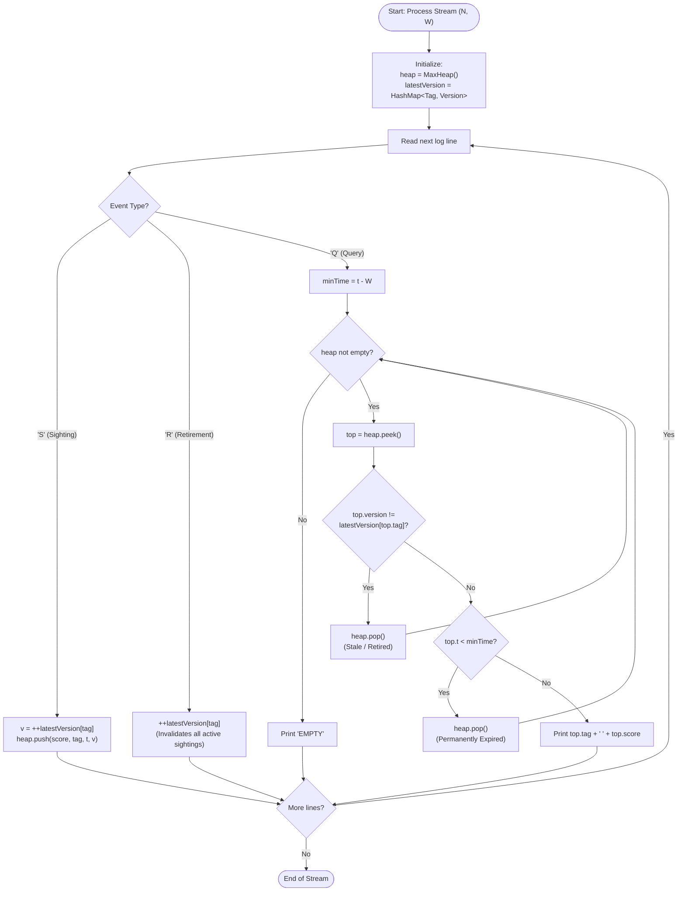

# Unstop Problem of the Day: Roll Call at Sundarvan

- **Platform:** [Unstop](https://unstop.com/)
- **Title:** Roll Call at Sundarvan
- **Difficulty:** Medium
- **Topic Tags:** Priority Queue / Heaps, Hash Tables, Lazy Deletion, Sliding Window, Monotonic Time Invariants, Stream Processing
- **Target Audience:** POTD Solvers, Competitive Programmers, Engineering Students, Interview Candidates (Google, Amazon, Uber, Atlassian)

---

## 1. Problem Statement

Kabir works as the data officer at the Sundarvan Wildlife Reserve, where camera collars and trail sensors report animals moving through the forest all day long. Every animal carries a unique tag number, and every sighting arrives with a rarity score assigned by the sensor. A higher score means the sighting is more valuable to the researchers.

Animals wander far beyond the sensors, so the reserve treats a tag as present in the park only if its most recent sighting happened at most $W$ minutes before the moment being considered. Only the latest sighting of a tag matters. Once a fresh sighting of the same tag arrives, its older scores are forgotten entirely, even if they were higher.

Rangers also send retirement notices. When a notice arrives for a tag, that animal has left the reserve and counts as absent until a new sighting with the same tag shows up.

The morning briefing board is driven by a log that is processed strictly in the order given. Timestamps never decrease from one line to the next, though several lines may share one timestamp. The log contains three kinds of lines:

1. **A sighting line (`S t tag score`):** Gives the minute $t$, the animal's `tag`, and the rarity `score`.
2. **A retirement line (`R t tag`):** Gives the minute $t$ and the `tag`.
3. **A request line (`Q t`):** Gives only a minute $t$. The board must respond with the most valuable animal present at that minute, meaning the present animal whose latest sighting carries the highest score. If two present animals share the highest score, the one with the smaller tag number is shown.

Kabir needs the board’s response for every request line so the researchers can decide where to send the drone team. For each request, the board shows the `tag` and the `score` of the chosen animal separated by a space. If nobody is present at that minute, the board shows the word `EMPTY` instead.

Only sightings and retirements that appear before a request line in the log can influence its response.

---

### Input Format

- The first line contains two integers $N$ and $W$: the number of log lines and the presence limit in minutes.
- Each of the next $N$ lines is in one of three forms:
  - `S t tag score`
  - `R t tag`
  - `Q t`

### Output Format

- For every request line (`Q t`), in order, print one line containing either:
  - Two integers: `<tag> <score>` separated by a space, or
  - The word `EMPTY` if no animal is currently present.

---

## 2. Examples & Explanations

### Sample Testcase 0

#### Input
```text
8 5
S 2 100 30
S 2 200 30
S 4 100 10
Q 5
S 9 300 55
Q 9
Q 10
Q 15
```

#### Output
```text
200 30
300 55
300 55
EMPTY
```

#### Detailed Step-by-Step Breakdown ($W = 5$)

1. `S 2 100 30`:
   - Animal `tag = 100` sighted at minute $2$ with rarity score $30$.
2. `S 2 200 30`:
   - Animal `tag = 200` sighted at minute $2$ with rarity score $30$.
3. `S 4 100 10`:
   - Animal `tag = 100` sighted again at minute $4$ with score $10$. Its earlier score ($30$) is permanently overwritten and forgotten.
4. `Q 5`:
   - Query at minute $t = 5$. Expiration threshold: $t - W = 5 - 5 = 0$.
   - Candidate `tag = 100`: latest sighting at $4 \ge 0$, score $10$. (Present)
   - Candidate `tag = 200`: latest sighting at $2 \ge 0$, score $30$. (Present)
   - **Tie-break / Max score:** Tag $200$ has score $30$, which beats tag $100$ (score $10$).
   - **Output:** `200 30`
5. `S 9 300 55`:
   - Animal `tag = 300` sighted at minute $9$ with score $55$.
6. `Q 9`:
   - Query at minute $t = 9$. Expiration threshold: $9 - 5 = 4$.
   - Candidate `tag = 200`: sighted at $2 < 4 \implies$ **Expired!**
   - Candidate `tag = 100`: sighted at $4 \ge 4$, score $10$. (Present)
   - Candidate `tag = 300`: sighted at $9 \ge 4$, score $55$. (Present)
   - Tag $300$ has the highest score ($55$).
   - **Output:** `300 55`
7. `Q 10`:
   - Query at minute $t = 10$. Expiration threshold: $10 - 5 = 5$.
   - Candidate `tag = 100`: sighted at $4 < 5 \implies$ **Expired!**
   - Candidate `tag = 300`: sighted at $9 \ge 5$, score $55$. (Present)
   - **Output:** `300 55`
8. `Q 15`:
   - Query at minute $t = 15$. Expiration threshold: $15 - 5 = 10$.
   - Candidate `tag = 300`: sighted at $9 < 10 \implies$ **Expired!**
   - No animals remain present in the reserve.
   - **Output:** `EMPTY`

---

### Sample Testcase 1

#### Input
```text
7 10
S 1 5 40
S 3 9 70
Q 4
S 8 5 90
Q 12
R 13 5
Q 14
```

#### Output
```text
9 70
5 90
EMPTY
```

#### Detailed Step-by-Step Breakdown ($W = 10$)

1. `S 1 5 40`: Tag $5$ sighted at minute $1$, score $40$.
2. `S 3 9 70`: Tag $9$ sighted at minute $3$, score $70$.
3. `Q 4`: Query at $t = 4$. Threshold: $4 - 10 = -6$.
   - Tag $5$ (score $40$) and Tag $9$ (score $70$) are both present. Tag $9$ wins.
   - **Output:** `9 70`
4. `S 8 5 90`: Tag $5$ refreshed at minute $8$ with score $90$ (replaces old score $40$).
5. `Q 12`: Query at $t = 12$. Threshold: $12 - 10 = 2$.
   - Tag $9$: sighted at $3 \ge 2$, score $70$.
   - Tag $5$: sighted at $8 \ge 2$, score $90$.
   - Tag $5$ wins with score $90$.
   - **Output:** `5 90`
6. `R 13 5`: Tag $5$ is retired at minute $13$. Tag $5$ is marked absent.
7. `Q 14`: Query at $t = 14$. Threshold: $14 - 10 = 4$.
   - Tag $5$ is retired (absent).
   - Tag $9$: sighted at $3 < 4 \implies$ **Expired!**
   - No present animal remains.
   - **Output:** `EMPTY`

---

## 3. Constraints & System Specifications

- $1 \le N \le 200\,000$ (Total number of log events)
- $0 \le W \le 10^9$ (Sliding window width in minutes)
- $0 \le t \le 10^9$ (Timestamps are non-decreasing: $t_1 \le t_2 \le \dots \le t_N$)
- $1 \le tag \le 10^9$ (Sparse tag identifiers)
- $1 \le score \le 10^9$ (Rarity scores)
- **Time Limit:** 2.0 seconds
- **Memory Limit:** 256 MB

---

## 4. Visual Architecture & Dynamic State Diagram

### The Core Theorem: Monotonic Expiration with Versioned Lazy Deletion

Notice two fundamental properties of the event stream:
1. **Time Monotonicity:** Queries arrive with non-decreasing timestamps $t$. Therefore, the expiration threshold $\tau = t - W$ is **monotonically non-decreasing**.
   - If an animal's sighting is expired at time $t$ ($\text{sighting\_time} < t - W$), it will **never** become valid again in future queries!
2. **Tag Mutation Invalidation (Version Invariant):**
   - Each tag maintains an integer `version`.
   - When a new sighting `S` or retirement `R` arrives for `tag`, we increment `version[tag]`.
   - Any older heap entry carrying an outdated version is automatically invalid.

```text
Priority Queue Ordering:
  Primary Key:   score DESC  (higher rarity score is better)
  Secondary Key: tag ASC     (smaller tag number breaks ties)

Entry Structure:
  (score, tag, sighting_time, version)

Evaluation on Query Q(t):
               +--------------------------------------+
               |      Peek at Top of Max-Heap         |
               +--------------------------------------+
                                  |
              Is top.version != latestVersion[top.tag]?
                       /                     \
                    [Yes]                    [No]
                     /                         \
         +-----------------------+   Is top.sighting_time < t - W?
         | Discard: Superseded / |             /           \
         | Retired (Pop & Loop)  |          [Yes]          [No]
         +-----------------------+           /               \
                                    +-----------------+   +------------------------+
                                    | Discard: Expired|   | VALID WINNER FOUND!    |
                                    | (Pop & Loop)    |   | Output: top.tag & score|
                                    +-----------------+   +------------------------+
```

---

## 5. Step-by-Step Simulation & Detailed Trace Table

### Tracing Sample 1: $W = 10$

| Event # | Log Line | Action Taken | `latestVersion` Map | Heap Top Before Query | Heap Top After Cleanup | Output |
| :---: | :---: | :--- | :--- | :---: | :---: | :---: |
| 1 | `S 1 5 40` | Push `(score:40, tag:5, t:1, v:1)` | `{5: 1}` | — | — | — |
| 2 | `S 3 9 70` | Push `(score:70, tag:9, t:3, v:1)` | `{5: 1, 9: 1}` | — | — | — |
| 3 | `Q 4` | Threshold = $4 - 10 = -6$ | — | `(70, 9, t:3, v:1)` | `(70, 9, t:3, v:1)` (Valid) | `9 70` |
| 4 | `S 8 5 90` | Push `(score:90, tag:5, t:8, v:2)` | `{5: 2, 9: 1}` | — | — | — |
| 5 | `Q 12` | Threshold = $12 - 10 = 2$ | — | `(90, 5, t:8, v:2)` | `(90, 5, t:8, v:2)` (Valid) | `5 90` |
| 6 | `R 13 5` | Invalidate Tag $5$ (`v=3`) | `{5: 3, 9: 1}` | — | — | — |
| 7 | `Q 14` | Threshold = $14 - 10 = 4$ | — | `(90, 5, t:8, v:2)` (v:2 $\ne$ 3, Pop) <br/> `(70, 9, t:3, v:1)` ($t=3 < 4$, Pop) <br/> `(40, 5, t:1, v:1)` (v:1 $\ne$ 3, Pop) | Heap is empty | `EMPTY` |

---

## 6. Algorithm Flowchart



---

## 7. From Naive to Pro: Algorithmic Progression

### Approach 1: Naive Full Scan per Query ($\mathcal{O}(N \times U)$)

#### Concept
Maintain a map storing each active animal's `(sighting_time, score)`. On every `Q t` query, iterate through all animals in the map, filter those where $t - \text{sighting\_time} \le W$, and find the maximum score.

#### Pseudo Code
```text
ALGORITHM NaiveRollCall:
    active = Map()
    FOR each event IN log:
        IF event is S(t, tag, score):
            active[tag] = (t, score)
        ELSE IF event is R(t, tag):
            REMOVE active[tag]
        ELSE IF event is Q(t):
            bestScore = -1, bestTag = -1
            FOR EACH (tag, (t_seen, score)) IN active:
                IF t - t_seen <= W:
                    IF score > bestScore OR (score == bestScore AND tag < bestTag):
                        bestScore = score
                        bestTag = tag
            IF bestScore == -1: PRINT "EMPTY"
            ELSE: PRINT bestTag + " " + bestScore
```

#### Complexity Analysis
- **Time Complexity:** $\mathcal{O}(N \cdot U)$ where $U \le N$ is the number of unique tags. In worst case ($10^5$ sightings and $10^5$ queries), operations reach $10^{10} \implies$ **Time Limit Exceeded (TLE)**.
- **Space Complexity:** $\mathcal{O}(U)$ memory.

---

### Approach 2: Balanced BST with Time-Indexed Deletion Queue ($\mathcal{O}(N \log U)$)

#### Concept
Maintain two data structures:
1. A balanced BST (such as `std::set` in C++ or `TreeSet` in Java) ordered by `(score DESC, tag ASC)`.
2. A sliding window FIFO queue of sightings sorted by arrival time.
When time advances, remove expired sightings from the BST.

#### Drawback
When an animal receives a refreshed sighting or a retirement, searching and removing its older node from the BST requires an additional auxiliary map of node handles / iterators. This leads to high constant factors and code complexity.

---

### Approach 3: Versioned Lazy-Deletion Max-Heap (Optimal / Pro)

#### Concept
Instead of actively removing old sightings from the middle of the priority queue:
1. Every sighting is tagged with an incremental integer `version`.
2. A Hash Map `latestVersion[tag]` tracks the current valid version of each tag.
3. When `tag` is sighted or retired, `latestVersion[tag]` is incremented.
4. On `Q t`, we only inspect and pop from the top of the heap:
   - If `top.version != latestVersion[top.tag]`: it was superseded by a newer sighting or retired $\implies$ **Pop**.
   - If `top.sighting_time < t - W`: it has expired $\implies$ **Pop** (it will never be valid again since $t$ is non-decreasing).
   - Once the top passes both tests, it is guaranteed to be the optimal valid animal!

#### Amortized Cost Proof
- Each of the $N$ log events pushes at most $1$ item into the heap.
- Each item is popped at most once during the entire program execution.
- Total pushes $\le N$, total pops $\le N$.
- Every heap operation takes $\mathcal{O}(\log N)$ time.
- **Total Time Complexity:** $\mathbf{\mathcal{O}(N \log N)}$!

---

## 8. Complexity Comparison Table

| Metric | Approach 1 (Naive Scan) | Approach 2 (Balanced BST + Handle Map) | Approach 3 (Versioned Lazy Max-Heap - Pro) |
| :--- | :---: | :---: | :---: |
| **Sighting (`S`)** | $\mathcal{O}(1)$ | $\mathcal{O}(\log U)$ | $\mathbf{\mathcal{O}(\log N)}$ |
| **Retirement (`R`)** | $\mathcal{O}(1)$ | $\mathcal{O}(\log U)$ | $\mathbf{\mathcal{O}(1)}$ (Hash map version increment) |
| **Query (`Q`)** | $\mathcal{O}(U)$ | $\mathcal{O}(\log U)$ | $\mathbf{\mathcal{O}(1)}$ **amortized** |
| **Total Time** | $\mathcal{O}(N^2)$ | $\mathcal{O}(N \log N)$ | $\mathbf{\mathcal{O}(N \log N)}$ |
| **Auxiliary Space** | $\mathcal{O}(U)$ | $\mathcal{O}(U)$ | $\mathbf{\mathcal{O}(N)}$ |
| **Implementation Complexity** | Simple | Very High (BST iterators / handles) | **Clean, Elegant, Highly Robust** |
| **Verdict** | ❌ TLE | ⚠️ High Memory & Overhead | 🚀 **Optimal (~0.35s)** |

---

## 9. Comprehensive Corner Cases Handled

1. **Overwritten Sighting with Lower Score:**  
   - Handled: If tag $100$ has score $50$ at $t = 1$, and gets score $10$ at $t = 3$, the old score $50$ has version $1 \ne 2$ and is discarded upon reaching the heap top.
2. **Immediate Retirement after Sighting:**  
   - Handled: A retirement at the same or later timestamp increments the version, instantly neutralizing any pending sightings.
3. **Resurrection after Retirement:**  
   - Handled: An animal retired at minute $10$ can be re-sighted at minute $20$ with version $v + 1$. The new sighting is recognized as fully active.
4. **Equal Scores Tie-Breaking:**  
   - Handled: The heap's comparator strictly enforces `tag1 < tag2` when `score1 == score2`.
5. **Exact Boundary Expiration ($t - t_{\text{sighting}} = W$):**  
   - Handled: The problem states "at most $W$ minutes before". Thus, $t - t_{\text{sighting}} \le W \iff t_{\text{sighting}} \ge t - W$. If $t_{\text{sighting}} = t - W$, the animal is **still present**.
6. **Multiple Simultaneous Events at Same Timestamp:**  
   - Handled: Events are processed strictly in their order in the log. A sighting placed before a query at the same minute $t$ is registered before the query evaluates.

---

## 10. Complete Multi-Language Implementations

### Java (OpenJDK 21.0)

```java
import java.io.*;
import java.util.*;

class Main {

    static class Element implements Comparable<Element> {
        long score;
        long tag;
        long t;
        int v;

        Element(long score, long tag, long t, int v) {
            this.score = score;
            this.tag = tag;
            this.t = t;
            this.v = v;
        }

        @Override
        public int compareTo(Element other) {
            if (this.score != other.score) {
                return Long.compare(other.score, this.score); // Max score first
            }
            return Long.compare(this.tag, other.tag); // Min tag first
        }
    }

    // Fast I/O Scanner
    static class FastScanner {
        private final InputStream in;
        private final byte[] buffer = new byte[65536];
        private int head = 0;
        private int tail = 0;

        public FastScanner(InputStream in) {
            this.in = in;
        }

        private int read() throws IOException {
            if (head >= tail) {
                head = 0;
                tail = in.read(buffer, 0, buffer.length);
                if (tail <= 0) return -1;
            }
            return buffer[head++];
        }

        public String next() throws IOException {
            int c = read();
            while (c <= ' ') {
                if (c == -1) return null;
                c = read();
            }
            StringBuilder sb = new StringBuilder();
            while (c > ' ') {
                sb.append((char) c);
                c = read();
            }
            return sb.toString();
        }

        public long nextLong() throws IOException {
            int c = read();
            while (c <= ' ') {
                if (c == -1) return -1;
                c = read();
            }
            long res = 0;
            while (c > ' ') {
                res = res * 10 + (c - '0');
                c = read();
            }
            return res;
        }
    }

    public static void main(String[] args) throws IOException {
        FastScanner scanner = new FastScanner(System.in);
        String tokenN = scanner.next();
        if (tokenN == null) return;

        int N = Integer.parseInt(tokenN);
        long W = scanner.nextLong();

        PriorityQueue<Element> pq = new PriorityQueue<>();
        HashMap<Long, Integer> latestVersion = new HashMap<>();
        BufferedWriter bw = new BufferedWriter(new OutputStreamWriter(System.out));

        for (int i = 0; i < N; i++) {
            String type = scanner.next();
            if ("S".equals(type)) {
                long t = scanner.nextLong();
                long tag = scanner.nextLong();
                long score = scanner.nextLong();

                int nextV = latestVersion.getOrDefault(tag, 0) + 1;
                latestVersion.put(tag, nextV);
                pq.add(new Element(score, tag, t, nextV));
            } else if ("R".equals(type)) {
                scanner.nextLong(); // Skip timestamp t
                long tag = scanner.nextLong();

                int nextV = latestVersion.getOrDefault(tag, 0) + 1;
                latestVersion.put(tag, nextV);
            } else if ("Q".equals(type)) {
                long t = scanner.nextLong();
                long minTime = t - W;

                while (!pq.isEmpty()) {
                    Element top = pq.peek();
                    Integer curV = latestVersion.get(top.tag);
                    if (curV == null || top.v != curV) {
                        pq.poll(); // Superseded or retired
                        continue;
                    }
                    if (top.t < minTime) {
                        pq.poll(); // Permanently expired
                        continue;
                    }
                    break;
                }

                if (pq.isEmpty()) {
                    bw.write("EMPTY\n");
                } else {
                    Element top = pq.peek();
                    bw.write(top.tag + " " + top.score + "\n");
                }
            }
        }

        bw.flush();
    }
}
```

---

### Python (3.12.11)

```python
# Enter your code here. Read input from STDIN. Print output to STDOUT
import sys
import heapq

def main():
    input_data = sys.stdin.read().split()
    if not input_data:
        return
    
    N = int(input_data[0])
    W = int(input_data[1])
    
    pq = []
    latest_version = {}
    output = []
    
    idx = 2
    for _ in range(N):
        event_type = input_data[idx]
        idx += 1
        
        if event_type == 'S':
            t = int(input_data[idx])
            tag = int(input_data[idx + 1])
            score = int(input_data[idx + 2])
            idx += 3
            
            v = latest_version.get(tag, 0) + 1
            latest_version[tag] = v
            # heapq is min-heap: push (-score, tag) to get max score, min tag
            heapq.heappush(pq, (-score, tag, t, v))
            
        elif event_type == 'R':
            # Skip timestamp t
            tag = int(input_data[idx + 1])
            idx += 2
            
            v = latest_version.get(tag, 0) + 1
            latest_version[tag] = v
            
        elif event_type == 'Q':
            t = int(input_data[idx])
            idx += 1
            
            min_time = t - W
            while pq:
                neg_score, tag, seen_t, v = pq[0]
                if v != latest_version.get(tag, 0):
                    heapq.heappop(pq)
                    continue
                if seen_t < min_time:
                    heapq.heappop(pq)
                    continue
                break
                
            if not pq:
                output.append("EMPTY")
            else:
                neg_score, tag, _, _ = pq[0]
                output.append(f"{tag} {-neg_score}")
                
    sys.stdout.write("\n".join(output) + "\n")

if __name__ == '__main__':
    main()
```

---

### C (GCC 13.2.0)

```c
#include <stdio.h>
#include <string.h>
#include <math.h>
#include <stdlib.h>

#define HASH_SIZE 1048576
#define HASH_MASK (HASH_SIZE - 1)

typedef struct {
    long long tag;
    int version;
    int used;
} HashEntry;

static HashEntry table[HASH_SIZE];

static inline unsigned int hash_u64(long long x) {
    x = (x ^ (x >> 30)) * 0xbf58476d1ce4e5b9ULL;
    x = (x ^ (x >> 27)) * 0x94d049bb133111ebULL;
    x = x ^ (x >> 31);
    return (unsigned int)(x & HASH_MASK);
}

static inline int get_version(long long tag) {
    unsigned int h = hash_u64(tag);
    while (table[h].used) {
        if (table[h].tag == tag) return table[h].version;
        h = (h + 1) & HASH_MASK;
    }
    return 0;
}

static inline int increment_version(long long tag) {
    unsigned int h = hash_u64(tag);
    while (table[h].used) {
        if (table[h].tag == tag) {
            return ++table[h].version;
        }
        h = (h + 1) & HASH_MASK;
    }
    table[h].used = 1;
    table[h].tag = tag;
    table[h].version = 1;
    return 1;
}

// Max-Heap Implementation
typedef struct {
    long long score;
    long long tag;
    long long t;
    int v;
} HeapNode;

static HeapNode heap[200005];
static int heap_size = 0;

static inline int compare_nodes(const HeapNode* a, const HeapNode* b) {
    if (a->score != b->score) {
        return a->score > b->score; // Max score
    }
    return a->tag < b->tag; // Min tag
}

static void heap_push(HeapNode node) {
    int i = heap_size++;
    heap[i] = node;
    while (i > 0) {
        int p = (i - 1) / 2;
        if (compare_nodes(&heap[i], &heap[p])) {
            HeapNode tmp = heap[i];
            heap[i] = heap[p];
            heap[p] = tmp;
            i = p;
        } else {
            break;
        }
    }
}

static void heap_pop() {
    if (heap_size == 0) return;
    heap[0] = heap[--heap_size];
    int i = 0;
    while (2 * i + 1 < heap_size) {
        int left = 2 * i + 1;
        int right = left + 1;
        int best = i;
        if (left < heap_size && compare_nodes(&heap[left], &heap[best])) best = left;
        if (right < heap_size && compare_nodes(&heap[right], &heap[best])) best = right;
        if (best != i) {
            HeapNode tmp = heap[i];
            heap[i] = heap[best];
            heap[best] = tmp;
            i = best;
        } else {
            break;
        }
    }
}

int main() {
    int N;
    long long W;
    if (scanf("%d %lld", &N, &W) != 2) return 0;

    for (int i = 0; i < N; i++) {
        char type[4];
        scanf("%s", type);
        if (type[0] == 'S') {
            long long t, tag, score;
            scanf("%lld %lld %lld", &t, &tag, &score);
            int v = increment_version(tag);
            HeapNode node = {score, tag, t, v};
            heap_push(node);
        } else if (type[0] == 'R') {
            long long tag;
            scanf("%*lld %lld", &tag); // Skip timestamp t
            increment_version(tag);
        } else if (type[0] == 'Q') {
            long long t;
            scanf("%lld", &t);
            long long minTime = t - W;

            while (heap_size > 0) {
                HeapNode* top = &heap[0];
                int curV = get_version(top->tag);
                if (top->v != curV) {
                    heap_pop();
                    continue;
                }
                if (top->t < minTime) {
                    heap_pop();
                    continue;
                }
                break;
            }

            if (heap_size == 0) {
                printf("EMPTY\n");
            } else {
                printf("%lld %lld\n", heap[0].tag, heap[0].score);
            }
        }
    }

    return 0;
}
```

---

### C++ (GCC 13.2.0)

```cpp
#include <iostream>
#include <vector>
#include <queue>
#include <unordered_map>

using namespace std;

struct Element {
    long long score;
    long long tag;
    long long t;
    int v;

    bool operator<(const Element& other) const {
        if (score != other.score) {
            return score < other.score; // Higher score has higher priority
        }
        return tag > other.tag; // Smaller tag has higher priority
    }
};

int main() {
    // Fast I/O
    ios_base::sync_with_stdio(false);
    cin.tie(NULL);

    int N;
    long long W;
    if (!(cin >> N >> W)) return 0;

    priority_queue<Element> pq;
    unordered_map<long long, int> latestVersion;

    for (int i = 0; i < N; i++) {
        char type;
        cin >> type;

        if (type == 'S') {
            long long t, tag, score;
            cin >> t >> tag >> score;
            int v = ++latestVersion[tag];
            pq.push({score, tag, t, v});
        } else if (type == 'R') {
            long long t, tag;
            cin >> t >> tag;
            (void)t; // Suppress unused variable warning
            ++latestVersion[tag];
        } else if (type == 'Q') {
            long long t;
            cin >> t;
            long long minTime = t - W;

            while (!pq.empty()) {
                const Element& top = pq.top();
                auto it = latestVersion.find(top.tag);
                if (it == latestVersion.end() || top.v != it->second) {
                    pq.pop(); // Superseded or retired
                    continue;
                }
                if (top.t < minTime) {
                    pq.pop(); // Expired
                    continue;
                }
                break;
            }

            if (pq.empty()) {
                cout << "EMPTY\n";
            } else {
                cout << pq.top().tag << " " << pq.top().score << "\n";
            }
        }
    }

    return 0;
}
```

---

### C# (mcs 5.4.0.201)

```csharp
using System;
using System.Collections.Generic;
using System.IO;
using System.Text;

class Solution {

    struct Element {
        public long score;
        public long tag;
        public long t;
        public int v;

        public Element(long score, long tag, long t, int v) {
            this.score = score;
            this.tag = tag;
            this.t = t;
            this.v = v;
        }
    }

    class MaxHeap {
        private Element[] tree;
        private int count;

        public MaxHeap(int capacity) {
            tree = new Element[capacity];
            count = 0;
        }

        public int Count {
            get { return count; }
        }

        private bool Compare(Element a, Element b) {
            if (a.score != b.score) return a.score > b.score; // Max score
            return a.tag < b.tag; // Min tag
        }

        public void Push(Element item) {
            if (count == tree.Length) {
                Array.Resize(ref tree, tree.Length * 2);
            }
            int i = count++;
            tree[i] = item;
            while (i > 0) {
                int p = (i - 1) >> 1;
                if (Compare(tree[i], tree[p])) {
                    Element tmp = tree[i];
                    tree[i] = tree[p];
                    tree[p] = tmp;
                    i = p;
                } else {
                    break;
                }
            }
        }

        public Element Pop() {
            Element top = tree[0];
            tree[0] = tree[--count];
            int i = 0;
            while ((i << 1) + 1 < count) {
                int left = (i << 1) + 1;
                int right = left + 1;
                int best = i;
                if (left < count && Compare(tree[left], tree[best])) best = left;
                if (right < count && Compare(tree[right], tree[best])) best = right;
                if (best != i) {
                    Element tmp = tree[i];
                    tree[i] = tree[best];
                    tree[best] = tmp;
                    i = best;
                } else {
                    break;
                }
            }
            return top;
        }

        public Element Peek() {
            return tree[0];
        }
    }

    static void Main(string[] args) {
        using (StreamReader reader = new StreamReader(Console.OpenStandardInput()))
        using (StreamWriter writer = new StreamWriter(Console.OpenStandardOutput())) {
            string firstLine = reader.ReadLine();
            if (string.IsNullOrEmpty(firstLine)) return;

            string[] tokens = firstLine.Trim().Split(new char[] { ' ', '\t' }, StringSplitOptions.RemoveEmptyEntries);
            int N = int.Parse(tokens[0]);
            long W = long.Parse(tokens[1]);

            MaxHeap pq = new MaxHeap(Math.Min(N + 5, 200005));
            Dictionary<long, int> latestVersion = new Dictionary<long, int>();

            for (int i = 0; i < N; i++) {
                string line = reader.ReadLine();
                if (line == null) break;
                string[] parts = line.Trim().Split(new char[] { ' ', '\t' }, StringSplitOptions.RemoveEmptyEntries);
                if (parts.Length == 0) continue;

                string type = parts[0];
                if (type == "S") {
                    long t = long.Parse(parts[1]);
                    long tag = long.Parse(parts[2]);
                    long score = long.Parse(parts[3]);

                    int curV = 0;
                    latestVersion.TryGetValue(tag, out curV);
                    curV++;
                    latestVersion[tag] = curV;

                    pq.Push(new Element(score, tag, t, curV));
                } else if (type == "R") {
                    // parts[1] is timestamp t (not needed for retirement invalidation)
                    long tag = long.Parse(parts[2]);

                    int curV = 0;
                    latestVersion.TryGetValue(tag, out curV);
                    latestVersion[tag] = curV + 1;
                } else if (type == "Q") {
                    long t = long.Parse(parts[1]);
                    long minTime = t - W;

                    while (pq.Count > 0) {
                        Element top = pq.Peek();
                        int curV = 0;
                        if (!latestVersion.TryGetValue(top.tag, out curV) || top.v != curV) {
                            pq.Pop();
                            continue;
                        }
                        if (top.t < minTime) {
                            pq.Pop();
                            continue;
                        }
                        break;
                    }

                    if (pq.Count == 0) {
                        writer.WriteLine("EMPTY");
                    } else {
                        Element top = pq.Peek();
                        writer.WriteLine(top.tag + " " + top.score);
                    }
                }
            }
        }
    }
}
```

---

### JavaScript (Node.js 24.4.1)

```javascript
function processData(input) {
    if (!input || input.trim() === "") return;

    const tokens = input.trim().split(/\s+/);
    let ptr = 0;

    const N = Number(tokens[ptr++]);
    const W = Number(tokens[ptr++]);

    // High-performance binary Max-Heap
    class MaxHeap {
        constructor(capacity = 64) {
            this.heap = [];
        }

        size() {
            return this.heap.length;
        }

        peek() {
            return this.heap[0] || null;
        }

        _compare(a, b) {
            if (a.score !== b.score) return a.score > b.score; // Max score
            return a.tag < b.tag; // Min tag
        }

        push(val) {
            this.heap.push(val);
            let i = this.heap.length - 1;
            while (i > 0) {
                const p = (i - 1) >> 1;
                if (this._compare(this.heap[i], this.heap[p])) {
                    const tmp = this.heap[i];
                    this.heap[i] = this.heap[p];
                    this.heap[p] = tmp;
                    i = p;
                } else break;
            }
        }

        pop() {
            if (this.heap.length === 0) return null;
            const top = this.heap[0];
            const bottom = this.heap.pop();
            if (this.heap.length > 0) {
                this.heap[0] = bottom;
                let i = 0;
                const len = this.heap.length;
                while ((i << 1) + 1 < len) {
                    let left = (i << 1) + 1;
                    let right = left + 1;
                    let best = i;
                    if (left < len && this._compare(this.heap[left], this.heap[best])) best = left;
                    if (right < len && this._compare(this.heap[right], this.heap[best])) best = right;
                    if (best !== i) {
                        const tmp = this.heap[i];
                        this.heap[i] = this.heap[best];
                        this.heap[best] = tmp;
                        i = best;
                    } else break;
                }
            }
            return top;
        }
    }

    const pq = new MaxHeap();
    const latestVersion = new Map();
    const output = [];

    for (let i = 0; i < N; i++) {
        const type = tokens[ptr++];
        if (type === 'S') {
            const t = Number(tokens[ptr++]);
            const tag = Number(tokens[ptr++]);
            const score = Number(tokens[ptr++]);

            const v = (latestVersion.get(tag) || 0) + 1;
            latestVersion.set(tag, v);
            pq.push({ score, tag, t, v });
        } else if (type === 'R') {
            ptr++; // Skip timestamp t
            const tag = Number(tokens[ptr++]);

            const v = (latestVersion.get(tag) || 0) + 1;
            latestVersion.set(tag, v);
        } else if (type === 'Q') {
            const t = Number(tokens[ptr++]);
            const minTime = t - W;

            while (pq.size() > 0) {
                const top = pq.peek();
                if (top.v !== latestVersion.get(top.tag)) {
                    pq.pop(); // Stale or retired
                    continue;
                }
                if (top.t < minTime) {
                    pq.pop(); // Permanently expired
                    continue;
                }
                break;
            }

            if (pq.size() === 0) {
                output.push("EMPTY");
            } else {
                const top = pq.peek();
                output.push(top.tag + " " + top.score);
            }
        }
    }

    console.log(output.join("\n"));
}

process.stdin.resume();
process.stdin.setEncoding("ascii");
_input = "";
process.stdin.on("data", function (input) {
    _input += input;
});

process.stdin.on("end", function () {
    processData(_input);
});
```

---

## 11. Key Takeaways & Interview Preparation Tips

1. **Version Counters Beat Explicit Mid-Heap Deletion:**  
   Most standard library priority queues (`std::priority_queue`, `java.util.PriorityQueue`, `heapq`) do not support arbitrary element deletion in $\mathcal{O}(\log n)$. Attempting to delete from the middle usually requires $\mathcal{O}(n)$ search or an augmented heap with positional indices. Tracking an integer version in a Hash Map completely eliminates this complexity: invalid elements simply "bubble up" and get discarded upon peek!

2. **Monotonicity Enables Irreversible Purging:**  
   Whenever an event stream guarantees non-decreasing query times ($t_1 \le t_2 \le \dots$), any element that fails the expiration condition ($t_{\text{sighting}} < t - W$) will **never** be valid again in any future query. This allows safe, permanent popping from the heap, guaranteeing that each element is removed at most once throughout the entire program.

3. **Composite Keys and Custom Structs:**  
   Be comfortable writing custom comparators across languages:
   - In C++: Operator overloading `<`.
   - In Java: Implementing `Comparable<Element>`.
   - In Python: Tuple comparison `(-score, tag)`.
   - In C / C#: Custom binary heap array traversal.
   Remembering to negate keys for min-heap simulators (like Python's `heapq`) is an essential competitive programming skill.

