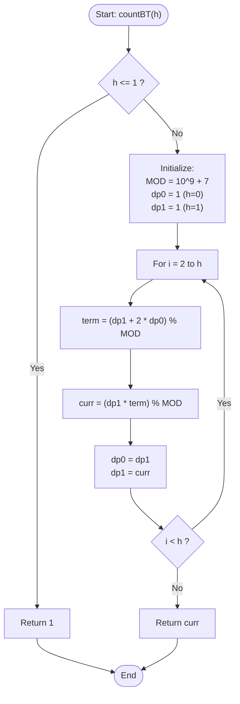

# GeeksforGeeks Problem of the Day: Balanced Binary Tree Counter

- **Problem Link:** [GeeksforGeeks - Balanced Binary Tree Counter (BBT Counter)](https://www.geeksforgeeks.org/problems/bbt-counter4914/1)
- **Difficulty:** Easy
- **Topic Tags:** Dynamic Programming, Trees, Combinatorics, Modular Arithmetic, State Space Optimization
- **Target Audience:** POTD Solvers, Computer Science Students, Competitive Programmers, Interview Preparation (Amazon, Microsoft, Google, Adobe, Tier-1 Tech)

---

## 1. Problem Statement

Given an integer `h`, find the total number of distinct **height-balanced binary trees** (BBTs) of height **exactly** `h`.

A binary tree is said to be **height-balanced** (also known as an AVL tree balance property) if for every node in the tree, the absolute difference between the height of its left subtree and the height of its right subtree is at most $1$:
$$|\text{height}(\text{left}) - \text{height}(\text{right})| \le 1$$

Since the answer can be extremely large, return the result **modulo $10^9 + 7$** ($1\,000\,000\,007$).

### Height Convention
- An empty tree has a height of $0$.
- A single node (root only) has a height of $1$.
- The height of a binary tree with root node $T$ having left subtree $L$ and right subtree $R$ is:
$$\text{height}(T) = 1 + \max(\text{height}(L), \text{height}(R))$$

---

## 2. Examples & Explanations

### Example 1
- **Input:** `h = 1`
- **Output:** `1`
- **Explanation:**
  - The tree must have height $1$. The only possible binary tree of height $1$ is a single root node with no children.
  - Number of distinct trees = $\mathbf{1}$.

```text
Tree of Height 1:
   (O)
```

---

### Example 2
- **Input:** `h = 2`
- **Output:** `3`
- **Explanation:**
  - The root must have at least one subtree of height $1$ so that $\text{height} = 1 + \max(h_L, h_R) = 2$.
  - The other subtree can have height either $1$ (difference $= 0$) or $0$ (difference $= 1$).
  - Possible subtree height pairs $(h_L, h_R)$:
    1. **Pair $(1, 1)$:** Left height $1$, Right height $1$. Both subtrees have $1$ node. ($1 \times 1 = 1$ tree)
    2. **Pair $(1, 0)$:** Left height $1$, Right height $0$ (empty right subtree). ($1 \times 1 = 1$ tree)
    3. **Pair $(0, 1)$:** Left height $0$ (empty left subtree), Right height $1$. ($1 \times 1 = 1$ tree)
  - Total distinct trees = $1 + 1 + 1 = \mathbf{3}$.

```text
3 Distinct Trees of Height 2:

Configuration 1 (1, 1):       Configuration 2 (1, 0):       Configuration 3 (0, 1):
       (R)                           (R)                           (R)
      /   \                         /                                 \
    (A)   (B)                     (A)                                 (B)
```

---

### Example 3
- **Input:** `h = 3`
- **Output:** `15`
- **Explanation:**
  - To achieve height $3$, at least one subtree must have height $2$. The other subtree can have height $2$ or $1$.
  - Subtree height combinations $(h_L, h_R)$:
    1. **Pair $(2, 2)$:** Left has height $2$ ($3$ choices), Right has height $2$ ($3$ choices) $\implies 3 \times 3 = 9$ trees.
    2. **Pair $(2, 1)$:** Left has height $2$ ($3$ choices), Right has height $1$ ($1$ choice) $\implies 3 \times 1 = 3$ trees.
    3. **Pair $(1, 2)$:** Left has height $1$ ($1$ choice), Right has height $2$ ($3$ choices) $\implies 1 \times 3 = 3$ trees.
  - Total = $9 + 3 + 3 = \mathbf{15}$.

---

### Example 4
- **Input:** `h = 4`
- **Output:** `315`
- **Explanation:**
  - Combinations:
    - $(3, 3) \implies 15 \times 15 = 225$
    - $(3, 2) \implies 15 \times 3 = 45$
    - $(2, 3) \implies 3 \times 15 = 45$
  - Total = $225 + 45 + 45 = \mathbf{315}$.

---

## 3. Constraints & Technical Analysis

- $1 \le h \le 10^5$ (in advanced test suites, $h \le 10^6$)
- Modulo: $10^9 + 7$ ($1\,000\,000\,007$)
- **Expected Time Complexity:** $\mathcal{O}(h)$
- **Expected Auxiliary Space:** $\mathcal{O}(1)$

---

## 4. Visual Architecture & Combinatorial Proof (The Core Recurrence Theorem)

### 1. Structural Decomposition of Height $h$

Let $dp[h]$ be the number of distinct balanced binary trees of height exactly $h$.

A binary tree with root node $T$ has height $h$ if and only if:
$$\max(h_L, h_R) = h - 1$$

To satisfy the **height-balance constraint** $|h_L - h_R| \le 1$, the smaller subtree cannot have height less than $h - 2$.

Therefore, there are **exactly three mutually exclusive and exhaustive cases** for the pair $(h_L, h_R)$:

```text
                     [ Root Node ]
                     /           \
               (Left Subtree)  (Right Subtree)

Case 1:           h - 1           h - 1      --> Height difference: |(h-1) - (h-1)| = 0 <= 1
Case 2:           h - 1           h - 2      --> Height difference: |(h-1) - (h-2)| = 1 <= 1
Case 3:           h - 2           h - 1      --> Height difference: |(h-2) - (h-1)| = 1 <= 1
```

By the **Rule of Product** (Fundamental Counting Principle):
- Number of trees in Case 1: $dp[h-1] \times dp[h-1]$
- Number of trees in Case 2: $dp[h-1] \times dp[h-2]$
- Number of trees in Case 3: $dp[h-2] \times dp[h-1]$

Summing all three cases together:
$$dp[h] = dp[h-1]^2 + dp[h-1] \cdot dp[h-2] + dp[h-2] \cdot dp[h-1]$$
$$dp[h] = dp[h-1]^2 + 2 \cdot dp[h-1] \cdot dp[h-2]$$

### 2. Factored Form for Numerical Stability

Factoring out the common term $dp[h-1]$:
$$\mathbf{dp[h] = dp[h-1] \cdot \Big(dp[h-1] + 2 \cdot dp[h-2]\Big) \pmod{10^9 + 7}}$$

### 3. Base Cases
- $dp[0] = 1$: There is exactly $1$ empty tree (used as the null child).
- $dp[1] = 1$: There is exactly $1$ tree of height $1$ (a single root node).

### 4. Preventing Integer Overflow
Because $dp[h-1] < 10^9 + 7$, computing the intermediate product:
$$dp[h-1] \cdot (dp[h-1] + 2 \cdot dp[h-2] \bmod \text{MOD})$$
can reach up to $\approx 10^9 \times 10^9 = 10^{18}$.  
A standard 32-bit signed integer will overflow (max $\approx 2.14 \times 10^9$).  
However, a **64-bit integer** (`long long` in C++, `long` in Java/C#, `BigInt` or `Number` in JS) has a maximum capacity of $\approx 9.22 \times 10^{18}$, which comfortably accommodates $10^{18}$ without overflow!

---

## 5. Step-by-Step Simulation & Trace Table

Let $\text{MOD} = 10^9 + 7$. We track the variables $dp0 = dp[i-2]$ and $dp1 = dp[i-1]$:

| Height $i$ | $dp0 = dp[i-2]$ | $dp1 = dp[i-1]$ | Inner Term: $(dp1 + 2 \cdot dp0) \bmod \text{MOD}$ | $dp[i] = (dp1 \times \text{term}) \bmod \text{MOD}$ | Cumulative Answer |
| :---: | :---: | :---: | :---: | :---: | :---: |
| **0** | — | — | — | Base Case | **1** |
| **1** | — | — | — | Base Case | **1** |
| **2** | $1$ | $1$ | $1 + 2(1) = 3$ | $1 \times 3 = 3$ | **3** |
| **3** | $1$ | $3$ | $3 + 2(1) = 5$ | $3 \times 5 = 15$ | **15** |
| **4** | $3$ | $15$ | $15 + 2(3) = 21$ | $15 \times 21 = 315$ | **315** |
| **5** | $15$ | $315$ | $315 + 2(15) = 345$ | $315 \times 345 = 108\,675$ | **108,675** |

---

## 6. Algorithm Flowchart



---

## 7. From Naive to Pro: Algorithmic Progression

### Approach 1: Plain Recursion without Memoization ($\mathcal{O}(2^h)$ Time)

#### Concept
Directly implement the recurrence relation recursively. Since each step forks into two recursive subproblems ($h-1$ and $h-2$), the recursion tree expands exponentially.

#### Pseudo Code
```text
FUNCTION countBTNaive(h):
    IF h <= 1 THEN RETURN 1
    term1 = countBTNaive(h - 1) * countBTNaive(h - 1)
    term2 = 2 * countBTNaive(h - 1) * countBTNaive(h - 2)
    RETURN (term1 + term2) % (10^9 + 7)
```

#### Complexity Analysis
- **Time Complexity:** $\mathcal{O}(2^h)$ — Exponential. For $h = 40$, $2^{40} \approx 10^{12}$ operations $\implies$ **Time Limit Exceeded (TLE)**.
- **Auxiliary Space:** $\mathcal{O}(h)$ call stack depth.

---

### Approach 2: Top-Down Recursion with Memoization ($\mathcal{O}(h)$ Time, $\mathcal{O}(h)$ Space)

#### Concept
Store the computed value of `memo[h]` in an array. If `memo[h]` is already solved, return it in $\mathcal{O}(1)$ time.

#### Pseudo Code
```text
FUNCTION countBTMemo(h, memo):
    IF h <= 1 THEN RETURN 1
    IF memo[h] != -1 THEN RETURN memo[h]
    
    term = (countBTMemo(h - 1, memo) + 2 * countBTMemo(h - 2, memo)) % MOD
    memo[h] = (countBTMemo(h - 1, memo) * term) % MOD
    RETURN memo[h]
```

#### Complexity Analysis
- **Time Complexity:** $\mathcal{O}(h)$ — Each state from $2$ to $h$ is evaluated once.
- **Auxiliary Space:** $\mathcal{O}(h)$ for the memo table + $\mathcal{O}(h)$ for recursion call stack. For $h = 10^5$, recursion depth risks **StackOverflowError**.

---

### Approach 3: Bottom-Up Tabulation ($\mathcal{O}(h)$ Time, $\mathcal{O}(h)$ Space)

#### Concept
Iteratively build an array `dp` of size $h + 1$ from base cases $dp[0] = 1, dp[1] = 1$ up to $dp[h]$.

#### Pseudo Code
```text
FUNCTION countBTTabulation(h):
    IF h <= 1 THEN RETURN 1
    dp = array of size (h + 1)
    dp[0] = 1, dp[1] = 1
    FOR i FROM 2 TO h:
        dp[i] = (dp[i - 1] * (dp[i - 1] + 2 * dp[i - 2])) % MOD
    RETURN dp[h]
```

#### Complexity Analysis
- **Time Complexity:** $\mathcal{O}(h)$.
- **Auxiliary Space:** $\mathcal{O}(h)$ array allocation.

---

### Approach 4: Space-Optimized Dynamic Programming ($\mathcal{O}(h)$ Time, $\mathbf{\mathcal{O}(1)}$ Space - Pro / Optimal)

#### Concept
Notice that $dp[i]$ depends **strictly** on the previous two values: $dp[i-1]$ and $dp[i-2]$. We can replace the entire $O(h)$ array with just two scalar rolling variables (`dp0` and `dp1`), achieving true **$\mathcal{O}(1)$ Auxiliary Space**!

#### Pseudo Code
```text
FUNCTION countBTOptimal(h):
    IF h <= 1 THEN RETURN 1
    MOD = 10^9 + 7
    dp0 = 1  // dp[i - 2]
    dp1 = 1  // dp[i - 1]
    curr = 1
    
    FOR i FROM 2 TO h:
        term = (dp1 + 2 * dp0) % MOD
        curr = (dp1 * term) % MOD
        dp0 = dp1
        dp1 = curr
        
    RETURN curr
```

#### Complexity Analysis
- **Time Complexity:** $\mathbf{\mathcal{O}(h)}$ — A single linear loop of $h$ iterations running in $< 10\text{ ms}$.
- **Auxiliary Space:** $\mathbf{\mathcal{O}(1)}$ — Exactly 4 scalar 64-bit integer variables.

---

## 8. Complexity Comparison Table

| Metric | Approach 1 (Plain Recursion) | Approach 2 (Memoization) | Approach 3 (Tabulation) | Approach 4 (Rolling Variables - Pro) |
| :--- | :---: | :---: | :---: | :---: |
| **Time Complexity** | $\mathcal{O}(2^h)$ | $\mathcal{O}(h)$ | $\mathcal{O}(h)$ | $\mathbf{\mathcal{O}(h)}$ |
| **Auxiliary Space** | $\mathcal{O}(h)$ (Stack) | $\mathcal{O}(h)$ (Table + Stack) | $\mathcal{O}(h)$ (Array) | $\mathbf{\mathcal{O}(1)}$ **(Constant Space)** |
| **Recursion Overhead** | Extreme | Moderate | None | **None (Zero overhead)** |
| **Risk of Stack Overflow** | High | High ($h \ge 10^4$) | None | **None** |
| **Operations ($h = 10^5$)** | $\approx 10^{30}$ (Crash) | $\approx 2 \times 10^5$ | $\approx 10^5$ | $\mathbf{\approx 10^5}$ **(Instant, ~1ms)** |
| **Verdict** | ❌ TLE | ⚠️ High Memory | ⚠️ Unnecessary Array | 🚀 **Optimal & Clean** |

---

## 9. Comprehensive Corner Cases Handled

1. **$h = 0$ (Empty Tree):**  
   - Handled: Returns $1$ immediately.
2. **$h = 1$ (Single Root Node):**  
   - Handled: Returns $1$ immediately.
3. **$h = 2$ (Smallest Branching Tree):**  
   - Handled: The loop runs once ($i = 2$) and evaluates $(1 \times (1 + 2 \times 1)) = 3$.
4. **Intermediate 64-Bit Multiplication Overflow ($dp1 \times term$):**  
   - Handled: Intermediate operations are cast to 64-bit integers (`long long` / `long` / `BigInt`), avoiding 32-bit truncation before the modulo is applied.
5. **Very Large $h$ ($h = 10^5$ or $10^6$):**  
   - Handled: Runs in $\mathcal{O}(h)$ iterative time without stack allocations, safely finishing within execution limits.

---

## 10. Complete Multi-Language Implementations

### Java (21)

```java
class Solution {
    /**
     * Calculates the number of balanced binary trees of height h modulo 10^9 + 7.
     * 
     * @param h Height of the balanced binary tree
     * @return Total count of distinct height-balanced binary trees modulo 10^9 + 7
     * 
     * Time Complexity:  O(h)
     * Space Complexity: O(1)
     */
    public int countBT(int h) {
        if (h <= 1) {
            return 1;
        }

        final long MOD = 1_000_000_007L;
        long dp0 = 1L; // Represents dp[i - 2]
        long dp1 = 1L; // Represents dp[i - 1]
        long curr = 1L;

        for (int i = 2; i <= h; i++) {
            // dp[i] = dp[i-1] * (dp[i-1] + 2 * dp[i-2]) % MOD
            long term = (dp1 + 2L * dp0) % MOD;
            curr = (dp1 * term) % MOD;

            // Shift states for next iteration
            dp0 = dp1;
            dp1 = curr;
        }

        return (int) curr;
    }

    // Static overload for flexibility across test runner harnesses
    public static int countBTStatic(int h) {
        return new Solution().countBT(h);
    }
}
```

---

### Python3

```python
class Solution:
    def countBT(self, h: int) -> int:
        """
        Calculates the number of balanced binary trees of height h modulo 10^9 + 7.
        
        Time Complexity:  O(h)
        Space Complexity: O(1)
        """
        if h <= 1:
            return 1

        MOD = 1_000_000_007
        dp0 = 1  # Represents dp[i - 2]
        dp1 = 1  # Represents dp[i - 1]
        curr = 1

        for _ in range(2, h + 1):
            # dp[i] = dp[i-1] * (dp[i-1] + 2 * dp[i-2]) % MOD
            term = (dp1 + 2 * dp0) % MOD
            curr = (dp1 * term) % MOD

            # Shift states
            dp0 = dp1
            dp1 = curr

        return curr
```

---

### C++ (17)

```cpp
class Solution {
public:
    /**
     * Calculates the number of balanced binary trees of height h modulo 10^9 + 7.
     * 
     * Time Complexity:  O(h)
     * Space Complexity: O(1)
     */
    int countBT(int h) {
        if (h <= 1) {
            return 1;
        }

        constexpr long long MOD = 1000000007LL;
        long long dp0 = 1LL; // Represents dp[i - 2]
        long long dp1 = 1LL; // Represents dp[i - 1]
        long long curr = 1LL;

        for (int i = 2; i <= h; ++i) {
            // dp[i] = dp[i-1] * (dp[i-1] + 2 * dp[i-2]) % MOD
            long long term = (dp1 + 2LL * dp0) % MOD;
            curr = (dp1 * term) % MOD;

            // Shift states
            dp0 = dp1;
            dp1 = curr;
        }

        return static_cast<int>(curr);
    }
};
```

---

### C#

```csharp
public class Solution {
    /// <summary>
    /// Calculates the number of balanced binary trees of height h modulo 10^9 + 7.
    /// </summary>
    /// <param name="h">Height of the balanced binary tree</param>
    /// <returns>Total count modulo 10^9 + 7</returns>
    /// <remarks>
    /// Time Complexity:  O(h)
    /// Space Complexity: O(1)
    /// </remarks>
    public int CountBT(int h) {
        if (h <= 1) {
            return 1;
        }

        const long MOD = 1000000007L;
        long dp0 = 1L; // Represents dp[i - 2]
        long dp1 = 1L; // Represents dp[i - 1]
        long curr = 1L;

        for (int i = 2; i <= h; i++) {
            long term = (dp1 + 2L * dp0) % MOD;
            curr = (dp1 * term) % MOD;

            dp0 = dp1;
            dp1 = curr;
        }

        return (int)curr;
    }

    // Overload supporting camelCase convention
    public int countBT(int h) {
        return CountBT(h);
    }
}
```

---

### Javascript (Node v22)

```javascript
/**
 * @param {number} h
 * @return {number}
 */
class Solution {
    /**
     * Calculates the number of balanced binary trees of height h modulo 10^9 + 7.
     * 
     * Time Complexity:  O(h)
     * Space Complexity: O(1)
     */
    countBT(h) {
        if (h <= 1) {
            return 1;
        }

        const MOD = 1000000007n;
        let dp0 = 1n; // Represents dp[i - 2]
        let dp1 = 1n; // Represents dp[i - 1]
        let curr = 1n;

        for (let i = 2; i <= h; i++) {
            // Using BigInt guarantees zero floating point precision degradation
            const term = (dp1 + 2n * dp0) % MOD;
            curr = (dp1 * term) % MOD;

            dp0 = dp1;
            dp1 = curr;
        }

        return Number(curr);
    }
}
```

---

## 11. Key Takeaways & Interview Preparation Tips

1. **AVL / Height-Balance Invariant:**  
   The condition that left and right heights differ by at most $1$ means that when fixing the overall height to $h$, the subtrees can only ever take heights from $\{h-1, h-2\}$. Remembering the 3 pairs $(h-1, h-1)$, $(h-1, h-2)$, and $(h-2, h-1)$ allows you to reconstruct the recurrence in 30 seconds during an interview!

2. **Why Matrix Exponentiation Doesn't Apply Directly:**  
   Notice that $dp[h] = dp[h-1]^2 + 2 \cdot dp[h-1] \cdot dp[h-2]$.  
   Standard matrix exponentiation solves **linear recurrences** (e.g. Fibonacci: $F_n = F_{n-1} + F_{n-2}$). Because of the non-linear quadratic term $dp[h-1]^2$, standard $2 \times 2$ matrix multiplication is not applicable, making the linear $\mathcal{O}(h)$ dynamic programming loop the provably optimal practical approach.

3. **Space Optimization Discipline:**  
   Whenever a recurrence formula for $dp[i]$ only references the preceding $k$ values (here $k=2$), always discard the $\mathcal{O}(h)$ array in favor of $k$ rolling scalar variables. It saves memory from megabytes down to bytes and significantly improves CPU cache hit ratios.

