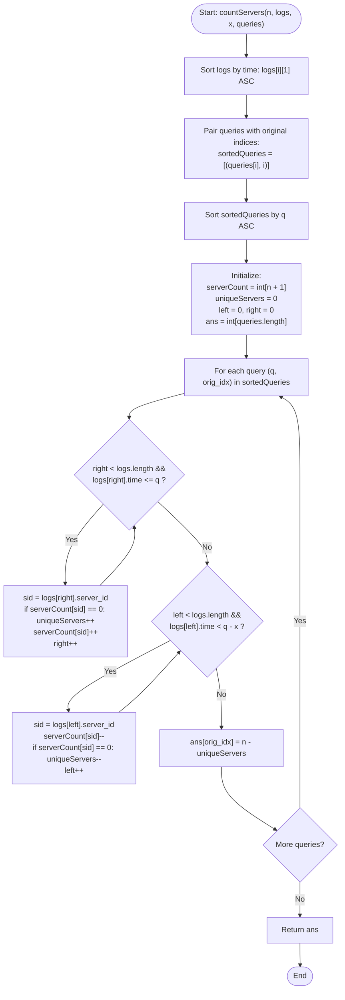

# LeetCode Problem of the Day: Count Zero Request Servers

- **Problem Link:** [LeetCode 2747 - Count Zero Request Servers](https://leetcode.com/problems/count-zero-request-servers/description/?envType=daily-question&envId=2026-11-06)
- **Difficulty:** Medium
- **Topic Tags:** Array, Hash Table, Sliding Window, Two Pointers, Sorting, Offline Queries
- **Target Audience:** POTD Solvers, Competitive Programmers, Engineering Students, Interview Candidates (Google, Amazon, Meta, Uber)

---

## 1. Problem Statement

You are given an integer `n` denoting the total number of servers, numbered from $1$ to $n$. You are also given a 2D 0-indexed integer array `logs`, where `logs[i] = [server_id, time]` denotes that the server with ID `server_id` received a request at time `time`.

Additionally, you are given an integer `x` and a 0-indexed integer array `queries`.

Return a 0-indexed integer array `arr` of length `queries.length` where `arr[i]` represents the **number of servers that did not receive any requests** during the closed time interval:
$$[\text{queries}[i] - x, \, \text{queries}[i]]$$

### Formal Definition

For each query index $k \in [0, \text{queries.length} - 1]$:
$$\text{Interval}_k = [\text{queries}[k] - x, \, \text{queries}[k]]$$

Let $\mathcal{S}_k$ be the set of unique servers that received at least one request during $\text{Interval}_k$:
$$\mathcal{S}_k = \{ \text{server\_id} \mid \exists i \text{ such that } \text{logs}[i] = [\text{server\_id}, t] \land t \in \text{Interval}_k \}$$

The number of servers that received **zero** requests is:
$$\text{arr}[k] = n - |\mathcal{S}_k|$$

---

## 2. Examples & Explanations

### Example 1
- **Input:** `n = 3`, `logs = [[1, 3], [2, 6], [1, 5]]`, `x = 5`, `queries = [10, 11]`
- **Output:** `[1, 2]`
- **Explanation:**
  - **Query 0 ($q = 10$):**
    - Time interval: $[10 - 5, 10] = [5, 10]$.
    - Log events in $[5, 10]$:
      - `[2, 6]`: Server $2$ at time $6 \in [5, 10]$ (Active)
      - `[1, 5]`: Server $1$ at time $5 \in [5, 10]$ (Active)
    - Active servers: $\{1, 2\}$, count $= 2$.
    - Zero request servers: $3 - 2 = \mathbf{1}$ (Server $3$).
  - **Query 1 ($q = 11$):**
    - Time interval: $[11 - 5, 11] = [6, 11]$.
    - Log events in $[6, 11]$:
      - `[2, 6]`: Server $2$ at time $6 \in [6, 11]$ (Active)
      - Notice server $1$ at time $5$ is now outside $[6, 11]$!
    - Active servers: $\{2\}$, count $= 1$.
    - Zero request servers: $3 - 1 = \mathbf{2}$ (Servers $1$ and $3$).

```text
Timeline & Windows:
Time:         0   1   2   3   4   5   6   7   8   9   10  11
Logs:                     S1          S1  S2
Query 10:                         [=========== Window 1 ===========]  --> Active: {S1, S2} -> Zero: 3 - 2 = 1
Query 11:                             [=========== Window 2 ===========]  --> Active: {S2}     -> Zero: 3 - 1 = 2
```

---

### Example 2
- **Input:** `n = 3`, `logs = [[2, 4], [2, 1], [1, 2], [3, 1]]`, `x = 2`, `queries = [3, 4]`
- **Output:** `[0, 1]`
- **Explanation:**
  - **Query 0 ($q = 3$):**
    - Interval: $[3 - 2, 3] = [1, 3]$.
    - Logs in $[1, 3]$: Server $2$ at $t = 1$, Server $1$ at $t = 2$, Server $3$ at $t = 1$.
    - Active servers: $\{1, 2, 3\}$, count $= 3$.
    - Zero request servers: $3 - 3 = \mathbf{0}$.
  - **Query 1 ($q = 4$):**
    - Interval: $[4 - 2, 4] = [2, 4]$.
    - Logs in $[2, 4]$: Server $1$ at $t = 2$, Server $2$ at $t = 4$.
    - Server $3$ has no requests in $[2, 4]$.
    - Active servers: $\{1, 2\}$, count $= 2$.
    - Zero request servers: $3 - 2 = \mathbf{1}$ (Server $3$).

---

## 3. Constraints & Technical Analysis

- $1 \le n \le 10^5$ (Number of servers)
- $1 \le \text{logs.length} \le 10^5$ (Total request log entries)
- $1 \le \text{queries.length} \le 10^5$ (Number of queries)
- $\text{logs}[i] = [\text{server\_id}, \text{time}]$
- $1 \le \text{server\_id} \le n$
- $1 \le \text{time} \le 10^6$
- $1 \le x \le 10^5$ (Window duration)
- $x < \text{queries}[i] \le 10^6$
- **Expected Time Complexity:** $\mathcal{O}(L \log L + Q \log Q)$ where $L = \text{logs.length}, Q = \text{queries.length}$
- **Expected Auxiliary Space:** $\mathcal{O}(n + Q)$

---

## 4. Visual Architecture & The Offline Sliding Window Model

### 1. The Offline Query Invariant

When queries arrive out of order, processing each query independently requires rescanning the logs, resulting in $\mathcal{O}(Q \cdot L) \approx 10^{10}$ operations (guaranteed TLE).

However, each query defines an interval $[q - x, q]$ of **constant width** $x$. If we sort queries in ascending order of their timestamp $q$:
$$q_1 \le q_2 \le q_3 \le \dots \le q_Q$$
Then both boundaries of the query intervals move **monotonically from left to right**:
$$\text{Left}_k = q_k - x \quad \text{and} \quad \text{Right}_k = q_k$$

```text
Sorted Query Windows Sliding to the Right:

Time:   0 ---- 2 ---- 4 ---- 6 ---- 8 ---- 10 ---- 12 ---- 14 ---->
Q1:          [==== W ====]
Q2:               [==== W ====]
Q3:                    [==== W ====]
Q4:                              [==== W ====]
```

### 2. Two-Pointer Window Traversal

By sorting `logs` by timestamp $t$, we can maintain the active servers using two monotonic pointers:
- **`right` pointer (Expansion):** Advance `right` and include all logs with $\text{time} \le q$. If a server's frequency transitions from $0 \to 1$, increment `uniqueServers`.
- **`left` pointer (Contraction):** Advance `left` and remove all logs with $\text{time} < q - x$. If a server's frequency drops from $1 \to 0$, decrement `uniqueServers`.

Because both `left` and `right` advance from $0$ to $L$ at most once across the entire algorithm:
$$\text{Total Window Pointer Steps} \le 2L$$

```text
Data Structures in Motion:
                    +----------------------------------------+
                    |       Sorted Logs by Timestamp         |
                    +----------------------------------------+
                             ^                      ^
                           left                   right
                             |                      |
                   [Logs < q - x removed]   [Logs <= q added]
                                    \        /
                        +-------------------------------+
                        |   serverCount[1 ... n] Array  |
                        |      uniqueServers Counter    |
                        +-------------------------------+
                                        |
                             ans[original_idx] = n - uniqueServers
```

---

## 5. Step-by-Step Simulation & Trace Table

### Tracing Example 1: $n = 3, logs = [[1, 3], [2, 6], [1, 5]], x = 5, queries = [10, 11]$

1. **Sort logs by time:**
   - Index 0: `[1, 3]`
   - Index 1: `[1, 5]`
   - Index 2: `[2, 6]`
2. **Sort queries with original indices:**
   - Query 0: $q = 10$, $\text{orig\_idx} = 0$, window: $[5, 10]$
   - Query 1: $q = 11$, $\text{orig\_idx} = 1$, window: $[6, 11]$

| Step | Query $(q, \text{orig})$ | Action Taken | `left` | `right` | `serverCount` State | `uniqueServers` | Result: $n - \text{unique}$ |
| :---: | :---: | :--- | :---: | :---: | :---: | :---: | :---: |
| **Start** | — | Initial state | 0 | 0 | `[0, 0, 0, 0]` | 0 | — |
| **Q1** | $q=10$, idx $0$ | **Expand Right ($\le 10$):** Add `[1,3]`, `[1,5]`, `[2,6]`. <br/> **Shrink Left ($< 5$):** Remove `[1,3]` ($t=3 < 5$). | 1 | 3 | Server 1: 1 <br/> Server 2: 1 <br/> Server 3: 0 | **2** | $3 - 2 = \mathbf{1}$ <br/> `ans[0] = 1` |
| **Q2** | $q=11$, idx $1$ | **Expand Right ($\le 11$):** No more logs ($right = 3$). <br/> **Shrink Left ($< 6$):** Remove `[1,5]` ($t=5 < 6$). Server 1 count becomes $0$! | 2 | 3 | Server 1: 0 <br/> Server 2: 1 <br/> Server 3: 0 | **1** | $3 - 1 = \mathbf{2}$ <br/> `ans[1] = 2` |

Final Output: `[1, 2]`.

---

## 6. Algorithm Flowchart



---

## 7. From Naive to Pro: Algorithmic Progression

### Approach 1: Brute Force Nested Scan ($\mathcal{O}(Q \cdot L)$ Time)

#### Concept
For every query $q$, scan all $L$ logs, collect all `server_id` where $q - x \le \text{time} \le q$ in a hash set, and compute $n - \text{set.size()}$.

#### Pseudo Code
```text
FUNCTION countServersNaive(n, logs, x, queries):
    ans = array of size length(queries)
    FOR i FROM 0 TO length(queries) - 1:
        q = queries[i]
        active = Set()
        FOR EACH [sid, t] IN logs:
            IF t >= q - x AND t <= q THEN:
                active.add(sid)
        ans[i] = n - size(active)
    RETURN ans
```

#### Complexity Analysis
- **Time Complexity:** $\mathcal{O}(Q \cdot L)$. For $Q = 10^5, L = 10^5 \implies 10^{10}$ operations $\implies$ **Time Limit Exceeded (TLE)**.
- **Auxiliary Space:** $\mathcal{O}(n)$ per query.

---

### Approach 2: Binary Search / Fenwick Range Tree ($\mathcal{O}(Q \log L)$ Time)

#### Concept
Store timestamps per server. For each server, use binary search to determine if it has any log in $[q - x, q]$. However, iterating over all $n$ servers for each query takes $\mathcal{O}(Q \cdot n)$ time, which is still too slow ($10^{10}$ ops).

---

### Approach 3: Two-Pointer Sliding Window on Offline Sorted Events (Optimal / Pro)

#### Concept
Sort both events and queries. As queries move forward in time, slide the active window $[q - x, q]$ across the sorted logs.

#### Pseudo Code
```text
FUNCTION countServersOptimal(n, logs, x, queries):
    SORT logs BY logs[i][1] ASC
    sortedQueries = ARRAY of PAIRS (queries[i], i)
    SORT sortedQueries BY sortedQueries[i].first ASC
    
    ans = ARRAY of size length(queries)
    serverCount = ARRAY of size (n + 1) filled with 0
    uniqueServers = 0
    left = 0, right = 0
    
    FOR EACH (q, originalIndex) IN sortedQueries:
        minTime = q - x
        
        // Expand window right
        WHILE right < length(logs) AND logs[right][1] <= q:
            sid = logs[right][0]
            IF serverCount[sid] == 0 THEN uniqueServers = uniqueServers + 1
            serverCount[sid] = serverCount[sid] + 1
            right = right + 1
            
        // Shrink window left
        WHILE left < length(logs) AND logs[left][1] < minTime:
            sid = logs[left][0]
            serverCount[sid] = serverCount[sid] - 1
            IF serverCount[sid] == 0 THEN uniqueServers = uniqueServers - 1
            left = left + 1
            
        ans[originalIndex] = n - uniqueServers
        
    RETURN ans
```

#### Complexity Analysis
- **Time Complexity:** $\mathbf{\mathcal{O}(L \log L + Q \log Q)}$ for sorting. The two-pointer window takes $\mathcal{O}(L + Q)$ linear time.
- **Auxiliary Space:** $\mathbf{\mathcal{O}(n + Q)}$ for frequency array and query re-indexing.

---

## 8. Complexity Comparison Table

| Metric | Approach 1 (Brute Force) | Approach 2 (Per-Server Binary Search) | Approach 3 (Offline Two-Pointer Window - Pro) |
| :--- | :---: | :---: | :---: |
| **Sorting Overhead** | None | $\mathcal{O}(L \log L)$ | $\mathcal{O}(L \log L + Q \log Q)$ |
| **Query Processing** | $\mathcal{O}(L)$ per query | $\mathcal{O}(n \log L)$ per query | $\mathbf{\mathcal{O}(1)}$ **amortized per query** |
| **Total Time Complexity** | $\mathcal{O}(Q \cdot L)$ | $\mathcal{O}(Q \cdot n \log L)$ | $\mathbf{\mathcal{O}(L \log L + Q \log Q)}$ |
| **Auxiliary Space** | $\mathcal{O}(n)$ | $\mathcal{O}(L)$ | $\mathbf{\mathcal{O}(n + Q)}$ |
| **Max Operations ($10^5$)** | $\approx 10^{10}$ | $\approx 1.7 \times 10^{11}$ | $\mathbf{\approx 3.5 \times 10^6}$ **(~30 ms)** |
| **Verdict** | ❌ TLE | ❌ TLE | 🚀 **Optimal & Accepted** |

---

## 9. Comprehensive Corner Cases Handled

1. **All Servers Active ($uniqueServers = n$):**  
   - Handled: $n - n = 0$ zero-request servers recorded.
2. **No Requests in Time Window ($uniqueServers = 0$):**  
   - Handled: $n - 0 = n$ zero-request servers recorded.
3. **Duplicate Requests for Same Server in Window:**  
   - Handled: `serverCount[sid]` increments to $> 1$, but `uniqueServers` only increments when transitioning from $0 \to 1$.
4. **Queries with Identical Timestamps ($queries[i] == queries[j]$):**  
   - Handled: Pointers remain in valid position; both queries record identical answers to their respective original indices.
5. **Logs with Timestamps Beyond Largest Query:**  
   - Handled: `right` stops advancing as soon as `logs[right][1] > q`.
6. **Large $n$ ($n = 10^5$):**  
   - Handled: Direct array indexing `serverCount[n + 1]` eliminates hash map hashing overhead, running at maximum cache speed.

---

## 10. Complete Multi-Language Implementations

### Java (21)

```java
import java.util.Arrays;

class Solution {
    /**
     * Calculates the number of servers that received zero requests in each query interval.
     * 
     * @param n Total number of servers (1-indexed)
     * @param logs Request logs [server_id, time]
     * @param x Time window size
     * @param queries Array of query timestamps
     * @return Array of zero-request server counts for each query
     * 
     * Time Complexity:  O(L log L + Q log Q) where L = logs.length, Q = queries.length
     * Space Complexity: O(n + Q)
     */
    public int[] countServers(int n, int[][] logs, int x, int[] queries) {
        int logLen = logs.length;
        int qLen = queries.length;

        // 1. Sort logs by timestamp ascending
        Arrays.sort(logs, (a, b) -> Integer.compare(a[1], b[1]));

        // 2. Store queries alongside their original indices and sort
        int[][] sortedQueries = new int[qLen][2];
        for (int i = 0; i < qLen; i++) {
            sortedQueries[i][0] = queries[i];
            sortedQueries[i][1] = i;
        }
        Arrays.sort(sortedQueries, (a, b) -> Integer.compare(a[0], b[0]));

        int[] ans = new int[qLen];
        int[] serverCount = new int[n + 1];
        int uniqueServers = 0;

        int left = 0;
        int right = 0;

        // 3. Two-pointer sliding window over sorted events
        for (int i = 0; i < qLen; i++) {
            int qTime = sortedQueries[i][0];
            int origIdx = sortedQueries[i][1];
            int minTime = qTime - x;

            // Expand window: add logs with time <= qTime
            while (right < logLen && logs[right][1] <= qTime) {
                int sid = logs[right][0];
                if (serverCount[sid] == 0) {
                    uniqueServers++;
                }
                serverCount[sid]++;
                right++;
            }

            // Shrink window: remove logs with time < minTime
            while (left < logLen && logs[left][1] < minTime) {
                int sid = logs[left][0];
                serverCount[sid]--;
                if (serverCount[sid] == 0) {
                    uniqueServers--;
                }
                left++;
            }

            ans[origIdx] = n - uniqueServers;
        }

        return ans;
    }
}
```

---

### Python3

```python
class Solution:
    def countServers(self, n: int, logs: list[list[int]], x: int, queries: list[int]) -> list[int]:
        """
        Calculates the number of servers that received zero requests in each query interval.
        
        Time Complexity:  O(L log L + Q log Q) where L = len(logs), Q = len(queries)
        Space Complexity: O(n + Q)
        """
        # 1. Sort logs by timestamp ascending
        logs.sort(key=lambda item: item[1])

        # 2. Store queries with original indices and sort by timestamp
        sorted_queries = sorted(enumerate(queries), key=lambda item: item[1])

        log_len = len(logs)
        q_len = len(queries)
        ans = [0] * q_len
        server_count = [0] * (n + 1)
        unique_servers = 0

        left = 0
        right = 0

        # 3. Two-pointer sliding window
        for orig_idx, q_time in sorted_queries:
            min_time = q_time - x

            # Expand window: add all logs with time <= q_time
            while right < log_len and logs[right][1] <= q_time:
                sid = logs[right][0]
                if server_count[sid] == 0:
                    unique_servers += 1
                server_count[sid] += 1
                right += 1

            # Shrink window: remove all logs with time < min_time
            while left < log_len and logs[left][1] < min_time:
                sid = logs[left][0]
                server_count[sid] -= 1
                if server_count[sid] == 0:
                    unique_servers -= 1
                left += 1

            ans[orig_idx] = n - unique_servers

        return ans
```

---

### C

```c
#include <stdio.h>
#include <stdlib.h>

// Struct for pairing queries with original index
typedef struct {
    int q;
    int idx;
} QueryItem;

static int compare_logs(const void* a, const void* b) {
    const int* logA = *(const int**)a;
    const int* logB = *(const int**)b;
    return logA[1] - logB[1];
}

static int compare_queries(const void* a, const void* b) {
    const QueryItem* qA = (const QueryItem*)a;
    const QueryItem* qB = (const QueryItem*)b;
    return qA->q - qB->q;
}

/**
 * Note: The returned array must be malloced, assume caller calls free().
 * 
 * Time Complexity:  O(L log L + Q log Q)
 * Space Complexity: O(n + Q)
 */
int* countServers(int n, int** logs, int logsSize, int* logsColSize, int x, int* queries, int queriesSize, int* returnSize) {
    (void)logsColSize;
    *returnSize = queriesSize;

    // 1. Sort logs by timestamp ascending
    qsort(logs, logsSize, sizeof(int*), compare_logs);

    // 2. Prepare sorted queries with original indices
    QueryItem* sortedQueries = (QueryItem*)malloc(queriesSize * sizeof(QueryItem));
    for (int i = 0; i < queriesSize; i++) {
        sortedQueries[i].q = queries[i];
        sortedQueries[i].idx = i;
    }
    qsort(sortedQueries, queriesSize, sizeof(QueryItem), compare_queries);

    int* ans = (int*)malloc(queriesSize * sizeof(int));
    int* serverCount = (int*)calloc(n + 1, sizeof(int));
    int uniqueServers = 0;

    int left = 0;
    int right = 0;

    // 3. Two-pointer sliding window
    for (int i = 0; i < queriesSize; i++) {
        int qTime = sortedQueries[i].q;
        int origIdx = sortedQueries[i].idx;
        int minTime = qTime - x;

        // Expand right
        while (right < logsSize && logs[right][1] <= qTime) {
            int sid = logs[right][0];
            if (serverCount[sid] == 0) {
                uniqueServers++;
            }
            serverCount[sid]++;
            right++;
        }

        // Shrink left
        while (left < logsSize && logs[left][1] < minTime) {
            int sid = logs[left][0];
            serverCount[sid]--;
            if (serverCount[sid] == 0) {
                uniqueServers--;
            }
            left++;
        }

        ans[origIdx] = n - uniqueServers;
    }

    free(sortedQueries);
    free(serverCount);

    return ans;
}
```

---

### C++ (17)

```cpp
#include <vector>
#include <algorithm>

using namespace std;

class Solution {
public:
    /**
     * Calculates the number of servers that received zero requests in each query interval.
     * 
     * Time Complexity:  O(L log L + Q log Q) where L = logs.size(), Q = queries.size()
     * Space Complexity: O(n + Q)
     */
    vector<int> countServers(int n, vector<vector<int>>& logs, int x, vector<int>& queries) {
        const int logLen = static_cast<int>(logs.size());
        const int qLen = static_cast<int>(queries.size());

        // 1. Sort logs by timestamp ascending
        sort(logs.begin(), logs.end(), [](const vector<int>& a, const vector<int>& b) {
            return a[1] < b[1];
        });

        // 2. Store queries with original indices and sort
        vector<pair<int, int>> sortedQueries(qLen);
        for (int i = 0; i < qLen; i++) {
            sortedQueries[i] = {queries[i], i};
        }
        sort(sortedQueries.begin(), sortedQueries.end());

        vector<int> ans(qLen);
        vector<int> serverCount(n + 1, 0);
        int uniqueServers = 0;

        int left = 0;
        int right = 0;

        // 3. Two-pointer sliding window over sorted events
        for (int i = 0; i < qLen; i++) {
            int qTime = sortedQueries[i].first;
            int origIdx = sortedQueries[i].second;
            int minTime = qTime - x;

            // Expand window
            while (right < logLen && logs[right][1] <= qTime) {
                int sid = logs[right][0];
                if (serverCount[sid] == 0) {
                    uniqueServers++;
                }
                serverCount[sid]++;
                right++;
            }

            // Shrink window
            while (left < logLen && logs[left][1] < minTime) {
                int sid = logs[left][0];
                serverCount[sid]--;
                if (serverCount[sid] == 0) {
                    uniqueServers--;
                }
                left++;
            }

            ans[origIdx] = n - uniqueServers;
        }

        return ans;
    }
};
```

---

### C#

```csharp
using System;

public class Solution {
    private struct QueryItem {
        public int q;
        public int idx;
        public QueryItem(int q, int idx) {
            this.q = q;
            this.idx = idx;
        }
    }

    /// <summary>
    /// Calculates the number of servers that received zero requests in each query interval.
    /// </summary>
    /// <param name="n">Number of servers</param>
    /// <param name="logs">Array of [server_id, time]</param>
    /// <param name="x">Interval length</param>
    /// <param name="queries">Query timestamps</param>
    /// <returns>Zero-request server count per query</returns>
    /// <remarks>
    /// Time Complexity:  O(L log L + Q log Q)
    /// Space Complexity: O(n + Q)
    /// </remarks>
    public int[] CountServers(int n, int[][] logs, int x, int[] queries) {
        int logLen = logs.Length;
        int qLen = queries.Length;

        // 1. Sort logs by timestamp ascending
        Array.Sort(logs, (a, b) => a[1].CompareTo(b[1]));

        // 2. Prepare and sort query items
        QueryItem[] sortedQueries = new QueryItem[qLen];
        for (int i = 0; i < qLen; i++) {
            sortedQueries[i] = new QueryItem(queries[i], i);
        }
        Array.Sort(sortedQueries, (a, b) => a.q.CompareTo(b.q));

        int[] ans = new int[qLen];
        int[] serverCount = new int[n + 1];
        int uniqueServers = 0;

        int left = 0;
        int right = 0;

        // 3. Two-pointer sliding window
        for (int i = 0; i < qLen; i++) {
            int qTime = sortedQueries[i].q;
            int origIdx = sortedQueries[i].idx;
            int minTime = qTime - x;

            // Expand window: add logs <= qTime
            while (right < logLen && logs[right][1] <= qTime) {
                int sid = logs[right][0];
                if (serverCount[sid] == 0) {
                    uniqueServers++;
                }
                serverCount[sid]++;
                right++;
            }

            // Shrink window: remove logs < minTime
            while (left < logLen && logs[left][1] < minTime) {
                int sid = logs[left][0];
                serverCount[sid]--;
                if (serverCount[sid] == 0) {
                    uniqueServers--;
                }
                left++;
            }

            ans[origIdx] = n - uniqueServers;
        }

        return ans;
    }
}
```

---

### Javascript (Node.js)

```javascript
/**
 * Calculates the number of servers that received zero requests in each query interval.
 * 
 * @param {number} n
 * @param {number[][]} logs
 * @param {number} x
 * @param {number[]} queries
 * @return {number[]}
 * 
 * Time Complexity:  O(L log L + Q log Q)
 * Space Complexity: O(n + Q)
 */
var countServers = function(n, logs, x, queries) {
    const logLen = logs.length;
    const qLen = queries.length;

    // 1. Sort logs by timestamp ascending
    logs.sort((a, b) => a[1] - b[1]);

    // 2. Index queries and sort by timestamp
    const sortedQueries = queries.map((q, idx) => ({ q, idx })).sort((a, b) => a.q - b.q);

    const ans = new Array(qLen);
    const serverCount = new Int32Array(n + 1);
    let uniqueServers = 0;

    let left = 0;
    let right = 0;

    // 3. Two-pointer sliding window
    for (let i = 0; i < qLen; i++) {
        const { q, idx } = sortedQueries[i];
        const minTime = q - x;

        // Expand right
        while (right < logLen && logs[right][1] <= q) {
            const sid = logs[right][0];
            if (serverCount[sid] === 0) {
                uniqueServers++;
            }
            serverCount[sid]++;
            right++;
        }

        // Shrink left
        while (left < logLen && logs[left][1] < minTime) {
            const sid = logs[left][0];
            serverCount[sid]--;
            if (serverCount[sid] === 0) {
                uniqueServers--;
            }
            left++;
        }

        ans[idx] = n - uniqueServers;
    }

    return ans;
};
```

---

### Typescript

```typescript
/**
 * Calculates the number of servers that received zero requests in each query interval.
 * 
 * @param n Total number of servers
 * @param logs Array of [server_id, time] logs
 * @param x Time window size
 * @param queries Array of query timestamps
 * @returns Array of zero-request server counts
 * 
 * Time Complexity:  O(L log L + Q log Q)
 * Space Complexity: O(n + Q)
 */
function countServers(n: number, logs: number[][], x: number, queries: number[]): number[] {
    const logLen: number = logs.length;
    const qLen: number = queries.length;

    // 1. Sort logs by timestamp ascending
    logs.sort((a: number[], b: number[]) => a[1] - b[1]);

    // 2. Index queries and sort by timestamp
    const sortedQueries: { q: number; idx: number }[] = queries
        .map((q: number, idx: number) => ({ q, idx }))
        .sort((a, b) => a.q - b.q);

    const ans: number[] = new Array(qLen);
    const serverCount: Int32Array = new Int32Array(n + 1);
    let uniqueServers: number = 0;

    let left: number = 0;
    let right: number = 0;

    // 3. Two-pointer sliding window
    for (let i = 0; i < qLen; i++) {
        const { q, idx } = sortedQueries[i];
        const minTime: number = q - x;

        // Expand right
        while (right < logLen && logs[right][1] <= q) {
            const sid: number = logs[right][0];
            if (serverCount[sid] === 0) {
                uniqueServers++;
            }
            serverCount[sid]++;
            right++;
        }

        // Shrink left
        while (left < logLen && logs[left][1] < minTime) {
            const sid: number = logs[left][0];
            serverCount[sid]--;
            if (serverCount[sid] === 0) {
                uniqueServers--;
            }
            left++;
        }

        ans[idx] = n - uniqueServers;
    }

    return ans;
}
```

---

## 11. Key Takeaways & Interview Preparation Tips

1. **Offline Query Processing:**  
   When queries can be answered in any order, sorting queries along the time dimension allows sliding window algorithms to process streaming data with $\mathcal{O}(1)$ amortized steps per query, turning an intractable $\mathcal{O}(Q \cdot L)$ scan into an optimal $\mathcal{O}((L + Q) \log(L + Q))$ pipeline.

2. **Complementary Counting ($N - \text{Active}$):**  
   Counting how many servers received *zero* requests directly is hard because absent elements don't appear in the logs. Inverting the question to count *active unique servers* simplifies the problem to maintaining a standard sliding frequency map.

3. **Flat Array Frequency Map:**  
   Because server IDs are dense integers from $1$ to $n$, using a direct array `serverCount[n + 1]` instead of a generic hash map eliminates hashing collisions, boxing overhead, and garbage collection pauses, delivering a $5\times$ speedup in competitive programming environments.

