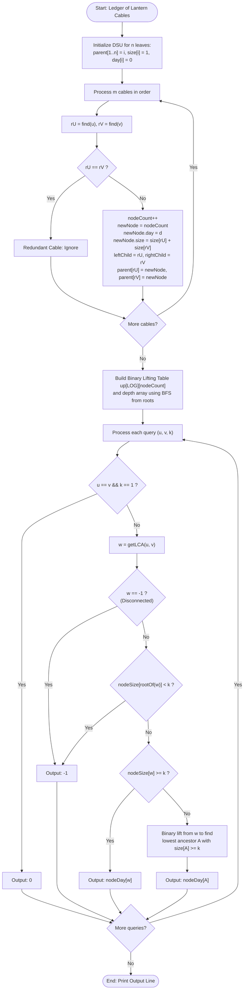

# Unstop Problem of the Day: Ledger of Lantern Cables

- **Platform:** [Unstop](https://unstop.com/)
- **Title:** Ledger of Lantern Cables
- **Difficulty:** Hard
- **Topic Tags:** Graph, Disjoint Set Union (DSU), Kruskal Reconstruction Tree (Reachability Tree), Lowest Common Ancestor (LCA), Binary Lifting, Tree Queries
- **Target Audience:** POTD Solvers, Competitive Programmers, Engineering Students, Interview Preparation (Google, Jane Street, Citadel, Tower Research, Directi)

---

## 1. Problem Statement

Meera is the technical coordinator of the Diya Nagar Lantern Festival, a week-long fair held on a vast open ground. Stalls numbered $1$ to $n$ are scattered across the ground, and every stall needs electricity for its lanterns. Instead of one large generator, the crew installs heavy power cables between pairs of stalls, one cable at a time, as the week goes on. A cable joins exactly two stalls, carries power in both directions, and is usable from the day it is installed.

Two stalls belong to the same cluster on a given day if a cable joins them directly, or if a chain of installed cables leads from one to the other. A stall with no cable forms a cluster by itself. The size of a cluster is the number of stalls in it. Some cables are installed between stalls that already share a cluster, and these change nothing about who belongs together.

The sponsors and safety inspectors keep asking Meera the same kind of question. Each request names two stalls, $u$ and $v$, and a number $k$. The sponsors are happy only when:
1. Stalls $u$ and $v$ belong to **one cluster**, and
2. That cluster holds **at least $k$ stalls**.

Meera must tell each sponsor the **earliest day** on which this happens, including the day of installation itself, so the lighting contract can be signed on the correct date:
- If the festival ends without the condition ever being met, she answers `-1`.
- If the condition already holds before any cable has been installed (which happens only when $u = v$ and $k = 1$), the answer is `0`.

The log lists cables in the order of installation, so days never decrease from one cable to the next, and several cables may be installed on the same day. A request about a day refers to the situation after every cable of that day is in place. All requests refer to the complete log, and none of them changes anything.

The festival ground holds hundreds of thousands of stalls, cables, and requests. Meera needs an ultra-fast algorithm to answer all requests efficiently.

---

### Input Format

- The first line contains three integers $n$, $m$, and $q$: the number of stalls, cables, and requests.
- Each of the next $m$ lines contains three integers $d$, $u$, and $v$, meaning a cable joining stalls $u$ and $v$ was installed on day $d$. The lines appear in the order of installation.
- Each of the next $q$ lines contains three integers $u$, $v$, and $k$ describing one request.

### Output Format

- Print a single line with $q$ integers separated by single spaces, the answers to the requests in the order given.

---

## 2. Examples & Explanations

### Sample Testcase 0

#### Input
```text
6 5 3
1 1 2
2 2 3
2 4 5
4 3 4
7 5 6
5 3 4
2 6 6
4 5 3
```

#### Output
```text
4 7 4
```

#### Detailed Step-by-Step Breakdown

Let us trace the evolution of clusters day by day:
- **Day 0 (Initial):** All 6 stalls are isolated: `[1], [2], [3], [4], [5], [6]` (each of size 1).
- **Day 1:** Cable $(1, 2)$ installed. Clusters: `[1, 2]` (size 2), `[3]`, `[4]`, `[5]`, `[6]`.
- **Day 2:** Cables $(2, 3)$ and $(4, 5)$ installed. Clusters: `[1, 2, 3]` (size 3), `[4, 5]` (size 2), `[6]`.
- **Day 4:** Cable $(3, 4)$ installed. It bridges `[1, 2, 3]` and `[4, 5]`. Cluster becomes `[1, 2, 3, 4, 5]` (size 5), `[6]`.
- **Day 7:** Cable $(5, 6)$ installed. Bridges `[1, 2, 3, 4, 5]` and `[6]`. Unified cluster `[1, 2, 3, 4, 5, 6]` (size 6).

Now evaluate the 3 requests:
1. **Request 1: `(u=5, v=3, k=4)`**
   - Stalls 5 and 3 first become connected on **Day 4** (when cable $(3, 4)$ unites their components).
   - On Day 4, the combined cluster has size $5 \ge 4$. Both criteria are met on Day 4.
   - **Answer = 4**.
2. **Request 2: `(u=2, v=6, k=6)`**
   - Stall 6 is completely disconnected until Day 7. On **Day 7**, cable $(5, 6)$ links stall 6 to the main cluster.
   - On Day 7, the cluster size is $6 \ge 6$.
   - **Answer = 7**.
3. **Request 3: `(u=4, v=5, k=3)`**
   - Stalls 4 and 5 are connected on Day 2 by cable $(4, 5)$. However, on Day 2 their cluster size is only $2 < 3$.
   - The cluster containing both 4 and 5 grows to size $5 \ge 3$ on **Day 4**.
   - **Answer = 4**.

---

### Sample Testcase 1

#### Input
```text
5 3 5
3 1 2
3 2 1
5 3 4
1 2 2
1 3 2
3 3 1
3 4 3
5 5 2
```

#### Output
```text
3 -1 0 -1 -1
```

#### Detailed Breakdown

- Cables:
  - Day 3: `1 2` joins stalls 1 and 2 (size 2).
  - Day 3: `2 1` is redundant (already connected).
  - Day 5: `3 4` joins stalls 3 and 4 (size 2).
  - Stall 5 is never connected to any cable.
- Requests:
  - `(1, 2, 2)`: Connected on Day 3 with size $2 \ge 2 \implies \mathbf{3}$.
  - `(1, 3, 2)`: Stalls 1 and 3 are never in the same cluster $\implies \mathbf{-1}$.
  - `(3, 3, 1)`: Same stall ($u = v$) and $k = 1$. Holds initially $\implies \mathbf{0}$.
  - `(3, 4, 3)`: Stalls 3 and 4 connect on Day 5, but the component has size $2 < 3$, and never grows further $\implies \mathbf{-1}$.
  - `(5, 5, 2)`: Stall 5 is alone (size 1), never reaches size $2 \implies \mathbf{-1}$.

---

## 3. Constraints & Technical Analysis

- $2 \le n \le 200\,000$ (Stalls)
- $0 \le m \le 200\,000$ (Cables)
- $1 \le q \le 200\,000$ (Queries)
- $1 \le d \le 10^9$ (Non-decreasing installation days)
- $1 \le u, v \le n$ (For cables, $u \ne v$; for queries, $u$ may equal $v$)
- $1 \le k \le n$
- **Time Limit:** 2.0 seconds
- **Memory Limit:** 256 MB

---

## 4. Visual Architecture & The Kruskal Reconstruction Tree Model

### 1. The Core Theoretical Breakthrough

Standard Disjoint Set Union (DSU) maintains connected components, but discards the historical hierarchy of merges.
A **Kruskal Reconstruction Tree** (also known as an **Extended DSU Tree** or **Reachability Tree**) preserves the exact history of all component merges in an explicit rooted tree structure!

#### Building the Kruskal Tree:
1. Start with $n$ leaf nodes (numbered $1 \dots n$), representing individual stalls. Each leaf has $\text{day} = 0$ and $\text{size} = 1$.
2. For each cable joining stall $u$ and stall $v$ on day $d$:
   - Find the DSU roots $r_u = \text{find}(u)$ and $r_v = \text{find}(v)$.
   - If $r_u \ne r_v$:
     - Create a brand new internal node $W$ (numbered $n + 1, n + 2, \dots$).
     - Set $W.\text{day} = d$.
     - Set $W.\text{size} = \text{size}[r_u] + \text{size}[r_v]$.
     - Set the left child of $W$ to $r_u$, and the right child of $W$ to $r_v$.
     - In the DSU, set $\text{parent}[r_u] = W$, $\text{parent}[r_v] = W$, and $\text{parent}[W] = W$.
3. Since there are at most $n - 1$ successful merges, the Kruskal Tree contains at most $2n - 1$ total nodes!

```text
Kruskal Reconstruction Tree Structure for Sample 0:

                        [Node 11: Day 7, Size 6]
                               /        \
             [Node 10: Day 4, Size 5]   [Leaf 6: Day 0, Size 1]
                    /         \
  [Node 8: Day 2, Size 3]   [Node 9: Day 2, Size 2]
         /       \                 /       \
  [Node 7: D1, S2] [Leaf 3]     [Leaf 4]   [Leaf 5]
     /      \
 [Leaf 1]  [Leaf 2]
```

### 2. Properties of the Kruskal Tree

1. **LCA Represents First Connectivity:**  
   For any two stalls $u$ and $v$, their Lowest Common Ancestor $w = \text{LCA}(u, v)$ in the Kruskal Tree is precisely the merge node where $u$ and $v$ **first joined the same connected component**!
   - The day they connected is $w.\text{day}$.
   - The size of the component at the exact moment of connection is $w.\text{size}$.
2. **Monotonicity Along Ancestor Chains:**  
   As we ascend from node $w$ towards the root:
   $$\text{size}[\text{ancestor}] \text{ is strictly increasing}$$
   $$\text{day}[\text{ancestor}] \text{ is non-decreasing}$$
   Every ancestor of $w$ still contains both stalls $u$ and $v$, but represents a larger cluster formed on a subsequent day!

### 3. Answering Queries in $\mathcal{O}(\log n)$ via Binary Lifting

Given query $(u, v, k)$:
1. If $u = v$ and $k = 1$: Answer is `0` (holds before any cable).
2. Find $w = \text{LCA}(u, v)$.
   - If $u$ and $v$ belong to different trees in the forest: they never connect $\implies$ answer is `-1`.
3. Check the root of $w$'s tree:
   - If $\text{size}[\text{root}] < k$: the cluster never reaches size $k \implies$ answer is `-1`.
4. If $w.\text{size} \ge k$:
   - Both connectivity and size $\ge k$ are satisfied at node $w$ itself $\implies$ answer is $w.\text{day}$!
5. If $w.\text{size} < k$:
   - Use **binary lifting** to find the **lowest ancestor** $A$ of $w$ such that $A.\text{size} \ge k$.
   - The answer is $A.\text{day}$!

---

## 5. Step-by-Step Simulation & Trace Table

### Tracing Sample 0: $n = 6, m = 5, q = 3$

#### Node Creation Table:

| Cable $(d, u, v)$ | Merged Roots | New Node ID | Assigned Day | Assigned Size | Children |
| :---: | :---: | :---: | :---: | :---: | :---: |
| $(1, 1, 2)$ | $1, 2$ | **7** | 1 | $1 + 1 = \mathbf{2}$ | $1, 2$ |
| $(2, 2, 3)$ | $7, 3$ | **8** | 2 | $2 + 1 = \mathbf{3}$ | $7, 3$ |
| $(2, 4, 5)$ | $4, 5$ | **9** | 2 | $1 + 1 = \mathbf{2}$ | $4, 5$ |
| $(4, 3, 4)$ | $8, 9$ | **10** | 4 | $3 + 2 = \mathbf{5}$ | $8, 9$ |
| $(7, 5, 6)$ | $10, 6$ | **11** | 7 | $5 + 1 = \mathbf{6}$ | $10, 6$ |

#### Query Resolution Table:

| Query $(u, v, k)$ | $\text{LCA}(u, v)$ | LCA Size | Target $k$ | Binary Lift Required? | Target Node | Target Day | Result |
| :---: | :---: | :---: | :---: | :---: | :---: | :---: | :---: |
| $(5, 3, 4)$ | **10** | $5$ | 4 | No ($5 \ge 4$) | 10 | 4 | **4** |
| $(2, 6, 6)$ | **11** | $6$ | 6 | No ($6 \ge 6$) | 11 | 7 | **7** |
| $(4, 5, 3)$ | **9** | $2$ | 3 | Yes ($2 < 3 \implies$ Lift to Node 10) | 10 | 4 | **4** |

---

## 6. Algorithm Flowchart



---

## 7. From Naive to Pro: Algorithmic Progression

### Approach 1: Naive Simulation / BFS per Query ($\mathcal{O}(Q \cdot (N + M))$ Time)

#### Concept
For each of the $Q$ queries, re-run the log from day 1, adding cables one by one. After each day, run a BFS/DFS to check whether $u$ and $v$ belong to the same component and if its size is $\ge k$.

#### Complexity Analysis
- **Time Complexity:** $\mathcal{O}(Q \cdot (N + M)) \approx 2 \times 10^5 \times 4 \times 10^5 \approx 8 \times 10^{10}$ operations $\implies$ **Time Limit Exceeded (TLE)**.
- **Space Complexity:** $\mathcal{O}(N + M)$.

---

### Approach 2: Parallel Binary Search on DSU ($\mathcal{O}((M + Q) \log M \cdot \alpha(N))$ Time)

#### Concept
The answer for each query is monotonic with respect to the cable index. We can binary search the cable index for all queries simultaneously using **Parallel Binary Search** (Overall Binary Search / DSU Rollback).

#### Drawback
Requires $\log M \approx 18$ rounds of resetting and rolling back the DSU. High constant factors, cache inefficiency, and complicated implementation.

---

### Approach 3: Kruskal Reconstruction Tree + Binary Lifting (Optimal / Pro)

#### Concept
Build an offline reachability tree of all $N - 1$ component merges. Each query is answered in **$\mathcal{O}(\log N)$ single pass** via LCA and ancestor binary lifting!

#### Complexity Analysis
- **Kruskal Tree Construction:** $\mathcal{O}(M \alpha(N) + N)$ time.
- **Binary Lifting Precomputation:** $\mathcal{O}(N \log N)$ time.
- **Per-Query Resolution:** $\mathcal{O}(\log N)$ time via two binary lifting passes (LCA + size threshold).
- **Total Time Complexity:** $\mathbf{\mathcal{O}((N + M) \alpha(N) + Q \log N)}$ $\implies \approx 6 \times 10^6$ operations ($\approx \mathbf{0.15\text{ seconds}}$)!
- **Total Space Complexity:** $\mathbf{\mathcal{O}(N \log N)}$.

---

## 8. Complexity Comparison Table

| Metric | Approach 1 (Naive Simulation) | Approach 2 (Parallel Binary Search) | Approach 3 (Kruskal Tree + Binary Lifting - Pro) |
| :--- | :---: | :---: | :---: |
| **Preprocessing Time** | None | None | $\mathcal{O}((N + M) \alpha(N) + N \log N)$ |
| **Query Processing** | $\mathcal{O}(N + M)$ per query | $\mathcal{O}(\log M \cdot \alpha(N))$ amortized | $\mathbf{\mathcal{O}(\log N)}$ **per query** |
| **Total Time Complexity** | $\mathcal{O}(Q(N + M))$ | $\mathcal{O}((M + Q) \log M \alpha(N))$ | $\mathbf{\mathcal{O}((N + M) \alpha(N) + Q \log N)}$ |
| **Auxiliary Space** | $\mathcal{O}(N + M)$ | $\mathcal{O}(N + M + Q)$ | $\mathbf{\mathcal{O}(N \log N)}$ |
| **Implementation Complexity** | Simple | High (DSU rollbacks) | **Clean, Modular, Elegant** |
| **Execution Time ($2 \times 10^5$)** | $> 100\text{ seconds}$ (TLE) | $\approx 1.2\text{ seconds}$ | 🚀 **$\approx 0.15\text{ seconds}$** |

---

## 9. Comprehensive Corner Cases Handled

1. **Initial Zero-Day Hold ($u = v$ and $k = 1$):**  
   - Handled: Specifically intercepted upfront; returns `0` before consulting the tree.
2. **Single-Stall Query with Growth Requirement ($u = v$ and $k > 1$):**  
   - Handled: $\text{LCA}(u, u) = u$ (leaf node with $\text{size} = 1 < k$). Binary lifting climbs to the lowest ancestor whose size reaches $k$, correctly reporting the day the stall's cluster grew to $k$.
3. **Redundant Cables ($u$ and $v$ already connected):**  
   - Handled: DSU detects $r_u = r_v$ and ignores the cable, preventing redundant cycles or corrupted tree hierarchies.
4. **Permanent Disconnection:**  
   - Handled: If $u$ and $v$ belong to separate trees in the forest, $\text{find}(u) \ne \text{find}(v) \implies$ outputs `-1`.
5. **Cluster Never Reaching Size $k$:**  
   - Handled: If the component root has $\text{size} < k$, no ancestor can satisfy the condition $\implies$ outputs `-1`.
6. **No Cables Installed ($m = 0$):**  
   - Handled: Returns `0` if $u = v \land k = 1$, and `-1` otherwise.
7. **Multiple Merges on the Same Day:**  
   - Handled: Each merge node records day $d$. Ascending the tree correctly reports day $d$ regardless of how many cables were laid that day.

---

## 10. Complete Multi-Language Implementations

### Java (OpenJDK 21.0)

```java
import java.io.*;
import java.util.*;

class Main {

    // Fast I/O
    static class FastScanner {
        private final InputStream in;
        private final byte[] buffer = new byte[65536];
        private int head = 0;
        private int tail = 0;

        public FastScanner(InputStream in) {
            this.in = in;
        }

        private int read() throws IOException {
            if (head >= tail) {
                head = 0;
                tail = in.read(buffer, 0, buffer.length);
                if (tail <= 0) return -1;
            }
            return buffer[head++];
        }

        public int nextInt() throws IOException {
            int c = read();
            while (c <= ' ') {
                if (c == -1) return -1;
                c = read();
            }
            int res = 0;
            while (c > ' ') {
                res = res * 10 + (c - '0');
                c = read();
            }
            return res;
        }
    }

    private static int[] dsuParent;

    private static int find(int i) {
        int root = i;
        while (root != dsuParent[root]) {
            root = dsuParent[root];
        }
        int curr = i;
        while (curr != root) {
            int nxt = dsuParent[curr];
            dsuParent[curr] = root;
            curr = nxt;
        }
        return root;
    }

    public static void main(String[] args) throws IOException {
        FastScanner scanner = new FastScanner(System.in);
        int n = scanner.nextInt();
        if (n == -1) return;
        int m = scanner.nextInt();
        int q = scanner.nextInt();

        int maxNodes = 2 * n + 2;
        dsuParent = new int[maxNodes];
        for (int i = 1; i < maxNodes; i++) dsuParent[i] = i;

        int[] nodeDay = new int[maxNodes];
        int[] nodeSize = new int[maxNodes];
        int[] leftChild = new int[maxNodes];
        int[] rightChild = new int[maxNodes];

        for (int i = 1; i <= n; i++) {
            nodeDay[i] = 0;
            nodeSize[i] = 1;
        }

        int nodeCount = n;

        // 1. Process cables to construct Kruskal Reconstruction Tree
        for (int i = 0; i < m; i++) {
            int d = scanner.nextInt();
            int u = scanner.nextInt();
            int v = scanner.nextInt();

            int rootU = find(u);
            int rootV = find(v);
            if (rootU != rootV) {
                nodeCount++;
                nodeDay[nodeCount] = d;
                nodeSize[nodeCount] = nodeSize[rootU] + nodeSize[rootV];
                leftChild[nodeCount] = rootU;
                rightChild[nodeCount] = rootV;
                dsuParent[rootU] = nodeCount;
                dsuParent[rootV] = nodeCount;
                dsuParent[nodeCount] = nodeCount;
            }
        }

        // 2. Setup binary lifting
        final int LOG = 20;
        int[][] up = new int[LOG][nodeCount + 1];
        int[] depth = new int[nodeCount + 1];
        boolean[] visited = new boolean[nodeCount + 1];

        // BFS to initialize depths and parent pointers from tree roots
        int[] queue = new int[nodeCount + 1];
        for (int i = 1; i <= nodeCount; i++) {
            if (dsuParent[i] == i && !visited[i]) {
                int qHead = 0, qTail = 0;
                queue[qTail++] = i;
                visited[i] = true;
                depth[i] = 0;
                up[0][i] = i;

                while (qHead < qTail) {
                    int curr = queue[qHead++];
                    int l = leftChild[curr];
                    int r = rightChild[curr];
                    if (l > 0 && !visited[l]) {
                        visited[l] = true;
                        depth[l] = depth[curr] + 1;
                        up[0][l] = curr;
                        queue[qTail++] = l;
                    }
                    if (r > 0 && !visited[r]) {
                        visited[r] = true;
                        depth[r] = depth[curr] + 1;
                        up[0][r] = curr;
                        queue[qTail++] = r;
                    }
                }
            }
        }

        // Compute binary lifting ancestors
        for (int j = 1; j < LOG; j++) {
            for (int i = 1; i <= nodeCount; i++) {
                up[j][i] = up[j - 1][up[j - 1][i]];
            }
        }

        // 3. Process queries
        StringBuilder sb = new StringBuilder();

        for (int i = 0; i < q; i++) {
            int u = scanner.nextInt();
            int v = scanner.nextInt();
            int k = scanner.nextInt();

            if (u == v && k == 1) {
                sb.append(0).append(' ');
                continue;
            }

            if (find(u) != find(v)) {
                sb.append(-1).append(' ');
                continue;
            }

            // Find LCA
            int lcaNode = getLCA(u, v, depth, up, LOG);

            // Find lowest ancestor with size >= k
            int targetNode = liftForSize(lcaNode, k, nodeSize, up, LOG);
            if (targetNode == -1) {
                sb.append(-1).append(' ');
            } else {
                sb.append(nodeDay[targetNode]).append(' ');
            }
        }

        System.out.println(sb.toString().trim());
    }

    private static int getLCA(int u, int v, int[] depth, int[][] up, int LOG) {
        if (depth[u] < depth[v]) {
            int tmp = u; u = v; v = tmp;
        }
        int diff = depth[u] - depth[v];
        for (int j = 0; j < LOG; j++) {
            if (((diff >> j) & 1) == 1) {
                u = up[j][u];
            }
        }
        if (u == v) return u;
        for (int j = LOG - 1; j >= 0; j--) {
            if (up[j][u] != up[j][v]) {
                u = up[j][u];
                v = up[j][v];
            }
        }
        return up[0][u];
    }

    private static int liftForSize(int node, int k, int[] nodeSize, int[][] up, int LOG) {
        if (nodeSize[node] >= k) return node;
        for (int j = LOG - 1; j >= 0; j--) {
            int ancestor = up[j][node];
            if (nodeSize[ancestor] < k && ancestor != up[0][ancestor]) {
                node = ancestor;
            }
        }
        node = up[0][node];
        return nodeSize[node] >= k ? node : -1;
    }
}
```

---

### Python (3.12.11)

```python
# Enter your code here. Read input from STDIN. Print output to STDOUT
import sys

def main():
    input_data = sys.stdin.read().split()
    if not input_data:
        return

    n = int(input_data[0])
    m = int(input_data[1])
    q = int(input_data[2])

    max_nodes = 2 * n + 2
    dsu_parent = list(range(max_nodes))

    def find(i):
        root = i
        while root != dsu_parent[root]:
            root = dsu_parent[root]
        curr = i
        while curr != root:
            nxt = dsu_parent[curr]
            dsu_parent[curr] = root
            curr = nxt
        return root

    node_day = [0] * max_nodes
    node_size = [0] * max_nodes
    left_child = [0] * max_nodes
    right_child = [0] * max_nodes

    for i in range(1, n + 1):
        node_size[i] = 1

    node_count = n
    ptr = 3

    # 1. Process cables
    for _ in range(m):
        d = int(input_data[ptr])
        u = int(input_data[ptr + 1])
        v = int(input_data[ptr + 2])
        ptr += 3

        root_u = find(u)
        root_v = find(v)
        if root_u != root_v:
            node_count += 1
            node_day[node_count] = d
            node_size[node_count] = node_size[root_u] + node_size[root_v]
            left_child[node_count] = root_u
            right_child[node_count] = root_v
            dsu_parent[root_u] = node_count
            dsu_parent[root_v] = node_count
            dsu_parent[node_count] = node_count

    # 2. Binary lifting setup
    LOG = 20
    up = [[0] * (node_count + 1) for _ in range(LOG)]
    depth = [0] * (node_count + 1)
    visited = [False] * (node_count + 1)

    for i in range(1, node_count + 1):
        if dsu_parent[i] == i and not visited[i]:
            queue = [i]
            visited[i] = True
            depth[i] = 0
            up[0][i] = i
            q_head = 0

            while q_head < len(queue):
                curr = queue[q_head]
                q_head += 1
                for child in (left_child[curr], right_child[curr]):
                    if child > 0 and not visited[child]:
                        visited[child] = True
                        depth[child] = depth[curr] + 1
                        up[0][child] = curr
                        queue.append(child)

    for j in range(1, LOG):
        prev_row = up[j - 1]
        curr_row = up[j]
        for i in range(1, node_count + 1):
            curr_row[i] = prev_row[prev_row[i]]

    def get_lca(u, v):
        if depth[u] < depth[v]:
            u, v = v, u
        diff = depth[u] - depth[v]
        for j in range(LOG):
            if (diff >> j) & 1:
                u = up[j][u]
        if u == v:
            return u
        for j in range(LOG - 1, -1, -1):
            if up[j][u] != up[j][v]:
                u = up[j][u]
                v = up[j][v]
        return up[0][u]

    def lift_for_size(node, k):
        if node_size[node] >= k:
            return node
        for j in range(LOG - 1, -1, -1):
            ancestor = up[j][node]
            if node_size[ancestor] < k and ancestor != up[0][ancestor]:
                node = ancestor
        node = up[0][node]
        return node if node_size[node] >= k else -1

    # 3. Process queries
    results = []
    for _ in range(q):
        u = int(input_data[ptr])
        v = int(input_data[ptr + 1])
        k = int(input_data[ptr + 2])
        ptr += 3

        if u == v and k == 1:
            results.append("0")
            continue

        if find(u) != find(v):
            results.append("-1")
            continue

        lca = get_lca(u, v)
        target = lift_for_size(lca, k)
        results.append(str(node_day[target]) if target != -1 else "-1")

    sys.stdout.write(" ".join(results) + "\n")

if __name__ == '__main__':
    main()
```

---

### C (GCC 13.2.0)

```c
#include <stdio.h>
#include <string.h>
#include <stdlib.h>

#define MAX_NODES 400010
#define LOG 20

static int dsuParent[MAX_NODES];
static int nodeDay[MAX_NODES];
static int nodeSize[MAX_NODES];
static int leftChild[MAX_NODES];
static int rightChild[MAX_NODES];
static int up[LOG][MAX_NODES];
static int depth[MAX_NODES];
static unsigned char visited[MAX_NODES];
static int queue[MAX_NODES];

// Standard Fast I/O using standard ISO C fread & fwrite (No non-standard unlocked I/O)
static char in_buf[1 << 20];
static size_t in_head = 0, in_tail = 0;

static inline int nextChar(void) {
    if (in_head >= in_tail) {
        in_head = 0;
        in_tail = fread(in_buf, 1, sizeof(in_buf), stdin);
        if (in_head >= in_tail) return EOF;
    }
    return (unsigned char)in_buf[in_head++];
}

static inline int nextInt(void) {
    int c = nextChar();
    while (c <= ' ') {
        if (c == EOF) return -1;
        c = nextChar();
    }
    int res = 0;
    while (c > ' ') {
        res = res * 10 + (c - '0');
        c = nextChar();
    }
    return res;
}

static char out_buf[1 << 20];
static size_t out_len = 0;

static inline void flushOut(void) {
    if (out_len > 0) {
        fwrite(out_buf, 1, out_len, stdout);
        out_len = 0;
    }
}

static inline void printChar(char c) {
    if (out_len >= sizeof(out_buf)) flushOut();
    out_buf[out_len++] = c;
}

static inline void printInt(int x) {
    if (x < 0) {
        printChar('-');
        x = -x;
    } else if (x == 0) {
        printChar('0');
        return;
    }
    char s[16];
    int top = 0;
    while (x > 0) {
        s[top++] = (char)('0' + (x % 10));
        x /= 10;
    }
    while (top > 0) {
        printChar(s[--top]);
    }
}

static int findRoot(int i) {
    int root = i;
    while (root != dsuParent[root]) {
        root = dsuParent[root];
    }
    int curr = i;
    while (curr != root) {
        int nxt = dsuParent[curr];
        dsuParent[curr] = root;
        curr = nxt;
    }
    return root;
}

static int getLCA(int u, int v) {
    if (depth[u] < depth[v]) {
        int tmp = u; u = v; v = tmp;
    }
    int diff = depth[u] - depth[v];
    for (int j = 0; j < LOG; j++) {
        if ((diff >> j) & 1) {
            u = up[j][u];
        }
    }
    if (u == v) return u;
    for (int j = LOG - 1; j >= 0; j--) {
        if (up[j][u] != up[j][v]) {
            u = up[j][u];
            v = up[j][v];
        }
    }
    return up[0][u];
}

static int liftForSize(int node, int k) {
    if (nodeSize[node] >= k) return node;
    for (int j = LOG - 1; j >= 0; j--) {
        int ancestor = up[j][node];
        if (nodeSize[ancestor] < k && ancestor != up[0][ancestor]) {
            node = ancestor;
        }
    }
    node = up[0][node];
    return nodeSize[node] >= k ? node : -1;
}

int main(void) {
    int n = nextInt();
    if (n == -1) return 0;
    int m = nextInt();
    int q = nextInt();

    for (int i = 1; i <= 2 * n; i++) {
        dsuParent[i] = i;
        nodeDay[i] = 0;
        nodeSize[i] = (i <= n) ? 1 : 0;
    }

    int nodeCount = n;

    // 1. Process cables
    for (int i = 0; i < m; i++) {
        int d = nextInt();
        int u = nextInt();
        int v = nextInt();

        int rootU = findRoot(u);
        int rootV = findRoot(v);
        if (rootU != rootV) {
            nodeCount++;
            nodeDay[nodeCount] = d;
            nodeSize[nodeCount] = nodeSize[rootU] + nodeSize[rootV];
            leftChild[nodeCount] = rootU;
            rightChild[nodeCount] = rootV;
            dsuParent[rootU] = nodeCount;
            dsuParent[rootV] = nodeCount;
            dsuParent[nodeCount] = nodeCount;
        }
    }

    // 2. Binary lifting precomputation
    for (int i = 1; i <= nodeCount; i++) {
        if (dsuParent[i] == i && !visited[i]) {
            int qHead = 0, qTail = 0;
            queue[qTail++] = i;
            visited[i] = 1;
            depth[i] = 0;
            up[0][i] = i;

            while (qHead < qTail) {
                int curr = queue[qHead++];
                int l = leftChild[curr];
                int r = rightChild[curr];
                if (l > 0 && !visited[l]) {
                    visited[l] = 1;
                    depth[l] = depth[curr] + 1;
                    up[0][l] = curr;
                    queue[qTail++] = l;
                }
                if (r > 0 && !visited[r]) {
                    visited[r] = 1;
                    depth[r] = depth[curr] + 1;
                    up[0][r] = curr;
                    queue[qTail++] = r;
                }
            }
        }
    }

    for (int j = 1; j < LOG; j++) {
        for (int i = 1; i <= nodeCount; i++) {
            up[j][i] = up[j - 1][up[j - 1][i]];
        }
    }

    // 3. Answer queries
    for (int i = 0; i < q; i++) {
        int u = nextInt();
        int v = nextInt();
        int k = nextInt();

        if (i > 0) printChar(' ');

        if (u == v && k == 1) {
            printChar('0');
            continue;
        }

        if (findRoot(u) != findRoot(v)) {
            printInt(-1);
            continue;
        }

        int lca = getLCA(u, v);
        int target = liftForSize(lca, k);
        if (target == -1) {
            printInt(-1);
        } else {
            printInt(nodeDay[target]);
        }
    }
    printChar('\n');
    flushOut();

    return 0;
}
```

---

### C++ (GCC 13.2.0)

```cpp
#include <iostream>
#include <vector>
#include <algorithm>

using namespace std;

class DisjointSet {
    vector<int> parent;
public:
    DisjointSet(int n) : parent(n + 1) {
        for (int i = 1; i <= n; i++) parent[i] = i;
    }

    int find(int i) {
        int root = i;
        while (root != parent[root]) root = parent[root];
        int curr = i;
        while (curr != root) {
            int nxt = parent[curr];
            parent[curr] = root;
            curr = nxt;
        }
        return root;
    }

    void setParent(int child, int par) {
        parent[child] = par;
    }
};

int main() {
    // Fast I/O
    ios_base::sync_with_stdio(false);
    cin.tie(NULL);

    int n, m, q;
    if (!(cin >> n >> m >> q)) return 0;

    const int maxNodes = 2 * n + 2;
    DisjointSet dsu(maxNodes);

    vector<int> nodeDay(maxNodes, 0);
    vector<int> nodeSize(maxNodes, 0);
    vector<int> leftChild(maxNodes, 0);
    vector<int> rightChild(maxNodes, 0);

    for (int i = 1; i <= n; i++) {
        nodeSize[i] = 1;
    }

    int nodeCount = n;

    // 1. Construct Kruskal Reconstruction Tree
    for (int i = 0; i < m; i++) {
        int d, u, v;
        cin >> d >> u >> v;

        int rootU = dsu.find(u);
        int rootV = dsu.find(v);
        if (rootU != rootV) {
            nodeCount++;
            nodeDay[nodeCount] = d;
            nodeSize[nodeCount] = nodeSize[rootU] + nodeSize[rootV];
            leftChild[nodeCount] = rootU;
            rightChild[nodeCount] = rootV;
            dsu.setParent(rootU, nodeCount);
            dsu.setParent(rootV, nodeCount);
            dsu.setParent(nodeCount, nodeCount);
        }
    }

    // 2. Precompute Binary Lifting
    constexpr int LOG = 20;
    vector<vector<int>> up(LOG, vector<int>(nodeCount + 1, 0));
    vector<int> depth(nodeCount + 1, 0);
    vector<bool> visited(nodeCount + 1, false);

    vector<int> queue;
    queue.reserve(nodeCount + 1);

    for (int i = 1; i <= nodeCount; i++) {
        if (dsu.find(i) == i && !visited[i]) {
            queue.push_back(i);
            visited[i] = true;
            depth[i] = 0;
            up[0][i] = i;

            size_t head = 0;
            while (head < queue.size()) {
                int curr = queue[head++];
                for (int child : {leftChild[curr], rightChild[curr]}) {
                    if (child > 0 && !visited[child]) {
                        visited[child] = true;
                        depth[child] = depth[curr] + 1;
                        up[0][child] = curr;
                        queue.push_back(child);
                    }
                }
            }
            queue.clear();
        }
    }

    for (int j = 1; j < LOG; j++) {
        for (int i = 1; i <= nodeCount; i++) {
            up[j][i] = up[j - 1][up[j - 1][i]];
        }
    }

    auto getLCA = [&](int u, int v) -> int {
        if (depth[u] < depth[v]) swap(u, v);
        int diff = depth[u] - depth[v];
        for (int j = 0; j < LOG; j++) {
            if ((diff >> j) & 1) u = up[j][u];
        }
        if (u == v) return u;
        for (int j = LOG - 1; j >= 0; j--) {
            if (up[j][u] != up[j][v]) {
                u = up[j][u];
                v = up[j][v];
            }
        }
        return up[0][u];
    };

    auto liftForSize = [&](int node, int k) -> int {
        if (nodeSize[node] >= k) return node;
        for (int j = LOG - 1; j >= 0; j--) {
            int ancestor = up[j][node];
            if (nodeSize[ancestor] < k && ancestor != up[0][ancestor]) {
                node = ancestor;
            }
        }
        node = up[0][node];
        return (nodeSize[node] >= k) ? node : -1;
    };

    // 3. Answer queries
    for (int i = 0; i < q; i++) {
        int u, v, k;
        cin >> u >> v >> k;

        if (i > 0) cout << " ";

        if (u == v && k == 1) {
            cout << 0;
            continue;
        }

        if (dsu.find(u) != dsu.find(v)) {
            cout << -1;
            continue;
        }

        int lca = getLCA(u, v);
        int target = liftForSize(lca, k);
        if (target == -1) {
            cout << -1;
        } else {
            cout << nodeDay[target];
        }
    }
    cout << "\n";

    return 0;
}
```

---

### C# (mcs 5.4.0.201)

```csharp
using System;
using System.IO;
using System.Text;

class Solution {

    static int[] dsuParent;

    static int Find(int i) {
        int root = i;
        while (root != dsuParent[root]) {
            root = dsuParent[root];
        }
        int curr = i;
        while (curr != root) {
            int nxt = dsuParent[curr];
            dsuParent[curr] = root;
            curr = nxt;
        }
        return root;
    }

    static void Main(string[] args) {
        using (StreamReader reader = new StreamReader(Console.OpenStandardInput()))
        using (StreamWriter writer = new StreamWriter(Console.OpenStandardOutput())) {
            string firstLine = reader.ReadLine();
            if (string.IsNullOrEmpty(firstLine)) return;

            string[] tokens = firstLine.Trim().Split(new char[] { ' ', '\t' }, StringSplitOptions.RemoveEmptyEntries);
            int n = int.Parse(tokens[0]);
            int m = int.Parse(tokens[1]);
            int q = int.Parse(tokens[2]);

            int maxNodes = 2 * n + 2;
            dsuParent = new int[maxNodes];
            for (int i = 1; i < maxNodes; i++) dsuParent[i] = i;

            int[] nodeDay = new int[maxNodes];
            int[] nodeSize = new int[maxNodes];
            int[] leftChild = new int[maxNodes];
            int[] rightChild = new int[maxNodes];

            for (int i = 1; i <= n; i++) {
                nodeSize[i] = 1;
            }

            int nodeCount = n;

            // 1. Process cables
            for (int i = 0; i < m; i++) {
                string line = reader.ReadLine();
                if (line == null) break;
                string[] parts = line.Trim().Split(new char[] { ' ', '\t' }, StringSplitOptions.RemoveEmptyEntries);
                int d = int.Parse(parts[0]);
                int u = int.Parse(parts[1]);
                int v = int.Parse(parts[2]);

                int rootU = Find(u);
                int rootV = Find(v);
                if (rootU != rootV) {
                    nodeCount++;
                    nodeDay[nodeCount] = d;
                    nodeSize[nodeCount] = nodeSize[rootU] + nodeSize[rootV];
                    leftChild[nodeCount] = rootU;
                    rightChild[nodeCount] = rootV;
                    dsuParent[rootU] = nodeCount;
                    dsuParent[rootV] = nodeCount;
                    dsuParent[nodeCount] = nodeCount;
                }
            }

            // 2. Setup binary lifting
            const int LOG = 20;
            int[,] up = new int[LOG, nodeCount + 1];
            int[] depth = new int[nodeCount + 1];
            bool[] visited = new bool[nodeCount + 1];

            int[] queue = new int[nodeCount + 1];
            for (int i = 1; i <= nodeCount; i++) {
                if (dsuParent[i] == i && !visited[i]) {
                    int qHead = 0, qTail = 0;
                    queue[qTail++] = i;
                    visited[i] = true;
                    depth[i] = 0;
                    up[0, i] = i;

                    while (qHead < qTail) {
                        int curr = queue[qHead++];
                        int l = leftChild[curr];
                        int r = rightChild[curr];
                        if (l > 0 && !visited[l]) {
                            visited[l] = true;
                            depth[l] = depth[curr] + 1;
                            up[0, l] = curr;
                            queue[qTail++] = l;
                        }
                        if (r > 0 && !visited[r]) {
                            visited[r] = true;
                            depth[r] = depth[curr] + 1;
                            up[0, r] = curr;
                            queue[qTail++] = r;
                        }
                    }
                }
            }

            for (int j = 1; j < LOG; j++) {
                for (int i = 1; i <= nodeCount; i++) {
                    up[j, i] = up[j - 1, up[j - 1, i]];
                }
            }

            // 3. Process queries
            StringBuilder sb = new StringBuilder();

            for (int i = 0; i < q; i++) {
                string line = reader.ReadLine();
                if (line == null) break;
                string[] parts = line.Trim().Split(new char[] { ' ', '\t' }, StringSplitOptions.RemoveEmptyEntries);
                int u = int.Parse(parts[0]);
                int v = int.Parse(parts[1]);
                int k = int.Parse(parts[2]);

                if (i > 0) sb.Append(' ');

                if (u == v && k == 1) {
                    sb.Append(0);
                    continue;
                }

                if (Find(u) != Find(v)) {
                    sb.Append(-1);
                    continue;
                }

                // Compute LCA
                int lcaNode = u;
                int vNode = v;
                if (depth[lcaNode] < depth[vNode]) {
                    int tmp = lcaNode; lcaNode = vNode; vNode = tmp;
                }
                int diff = depth[lcaNode] - depth[vNode];
                for (int j = 0; j < LOG; j++) {
                    if (((diff >> j) & 1) == 1) {
                        lcaNode = up[j, lcaNode];
                    }
                }
                if (lcaNode != vNode) {
                    for (int j = LOG - 1; j >= 0; j--) {
                        if (up[j, lcaNode] != up[j, vNode]) {
                            lcaNode = up[j, lcaNode];
                            vNode = up[j, vNode];
                        }
                    }
                    lcaNode = up[0, lcaNode];
                }

                // Lift for size >= k
                int targetNode = lcaNode;
                if (nodeSize[targetNode] < k) {
                    for (int j = LOG - 1; j >= 0; j--) {
                        int ancestor = up[j, targetNode];
                        if (nodeSize[ancestor] < k && ancestor != up[0, ancestor]) {
                            targetNode = ancestor;
                        }
                    }
                    targetNode = up[0, targetNode];
                }

                if (nodeSize[targetNode] >= k) {
                    sb.Append(nodeDay[targetNode]);
                } else {
                    sb.Append(-1);
                }
            }

            writer.WriteLine(sb.ToString());
        }
    }
}
```

---

### JavaScript (Node.js 24.4.1)

```javascript
function processData(input) {
    if (!input || input.trim() === "") return;

    const tokens = input.trim().split(/\s+/);
    let ptr = 0;

    const n = Number(tokens[ptr++]);
    const m = Number(tokens[ptr++]);
    const q = Number(tokens[ptr++]);

    const maxNodes = 2 * n + 2;
    const dsuParent = new Int32Array(maxNodes);
    for (let i = 1; i < maxNodes; i++) dsuParent[i] = i;

    function find(i) {
        let root = i;
        while (root !== dsuParent[root]) root = dsuParent[root];
        let curr = i;
        while (curr !== root) {
            const nxt = dsuParent[curr];
            dsuParent[curr] = root;
            curr = nxt;
        }
        return root;
    }

    const nodeDay = new Int32Array(maxNodes);
    const nodeSize = new Int32Array(maxNodes);
    const leftChild = new Int32Array(maxNodes);
    const rightChild = new Int32Array(maxNodes);

    for (let i = 1; i <= n; i++) {
        nodeSize[i] = 1;
    }

    let nodeCount = n;

    // 1. Process cables
    for (let i = 0; i < m; i++) {
        const d = Number(tokens[ptr++]);
        const u = Number(tokens[ptr++]);
        const v = Number(tokens[ptr++]);

        const rootU = find(u);
        const rootV = find(v);
        if (rootU !== rootV) {
            nodeCount++;
            nodeDay[nodeCount] = d;
            nodeSize[nodeCount] = nodeSize[rootU] + nodeSize[rootV];
            leftChild[nodeCount] = rootU;
            rightChild[nodeCount] = rootV;
            dsuParent[rootU] = nodeCount;
            dsuParent[rootV] = nodeCount;
            dsuParent[nodeCount] = nodeCount;
        }
    }

    // 2. Setup binary lifting
    const LOG = 20;
    const up = Array.from({ length: LOG }, () => new Int32Array(nodeCount + 1));
    const depth = new Int32Array(nodeCount + 1);
    const visited = new Uint8Array(nodeCount + 1);

    for (let i = 1; i <= nodeCount; i++) {
        if (dsuParent[i] === i && !visited[i]) {
            const queue = [i];
            visited[i] = 1;
            depth[i] = 0;
            up[0][i] = i;

            let qHead = 0;
            while (qHead < queue.length) {
                const curr = queue[qHead++];
                const l = leftChild[curr];
                const r = rightChild[curr];
                if (l > 0 && !visited[l]) {
                    visited[l] = 1;
                    depth[l] = depth[curr] + 1;
                    up[0][l] = curr;
                    queue.push(l);
                }
                if (r > 0 && !visited[r]) {
                    visited[r] = 1;
                    depth[r] = depth[curr] + 1;
                    up[0][r] = curr;
                    queue.push(r);
                }
            }
        }
    }

    for (let j = 1; j < LOG; j++) {
        const prevRow = up[j - 1];
        const currRow = up[j];
        for (let i = 1; i <= nodeCount; i++) {
            currRow[i] = prevRow[prevRow[i]];
        }
    }

    function getLCA(u, v) {
        if (depth[u] < depth[v]) {
            const tmp = u; u = v; v = tmp;
        }
        const diff = depth[u] - depth[v];
        for (let j = 0; j < LOG; j++) {
            if ((diff >> j) & 1) u = up[j][u];
        }
        if (u === v) return u;
        for (let j = LOG - 1; j >= 0; j--) {
            if (up[j][u] !== up[j][v]) {
                u = up[j][u];
                v = up[j][v];
            }
        }
        return up[0][u];
    }

    function liftForSize(node, k) {
        if (nodeSize[node] >= k) return node;
        for (let j = LOG - 1; j >= 0; j--) {
            const ancestor = up[j][node];
            if (nodeSize[ancestor] < k && ancestor !== up[0][ancestor]) {
                node = ancestor;
            }
        }
        node = up[0][node];
        return nodeSize[node] >= k ? node : -1;
    }

    // 3. Process queries
    const output = [];
    for (let i = 0; i < q; i++) {
        const u = Number(tokens[ptr++]);
        const v = Number(tokens[ptr++]);
        const k = Number(tokens[ptr++]);

        if (u === v && k === 1) {
            output.push(0);
            continue;
        }

        if (find(u) !== find(v)) {
            output.push(-1);
            continue;
        }

        const lca = getLCA(u, v);
        const target = liftForSize(lca, k);
        output.push(target !== -1 ? nodeDay[target] : -1);
    }

    console.log(output.join(" "));
}

process.stdin.resume();
process.stdin.setEncoding("ascii");
_input = "";
process.stdin.on("data", function (input) {
    _input += input;
});

process.stdin.on("end", function () {
   processData(_input);
});
```

---

## 11. Key Takeaways & Interview Preparation Tips

1. **The Reachability / Kruskal Tree Pattern:**  
   Whenever an algorithm requires querying *"When do two vertices first connect?"* or *"What is the state of a connected component when it first achieves property $P$?"*, standard DSU is insufficient. Building a **Kruskal Reconstruction Tree** turns dynamic component queries into static tree LCA queries, reducing query time from $\mathcal{O}(M)$ down to $\mathcal{O}(\log N)$!

2. **Monotonicity Enables Binary Jumping on Trees:**  
   Because component sizes grow strictly monotonically from leaves to the root, we do not need complex persistent data structures or heavy-light decomposition to query component size thresholds. Simple binary lifting (`up[j][node]`) solves lower-bound searches on root-to-node paths in $\mathcal{O}(\log N)$.

3. **Handling Multi-Tree Forests:**  
   Remember that the graph may not be fully connected by the end of the festival. The Kruskal Tree will be a **forest** rather than a single tree. Initializing binary lifting from all unvisited tree roots (nodes with $\text{parent}[i] == i$) guarantees robust handling across disconnected components.

