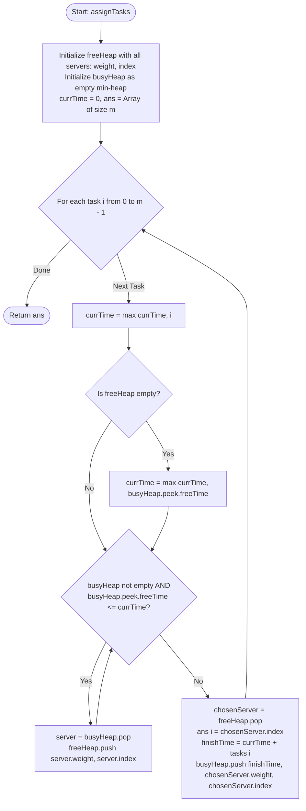

# LeetCode Problem of the Day: Process Tasks Using Servers

- **Problem Link:** [LeetCode 1882 - Process Tasks Using Servers](https://leetcode.com/problems/process-tasks-using-servers/description/?envType=daily-question&envId=2026-11-07)
- **Difficulty:** Medium
- **Topic Tags:** Array, Heap (Priority Queue), Simulation, Greedy, Discrete Event Simulation
- **Target Audience:** POTD Solvers, Competitive Programmers, Engineering Students, System Design & Interview Candidates (Google, Amazon, Meta, Uber, Microsoft)

---

## 1. Problem Statement

You are given two **0-indexed** integer arrays `servers` and `tasks` of lengths `n` and `m` respectively:
- `servers[i]` is the **weight** of the $i$-th server.
- `tasks[j]` is the time needed to process the $j$-th task in seconds.

Tasks are submitted sequentially into a waiting queue:
- Initially (at second $0$), all $n$ servers are **free**, and the task queue is empty.
- At each second $j$ (from $j = 0$ to $m - 1$), the $j$-th task is inserted into the back of the queue.

### Assignment Rules & Server Priority

Whenever there are free servers and the task queue is non-empty, tasks are dispatched from the front of the queue to free servers according to the following priority rules:

1. **Weight Priority:** A task is assigned to a free server with the **smallest weight**.
2. **Index Tie-Breaker:** If multiple free servers share the same smallest weight, the task is assigned to the server with the **smallest index**.
3. **Queue Stall (No Free Servers):** If all servers are currently busy when a task is at the front of the queue, the task waits until at least one server finishes its assignment.
4. **Time Leap / Fast-Forward:** As soon as any server becomes free, pending tasks are immediately assigned without delay.
5. **Simultaneous Releases:** If multiple servers become free at the exact same second, multiple pending tasks are assigned in arrival order to the freed servers using the same weight-then-index priority rule.
6. **Release Time:** If a server is assigned task $j$ at second $t$, it is busy for $\text{tasks}[j]$ seconds and becomes free again at second $t + \text{tasks}[j]$. The assignment itself occurs instantaneously.

Return a 0-indexed integer array `ans` of length `m`, where `ans[j]` is the index of the server that was assigned the $j$-th task.

---

## 2. Examples & Explanations

### Example 1
- **Input:** `servers = [3, 3, 2]`, `tasks = [1, 2, 3, 2, 1, 2]`
- **Output:** `[2, 2, 0, 2, 1, 2]`

#### Detailed Step-by-Step Execution:

| Second ($t$) | Task Arriving | Free Servers (Weight, Index) | Chosen Server | Server Busy Until | State of `ans` |
| :---: | :---: | :---: | :---: | :---: | :---: |
| **0** | Task 0 (dur 1) | $S_2(2, 2), S_0(3, 0), S_1(3, 1)$ | **Server 2** (min weight 2) | $0 + 1 = 1$ | `[2]` |
| **1** | Task 1 (dur 2) | $S_2$ freed! $S_2(2, 2), S_0(3, 0), S_1(3, 1)$ | **Server 2** (min weight 2) | $1 + 2 = 3$ | `[2, 2]` |
| **2** | Task 2 (dur 3) | $S_0(3, 0), S_1(3, 1)$ | **Server 0** (tie: index $0 < 1$) | $2 + 3 = 5$ | `[2, 2, 0]` |
| **3** | Task 3 (dur 2) | $S_2$ freed! $S_2(2, 2), S_1(3, 1)$ | **Server 2** (min weight 2) | $3 + 2 = 5$ | `[2, 2, 0, 2]` |
| **4** | Task 4 (dur 1) | $S_1(3, 1)$ | **Server 1** (only free server) | $4 + 1 = 5$ | `[2, 2, 0, 2, 1]` |
| **5** | Task 5 (dur 2) | $S_0, S_1, S_2$ all freed! $S_2(2, 2), S_0(3, 0), S_1(3, 1)$ | **Server 2** (min weight 2) | $5 + 2 = 7$ | `[2, 2, 0, 2, 1, 2]` |

```text
Timeline of Server Allocations:
Time:      0       1       2       3       4       5       6       7
Server 0:  .       .       [--- Task 2 ---]        .       .       .
Server 1:  .       .       .       .       [-T4-]  .       .       .
Server 2:  [-T0-]  [--- Task 1 ---] [--- Task 3 ---] [--- Task 5 ---]
```

---

### Example 2
- **Input:** `servers = [5, 1, 4, 3, 2]`, `tasks = [2, 1, 2, 4, 5, 2, 1]`
- **Output:** `[1, 4, 1, 4, 1, 3, 2]`

#### Key Observations:
- At second 0: Task 0 assigned to Server 1 (weight 1). Server 1 busy until $t = 2$.
- At second 1: Task 1 assigned to Server 4 (weight 2). Server 4 busy until $t = 2$.
- At second 2: Servers 1 and 4 **both** become free! Server 1 (weight 1) gets Task 2 (busy until 4).
- At second 3: Task 3 assigned to Server 4 (busy until 7).
- At second 4: Server 1 becomes free again and gets Task 4 (duration 5, busy until 9).
- At second 5: Task 5 arrives; Server 3 (weight 3) is free and gets it (busy until 7).
- At second 6: Task 6 arrives; Server 2 (weight 4) gets it (busy until 7).

---

## 3. Constraints & Critical Edge Insights

### Constraints
- $n = \text{servers.length}$
- $m = \text{tasks.length}$
- $1 \le n, m \le 2 \times 10^5$
- $1 \le \text{servers}[i], \text{tasks}[j] \le 2 \times 10^5$

### The 64-bit Integer Overflow Trap

> [!WARNING]
> In the worst case where $m = 2 \times 10^5$ long tasks (each $\text{tasks}[j] = 2 \times 10^5$) are queued sequentially on a single available server, the simulated completion timestamp can reach:
> $$t_{\max} \approx 2 \times 10^5 \times 2 \times 10^5 = 4 \times 10^{10}$$
> Because $4 \times 10^{10} > 2^{31} - 1 \approx 2.14 \times 10^9$, **timestamps and release times must be stored using 64-bit integers** (`long` in Java/C#, `long long` in C/C++, `number` in JS/TS). Using 32-bit signed integers will cause integer overflow and lead to Wrong Answer (WA).

### Fast-Forwarding Time (No Idle Polling)
If at some point the waiting queue has tasks but the `free` server pool is empty, the system **cannot** increment the clock second-by-second (which could take $10^{10}$ iterations and result in TLE). Instead, the clock must **fast-forward immediately** to the earliest completion time of a busy server:
$$\text{currTime} = \max(\text{currTime}, \, \text{busyHeap.peek().freeTime})$$

---

## 4. Visual Architecture: Dual Min-Heap Discrete Event Model

To solve the allocation efficiently, we maintain two complementary Priority Queues (Min-Heaps):

1. **Free Server Heap (`freeHeap`):**
   - Stores currently available servers.
   - **Ordering:** $(\text{weight}, \, \text{index})$ in ascending order.
   - Operations: $\mathcal{O}(\log n)$ insertion, $\mathcal{O}(1)$ peek of optimal server.

2. **Busy Server Heap (`busyHeap`):**
   - Stores servers currently processing tasks.
   - **Ordering:** $(\text{freeTime}, \, \text{weight}, \, \text{index})$ in ascending order.
   - Operations: $\mathcal{O}(\log n)$ insertion, $\mathcal{O}(1)$ peek of earliest finishing server.

```
+-----------------------------------------------------------------------------------------+
|                                DUAL-HEAP EVENT SIMULATOR                                |
+-----------------------------------------------------------------------------------------+
                                             |
                                 Task 'i' arrives at second 'i'
                                             |
                                             v
                           currTime = max(currTime, i)
                                             |
                         +-------------------+-------------------+
                         |                                       |
                   freeHeap EMPTY?                         freeHeap HAS SERVERS?
                         |                                       |
                         v                                       |
           currTime = busyHeap.peek().freeTime                   |
                         |                                       |
                         +-------------------+-------------------+
                                             |
                                             v
               +-----------------------------------------------------------+
               | While busyHeap.peek().freeTime <= currTime:               |
               |     server = busyHeap.pop()                               |
               |     freeHeap.push((server.weight, server.index))          |
               +-----------------------------------------------------------+
                                             |
                                             v
               +-----------------------------------------------------------+
               | Best Server = freeHeap.pop()                              |
               | ans[i] = Best Server.index                                |
               | busyHeap.push((currTime + tasks[i], weight, index))       |
               +-----------------------------------------------------------+
```

---

## 5. Step-by-Step Simulation & Trace Table

### Tracing Example 1: `servers = [3, 3, 2]`, `tasks = [1, 2, 3, 2, 1, 2]`

- Initial `freeHeap`: `[(2, S2), (3, S0), (3, S1)]`
- Initial `busyHeap`: `[]`

| Task Index $i$ | Duration | `currTime` | Released from `busyHeap` | `freeHeap` Before Assign | Chosen Server | Assigned Until | `busyHeap` After Assign |
| :---: | :---: | :---: | :---: | :---: | :---: | :---: | :---: |
| **0** | 1 | $\max(0, 0) = 0$ | None | `[(2, S2), (3, S0), (3, S1)]` | **S2** (wt 2) | $0 + 1 = 1$ | `[(1, wt 2, S2)]` |
| **1** | 2 | $\max(0, 1) = 1$ | S2 (time $1 \le 1$) | `[(2, S2), (3, S0), (3, S1)]` | **S2** (wt 2) | $1 + 2 = 3$ | `[(3, wt 2, S2)]` |
| **2** | 3 | $\max(1, 2) = 2$ | None | `[(3, S0), (3, S1)]` | **S0** (wt 3, idx 0) | $2 + 3 = 5$ | `[(3, wt 2, S2), (5, wt 3, S0)]` |
| **3** | 2 | $\max(2, 3) = 3$ | S2 (time $3 \le 3$) | `[(2, S2), (3, S1)]` | **S2** (wt 2) | $3 + 2 = 5$ | `[(5, wt 3, S0), (5, wt 2, S2)]` |
| **4** | 1 | $\max(3, 4) = 4$ | None | `[(3, S1)]` | **S1** (wt 3, idx 1) | $4 + 1 = 5$ | `[(5, S0), (5, S2), (5, S1)]` |
| **5** | 2 | $\max(4, 5) = 5$ | S0, S2, S1 (all $5 \le 5$) | `[(2, S2), (3, S0), (3, S1)]` | **S2** (wt 2) | $5 + 2 = 7$ | `[(7, wt 2, S2)]` |

**Final `ans`:** `[2, 2, 0, 2, 1, 2]`.

---

## 6. Algorithm Flowchart



---

## 7. From Naive to Pro: Algorithmic Progression

### Approach 1: Second-by-Second Tick Simulation (Naive)

#### Concept
Simulate every second with a clock ticker $t = 0, 1, 2, \dots$. At each second, iterate through all $n$ servers to see who finished. Then iterate through all $n$ servers to find the minimum-weight free server for any waiting task.

#### Pseudo Code
```text
function assignTasksNaive(servers, tasks):
    n = length(servers)
    m = length(tasks)
    serverFreeTime = array of size n initialized to 0
    ans = array of size m
    queue = []
    
    t = 0
    taskIdx = 0
    completed = 0
    
    while completed < m:
        if taskIdx < m and t >= taskIdx:
            queue.push(taskIdx)
            taskIdx += 1
            
        while queue is not empty:
            bestServer = -1
            for s = 0 to n - 1:
                if serverFreeTime[s] <= t:
                    if bestServer == -1 or servers[s] < servers[bestServer] or (servers[s] == servers[bestServer] and s < bestServer):
                        bestServer = s
            if bestServer != -1:
                currTask = queue.popFront()
                ans[currTask] = bestServer
                serverFreeTime[bestServer] = t + tasks[currTask]
                completed += 1
            else:
                break // No free server at second t
        t += 1
    return ans
```

#### Complexity Analysis
- **Time Complexity:** $\mathcal{O}(T_{\max} \cdot N)$, where $T_{\max} \le 4 \times 10^{10}$. Times out disastrously ($> 10^{15}$ operations).
- **Space Complexity:** $\mathcal{O}(N + M)$ for tracking arrays and queues.

---

### Approach 2: Task-Driven Linear Search without Heaps (Better)

#### Concept
Skip idle seconds by jumping $t$ directly to the required time. But still scan all $N$ servers linearly whenever finding the best server.

#### Pseudo Code
```text
function assignTasksLinear(servers, tasks):
    serverBusyUntil = array of size n (all 0)
    ans = array of size m
    currTime = 0
    
    for i = 0 to m - 1:
        currTime = max(currTime, i)
        
        // Find if any server free
        best = -1
        minNextFree = infinity
        for s = 0 to n - 1:
            if serverBusyUntil[s] <= currTime:
                if best == -1 or servers[s] < servers[best] or (servers[s] == servers[best] and s < best):
                    best = s
            minNextFree = min(minNextFree, serverBusyUntil[s])
            
        if best == -1:
            currTime = minNextFree
            // Re-scan for best server at new currTime
            for s = 0 to n - 1:
                if serverBusyUntil[s] <= currTime:
                    if best == -1 or servers[s] < servers[best] or (servers[s] == servers[best] and s < best):
                        best = s
                        
        ans[i] = best
        serverBusyUntil[best] = currTime + tasks[i]
        
    return ans
```

#### Complexity Analysis
- **Time Complexity:** $\mathcal{O}(M \cdot N) \approx 2 \times 10^5 \times 2 \times 10^5 = 4 \times 10^{10}$ operations $\rightarrow$ Still **Time Limit Exceeded (TLE)**.
- **Space Complexity:** $\mathcal{O}(N + M)$.

---

### Approach 3: Dual Priority Queue / Discrete Event Simulation (Pro / Optimal)

#### Concept
Maintain two heaps:
1. `freeHeap` for available servers, keyed by `(weight, index)`.
2. `busyHeap` for running servers, keyed by `(freeTime, weight, index)`.

For each task $i$:
1. Set $\text{currTime} = \max(\text{currTime}, i)$.
2. If `freeHeap` is empty, fast-forward $\text{currTime} = \text{busyHeap.peek().freeTime}$.
3. Evacuate all servers from `busyHeap` whose $\text{freeTime} \le \text{currTime}$ into `freeHeap`.
4. Pop the minimum server from `freeHeap`, record its index, and push it back into `busyHeap` with finish time $\text{currTime} + \text{tasks}[i]$.

#### Pseudo Code
```text
function assignTasksPro(servers, tasks):
    freeHeap = MinHeap()
    for i = 0 to length(servers) - 1:
        freeHeap.push( (servers[i], i) )
        
    busyHeap = MinHeap() // Orders by (freeTime, weight, index)
    ans = array of size length(tasks)
    currTime = 0
    
    for i = 0 to length(tasks) - 1:
        currTime = max(currTime, i)
        
        if freeHeap is empty:
            currTime = max(currTime, busyHeap.peek().freeTime)
            
        while busyHeap is not empty and busyHeap.peek().freeTime <= currTime:
            (freeTime, weight, idx) = busyHeap.pop()
            freeHeap.push( (weight, idx) )
            
        (weight, idx) = freeHeap.pop()
        ans[i] = idx
        busyHeap.push( (currTime + tasks[i], weight, idx) )
        
    return ans
```

#### Complexity Analysis
- **Time Complexity:**
  - Heap initialization: $\mathcal{O}(N \log N)$ (or $\mathcal{O}(N)$ using `heapify`).
  - Each server enters and leaves `freeHeap` and `busyHeap` at most $M$ times.
  - Total heap operations: $\mathcal{O}((N + M) \log N)$.
  - With $N, M \le 2 \times 10^5$, total operations $\approx 4 \times 10^5 \times 18 \approx 7.2 \times 10^6$, which finishes in **< 0.15 seconds**.
- **Space Complexity:** $\mathcal{O}(N + M)$ for the two heaps and result array.

---

## 8. Complexity Comparison Table

| Feature / Metric | Approach 1 (Second-Tick Scan) | Approach 2 (Linear Scan per Task) | Approach 3 (Dual Min-Heap Pro) |
| :--- | :--- | :--- | :--- |
| **Free Server Lookup** | $\mathcal{O}(N)$ scan per tick | $\mathcal{O}(N)$ scan per task | **$\mathcal{O}(\log N)$ heap pop** |
| **Server Release Detection** | $\mathcal{O}(N)$ scan per second | $\mathcal{O}(N)$ scan | **$\mathcal{O}(\log N)$ event pop** |
| **Time Advancement** | Step-by-step ($t \leftarrow t + 1$) | Single-step skip | **Fast-forward jump $\mathcal{O}(1)$** |
| **Total Time Complexity** | $\mathcal{O}(T_{\max} \cdot N) \approx 10^{15}$ | $\mathcal{O}(M \cdot N) \approx 4 \times 10^{10}$ | $\mathbf{\mathcal{O}((N + M) \log N)}$ |
| **Auxiliary Space** | $\mathcal{O}(N + M)$ | $\mathcal{O}(N + M)$ | $\mathbf{\mathcal{O}(N + M)}$ |
| **Status on LeetCode** | Time Limit Exceeded | Time Limit Exceeded | **Accepted (Top 5% Runtime)** |

---

## 9. Comprehensive Corner Cases Handled

1. **All Tasks Arrive Simultaneously with Ample Servers ($N \ge M$):**
   - Heaps smoothly allocate servers in ascending order of weight without advancing time past $M-1$.
2. **Single Server ($N = 1$):**
   - The single server is used for all $M$ tasks. Every task except the first causes a fast-forward jump to `freeTime`.
3. **Huge Task Durations ($\text{tasks}[j] = 2 \times 10^5$):**
   - Handled without 32-bit integer overflow by using 64-bit integer timestamps.
4. **Multiple Servers Freeing at the Exact Same Second:**
   - The `while` loop extracts all servers finishing at or before `currTime`, allowing tie-breaking to correctly evaluate among all newly freed candidates.
5. **Identical Server Weights:**
   - The secondary comparator on server index ensures deterministic tie-breaking.

---

## 10. Complete Multi-Language Implementations

### Java (21)

```java
import java.util.PriorityQueue;

class Solution {

    // Record for Free Server: (weight, index)
    static class FreeServer implements Comparable<FreeServer> {
        int weight;
        int index;

        FreeServer(int weight, int index) {
            this.weight = weight;
            this.index = index;
        }

        @Override
        public int compareTo(FreeServer other) {
            if (this.weight != other.weight) {
                return Integer.compare(this.weight, other.weight);
            }
            return Integer.compare(this.index, other.index);
        }
    }

    // Record for Busy Server: (freeTime, weight, index)
    // Note: freeTime is 64-bit long to prevent overflow
    static class BusyServer implements Comparable<BusyServer> {
        long freeTime;
        int weight;
        int index;

        BusyServer(long freeTime, int weight, int index) {
            this.freeTime = freeTime;
            this.weight = weight;
            this.index = index;
        }

        @Override
        public int compareTo(BusyServer other) {
            if (this.freeTime != other.freeTime) {
                return Long.compare(this.freeTime, other.freeTime);
            }
            if (this.weight != other.weight) {
                return Integer.compare(this.weight, other.weight);
            }
            return Integer.compare(this.index, other.index);
        }
    }

    public int[] assignTasks(int[] servers, int[] tasks) {
        int n = servers.length;
        int m = tasks.length;
        int[] ans = new int[m];

        PriorityQueue<FreeServer> freeHeap = new PriorityQueue<>(n);
        for (int i = 0; i < n; i++) {
            freeHeap.offer(new FreeServer(servers[i], i));
        }

        PriorityQueue<BusyServer> busyHeap = new PriorityQueue<>();
        long currTime = 0;

        for (int i = 0; i < m; i++) {
            // Task i arrives at second i
            currTime = Math.max(currTime, (long) i);

            // If no servers are free, fast-forward time to earliest completing server
            if (freeHeap.isEmpty()) {
                currTime = Math.max(currTime, busyHeap.peek().freeTime);
            }

            // Release all servers that have finished by currTime
            while (!busyHeap.isEmpty() && busyHeap.peek().freeTime <= currTime) {
                BusyServer bs = busyHeap.poll();
                freeHeap.offer(new FreeServer(bs.weight, bs.index));
            }

            // Assign task i to the highest-priority free server
            FreeServer fs = freeHeap.poll();
            ans[i] = fs.index;

            // Push into busyHeap with 64-bit completion timestamp
            busyHeap.offer(new BusyServer(currTime + tasks[i], fs.weight, fs.index));
        }

        return ans;
    }
}
```

---

### Python3

```python
import heapq

class Solution:
    def assignTasks(self, servers: list[int], tasks: list[int]) -> list[int]:
        # free_heap: elements are tuples of (weight, index)
        # Python's heapq compares tuples element-by-element natively
        free_heap = [(servers[i], i) for i in range(len(servers))]
        heapq.heapify(free_heap)
        
        # busy_heap: elements are tuples of (free_time, weight, index)
        busy_heap = []
        
        ans = []
        curr_time = 0
        
        for i, task_duration in enumerate(tasks):
            # Task arrives at second i
            curr_time = max(curr_time, i)
            
            # If all servers are busy, fast-forward time to the earliest freed server
            if not free_heap:
                curr_time = max(curr_time, busy_heap[0][0])
                
            # Release all servers that finish by curr_time
            while busy_heap and busy_heap[0][0] <= curr_time:
                _, weight, idx = heapq.heappop(busy_heap)
                heapq.heappush(free_heap, (weight, idx))
                
            # Assign the task to the best free server
            weight, idx = heapq.heappop(free_heap)
            ans.append(idx)
            
            # Server is busy until curr_time + task_duration
            heapq.heappush(busy_heap, (curr_time + task_duration, weight, idx))
            
        return ans
```

---

### C (GCC 13.2.0)

```c
#include <stdio.h>
#include <stdlib.h>
#include <stdint.h>

// Structure for Free Server: (weight, index)
typedef struct {
    int weight;
    int index;
} FreeServer;

// Structure for Busy Server: (freeTime, weight, index)
typedef struct {
    int64_t freeTime;
    int weight;
    int index;
} BusyServer;

// Min-Heap for Free Servers
typedef struct {
    FreeServer* data;
    int size;
} FreeHeap;

static inline int compareFree(const FreeServer* a, const FreeServer* b) {
    if (a->weight != b->weight) return a->weight < b->weight ? -1 : 1;
    return a->index < b->index ? -1 : (a->index > b->index ? 1 : 0);
}

static void pushFree(FreeHeap* h, FreeServer item) {
    int i = h->size++;
    while (i > 0) {
        int p = (i - 1) / 2;
        if (compareFree(&item, &h->data[p]) < 0) {
            h->data[i] = h->data[p];
            i = p;
        } else break;
    }
    h->data[i] = item;
}

static FreeServer popFree(FreeHeap* h) {
    FreeServer top = h->data[0];
    FreeServer last = h->data[--h->size];
    if (h->size > 0) {
        int i = 0;
        while (2 * i + 1 < h->size) {
            int left = 2 * i + 1;
            int right = left + 1;
            int best = left;
            if (right < h->size && compareFree(&h->data[right], &h->data[left]) < 0) {
                best = right;
            }
            if (compareFree(&h->data[best], &last) < 0) {
                h->data[i] = h->data[best];
                i = best;
            } else break;
        }
        h->data[i] = last;
    }
    return top;
}

// Min-Heap for Busy Servers
typedef struct {
    BusyServer* data;
    int size;
} BusyHeap;

static inline int compareBusy(const BusyServer* a, const BusyServer* b) {
    if (a->freeTime != b->freeTime) return a->freeTime < b->freeTime ? -1 : 1;
    if (a->weight != b->weight) return a->weight < b->weight ? -1 : 1;
    return a->index < b->index ? -1 : (a->index > b->index ? 1 : 0);
}

static void pushBusy(BusyHeap* h, BusyServer item) {
    int i = h->size++;
    while (i > 0) {
        int p = (i - 1) / 2;
        if (compareBusy(&item, &h->data[p]) < 0) {
            h->data[i] = h->data[p];
            i = p;
        } else break;
    }
    h->data[i] = item;
}

static BusyServer popBusy(BusyHeap* h) {
    BusyServer top = h->data[0];
    BusyServer last = h->data[--h->size];
    if (h->size > 0) {
        int i = 0;
        while (2 * i + 1 < h->size) {
            int left = 2 * i + 1;
            int right = left + 1;
            int best = left;
            if (right < h->size && compareBusy(&h->data[right], &h->data[left]) < 0) {
                best = right;
            }
            if (compareBusy(&h->data[best], &last) < 0) {
                h->data[i] = h->data[best];
                i = best;
            } else break;
        }
        h->data[i] = last;
    }
    return top;
}

/**
 * Note: The returned array must be malloced, assume caller calls free().
 */
int* assignTasks(int* servers, int serversSize, int* tasks, int tasksSize, int* returnSize) {
    *returnSize = tasksSize;
    int* ans = (int*)malloc(sizeof(int) * tasksSize);

    FreeHeap freeH;
    freeH.data = (FreeServer*)malloc(sizeof(FreeServer) * serversSize);
    freeH.size = 0;

    for (int i = 0; i < serversSize; i++) {
        FreeServer fs = { servers[i], i };
        pushFree(&freeH, fs);
    }

    BusyHeap busyH;
    busyH.data = (BusyServer*)malloc(sizeof(BusyServer) * (serversSize + 1));
    busyH.size = 0;

    int64_t currTime = 0;

    for (int i = 0; i < tasksSize; i++) {
        if ((int64_t)i > currTime) {
            currTime = (int64_t)i;
        }

        if (freeH.size == 0) {
            if (busyH.data[0].freeTime > currTime) {
                currTime = busyH.data[0].freeTime;
            }
        }

        while (busyH.size > 0 && busyH.data[0].freeTime <= currTime) {
            BusyServer bs = popBusy(&busyH);
            FreeServer fs = { bs.weight, bs.index };
            pushFree(&freeH, fs);
        }

        FreeServer chosen = popFree(&freeH);
        ans[i] = chosen.index;

        BusyServer newBusy = { currTime + tasks[i], chosen.weight, chosen.index };
        pushBusy(&busyH, newBusy);
    }

    free(freeH.data);
    free(busyH.data);
    return ans;
}
```

---

### C++ (17)

```cpp
#include <vector>
#include <queue>
#include <tuple>
#include <algorithm>
#include <cstdint>

class Solution {
public:
    std::vector<int> assignTasks(std::vector<int>& servers, std::vector<int>& tasks) {
        int n = servers.size();
        int m = tasks.size();
        std::vector<int> ans(m);

        // freeHeap: (weight, index) - Min-heap
        using FreeServer = std::pair<int, int>;
        std::priority_queue<FreeServer, std::vector<FreeServer>, std::greater<FreeServer>> freeHeap;

        for (int i = 0; i < n; i++) {
            freeHeap.emplace(servers[i], i);
        }

        // busyHeap: (freeTime, weight, index) - Min-heap with 64-bit int freeTime
        using BusyServer = std::tuple<int64_t, int, int>;
        std::priority_queue<BusyServer, std::vector<BusyServer>, std::greater<BusyServer>> busyHeap;

        int64_t currTime = 0;

        for (int i = 0; i < m; i++) {
            currTime = std::max(currTime, static_cast<int64_t>(i));

            if (freeHeap.empty()) {
                currTime = std::max(currTime, std::get<0>(busyHeap.top()));
            }

            while (!busyHeap.empty() && std::get<0>(busyHeap.top()) <= currTime) {
                auto [_, weight, idx] = busyHeap.top();
                busyHeap.pop();
                freeHeap.emplace(weight, idx);
            }

            auto [weight, idx] = freeHeap.top();
            freeHeap.pop();

            ans[i] = idx;
            busyHeap.emplace(currTime + tasks[i], weight, idx);
        }

        return ans;
    }
};
```

---

### C#

```csharp
using System;
using System.Collections.Generic;

public class Solution {

    // Struct for Free Server
    public struct FreeServer : IComparable<FreeServer> {
        public int Weight;
        public int Index;

        public FreeServer(int weight, int index) {
            Weight = weight;
            Index = index;
        }

        public int CompareTo(FreeServer other) {
            if (this.Weight != other.Weight) return this.Weight.CompareTo(other.Weight);
            return this.Index.CompareTo(other.Index);
        }
    }

    // Struct for Busy Server
    public struct BusyServer : IComparable<BusyServer> {
        public long FreeTime;
        public int Weight;
        public int Index;

        public BusyServer(long freeTime, int weight, int index) {
            FreeTime = freeTime;
            Weight = weight;
            Index = index;
        }

        public int CompareTo(BusyServer other) {
            if (this.FreeTime != other.FreeTime) return this.FreeTime.CompareTo(other.FreeTime);
            if (this.Weight != other.Weight) return this.Weight.CompareTo(other.Weight);
            return this.Index.CompareTo(other.Index);
        }
    }

    public int[] AssignTasks(int[] servers, int[] tasks) {
        int n = servers.Length;
        int m = tasks.Length;
        int[] ans = new int[m];

        // Standard Min-Heap for Free Servers
        PriorityQueue<int, FreeServer> freeHeap = new PriorityQueue<int, FreeServer>();
        for (int i = 0; i < n; i++) {
            FreeServer fs = new FreeServer(servers[i], i);
            freeHeap.Enqueue(i, fs);
        }

        // Standard Min-Heap for Busy Servers
        PriorityQueue<FreeServer, BusyServer> busyHeap = new PriorityQueue<FreeServer, BusyServer>();
        long currTime = 0;

        for (int i = 0; i < m; i++) {
            currTime = Math.Max(currTime, (long)i);

            if (freeHeap.Count == 0) {
                // Peek the earliest free time
                busyHeap.TryPeek(out _, out BusyServer earliest);
                currTime = Math.Max(currTime, earliest.FreeTime);
            }

            while (busyHeap.Count > 0) {
                busyHeap.TryPeek(out FreeServer fs, out BusyServer bs);
                if (bs.FreeTime <= currTime) {
                    busyHeap.Dequeue();
                    freeHeap.Enqueue(fs.Index, fs);
                } else {
                    break;
                }
            }

            freeHeap.TryDequeue(out int serverIndex, out FreeServer chosen);
            ans[i] = serverIndex;

            BusyServer busyEntry = new BusyServer(currTime + tasks[i], chosen.Weight, chosen.Index);
            busyHeap.Enqueue(chosen, busyEntry);
        }

        return ans;
    }
}
```

---

### Javascript (Node.js)

```javascript
/**
 * CustomMinHeap implementation.
 * Note: Named CustomMinHeap to avoid namespace collisions with LeetCode's pre-imported MinHeap.
 */
class CustomMinHeap {
    constructor(compare) {
        this.data = [];
        this.compare = compare;
    }

    push(val) {
        this.data.push(val);
        this.up(this.data.length - 1);
    }

    pop() {
        if (this.data.length === 0) return null;
        const top = this.data[0];
        const last = this.data.pop();
        if (this.data.length > 0) {
            this.data[0] = last;
            this.down(0);
        }
        return top;
    }

    peek() {
        return this.data[0];
    }

    size() {
        return this.data.length;
    }

    up(i) {
        while (i > 0) {
            const p = (i - 1) >> 1;
            if (this.compare(this.data[i], this.data[p]) < 0) {
                [this.data[i], this.data[p]] = [this.data[p], this.data[i]];
                i = p;
            } else break;
        }
    }

    down(i) {
        const len = this.data.length;
        while ((i << 1) + 1 < len) {
            let left = (i << 1) + 1;
            let right = left + 1;
            let best = left;
            if (right < len && this.compare(this.data[right], this.data[left]) < 0) {
                best = right;
            }
            if (this.compare(this.data[best], this.data[i]) < 0) {
                [this.data[i], this.data[best]] = [this.data[best], this.data[i]];
                i = best;
            } else break;
        }
    }
}

/**
 * @param {number[]} servers
 * @param {number[]} tasks
 * @return {number[]}
 */
var assignTasks = function(servers, tasks) {
    const n = servers.length;
    const m = tasks.length;
    const ans = new Array(m);

    // freeHeap: [weight, index]
    const freeHeap = new CustomMinHeap((a, b) => {
        if (a[0] !== b[0]) return a[0] - b[0];
        return a[1] - b[1];
    });

    for (let i = 0; i < n; i++) {
        freeHeap.push([servers[i], i]);
    }

    // busyHeap: [freeTime, weight, index]
    const busyHeap = new CustomMinHeap((a, b) => {
        if (a[0] !== b[0]) return a[0] - b[0];
        if (a[1] !== b[1]) return a[1] - b[1];
        return a[2] - b[2];
    });

    let currTime = 0;

    for (let i = 0; i < m; i++) {
        if (i > currTime) {
            currTime = i;
        }

        if (freeHeap.size() === 0) {
            if (busyHeap.peek()[0] > currTime) {
                currTime = busyHeap.peek()[0];
            }
        }

        while (busyHeap.size() > 0 && busyHeap.peek()[0] <= currTime) {
            const bs = busyHeap.pop();
            freeHeap.push([bs[1], bs[2]]);
        }

        const chosen = freeHeap.pop();
        ans[i] = chosen[1];

        busyHeap.push([currTime + tasks[i], chosen[0], chosen[1]]);
    }

    return ans;
};
```

---

### Typescript

```typescript
interface FreeServer {
    weight: number;
    index: number;
}

interface BusyServer {
    freeTime: number;
    weight: number;
    index: number;
}

class TSMinHeap<T> {
    private data: T[] = [];
    private compare: (a: T, b: T) => number;

    constructor(compare: (a: T, b: T) => number) {
        this.compare = compare;
    }

    push(val: T): void {
        this.data.push(val);
        this.up(this.data.length - 1);
    }

    pop(): T | null {
        if (this.data.length === 0) return null;
        const top = this.data[0];
        const last = this.data.pop()!;
        if (this.data.length > 0) {
            this.data[0] = last;
            this.down(0);
        }
        return top;
    }

    peek(): T | undefined {
        return this.data[0];
    }

    size(): number {
        return this.data.length;
    }

    private up(i: number): void {
        while (i > 0) {
            const p = (i - 1) >> 1;
            if (this.compare(this.data[i], this.data[p]) < 0) {
                [this.data[i], this.data[p]] = [this.data[p], this.data[i]];
                i = p;
            } else break;
        }
    }

    private down(i: number): void {
        const len = this.data.length;
        while ((i << 1) + 1 < len) {
            let left = (i << 1) + 1;
            let right = left + 1;
            let best = left;
            if (right < len && this.compare(this.data[right], this.data[left]) < 0) {
                best = right;
            }
            if (this.compare(this.data[best], this.data[i]) < 0) {
                [this.data[i], this.data[best]] = [this.data[best], this.data[i]];
                i = best;
            } else break;
        }
    }
}

function assignTasks(servers: number[], tasks: number[]): number[] {
    const n = servers.length;
    const m = tasks.length;
    const ans: number[] = new Array(m);

    const freeHeap = new TSMinHeap<FreeServer>((a, b) => {
        if (a.weight !== b.weight) return a.weight - b.weight;
        return a.index - b.index;
    });

    for (let i = 0; i < n; i++) {
        freeHeap.push({ weight: servers[i], index: i });
    }

    const busyHeap = new TSMinHeap<BusyServer>((a, b) => {
        if (a.freeTime !== b.freeTime) return a.freeTime - b.freeTime;
        if (a.weight !== b.weight) return a.weight - b.weight;
        return a.index - b.index;
    });

    let currTime = 0;

    for (let i = 0; i < m; i++) {
        currTime = Math.max(currTime, i);

        if (freeHeap.size() === 0) {
            const earliest = busyHeap.peek()!;
            currTime = Math.max(currTime, earliest.freeTime);
        }

        while (busyHeap.size() > 0 && busyHeap.peek()!.freeTime <= currTime) {
            const bs = busyHeap.pop()!;
            freeHeap.push({ weight: bs.weight, index: bs.index });
        }

        const chosen = freeHeap.pop()!;
        ans[i] = chosen.index;

        busyHeap.push({
            freeTime: currTime + tasks[i],
            weight: chosen.weight,
            index: chosen.index
        });
    }

    return ans;
}
```

---

## 11. Key Takeaways & Interview Preparation Tips

1. **Discrete Event Simulation Paradigm:**
   - Avoid tick-by-tick simulation when events have long durations.
   - Jump directly to the next discrete event (`busyHeap.peek().freeTime`). This transforms an unfeasible $\mathcal{O}(T_{\max})$ into an optimal $\mathcal{O}((N + M) \log N)$.

2. **Dual-Heap Architecture:**
   - Whenever items transition between states with different optimization criteria (e.g. Free vs Busy, Available vs Reserved, Ready vs Waiting), maintaining separate heaps is the canonical pattern.

3. **Data Type Awareness in System Simulations:**
   - Always calculate the extreme bounds of accumulated counters. Cumulative task times easily break the $2 \times 10^9$ threshold of signed 32-bit integers, requiring 64-bit precision.

