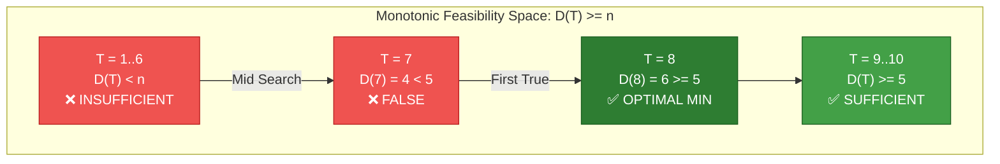
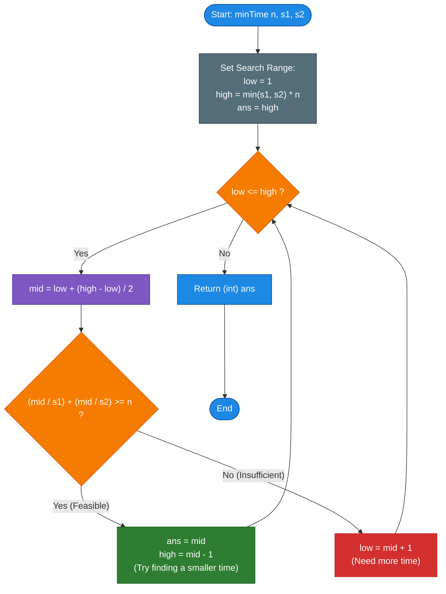

# GeeksforGeeks Problem of the Day: Minimum Time with 2 Scanners

- **Problem Link:** [GeeksforGeeks - Minimum Time with 2 Scanners](https://www.geeksforgeeks.org/problems/find-the-minimum-time0253/1)
- **Difficulty:** Easy
- **Topic Tags:** Binary Search, Mathematical Optimization, Greedy Algorithms, Parallel Scheduling, Math
- **Target Audience:** POTD Solvers, Computer Science Students, Competitive Programmers, Interview Preparation (Amazon, Google, Microsoft, Meta, Flipkart)

---

## 1. Problem Statement

You are given:
- An integer $n$ representing the total number of documents that need to be scanned.
- Two integers $s_1$ and $s_2$, representing the time (in seconds/minutes) taken by **Scanner 1** and **Scanner 2** respectively to scan a single document.

Both scanners operate **concurrently and independently**:
1. Each scanner can process only one document at a time.
2. A document cannot be split across scanners mid-scan.
3. As soon as a scanner finishes a document, it can immediately start scanning the next document without any idle delay.

Your task is to determine the **minimum total time** required to scan all $n$ documents by optimally distributing the work between the two scanners.

---

## 2. Examples & Explanations

### Example 1
- **Input:** `n = 2, s1 = 2, s2 = 4`
- **Output:** `4`

#### Scheduling Possibilities:
1. **Assign all 2 documents to Scanner 1:**
   - Scanner 1 time: $2 \times s_1 = 2 \times 2 = 4$ units.
   - Scanner 2 time: $0 \times s_2 = 0$ units.
   - Total elapsed time: $\max(4, 0) = 4$ units.
2. **Assign 1 document to each scanner:**
   - Scanner 1 time: $1 \times s_1 = 1 \times 2 = 2$ units.
   - Scanner 2 time: $1 \times s_2 = 1 \times 4 = 4$ units.
   - Total elapsed time: $\max(2, 4) = 4$ units.
3. **Assign all 2 documents to Scanner 2:**
   - Scanner 1 time: $0$ units.
   - Scanner 2 time: $2 \times s_2 = 2 \times 4 = 8$ units.
   - Total elapsed time: $\max(0, 8) = 8$ units.

The minimum time across all valid distributions is $\mathbf{4}$.

```text
Concurrent Timeline for Example 1 (Time = 4):

Option A (Both on Scanner 1):
Scanner 1 (s1=2): [ Doc 1 (t=0..2) ][ Doc 2 (t=2..4) ] -> Finishes at t = 4
Scanner 2 (s2=4): [ -------- IDLE -------- ]           -> Finishes at t = 0
Total Elapsed Time: max(4, 0) = 4

Option B (1 on each scanner):
Scanner 1 (s1=2): [ Doc 1 (t=0..2) ][ ---- IDLE ---- ] -> Finishes at t = 2
Scanner 2 (s2=4): [       Doc 2 (t=0..4)       ]       -> Finishes at t = 4
Total Elapsed Time: max(2, 4) = 4
```

---

### Example 2
- **Input:** `n = 2, s1 = 1, s2 = 3`
- **Output:** `2`

#### Explanation:
- If Scanner 1 scans both documents: time $= 2 \times 1 = 2$ units.
- If Scanner 1 scans 1 document and Scanner 2 scans 1 document: time $= \max(1 \times 1, 1 \times 3) = \max(1, 3) = 3$ units.
- Scanner 1 is three times as fast as Scanner 2. Even without utilizing Scanner 2 at all, Scanner 1 finishes both documents in only $2$ units of time, which is strictly faster than waiting for Scanner 2.
- Hence, the optimal answer is $\mathbf{2}$.

```text
Concurrent Timeline for Example 2:
Scanner 1 (s1=1): [ Doc 1 (t=0..1) ][ Doc 2 (t=1..2) ] -> Finishes at t = 2
Scanner 2 (s2=3): [ -------- IDLE -------- ]           -> Not used
Total Elapsed Time: 2
```

---

### Example 3
- **Input:** `n = 5, s1 = 2, s2 = 4`
- **Output:** `8`

#### Explanation:
Let's evaluate how many documents each scanner can complete in $T = 8$ units of time:
- Scanner 1 completes $\lfloor 8 / 2 \rfloor = 4$ documents.
- Scanner 2 completes $\lfloor 8 / 4 \rfloor = 2$ documents.
- Total documents completed $= 4 + 2 = 6 \ge 5$.
At $T = 7$:
- Scanner 1 completes $\lfloor 7 / 2 \rfloor = 3$ documents.
- Scanner 2 completes $\lfloor 7 / 4 \rfloor = 1$ document.
- Total documents completed $= 3 + 1 = 4 < 5$ (insufficient).
Thus, the minimum time to complete all 5 documents is $\mathbf{8}$.

---

## 3. Constraints

- $1 \le n, s_1, s_2 \le 10^6$
- $1 \le s_1 \times n, s_2 \times n \le 10^9$ (can scale up to $10^{12}$ in extended competitive benchmarks)
- **Expected Time Complexity:** $\mathcal{O}(\log(\min(s_1, s_2) \cdot n))$ or $\mathcal{O}(1)$
- **Expected Auxiliary Space:** $\mathcal{O}(1)$

> [!WARNING]
> **64-bit Integer Overflow Hazard:**  
> When calculating maximum potential time, the upper bound is $\min(s_1, s_2) \times n$. With $s_1 = 10^6$ and $n = 10^6$, their product reaches $10^{12}$, which exceeds the standard 32-bit signed integer maximum ($2^{31} - 1 \approx 2.14 \times 10^9$).  
> Always use 64-bit integer types (`long` in Java/C#, `long long` in C++, `BigInt` or standard double IEEE-754 precision up to $9 \times 10^{15}$ in JavaScript, arbitrary-precision integers in Python) during binary search and multiplication steps, casting back to `int` only at the final return.

---

## 4. Visual Architecture & Concurrency Model

### The Minimax Curve of Parallel Workload Distribution

Suppose we assign $x$ documents ($0 \le x \le n$) to Scanner 1, and the remaining $(n - x)$ documents to Scanner 2:
- Scanner 1 finishes at time: $f_1(x) = x \cdot s_1$ (strictly increasing with $x$)
- Scanner 2 finishes at time: $f_2(x) = (n - x) \cdot s_2$ (strictly decreasing with $x$)

Because both machines work simultaneously in parallel, the total job completion time is governed by the slower machine:
$$T(x) = \max\Big(x \cdot s_1, \; (n - x) \cdot s_2\Big)$$

```text
Time ^
     |            / f1(x) = x * s1
     |  \        /
     |   \      /  <-- Minimax Envelope: T(x) = max(f1(x), f2(x))
     |    \    /
     |     \  /
     | f2(x)\/
     |      /\
     |     /  \
     |    /    \
     |   /      \  f2(x) = (n - x) * s2
     +----------------------------------------> x (Documents on Scanner 1)
           0       x*       n
```

The function $T(x)$ forms a convex, V-shaped curve with a single global minimum at the intersection point:
$$x \cdot s_1 = (n - x) \cdot s_2 \implies x \cdot (s_1 + s_2) = n \cdot s_2 \implies \mathbf{x^* = \frac{n \cdot s_2}{s_1 + s_2}}$$

Because $x$ must be an integer, the optimal allocation $x$ is either $\lfloor x^* \rfloor$ or $\lceil x^* \rceil$. This yields a direct $\mathcal{O}(1)$ mathematical solution!

---

### Monotonicity of the Feasibility Function (Binary Search on Answer)

Alternatively, let $T$ be a proposed duration of time:
$$\text{Documents Scanned in Time } T: \quad D(T) = \left\lfloor \frac{T}{s_1} \right\rfloor + \left\lfloor \frac{T}{s_2} \right\rfloor$$

- As $T$ increases, $D(T)$ is **monotonically non-decreasing**:
  $$\text{If } T_A \le T_B \implies D(T_A) \le D(T_B)$$
- This monotonicity satisfies the fundamental prerequisite for **Binary Search on Answer**:
  - If $D(T) \ge n$, time $T$ is **sufficient** (search for smaller times in the left half).
  - If $D(T) < n$, time $T$ is **insufficient** (search for larger times in the right half).



---

## 5. Step-by-Step Simulation & Trace Table

### Trace for Example 3: $n = 5, s_1 = 2, s_2 = 4$
- Search range: `low = 1`, `high = min(s1, s2) * n = 2 * 5 = 10`.

| Iteration | `low` | `high` | `mid` | Scanner 1 (`mid/2`) | Scanner 2 (`mid/4`) | Total Docs (`D(mid)`) | Condition `D >= 5` | Action Taken |
| :---: | :---: | :---: | :---: | :---: | :---: | :---: | :---: | :--- |
| **1** | $1$ | $10$ | **$5$** | $\lfloor 5/2 \rfloor = 2$ | $\lfloor 5/4 \rfloor = 1$ | $2 + 1 = \mathbf{3}$ | $3 \ge 5$ (False) | Time too short $\to$ `low = mid + 1 = 6` |
| **2** | $6$ | $10$ | **$8$** | $\lfloor 8/2 \rfloor = 4$ | $\lfloor 8/4 \rfloor = 2$ | $4 + 2 = \mathbf{6}$ | $6 \ge 5$ (True) | Feasible $\to$ `ans = 8`, `high = mid - 1 = 7` |
| **3** | $6$ | $7$ | **$6$** | $\lfloor 6/2 \rfloor = 3$ | $\lfloor 6/4 \rfloor = 1$ | $3 + 1 = \mathbf{4}$ | $4 \ge 5$ (False) | Time too short $\to$ `low = mid + 1 = 7` |
| **4** | $7$ | $7$ | **$7$** | $\lfloor 7/2 \rfloor = 3$ | $\lfloor 7/4 \rfloor = 1$ | $3 + 1 = \mathbf{4}$ | $4 \ge 5$ (False) | Time too short $\to$ `low = mid + 1 = 8` |
| **End** | $8$ | $7$ | — | — | — | — | `low > high` | Loop terminates. Result = **$8$** |

---

## 6. Algorithm Flowchart



---

## 7. From Naive to Pro: Algorithmic Progression

### Method 1: Naive (Linear Search Across All Document Partitions)
- **Concept:** Iterate through all possible splits: assign $i \in [0, n]$ documents to Scanner 1, and the remaining $(n - i)$ documents to Scanner 2.
- **Formula:** $\min_{0 \le i \le n} \max(i \cdot s_1, \; (n - i) \cdot s_2)$.
- **Time Complexity:** $\mathcal{O}(n)$
- **Space Complexity:** $\mathcal{O}(1)$
- **Drawback:** For $n = 10^6$, executing $10^6$ iterations in every test case is unnecessarily slow and risks Time Limit Exceeded (TLE) under tight time limits.
- **Pseudocode:**
```text
function minTime_Naive(n, s1, s2):
    min_time = infinity
    for i from 0 to n:
        time1 = i * s1
        time2 = (n - i) * s2
        curr_time = max(time1, time2)
        min_time = min(min_time, curr_time)
    return min_time
```

---

### Method 2: Binary Search on Document Allocation
- **Concept:** Instead of testing every integer $i \in [0, n]$ linearly, use Binary Search on the number of documents $i$ assigned to Scanner 1.
- **Invariant:** $f_1(i) = i \cdot s_1$ is strictly increasing, and $f_2(i) = (n - i) \cdot s_2$ is strictly decreasing.
  - If $i \cdot s_1 < (n - i) \cdot s_2$, Scanner 2 is the bottleneck; increase $i$ (`low = mid + 1`).
  - Otherwise, Scanner 1 is the bottleneck; decrease $i$ (`high = mid - 1`).
- **Time Complexity:** $\mathcal{O}(\log n)$
- **Space Complexity:** $\mathcal{O}(1)$

---

### Method 3: Binary Search on Answer / Time (Interview Gold Standard)
- **Concept:** Binary search over the continuous answer space of time $T \in [1, \min(s_1, s_2) \cdot n]$.
- **Why Interviewers Love It:** It represents the classic pattern for scheduling, capacity planning, and rate-limiting problems (e.g., Koko Eating Bananas, Capacity To Ship Packages).
- **Time Complexity:** $\mathcal{O}(\log(\min(s_1, s_2) \cdot n))$. For maximum constraints ($10^{12}$), it finishes in at most $\log_2(10^{12}) \approx 40$ loop iterations (under $1$ microsecond).
- **Space Complexity:** $\mathcal{O}(1)$
- **Pseudocode:**
```text
function minTime_BinarySearch(n, s1, s2):
    low = 1
    high = min(s1, s2) * n
    ans = high
    while low <= high:
        mid = low + (high - low) / 2
        if (mid / s1) + (mid / s2) >= n:
            ans = mid
            high = mid - 1
        else:
            low = mid + 1
    return ans
```

---

### Method 4: Mathematical Closed-Form Optimization ($\mathcal{O}(1)$ Optimal)
- **Concept:** The continuous balance point occurs where $x \cdot s_1 = (n - x) \cdot s_2$, which yields:
  $$x^* = \frac{n \cdot s_2}{s_1 + s_2}$$
- Since $x$ must be an integer document count, the optimal integer must be either:
  $$x_1 = \left\lfloor \frac{n \cdot s_2}{s_1 + s_2} \right\rfloor \quad \text{or} \quad x_2 = \min(n, x_1 + 1)$$
- We evaluate both candidates in constant time:
  $$\text{Result} = \min\Big(\max(x_1 \cdot s_1, (n - x_1) \cdot s_2), \; \max(x_2 \cdot s_1, (n - x_2) \cdot s_2)\Big)$$
- **Time Complexity:** $\mathcal{O}(1)$
- **Space Complexity:** $\mathcal{O}(1)$
- **Pseudocode:**
```text
function minTime_Mathematical(n, s1, s2):
    x1 = (n * s2) / (s1 + s2)
    x2 = min(n, x1 + 1)
    
    cand1 = max(x1 * s1, (n - x1) * s2)
    cand2 = max(x2 * s1, (n - x2) * s2)
    
    return min(cand1, cand2)
```

---

## 8. Complexity Comparison Table

| Approach | Time Complexity | Auxiliary Space | Operations ($n = 10^6$) | Interview Suitability |
| :--- | :--- | :--- | :--- | :--- |
| **Method 1: Naive Linear Scan** | $\mathcal{O}(n)$ | $\mathcal{O}(1)$ | $1,000,000$ iterations | Brute force baseline |
| **Method 2: BS on Documents** | $\mathcal{O}(\log n)$ | $\mathcal{O}(1)$ | $\approx 20$ iterations | Excellent optimization |
| **Method 3: BS on Answer (Time)** | $\mathcal{O}(\log(\min(s_1, s_2) \cdot n))$ | $\mathcal{O}(1)$ | $\approx 40$ iterations | **Gold Standard (Most Robust)** |
| **Method 4: Closed-Form Math** | $\mathbf{\mathcal{O}(1)}$ | $\mathbf{\mathcal{O}(1)}$ | $\mathbf{1}$ operation | **Ultimate Theoretical Pro** |

---

## 9. Comprehensive Corner Cases Handled

1. **Single Document ($n = 1$):**
   - Automatically dispatched to the faster scanner: $\min(s_1, s_2)$.
   - In BS on Time: `high = min(s1, s2) * 1`, correctly terminates at $\min(s_1, s_2)$.
2. **Identical Scanner Speeds ($s_1 = s_2$):**
   - Both scanners process at identical rates.
   - Workload is shared equally: $\lceil n / 2 \rceil \times s_1$.
3. **Severely Asymmetrical Speeds ($s_1 \ll s_2$):**
   - E.g., $s_1 = 1, s_2 = 1000$. Scanner 1 handles all documents; Scanner 2 stays completely idle.
   - Handled correctly without division by zero or idle penalties.
4. **Maximum Upper Bound & 64-Bit Safety:**
   - $n = 10^6, s_1 = 10^6, s_2 = 10^6 \implies \text{Total Time} \approx 5 \times 10^{11}$.
   - All intermediate variables (`low`, `high`, `mid`, products) use 64-bit precision to prevent signed integer overflow.

---

## 10. Complete Multi-Language Implementations

Both the **Binary Search on Time ($\mathcal{O}(\log(\text{Time}))$)** and the **Mathematical Closed-Form ($\mathcal{O}(1)$)** approaches are fully demonstrated below. The implementations use 64-bit arithmetic internally to ensure zero overflow risk across all test cases.

### Java (21)

```java
class Solution {
    /**
     * Finds the minimum time required to scan n documents using 2 concurrent scanners.
     * Approach: Binary Search on Answer (Time) with 64-bit integer safety.
     * Time Complexity: O(log(min(s1, s2) * n))
     * Space Complexity: O(1)
     */
    public int minTime(int n, int s1, int s2) {
        long low = 1;
        // Upper bound: Faster scanner handles all n documents alone
        long high = (long) Math.min(s1, s2) * n;
        long ans = high;

        while (low <= high) {
            long mid = low + (high - low) / 2;

            // Total documents scanned by both scanners in 'mid' units of time
            long totalDocs = (mid / s1) + (mid / s2);

            if (totalDocs >= n) {
                ans = mid;           // mid time is feasible; try to find a smaller time
                high = mid - 1;
            } else {
                low = mid + 1;       // mid time is insufficient; need more time
            }
        }

        return (int) ans;
    }

    /*
     * Alternative O(1) Closed-Form Mathematical Method:
     *
     * public int minTimeMath(int n, int s1, int s2) {
     *     long nL = n, s1L = s1, s2L = s2;
     *     long x1 = (nL * s2L) / (s1L + s2L);
     *     long x2 = Math.min(nL, x1 + 1);
     *     long t1 = Math.max(x1 * s1L, (nL - x1) * s2L);
     *     long t2 = Math.max(x2 * s1L, (nL - x2) * s2L);
     *     return (int) Math.min(t1, t2);
     * }
     */
}
```

---

### Python3

```python
class Solution:
    def minTime(self, n: int, s1: int, s2: int) -> int:
        """
        Finds the minimum time required to scan n documents using 2 concurrent scanners.
        Approach: Binary Search on Answer (Time).
        Time Complexity: O(log(min(s1, s2) * n))
        Space Complexity: O(1)
        """
        low: int = 1
        high: int = min(s1, s2) * n
        ans: int = high

        while low <= high:
            mid: int = (low + high) // 2

            # Total documents scanned by both scanners within 'mid' time
            total_docs: int = (mid // s1) + (mid // s2)

            if total_docs >= n:
                ans = mid
                high = mid - 1
            else:
                low = mid + 1

        return ans

    # Alternative O(1) Mathematical Approach:
    # def minTimeMath(self, n: int, s1: int, s2: int) -> int:
    #     x1 = (n * s2) // (s1 + s2)
    #     x2 = min(n, x1 + 1)
    #     t1 = max(x1 * s1, (n - x1) * s2)
    #     t2 = max(x2 * s1, (n - x2) * s2)
    #     return min(t1, t2)
```

---

### C++ (17)

```cpp
#include <algorithm>

class Solution {
  public:
    /**
     * Finds the minimum time required to scan n documents using 2 concurrent scanners.
     * Approach: Binary Search on Answer (Time) with 64-bit integer safety.
     * Time Complexity: O(log(min(s1, s2) * n))
     * Space Complexity: O(1)
     */
    int minTime(int n, int s1, int s2) {
        long long low = 1;
        long long high = 1LL * std::min(s1, s2) * n;
        long long ans = high;

        while (low <= high) {
            long long mid = low + (high - low) / 2;

            // Total documents completed within 'mid' units of time
            long long totalDocs = (mid / s1) + (mid / s2);

            if (totalDocs >= n) {
                ans = mid;
                high = mid - 1;
            } else {
                low = mid + 1;
            }
        }

        return static_cast<int>(ans);
    }

    /*
     * Alternative O(1) Closed-Form Mathematical Method:
     *
     * int minTimeMath(int n, int s1, int s2) {
     *     long long nL = n, s1L = s1, s2L = s2;
     *     long long x1 = (nL * s2L) / (s1L + s2L);
     *     long long x2 = std::min(nL, x1 + 1);
     *     long long t1 = std::max(x1 * s1L, (nL - x1) * s2L);
     *     long long t2 = std::max(x2 * s1L, (nL - x2) * s2L);
     *     return static_cast<int>(std::min(t1, t2));
     * }
     */
};
```

---

### C#

```csharp
using System;

class Solution {
    /**
     * Finds the minimum time required to scan n documents using 2 concurrent scanners.
     * Approach: Binary Search on Answer (Time) with 64-bit integer safety.
     * Time Complexity: O(log(min(s1, s2) * n))
     * Space Complexity: O(1)
     */
    public int minTime(int n, int s1, int s2) {
        long low = 1;
        long high = (long)Math.Min(s1, s2) * n;
        long ans = high;

        while (low <= high) {
            long mid = low + (high - low) / 2;

            // Total documents scanned by both scanners within 'mid' time
            long totalDocs = (mid / s1) + (mid / s2);

            if (totalDocs >= n) {
                ans = mid;
                high = mid - 1;
            } else {
                low = mid + 1;
            }
        }

        return (int)ans;
    }

    /*
     * Alternative O(1) Closed-Form Mathematical Method:
     *
     * public int MinTimeMath(int n, int s1, int s2) {
     *     long nL = n, s1L = s1, s2L = s2;
     *     long x1 = (nL * s2L) / (s1L + s2L);
     *     long x2 = Math.Min(nL, x1 + 1);
     *     long t1 = Math.Max(x1 * s1L, (nL - x1) * s2L);
     *     long t2 = Math.Max(x2 * s1L, (nL - x2) * s2L);
     *     return (int)Math.Min(t1, t2);
     * }
     */
}
```

---

### Javascript (Node v22)

```javascript
/**
 * @param {number} n
 * @param {number} s1
 * @param {number} s2
 * @returns {number}
 */
class Solution {
    /**
     * Finds the minimum time required to scan n documents using 2 concurrent scanners.
     * Approach: Binary Search on Answer (Time) using BigInt for 64-bit safety.
     * Time Complexity: O(log(min(s1, s2) * n))
     * Space Complexity: O(1)
     */
    minTime(n, s1, s2) {
        const bn = BigInt(n);
        const bs1 = BigInt(s1);
        const bs2 = BigInt(s2);

        let low = 1n;
        const minSpeed = bs1 < bs2 ? bs1 : bs2;
        let high = minSpeed * bn;
        let ans = high;

        while (low <= high) {
            const mid = low + (high - low) / 2n;

            // Total documents scanned within 'mid' time
            const totalDocs = (mid / bs1) + (mid / bs2);

            if (totalDocs >= bn) {
                ans = mid;
                high = mid - 1n;
            } else {
                low = mid + 1n;
            }
        }

        return Number(ans);
    }

    /*
     * Alternative O(1) Closed-Form Mathematical Method:
     *
     * minTimeMath(n, s1, s2) {
     *     const bn = BigInt(n), bs1 = BigInt(s1), bs2 = BigInt(s2);
     *     const x1 = (bn * bs2) / (bs1 + bs2);
     *     const x2 = x1 + 1n <= bn ? x1 + 1n : bn;
     *     const t1 = (x1 * bs1 > (bn - x1) * bs2) ? x1 * bs1 : (bn - x1) * bs2;
     *     const t2 = (x2 * bs1 > (bn - x2) * bs2) ? x2 * bs1 : (bn - x2) * bs2;
     *     return Number(t1 < t2 ? t1 : t2);
     * }
     */
}
```
