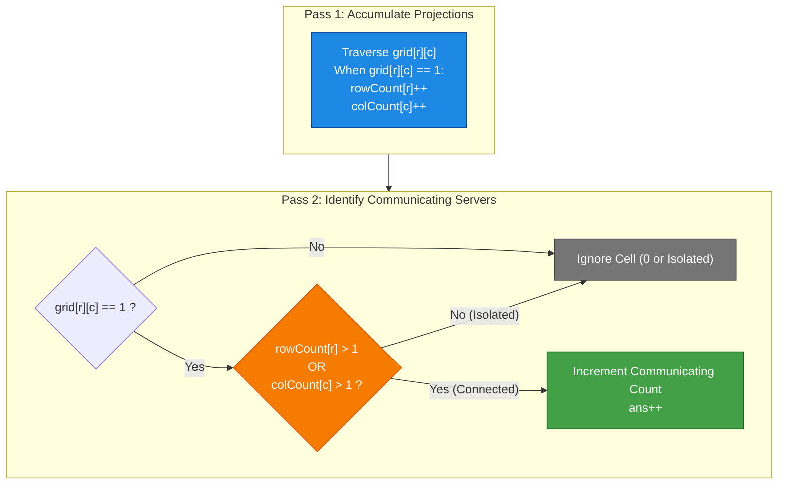
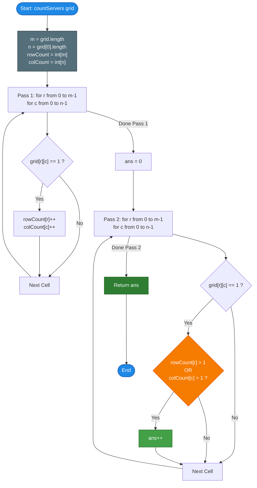

# LeetCode Problem of the Day: Count Servers that Communicate

- **Problem Link:** [LeetCode 1267 - Count Servers that Communicate](https://leetcode.com/problems/count-servers-that-communicate/)
- **Difficulty:** Medium
- **Topic Tags:** Array, Hash Table, Counting, Matrix, Graph, Depth-First Search, Breadth-First Search, Union Find
- **Target Audience:** POTD Solvers, Computer Science Students, Competitive Programmers, Interview Preparation (Amazon, Google, Microsoft, Bloomberg, Meta)

---

## 1. Problem Statement

You are given a map of a server center represented as an $m \times n$ integer 2D binary matrix `grid`, where:
- `grid[r][c] == 1` indicates that there is a **server** located at row `r` and column `c`.
- `grid[r][c] == 0` indicates an empty space without any server.

Two servers are said to **communicate** if and only if they are located:
1. On the **same row** (`r1 == r2`), OR
2. On the **same column** (`c1 == c2`).

Return the **total number of servers that communicate with at least one other server**.

---

## 2. Examples & Explanations

### Example 1
- **Input:** `grid = [[1, 0], [0, 1]]`
- **Output:** `0`

#### Grid Layout:
```text
         Col 0   Col 1
Row 0   |   1   |   0   |  -> 1 server in Row 0
Row 1   |   0   |   1   |  -> 1 server in Row 1
          ^       ^
        1 serv  1 serv
```
#### Explanation:
- The server at `(0, 0)` is the sole server in Row 0 and the sole server in Col 0. It cannot communicate with any other server.
- The server at `(1, 1)` is the sole server in Row 1 and the sole server in Col 1. It cannot communicate with any other server.
- Neither server shares a row or column with any other server.
- Total communicating servers = $\mathbf{0}$.

---

### Example 2
- **Input:** `grid = [[1, 0], [1, 1]]`
- **Output:** `3`

#### Grid Layout:
```text
         Col 0   Col 1
Row 0   |   1   |   0   |  -> 1 server in Row 0
Row 1   |   1   |   1   |  -> 2 servers in Row 1
          ^       ^
        2 serv  1 serv
```
#### Explanation:
- The server at `(0, 0)` shares **Column 0** with the server at `(1, 0)`.
- The server at `(1, 0)` shares **Column 0** with `(0, 0)` AND **Row 1** with `(1, 1)`.
- The server at `(1, 1)` shares **Row 1** with `(1, 0)`.
- All $3$ servers can communicate with at least one other server.
- Total communicating servers = $\mathbf{3}$.

---

### Example 3
- **Input:** `grid = [[1, 1, 0, 0], [0, 0, 1, 0], [0, 0, 1, 0], [0, 0, 0, 1]]`
- **Output:** `4`

#### Grid Layout:
```text
         Col 0   Col 1   Col 2   Col 3
Row 0   |   1   |   1   |   0   |   0   |  -> 2 servers (Communicating via Row 0)
Row 1   |   0   |   0   |   1   |   0   |  -> 1 server  (Communicating via Col 2)
Row 2   |   0   |   0   |   1   |   0   |  -> 1 server  (Communicating via Col 2)
Row 3   |   0   |   0   |   0   |   1   |  -> 1 server  (Isolated!)
          ^       ^       ^       ^
        1 serv  1 serv  2 serv  1 serv
```
#### Explanation:
- Servers at `(0, 0)` and `(0, 1)` communicate through **Row 0** (Row count = 2).
- Servers at `(1, 2)` and `(2, 2)` communicate through **Column 2** (Column count = 2).
- The server at `(3, 3)` has row count $= 1$ and column count $= 1$, so it is completely isolated.
- Total communicating servers: $2 + 2 = \mathbf{4}$.

---

## 3. Constraints

- $m == \text{grid.length}$
- $n == \text{grid}[i]\text{.length}$
- $1 \le m, n \le 250$
- $1 \le m \times n \le 62,500$
- $\text{grid}[i][j] \in \{0, 1\}$
- **Expected Time Complexity:** $\mathcal{O}(m \times n)$
- **Expected Auxiliary Space:** $\mathcal{O}(m + n)$

> [!NOTE]
> With matrix dimensions up to $250 \times 250 = 62,500$ cells:
> - A naive scan that searches the entire row and column for every server takes $\mathcal{O}(m \cdot n \cdot (m + n)) \approx 62,500 \times 500 \approx 3.125 \times 10^7$ operations.
> - The two-pass projection approach takes exactly $2 \times 62,500 = 1.25 \times 10^5$ operations — running in less than **$2$ milliseconds**!

---

## 4. Visual Architecture & The Projection Invariant

### The Projection Principle

Instead of treating the grid as an arbitrary geometric network, we project the servers onto two independent 1D orthogonal axes:
1. **Row Projection Axis (`rowCount` of size $m$):** Counts how many servers exist on each horizontal line.
2. **Column Projection Axis (`colCount` of size $n$):** Counts how many servers exist on each vertical line.

```text
               Col 0   Col 1   Col 2   Col 3     rowCount
Row 0         [  1       1       0       0  ]  ->   2  (> 1: Row communicates!)
Row 1         [  0       0       1       0  ]  ->   1  (<= 1: check column)
Row 2         [  0       0       1       0  ]  ->   1  (<= 1: check column)
Row 3         [  0       0       0       1  ]  ->   1  (<= 1: check column)
                 |       |       |       |
colCount:        1       1       2       1
                         ^       ^       ^
                     (alone)  (Col 2  (alone in
                               comms!) row & col)
```

### The Invariant Rule
A server at position $(r, c)$ can communicate with at least one other server **if and only if**:
$$\mathbf{\text{rowCount}[r] > 1 \quad \lor \quad \text{colCount}[c] > 1}$$

- If $\text{rowCount}[r] > 1$, there exists at least one other server on row $r$.
- If $\text{colCount}[c] > 1$, there exists at least one other server on column $c$.
- If $\text{rowCount}[r] == 1$ AND $\text{colCount}[c] == 1$, this server is uniquely isolated in its crosshair.



---

## 5. Step-by-Step Simulation & Trace Table

### Tracing Example 3
`grid = [[1, 1, 0, 0], [0, 0, 1, 0], [0, 0, 1, 0], [0, 0, 0, 1]]`  
Dimensions: $m = 4, n = 4$.

#### Pass 1: Frequency Array Construction
- **Row Counts:**
  - Row 0: `(0, 0), (0, 1)` $\implies \text{rowCount}[0] = 2$
  - Row 1: `(1, 2)` $\implies \text{rowCount}[1] = 1$
  - Row 2: `(2, 2)` $\implies \text{rowCount}[2] = 1$
  - Row 3: `(3, 3)` $\implies \text{rowCount}[3] = 1$
  - `rowCount = [2, 1, 1, 1]`
- **Column Counts:**
  - Col 0: `(0, 0)` $\implies \text{colCount}[0] = 1$
  - Col 1: `(0, 1)` $\implies \text{colCount}[1] = 1$
  - Col 2: `(1, 2), (2, 2)` $\implies \text{colCount}[2] = 2$
  - Col 3: `(3, 3)` $\implies \text{colCount}[3] = 1$
  - `colCount = [1, 1, 2, 1]`

#### Pass 2: Server Qualification Table

| Cell $(r, c)$ | `grid[r][c]` | `rowCount[r]` | `colCount[c]` | Condition: `rowCount > 1 \|\| colCount > 1` | Reason / Connection | Communicating? | Running Total |
| :---: | :---: | :---: | :---: | :---: | :--- | :---: | :---: |
| **$(0, 0)$** | $1$ | $2$ | $1$ | $2 > 1$ (True) | Shares Row 0 with $(0, 1)$ | **YES** | **1** |
| **$(0, 1)$** | $1$ | $2$ | $1$ | $2 > 1$ (True) | Shares Row 0 with $(0, 0)$ | **YES** | **2** |
| $(0, 2)$ | $0$ | — | — | Empty cell | No server | NO | 2 |
| $(0, 3)$ | $0$ | — | — | Empty cell | No server | NO | 2 |
| $(1, 0)$ | $0$ | — | — | Empty cell | No server | NO | 2 |
| $(1, 1)$ | $0$ | — | — | Empty cell | No server | NO | 2 |
| **$(1, 2)$** | $1$ | $1$ | $2$ | $2 > 1$ (True) | Shares Col 2 with $(2, 2)$ | **YES** | **3** |
| $(1, 3)$ | $0$ | — | — | Empty cell | No server | NO | 3 |
| $(2, 0)$ | $0$ | — | — | Empty cell | No server | NO | 3 |
| $(2, 1)$ | $0$ | — | — | Empty cell | No server | NO | 3 |
| **$(2, 2)$** | $1$ | $1$ | $2$ | $2 > 1$ (True) | Shares Col 2 with $(1, 2)$ | **YES** | **4** |
| $(2, 3)$ | $0$ | — | — | Empty cell | No server | NO | 4 |
| $(3, 0)$ | $0$ | — | — | Empty cell | No server | NO | 4 |
| $(3, 1)$ | $0$ | — | — | Empty cell | No server | NO | 4 |
| $(3, 2)$ | $0$ | — | — | Empty cell | No server | NO | 4 |
| **$(3, 3)$** | $1$ | $1$ | $1$ | $1 > 1 \lor 1 > 1$ (False) | Completely isolated | NO | 4 |

**Final Communicating Servers Count:** $\mathbf{4}$.

---

## 6. Algorithm Flowchart



---

## 7. From Naive to Pro: Algorithmic Progression

### Method 1: Naive (Crosshair Scanning Per Server)
- **Concept:** For every cell `(r, c)` where `grid[r][c] == 1`, run two nested loops:
  1. Scan all columns $k \in [0, n - 1]$ in row $r$ ($k \neq c$).
  2. Scan all rows $k \in [0, m - 1]$ in col $c$ ($k \neq r$).
  - If another server is found, increment the count and break early.
- **Why it is suboptimal:**
  - Repeated redundant scans: servers on the same row repeatedly scan each other.
  - Worst case: grid full of servers $\implies \mathcal{O}(m \cdot n \cdot (m + n))$.
- **Pseudocode:**
```text
function countServers_Naive(grid):
    m = len(grid), n = len(grid[0])
    ans = 0
    for r from 0 to m - 1:
        for c from 0 to n - 1:
            if grid[r][c] == 1:
                can_communicate = false
                // Check same row
                for k from 0 to n - 1:
                    if k != c and grid[r][k] == 1:
                        can_communicate = true
                        break
                // Check same col
                if not can_communicate:
                    for k from 0 to m - 1:
                        if k != r and grid[k][c] == 1:
                            can_communicate = true
                            break
                if can_communicate:
                    ans++
    return ans
```

---

### Method 2: Disjoint Set Union (DSU) / Connected Components
- **Concept:** Create a graph where each server is a node. Union servers that share the same row or column. Alternatively, create $m + n$ virtual nodes for rows and columns and connect each server `(r, c)` to `row_r` and `col_c`. Any component with $\ge 2$ servers is counted.
- **Why it is suboptimal:**
  - Unnecessary overhead of graph adjacency structures or union-find parent/rank arrays.
  - High memory footprint ($\mathcal{O}(m \cdot n)$ or $\mathcal{O}(m + n)$ with heavy pointer indirection).
- **Pseudocode:**
```text
function countServers_DSU(grid):
    // Construct DSU over m + n row and col nodes
    // For each server, union(row_r, col_c)
    // Count servers in components containing > 1 server
```

---

### Method 3: Optimal Standard (Two-Pass Row & Column Count Array)
- **Concept:**
  - **Pass 1:** Count the server frequency per row and per column in $\mathcal{O}(m \times n)$ time using two arrays `rowCount[m]` and `colCount[n]`.
  - **Pass 2:** Check each server cell in $\mathcal{O}(1)$ time. If `rowCount[r] > 1` or `colCount[c] > 1`, count it.
- **Time Complexity:** $\mathcal{O}(m \times n)$ (Optimal, every cell visited twice).
- **Space Complexity:** $\mathcal{O}(m + n)$ (Minimal auxiliary buffers).
- **Pseudocode:**
```text
function countServers_TwoPass(grid):
    m = len(grid), n = len(grid[0])
    rowCount = array of size m initialized to 0
    colCount = array of size n initialized to 0
    
    // Pass 1: Count servers
    for r from 0 to m - 1:
        for c from 0 to n - 1:
            if grid[r][c] == 1:
                rowCount[r]++
                colCount[c]++
                
    // Pass 2: Filter communicating servers
    ans = 0
    for r from 0 to m - 1:
        for c from 0 to n - 1:
            if grid[r][c] == 1:
                if rowCount[r] > 1 or colCount[c] > 1:
                    ans++
                    
    return ans
```

---

### Method 4: Pro Single-Pass Track & Resolve ($\mathcal{O}(n)$ Extra Space)
- **Concept:**
  - Notice that during row traversal:
    - If a row has $> 1$ servers, **all** servers in that row communicate! We can directly add `row_count` to the answer.
    - If a row has exactly $1$ server at $(r, c)$, we cannot decide immediately whether it communicates. We store its column index `c` in a candidate list.
  - After completing all rows, compute `colCount` for only the candidate columns. If `colCount[c] > 1`, add $1$ to the answer.
- **Time Complexity:** $\mathcal{O}(m \times n)$
- **Space Complexity:** $\mathcal{O}(n)$
- **Pseudocode:**
```text
function countServers_Pro(grid):
    m = len(grid), n = len(grid[0])
    colCount = array of size n initialized to 0
    candidates = []
    ans = 0
    
    for r from 0 to m - 1:
        servers_in_row = 0
        last_col = -1
        for c from 0 to n - 1:
            if grid[r][c] == 1:
                servers_in_row++
                last_col = c
                colCount[c]++
        if servers_in_row > 1:
            ans += servers_in_row
        else if servers_in_row == 1:
            candidates.append(last_col)
            
    for c in candidates:
        if colCount[c] > 1:
            ans++
            
    return ans
```

---

## 8. Complexity Comparison Table

| Metric | Method 1: Naive Crosshair Scan | Method 2: Disjoint Set Union (DSU) | Method 3: Two-Pass Projections (Standard) | Method 4: Track & Resolve (Pro) |
| :--- | :--- | :--- | :--- | :--- |
| **Time Complexity** | $\mathcal{O}(m \cdot n \cdot (m + n))$ | $\mathcal{O}(m \cdot n \cdot \alpha(m + n))$ | $\mathbf{\mathcal{O}(m \cdot n)}$ | $\mathbf{\mathcal{O}(m \cdot n)}$ |
| **Auxiliary Space** | $\mathcal{O}(1)$ | $\mathcal{O}(m + n)$ | $\mathbf{\mathcal{O}(m + n)}$ | $\mathbf{\mathcal{O}(n)}$ |
| **Operations ($250 \times 250$)** | $\approx 31,250,000$ | $\approx 250,000$ | $\mathbf{\approx 125,000}$ | $\mathbf{\approx 62,500 + \text{cand}}$ |
| **Cache Friendliness** | Extremely poor | Poor (Tree pointers) | **High (Linear arrays)** | **Highest (Single-pass rows)** |
| **Interview Verdict** | TLE risk on large bounds | Over-engineered | **Gold Standard (Clean & Direct)** | **Impressive Follow-up** |

---

## 9. Comprehensive Corner Cases Handled

1. **All Zeros (No Servers):**
   - `grid[r][c] == 0` everywhere. `rowCount` and `colCount` remain all zeros; loop safely terminates returning `0`.
2. **Single Server ($1 \times 1$ or isolated in large grid):**
   - Exactly one `1` at `(r, c)`. `rowCount[r] == 1` and `colCount[c] == 1`. Neither condition $> 1$ is satisfied; correctly returns `0`.
3. **Entire Grid Full of Servers (All Ones):**
   - $m \times n$ servers. Every cell has `rowCount[r] = n > 1` and `colCount[c] = m > 1`. Returns $m \times n$.
4. **Single Row Matrix ($1 \times n$):**
   - Column counts can never exceed $1$. If row count $> 1$, all servers communicate; if row count $= 1$, output is $0$.
5. **Single Column Matrix ($m \times 1$):**
   - Row counts can never exceed $1$. If column count $> 1$, all servers communicate; if column count $= 1$, output is $0$.
6. **Main Diagonal Servers without Shared Rows/Cols:**
   - Identity matrix pattern ($I_n$). Each row and column has exactly $1$ server. All servers are isolated; correctly returns `0`.
7. **Star / Cross Topology:**
   - One central server intersecting a row of servers and a column of servers. Correctly includes the center and all satellite servers.

---

## 10. Complete Multi-Language Implementations

### Java

```java
class Solution {
    /**
     * Counts servers that can communicate with at least one other server.
     * Approach: Two-Pass Row and Column Frequency Accumulation.
     * Time Complexity: O(m * n)
     * Space Complexity: O(m + n)
     */
    public int countServers(int[][] grid) {
        int m = grid.length;
        int n = grid[0].length;

        int[] rowCount = new int[m];
        int[] colCount = new int[n];

        // Pass 1: Accumulate total servers in each row and column
        for (int r = 0; r < m; r++) {
            for (int c = 0; c < n; c++) {
                if (grid[r][c] == 1) {
                    rowCount[r]++;
                    colCount[c]++;
                }
            }
        }

        int communicatingServers = 0;

        // Pass 2: A server communicates if its row or column has > 1 server
        for (int r = 0; r < m; r++) {
            for (int c = 0; c < n; c++) {
                if (grid[r][c] == 1) {
                    if (rowCount[r] > 1 || colCount[c] > 1) {
                        communicatingServers++;
                    }
                }
            }
        }

        return communicatingServers;
    }
}
```

---

### Python3

```python
from typing import List

class Solution:
    def countServers(self, grid: List[List[int]]) -> int:
        """
        Counts servers that can communicate with at least one other server.
        Approach: Two-Pass Row and Column Frequency Accumulation.
        Time Complexity: O(m * n)
        Space Complexity: O(m + n)
        """
        m, n = len(grid), len(grid[0])

        row_count = [0] * m
        col_count = [0] * n

        # Pass 1: Count servers across each row and column
        for r in range(m):
            for c in range(n):
                if grid[r][c] == 1:
                    row_count[r] += 1
                    col_count[c] += 1

        communicating_servers = 0

        # Pass 2: Check if server's row or column has multiple servers
        for r in range(m):
            for c in range(n):
                if grid[r][c] == 1:
                    if row_count[r] > 1 or col_count[c] > 1:
                        communicating_servers += 1

        return communicating_servers
```

---

### C

```c
#include <stdlib.h>

/**
 * Counts servers that can communicate with at least one other server.
 * Approach: Two-Pass Row and Column Frequency Accumulation.
 * Time Complexity: O(m * n)
 * Space Complexity: O(m + n)
 */
int countServers(int** grid, int gridSize, int* gridColSize) {
    int m = gridSize;
    int n = gridColSize[0];

    // Allocate zero-initialized frequency counters
    int* rowCount = (int*)calloc(m, sizeof(int));
    int* colCount = (int*)calloc(n, sizeof(int));

    // Pass 1: Count servers in each row and column
    for (int r = 0; r < m; r++) {
        for (int c = 0; c < n; c++) {
            if (grid[r][c] == 1) {
                rowCount[r]++;
                colCount[c]++;
            }
        }
    }

    int communicatingServers = 0;

    // Pass 2: Count servers with rowCount > 1 or colCount > 1
    for (int r = 0; r < m; r++) {
        for (int c = 0; c < n; c++) {
            if (grid[r][c] == 1) {
                if (rowCount[r] > 1 || colCount[c] > 1) {
                    communicatingServers++;
                }
            }
        }
    }

    // Free dynamically allocated memory
    free(rowCount);
    free(colCount);

    return communicatingServers;
}
```

---

### C++

```cpp
#include <vector>

class Solution {
public:
    /**
     * Counts servers that can communicate with at least one other server.
     * Approach: Two-Pass Row and Column Frequency Accumulation.
     * Time Complexity: O(m * n)
     * Space Complexity: O(m + n)
     */
    int countServers(std::vector<std::vector<int>>& grid) {
        int m = grid.size();
        int n = grid[0].size();

        std::vector<int> rowCount(m, 0);
        std::vector<int> colCount(n, 0);

        // Pass 1: Count servers per row and column
        for (int r = 0; r < m; ++r) {
            for (int c = 0; c < n; ++c) {
                if (grid[r][c] == 1) {
                    rowCount[r]++;
                    colCount[c]++;
                }
            }
        }

        int communicatingServers = 0;

        // Pass 2: Identify communicating servers
        for (int r = 0; r < m; ++r) {
            for (int c = 0; c < n; ++c) {
                if (grid[r][c] == 1) {
                    if (rowCount[r] > 1 || colCount[c] > 1) {
                        communicatingServers++;
                    }
                }
            }
        }

        return communicatingServers;
    }
};
```

---

### C#

```csharp
public class Solution {
    /**
     * Counts servers that can communicate with at least one other server.
     * Approach: Two-Pass Row and Column Frequency Accumulation.
     * Time Complexity: O(m * n)
     * Space Complexity: O(m + n)
     */
    public int CountServers(int[][] grid) {
        int m = grid.Length;
        int n = grid[0].Length;

        int[] rowCount = new int[m];
        int[] colCount = new int[n];

        // Pass 1: Accumulate server frequencies
        for (int r = 0; r < m; r++) {
            for (int c = 0; c < n; c++) {
                if (grid[r][c] == 1) {
                    rowCount[r]++;
                    colCount[c]++;
                }
            }
        }

        int communicatingServers = 0;

        // Pass 2: Count communicating servers
        for (int r = 0; r < m; r++) {
            for (int c = 0; c < n; c++) {
                if (grid[r][c] == 1) {
                    if (rowCount[r] > 1 || colCount[c] > 1) {
                        communicatingServers++;
                    }
                }
            }
        }

        return communicatingServers;
    }
}
```

---

### Javascript

```javascript
/**
 * Counts servers that can communicate with at least one other server.
 * Approach: Two-Pass Row and Column Frequency Accumulation.
 * Time Complexity: O(m * n)
 * Space Complexity: O(m + n)
 * @param {number[][]} grid
 * @return {number}
 */
var countServers = function(grid) {
    const m = grid.length;
    const n = grid[0].length;

    // Use typed arrays for optimal allocation speed and cache locality
    const rowCount = new Int32Array(m);
    const colCount = new Int32Array(n);

    // Pass 1: Accumulate server occurrences in rows and columns
    for (let r = 0; r < m; r++) {
        for (let c = 0; c < n; c++) {
            if (grid[r][c] === 1) {
                rowCount[r]++;
                colCount[c]++;
            }
        }
    }

    let communicatingServers = 0;

    // Pass 2: Verify communication condition
    for (let r = 0; r < m; r++) {
        for (let c = 0; c < n; c++) {
            if (grid[r][c] === 1) {
                if (rowCount[r] > 1 || colCount[c] > 1) {
                    communicatingServers++;
                }
            }
        }
    }

    return communicatingServers;
};
```

---

### Typescript

```typescript
/**
 * Counts servers that can communicate with at least one other server.
 * Approach: Two-Pass Row and Column Frequency Accumulation.
 * Time Complexity: O(m * n)
 * Space Complexity: O(m + n)
 * @param grid 2D binary grid representation of the server center
 * @returns Total number of communicating servers
 */
function countServers(grid: number[][]): number {
    const m: number = grid.length;
    const n: number = grid[0].length;

    const rowCount: number[] = new Array(m).fill(0);
    const colCount: number[] = new Array(n).fill(0);

    // Pass 1: Accumulate server occurrences in rows and columns
    for (let r = 0; r < m; r++) {
        for (let c = 0; c < n; c++) {
            if (grid[r][c] === 1) {
                rowCount[r]++;
                colCount[c]++;
            }
        }
    }

    let communicatingServers: number = 0;

    // Pass 2: Verify communication condition
    for (let r = 0; r < m; r++) {
        for (let c = 0; c < n; c++) {
            if (grid[r][c] === 1) {
                if (rowCount[r] > 1 || colCount[c] > 1) {
                    communicatingServers++;
                }
            }
        }
    }

    return communicatingServers;
}
```
