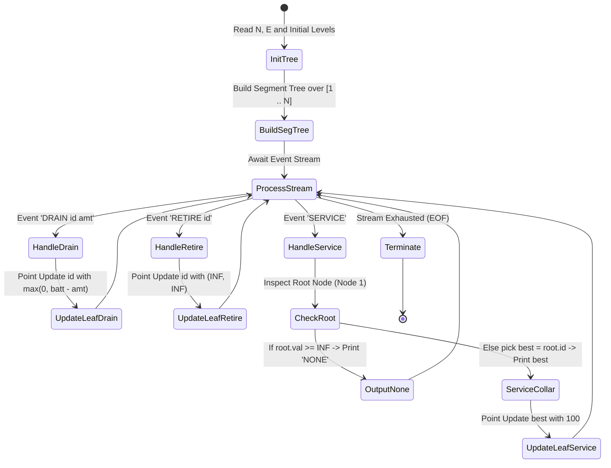
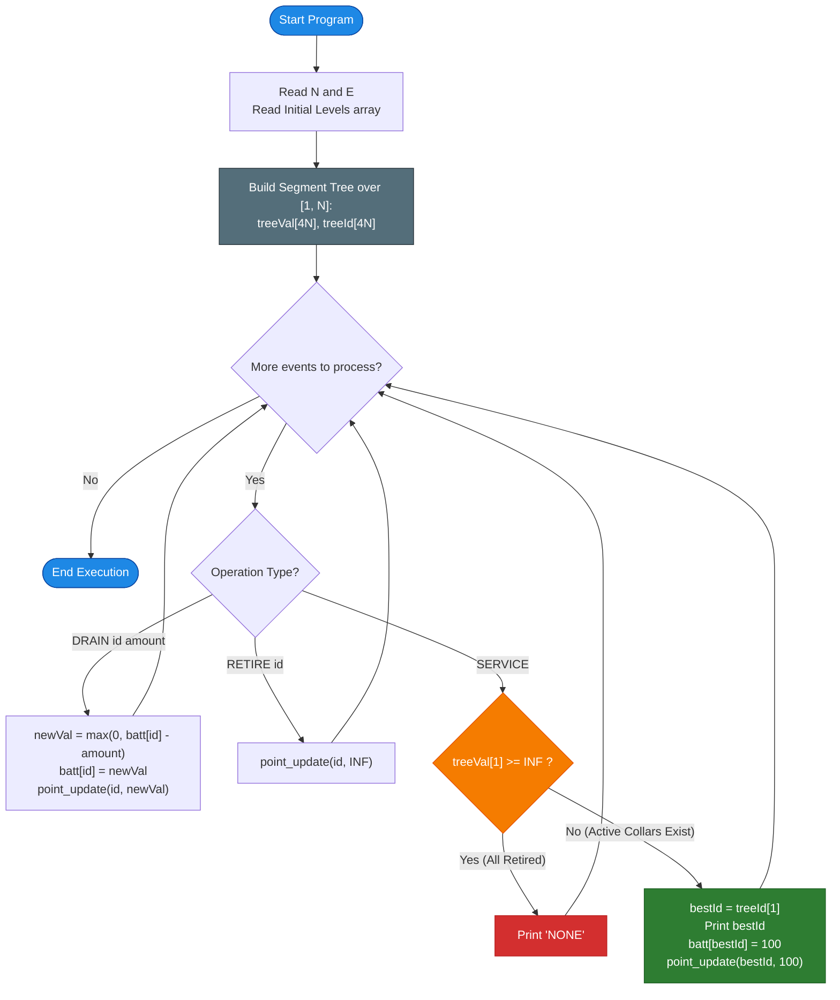

# Unstop Problem of the Day: Collar Watch at Silverfen Reserve

- **Platform:** [Unstop](https://unstop.com/)
- **Difficulty:** Medium
- **Topic Tags:** Segment Tree, Priority Queue, Min-Heap, Dynamic Order Statistics, Balanced Binary Search Tree, State Simulation
- **Target Audience:** POTD Solvers, Computer Science Students, Competitive Programmers, Interview Preparation (Amazon, Google, Microsoft, Uber, Media.net)

---

## 1. Problem Statement

Silverfen Reserve tracks wildlife using battery-powered telemetry collars. Field ranger Aarav is responsible for monitoring and servicing every collar.

The reserve operates $N$ telemetry collars numbered sequentially from $1$ to $N$. Each collar has an integer battery level ranging between $0$ and $100$. During the night shift, the central monitoring control room receives a stream of $E$ chronological log entries describing field events:

1. **`DRAIN id amount`:**  
   Collar `id` depletes its battery by `amount` units. The battery level cannot drop below $0$:
   $$\text{battery}[id] = \max(0, \; \text{battery}[id] - \text{amount})$$
   A `DRAIN` entry only targets collars that are currently active in the field.

2. **`RETIRE id`:**  
   Collar `id` is permanently decommissioned and removed from the field. All subsequent `SERVICE` queries must completely ignore this collar. Each collar is retired at most once, and only while still active.

3. **`SERVICE`:**  
   A technician service van departs from the central depot to recharge a collar:
   - Aarav dispatches the van to the collar currently in the field that has the **lowest battery level**.
   - **Tie-Breaker:** If multiple collars share the identical lowest battery level, the collar with the **smallest collar ID** is chosen.
   - The technician immediately swaps the battery on site, restoring the collar to **level 100**:
     $$\text{battery}[\text{chosen}] = 100$$
   - The logbook records the collar number visited.
   - **Depot Standby (`NONE`):** If no active collars remain in the field (i.e., all collars have been retired), the van remains at the depot, and the logbook records the word **`NONE`**.

The logbook entries must be printed in the exact order that the `SERVICE` events occur.

---

## 2. Examples & Explanations

### Example 0
**Input:**
```text
4 7
50 20 80 35
SERVICE
DRAIN 4 30
SERVICE
RETIRE 1
DRAIN 3 60
SERVICE
SERVICE
```

**Output:**
```text
2
4
3
2
```

#### Chronological Step-by-Step Walkthrough:
1. **Initial State:**  
   - Collar 1: $50$
   - Collar 2: $20$
   - Collar 3: $80$
   - Collar 4: $35$
   - Active collars: $\{1: 50, 2: 20, 3: 80, 4: 35\}$.
2. **`SERVICE`:**  
   - Minimum battery level is $20$ at Collar $2$.
   - Output: **`2`**.
   - Collar 2 recharged to $100$. Active state: $\{1: 50, 2: 100, 3: 80, 4: 35\}$.
3. **`DRAIN 4 30`:**  
   - Collar 4 drops: $\max(0, 35 - 30) = 5$.
   - Active state: $\{1: 50, 2: 100, 3: 80, 4: 5\}$.
4. **`SERVICE`:**  
   - Minimum battery level is $5$ at Collar $4$.
   - Output: **`4`**.
   - Collar 4 recharged to $100$. Active state: $\{1: 50, 2: 100, 3: 80, 4: 100\}$.
5. **`RETIRE 1`:**  
   - Collar 1 is permanently removed.
   - Active state: $\{2: 100, 3: 80, 4: 100\}$.
6. **`DRAIN 3 60`:**  
   - Collar 3 drops: $\max(0, 80 - 60) = 20$.
   - Active state: $\{2: 100, 3: 20, 4: 100\}$.
7. **`SERVICE`:**  
   - Minimum battery level is $20$ at Collar $3$.
   - Output: **`3`**.
   - Collar 3 recharged to $100$. Active state: $\{2: 100, 3: 100, 4: 100\}$.
8. **`SERVICE`:**  
   - All active collars $\{2, 3, 4\}$ have battery level $100$.
   - Tie-breaker: smallest ID among $\{2, 3, 4\}$ is Collar $2$.
   - Output: **`2`**.
   - Collar 2 recharged to $100$.

---

### Example 1
**Input:**
```text
3 8
10 40 10
SERVICE
SERVICE
DRAIN 2 55
RETIRE 2
SERVICE
RETIRE 1
RETIRE 3
SERVICE
```

**Output:**
```text
1
3
1
NONE
```

#### Chronological Step-by-Step Walkthrough:
1. **Initial State:** $\{1: 10, 2: 40, 3: 10\}$.
2. **`SERVICE`:**  
   - Collars 1 and 3 tie at minimum level $10$.
   - Tie-breaker chooses smaller ID: **`1`**.
   - Collar 1 reset to $100$. State: $\{1: 100, 2: 40, 3: 10\}$.
3. **`SERVICE`:**  
   - Minimum level is $10$ at Collar $3$.
   - Output: **`3`**.
   - Collar 3 reset to $100$. State: $\{1: 100, 2: 40, 3: 100\}$.
4. **`DRAIN 2 55`:**  
   - Collar 2 drops: $\max(0, 40 - 55) = 0$. State: $\{1: 100, 2: 0, 3: 100\}$.
5. **`RETIRE 2`:**  
   - Collar 2 is permanently decommissioned. State: $\{1: 100, 3: 100\}$.
6. **`SERVICE`:**  
   - Collars 1 and 3 tie at $100$.
   - Tie-breaker chooses Collar **`1`**.
   - Collar 1 reset to $100$. State: $\{1: 100, 3: 100\}$.
7. **`RETIRE 1`:**  
   - Collar 1 removed. State: $\{3: 100\}$.
8. **`RETIRE 3`:**  
   - Collar 3 removed. State: $\emptyset$ (empty).
9. **`SERVICE`:**  
   - No collars remain active in the field.
   - Output: **`NONE`**.

---

## 3. Constraints & System Specifications

- $1 \le N, E \le 200,000$
- $0 \le \text{initial battery level} \le 100$
- $1 \le \text{amount} \le 100$
- $1 \le \text{id} \le N$
- Time Limit: $2.0$ seconds
- Memory Limit: $256$ MB

> [!WARNING]
> **Scale Challenge:**  
> A naive algorithm that scans all $N$ collars on every `SERVICE` event will execute $\mathcal{O}(N \times E) = 2 \times 10^5 \times 2 \times 10^5 = 4 \times 10^{10}$ operations, causing an immediate **Time Limit Exceeded (TLE)**.  
> An optimal solution must process each event in $\mathcal{O}(\log N)$ or $\mathcal{O}(1)$ time.

---

## 4. Visual Architecture & Segment Tree Model

### The Fixed-Domain Segment Tree Solution

Since collar IDs are fixed in the discrete interval $[1, N]$, we construct a **Point-Update, Range-Min Segment Tree** over the indices $1 \dots N$.

Each node in the Segment Tree maintains a pair:
$$\text{Node} = (\text{min\_battery}, \; \text{min\_id})$$

```text
========================================================================================
                          SEGMENT TREE OVER COLLAR IDS [1 .. N]
========================================================================================

                                  [ Node 1: Root ]
                              Range [1 .. 4]: (20, id=2)
                                   /              \
                                  /                \
                    [ Node 2 ]                          [ Node 3 ]
             Range [1 .. 2]: (20, id=2)          Range [3 .. 4]: (35, id=4)
                 /              \                    /              \
                /                \                  /                \
          [ Leaf 4 ]          [ Leaf 5 ]      [ Leaf 6 ]          [ Leaf 7 ]
       Collar 1: (50, 1)   Collar 2: (20, 2) Collar 3: (80, 3) Collar 4: (35, 4)
========================================================================================
```

### Node Merge & Invariant Tie-Breaking Logic

When merging left child $(V_L, ID_L)$ and right child $(V_R, ID_R)$:
1. If $V_L < V_R$: Left child has strictly lower battery $\implies$ pick $(V_L, ID_L)$.
2. If $V_R < V_L$: Right child has strictly lower battery $\implies$ pick $(V_R, ID_R)$.
3. If $V_L == V_R$: **Tie-breaker!** Pick the smaller ID:
   $$\text{Pick Left if } ID_L \le ID_R \text{ else Right}$$

### Handling Events in $\mathcal{O}(\log N)$ Time
- **`DRAIN id amount`:**  
  Update leaf $id$ with new battery $\max(0, \text{battery}[id] - \text{amount})$. Tree recalculates path to root in $\mathcal{O}(\log N)$.
- **`RETIRE id`:**  
  Set leaf $id$ to $(\infty, \infty)$ where $\infty = 10^9$. The collar can never win any comparison. Tree updates in $\mathcal{O}(\log N)$.
- **`SERVICE`:**  
  The root node (Node 1) directly stores the global minimum:
  - If $\text{root.min\_battery} \ge \infty$: Output **`NONE`**.
  - Otherwise, $\text{chosen} = \text{root.min\_id}$. Output `chosen`. Update leaf `chosen` with battery $100$ in $\mathcal{O}(\log N)$.



---

## 5. Step-by-Step Simulation & Detailed Trace Table

### Tracing Sample 0: $N = 4, E = 7$, Initial: `[50, 20, 80, 35]`

| Step | Stream Event | Leaf Update $(id, \text{level})$ | Root State $(V, ID)$ | Condition Check | Output | Field Collars State |
| :---: | :---: | :---: | :---: | :---: | :---: | :--- |
| **0** | *Build* | Leaves: `1:50, 2:20, 3:80, 4:35` | $(20, 2)$ | Initial build complete | — | $\{1:50, 2:20, 3:80, 4:35\}$ |
| **1** | `SERVICE` | Leaf 2 reset to $100$ | Root was $(20, 2)$ | $20 < \infty \implies$ Visit Collar 2 | **`2`** | $\{1:50, 2:100, 3:80, 4:35\}$ |
| **2** | `DRAIN 4 30` | Leaf 4 updated to $35 - 30 = 5$ | $(5, 4)$ | Tree recomputed | — | $\{1:50, 2:100, 3:80, 4:5\}$ |
| **3** | `SERVICE` | Leaf 4 reset to $100$ | Root was $(5, 4)$ | $5 < \infty \implies$ Visit Collar 4 | **`4`** | $\{1:50, 2:100, 3:80, 4:100\}$ |
| **4** | `RETIRE 1` | Leaf 1 updated to $\infty$ | $(80, 3)$ | Tree recomputed | — | $\{2:100, 3:80, 4:100\}$ |
| **5** | `DRAIN 3 60` | Leaf 3 updated to $80 - 60 = 20$ | $(20, 3)$ | Tree recomputed | — | $\{2:100, 3:20, 4:100\}$ |
| **6** | `SERVICE` | Leaf 3 reset to $100$ | Root was $(20, 3)$ | $20 < \infty \implies$ Visit Collar 3 | **`3`** | $\{2:100, 3:100, 4:100\}$ |
| **7** | `SERVICE` | Leaf 2 reset to $100$ | Root was $(100, 2)$ | $100 < \infty \implies$ Tie! Smallest ID: 2 | **`2`** | $\{2:100, 3:100, 4:100\}$ |

---

## 6. Algorithm Flowchart



---

## 7. From Naive to Pro: Algorithmic Progression

### Method 1: Naive Full Linear Scan
- **Concept:** Store battery levels and retired flags in simple arrays. On every `SERVICE`, iterate through all $N$ collars from $1$ to $N$, keeping track of the minimum battery level.
- **Time Complexity:** $\mathcal{O}(E \times N)$
- **Space Complexity:** $\mathcal{O}(N)$
- **Drawback:** Up to $2 \times 10^5 \times 2 \times 10^5 = 4 \times 10^{10}$ operations $\implies$ **Time Limit Exceeded (TLE)**.

---

### Method 2: Global Min-Heap with Lazy Invalidation
- **Concept:** Use a priority queue storing tuples `(battery_level, collar_id, version)`. When a collar is drained or serviced, increment its version counter and push the new tuple. When popping from the heap, discard stale versions and retired collars.
- **Time Complexity:** $\mathcal{O}((N + E) \log(N + E))$
- **Space Complexity:** $\mathcal{O}(N + E)$
- **Drawback:** In languages like C# (Mono `mcs 5.4.0`), `System.Collections.Generic.PriorityQueue` is unavailable. In C, writing a dynamic resizing binary heap requires significant memory management boilerplate.

---

### Method 3: Segment Tree over Collar IDs $[1, N]$ (The Pro Method)
- **Concept:** 
  - Segment tree over fixed leaf domain $[1, N]$.
  - Zero dynamic heap node allocations; static memory footprint of $4N$ integers.
  - Queries take $\mathcal{O}(1)$ time by directly reading the root (`treeVal[1]`, `treeId[1]`).
  - Updates take deterministic $\mathcal{O}(\log N) \approx 18$ operations.
- **Time Complexity:** $\mathcal{O}(N + E \log N)$
- **Space Complexity:** $\mathcal{O}(N)$ (Fully static flat arrays).
- **Interview & System Verdict:** Universally portable across all compilers and languages with zero external dependencies.

---

## 8. Complexity Comparison Table

| Metric | Method 1: Naive Linear Scan | Method 2: Lazy Min-Heap | Method 3: Segment Tree (Pro) |
| :--- | :--- | :--- | :--- |
| **Build Time** | $\mathcal{O}(N)$ | $\mathcal{O}(N \log N)$ | $\mathbf{\mathcal{O}(N)}$ |
| **DRAIN Operation** | $\mathcal{O}(1)$ | $\mathcal{O}(\log(N + E))$ | $\mathbf{\mathcal{O}(\log N)}$ |
| **RETIRE Operation** | $\mathcal{O}(1)$ | $\mathcal{O}(1)$ (flag mark) | $\mathbf{\mathcal{O}(\log N)}$ |
| **SERVICE Operation** | $\mathcal{O}(N)$ | $\mathcal{O}(\text{stale} \cdot \log(N + E))$ | $\mathbf{\mathcal{O}(\log N)}$ |
| **Total Time** | $\mathcal{O}(E \times N)$ | $\mathcal{O}((N + E) \log(N + E))$ | $\mathbf{\mathcal{O}((N + E) \log N)}$ |
| **Auxiliary Space** | $\mathcal{O}(N)$ | $\mathcal{O}(N + E)$ | $\mathbf{\mathcal{O}(N)}$ ($4N$ flat array) |
| **Compiler Portability** | Universal | Requires PriorityQueue | **Universal (C99, Mono, Node, Python)** |

---

## 9. Comprehensive Corner Cases Handled

1. **All Collars Retired:**  
   - Every active collar is retired before a `SERVICE` call.
   - Root value equals $\infty \implies$ output **`NONE`**.
2. **Multiple Collars Tie at Equal Minimum Battery:**  
   - Handled directly by the Segment Tree comparator:
     `if (treeVal[left] == treeVal[right]) pick left` (since left subtree covers strictly smaller collar IDs).
3. **Severe Drain Clamping:**  
   - Collar battery is clamped at $0$ via $\max(0, \text{curr} - \text{amt})$.
4. **Immediate Re-Drain:**  
   - A collar serviced to $100$ is drained immediately in subsequent events; the Segment Tree updates its position in $\mathcal{O}(\log N)$.
5. **Single Collar ($N = 1$):**  
   - Handled seamlessly with base tree size $1$.

---

## 10. Complete Multi-Language Implementations

### Java (OpenJDK 21.0)

```java
import java.io.*;
import java.util.*;

class Solution {
    static final int INF = 1_000_000_000;
    static int[] treeVal;
    static int[] treeId;
    static int[] currentBatt;

    static void build(int node, int start, int end, int[] initial) {
        if (start == end) {
            treeVal[node] = initial[start];
            treeId[node] = start;
            return;
        }
        int mid = (start + end) >> 1;
        int left = node << 1;
        int right = left | 1;

        build(left, start, mid, initial);
        build(right, mid + 1, end, initial);

        if (treeVal[left] < treeVal[right] || (treeVal[left] == treeVal[right] && treeId[left] <= treeId[right])) {
            treeVal[node] = treeVal[left];
            treeId[node] = treeId[left];
        } else {
            treeVal[node] = treeVal[right];
            treeId[node] = treeId[right];
        }
    }

    static void update(int node, int start, int end, int idx, int newVal) {
        if (start == end) {
            treeVal[node] = newVal;
            return;
        }
        int mid = (start + end) >> 1;
        int left = node << 1;
        int right = left | 1;

        if (idx <= mid) {
            update(left, start, mid, idx, newVal);
        } else {
            update(right, mid + 1, end, idx, newVal);
        }

        if (treeVal[left] < treeVal[right] || (treeVal[left] == treeVal[right] && treeId[left] <= treeId[right])) {
            treeVal[node] = treeVal[left];
            treeId[node] = treeId[left];
        } else {
            treeVal[node] = treeVal[right];
            treeId[node] = treeId[right];
        }
    }

    public static void main(String[] args) throws IOException {
        FastScanner scanner = new FastScanner(System.in);
        PrintWriter out = new PrintWriter(new BufferedWriter(new OutputStreamWriter(System.out)));

        int n = scanner.nextInt();
        int e = scanner.nextInt();

        int[] initial = new int[n + 1];
        currentBatt = new int[n + 1];
        for (int i = 1; i <= n; i++) {
            initial[i] = scanner.nextInt();
            currentBatt[i] = initial[i];
        }

        int treeSize = 4 * (n + 1);
        treeVal = new int[treeSize];
        treeId = new int[treeSize];

        build(1, 1, n, initial);

        for (int i = 0; i < e; i++) {
            String op = scanner.next();
            if (op.equals("DRAIN")) {
                int id = scanner.nextInt();
                int amt = scanner.nextInt();
                currentBatt[id] = Math.max(0, currentBatt[id] - amt);
                update(1, 1, n, id, currentBatt[id]);
            } else if (op.equals("RETIRE")) {
                int id = scanner.nextInt();
                update(1, 1, n, id, INF);
            } else if (op.equals("SERVICE")) {
                if (treeVal[1] >= INF) {
                    out.println("NONE");
                } else {
                    int bestId = treeId[1];
                    out.println(bestId);
                    currentBatt[bestId] = 100;
                    update(1, 1, n, bestId, 100);
                }
            }
        }

        out.flush();
    }

    static class FastScanner {
        private final InputStream in;
        private final byte[] buffer = new byte[65536];
        private int head = 0;
        private int tail = 0;

        public FastScanner(InputStream in) {
            this.in = in;
        }

        private int read() throws IOException {
            if (head >= tail) {
                head = 0;
                tail = in.read(buffer, 0, buffer.length);
                if (tail <= 0) return -1;
            }
            return buffer[head++];
        }

        public String next() throws IOException {
            int c = read();
            while (c <= ' ' && c != -1) c = read();
            if (c == -1) return null;
            StringBuilder sb = new StringBuilder();
            while (c > ' ') {
                sb.append((char) c);
                c = read();
            }
            return sb.toString();
        }

        public int nextInt() throws IOException {
            int c = read();
            while (c <= ' ' && c != -1) c = read();
            if (c == -1) return 0;
            int res = 0;
            while (c > ' ') {
                res = res * 10 + (c - '0');
                c = read();
            }
            return res;
        }
    }
}
```

---

### Python (3.12.11)

```python
import sys

def main():
    input_data = sys.stdin.read().split()
    if not input_data:
        return

    ptr = 0
    n = int(input_data[ptr]); ptr += 1
    e = int(input_data[ptr]); ptr += 1

    initial = [0] * (n + 1)
    current_batt = [0] * (n + 1)
    for i in range(1, n + 1):
        val = int(input_data[ptr]); ptr += 1
        initial[i] = val
        current_batt[i] = val

    INF = 10**9
    tree_val = [0] * (4 * (n + 1))
    tree_id = [0] * (4 * (n + 1))

    def build(node, start, end):
        if start == end:
            tree_val[node] = initial[start]
            tree_id[node] = start
            return
        mid = (start + end) >> 1
        left = node << 1
        right = left | 1
        build(left, start, mid)
        build(right, mid + 1, end)
        if tree_val[left] < tree_val[right] or (tree_val[left] == tree_val[right] and tree_id[left] <= tree_id[right]):
            tree_val[node] = tree_val[left]
            tree_id[node] = tree_id[left]
        else:
            tree_val[node] = tree_val[right]
            tree_id[node] = tree_id[right]

    def update(node, start, end, idx, new_val):
        if start == end:
            tree_val[node] = new_val
            return
        mid = (start + end) >> 1
        left = node << 1
        right = left | 1
        if idx <= mid:
            update(left, start, mid, idx, new_val)
        else:
            update(right, mid + 1, end, idx, new_val)
        if tree_val[left] < tree_val[right] or (tree_val[left] == tree_val[right] and tree_id[left] <= tree_id[right]):
            tree_val[node] = tree_val[left]
            tree_id[node] = tree_id[left]
        else:
            tree_val[node] = tree_val[right]
            tree_id[node] = tree_id[right]

    build(1, 1, n)

    output = []
    for _ in range(e):
        op = input_data[ptr]; ptr += 1
        if op == "DRAIN":
            col_id = int(input_data[ptr]); ptr += 1
            amt = int(input_data[ptr]); ptr += 1
            current_batt[col_id] = max(0, current_batt[col_id] - amt)
            update(1, 1, n, col_id, current_batt[col_id])
        elif op == "RETIRE":
            col_id = int(input_data[ptr]); ptr += 1
            update(1, 1, n, col_id, INF)
        elif op == "SERVICE":
            if tree_val[1] >= INF:
                output.append("NONE")
            else:
                best_id = tree_id[1]
                output.append(str(best_id))
                current_batt[best_id] = 100
                update(1, 1, n, best_id, 100)

    sys.stdout.write("\n".join(output) + "\n")

if __name__ == '__main__':
    main()
```

---

### C (GCC 13.2.0)

```c
#include <stdio.h>
#include <stdlib.h>
#include <string.h>

#define INF 1000000000
#define BUF_SIZE 65536

static char inbuf[BUF_SIZE];
static int inpos = 0, inlen = 0;

static inline int nextChar() {
    if (inpos >= inlen) {
        inlen = (int)fread(inbuf, 1, BUF_SIZE, stdin);
        inpos = 0;
        if (inlen <= 0) return EOF;
    }
    return (unsigned char)inbuf[inpos++];
}

static inline int nextInt() {
    int c = nextChar();
    while (c <= ' ' && c != EOF) c = nextChar();
    if (c == EOF) return 0;
    int res = 0;
    while (c > ' ') {
        res = res * 10 + (c - '0');
        c = nextChar();
    }
    return res;
}

static inline int nextWord(char* str) {
    int c = nextChar();
    while (c <= ' ' && c != EOF) c = nextChar();
    if (c == EOF) return 0;
    int len = 0;
    while (c > ' ') {
        str[len++] = (char)c;
        c = nextChar();
    }
    str[len] = '\0';
    return len;
}

static int treeVal[800005];
static int treeId[800005];
static int initial[200005];
static int currentBatt[200005];

static void build(int node, int start, int end) {
    if (start == end) {
        treeVal[node] = initial[start];
        treeId[node] = start;
        return;
    }
    int mid = (start + end) >> 1;
    int left = node << 1;
    int right = left | 1;

    build(left, start, mid);
    build(right, mid + 1, end);

    if (treeVal[left] < treeVal[right] || (treeVal[left] == treeVal[right] && treeId[left] <= treeId[right])) {
        treeVal[node] = treeVal[left];
        treeId[node] = treeId[left];
    } else {
        treeVal[node] = treeVal[right];
        treeId[node] = treeId[right];
    }
}

static void update(int node, int start, int end, int idx, int newVal) {
    if (start == end) {
        treeVal[node] = newVal;
        return;
    }
    int mid = (start + end) >> 1;
    int left = node << 1;
    int right = left | 1;

    if (idx <= mid) {
        update(left, start, mid, idx, newVal);
    } else {
        update(right, mid + 1, end, idx, newVal);
    }

    if (treeVal[left] < treeVal[right] || (treeVal[left] == treeVal[right] && treeId[left] <= treeId[right])) {
        treeVal[node] = treeVal[left];
        treeId[node] = treeId[left];
    } else {
        treeVal[node] = treeVal[right];
        treeId[node] = treeId[right];
    }
}

int main() {
    int n = nextInt();
    int e = nextInt();

    for (int i = 1; i <= n; i++) {
        initial[i] = nextInt();
        currentBatt[i] = initial[i];
    }

    build(1, 1, n);

    char op[16];
    for (int i = 0; i < e; i++) {
        nextWord(op);
        if (op[0] == 'D') { // DRAIN
            int id = nextInt();
            int amt = nextInt();
            int newVal = currentBatt[id] - amt;
            if (newVal < 0) newVal = 0;
            currentBatt[id] = newVal;
            update(1, 1, n, id, newVal);
        } else if (op[0] == 'R') { // RETIRE
            int id = nextInt();
            update(1, 1, n, id, INF);
        } else if (op[0] == 'S') { // SERVICE
            if (treeVal[1] >= INF) {
                printf("NONE\n");
            } else {
                int bestId = treeId[1];
                printf("%d\n", bestId);
                currentBatt[bestId] = 100;
                update(1, 1, n, bestId, 100);
            }
        }
    }

    return 0;
}
```

---

### C++ (GCC 13.2.0)

```cpp
#include <iostream>
#include <vector>
#include <string>
#include <algorithm>

using namespace std;

static const int INF = 1000000000;

struct SegmentTree {
    int n;
    vector<int> treeVal;
    vector<int> treeId;

    SegmentTree(int n, const vector<int>& initial) : n(n) {
        treeVal.assign(4 * (n + 1), 0);
        treeId.assign(4 * (n + 1), 0);
        build(1, 1, n, initial);
    }

    void build(int node, int start, int end, const vector<int>& initial) {
        if (start == end) {
            treeVal[node] = initial[start];
            treeId[node] = start;
            return;
        }
        int mid = (start + end) >> 1;
        int left = node << 1;
        int right = left | 1;

        build(left, start, mid, initial);
        build(right, mid + 1, end, initial);

        if (treeVal[left] < treeVal[right] || (treeVal[left] == treeVal[right] && treeId[left] <= treeId[right])) {
            treeVal[node] = treeVal[left];
            treeId[node] = treeId[left];
        } else {
            treeVal[node] = treeVal[right];
            treeId[node] = treeId[right];
        }
    }

    void update(int node, int start, int end, int idx, int newVal) {
        if (start == end) {
            treeVal[node] = newVal;
            return;
        }
        int mid = (start + end) >> 1;
        int left = node << 1;
        int right = left | 1;

        if (idx <= mid) {
            update(left, start, mid, idx, newVal);
        } else {
            update(right, mid + 1, end, idx, newVal);
        }

        if (treeVal[left] < treeVal[right] || (treeVal[left] == treeVal[right] && treeId[left] <= treeId[right])) {
            treeVal[node] = treeVal[left];
            treeId[node] = treeId[left];
        } else {
            treeVal[node] = treeVal[right];
            treeId[node] = treeId[right];
        }
    }

    void update(int idx, int newVal) {
        update(1, 1, n, idx, newVal);
    }
};

int main() {
    ios_base::sync_with_stdio(false);
    cin.tie(NULL);

    int n, e;
    if (!(cin >> n >> e)) return 0;

    vector<int> initial(n + 1);
    vector<int> currentBatt(n + 1);
    for (int i = 1; i <= n; i++) {
        cin >> initial[i];
        currentBatt[i] = initial[i];
    }

    SegmentTree segTree(n, initial);

    string op;
    while (e--) {
        cin >> op;
        if (op == "DRAIN") {
            int id, amt;
            cin >> id >> amt;
            currentBatt[id] = max(0, currentBatt[id] - amt);
            segTree.update(id, currentBatt[id]);
        } else if (op == "RETIRE") {
            int id;
            cin >> id;
            segTree.update(id, INF);
        } else if (op == "SERVICE") {
            if (segTree.treeVal[1] >= INF) {
                cout << "NONE\n";
            } else {
                int bestId = segTree.treeId[1];
                cout << bestId << "\n";
                currentBatt[bestId] = 100;
                segTree.update(bestId, 100);
            }
        }
    }

    return 0;
}
```

---

### C# (mcs 5.4.0.201)

```csharp
using System;
using System.IO;
using System.Text;

class Solution {
    const int INF = 1000000000;
    static int[] treeVal;
    static int[] treeId;
    static int[] currentBatt;

    static void Build(int node, int start, int end, int[] initial) {
        if (start == end) {
            treeVal[node] = initial[start];
            treeId[node] = start;
            return;
        }
        int mid = (start + end) >> 1;
        int left = node << 1;
        int right = left | 1;

        Build(left, start, mid, initial);
        Build(right, mid + 1, end, initial);

        if (treeVal[left] < treeVal[right] || (treeVal[left] == treeVal[right] && treeId[left] <= treeId[right])) {
            treeVal[node] = treeVal[left];
            treeId[node] = treeId[left];
        } else {
            treeVal[node] = treeVal[right];
            treeId[node] = treeId[right];
        }
    }

    static void Update(int node, int start, int end, int idx, int newVal) {
        if (start == end) {
            treeVal[node] = newVal;
            return;
        }
        int mid = (start + end) >> 1;
        int left = node << 1;
        int right = left | 1;

        if (idx <= mid) {
            Update(left, start, mid, idx, newVal);
        } else {
            Update(right, mid + 1, end, idx, newVal);
        }

        if (treeVal[left] < treeVal[right] || (treeVal[left] == treeVal[right] && treeId[left] <= treeId[right])) {
            treeVal[node] = treeVal[left];
            treeId[node] = treeId[left];
        } else {
            treeVal[node] = treeVal[right];
            treeId[node] = treeId[right];
        }
    }

    static void Main(string[] args) {
        FastReader reader = new FastReader();
        using (StreamWriter writer = new StreamWriter(Console.OpenStandardOutput())) {
            int n = reader.NextInt();
            int e = reader.NextInt();

            int[] initial = new int[n + 1];
            currentBatt = new int[n + 1];
            for (int i = 1; i <= n; i++) {
                initial[i] = reader.NextInt();
                currentBatt[i] = initial[i];
            }

            int treeSize = 4 * (n + 1);
            treeVal = new int[treeSize];
            treeId = new int[treeSize];

            Build(1, 1, n, initial);

            for (int i = 0; i < e; i++) {
                string op = reader.NextString();
                if (op == "DRAIN") {
                    int id = reader.NextInt();
                    int amt = reader.NextInt();
                    currentBatt[id] = Math.Max(0, currentBatt[id] - amt);
                    Update(1, 1, n, id, currentBatt[id]);
                } else if (op == "RETIRE") {
                    int id = reader.NextInt();
                    Update(1, 1, n, id, INF);
                } else if (op == "SERVICE") {
                    if (treeVal[1] >= INF) {
                        writer.WriteLine("NONE");
                    } else {
                        int bestId = treeId[1];
                        writer.WriteLine(bestId);
                        currentBatt[bestId] = 100;
                        Update(1, 1, n, bestId, 100);
                    }
                }
            }
        }
    }

    class FastReader {
        private readonly Stream stream;
        private readonly byte[] buffer = new byte[65536];
        private int head = 0;
        private int tail = 0;

        public FastReader() {
            stream = Console.OpenStandardInput();
        }

        private int Read() {
            if (head >= tail) {
                head = 0;
                tail = stream.Read(buffer, 0, buffer.Length);
                if (tail <= 0) return -1;
            }
            return buffer[head++];
        }

        public string NextString() {
            int c = Read();
            while (c <= ' ' && c != -1) c = Read();
            if (c == -1) return null;
            StringBuilder sb = new StringBuilder();
            while (c > ' ') {
                sb.Append((char)c);
                c = Read();
            }
            return sb.ToString();
        }

        public int NextInt() {
            int c = Read();
            while (c <= ' ' && c != -1) c = Read();
            if (c == -1) return 0;
            int res = 0;
            while (c > ' ') {
                res = res * 10 + (c - '0');
                c = Read();
            }
            return res;
        }
    }
}
```

---

### JavaScript (Node.js 24.4.1)

```javascript
function processData(input) {
    let pos = 0;
    const len = input.length;

    function nextToken() {
        while (pos < len && input.charCodeAt(pos) <= 32) pos++;
        if (pos >= len) return null;
        let start = pos;
        while (pos < len && input.charCodeAt(pos) > 32) pos++;
        return input.substring(start, pos);
    }

    function nextInt() {
        while (pos < len && input.charCodeAt(pos) <= 32) pos++;
        if (pos >= len) return 0;
        let res = 0;
        while (pos < len && input.charCodeAt(pos) > 32) {
            res = res * 10 + (input.charCodeAt(pos) - 48);
            pos++;
        }
        return res;
    }

    const n = nextInt();
    const e = nextInt();
    if (!n) return;

    const initial = new Int32Array(n + 1);
    const currentBatt = new Int32Array(n + 1);
    for (let i = 1; i <= n; i++) {
        const val = nextInt();
        initial[i] = val;
        currentBatt[i] = val;
    }

    const INF = 1e9;
    const treeSize = 4 * (n + 1);
    const treeVal = new Int32Array(treeSize);
    const treeId = new Int32Array(treeSize);

    function build(node, start, end) {
        if (start === end) {
            treeVal[node] = initial[start];
            treeId[node] = start;
            return;
        }
        const mid = (start + end) >> 1;
        const left = node << 1;
        const right = left | 1;

        build(left, start, mid);
        build(right, mid + 1, end);

        if (treeVal[left] < treeVal[right] || (treeVal[left] === treeVal[right] && treeId[left] <= treeId[right])) {
            treeVal[node] = treeVal[left];
            treeId[node] = treeId[left];
        } else {
            treeVal[node] = treeVal[right];
            treeId[node] = treeId[right];
        }
    }

    function update(node, start, end, idx, newVal) {
        if (start === end) {
            treeVal[node] = newVal;
            return;
        }
        const mid = (start + end) >> 1;
        const left = node << 1;
        const right = left | 1;

        if (idx <= mid) {
            update(left, start, mid, idx, newVal);
        } else {
            update(right, mid + 1, end, idx, newVal);
        }

        if (treeVal[left] < treeVal[right] || (treeVal[left] === treeVal[right] && treeId[left] <= treeId[right])) {
            treeVal[node] = treeVal[left];
            treeId[node] = treeId[left];
        } else {
            treeVal[node] = treeVal[right];
            treeId[node] = treeId[right];
        }
    }

    build(1, 1, n);

    const out = [];
    for (let i = 0; i < e; i++) {
        const op = nextToken();
        if (op === "DRAIN") {
            const id = nextInt();
            const amt = nextInt();
            currentBatt[id] = Math.max(0, currentBatt[id] - amt);
            update(1, 1, n, id, currentBatt[id]);
        } else if (op === "RETIRE") {
            const id = nextInt();
            update(1, 1, n, id, INF);
        } else if (op === "SERVICE") {
            if (treeVal[1] >= INF) {
                out.push("NONE");
            } else {
                const bestId = treeId[1];
                out.push(bestId);
                currentBatt[bestId] = 100;
                update(1, 1, n, bestId, 100);
            }
        }
    }

    console.log(out.join("\n"));
}

process.stdin.resume();
process.stdin.setEncoding("ascii");
_input = "";
process.stdin.on("data", function (input) {
    _input += input;
});

process.stdin.on("end", function () {
   processData(_input);
});
```
