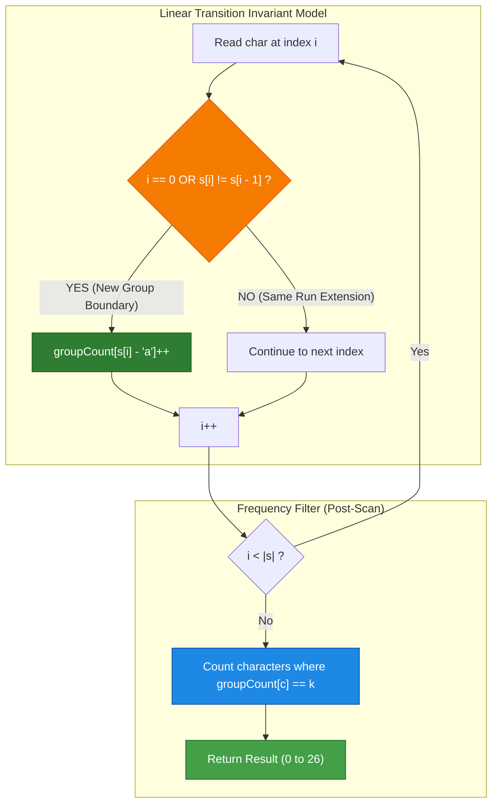
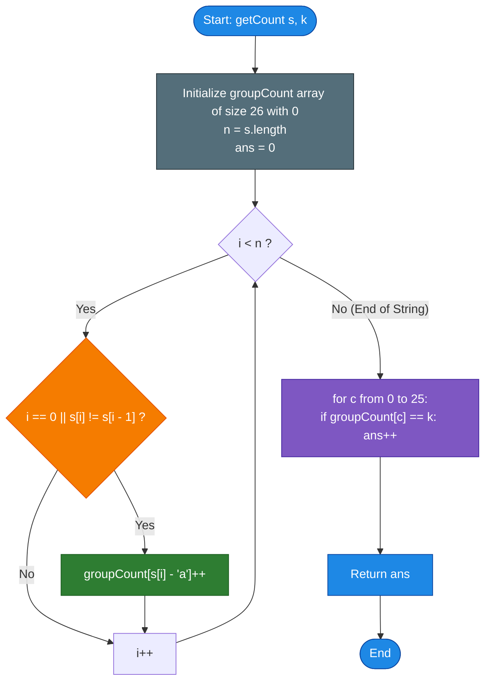

# GeeksforGeeks Problem of the Day: Count Group Occurrences

- **Problem Link:** [GeeksforGeeks - Count Group Occurrences](https://www.geeksforgeeks.org/problems/count-the-characters1821/1)
- **Difficulty:** Easy
- **Topic Tags:** Strings, Hash Table, Counting, Two Pointers, Run-Length Encoding, Algorithms
- **Target Audience:** POTD Solvers, Computer Science Students, Competitive Programmers, Interview Preparation (Amazon, Google, Microsoft, TCS, Infosys, Wipro, Cognizant)

---

## 1. Problem Statement

Given a string `s` consisting of lowercase English letters and an integer `k`, your task is to count the number of **distinct characters** that appear in **exactly `k` groups** throughout the string.

### What is a "Group"?
A **group** is defined as one or more **consecutive (contiguous) occurrences** of the same character.
- If a character appears repeatedly back-to-back without interruption (e.g., `"aaa"`), it forms **one single group**.
- If the same character appears again later in the string separated by other characters (e.g., `"aaa"` followed by `"bb"` followed by `"a"`), that subsequent run forms a **new, separate group** for that character.

Return the total number of distinct characters whose cumulative number of groups equals `k`.

---

## 2. Examples & Explanations

### Example 1
- **Input:** `s = "geeksforgeeks"`, `k = 2`
- **Output:** `4`

#### Step-by-Step Group Extraction:
Let's decompose `s = "geeksforgeeks"` into its constituent consecutive groups:

```text
Index:   0   1 2   3   4   5   6   7   8   9 10  11  12
String:  g   e e   k   s   f   o   r   g   e  e   k   s
Groups: [g] [ee]  [k] [s] [f] [o] [r] [g] [e  e] [k] [s]
```

#### Group Count Per Character:
| Character | Consecutive Groups Observed | Total Group Count | Matches $k = 2$? |
| :---: | :--- | :---: | :---: |
| `'g'` | Group 1: `"g"` at index 0, Group 2: `"g"` at index 8 | **2** | **YES** |
| `'e'` | Group 1: `"ee"` at index 1..2, Group 2: `"ee"` at index 9..10 | **2** | **YES** |
| `'k'` | Group 1: `"k"` at index 3, Group 2: `"k"` at index 11 | **2** | **YES** |
| `'s'` | Group 1: `"s"` at index 4, Group 2: `"s"` at index 12 | **2** | **YES** |
| `'f'` | Group 1: `"f"` at index 5 | **1** | NO |
| `'o'` | Group 1: `"o"` at index 6 | **1** | NO |
| `'r'` | Group 1: `"r"` at index 7 | **1** | NO |

**Characters with exactly $k = 2$ groups:** `'g'`, `'e'`, `'k'`, and `'s'`.  
**Final Count:** $\mathbf{4}$.

---

### Example 2
- **Input:** `s = "abc"`, `k = 1`
- **Output:** `3`

#### Explanation:
- Group breakdown: `[a]`, `[b]`, `[c]`.
- `'a'` appears in $1$ group.
- `'b'` appears in $1$ group.
- `'c'` appears in $1$ group.
- All $3$ distinct characters appear in exactly $k = 1$ group.
- **Final Count:** $\mathbf{3}$.

---

### Example 3
- **Input:** `s = "aaabbcca"`, `k = 1`
- **Output:** `2`

#### Explanation:
- Group breakdown:
  - `"aaa"` $\implies$ Group 1 for `'a'`
  - `"bb"` $\implies$ Group 1 for `'b'`
  - `"cc"` $\implies$ Group 1 for `'c'`
  - `"a"` $\implies$ Group 2 for `'a'`
- Summary:
  - `'a'` has $2$ groups (`"aaa"` and `"a"`).
  - `'b'` has $1$ group (`"bb"`).
  - `'c'` has $1$ group (`"cc"`).
- Characters with exactly $k = 1$ group: `'b'` and `'c'`.
- **Final Count:** $\mathbf{2}$.

---

## 3. Constraints

- $1 \le |s| \le 10^5$
- $1 \le k \le 10^3$
- `s` consists strictly of lowercase English letters (`'a'` through `'z'`).
- **Expected Time Complexity:** $\mathcal{O}(|s|)$
- **Expected Auxiliary Space:** $\mathcal{O}(1)$ (fixed 26-element array)

---

## 4. Visual Architecture & Run-Length Invariant

### The Boundary Transition Invariant
Instead of slicing and storing substring objects, we can detect the start of every group using a simple local boundary rule.

A character $s[i]$ initiates a **new group** if and only if:
$$\mathbf{i == 0 \quad \lor \quad s[i] \ne s[i - 1]}$$

```text
String:       a   a   a   b   b   c   c   a
Index:        0   1   2   3   4   5   6   7
s[i]!=s[i-1]: YES NO  NO  YES NO  YES NO  YES
Action:      +1          +1      +1      +1
Character:   'a'         'b'     'c'     'a'
```

Every time the condition $s[i] \ne s[i - 1]$ evaluates to `true`, we increment the group frequency for character $s[i]$.



---

## 5. Step-by-Step Simulation & Trace Table

### Tracing $s = \text{"aaabbcca"}$, $k = 1$

| Index $i$ | Char $s[i]$ | Previous $s[i-1]$ | Is New Group? ($i=0 \lor s[i] \ne s[i-1]$) | Action Taken | Current Group Counts State |
| :---: | :---: | :---: | :---: | :---: | :--- |
| **0** | `'a'` | — | **YES** ($i = 0$) | `count['a']++` | `{'a': 1}` |
| **1** | `'a'` | `'a'` | NO (duplicate) | Pass | `{'a': 1}` |
| **2** | `'a'` | `'a'` | NO (duplicate) | Pass | `{'a': 1}` |
| **3** | `'b'` | `'a'` | **YES** (`'b' != 'a'`) | `count['b']++` | `{'a': 1, 'b': 1}` |
| **4** | `'b'` | `'b'` | NO (duplicate) | Pass | `{'a': 1, 'b': 1}` |
| **5** | `'c'` | `'b'` | **YES** (`'c' != 'b'`) | `count['c']++` | `{'a': 1, 'b': 1, 'c': 1}` |
| **6** | `'c'` | `'c'` | NO (duplicate) | Pass | `{'a': 1, 'b': 1, 'c': 1}` |
| **7** | `'a'` | `'c'` | **YES** (`'a' != 'c'`) | `count['a']++` | `{'a': 2, 'b': 1, 'c': 1}` |

#### Final Evaluation ($k = 1$):
- `count['a'] = 2` $\ne 1$
- `count['b'] = 1` $== 1$ $\implies$ **Match (+1)**
- `count['c'] = 1` $== 1$ $\implies$ **Match (+1)**
- All other 23 lowercase letters have count $0 \ne 1$.
- **Result:** $1 + 1 = \mathbf{2}$.

---

## 6. Algorithm Flowchart



---

## 7. From Naive to Pro: Algorithmic Progression

### Method 1: Naive (Explicit Substring Chunking & Map Lookup)
- **Concept:** Tokenize the string into consecutive identical character substrings (e.g., using regular expressions or dynamic string builders). Store groups in a list of strings, then iterate through the list to count group appearances per character in a hash map.
- **Why it is suboptimal:**
  - Performs unnecessary string allocations and substring slicing.
  - High GC (Garbage Collection) pressure for strings of length $10^5$.
- **Pseudocode:**
```text
function getCount_Naive(s, k):
    groups = []
    curr = ""
    for char in s:
        if curr is empty or curr[last] == char:
            curr += char
        else:
            groups.append(curr)
            curr = char
    if curr is not empty:
        groups.append(curr)
        
    freq = map()
    for g in groups:
        freq[g[0]]++
        
    count = 0
    for key, val in freq:
        if val == k: count++
    return count
```

---

### Method 2: Two-Pointer Group Chunking
- **Concept:** Use two pointers $i$ and $j$. Pointer $i$ marks the start of a run, and $j$ advances while $s[j] == s[i]$. When $j$ stops, increment `count[s[i] - 'a']`, then jump $i = j$.
- **Time Complexity:** $\mathcal{O}(|s|)$
- **Space Complexity:** $\mathcal{O}(1)$
- **Pseudocode:**
```text
function getCount_TwoPointer(s, k):
    groupCount = array of size 26
    n = len(s)
    i = 0
    while i < n:
        ch = s[i]
        groupCount[ch - 'a']++
        while i < n and s[i] == ch:
            i++
    result = 0
    for c in groupCount:
        if c == k: result++
    return result
```

---

### Method 3: Pro Approach — Single-Pass Transition Invariant ($\mathcal{O}(|s|)$ Time, $\mathcal{O}(1)$ Space)
- **The Core Strategy:**
  - A new group starts precisely when $s[i] \ne s[i - 1]$ (or at $i = 0$).
  - One single clean `for` loop without nested `while` conditions.
  - Cache-friendly array of size 26 (`groupCount[26]`).
  - Constant memory, zero heap allocations, lightning-fast execution.
- **Pseudocode:**
```text
function getCount_Optimal(s, k):
    groupCount = array of size 26 filled with 0
    for i from 0 to len(s) - 1:
        if i == 0 or s[i] != s[i - 1]:
            groupCount[s[i] - 'a']++
            
    ans = 0
    for count in groupCount:
        if count == k:
            ans++
    return ans
```

---

## 8. Complexity Comparison Table

| Metric | Method 1: Substring Extraction | Method 2: Two Pointers | Method 3: Transition Invariant (Pro) |
| :--- | :--- | :--- | :--- |
| **Time Complexity** | $\mathcal{O}(|s|)$ | $\mathcal{O}(|s|)$ | $\mathbf{\mathcal{O}(|s|)}$ (Fastest single loop) |
| **Auxiliary Space** | $\mathcal{O}(|s|)$ (Heap string buffers) | $\mathcal{O}(1)$ | $\mathbf{\mathcal{O}(1)}$ (26-element stack array) |
| **Memory Allocations** | Up to $10^5$ objects | 1 array of size 26 | **1 flat array of size 26** |
| **Branching Overhead** | High | Nested while loops | **Minimal single if condition** |
| **Interview Verdict** | Inefficient for memory | Good | **Gold Standard (Clean & Idiomatic)** |

---

## 9. Comprehensive Corner Cases Handled

1. **Single Character String ($|s| = 1$):**
   - E.g., `s = "a"`, `k = 1`.
   - Condition $i = 0$ triggers once; `count['a'] = 1 == k` $\implies$ returns `1`.
2. **All Identical Characters (`"aaaaaaa"`):**
   - Condition $i = 0$ triggers for index 0; all subsequent indices have $s[i] == s[i-1]$ and are skipped.
   - Total groups for `'a'` is $1$. If $k = 1$, returns $1$; if $k > 1$, returns $0$.
3. **All Distinct Characters (`"abcdef"`):**
   - Every single character triggers $s[i] \ne s[i-1]$.
   - Each character forms exactly $1$ group.
4. **$k$ Greater Than Total Groups ($k > |s|$):**
   - No character can ever form more than $|s|$ groups.
   - Loop completes and returns $0$ correctly without errors.
5. **Alternating Run Patterns (`"abababab"`):**
   - Every step is a transition $\implies 4$ groups for `'a'` and $4$ groups for `'b'`.

---

## 10. Complete Multi-Language Implementations

### Java (21)

```java
class Solution {
    /**
     * Counts the number of distinct characters that appear in exactly k groups.
     * Approach: Single-Pass Transition Invariant with fixed 26-element frequency table.
     * Time Complexity: O(|s|)
     * Space Complexity: O(1)
     */
    int getCount(String s, int k) {
        int[] groupCount = new int[26];
        int n = s.length();

        // Count every time a character starts a new contiguous group
        for (int i = 0; i < n; i++) {
            if (i == 0 || s.charAt(i) != s.charAt(i - 1)) {
                groupCount[s.charAt(i) - 'a']++;
            }
        }

        // Count distinct characters with group count exactly equal to k
        int result = 0;
        for (int i = 0; i < 26; i++) {
            if (groupCount[i] == k) {
                result++;
            }
        }

        return result;
    }
}
```

---

### Python3

```python
class Solution:
    def getCount(self, s: str, k: int) -> int:
        """
        Counts the number of distinct characters that appear in exactly k groups.
        Approach: Single-Pass Transition Invariant with fixed 26-element frequency table.
        Time Complexity: O(|s|)
        Space Complexity: O(1)
        """
        group_count = [0] * 26
        n = len(s)

        # Detect group boundaries: index 0 or transition from previous character
        for i in range(n):
            if i == 0 or s[i] != s[i - 1]:
                group_count[ord(s[i]) - ord('a')] += 1

        # Count characters that formed exactly k groups
        return sum(1 for count in group_count if count == k)
```

---

### C++ (17)

```cpp
#include <string>
#include <vector>

using namespace std;

class Solution {
  public:
    /**
     * Counts the number of distinct characters that appear in exactly k groups.
     * Approach: Single-Pass Transition Invariant with fixed 26-element frequency table.
     * Time Complexity: O(|s|)
     * Space Complexity: O(1)
     */
    int getCount(string &s, int k) {
        int groupCount[26] = {0};
        int n = s.length();

        // Increment count when a new contiguous block starts
        for (int i = 0; i < n; ++i) {
            if (i == 0 || s[i] != s[i - 1]) {
                groupCount[s[i] - 'a']++;
            }
        }

        int result = 0;
        for (int i = 0; i < 26; ++i) {
            if (groupCount[i] == k) {
                result++;
            }
        }

        return result;
    }
};
```

---

### C#

```csharp
class Solution {
    /**
     * Counts the number of distinct characters that appear in exactly k groups.
     * Approach: Single-Pass Transition Invariant with fixed 26-element frequency table.
     * Time Complexity: O(|s|)
     * Space Complexity: O(1)
     */
    public int getCount(string s, int k) {
        int[] groupCount = new int[26];
        int n = s.Length;

        // Traverse string and record group starts
        for (int i = 0; i < n; i++) {
            if (i == 0 || s[i] != s[i - 1]) {
                groupCount[s[i] - 'a']++;
            }
        }

        int result = 0;
        for (int i = 0; i < 26; i++) {
            if (groupCount[i] == k) {
                result++;
            }
        }

        return result;
    }
}
```

---

### Javascript (Node v22)

```javascript
/**
 * @param {string} s
 * @param {number} k
 * @return {number}
 */
class Solution {
    /**
     * Counts the number of distinct characters that appear in exactly k groups.
     * Approach: Single-Pass Transition Invariant with typed Int32Array.
     * Time Complexity: O(|s|)
     * Space Complexity: O(1)
     */
    getCount(s, k) {
        const groupCount = new Int32Array(26);
        const n = s.length;

        // Detect boundaries of consecutive character runs
        for (let i = 0; i < n; i++) {
            if (i === 0 || s.charCodeAt(i) !== s.charCodeAt(i - 1)) {
                groupCount[s.charCodeAt(i) - 97]++;
            }
        }

        let result = 0;
        for (let i = 0; i < 26; i++) {
            if (groupCount[i] === k) {
                result++;
            }
        }

        return result;
    }
}
```
