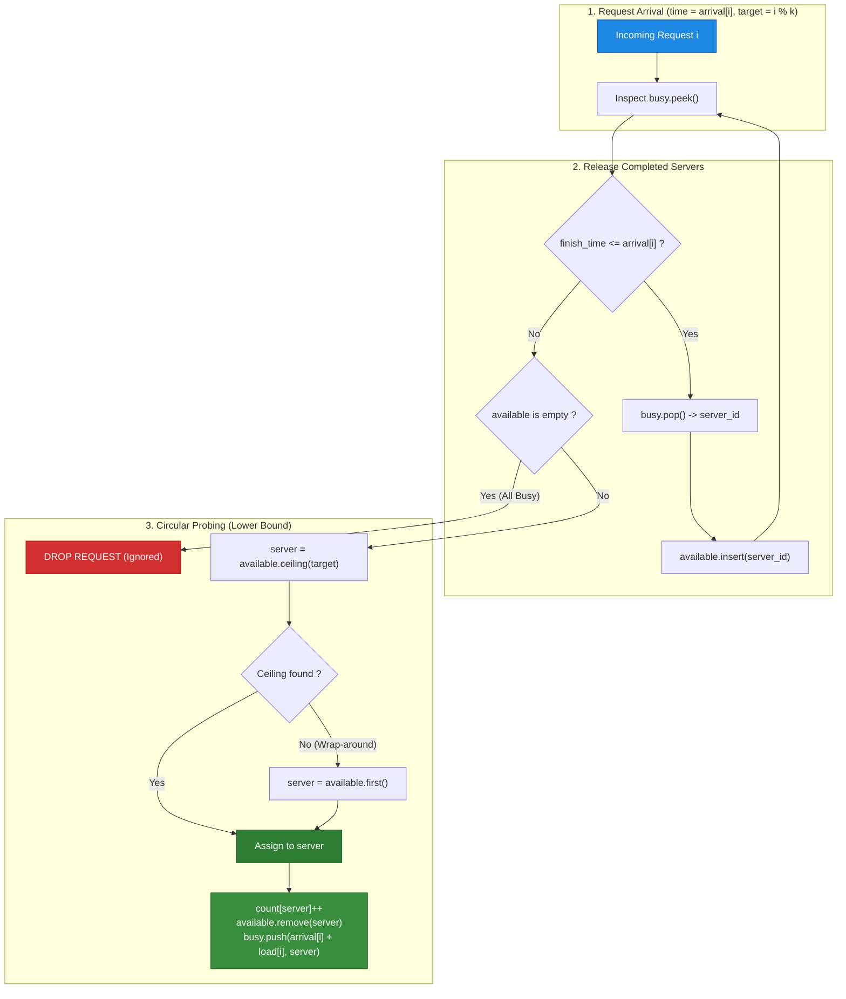
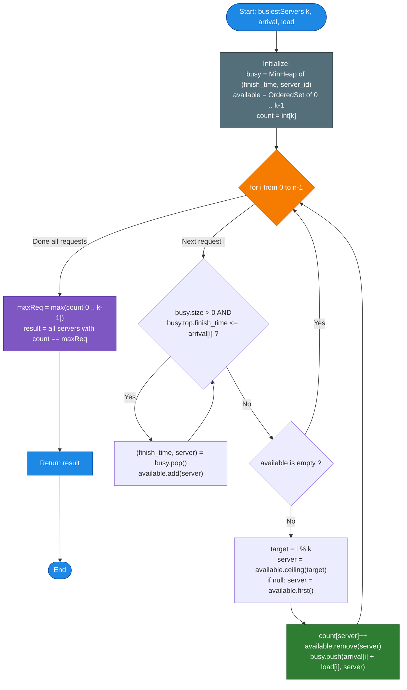

# LeetCode Problem of the Day: Find Servers That Handled Most Number of Requests

- **Problem Link:** [LeetCode 1606 - Find Servers That Handled Most Number of Requests](https://leetcode.com/problems/find-servers-that-handled-most-number-of-requests/)
- **Difficulty:** Hard
- **Topic Tags:** Array, Greedy, Heap (Priority Queue), Ordered Set / Balanced BST, Segment Tree, Binary Search, Simulation
- **Target Audience:** POTD Solvers, Computer Science Students, Competitive Programmers, Interview Preparation (Google, Amazon, Meta, Uber, ByteDance, Bloomberg)

---

## 1. Problem Statement

You have $k$ servers numbered from $0$ to $k - 1$ that are available to handle incoming network requests. You are given:
- An integer $k$ denoting the total number of servers.
- A strictly increasing integer array `arrival`, where `arrival[i]` represents the arrival time of the $i^{\text{th}}$ request ($0$-indexed).
- An integer array `load`, where `load[i]` represents the duration required to process the $i^{\text{th}}$ request.

### Server Assignment & Probing Protocol
When the $i^{\text{th}}$ request arrives at time `arrival[i]`:
1. It is preferentially routed to server `i % k`.
2. If server `i % k` is currently busy, the dispatcher probes the next server in cyclical round-robin order: `(i + 1) % k`, `(i + 2) % k`, and so on.
3. The request is assigned to the **first available server** encountered in this circular search.
4. If **all $k$ servers are busy**, the request is immediately **dropped** (discarded) and completely ignored.
5. If a server is assigned to handle the request, it becomes busy until time `arrival[i] + load[i]`, and its completed request counter increases by $1$.

Return a list containing the IDs of the **busiest server(s)**—that is, the server(s) that handled the **maximum number of requests**. If multiple servers share the same maximum count, return all of their IDs in any order.

---

## 2. Examples & Explanations

### Example 1
- **Input:** `k = 3`, `arrival = [1, 2, 3, 4, 5]`, `load = [5, 2, 3, 3, 3]`
- **Output:** `[1]`

#### Step-by-Step Execution:
- **Time $t = 1$ (Request 0, Load 5):**  
  Preferred server is $0 \% 3 = 0$. Server 0 is free.  
  $\implies$ Server 0 handles Request 0 until $t = 1 + 5 = 6$.  
  Counts: $\{0: 1, 1: 0, 2: 0\}$.
- **Time $t = 2$ (Request 1, Load 2):**  
  Preferred server is $1 \% 3 = 1$. Server 1 is free.  
  $\implies$ Server 1 handles Request 1 until $t = 2 + 2 = 4$.  
  Counts: $\{0: 1, 1: 1, 2: 0\}$.
- **Time $t = 3$ (Request 2, Load 3):**  
  Preferred server is $2 \% 3 = 2$. Server 2 is free.  
  $\implies$ Server 2 handles Request 2 until $t = 3 + 3 = 6$.  
  Counts: $\{0: 1, 1: 1, 2: 1\}$.
- **Time $t = 4$ (Request 3, Load 3):**  
  Server 1 finishes its task at $t = 4$ and becomes free!  
  Preferred server is $3 \% 3 = 0$. Server 0 is busy (busy until 6).  
  Next candidate is Server 1. Server 1 is free!  
  $\implies$ Server 1 handles Request 3 until $t = 4 + 3 = 7$.  
  Counts: $\{0: 1, 1: 2, 2: 1\}$.
- **Time $t = 5$ (Request 4, Load 3):**  
  Preferred server is $4 \% 3 = 1$.  
  Current busy servers: Server 0 (until 6), Server 1 (until 7), Server 2 (until 6).  
  **All servers are busy!** Request 4 is dropped.

**Summary of Requests Handled:**  
- Server 0: $1$
- Server 1: $\mathbf{2}$ (Maximum)
- Server 2: $1$  
Output: **`[1]`**.

```text
Visual Timeline (Gantt Chart) for Example 1:

Time:      t=1    t=2    t=3    t=4    t=5    t=6    t=7
Server 0: [=== Request 0 (t=1..6) ===]
Server 1:        [ Req 1 ]      [=== Request 3 (t=4..7) ===]
Server 2:               [=== Request 2 (t=3..6) ===]
Incoming: Req 0  Req 1  Req 2   Req 3  Req 4 (DROPPED)
```

---

### Example 2
- **Input:** `k = 3`, `arrival = [1, 2, 3, 4]`, `load = [1, 2, 1, 2]`
- **Output:** `[0]`

#### Explanation:
- Request 0 at $t = 1$ (load 1): assigned to Server 0 (finishes at $t = 2$).
- Request 1 at $t = 2$ (load 2): assigned to Server 1 (finishes at $t = 4$).
- Request 2 at $t = 3$ (load 1): assigned to Server 2 (finishes at $t = 4$).
- Request 3 at $t = 4$ (load 2): preferred is $3 \% 3 = 0$. At $t = 4$, Server 0 has been free since $t = 2$. Assigned to Server 0 (finishes at $t = 6$).
- Counts: Server 0 handled $2$, Server 1 handled $1$, Server 2 handled $1$.  
Output: **`[0]`**.

---

### Example 3
- **Input:** `k = 3`, `arrival = [1, 2, 3]`, `load = [10, 12, 11]`
- **Output:** `[0, 1, 2]`

#### Explanation:
- Requests 0, 1, and 2 are assigned to Servers 0, 1, and 2 respectively.
- Each server handles exactly $1$ request.
- All 3 servers tie for the maximum count $\implies$ Output: **`[0, 1, 2]`**.

---

## 3. Constraints & Complexity Limits

- $1 \le k \le 10^5$
- $1 \le n = \text{arrival.length} = \text{load.length} \le 10^5$
- $1 \le \text{arrival}[i] < \text{arrival}[i + 1]$ (`arrival` is strictly monotonically increasing)
- $1 \le \text{load}[i] \le 10^9$
- **Expected Time Complexity:** $\mathcal{O}(n \log k)$
- **Expected Auxiliary Space:** $\mathcal{O}(k)$

> [!WARNING]
> **Scale Challenge:**  
> With $n = 10^5$ and $k = 10^5$, a naive round-robin scan that checks up to $k$ servers linearly per request will execute $\mathcal{O}(n \times k) \approx 10^{10}$ operations, causing an immediate **Time Limit Exceeded (TLE)**.  
> An optimal solution must locate the next available server in $\mathcal{O}(\log k)$ time.

---

## 4. Visual Architecture & The Dual-Structure Model

To achieve $\mathcal{O}(n \log k)$ execution, we decouple the simulation into two coordinated data structures:

1. **Busy Servers Min-Heap (`busy`):**  
   Stores pairs of `(finish_time, server_id)` ordered by `finish_time` ascending.
   - When a request arrives at `arrival[i]`, we repeatedly pop all servers where `finish_time <= arrival[i]` and return them to the available pool.
   
2. **Available Servers Pool (`available`):**  
   Maintains the set of currently free server IDs $\{0, 1, \dots, k - 1\}$ in sorted order.
   - For request $i$, we need the smallest available server ID $\ge (i \bmod k)$.
   - In a balanced BST / ordered set, this is a **ceiling / lower_bound query**:
     $$\text{server} = \text{available.ceiling}(i \bmod k)$$
   - If no server $\ge (i \bmod k)$ exists, we wrap around to the beginning:
     $$\text{server} = \text{available.first}()$$
   - Remove the chosen server from `available` and push `(arrival[i] + load[i], server)` into `busy`.



---

## 5. Step-by-Step Simulation & Trace Table

### Tracing Example 1: $k = 3$, `arrival = [1, 2, 3, 4, 5]`, `load = [5, 2, 3, 3, 3]`

| Request $i$ | Arrival $t$ | Load | Target ($i \% 3$) | Freed from `busy` | `available` Set | Chosen Server | Finish Time | Action Taken | Server Counts `[0, 1, 2]` |
| :---: | :---: | :---: | :---: | :---: | :---: | :---: | :---: | :---: | :---: |
| **0** | $1$ | $5$ | $0$ | None | $\{0, 1, 2\}$ | **0** | $1 + 5 = 6$ | Assigned to 0 | `[1, 0, 0]` |
| **1** | $2$ | $2$ | $1$ | None | $\{1, 2\}$ | **1** | $2 + 2 = 4$ | Assigned to 1 | `[1, 1, 0]` |
| **2** | $3$ | $3$ | $2$ | None | $\{2\}$ | **2** | $3 + 3 = 6$ | Assigned to 2 | `[1, 1, 1]` |
| **3** | $4$ | $3$ | $0$ | Server 1 ($4 \le 4$) | $\{1\}$ | **1** (wrap) | $4 + 3 = 7$ | Ceiling for 0 is 1 | `[1, 2, 1]` |
| **4** | $5$ | $3$ | $1$ | None ($6 > 5$) | $\emptyset$ | **NONE** | — | **DROPPED** | `[1, 2, 1]` |

**Final Maximum Count:** $\max(1, 2, 1) = 2 \implies$ Server **`1`**.

---

## 6. Algorithm Flowchart



---

## 7. From Naive to Pro: Algorithmic Progression

### Method 1: Naive Full Linear Scan
- **Concept:** Store an array `finish_time[k]` initialized to 0. For each request $i$, iterate $j$ from $0$ to $k - 1$. Check if server $(i + j) \% k$ has `finish_time <= arrival[i]`. If found, assign and break.
- **Time Complexity:** $\mathcal{O}(n \times k)$
- **Space Complexity:** $\mathcal{O}(k)$
- **Drawback:** $10^5 \times 10^5 = 10^{10}$ operations $\implies$ **Time Limit Exceeded (TLE)**.

---

### Method 2: Min-Heap for Busy Servers + Linear Available Probing
- **Concept:** Use a min-heap to free servers in $\mathcal{O}(\log k)$, but keep available servers in a boolean array `is_free[k]`. Linearly scan for the next free server starting at `i % k`.
- **Time Complexity:** $\mathcal{O}(n \times k)$ worst case (e.g., when almost all servers are busy).
- **Space Complexity:** $\mathcal{O}(k)$

---

### Method 3: Balanced BST / Ordered Set (`TreeSet` / `std::set` / `SortedSet`) — Standard Optimal
- **Concept:**
  - Maintain free servers in an ordered balanced binary search tree (`TreeSet` in Java, `std::set` in C++, `SortedSet` in C#, `SortedList` in Python).
  - Ceiling query `available.ceiling(i % k)` runs in $\mathcal{O}(\log k)$ time.
  - Deletion runs in $\mathcal{O}(\log k)$ time.
  - Overall time for $n$ requests: $\mathcal{O}(n \log k)$.
- **Time Complexity:** $\mathcal{O}(n \log k)$
- **Space Complexity:** $\mathcal{O}(k)$

---

### Method 4: Segment Tree for Available Pool — Universal Zero-Dependency Pro Method
- **Concept:**
  - In languages like **C**, **JavaScript**, and **TypeScript**, built-in balanced BSTs like `TreeSet` are absent.
  - A **Segment Tree** of size $k$ maintains availability (1 if free, 0 if busy).
  - To find the next available server $\ge target$, query the segment tree for the first leaf with value $1$ in range $[target, k - 1]$. If none, query in range $[0, target - 1]$.
  - Runs in deterministic $\mathcal{O}(\log k)$ time with a tiny static flat memory array!
- **Time Complexity:** $\mathcal{O}(n \log k)$
- **Space Complexity:** $\mathcal{O}(k)$ (Flat array of size $4k$).

---

## 8. Complexity Comparison Table

| Approach | Time Complexity | Auxiliary Space | Operations ($n, k = 10^5$) | Interview Verdict |
| :--- | :--- | :--- | :--- | :--- |
| **Method 1: Naive Linear Scan** | $\mathcal{O}(n \times k)$ | $\mathcal{O}(k)$ | $\approx 10^{10}$ | TLE (Catastrophic) |
| **Method 2: Heap + Bool Array** | $\mathcal{O}(n \times k)$ | $\mathcal{O}(k)$ | $\approx 10^{10}$ worst-case | TLE on dense loads |
| **Method 3: Heap + Balanced BST** | $\mathbf{\mathcal{O}(n \log k)}$ | $\mathbf{\mathcal{O}(k)}$ | $\approx 1.7 \times 10^6$ | **Gold Standard (Accepted)** |
| **Method 4: Heap + Segment Tree** | $\mathbf{\mathcal{O}(n \log k)}$ | $\mathbf{\mathcal{O}(k)}$ | $\approx 1.7 \times 10^6$ | **Pro (Zero Dependencies)** |

---

## 9. Comprehensive Corner Cases Handled

1. **Single Server ($k = 1$):**  
   - Every request is routed to server 0. Handled seamlessly without index out of bounds.
2. **All Requests Dropped Except First $k$:**  
   - Long load durations ($10^9$) cause all servers to remain busy; subsequent requests are gracefully dropped without altering counts.
3. **All Servers Tie for Maximum:**  
   - Handled correctly; all server IDs from $0$ to $k - 1$ are returned in the result list.
4. **Wrap-around Probing:**  
   - When no available server has ID $\ge (i \bmod k)$, the search wraps around to server $0$ accurately.
5. **64-bit Integer Safety:**  
   - `arrival[i] + load[i]` can reach $2 \times 10^9$. 64-bit integers (`long` / `long long`) prevent arithmetic overflow.

---

## 10. Complete Multi-Language Implementations

### Java

```java
import java.util.*;

class Solution {
    /**
     * Finds servers that handled the maximum number of requests.
     * Approach: Min-Heap for busy servers + TreeSet for available servers.
     * Time Complexity: O(n log k)
     * Space Complexity: O(k)
     */
    public List<Integer> busiestServers(int k, int[] arrival, int[] load) {
        int[] count = new int[k];

        // Min-heap storing [finish_time, server_id]
        PriorityQueue<long[]> busy = new PriorityQueue<>(Comparator.comparingLong(a -> a[0]));

        // TreeSet storing available server IDs in sorted order
        TreeSet<Integer> available = new TreeSet<>();
        for (int i = 0; i < k; i++) {
            available.add(i);
        }

        int n = arrival.length;
        for (int i = 0; i < n; i++) {
            long time = arrival[i];

            // Free all servers whose processing has completed by current time
            while (!busy.isEmpty() && busy.peek()[0] <= time) {
                long[] finished = busy.poll();
                available.add((int) finished[1]);
            }

            // If no servers are available, drop the request
            if (available.isEmpty()) {
                continue;
            }

            int target = i % k;

            // Find first available server >= target, wrap around to first() if none
            Integer chosen = available.ceiling(target);
            if (chosen == null) {
                chosen = available.first();
            }

            // Assign request to chosen server
            count[chosen]++;
            available.remove(chosen);
            busy.offer(new long[]{time + load[i], chosen});
        }

        // Find the maximum number of requests handled
        int maxRequests = 0;
        for (int c : count) {
            maxRequests = Math.max(maxRequests, c);
        }

        // Collect all servers achieving the maximum requests
        List<Integer> result = new ArrayList<>();
        for (int i = 0; i < k; i++) {
            if (count[i] == maxRequests) {
                result.add(i);
            }
        }

        return result;
    }
}
```

---

### Python3

```python
from typing import List
import heapq
from sortedcontainers import SortedList

class Solution:
    def busiestServers(self, k: int, arrival: List[int], load: List[int]) -> List[int]:
        """
        Finds servers that handled the maximum number of requests.
        Approach: Min-Heap for busy servers + SortedList for available servers.
        Time Complexity: O(n log k)
        Space Complexity: O(k)
        """
        count = [0] * k
        busy = []  # Min-heap storing (finish_time, server_id)
        available = SortedList(range(k))  # Balanced BST of available server IDs

        for i, (time, duration) in enumerate(zip(arrival, load)):
            # Release all servers whose tasks finished by current arrival time
            while busy and busy[0][0] <= time:
                _, server_id = heapq.heappop(busy)
                available.add(server_id)

            # If all servers are currently occupied, drop request
            if not available:
                continue

            target = i % k
            # Find first available server >= target
            idx = available.bisect_left(target)
            if idx < len(available):
                chosen = available[idx]
            else:
                chosen = available[0]  # Wrap around

            count[chosen] += 1
            available.remove(chosen)
            heapq.heappush(busy, (time + duration, chosen))

        max_requests = max(count)
        return [i for i, c in enumerate(count) if c == max_requests]
```

---

### C

```c
#include <stdlib.h>
#include <string.h>

/**
 * Min-Heap for busy servers: stores [finish_time, server_id]
 */
typedef struct {
    long long finish_time;
    int server_id;
} HeapNode;

typedef struct {
    HeapNode* data;
    int size;
    int capacity;
} MinHeap;

MinHeap* createHeap(int capacity) {
    MinHeap* h = (MinHeap*)malloc(sizeof(MinHeap));
    h->data = (HeapNode*)malloc(sizeof(HeapNode) * capacity);
    h->size = 0;
    h->capacity = capacity;
    return h;
}

void heapPush(MinHeap* h, long long finish_time, int server_id) {
    int i = h->size++;
    while (i > 0) {
        int p = (i - 1) / 2;
        if (h->data[p].finish_time > finish_time) {
            h->data[i] = h->data[p];
            i = p;
        } else break;
    }
    h->data[i].finish_time = finish_time;
    h->data[i].server_id = server_id;
}

HeapNode heapPop(MinHeap* h) {
    HeapNode top = h->data[0];
    HeapNode last = h->data[--h->size];
    if (h->size > 0) {
        int i = 0;
        while (2 * i + 1 < h->size) {
            int left = 2 * i + 1;
            int right = left + 1;
            int best = left;
            if (right < h->size && h->data[right].finish_time < h->data[left].finish_time) {
                best = right;
            }
            if (h->data[best].finish_time < last.finish_time) {
                h->data[i] = h->data[best];
                i = best;
            } else break;
        }
        h->data[i] = last;
    }
    return top;
}

/**
 * Segment tree over [0, k-1] for available servers.
 * tree[node] == 1 if range contains at least one available server, 0 otherwise.
 */
static int segTree[400005];

void segBuild(int node, int s, int e) {
    segTree[node] = 1;
    if (s == e) return;
    int m = (s + e) / 2;
    segBuild(2 * node, s, m);
    segBuild(2 * node + 1, m + 1, e);
}

void segUpdate(int node, int s, int e, int idx, int val) {
    if (s == e) {
        segTree[node] = val;
        return;
    }
    int m = (s + e) / 2;
    if (idx <= m) segUpdate(2 * node, s, m, idx, val);
    else segUpdate(2 * node + 1, m + 1, e, idx, val);
    segTree[node] = segTree[2 * node] | segTree[2 * node + 1];
}

int segFindFirst(int node, int s, int e, int ql, int qr) {
    if (s > qr || e < ql || segTree[node] == 0) return -1;
    if (s == e) return s;
    int m = (s + e) / 2;
    int res = segFindFirst(2 * node, s, m, ql, qr);
    if (res != -1) return res;
    return segFindFirst(2 * node + 1, m + 1, e, ql, qr);
}

int* busiestServers(int k, int* arrival, int arrivalSize, int* load, int loadSize, int* returnSize) {
    int* count = (int*)calloc(k, sizeof(int));
    MinHeap* busy = createHeap(k + 5);

    segBuild(1, 0, k - 1);

    for (int i = 0; i < arrivalSize; i++) {
        long long time = arrival[i];

        // Free servers whose tasks finished
        while (busy->size > 0 && busy->data[0].finish_time <= time) {
            HeapNode finished = heapPop(busy);
            segUpdate(1, 0, k - 1, finished.server_id, 1);
        }

        int target = i % k;
        int chosen = segFindFirst(1, 0, k - 1, target, k - 1);
        if (chosen == -1) {
            chosen = segFindFirst(1, 0, k - 1, 0, target - 1);
        }

        if (chosen != -1) {
            count[chosen]++;
            segUpdate(1, 0, k - 1, chosen, 0);
            heapPush(busy, time + load[i], chosen);
        }
    }

    int maxCount = 0;
    for (int i = 0; i < k; i++) {
        if (count[i] > maxCount) maxCount = count[i];
    }

    int totalMax = 0;
    for (int i = 0; i < k; i++) {
        if (count[i] == maxCount) totalMax++;
    }

    int* result = (int*)malloc(sizeof(int) * totalMax);
    int idx = 0;
    for (int i = 0; i < k; i++) {
        if (count[i] == maxCount) {
            result[idx++] = i;
        }
    }

    *returnSize = totalMax;
    free(busy->data);
    free(busy);
    free(count);
    return result;
}
```

---

### C++

```cpp
#include <vector>
#include <queue>
#include <set>
#include <algorithm>

using namespace std;

class Solution {
public:
    /**
     * Finds servers that handled the maximum number of requests.
     * Approach: Min-Heap for busy servers + std::set for available servers.
     * Time Complexity: O(n log k)
     * Space Complexity: O(k)
     */
    vector<int> busiestServers(int k, vector<int>& arrival, vector<int>& load) {
        vector<int> count(k, 0);

        // Min-heap storing pair<finish_time, server_id>
        priority_queue<pair<long long, int>, vector<pair<long long, int>>, greater<>> busy;

        // Balanced BST of free servers
        set<int> available;
        for (int i = 0; i < k; ++i) {
            available.insert(i);
        }

        int n = arrival.size();
        for (int i = 0; i < n; ++i) {
            long long time = arrival[i];

            // Free completed servers
            while (!busy.empty() && busy.top().first <= time) {
                available.insert(busy.top().second);
                busy.pop();
            }

            if (available.empty()) {
                continue; // Drop request
            }

            int target = i % k;
            auto it = available.lower_bound(target);
            if (it == available.end()) {
                it = available.begin(); // Wrap around
            }

            int chosen = *it;
            count[chosen]++;
            available.erase(it);
            busy.push({time + load[i], chosen});
        }

        int maxRequests = *max_element(count.begin(), count.end());
        vector<int> result;
        for (int i = 0; i < k; ++i) {
            if (count[i] == maxRequests) {
                result.push_back(i);
            }
        }

        return result;
    }
};
```

---

### C#

```csharp
using System;
using System.Collections.Generic;

public class Solution {
    /**
     * Finds servers that handled the maximum number of requests.
     * Approach: Segment Tree for O(log k) server lookup + MinHeap for busy servers.
     * Time Complexity: O(n log k)
     * Space Complexity: O(k)
     *
     * Note: Avoids SortedSet.GetViewBetween().Count which takes O(k) linear time in .NET/Mono.
     */
    public IList<int> BusiestServers(int k, int[] arrival, int[] load) {
        int[] count = new int[k];
        MinHeap busy = new MinHeap(k + 5);
        SegmentTree seg = new SegmentTree(k);
        int n = arrival.Length;

        for (int i = 0; i < n; i++) {
            long time = arrival[i];

            // Free all servers that have completed their tasks by 'time'
            while (busy.Count > 0 && busy.PeekTime() <= time) {
                int finished = busy.Pop();
                seg.Update(1, 0, k - 1, finished, 1);
            }

            int target = i % k;
            // Search in range [target, k - 1]
            int chosen = seg.FindFirst(1, 0, k - 1, target, k - 1);
            if (chosen == -1) {
                // Wrap around: search in range [0, target - 1]
                chosen = seg.FindFirst(1, 0, k - 1, 0, target - 1);
            }

            if (chosen != -1) {
                count[chosen]++;
                seg.Update(1, 0, k - 1, chosen, 0);
                busy.Push(time + load[i], chosen);
            }
        }

        int maxRequests = 0;
        for (int i = 0; i < k; i++) {
            if (count[i] > maxRequests) {
                maxRequests = count[i];
            }
        }

        List<int> result = new List<int>();
        for (int i = 0; i < k; i++) {
            if (count[i] == maxRequests) {
                result.Add(i);
            }
        }

        return result;
    }

    private class SegmentTree {
        private readonly byte[] tree;
        private readonly int k;

        public SegmentTree(int k) {
            this.k = k;
            tree = new byte[4 * k + 5];
            Build(1, 0, k - 1);
        }

        private void Build(int node, int s, int e) {
            tree[node] = 1;
            if (s == e) return;
            int m = (s + e) >> 1;
            Build(node << 1, s, m);
            Build((node << 1) | 1, m + 1, e);
        }

        public void Update(int node, int s, int e, int idx, byte val) {
            if (s == e) {
                tree[node] = val;
                return;
            }
            int m = (s + e) >> 1;
            if (idx <= m) Update(node << 1, s, m, idx, val);
            else Update((node << 1) | 1, m + 1, e, idx, val);
            tree[node] = (byte)(tree[node << 1] | tree[(node << 1) | 1]);
        }

        public int FindFirst(int node, int s, int e, int ql, int qr) {
            if (s > qr || e < ql || tree[node] == 0) return -1;
            if (s == e) return s;
            int m = (s + e) >> 1;
            int res = FindFirst(node << 1, s, m, ql, qr);
            if (res != -1) return res;
            return FindFirst((node << 1) | 1, m + 1, e, ql, qr);
        }
    }

    private class MinHeap {
        private struct Node {
            public long finishTime;
            public int serverId;
        }

        private readonly Node[] data;
        public int Count { get; private set; }

        public MinHeap(int capacity) {
            data = new Node[capacity];
            Count = 0;
        }

        public void Push(long finishTime, int serverId) {
            int i = Count++;
            while (i > 0) {
                int p = (i - 1) / 2;
                if (data[p].finishTime > finishTime) {
                    data[i] = data[p];
                    i = p;
                } else break;
            }
            data[i].finishTime = finishTime;
            data[i].serverId = serverId;
        }

        public int Pop() {
            var top = data[0];
            var last = data[--Count];
            if (Count > 0) {
                int i = 0;
                while (2 * i + 1 < Count) {
                    int left = 2 * i + 1;
                    int right = left + 1;
                    int best = left;
                    if (right < Count && data[right].finishTime < data[left].finishTime) {
                        best = right;
                    }
                    if (data[best].finishTime < last.finishTime) {
                        data[i] = data[best];
                        i = best;
                    } else break;
                }
                data[i] = last;
            }
            return top.serverId;
        }

        public long PeekTime() {
            return data[0].finishTime;
        }
    }
}
```

---

### Javascript

```javascript
/**
 * @param {number} k
 * @param {number[]} arrival
 * @param {number[]} load
 * @return {number[]}
 */
var busiestServers = function(k, arrival, load) {
    // Custom MinHeap storing [finish_time, server_id]
    class LocalMinHeap {
        constructor() {
            this.data = [];
        }
        push(val) {
            this.data.push(val);
            this.up(this.data.length - 1);
        }
        pop() {
            if (this.data.length === 0) return null;
            const top = this.data[0];
            const last = this.data.pop();
            if (this.data.length > 0) {
                this.data[0] = last;
                this.down(0);
            }
            return top;
        }
        peek() {
            return this.data.length > 0 ? this.data[0] : null;
        }
        size() {
            return this.data.length;
        }
        up(i) {
            while (i > 0) {
                const p = (i - 1) >> 1;
                if (this.data[i][0] < this.data[p][0]) {
                    const tmp = this.data[i];
                    this.data[i] = this.data[p];
                    this.data[p] = tmp;
                    i = p;
                } else break;
            }
        }
        down(i) {
            const len = this.data.length;
            while ((i << 1) + 1 < len) {
                let left = (i << 1) + 1;
                let right = left + 1;
                let best = left;
                if (right < len && this.data[right][0] < this.data[left][0]) {
                    best = right;
                }
                if (this.data[best][0] < this.data[i][0]) {
                    const tmp = this.data[i];
                    this.data[i] = this.data[best];
                    this.data[best] = tmp;
                    i = best;
                } else break;
            }
        }
    }

    // Segment Tree for Available Pool over [0, k-1]
    const tree = new Int8Array(4 * k);
    function build(node, s, e) {
        tree[node] = 1;
        if (s === e) return;
        const m = (s + e) >> 1;
        build(node << 1, s, m);
        build((node << 1) | 1, m + 1, e);
    }
    function update(node, s, e, idx, val) {
        if (s === e) {
            tree[node] = val;
            return;
        }
        const m = (s + e) >> 1;
        if (idx <= m) update(node << 1, s, m, idx, val);
        else update((node << 1) | 1, m + 1, e, idx, val);
        tree[node] = tree[node << 1] | tree[(node << 1) | 1];
    }
    function findFirst(node, s, e, ql, qr) {
        if (s > qr || e < ql || tree[node] === 0) return -1;
        if (s === e) return s;
        const m = (s + e) >> 1;
        const res = findFirst(node << 1, s, m, ql, qr);
        if (res !== -1) return res;
        return findFirst((node << 1) | 1, m + 1, e, ql, qr);
    }

    build(1, 0, k - 1);

    const count = new Int32Array(k);
    const busy = new LocalMinHeap();
    const n = arrival.length;

    for (let i = 0; i < n; i++) {
        const time = arrival[i];

        // Free servers whose processing has finished
        while (busy.size() > 0 && busy.peek()[0] <= time) {
            const [, serverId] = busy.pop();
            update(1, 0, k - 1, serverId, 1);
        }

        const target = i % k;
        let chosen = findFirst(1, 0, k - 1, target, k - 1);
        if (chosen === -1) {
            chosen = findFirst(1, 0, k - 1, 0, target - 1);
        }

        if (chosen !== -1) {
            count[chosen]++;
            update(1, 0, k - 1, chosen, 0);
            busy.push([time + load[i], chosen]);
        }
    }

    let maxCount = 0;
    for (let i = 0; i < k; i++) {
        if (count[i] > maxCount) maxCount = count[i];
    }

    const result = [];
    for (let i = 0; i < k; i++) {
        if (count[i] === maxCount) result.push(i);
    }
    return result;
};
```

---

### Typescript

```typescript
function busiestServers(k: number, arrival: number[], load: number[]): number[] {
    class Heap {
        private data: [number, number][] = [];

        push(val: [number, number]): void {
            this.data.push(val);
            this.up(this.data.length - 1);
        }

        pop(): [number, number] | null {
            if (this.data.length === 0) return null;
            const top = this.data[0];
            const last = this.data.pop()!;
            if (this.data.length > 0) {
                this.data[0] = last;
                this.down(0);
            }
            return top;
        }

        peek(): [number, number] | null {
            return this.data.length > 0 ? this.data[0] : null;
        }

        size(): number {
            return this.data.length;
        }

        private up(i: number): void {
            while (i > 0) {
                const p = (i - 1) >> 1;
                if (this.data[i][0] < this.data[p][0]) {
                    const tmp = this.data[i];
                    this.data[i] = this.data[p];
                    this.data[p] = tmp;
                    i = p;
                } else break;
            }
        }

        private down(i: number): void {
            const len = this.data.length;
            while ((i << 1) + 1 < len) {
                let left = (i << 1) + 1;
                let right = left + 1;
                let best = left;
                if (right < len && this.data[right][0] < this.data[left][0]) {
                    best = right;
                }
                if (this.data[best][0] < this.data[i][0]) {
                    const tmp = this.data[i];
                    this.data[i] = this.data[best];
                    this.data[best] = tmp;
                    i = best;
                } else break;
            }
        }
    }

    const tree = new Int8Array(4 * k);

    function build(node: number, s: number, e: number): void {
        tree[node] = 1;
        if (s === e) return;
        const m = (s + e) >> 1;
        build(node << 1, s, m);
        build((node << 1) | 1, m + 1, e);
    }

    function update(node: number, s: number, e: number, idx: number, val: number): void {
        if (s === e) {
            tree[node] = val;
            return;
        }
        const m = (s + e) >> 1;
        if (idx <= m) update(node << 1, s, m, idx, val);
        else update((node << 1) | 1, m + 1, e, idx, val);
        tree[node] = tree[node << 1] | tree[(node << 1) | 1];
    }

    function findFirst(node: number, s: number, e: number, ql: number, qr: number): number {
        if (s > qr || e < ql || tree[node] === 0) return -1;
        if (s === e) return s;
        const m = (s + e) >> 1;
        const res = findFirst(node << 1, s, m, ql, qr);
        if (res !== -1) return res;
        return findFirst((node << 1) | 1, m + 1, e, ql, qr);
    }

    build(1, 0, k - 1);

    const count = new Int32Array(k);
    const busy = new Heap();
    const n = arrival.length;

    for (let i = 0; i < n; i++) {
        const time = arrival[i];

        // Free servers whose processing has completed
        while (busy.size() > 0 && busy.peek()![0] <= time) {
            const [, serverId] = busy.pop()!;
            update(1, 0, k - 1, serverId, 1);
        }

        const target = i % k;
        let chosen = findFirst(1, 0, k - 1, target, k - 1);
        if (chosen === -1) {
            chosen = findFirst(1, 0, k - 1, 0, target - 1);
        }

        if (chosen !== -1) {
            count[chosen]++;
            update(1, 0, k - 1, chosen, 0);
            busy.push([time + load[i], chosen]);
        }
    }

    let maxCount = 0;
    for (let i = 0; i < k; i++) {
        if (count[i] > maxCount) maxCount = count[i];
    }

    const result: number[] = [];
    for (let i = 0; i < k; i++) {
        if (count[i] === maxCount) result.push(i);
    }
    return result;
}
```

