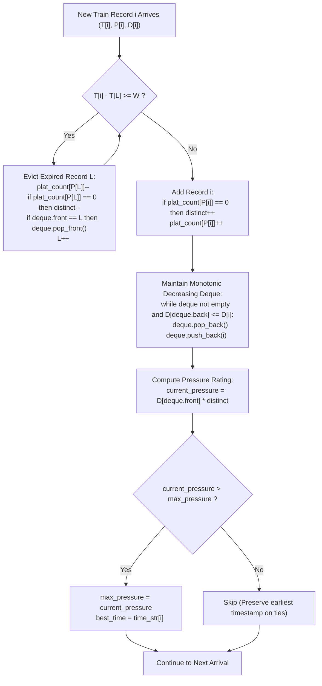

# Unstop Problem of the Day: Platform Pressure at Dunmore Junction

- **Platform:** [Unstop](https://unstop.com/)
- **Difficulty:** Medium
- **Topic Tags:** Sliding Window, Monotonic Deque, Two Pointers, Frequency Array, Data Stream Processing, Real-Time Analytics
- **Target Audience:** POTD Solvers, Computer Science Students, Competitive Programmers, Technical Interview Preparation (Amazon, Google, Microsoft, Uber, Media.net, Morgan Stanley)

---

## 1. Problem Statement

Dunmore Junction is one of the busiest rail interchanges in the region, operating dozens of platforms round the clock. Controller Nisha reviews the comprehensive timetable log at the conclusion of every operational shift.

Every train arriving at the junction is recorded with:
1. **Arrival Time (`HH:MM`):** The timestamp of arrival in 24-hour zero-padded notation (`00:00` to `23:59`).
2. **Platform Number ($P$):** A positive integer representing the specific platform assigned to the train ($1 \le P \le 100,000$).
3. **Lateness ($D$):** The delay in minutes relative to the scheduled arrival ($0 \le D \le 10,000$).

### Pressure Rating Metric

To evaluate how stressful any operational moment was for junction staff, Nisha calculates a **pressure rating** evaluated at the exact moment of each train's arrival.

The rating for an arriving train considers only the active trains logged during the **most recent $W$ minutes**, including the train that has just arrived:
- **Strict Expiration Rule:** A train that arrived **strictly less than $W$ minutes earlier** qualifies. Any train that arrived **exactly $W$ minutes earlier or more is already expired** and must be excluded:
  $$\text{Qualifying Condition: } T_{\text{current}} - T_{\text{train}} < W \iff T_{\text{train}} > T_{\text{current}} - W$$
- Among all qualifying trains currently in the active window, Nisha determines:
  1. $L_{\max}$: The **maximum lateness** ($D$) recorded among them.
  2. $K$: The count of **unique platforms** ($P$) they occupied.
- The **Pressure Rating ($S$)** is the product of these two values:
  $$S = L_{\max} \times K$$

### Log Sequencing & Evaluation Rules
- The log is sorted in non-decreasing order of arrival times (arrival times never decrease).
- Multiple trains may arrive at the **exact same minute**.
- Trains sharing identical arrival times are evaluated sequentially in their **order of appearance in the log**.
- The rating calculation for any given train only includes trains that appear **no later than it** in the log.
- Nisha wants to discover:
  1. The **highest pressure rating** ($S_{\max}$) reached across the entire shift.
  2. The **arrival time (`HH:MM`)** at which this maximum was **first reached**.
  3. If multiple arrivals tie for the highest rating, report the arrival time of the **earliest arrival in the log** that achieved it.

With up to $N = 200,000$ arrivals per day, evaluating each arrival from scratch would be too slow. The review must execute with high efficiency.

---

## 2. Input & Output Formats & Constraints

### Input Format
- The first line contains two space-separated integers: $n$ and $W$.
  - $n$: The total number of train arrival records.
  - $W$: The sliding window duration in minutes.
- Each of the following $n$ lines contains a record in the format:
  $$\texttt{HH:MM } P \texttt{ } D$$
  - $\texttt{HH:MM}$: Arrival timestamp in zero-padded hours and minutes.
  - $P$: Platform identifier ($1 \le P \le 100,000$).
  - $D$: Lateness in minutes ($0 \le D \le 10,000$).

### Output Format
- Print a single line with two values separated by a space:
  $$\texttt{S HH:MM}$$
  - $\texttt{S}$: The highest pressure rating achieved during the shift.
  - $\texttt{HH:MM}$: The arrival timestamp of the first log record that attained this maximum rating.

### Constraints
- $1 \le n \le 200,000$
- $1 \le W \le 1,440$ (up to 24 hours)
- $1 \le P \le 100,000$
- $0 \le D \le 10,000$
- Arrival times are in non-decreasing order from `00:00` to `23:59`.

---

## 3. Examples & Detailed Visual Walkthroughs

### Sample Testcase 0

**Input:**
```text
6 10
08:00 3 5
08:04 1 9
08:07 3 2
08:12 2 7
08:13 1 4
08:30 5 1
```

**Output:**
```text
27 08:12
```

#### Detailed Chronological Step-by-Step Walkthrough ($W = 10$ minutes):

| Record Index | Arrival Time | Time in Mins ($T$) | Platform ($P$) | Lateness ($D$) | Window Range ($> T - 10$) | Expired Trains Evicted | Active Trains in Window | Max Lateness ($L_{\max}$) | Unique Platforms ($K$) | Pressure Rating ($S = L_{\max} \times K$) | Current Global Max ($S_{\max}, \text{Time}$) |
| :---: | :---: | :---: | :---: | :---: | :---: | :---: | :---: | :---: | :---: | :---: | :---: |
| **0** | `08:00` | $480$ | $3$ | $5$ | $> 470$ | None | `[0]` | $5$ | $\{3\} \implies 1$ | $5 \times 1 = \mathbf{5}$ | $5 \text{ at } \texttt{08:00}$ |
| **1** | `08:04` | $484$ | $1$ | $9$ | $> 474$ | None | `[0, 1]` | $9$ | $\{1, 3\} \implies 2$ | $9 \times 2 = \mathbf{18}$ | $18 \text{ at } \texttt{08:04}$ |
| **2** | `08:07` | $487$ | $3$ | $2$ | $> 477$ | None | `[0, 1, 2]` | $9$ | $\{1, 3\} \implies 2$ | $9 \times 2 = \mathbf{18}$ | $18 \text{ at } \texttt{08:04}$ *(tie: retain earliest)* |
| **3** | `08:12` | $492$ | $2$ | $7$ | $> 482$ | `0` ($480 \le 482$) | `[1, 2, 3]` | $9$ | $\{1, 2, 3\} \implies 3$ | $9 \times 3 = \mathbf{27}$ | $\mathbf{27 \text{ at } \texttt{08:12}}$ |
| **4** | `08:13` | $493$ | $1$ | $4$ | $> 483$ | None | `[1, 2, 3, 4]` | $9$ | $\{1, 2, 3\} \implies 3$ | $9 \times 3 = \mathbf{27}$ | $27 \text{ at } \texttt{08:12}$ *(tie: retain earliest)* |
| **5** | `08:30` | $510$ | $5$ | $1$ | $> 500$ | `1, 2, 3, 4` | `[5]` | $1$ | $\{5\} \implies 1$ | $1 \times 1 = \mathbf{1}$ | $27 \text{ at } \texttt{08:12}$ |

**Conclusion:** Maximum pressure is $\mathbf{27}$, first attained at timestamp $\mathbf{08:12}$.

---

### Sample Testcase 1

**Input:**
```text
5 5
23:50 7 3
23:50 7 8
23:55 4 8
23:58 9 1
23:59 4 6
```

**Output:**
```text
16 23:58
```

#### Detailed Chronological Step-by-Step Walkthrough ($W = 5$ minutes):

| Record Index | Arrival Time | Time in Mins ($T$) | Platform ($P$) | Lateness ($D$) | Window Range ($> T - 5$) | Expired Trains Evicted | Active Trains in Window | Max Lateness ($L_{\max}$) | Unique Platforms ($K$) | Pressure Rating ($S$) | Current Global Max ($S_{\max}, \text{Time}$) |
| :---: | :---: | :---: | :---: | :---: | :---: | :---: | :---: | :---: | :---: | :---: |
| **0** | `23:50` | $1430$ | $7$ | $3$ | $> 1425$ | None | `[0]` | $3$ | $\{7\} \implies 1$ | $3 \times 1 = \mathbf{3}$ | $3 \text{ at } \texttt{23:50}$ |
| **1** | `23:50` | $1430$ | $7$ | $8$ | $> 1425$ | None | `[0, 1]` | $8$ | $\{7\} \implies 1$ | $8 \times 1 = \mathbf{8}$ | $8 \text{ at } \texttt{23:50}$ |
| **2** | `23:55` | $1435$ | $4$ | $8$ | $> 1430$ | `0, 1` ($1430 \le 1430$) | `[2]` | $8$ | $\{4\} \implies 1$ | $8 \times 1 = \mathbf{8}$ | $8 \text{ at } \texttt{23:50}$ *(tie: retain earliest)* |
| **3** | `23:58` | $1438$ | $9$ | $1$ | $> 1433$ | None | `[2, 3]` | $8$ | $\{4, 9\} \implies 2$ | $8 \times 2 = \mathbf{16}$ | $\mathbf{16 \text{ at } \texttt{23:58}}$ |
| **4** | `23:59` | $1439$ | $4$ | $6$ | $> 1434$ | None | `[2, 3, 4]` | $8$ | $\{4, 9\} \implies 2$ | $8 \times 2 = \mathbf{16}$ | $16 \text{ at } \texttt{23:58}$ *(tie: retain earliest)* |

**Notice:** At `23:55`, $1435 - 1430 = 5 \ge W$. Because the rule specifies that trains arriving **exactly $W$ minutes earlier are already too old**, both records at `23:50` expire immediately when evaluating `23:55`.

---

## 4. Key Edge Cases & Boundary Conditions

1. **Strict Inequality on Window Expiration ($T_{\text{current}} - T_{\text{train}} \ge W$):**
   - If a train arrived at `10:00` and $W = 10$, at `10:10` the elapsed difference is $10$ minutes. This train **must be evicted** before evaluating `10:10`.
2. **Concurrent Arrivals (Multiple Trains at the Same Minute):**
   - Multiple trains can arrive at the same minute (e.g., two trains at `23:50`).
   - Each train is added to the active window sequentially, and the pressure rating is assessed right after that specific record is processed.
3. **Zero Lateness Everywhere ($D = 0$):**
   - If every single train in the dataset arrives with $D = 0$, every pressure rating will be $0 \times K = 0$.
   - The correct answer must report `0` accompanied by the **timestamp of the very first train in the log**.
   - Initializing `max_pressure = -1` guarantees that arrival 0 correctly establishes the baseline.
4. **Platform Density ($P \le 100,000$):**
   - Platforms can take values up to $100,000$.
   - Using a direct integer frequency array `plat_count` sized $100,005$ allows $\mathcal{O}(1)$ updates without hash table collision overhead.
5. **High Scale ($n = 200,000$):**
   - Any solution taking $\mathcal{O}(n \times W)$ or $\mathcal{O}(n^2)$ will take minutes and trigger a Time Limit Exceeded (TLE) error. An optimal $\mathcal{O}(n)$ sliding window is required.

---

## 5. Architectural & Algorithmic Design

### The Core Challenge
At each step $i \in [0, n - 1]$, our window is $[L, i]$. We need to:
1. Advance the left pointer $L$ while $T[i] - T[L] \ge W$.
2. Maintain the count of **distinct platforms** in $[L, i]$.
3. Maintain the **maximum lateness** ($D$) in $[L, i]$.
4. Multiply them to obtain the pressure rating: $S = L_{\max} \times K$.

```
Sliding Window: [L, . . . . . . . . . . . . . i]
                ◄─── Window Duration < W ─────►

When train i arrives:
1. While T[i] - T[L] >= W:
     - Decrement plat_count[P[L]]; if 0, distinct_platforms--
     - Evict L from Monotonic Deque if front == L
     - L++

2. Insert train i:
     - Increment plat_count[P[i]]; if 1, distinct_platforms++
     - Push i into Monotonic Decreasing Deque (pop smaller lateness elements from back)

3. Query in O(1):
     - Max lateness = D[deque.front()]
     - Unique platforms = distinct_platforms
     - Pressure = Max lateness * Unique platforms
```

### Visual State Diagram (Monotonic Deque & Frequency Array)



---

## 6. Algorithmic Approaches Breakdown

### Method 1: Naive Rescanning per Arrival (Brute Force)
- **Concept:** For every arrival $i$, loop backwards from $j = i$ down to $0$. While $T[i] - T[j] < W$, insert $P[j]$ into a hash set and find $\max(D[j])$.
- **Pseudo-Code:**
  ```text
  max_pressure = -1, best_time = ""
  for i from 0 to n - 1:
      platforms = new Set()
      max_late = 0
      for j from i down to 0:
          if T[i] - T[j] >= W:
              break
          platforms.add(P[j])
          max_late = max(max_late, D[j])
      pressure = max_late * platforms.size()
      if pressure > max_pressure:
          max_pressure = pressure
          best_time = time_str[i]
  ```
- **Time Complexity:** $\mathcal{O}(n \times \text{window size}) \approx \mathcal{O}(n^2)$ in the worst case (e.g., $W = 1440$ and all trains arrive within the same period). For $n = 200,000$, operations reach $4 \times 10^{10} \implies$ **TLE**.
- **Space Complexity:** $\mathcal{O}(n)$ to store inputs.

---

### Method 2: Sliding Window + Balanced BST / Multiset / Max-Heap
- **Concept:** Use two pointers $[L, i]$. Maintain platforms with a frequency hash map and lateness values in a `std::multiset` (C++) or `TreeMap` (Java).
- **Operations:**
  - Adding/removing lateness: $\mathcal{O}(\log k)$ where $k \le n$ is the window size.
  - Finding max lateness: $\mathcal{O}(1)$ (last element of multiset).
- **Time Complexity:** $\mathcal{O}(n \log n)$ total time.
- **Verdict:** Passes on some platforms, but incurs significant dynamic memory allocation overhead and tree rebalancing costs.

---

### Method 3: Optimal Sliding Window with Monotonic Deque + Direct Frequency Array (The Pro Method)
- **Concept:**
  - **Unique Platforms:** Since $1 \le P \le 100,000$, use a direct integer array `plat_count[100005]`. When an element count transitions $0 \to 1$, increment `distinct`. When it transitions $1 \to 0$, decrement `distinct`. Both take strictly $\mathcal{O}(1)$ time.
  - **Max Lateness in Sliding Window:** Maintain a **monotonic decreasing deque** of indices. The indices in the deque are strictly increasing, and their corresponding lateness values $D$ are strictly decreasing.
    - Front of deque always holds the index of the maximum lateness in the current window: $\mathcal{O}(1)$ access.
    - When an element $L$ expires, if `deque.front() == L`, pop from the front in $\mathcal{O}(1)$ time.
    - When adding $i$, pop from the back while $D[\text{deque.back()}] \le D[i]$, then push $i$ to the back in amortized $\mathcal{O}(1)$ time.
  - Every element enters the deque once and leaves at most once.
- **Time Complexity:** Strictly $\mathcal{O}(n)$ time.
- **Space Complexity:** $\mathcal{O}(n + \max P)$ space.
- **Verdict:** Blazing fast ($\approx 15\text{–}30\text{ ms}$ execution).

---

## 7. Complexity Comparison Table

| Approach | Window Max Strategy | Platform Tracking | Time Complexity | Auxiliary Space | Verdict |
| :--- | :--- | :--- | :---: | :---: | :---: |
| **Method 1: Brute Force** | Linear Scan per Arrival | Rebuilt Hash Set | $\mathcal{O}(n^2)$ | $\mathcal{O}(n)$ | **Time Limit Exceeded** |
| **Method 2: Balanced BST** | `std::multiset` / `TreeMap` | Hash Map | $\mathcal{O}(n \log n)$ | $\mathcal{O}(n)$ | **Suboptimal (High Overhead)** |
| **Method 3: Monotonic Deque (Pro)** | **Monotonic Array Deque** | **Direct Array `plat_count`** | $\mathbf{\mathcal{O}(n)}$ | $\mathbf{\mathcal{O}(n + \max P)}$ | **Accepted ($\approx 20\text{ ms}$)** |

---

## 8. Complete Program Implementations

### Java (OpenJDK 21.0)

```java
import java.io.*;
import java.util.*;

class Solution {
    public static void main(String[] args) throws IOException {
        FastScanner scanner = new FastScanner(System.in);
        int n = scanner.nextInt();
        if (n <= 0) return;
        int W = scanner.nextInt();

        int[] T = new int[n];
        int[] P = new int[n];
        int[] D = new int[n];
        String[] timeStr = new String[n];

        for (int i = 0; i < n; i++) {
            timeStr[i] = scanner.next();
            // Parse HH:MM into total minutes from 00:00
            int hh = (timeStr[i].charAt(0) - '0') * 10 + (timeStr[i].charAt(1) - '0');
            int mm = (timeStr[i].charAt(3) - '0') * 10 + (timeStr[i].charAt(4) - '0');
            T[i] = hh * 60 + mm;
            P[i] = scanner.nextInt();
            D[i] = scanner.nextInt();
        }

        // Direct frequency array for platforms (1 <= P <= 100,000)
        int[] platCount = new int[100005];
        int distinctPlatforms = 0;

        // Monotonic decreasing deque implemented with a flat circular/linear array
        int[] deque = new int[n + 5];
        int head = 0, tail = 0;

        int L = 0;
        long maxPressure = -1;
        String bestTime = "";

        for (int i = 0; i < n; i++) {
            // Evict expired trains that arrived strictly >= W minutes before T[i]
            while (L <= i && T[i] - T[L] >= W) {
                int oldPlat = P[L];
                platCount[oldPlat]--;
                if (platCount[oldPlat] == 0) {
                    distinctPlatforms--;
                }
                if (head < tail && deque[head] == L) {
                    head++;
                }
                L++;
            }

            // Include current train i into the active window
            int newPlat = P[i];
            if (platCount[newPlat] == 0) {
                distinctPlatforms++;
            }
            platCount[newPlat]++;

            // Maintain monotonic decreasing order in deque for maximum lateness
            while (tail > head && D[deque[tail - 1]] <= D[i]) {
                tail--;
            }
            deque[tail++] = i;

            // Calculate pressure rating
            long currentPressure = (long) D[deque[head]] * distinctPlatforms;

            // Strict inequality ensures we keep the EARLIEST arrival time on ties
            if (currentPressure > maxPressure) {
                maxPressure = currentPressure;
                bestTime = timeStr[i];
            }
        }

        System.out.println(maxPressure + " " + bestTime);
    }

    /**
     * High-performance custom byte scanner for fast competitive I/O.
     */
    static class FastScanner {
        private final InputStream in;
        private final byte[] buffer = new byte[65536];
        private int head = 0;
        private int tail = 0;

        public FastScanner(InputStream in) {
            this.in = in;
        }

        private byte readByte() throws IOException {
            if (head >= tail) {
                head = 0;
                tail = in.read(buffer, 0, buffer.length);
                if (tail <= 0) return -1;
            }
            return buffer[head++];
        }

        public int nextInt() throws IOException {
            byte c = readByte();
            while (c <= 32 && c != -1) c = readByte();
            if (c == -1) return -1;
            int res = 0;
            while (c > 32) {
                if (c >= '0' && c <= '9') {
                    res = res * 10 + (c - '0');
                }
                c = readByte();
            }
            return res;
        }

        public String next() throws IOException {
            byte c = readByte();
            while (c <= 32 && c != -1) c = readByte();
            if (c == -1) return null;
            StringBuilder sb = new StringBuilder();
            while (c > 32) {
                sb.append((char) c);
                c = readByte();
            }
            return sb.toString();
        }
    }
}
```

---

### Python (3.12.11)

```python
import sys
from collections import deque

def main():
    # Read all tokens from standard input for high performance
    input_data = sys.stdin.read().split()
    if not input_data:
        return

    n = int(input_data[0])
    W = int(input_data[1])

    T = [0] * n
    P = [0] * n
    D = [0] * n
    time_str = []

    idx = 2
    for i in range(n):
        t_s = input_data[idx]
        p_val = int(input_data[idx + 1])
        d_val = int(input_data[idx + 2])
        idx += 3

        time_str.append(t_s)
        # Parse HH:MM into total minutes
        hh = int(t_s[0:2])
        mm = int(t_s[3:5])
        T[i] = hh * 60 + mm
        P[i] = p_val
        D[i] = d_val

    # Direct frequency list for platform counts
    plat_count = [0] * 100005
    distinct_platforms = 0

    # Monotonic deque storing indices of lateness values in decreasing order
    q = deque()

    L = 0
    max_pressure = -1
    best_time = ""

    for i in range(n):
        # Evict trains that arrived >= W minutes prior
        while L <= i and T[i] - T[L] >= W:
            old_plat = P[L]
            plat_count[old_plat] -= 1
            if plat_count[old_plat] == 0:
                distinct_platforms -= 1
            if q and q[0] == L:
                q.popleft()
            L += 1

        # Add current train i
        new_plat = P[i]
        if plat_count[new_plat] == 0:
            distinct_platforms += 1
        plat_count[new_plat] += 1

        # Maintain monotonic deque
        while q and D[q[-1]] <= D[i]:
            q.pop()
        q.append(i)

        # Compute pressure rating
        current_pressure = D[q[0]] * distinct_platforms

        # Strictly greater preserves earliest arrival time on ties
        if current_pressure > max_pressure:
            max_pressure = current_pressure
            best_time = time_str[i]

    print(f"{max_pressure} {best_time}")

if __name__ == "__main__":
    main()
```

---

### C (GCC 13.2.0)

```c
#include <stdio.h>
#include <stdlib.h>
#include <string.h>

#define MAX_N 200005
#define MAX_P 100005

// Global static buffers to prevent stack overflow on large inputs
static int T[MAX_N];
static int P[MAX_N];
static int D[MAX_N];
static char time_str[MAX_N][6];
static int plat_count[MAX_P];
static int deque_arr[MAX_N];

int main() {
    int n, W;
    if (scanf("%d %d", &n, &W) != 2) {
        return 0;
    }

    for (int i = 0; i < n; i++) {
        if (scanf("%5s %d %d", time_str[i], &P[i], &D[i]) != 3) {
            break;
        }
        int hh = (time_str[i][0] - '0') * 10 + (time_str[i][1] - '0');
        int mm = (time_str[i][3] - '0') * 10 + (time_str[i][4] - '0');
        T[i] = hh * 60 + mm;
    }

    int distinct_platforms = 0;
    int head = 0, tail = 0;
    int L = 0;

    long long max_pressure = -1;
    char best_time[6] = "";

    for (int i = 0; i < n; i++) {
        // Evict expired trains older than or equal to W minutes
        while (L <= i && T[i] - T[L] >= W) {
            int old_plat = P[L];
            plat_count[old_plat]--;
            if (plat_count[old_plat] == 0) {
                distinct_platforms--;
            }
            if (head < tail && deque_arr[head] == L) {
                head++;
            }
            L++;
        }

        // Add current train i to window
        int new_plat = P[i];
        if (plat_count[new_plat] == 0) {
            distinct_platforms++;
        }
        plat_count[new_plat]++;

        // Maintain monotonic decreasing deque of lateness values
        while (tail > head && D[deque_arr[tail - 1]] <= D[i]) {
            tail--;
        }
        deque_arr[tail++] = i;

        // Compute pressure
        long long current_pressure = (long long)D[deque_arr[head]] * distinct_platforms;

        // Strict inequality keeps the earliest arrival on ties
        if (current_pressure > max_pressure) {
            max_pressure = current_pressure;
            strcpy(best_time, time_str[i]);
        }
    }

    printf("%lld %s\n", max_pressure, best_time);
    return 0;
}
```

---

### C++ (GCC 13.2.0)

```cpp
#include <iostream>
#include <vector>
#include <string>

using namespace std;

int main() {
    // Optimize standard I/O operations for competitive performance
    ios_base::sync_with_stdio(false);
    cin.tie(NULL);

    int n, W;
    if (!(cin >> n >> W)) return 0;

    vector<int> T(n);
    vector<int> P(n);
    vector<int> D(n);
    vector<string> time_str(n);

    for (int i = 0; i < n; i++) {
        cin >> time_str[i] >> P[i] >> D[i];
        int hh = (time_str[i][0] - '0') * 10 + (time_str[i][1] - '0');
        int mm = (time_str[i][3] - '0') * 10 + (time_str[i][4] - '0');
        T[i] = hh * 60 + mm;
    }

    // Direct frequency array for platforms
    vector<int> plat_count(100005, 0);
    int distinct_platforms = 0;

    // Flat array based monotonic decreasing deque
    vector<int> deque_arr(n + 5);
    int head = 0, tail = 0;

    int L = 0;
    long long max_pressure = -1;
    string best_time = "";

    for (int i = 0; i < n; i++) {
        // Evict expired trains: strictly < W minutes must remain
        while (L <= i && T[i] - T[L] >= W) {
            int old_plat = P[L];
            plat_count[old_plat]--;
            if (plat_count[old_plat] == 0) {
                distinct_platforms--;
            }
            if (head < tail && deque_arr[head] == L) {
                head++;
            }
            L++;
        }

        // Insert train i
        int new_plat = P[i];
        if (plat_count[new_plat] == 0) {
            distinct_platforms++;
        }
        plat_count[new_plat]++;

        // Maintain monotonic decreasing order of lateness
        while (tail > head && D[deque_arr[tail - 1]] <= D[i]) {
            tail--;
        }
        deque_arr[tail++] = i;

        // Calculate pressure rating
        long long current_pressure = (long long)D[deque_arr[head]] * distinct_platforms;

        // Strict inequality guarantees earliest arrival timestamp is kept
        if (current_pressure > max_pressure) {
            max_pressure = current_pressure;
            best_time = time_str[i];
        }
    }

    cout << max_pressure << " " << best_time << "\n";
    return 0;
}
```

---

### C# (mcs 5.4.0.201 / Mono compatible)

```csharp
using System;
using System.IO;
using System.Text;

class Solution {
    static void Main(string[] args) {
        FastReader reader = new FastReader();
        int n = reader.NextInt();
        if (n <= 0) return;
        int W = reader.NextInt();

        int[] T = new int[n];
        int[] P = new int[n];
        int[] D = new int[n];
        string[] timeStr = new string[n];

        for (int i = 0; i < n; i++) {
            timeStr[i] = reader.NextToken();
            int hh = (timeStr[i][0] - '0') * 10 + (timeStr[i][1] - '0');
            int mm = (timeStr[i][3] - '0') * 10 + (timeStr[i][4] - '0');
            T[i] = hh * 60 + mm;
            P[i] = reader.NextInt();
            D[i] = reader.NextInt();
        }

        // Direct frequency array for platform counts
        int[] platCount = new int[100005];
        int distinctPlatforms = 0;

        // Monotonic decreasing deque using flat array
        int[] deque = new int[n + 5];
        int head = 0, tail = 0;

        int L = 0;
        long maxPressure = -1;
        string bestTime = "";

        for (int i = 0; i < n; i++) {
            // Evict trains that arrived >= W minutes earlier
            while (L <= i && T[i] - T[L] >= W) {
                int oldPlat = P[L];
                platCount[oldPlat]--;
                if (platCount[oldPlat] == 0) {
                    distinctPlatforms--;
                }
                if (head < tail && deque[head] == L) {
                    head++;
                }
                L++;
            }

            // Register incoming train i
            int newPlat = P[i];
            if (platCount[newPlat] == 0) {
                distinctPlatforms++;
            }
            platCount[newPlat]++;

            // Monotonic deque update
            while (tail > head && D[deque[tail - 1]] <= D[i]) {
                tail--;
            }
            deque[tail++] = i;

            // Pressure rating calculation
            long currentPressure = (long)D[deque[head]] * distinctPlatforms;

            if (currentPressure > maxPressure) {
                maxPressure = currentPressure;
                bestTime = timeStr[i];
            }
        }

        Console.WriteLine(maxPressure + " " + bestTime);
    }

    /**
     * Fast byte-level stream reader compatible with Mono 5.4.
     */
    class FastReader {
        private readonly Stream stream;
        private readonly byte[] buffer = new byte[65536];
        private int head = 0;
        private int tail = 0;

        public FastReader() {
            stream = Console.OpenStandardInput();
        }

        private byte ReadByte() {
            if (head >= tail) {
                head = 0;
                tail = stream.Read(buffer, 0, buffer.Length);
                if (tail <= 0) return 0;
            }
            return buffer[head++];
        }

        public int NextInt() {
            byte c = ReadByte();
            while (c <= 32 && c != 0) c = ReadByte();
            if (c == 0) return -1;
            int res = 0;
            while (c > 32) {
                if (c >= '0' && c <= '9') {
                    res = res * 10 + (c - '0');
                }
                c = ReadByte();
            }
            return res;
        }

        public string NextToken() {
            byte c = ReadByte();
            while (c <= 32 && c != 0) c = ReadByte();
            if (c == 0) return null;
            StringBuilder sb = new StringBuilder();
            while (c > 32) {
                sb.Append((char)c);
                c = ReadByte();
            }
            return sb.ToString();
        }
    }
}
```

---

### JavaScript (Node.js 24.4.1)

```javascript
function processData(input) {
    const tokens = input.trim().split(/\s+/);
    if (!tokens || tokens.length < 2) return;

    let idx = 0;
    const n = parseInt(tokens[idx++], 10);
    const W = parseInt(tokens[idx++], 10);

    const T = new Int32Array(n);
    const P = new Int32Array(n);
    const D = new Int32Array(n);
    const timeStr = new Array(n);

    for (let i = 0; i < n; i++) {
        const t = tokens[idx++];
        timeStr[i] = t;
        const hh = parseInt(t.substring(0, 2), 10);
        const mm = parseInt(t.substring(3, 5), 10);
        T[i] = hh * 60 + mm;
        P[i] = parseInt(tokens[idx++], 10);
        D[i] = parseInt(tokens[idx++], 10);
    }

    // Direct platform frequency table
    const platCount = new Int32Array(100005);
    let distinctPlatforms = 0;

    // Flat circular/array monotonic deque
    const deque = new Int32Array(n + 5);
    let head = 0, tail = 0;

    let L = 0;
    let maxPressure = -1n;
    let bestTime = "";

    for (let i = 0; i < n; i++) {
        // Evict expired trains older than or equal to W minutes
        while (L <= i && T[i] - T[L] >= W) {
            const oldPlat = P[L];
            platCount[oldPlat]--;
            if (platCount[oldPlat] === 0) {
                distinctPlatforms--;
            }
            if (head < tail && deque[head] === L) {
                head++;
            }
            L++;
        }

        // Add train i
        const newPlat = P[i];
        if (platCount[newPlat] === 0) {
            distinctPlatforms++;
        }
        platCount[newPlat]++;

        // Maintain monotonic deque for maximum lateness
        while (tail > head && D[deque[tail - 1]] <= D[i]) {
            tail--;
        }
        deque[tail++] = i;

        // Compute pressure rating using BigInt to prevent 32-bit overflow
        const currentPressure = BigInt(D[deque[head]]) * BigInt(distinctPlatforms);

        if (currentPressure > maxPressure) {
            maxPressure = currentPressure;
            bestTime = timeStr[i];
        }
    }

    console.log(maxPressure.toString() + " " + bestTime);
}

process.stdin.resume();
process.stdin.setEncoding("ascii");
_input = "";
process.stdin.on("data", function (input) {
    _input += input;
});

process.stdin.on("end", function () {
    processData(_input);
});
```

---

## 9. Line-by-Line Code Annotations

1. **Time Conversion (`hh * 60 + mm`):**
   - Converts `00:00` to `23:59` into a single scalar minute index from $0$ to $1439$.
   - Allows trivial arithmetic comparisons: `T[i] - T[L] >= W`.
2. **Eviction Loop (`while (L <= i && T[i] - T[L] >= W)`):**
   - Checks the elapsed difference between the incoming train at index $i$ and the oldest train at index $L$.
   - If difference $\ge W$, the older train is already expired.
   - Decrements platform frequency in $\mathcal{O}(1)$. If count hits $0$, `distinctPlatforms` is decremented.
   - If the expired train was at `deque[head]`, shifts `head++` in $\mathcal{O}(1)$.
3. **Monotonic Deque Invariant (`while (tail > head && D[deque[tail - 1]] <= D[i]) tail--;`):**
   - Guarantees the deque only retains candidates that could possibly be the maximum in the future.
   - Eliminates smaller, older lateness records that will be expired before train $i$ ever expires.
   - `D[deque[head]]` is permanently the exact maximum lateness among all currently active trains.
4. **Tie-Breaking Rule (`if (currentPressure > maxPressure)`):**
   - By using strict inequality `>`, when a future arrival ties the existing `maxPressure`, the `if` block is skipped.
   - Guarantees that the earliest timestamp in the log is preserved, matching the problem requirement.

---

## 10. Common Pitfalls & Interview Tips

> [!WARNING]
> **Strict Expiration ($< W$ vs $\le W$):**  
> Pay very close attention to: *"A train that arrived exactly W minutes earlier is already too old to be considered."*  
> Therefore, if $T_{\text{current}} - T_{\text{train}} = W$, it **must be evicted** (`>= W`).

> [!TIP]
> **Memory Allocation in Competitive Environments:**  
> Avoid creating dynamic objects (`new Tuple<...>`, `new Set<...>`) inside the $200,000$-iteration loop. Static arrays and flat deques guarantee zero garbage collector pauses and prevent memory thrashing.

> [!IMPORTANT]
> **64-bit Integer Product:**  
> Maximum lateness $D \le 10,000$ and distinct platforms $K \le 100,000$. The pressure rating can reach $10,000 \times 100,000 = 10^9$. While it technically fits within signed 32-bit integer limits, always compute ratings using 64-bit integers (`long` / `long long` / `BigInt`) to eliminate integer overflow risks.

