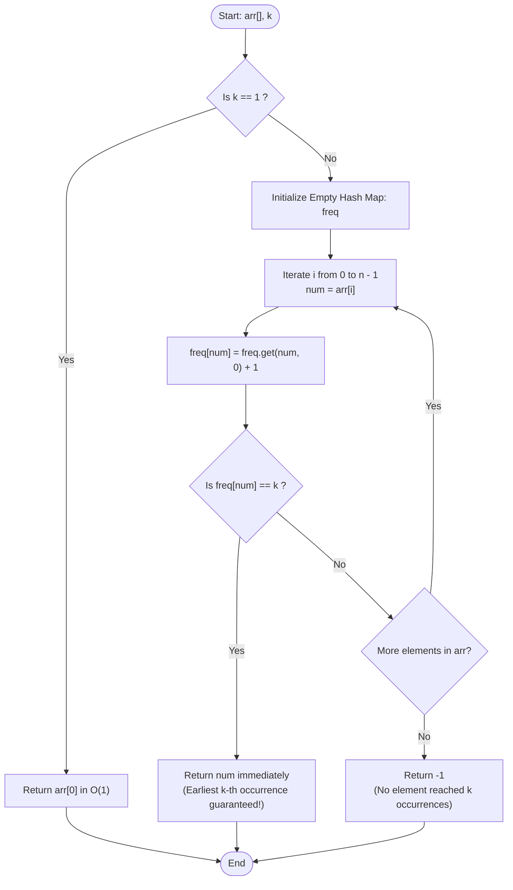

# GeeksforGeeks Problem of the Day: At Least K Occurrences

- **Problem Link:** [GeeksforGeeks - At Least K Occurrences](https://www.geeksforgeeks.org/problems/first-element-to-occur-k-times5150/1)
- **Difficulty:** Easy
- **Topic Tags:** Arrays, Hash Table, Counting, Frequency Map, Streaming Algorithms, Two Pointers
- **Target Audience:** POTD Solvers, Computer Science Students, Competitive Programmers, Interview Preparation (Amazon, Microsoft, MakeMyTrip, Adobe, TCS, Infosys, Wipro, Cognizant)

---

## 1. Problem Statement

Given an array `arr[]` of integers and a positive integer `k`, your task is to find the **first element that occurs at least `k` times** in the array.

### Tie-Breaking & Earliest Occurrence Rule
- If multiple elements in the array eventually reach a frequency of `k` or more, you must return the element whose **$k$-th occurrence appears earliest** (i.e., at the smallest index in the array).
- If no element occurs at least `k` times, return **`-1`**.

---

## 2. Examples & Visual Walkthroughs

### Example 1
- **Input:** `arr = [1, 7, 4, 3, 4, 8, 7]`, `k = 2`
- **Output:** `4`

#### Chronological Step-by-Step Stream Trace:
We process the array sequentially from index $0$ to $6$, tracking running frequencies:

```text
Index:     0    1    2    3    4    5    6
Element:   1    7    4    3    4    8    7
                               ▲
                 4 reaches count = 2 at index 4 (EARLIEST!)
```

| Step / Index | Current Element | Running Frequency Map | Current Frequency | Condition: `freq == k` ($k = 2$)? | Action Taken |
| :---: | :---: | :--- | :---: | :---: | :--- |
| **0** | `1` | `{1: 1}` | $1$ | $1 == 2$ (False) | Continue to next element |
| **1** | `7` | `{1: 1, 7: 1}` | $1$ | $1 == 2$ (False) | Continue to next element |
| **2** | `4` | `{1: 1, 7: 1, 4: 1}` | $1$ | $1 == 2$ (False) | Continue to next element |
| **3** | `3` | `{1: 1, 7: 1, 4: 1, 3: 1}` | $1$ | $1 == 2$ (False) | Continue to next element |
| **4** | `4` | `{1: 1, 7: 1, 4: 2, 3: 1}` | **2** | **$2 == 2$ (TRUE)** | **Return `4` Immediately!** |

> [!NOTE]
> Even though element `7` also appears twice in the array (at indices $1$ and $6$), its 2nd occurrence is at index $6$. Element `4` completes its 2nd occurrence at index $4$. Since index $4 < 6$, **`4` is the correct answer**.

---

### Example 2
- **Input:** `arr = [3, 1, 3, 4, 5, 1, 3, 3, 5, 4]`, `k = 3`
- **Output:** `3`

#### Chronological Walkthrough:
- Index 0: `3` (Count: 1)
- Index 1: `1` (Count: 1)
- Index 2: `3` (Count: 2)
- Index 3: `4` (Count: 1)
- Index 4: `5` (Count: 1)
- Index 5: `1` (Count: 2)
- Index 6: `3` (Count: 3) $\implies$ Count reaches $k = 3$!
- **Immediate Return:** `3`.

---

### Example 3
- **Input:** `arr = [1, 2, 3, 4, 5]`, `k = 2`
- **Output:** `-1`
- **Explanation:** Every element occurs exactly once. None reaches $k = 2$.

---

### Example 4 (Edge Case: $k = 1$)
- **Input:** `arr = [10, 20, 30]`, `k = 1`
- **Output:** `10`
- **Explanation:** The first element to occur at least $1$ time is simply the very first element in the array (`arr[0] = 10`), taking $\mathcal{O}(1)$ time.

---

## 3. Constraints

- $1 \le \text{arr.size()} \le 10^5$
- $1 \le k \le \text{arr.size()}$
- $0 \le \text{arr}[i] \le 10^6$
- **Expected Time Complexity:** $\mathcal{O}(n)$
- **Expected Auxiliary Space:** $\mathcal{O}(n)$

---

## 4. Visual Architecture & Stream Processing



---

## 5. The "Two-Pass" Trap vs Single-Pass Stream Invariant

A common pitfall encountered by many candidates in technical interviews is the **Two-Pass Approach**:

> [!WARNING]
> **The Two-Pass Pitfall:**
> 1. **Pass 1:** Build a full frequency map of the entire array.
> 2. **Pass 2:** Iterate through `arr` from left to right and return the first element where `total_freq[x] >= k`.
> 
> **Why is this WRONG?**
> Consider `arr = [1, 7, 4, 3, 4, 8, 7]`, `k = 2`.
> - Total frequencies: `{1: 1, 7: 2, 4: 2, 3: 1, 8: 1}`.
> - In Pass 2:
>   - Index 0: `1` (freq = 1 < 2)
>   - Index 1: `7` (total freq = 2 $\ge$ 2) $\implies$ Returns `7` ❌ **(WRONG!)**
> 
> The algorithm returned `7` because its **first** occurrence appeared early (index 1), ignoring the fact that its **$k$-th (second)** occurrence didn't arrive until index 6! Meanwhile, `4` completed its $k$-th occurrence at index 4.

### The Single-Pass Stream Invariant
By incrementing the counter **live during a single forward pass** and returning as soon as `freq[num] == k`, we inherently evaluate the timeline of $k$-th arrivals:
$$\text{Earliest } k\text{-th Arrival Index } i = \min \{ i \mid \text{count}(arr[i] \text{ in } arr[0..i]) = k \}$$
The very first element to hit `count == k` is mathematically guaranteed to be the earliest $k$-th arrival!

---

## 6. Algorithmic Approaches Breakdown

### Method 1: Naive Nested Counting (Brute Force)
- **Concept:** For each index $i$, count how many times `arr[i]` has appeared in the subarray $arr[0..i]$. If the count equals $k$, return `arr[i]`.
- **Pseudo-Code:**
  ```text
  for i from 0 to n - 1:
      count = 0
      for j from 0 to i:
          if arr[j] == arr[i]:
              count++
      if count == k:
          return arr[i]
  return -1
  ```
- **Time Complexity:** $\mathcal{O}(n^2)$ — for $n = 10^5$, $(10^5)^2 = 10^{10}$ operations $\implies$ **Time Limit Exceeded (TLE)**.
- **Space Complexity:** $\mathcal{O}(1)$.

---

### Method 2: Two-Pass with Occurrence Index Array
- **Concept:** Store all occurrence indices of each distinct number in lists. Find which numbers have $\ge k$ occurrences, and pick the one with the minimum $k$-th index.
- **Time Complexity:** $\mathcal{O}(n)$
- **Space Complexity:** $\mathcal{O}(n)$ (storing full index lists).
- **Verdict:** Suboptimal due to unnecessary memory allocations and redundant passes.

---

### Method 3: Optimal Single-Pass Hash Map with Early Exit (The Pro Method)
- **Concept:**
  - Fast path: If $k = 1$, return `arr[0]` in $\mathcal{O}(1)$ time.
  - Maintain a hash map / frequency table.
  - For each element `x` in `arr`:
    - Increment its frequency: `freq[x]++`.
    - If `freq[x] == k`, return `x` immediately!
  - If the loop finishes, return `-1`.
- **Time Complexity:** $\mathcal{O}(n)$ average time.
- **Space Complexity:** $\mathcal{O}(n)$ auxiliary space.
- **Verdict:** Accepted, clean, idiomatic, and optimal.

---

## 7. Complexity Comparison Table

| Method | Time Complexity | Auxiliary Space | Early Exit? | Verdict |
| :--- | :---: | :---: | :---: | :---: |
| **Method 1: Naive Nested Loops** | $\mathcal{O}(n^2)$ | $\mathcal{O}(1)$ | No | **Time Limit Exceeded** |
| **Method 2: Multi-Pass Index Tracking** | $\mathcal{O}(n)$ | $\mathcal{O}(n)$ (Heavy) | No | **Suboptimal (Overcomplicated)** |
| **Method 3: Single-Pass Hash Map (Pro)** | $\mathbf{\mathcal{O}(n)}$ | $\mathbf{\mathcal{O}(n)}$ | **Yes ($\mathcal{O}(1)$ for $k=1$)** | **Accepted (Optimal)** |

---

## 8. Complete Multi-Language Implementations

### Java (21)

```java
import java.util.HashMap;
import java.util.Map;

class Solution {
    /**
     * Finds the first element in arr that occurs at least k times.
     * Returns the element whose k-th occurrence appears earliest.
     * 
     * Time Complexity: O(n)
     * Auxiliary Space: O(n)
     */
    public int firstElementKTime(int[] arr, int k) {
        // Fast-path optimization: if k is 1, the very first element is the answer
        if (k == 1) {
            return arr[0];
        }

        Map<Integer, Integer> freq = new HashMap<>();

        for (int num : arr) {
            int count = freq.getOrDefault(num, 0) + 1;
            // The moment an element reaches k occurrences, return it immediately
            if (count == k) {
                return num;
            }
            freq.put(num, count);
        }

        return -1;
    }
}
```

---

### Python3

```python
class Solution:
    def firstElementKTime(self, arr: list[int], k: int) -> int:
        """
        Finds the first element in arr that occurs at least k times.
        Returns the element whose k-th occurrence appears earliest.
        
        Time Complexity: O(n)
        Auxiliary Space: O(n)
        """
        # Fast-path: first element occurs 1 time at index 0
        if k == 1:
            return arr[0]

        freq = {}
        for num in arr:
            count = freq.get(num, 0) + 1
            if count == k:
                return num
            freq[num] = count

        return -1
```

---

### C++ (17)

```cpp
#include <vector>
#include <unordered_map>

using namespace std;

class Solution {
  public:
    /**
     * Finds the first element in arr that occurs at least k times.
     * Returns the element whose k-th occurrence appears earliest.
     * 
     * Time Complexity: O(n)
     * Auxiliary Space: O(n)
     */
    int firstElementKTime(vector<int>& arr, int k) {
        // Fast-path for k == 1
        if (k == 1) {
            return arr[0];
        }

        unordered_map<int, int> freq;
        freq.reserve(arr.size()); // Pre-allocate bucket capacity to avoid rehash overhead

        for (int num : arr) {
            if (++freq[num] == k) {
                return num;
            }
        }

        return -1;
    }
};
```

---

### C#

```csharp
using System.Collections.Generic;

class Solution {
    /**
     * Finds the first element in arr that occurs at least k times.
     * Returns the element whose k-th occurrence appears earliest.
     * 
     * Time Complexity: O(n)
     * Auxiliary Space: O(n)
     */
    public int firstElementKTime(int[] arr, int k) {
        // Fast-path: first element satisfies k == 1
        if (k == 1) {
            return arr[0];
        }

        Dictionary<int, int> freq = new Dictionary<int, int>();

        foreach (int num in arr) {
            int count = 0;
            if (freq.TryGetValue(num, out count)) {
                count++;
                if (count == k) {
                    return num;
                }
                freq[num] = count;
            } else {
                if (k == 1) {
                    return num;
                }
                freq[num] = 1;
            }
        }

        return -1;
    }
}
```

---

### Javascript (Node v22)

```javascript
/**
 * @param {number[]} arr
 * @param {number} k
 * @returns {number}
 */
class Solution {
    /**
     * Finds the first element in arr that occurs at least k times.
     * Returns the element whose k-th occurrence appears earliest.
     * 
     * Time Complexity: O(n)
     * Auxiliary Space: O(n)
     */
    firstElementKTime(arr, k) {
        // Fast-path: first element satisfies k == 1
        if (k === 1) {
            return arr[0];
        }

        const freq = new Map();

        for (let i = 0; i < arr.length; i++) {
            const num = arr[i];
            const count = (freq.get(num) || 0) + 1;

            if (count === k) {
                return num;
            }

            freq.set(num, count);
        }

        return -1;
    }
}
```

---

## 9. Step-by-Step Code Walkthrough

1. **Fast-Path Check (`if (k == 1) return arr[0];`):**
   - If $k = 1$, the first element to reach $1$ occurrence is always the first element in the array (`arr[0]`).
   - This takes $\mathcal{O}(1)$ time and skips map creation entirely.
2. **Frequency Map Maintenance (`count = freq[num] + 1`):**
   - For each element in the array, retrieve its existing count (defaulting to 0) and increment by 1.
3. **Instant Early Termination (`if (count == k) return num;`):**
   - The very first element whose running count hits $k$ is guaranteed to have completed its $k$-th occurrence earliest.
   - Returning immediately prevents redundant iterations and avoids processing remaining elements.
4. **Fallback (`return -1;`):**
   - If the entire array is scanned and no element ever reached count $k$, return `-1`.

---

## 10. Common Pitfalls & Interview Discussion Points

> [!TIP]
> **Check Exact Equality `count == k` vs `count >= k`:**  
> Using `count == k` triggers the return on the **exact step** the count reaches $k$. If an element continues to appear, it won't trigger false duplicate triggers.

> [!IMPORTANT]
> **Why Not a Direct Array for Frequency?**  
> Elements can be as large as $10^6$ or negative in general integer arrays. A hash map dynamically scales with the number of unique elements ($\le n$), making it safer and more general than allocating a fixed-size $10^6$ array.
