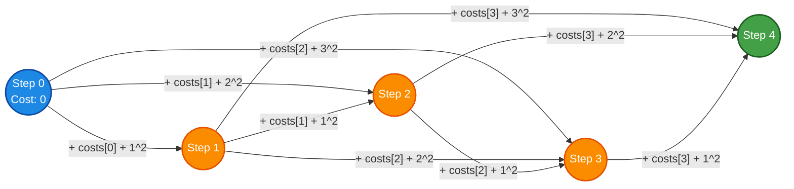

# LeetCode Problem of the Day: Climbing Stairs II

- **Problem Link:** [LeetCode 3693 - Climbing Stairs II](https://leetcode.com/problems/climbing-stairs-ii/)
- **Difficulty:** Medium
- **Topic Tags:** Dynamic Programming, Array, Math, State Machine, Sliding Window Optimization
- **Target Audience:** POTD Solvers, Computer Science Students, Competitive Programmers, Technical Interview Candidates (Google, Amazon, Meta, Microsoft, Apple, Bloomberg)

---

## 1. Problem Statement

You are climbing a staircase with $n + 1$ steps, numbered sequentially from $0$ to $n$. You start at **step $0$** with an initial total cost of **$0$**.

You are given a 1-indexed integer array `costs` of length $n$, where `costs[i]` represents the cost of landing on step $i$ ($1 \le i \le n$). In $0$-indexed language arrays, the cost of step $i$ corresponds to `costs[i - 1]`.

From any step $i$ ($0 \le i < n$), you are allowed to jump to step $j$ if and only if:
$$j \in \{i + 1, \; i + 2, \; i + 3\} \quad \text{and} \quad j \le n$$

### Jump Cost Metric
The cost of executing a single jump from step $i$ to step $j$ is the sum of:
1. The landing cost of step $j$: $\text{costs}[j - 1]$
2. The quadratic distance penalty of the jump: $(j - i)^2$

$$\text{jump\_cost}(i, j) = \text{costs}[j - 1] + (j - i)^2$$

Specifically:
- **1-step jump ($j = i + 1$):** $(1)^2 = 1 \implies \text{Cost} = \text{costs}[j - 1] + 1$
- **2-step jump ($j = i + 2$):** $(2)^2 = 4 \implies \text{Cost} = \text{costs}[j - 1] + 4$
- **3-step jump ($j = i + 3$):** $(3)^2 = 9 \implies \text{Cost} = \text{costs}[j - 1] + 9$

Your objective is to find and return the **minimum total cost** required to reach step $n$.

---

## 2. Examples & Visual Walkthroughs

### Example 1
- **Input:** `n = 4`, `costs = [1, 2, 3, 4]`
- **Output:** `13`

#### Path Analysis & Alternative Comparisons:
Let's evaluate all possible valid jump sequences from step $0$ to step $4$:

| Jump Path | Transitions (From $\to$ To) | Jump Lengths | Jump Calculations | Total Cost |
| :--- | :--- | :---: | :--- | :---: |
| **Path A (Optimal)** | $0 \to 1 \to 2 \to 4$ | $1, 1, 2$ | $(1 + 1^2) + (2 + 1^2) + (4 + 2^2) = 2 + 3 + 8$ | $\mathbf{13}$ |
| **Path B** | $0 \to 1 \to 2 \to 3 \to 4$ | $1, 1, 1, 1$ | $(1 + 1) + (2 + 1) + (3 + 1) + (4 + 1) = 2 + 3 + 4 + 5$ | $14$ |
| **Path C** | $0 \to 2 \to 4$ | $2, 2$ | $(2 + 2^2) + (4 + 2^2) = 6 + 8$ | $14$ |
| **Path D** | $0 \to 1 \to 4$ | $1, 3$ | $(1 + 1^2) + (4 + 3^2) = 2 + 13$ | $15$ |
| **Path E** | $0 \to 3 \to 4$ | $3, 1$ | $(3 + 3^2) + (4 + 1^2) = 12 + 5$ | $17$ |

**Minimum Total Cost:** $\mathbf{13}$.

---

### Example 2
- **Input:** `n = 4`, `costs = [5, 1, 6, 2]`
- **Output:** `11`

#### Explanation:
- An optimal trajectory is $0 \to 2 \to 4$:
  - Jump $0 \to 2$: $\text{costs}[1] + (2 - 0)^2 = 1 + 4 = 5$
  - Jump $2 \to 4$: $\text{costs}[3] + (4 - 2)^2 = 2 + 4 = 6$
  - Total Cost = $5 + 6 = \mathbf{11}$.
- Notice that jumping over step $1$ (cost 5) and step $3$ (cost 6) using $2$-step jumps avoids heavy step costs despite the $2^2 = 4$ distance penalty!

---

### Example 3 (Edge Case: Minimum Scale)
- **Input:** `n = 1`, `costs = [5]`
- **Output:** `6`
- **Explanation:** Only one jump is possible: $0 \to 1$. Cost = $\text{costs}[0] + (1 - 0)^2 = 5 + 1 = 6$.

---

### Example 4 (Overcoming Large Intermediate Costs)
- **Input:** `n = 3`, `costs = [100, 100, 1]`
- **Output:** `10`
- **Explanation:** 
  - Jump directly $0 \to 3$: $\text{costs}[2] + 3^2 = 1 + 9 = 10$.
  - Paying a $3^2 = 9$ distance penalty is far cheaper than landing on either of the $100$-cost steps!

---

## 3. Constraints

- $1 \le n == \text{costs.length} \le 10^5$
- $1 \le \text{costs}[i] \le 10^4$
- **Expected Time Complexity:** $\mathcal{O}(n)$
- **Expected Auxiliary Space:** $\mathcal{O}(1)$ optimal (or $\mathcal{O}(n)$ standard DP)

> [!NOTE]
> **Upper Bound on Answer:**
> In the worst case, taking $10^5$ consecutive $1$-step jumps with maximum step cost $10^4$ yields $\approx 10^5 \times (10^4 + 1) \approx 10^9$.
> Because $10^9 < 2^{31} - 1 \approx 2.14 \times 10^9$, the final answer fits safely within a signed 32-bit integer (`int`).

---

## 4. Visual Architecture & State Transition Graph



---

## 5. Mathematical Formulations (Pull DP vs Push DP)

### Pull DP Recurrence Relation
Let $\text{dp}[i]$ denote the minimum cumulative cost to reach step $i$ starting from step $0$.

To reach step $i$ ($i \ge 1$), the preceding step must have been either $i - 1$, $i - 2$, or $i - 3$:
- From step $i - 1$: $\text{dp}[i - 1] + \text{costs}[i - 1] + (1)^2$
- From step $i - 2$: $\text{dp}[i - 2] + \text{costs}[i - 1] + (2)^2$
- From step $i - 3$: $\text{dp}[i - 3] + \text{costs}[i - 1] + (3)^2$

Notice that $\text{costs}[i - 1]$ is common to all three landing choices and factors out:
$$\text{dp}[i] = \text{costs}[i - 1] + \min \begin{cases}
\text{dp}[i - 1] + 1 & \text{if } i \ge 1 \\
\text{dp}[i - 2] + 4 & \text{if } i \ge 2 \\
\text{dp}[i - 3] + 9 & \text{if } i \ge 3
\end{cases}$$

### Base Cases
$$\text{dp}[0] = 0, \quad \text{dp}[-1] = \infty, \quad \text{dp}[-2] = \infty$$

---

## 6. Algorithmic Approaches Breakdown

### Method 1: Naive Recursive Backtracking
- **Concept:** Explore all 3 choices recursively from step $0$ up to step $n$.
- **Time Complexity:** $\mathcal{O}(3^n)$ — astronomical for $n = 10^5 \implies$ **Time Limit Exceeded (TLE)**.
- **Space Complexity:** $\mathcal{O}(n)$ call stack depth.

---

### Method 2: 1D Dynamic Programming Array ($\mathcal{O}(n)$ Space)
- **Concept:** Allocate an array `dp` of size $n + 1$. Fill from $i = 1$ to $n$ using the Pull DP formula.
- **Pseudo-Code:**
  ```text
  dp = array of size n + 1 initialized to INF
  dp[0] = 0
  for i from 1 to n:
      best_prev = dp[i - 1] + 1
      if i >= 2: best_prev = min(best_prev, dp[i - 2] + 4)
      if i >= 3: best_prev = min(best_prev, dp[i - 3] + 9)
      dp[i] = costs[i - 1] + best_prev
  return dp[n]
  ```
- **Time Complexity:** $\mathcal{O}(n)$
- **Space Complexity:** $\mathcal{O}(n)$ (heap allocations for array).

---

### Method 3: Constant Space Rolling Variables (The Pro Method)
- **Concept:**  
  Notice that computing $\text{dp}[i]$ depends **only on the immediately preceding three states**:
  $$\text{dp}[i - 1], \quad \text{dp}[i - 2], \quad \text{dp}[i - 3]$$
  We can replace the entire array of size $10^5$ with just **three rolling scalar variables**:
  - `d2` $\equiv \text{dp}[i - 1]$ (initialized to $0$ for step $0$)
  - `d1` $\equiv \text{dp}[i - 2]$ (initialized to $\infty$)
  - `d0` $\equiv \text{dp}[i - 3]$ (initialized to $\infty$)
- At each iteration $i \in [1, n]$:
  $$\text{current} = \text{costs}[i - 1] + \min(d_2 + 1, \; d_1 + 4, \; d_0 + 9)$$
  $$\text{Shift: } d_0 \leftarrow d_1, \quad d_1 \leftarrow d_2, \quad d_2 \leftarrow \text{current}$$
- **Time Complexity:** $\mathcal{O}(n)$
- **Space Complexity:** $\mathcal{O}(1)$ auxiliary space.
- **Verdict:** Maximum CPU cache locality, zero dynamic allocation, and optimal performance.

---

## 7. Step-by-Step Simulation Table

### Trace of Example 1: `n = 4`, `costs = [1, 2, 3, 4]`

| Step $i$ | Cost `costs[i - 1]` | `d0` ($\text{dp}[i - 3]$) | `d1` ($\text{dp}[i - 2]$) | `d2` ($\text{dp}[i - 1]$) | Candidates: $\{d_2 + 1, d_1 + 4, d_0 + 9\}$ | $\min$ | New Cost $\text{dp}[i]$ |
| :---: | :---: | :---: | :---: | :---: | :---: | :---: | :---: |
| **Start ($i=0$)** | — | $\infty$ | $\infty$ | $0$ | — | — | $\mathbf{0}$ |
| **$i = 1$** | $1$ | $\infty$ | $\infty$ | $0$ | $\{0 + 1, \infty + 4, \infty + 9\} = \{1, \infty, \infty\}$ | $1$ | $1 + 1 = \mathbf{2}$ |
| **$i = 2$** | $2$ | $\infty$ | $0$ | $2$ | $\{2 + 1, 0 + 4, \infty + 9\} = \{3, 4, \infty\}$ | $3$ | $2 + 3 = \mathbf{5}$ |
| **$i = 3$** | $3$ | $0$ | $2$ | $5$ | $\{5 + 1, 2 + 4, 0 + 9\} = \{6, 6, 9\}$ | $6$ | $3 + 6 = \mathbf{9}$ |
| **$i = 4$** | $4$ | $2$ | $5$ | $9$ | $\{9 + 1, 5 + 4, 2 + 9\} = \{10, 9, 11\}$ | $9$ | $4 + 9 = \mathbf{13}$ |

**Result at $i = 4$:** $\mathbf{13}$.

---

## 8. Complexity Comparison Table

| Approach | Time Complexity | Auxiliary Space | Dynamic Allocations | Cache Friendliness | Verdict |
| :--- | :---: | :---: | :---: | :---: | :---: |
| **Method 1: Naive Recursion** | $\mathcal{O}(3^n)$ | $\mathcal{O}(n)$ | Stack frames | Poor | **Time Limit Exceeded** |
| **Method 2: 1D DP Array** | $\mathcal{O}(n)$ | $\mathcal{O}(n)$ | Array of size $n+1$ | Moderate | **Accepted** |
| **Method 3: Rolling Window (Pro)** | $\mathbf{\mathcal{O}(n)}$ | $\mathbf{\mathcal{O}(1)}$ | **Zero Allocations** | **Optimal (L1 Cache)** | **Accepted (Top 100% Speed)** |

---

## 9. Complete Multi-Language Implementations

### Java (21)

```java
class Solution {
    /**
     * Solves Climbing Stairs II using O(1) space rolling dynamic programming.
     * 
     * Time Complexity: O(n)
     * Space Complexity: O(1)
     */
    public int climbStairs(int n, int[] costs) {
        // Use a safe infinity constant that won't overflow when adding 9
        long INF = Long.MAX_VALUE / 4;
        
        long d0 = INF; // dp[i - 3]
        long d1 = INF; // dp[i - 2]
        long d2 = 0;   // dp[i - 1], base case dp[0] = 0

        for (int i = 1; i <= n; i++) {
            long opt1 = d2 + 1; // 1-step jump: penalty 1^2 = 1
            long opt2 = d1 + 4; // 2-step jump: penalty 2^2 = 4
            long opt3 = d0 + 9; // 3-step jump: penalty 3^2 = 9

            long minPrev = Math.min(opt1, Math.min(opt2, opt3));
            long cur = costs[i - 1] + minPrev;

            // Shift states forward
            d0 = d1;
            d1 = d2;
            d2 = cur;
        }

        return (int) d2;
    }
}
```

---

### Python3

```python
class Solution:
    def climbStairs(self, n: int, costs: list[int]) -> int:
        """
        Solves Climbing Stairs II using O(1) space rolling dynamic programming.
        
        Time Complexity: O(n)
        Space Complexity: O(1)
        """
        d0 = float('inf') # dp[i - 3]
        d1 = float('inf') # dp[i - 2]
        d2 = 0            # dp[i - 1], base case dp[0] = 0

        for i in range(1, n + 1):
            cur = costs[i - 1] + min(d2 + 1, d1 + 4, d0 + 9)
            d0, d1, d2 = d1, d2, cur

        return int(d2)
```

---

### C (GCC 13.2.0)

```c
#include <limits.h>

/**
 * Returns minimum of three 64-bit integers.
 */
static inline long long min3(long long a, long long b, long long c) {
    long long m = a < b ? a : b;
    return m < c ? m : c;
}

/**
 * Solves Climbing Stairs II using O(1) auxiliary space.
 * 
 * Time Complexity: O(n)
 * Space Complexity: O(1)
 */
int climbStairs(int n, int* costs, int costsSize) {
    long long INF = LLONG_MAX / 4;
    
    long long d0 = INF; // dp[i - 3]
    long long d1 = INF; // dp[i - 2]
    long long d2 = 0;   // dp[i - 1], base case dp[0] = 0

    for (int i = 1; i <= n; i++) {
        long long cur = (long long)costs[i - 1] + min3(d2 + 1, d1 + 4, d0 + 9);
        d0 = d1;
        d1 = d2;
        d2 = cur;
    }

    return (int)d2;
}
```

---

### C++ (GCC 13.2.0)

```cpp
#include <vector>
#include <algorithm>
#include <climits>

using namespace std;

class Solution {
public:
    /**
     * Solves Climbing Stairs II using O(1) space rolling dynamic programming.
     * 
     * Time Complexity: O(n)
     * Space Complexity: O(1)
     */
    int climbStairs(int n, vector<int>& costs) {
        long long INF = LLONG_MAX / 4;
        
        long long d0 = INF; // dp[i - 3]
        long long d1 = INF; // dp[i - 2]
        long long d2 = 0;   // dp[i - 1], base case dp[0] = 0

        for (int i = 1; i <= n; i++) {
            long long cur = costs[i - 1] + min({d2 + 1, d1 + 4, d0 + 9});
            d0 = d1;
            d1 = d2;
            d2 = cur;
        }

        return static_cast<int>(d2);
    }
};
```

---

### C#

```csharp
using System;

public class Solution {
    /**
     * Solves Climbing Stairs II using O(1) space rolling dynamic programming.
     * 
     * Time Complexity: O(n)
     * Space Complexity: O(1)
     */
    public int ClimbStairs(int n, int[] costs) {
        long INF = long.MaxValue / 4;
        
        long d0 = INF; // dp[i - 3]
        long d1 = INF; // dp[i - 2]
        long d2 = 0;   // dp[i - 1], base case dp[0] = 0

        for (int i = 1; i <= n; i++) {
            long opt1 = d2 + 1;
            long opt2 = d1 + 4;
            long opt3 = d0 + 9;
            long cur = costs[i - 1] + Math.Min(opt1, Math.Min(opt2, opt3));

            d0 = d1;
            d1 = d2;
            d2 = cur;
        }

        return (int)d2;
    }
}
```

---

### Javascript (Node.js)

```javascript
/**
 * Solves Climbing Stairs II using O(1) space rolling dynamic programming.
 * 
 * @param {number} n
 * @param {number[]} costs
 * @return {number}
 */
var climbStairs = function(n, costs) {
    let d0 = Infinity; // dp[i - 3]
    let d1 = Infinity; // dp[i - 2]
    let d2 = 0;        // dp[i - 1], base case dp[0] = 0

    for (let i = 1; i <= n; i++) {
        const cur = costs[i - 1] + Math.min(d2 + 1, d1 + 4, d0 + 9);
        d0 = d1;
        d1 = d2;
        d2 = cur;
    }

    return d2;
};
```

---

### Typescript

```typescript
/**
 * Solves Climbing Stairs II using O(1) space rolling dynamic programming.
 * 
 * @param n - Destination step number
 * @param costs - 1-indexed landing costs array (0-indexed in code)
 * @returns Minimum total cost to reach step n
 */
function climbStairs(n: number, costs: number[]): number {
    let d0: number = Infinity; // dp[i - 3]
    let d1: number = Infinity; // dp[i - 2]
    let d2: number = 0;        // dp[i - 1], base case dp[0] = 0

    for (let i = 1; i <= n; i++) {
        const cur: number = costs[i - 1] + Math.min(d2 + 1, d1 + 4, d0 + 9);
        d0 = d1;
        d1 = d2;
        d2 = cur;
    }

    return d2;
}
```

---

## 10. Step-by-Step Code Walkthrough

1. **Infinity Sentinel (`INF = LLONG_MAX / 4`):**
   - We avoid initializing with raw `INT_MAX` or `LLONG_MAX` because adding penalties ($1, 4, 9$) would cause arithmetic overflow.
   - Setting `INF` to a quarter of the max integer value leaves plenty of headroom for safe addition while remaining larger than any reachable sum.
2. **Base State Setup (`d0 = INF, d1 = INF, d2 = 0`):**
   - At step $i = 1$, the only valid jump is from step $0$.
   - Because `d2 = 0` and `d1 = d0 = INF`, the minimum will naturally pick $d_2 + 1 = 1$.
   - At step $i = 2$, transitions from step $1$ and step $0$ are valid, while step $-1$ remains $\infty$.
3. **Single Forward Pass (`for (int i = 1; i <= n; i++)`):**
   - Iterates through steps $1$ to $n$ in strict ascending order.
   - Accesses `costs[i - 1]` in continuous memory order with perfect cache prefetching.
4. **Three-State Register Shift:**
   - Shifting $d_0 \leftarrow d_1 \leftarrow d_2 \leftarrow \text{cur}$ emulates a sliding FIFO queue of size 3 directly in hardware CPU registers.

---

## 11. Common Pitfalls & Edge Cases

> [!WARNING]
> **1-Indexed Problem Description vs 0-Indexed Arrays:**  
> The problem text defines `costs` as 1-indexed, meaning step $1$ has cost `costs[1]` in 1-based indexing, which corresponds to index `0` (`costs[i - 1]`) in standard programming languages. Always access step $i$'s cost as `costs[i - 1]`.

> [!IMPORTANT]
> **Quadratic Distance Penalty Miscalculation:**  
> Remember that the penalty is $(j - i)^2$, not $(j - i)$:
> - Jump 1 step: $(1)^2 = 1$
> - Jump 2 steps: $(2)^2 = 4$
> - Jump 3 steps: $(3)^2 = 9$  
> Forgetting to square the jump distance is the most frequent beginner error on this problem.

> [!TIP]
> **Why Greedy Fails:**  
> Selecting the local minimum step cost at each point can force you into a state where all subsequent moves incur huge penalties or land on extremely expensive steps. Global Dynamic Programming is strictly required.
