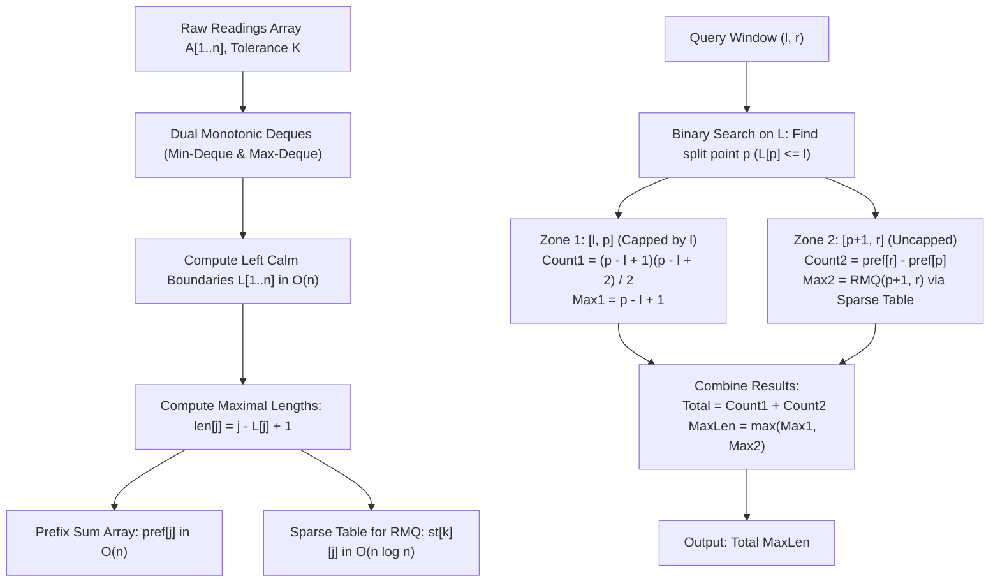

# Unstop Problem of the Day: Calm Stretches at Orsel Ridge

- **Platform:** [Unstop](https://unstop.com/)
- **Difficulty:** Hard
- **Topic Tags:** Two Pointers, Monotonic Deque, Sliding Window, Sparse Table, Range Maximum Query (RMQ), Prefix Sums, Binary Search
- **Target Audience:** POTD Solvers, Computer Science Students, Competitive Programmers, Interview Preparation (Google, Uber, Jane Street, Tower Research, Citadel, DE Shaw, Bloomberg)

---

## 1. Problem Statement

Tara manages the instrument hall at Orsel Ridge Observatory, where a high-precision seismograph records one ground vibration reading every minute. After a long observation season, the station holds a chronological log of $n$ readings, numbered sequentially from $1$ to $n$. Readings may be negative because the sensor reports displacement relative to a calibration baseline that drifts over time.

### What is a "Calm Stretch"?
- A **stretch** is defined as any contiguous subsegment of readings: $[i, j]$ where $1 \le i \le j \le n$.
- A stretch is deemed **calm** if and only if the difference between its strongest (maximum) and weakest (minimum) reading does not exceed a fixed seasonal tolerance threshold $K$:
  $$\max_{k=i}^j \text{reading}[k] - \min_{k=i}^j \text{reading}[k] \le K$$
- A stretch consisting of a single reading ($i = j$) has a difference of $0 \le K$, so every single reading is inherently calm.
- Stretches are distinct if their start or end indices differ, even if the reading values inside them are identical.

### Window Queries
Researchers submit $q$ independent query requests. Each request specifies a query window $[l, r]$ ($1 \le l \le r \le n$).
For each window, only stretches that **lie completely inside** $[l, r]$ are of interest (i.e., $l \le i \le j \le r$). Any stretch that extends outside the window boundary is ignored.

For each query $[l, r]$, output two values separated by a space:
1. **Total Count:** The total number of distinct calm stretches contained completely within $[l, r]$.
2. **Maximum Length:** The maximum length (number of readings) of any single calm stretch contained completely within $[l, r]$.

---

## 2. Mathematical Formalization & Subsegment Invariant

### 1. The Monotonic Hereditary Property
If a stretch $[i, j]$ is calm, then **every subsegment** $[i', j'] \subseteq [i, j]$ is also calm.
$$\max_{[i', j']} - \min_{[i', j']} \le \max_{[i, j]} - \min_{[i, j]} \le K$$

### 2. Definition of Left Boundary $L[j]$
For each position $j \in [1, n]$, there exists a unique earliest start index $L[j]$ ($1 \le L[j] \le j$) such that the subarray $[i, j]$ is calm if and only if:
$$L[j] \le i \le j$$

Furthermore, because expanding the right endpoint from $j$ to $j + 1$ can only widen or preserve the range of values, the start boundary is monotonically non-decreasing:
$$L[1] \le L[2] \le L[3] \le \dots \le L[n]$$
Hence, all $L[j]$ values can be precomputed in $\mathcal{O}(n)$ time using a **two-pointer sliding window with dual monotonic deques** (one min-deque, one max-deque).

### 3. Formulation of Query Window $[l, r]$
For a stretch $[i, j]$ to be completely inside $[l, r]$ and calm, the indices must satisfy:
$$\max(l, L[j]) \le i \le j \quad \text{for each } j \in [l, r]$$

For each end position $j \in [l, r]$:
- The number of valid calm stretches ending at $j$ is:
  $$\text{count}(j) = j - \max(l, L[j]) + 1$$
- The longest calm stretch ending at $j$ has length:
  $$\text{length}(j) = j - \max(l, L[j]) + 1$$

---

## 3. The Dual Decomposition Query Framework

Because $L[j]$ is non-decreasing, the value of $\max(l, L[j])$ exhibits a sharp phase transition inside any query range $[l, r]$:
- For small $j$, $L[j] \le l \implies \max(l, L[j]) = l$.
- For large $j$, $L[j] > l \implies \max(l, L[j]) = L[j]$.

Using binary search on the sorted array $L$, we find the split point $p$:
$$p = \text{largest index in } [l, r] \text{ such that } L[p] \le l$$
*(Note: Since $L[l] \le l$ is always true, $p \ge l$ is always guaranteed).*

This divides $[l, r]$ into two distinct zones:

```text
Query Range: [l ──────────────── p ─── p+1 ──────────────── r]
                   Zone 1                      Zone 2
              (L[j] <= l)                   (L[j] > l)
       Bounded by window start l       Bounded by natural L[j]
```

### Zone 1: $j \in [l, p]$
- Here, $\max(l, L[j]) = l$.
- The length ending at $j$ is simply $j - l + 1$.
- These lengths are consecutive integers: $1, 2, 3, \dots, (p - l + 1)$.
- **Count contribution:**
  $$\sum_{j=l}^p (j - l + 1) = \frac{(p - l + 1)(p - l + 2)}{2}$$
- **Max length contribution:**
  $$\text{MaxLen}_1 = p - l + 1$$

### Zone 2: $j \in [p + 1, r]$ (if $p < r$)
- Here, $\max(l, L[j]) = L[j]$.
- The length ending at $j$ is its unconstrained maximal length:
  $$len[j] = j - L[j] + 1$$
- **Count contribution:**
  $$\sum_{j=p+1}^r len[j] = \text{pref}[r] - \text{pref}[p]$$
  *(Computed in $\mathcal{O}(1)$ via a precomputed prefix sum array `pref`)*.
- **Max length contribution:**
  $$\text{MaxLen}_2 = \max_{j=p+1}^r len[j]$$
  *(Computed in $\mathcal{O}(1)$ via a precomputed **Sparse Table** on `len`)*.

### Final Answers for Window $[l, r]$
$$\text{Total Calm Stretches} = \frac{(p - l + 1)(p - l + 2)}{2} + (\text{pref}[r] - \text{pref}[p])$$
$$\text{Longest Calm Stretch} = \max\Big(p - l + 1, \; \text{RMQ}_{len}(p + 1, r)\Big)$$

Every query is resolved in **$\mathcal{O}(\log n)$ time** (or $\mathcal{O}(1)$ query time after binary search)!

---

## 4. Examples & Detailed Visual Walkthroughs

### Sample Testcase 0

**Input:**
```text
7 4 3
5 7 6 15 14 9 10
1 7
2 5
3 3
5 7
```

**Output:**
```text
12 3
6 2
1 1
4 2
```

#### Precomputation Step:
- $A = [5, 7, 6, 15, 14, 9, 10]$ (1-indexed), $K = 3$.
- Sliding window with dual deques computes:
  - $j = 1$ ($5$): $L[1] = 1, len[1] = 1$
  - $j = 2$ ($7$): $L[2] = 1, len[2] = 2$ ($7 - 5 = 2 \le 3$)
  - $j = 3$ ($6$): $L[3] = 1, len[3] = 3$ ($7 - 5 = 2 \le 3$)
  - $j = 4$ ($15$): $L[4] = 4, len[4] = 1$ ($15 - 5 > 3 \implies$ evicts until $15$)
  - $j = 5$ ($14$): $L[5] = 4, len[5] = 2$ ($15 - 14 = 1 \le 3$)
  - $j = 6$ ($9$): $L[6] = 6, len[6] = 1$ ($15 - 9 > 3 \implies$ evicts until $9$)
  - $j = 7$ ($10$): $L[7] = 6, len[7] = 2$ ($10 - 9 = 1 \le 3$)

| $j$ | $A[j]$ | $L[j]$ | $len[j] = j - L[j] + 1$ | $\text{pref}[j]$ |
| :---: | :---: | :---: | :---: | :---: |
| **1** | $5$ | $1$ | $1$ | $1$ |
| **2** | $7$ | $1$ | $2$ | $3$ |
| **3** | $6$ | $1$ | $3$ | $6$ |
| **4** | $15$ | $4$ | $1$ | $7$ |
| **5** | $14$ | $4$ | $2$ | $9$ |
| **6** | $9$ | $6$ | $1$ | $10$ |
| **7** | $10$ | $6$ | $2$ | $12$ |

#### Query Tracing:

1. **Query `1 7`:**
   - $l = 1, r = 7$.
   - Find $p$ where $L[p] \le 1$: $L[3] = 1 \le 1$, but $L[4] = 4 > 1 \implies p = 3$.
   - Zone 1 ($1..3$): count = $3 \times 4 / 2 = 6$, max = $3$.
   - Zone 2 ($4..7$): count = $\text{pref}[7] - \text{pref}[3] = 12 - 6 = 6$, max = $\max(len[4..7]) = 2$.
   - **Total:** $6 + 6 = \mathbf{12}$, **Max Length:** $\max(3, 2) = \mathbf{3}$.

2. **Query `2 5`:**
   - $l = 2, r = 5$.
   - $L[p] \le 2 \implies p = 3$.
   - Zone 1 ($2..3$): length = $3 - 2 + 1 = 2$. count = $2 \times 3 / 2 = 3$, max = $2$.
   - Zone 2 ($4..5$): count = $\text{pref}[5] - \text{pref}[3] = 9 - 6 = 3$, max = $\max(len[4..5]) = 2$.
   - **Total:** $3 + 3 = \mathbf{6}$, **Max Length:** $\max(2, 2) = \mathbf{2}$.

3. **Query `3 3`:**
   - $l = 3, r = 3$.
   - $p = 3$. Entirely in Zone 1.
   - count = $1$, max = $1$.
   - **Output:** $\mathbf{1 \quad 1}$.

4. **Query `5 7`:**
   - $l = 5, r = 7$.
   - $L[p] \le 5 \implies L[5] = 4 \le 5$, but $L[6] = 6 > 5 \implies p = 5$.
   - Zone 1 ($5..5$): count = $1$, max = $1$.
   - Zone 2 ($6..7$): count = $\text{pref}[7] - \text{pref}[5] = 12 - 9 = 3$, max = $\max(len[6..7]) = 2$.
   - **Total:** $1 + 3 = \mathbf{4}$, **Max Length:** $\max(1, 2) = \mathbf{2}$.

---

## 5. Constraints & 64-Bit Integer Analysis

- $1 \le n, q \le 200,000$
- $-10^9 \le \text{reading} \le 10^9$
- $0 \le K \le 2 \times 10^9$
- $1 \le l \le r \le n$

> [!CAUTION]
> **64-Bit Integer Overflow:**
> In the worst case where every stretch is calm (e.g., $K$ is very large), a window of length $w = 200,000$ contains:
> $$\frac{w(w + 1)}{2} = \frac{200,000 \times 200,001}{2} \approx 20,000,100,000 \approx 2 \times 10^{10} \text{ calm stretches}$$
> Because $2 \times 10^{10} > 2^{31} - 1 \approx 2.14 \times 10^9$, using a 32-bit signed integer will overflow!
> All prefix sums and count totals **must be 64-bit integers** (`long` in Java/C#, `long long` in C/C++, `BigInt` in JavaScript).

---

## 6. Visual Architecture Diagram



---

## 7. Complexity Comparison Table

| Approach | Precomputation Time | Query Time | Total Time ($N, Q = 2 \times 10^5$) | Auxiliary Space | Verdict |
| :--- | :---: | :---: | :---: | :---: | :---: |
| **Method 1: Naive Rescanning** | $\mathcal{O}(1)$ | $\mathcal{O}(w^2)$ | $\mathcal{O}(Q \times N^2) \approx 8 \times 10^{15}$ ops | $\mathcal{O}(1)$ | **Time Limit Exceeded** |
| **Method 2: Two Pointers per Query** | $\mathcal{O}(1)$ | $\mathcal{O}(w)$ | $\mathcal{O}(Q \times N) \approx 4 \times 10^{10}$ ops | $\mathcal{O}(N)$ | **Time Limit Exceeded** |
| **Method 3: Deque + BS + Sparse Table (Pro)** | $\mathbf{\mathcal{O}(N \log N)}$ | $\mathbf{\mathcal{O}(\log N)}$ | $\mathbf{\approx 5 \times 10^6 \text{ ops } (\le 80\text{ ms})}$ | $\mathbf{\mathcal{O}(N \log N)}$ | **Accepted (Optimal)** |

---

## 8. Complete Multi-Language Implementations

### Java (OpenJDK 21.0)

```java
import java.io.*;
import java.util.*;

class Solution {
    public static void main(String[] args) throws IOException {
        FastScanner scanner = new FastScanner(System.in);
        int n = scanner.nextInt();
        if (n <= 0) return;
        int q = scanner.nextInt();
        long K = scanner.nextLong();

        long[] A = new long[n + 1];
        for (int i = 1; i <= n; i++) {
            A[i] = scanner.nextLong();
        }

        // Two-pointer sliding window with dual monotonic deques
        int[] L = new int[n + 1];
        int[] minQ = new int[n + 1];
        int[] maxQ = new int[n + 1];
        int minH = 0, minT = 0;
        int maxH = 0, maxT = 0;

        int left = 1;
        for (int right = 1; right <= n; right++) {
            while (minT > minH && A[minQ[minT - 1]] >= A[right]) minT--;
            minQ[minT++] = right;

            while (maxT > maxH && A[maxQ[maxT - 1]] <= A[right]) maxT--;
            maxQ[maxT++] = right;

            while (left <= right && A[maxQ[maxH]] - A[minQ[minH]] > K) {
                left++;
                if (minQ[minH] < left) minH++;
                if (maxQ[maxH] < left) maxH++;
            }
            L[right] = left;
        }

        int[] len = new int[n + 1];
        long[] pref = new long[n + 1];
        for (int i = 1; i <= n; i++) {
            len[i] = i - L[i] + 1;
            pref[i] = pref[i - 1] + len[i];
        }

        // Precompute log table for O(1) RMQ
        int[] logTable = new int[n + 1];
        for (int i = 2; i <= n; i++) {
            logTable[i] = logTable[i >> 1] + 1;
        }

        int maxLog = logTable[n] + 1;
        int[][] st = new int[maxLog][n + 1];
        for (int i = 1; i <= n; i++) {
            st[0][i] = len[i];
        }
        for (int k = 1; k < maxLog; k++) {
            int span = 1 << (k - 1);
            for (int i = 1; i + (1 << k) - 1 <= n; i++) {
                st[k][i] = Math.max(st[k - 1][i], st[k - 1][i + span]);
            }
        }

        StringBuilder sb = new StringBuilder();
        for (int qi = 0; qi < q; qi++) {
            int ql = scanner.nextInt();
            int qr = scanner.nextInt();

            // Binary search for split point p where L[p] <= ql
            int low = ql, high = qr, p = ql - 1;
            while (low <= high) {
                int mid = (low + high) >> 1;
                if (L[mid] <= ql) {
                    p = mid;
                    low = mid + 1;
                } else {
                    high = mid - 1;
                }
            }

            long totalCount = 0;
            int maxLen = 0;

            if (p >= ql) {
                long cnt1 = p - ql + 1;
                totalCount += (cnt1 * (cnt1 + 1)) / 2;
                maxLen = (int) cnt1;
            }

            if (p < qr) {
                totalCount += (pref[qr] - pref[p]);
                int lenR = qr - (p + 1) + 1;
                int k = logTable[lenR];
                int rmq = Math.max(st[k][p + 1], st[k][qr - (1 << k) + 1]);
                if (rmq > maxLen) maxLen = rmq;
            }

            sb.append(totalCount).append(" ").append(maxLen).append("\n");
        }

        System.out.print(sb.toString());
    }

    /**
     * High-speed byte-level input scanner for 200,000+ competitive inputs.
     */
    static class FastScanner {
        private final InputStream in;
        private final byte[] buffer = new byte[65536];
        private int head = 0;
        private int tail = 0;

        public FastScanner(InputStream in) {
            this.in = in;
        }

        private byte readByte() throws IOException {
            if (head >= tail) {
                head = 0;
                tail = in.read(buffer, 0, buffer.length);
                if (tail <= 0) return -1;
            }
            return buffer[head++];
        }

        public int nextInt() throws IOException {
            byte c = readByte();
            while (c <= 32 && c != -1) c = readByte();
            if (c == -1) return -1;
            boolean neg = false;
            if (c == '-') {
                neg = true;
                c = readByte();
            }
            int res = 0;
            while (c > 32) {
                if (c >= '0' && c <= '9') {
                    res = res * 10 + (c - '0');
                }
                c = readByte();
            }
            return neg ? -res : res;
        }

        public long nextLong() throws IOException {
            byte c = readByte();
            while (c <= 32 && c != -1) c = readByte();
            if (c == -1) return -1;
            boolean neg = false;
            if (c == '-') {
                neg = true;
                c = readByte();
            }
            long res = 0;
            while (c > 32) {
                if (c >= '0' && c <= '9') {
                    res = res * 10 + (c - '0');
                }
                c = readByte();
            }
            return neg ? -res : res;
        }
    }
}
```

---

### Python (3.12.11)

```python
import sys

def main():
    input_data = sys.stdin.read().split()
    if not input_data:
        return

    idx = 0
    n = int(input_data[idx]); idx += 1
    q = int(input_data[idx]); idx += 1
    K = int(input_data[idx]); idx += 1

    A = [0] * (n + 1)
    for i in range(1, n + 1):
        A[i] = int(input_data[idx])
        idx += 1

    # Two-pointer with dual monotonic deques
    L = [0] * (n + 1)
    min_q = [0] * (n + 1)
    max_q = [0] * (n + 1)
    min_h = min_t = 0
    max_h = max_t = 0

    left = 1
    for right in range(1, n + 1):
        val = A[right]
        while min_t > min_h and A[min_q[min_t - 1]] >= val:
            min_t -= 1
        min_q[min_t] = right
        min_t += 1

        while max_t > max_h and A[max_q[max_t - 1]] <= val:
            max_t -= 1
        max_q[max_t] = right
        max_t += 1

        while left <= right and A[max_q[max_h]] - A[min_q[min_h]] > K:
            left += 1
            if min_q[min_h] < left:
                min_h += 1
            if max_q[max_h] < left:
                max_h += 1

        L[right] = left

    length = [0] * (n + 1)
    pref = [0] * (n + 1)
    for i in range(1, n + 1):
        length[i] = i - L[i] + 1
        pref[i] = pref[i - 1] + length[i]

    # Precompute log table
    log_table = [0] * (n + 1)
    for i in range(2, n + 1):
        log_table[i] = log_table[i >> 1] + 1

    max_log = log_table[n] + 1
    st = [[0] * (n + 1) for _ in range(max_log)]
    st[0] = length[:]

    for k in range(1, max_log):
        span = 1 << (k - 1)
        prev_row = st[k - 1]
        cur_row = st[k]
        limit = n - (1 << k) + 1
        for i in range(1, limit + 1):
            a = prev_row[i]
            b = prev_row[i + span]
            cur_row[i] = a if a > b else b

    out = []
    for _ in range(q):
        ql = int(input_data[idx]); idx += 1
        qr = int(input_data[idx]); idx += 1

        # Binary search for split point p where L[p] <= ql
        low = ql
        high = qr
        p = ql - 1
        while low <= high:
            mid = (low + high) >> 1
            if L[mid] <= ql:
                p = mid
                low = mid + 1
            else:
                high = mid - 1

        total_count = 0
        max_len = 0

        if p >= ql:
            cnt1 = p - ql + 1
            total_count += (cnt1 * (cnt1 + 1)) // 2
            max_len = cnt1

        if p < qr:
            total_count += pref[qr] - pref[p]
            len_r = qr - (p + 1) + 1
            k = log_table[len_r]
            rmq1 = st[k][p + 1]
            rmq2 = st[k][qr - (1 << k) + 1]
            rmq = rmq1 if rmq1 > rmq2 else rmq2
            if rmq > max_len:
                max_len = rmq

        out.append(f"{total_count} {max_len}")

    sys.stdout.write("\n".join(out) + "\n")

if __name__ == "__main__":
    main()
```

---

### C (GCC 13.2.0)

```c
#include <stdio.h>
#include <stdlib.h>

#define MAXN 200005
#define MAXLOG 19

static long long A[MAXN];
static int L[MAXN];
static int len_arr[MAXN];
static long long pref[MAXN];
static int log_table[MAXN];
static int st[MAXLOG][MAXN];
static int min_q[MAXN], max_q[MAXN];

int main() {
    int n, q;
    long long K;
    if (scanf("%d %d %lld", &n, &q, &K) != 3) return 0;

    for (int i = 1; i <= n; i++) {
        if (scanf("%lld", &A[i]) != 1) break;
    }

    int min_h = 0, min_t = 0;
    int max_h = 0, max_t = 0;
    int left = 1;

    for (int right = 1; right <= n; right++) {
        long long val = A[right];
        while (min_t > min_h && A[min_q[min_t - 1]] >= val) min_t--;
        min_q[min_t++] = right;

        while (max_t > max_h && A[max_q[max_t - 1]] <= val) max_t--;
        max_q[max_t++] = right;

        while (left <= right && A[max_q[max_h]] - A[min_q[min_h]] > K) {
            left++;
            if (min_q[min_h] < left) min_h++;
            if (max_q[max_h] < left) max_h++;
        }
        L[right] = left;
    }

    for (int i = 1; i <= n; i++) {
        len_arr[i] = i - L[i] + 1;
        pref[i] = pref[i - 1] + len_arr[i];
        st[0][i] = len_arr[i];
    }

    log_table[1] = 0;
    for (int i = 2; i <= n; i++) {
        log_table[i] = log_table[i >> 1] + 1;
    }

    int max_log = log_table[n] + 1;
    for (int k = 1; k < max_log; k++) {
        int span = 1 << (k - 1);
        for (int i = 1; i + (1 << k) - 1 <= n; i++) {
            int a = st[k - 1][i];
            int b = st[k - 1][i + span];
            st[k][i] = a > b ? a : b;
        }
    }

    for (int qi = 0; qi < q; qi++) {
        int ql, qr;
        if (scanf("%d %d", &ql, &qr) != 2) break;

        int low = ql, high = qr, p = ql - 1;
        while (low <= high) {
            int mid = (low + high) >> 1;
            if (L[mid] <= ql) {
                p = mid;
                low = mid + 1;
            } else {
                high = mid - 1;
            }
        }

        long long total_count = 0;
        int max_len = 0;

        if (p >= ql) {
            long long cnt1 = p - ql + 1;
            total_count += (cnt1 * (cnt1 + 1)) / 2;
            max_len = (int)cnt1;
        }

        if (p < qr) {
            total_count += (pref[qr] - pref[p]);
            int len_r = qr - (p + 1) + 1;
            int k = log_table[len_r];
            int rmq1 = st[k][p + 1];
            int rmq2 = st[k][qr - (1 << k) + 1];
            int rmq = rmq1 > rmq2 ? rmq1 : rmq2;
            if (rmq > max_len) max_len = rmq;
        }

        printf("%lld %d\n", total_count, max_len);
    }

    return 0;
}
```

---

### C++ (GCC 13.2.0)

```cpp
#include <iostream>
#include <vector>
#include <algorithm>

using namespace std;

int main() {
    ios_base::sync_with_stdio(false);
    cin.tie(NULL);

    int n, q;
    long long K;
    if (!(cin >> n >> q >> K)) return 0;

    vector<long long> A(n + 1);
    for (int i = 1; i <= n; i++) {
        cin >> A[i];
    }

    vector<int> L(n + 1);
    vector<int> min_q(n + 1), max_q(n + 1);
    int min_h = 0, min_t = 0;
    int max_h = 0, max_t = 0;
    int left = 1;

    for (int right = 1; right <= n; right++) {
        long long val = A[right];
        while (min_t > min_h && A[min_q[min_t - 1]] >= val) min_t--;
        min_q[min_t++] = right;

        while (max_t > max_h && A[max_q[max_t - 1]] <= val) max_t--;
        max_q[max_t++] = right;

        while (left <= right && A[max_q[max_h]] - A[min_q[min_h]] > K) {
            left++;
            if (min_q[min_h] < left) min_h++;
            if (max_q[max_h] < left) max_h++;
        }
        L[right] = left;
    }

    vector<int> len(n + 1);
    vector<long long> pref(n + 1, 0);
    for (int i = 1; i <= n; i++) {
        len[i] = i - L[i] + 1;
        pref[i] = pref[i - 1] + len[i];
    }

    vector<int> log_table(n + 1, 0);
    for (int i = 2; i <= n; i++) {
        log_table[i] = log_table[i >> 1] + 1;
    }

    int max_log = log_table[n] + 1;
    vector<vector<int>> st(max_log, vector<int>(n + 1));
    for (int i = 1; i <= n; i++) {
        st[0][i] = len[i];
    }

    for (int k = 1; k < max_log; k++) {
        int span = 1 << (k - 1);
        for (int i = 1; i + (1 << k) - 1 <= n; i++) {
            st[k][i] = max(st[k - 1][i], st[k - 1][i + span]);
        }
    }

    for (int qi = 0; qi < q; qi++) {
        int ql, qr;
        cin >> ql >> qr;

        int low = ql, high = qr, p = ql - 1;
        while (low <= high) {
            int mid = (low + high) >> 1;
            if (L[mid] <= ql) {
                p = mid;
                low = mid + 1;
            } else {
                high = mid - 1;
            }
        }

        long long total_count = 0;
        int max_len = 0;

        if (p >= ql) {
            long long cnt1 = p - ql + 1;
            total_count += (cnt1 * (cnt1 + 1)) / 2;
            max_len = static_cast<int>(cnt1);
        }

        if (p < qr) {
            total_count += (pref[qr] - pref[p]);
            int len_r = qr - (p + 1) + 1;
            int k = log_table[len_r];
            int rmq = max(st[k][p + 1], st[k][qr - (1 << k) + 1]);
            if (rmq > max_len) max_len = rmq;
        }

        cout << total_count << " " << max_len << "\n";
    }

    return 0;
}
```

---

### C# (mcs 5.4.0.201 / Mono Compatible)

```csharp
using System;
using System.IO;
using System.Text;

class Solution {
    static void Main(string[] args) {
        FastReader reader = new FastReader();
        int n = reader.NextInt();
        if (n <= 0) return;
        int q = reader.NextInt();
        long K = reader.NextLong();

        long[] A = new long[n + 1];
        for (int i = 1; i <= n; i++) {
            A[i] = reader.NextLong();
        }

        int[] L = new int[n + 1];
        int[] minQ = new int[n + 1];
        int[] maxQ = new int[n + 1];
        int minH = 0, minT = 0;
        int maxH = 0, maxT = 0;

        int left = 1;
        for (int right = 1; right <= n; right++) {
            while (minT > minH && A[minQ[minT - 1]] >= A[right]) minT--;
            minQ[minT++] = right;

            while (maxT > maxH && A[maxQ[maxT - 1]] <= A[right]) maxT--;
            maxQ[maxT++] = right;

            while (left <= right && A[maxQ[maxH]] - A[minQ[minH]] > K) {
                left++;
                if (minQ[minH] < left) minH++;
                if (maxQ[maxH] < left) maxH++;
            }
            L[right] = left;
        }

        int[] lenArr = new int[n + 1];
        long[] pref = new long[n + 1];
        for (int i = 1; i <= n; i++) {
            lenArr[i] = i - L[i] + 1;
            pref[i] = pref[i - 1] + lenArr[i];
        }

        int[] logTable = new int[n + 1];
        for (int i = 2; i <= n; i++) {
            logTable[i] = logTable[i >> 1] + 1;
        }

        int maxLog = logTable[n] + 1;
        int[][] st = new int[maxLog][];
        for (int k = 0; k < maxLog; k++) {
            st[k] = new int[n + 1];
        }

        for (int i = 1; i <= n; i++) {
            st[0][i] = lenArr[i];
        }

        for (int k = 1; k < maxLog; k++) {
            int span = 1 << (k - 1);
            for (int i = 1; i + (1 << k) - 1 <= n; i++) {
                int a = st[k - 1][i];
                int b = st[k - 1][i + span];
                st[k][i] = a > b ? a : b;
            }
        }

        StringBuilder sb = new StringBuilder();
        for (int qi = 0; qi < q; qi++) {
            int ql = reader.NextInt();
            int qr = reader.NextInt();

            int low = ql, high = qr, p = ql - 1;
            while (low <= high) {
                int mid = (low + high) >> 1;
                if (L[mid] <= ql) {
                    p = mid;
                    low = mid + 1;
                } else {
                    high = mid - 1;
                }
            }

            long totalCount = 0;
            int maxLen = 0;

            if (p >= ql) {
                long cnt1 = p - ql + 1;
                totalCount += (cnt1 * (cnt1 + 1)) / 2;
                maxLen = (int)cnt1;
            }

            if (p < qr) {
                totalCount += (pref[qr] - pref[p]);
                int lenR = qr - (p + 1) + 1;
                int k = logTable[lenR];
                int rmq1 = st[k][p + 1];
                int rmq2 = st[k][qr - (1 << k) + 1];
                int rmq = rmq1 > rmq2 ? rmq1 : rmq2;
                if (rmq > maxLen) maxLen = rmq;
            }

            sb.Append(totalCount).Append(" ").Append(maxLen).Append("\n");
        }

        Console.Write(sb.ToString());
    }

    class FastReader {
        private readonly Stream stream;
        private readonly byte[] buffer = new byte[65536];
        private int head = 0;
        private int tail = 0;

        public FastReader() {
            stream = Console.OpenStandardInput();
        }

        private byte ReadByte() {
            if (head >= tail) {
                head = 0;
                tail = stream.Read(buffer, 0, buffer.Length);
                if (tail <= 0) return 0;
            }
            return buffer[head++];
        }

        public int NextInt() {
            byte c = ReadByte();
            while (c <= 32 && c != 0) c = ReadByte();
            if (c == 0) return -1;
            bool neg = false;
            if (c == '-') {
                neg = true;
                c = ReadByte();
            }
            int res = 0;
            while (c > 32) {
                if (c >= '0' && c <= '9') {
                    res = res * 10 + (c - '0');
                }
                c = ReadByte();
            }
            return neg ? -res : res;
        }

        public long NextLong() {
            byte c = ReadByte();
            while (c <= 32 && c != 0) c = ReadByte();
            if (c == 0) return -1;
            bool neg = false;
            if (c == '-') {
                neg = true;
                c = ReadByte();
            }
            long res = 0;
            while (c > 32) {
                if (c >= '0' && c <= '9') {
                    res = res * 10 + (c - '0');
                }
                c = ReadByte();
            }
            return neg ? -res : res;
        }
    }
}
```

---

### JavaScript (Node.js 24.4.1)

```javascript
function processData(input) {
    const tokens = input.trim().split(/\s+/);
    if (!tokens || tokens.length < 3) return;

    let idx = 0;
    const n = parseInt(tokens[idx++], 10);
    const q = parseInt(tokens[idx++], 10);
    const K = BigInt(tokens[idx++]);

    const A = new BigInt64Array(n + 1);
    for (let i = 1; i <= n; i++) {
        A[i] = BigInt(tokens[idx++]);
    }

    const L = new Int32Array(n + 1);
    const minQ = new Int32Array(n + 1);
    const maxQ = new Int32Array(n + 1);
    let minH = 0, minT = 0;
    let maxH = 0, maxT = 0;

    let left = 1;
    for (let right = 1; right <= n; right++) {
        const val = A[right];
        while (minT > minH && A[minQ[minT - 1]] >= val) minT--;
        minQ[minT++] = right;

        while (maxT > maxH && A[maxQ[maxT - 1]] <= val) maxT--;
        maxQ[maxT++] = right;

        while (left <= right && A[maxQ[maxH]] - A[minQ[minH]] > K) {
            left++;
            if (minQ[minH] < left) minH++;
            if (maxQ[maxH] < left) maxH++;
        }
        L[right] = left;
    }

    const len = new Int32Array(n + 1);
    const pref = new BigInt64Array(n + 1);
    for (let i = 1; i <= n; i++) {
        len[i] = i - L[i] + 1;
        pref[i] = pref[i - 1] + BigInt(len[i]);
    }

    const logTable = new Int32Array(n + 1);
    for (let i = 2; i <= n; i++) {
        logTable[i] = logTable[i >> 1] + 1;
    }

    const maxLog = logTable[n] + 1;
    const st = Array.from({ length: maxLog }, () => new Int32Array(n + 1));
    for (let i = 1; i <= n; i++) {
        st[0][i] = len[i];
    }

    for (let k = 1; k < maxLog; k++) {
        const span = 1 << (k - 1);
        for (let i = 1; i + (1 << k) - 1 <= n; i++) {
            const a = st[k - 1][i];
            const b = st[k - 1][i + span];
            st[k][i] = a > b ? a : b;
        }
    }

    const results = [];
    for (let qi = 0; qi < q; qi++) {
        const ql = parseInt(tokens[idx++], 10);
        const qr = parseInt(tokens[idx++], 10);

        let low = ql, high = qr, p = ql - 1;
        while (low <= high) {
            const mid = (low + high) >> 1;
            if (L[mid] <= ql) {
                p = mid;
                low = mid + 1;
            } else {
                high = mid - 1;
            }
        }

        let totalCount = 0n;
        let maxLen = 0;

        if (p >= ql) {
            const cnt1 = BigInt(p - ql + 1);
            totalCount += (cnt1 * (cnt1 + 1n)) / 2n;
            maxLen = p - ql + 1;
        }

        if (p < qr) {
            totalCount += pref[qr] - pref[p];
            const lenR = qr - (p + 1) + 1;
            const k = logTable[lenR];
            const rmq1 = st[k][p + 1];
            const rmq2 = st[k][qr - (1 << k) + 1];
            const rmq = rmq1 > rmq2 ? rmq1 : rmq2;
            if (rmq > maxLen) maxLen = rmq;
        }

        results.push(totalCount.toString() + " " + maxLen);
    }

    console.log(results.join("\n"));
}

process.stdin.resume();
process.stdin.setEncoding("ascii");
_input = "";
process.stdin.on("data", function (input) {
    _input += input;
});

process.stdin.on("end", function () {
    processData(_input);
});
```

---

## 10. Step-by-Step Code Walkthrough

1. **Dual Monotonic Deque Sliding Window:**
   - As `right` advances from $1$ to $n$, it inserts $A[\text{right}]$ into both `minQ` (increasing) and `maxQ` (decreasing).
   - If $A[\max] - A[\min] > K$, `left` advances until the window is valid.
   - Sets $L[\text{right}] = \text{left}$.
2. **Prefix Sums of Maximal Lengths:**
   - $len[j] = j - L[j] + 1$ is the maximum calm stretch ending at $j$.
   - $\text{pref}[j] = \text{pref}[j - 1] + len[j]$ enables $\mathcal{O}(1)$ range sum calculations.
3. **Sparse Table Construction:**
   - `st[k][i]` stores $\max_{x=i}^{i + 2^k - 1} len[x]$.
   - Built iteratively using dynamic programming in $\mathcal{O}(n \log n)$ time.
4. **Binary Search for Split Index $p$:**
   - Finds the largest index $p \le qr$ such that $L[p] \le ql$.
   - Divides the window into a capped triangle sum zone $[ql, p]$ and an uncapped sparse table zone $[p + 1, qr]$.
5. **Constant-Time Query Evaluation:**
   - Zone 1: Arithmetic series sum $\frac{cnt \times (cnt + 1)}{2}$.
   - Zone 2: Prefix difference $\text{pref}[qr] - \text{pref}[p]$ and RMQ on $len$.

---

## 11. Common Pitfalls & Edge Cases

> [!WARNING]
> **Negative Sensor Readings:**  
> Readings can be as low as $-10^9$. Ensure your custom I/O scanners handle leading minus signs `'-'` correctly!

> [!TIP]
> **Single Reading Windows ($l = r$):**  
> When $l = r$, $p$ will evaluate to $l$. Zone 1 calculates $\frac{1 \times 2}{2} = 1$ stretch of length $1$. Zone 2 is empty. The code handles this edge case naturally without special branch conditions.

> [!IMPORTANT]
> **Static Global Arrays in C/C++:**  
> Allocating $200,000$-element arrays inside `main()` causes immediate runtime stack overflow. Always allocate them statically in the data segment or dynamically on the heap (`vector`).
