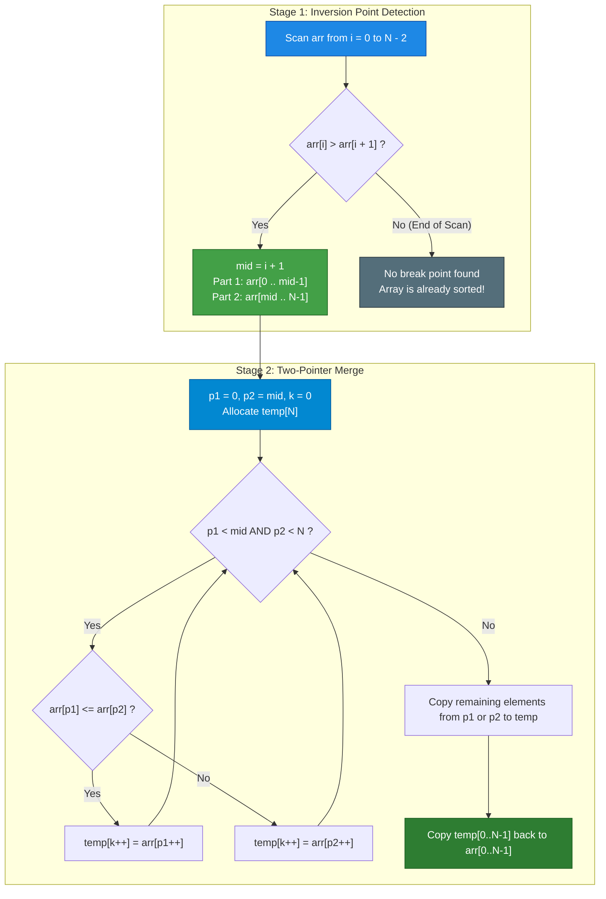
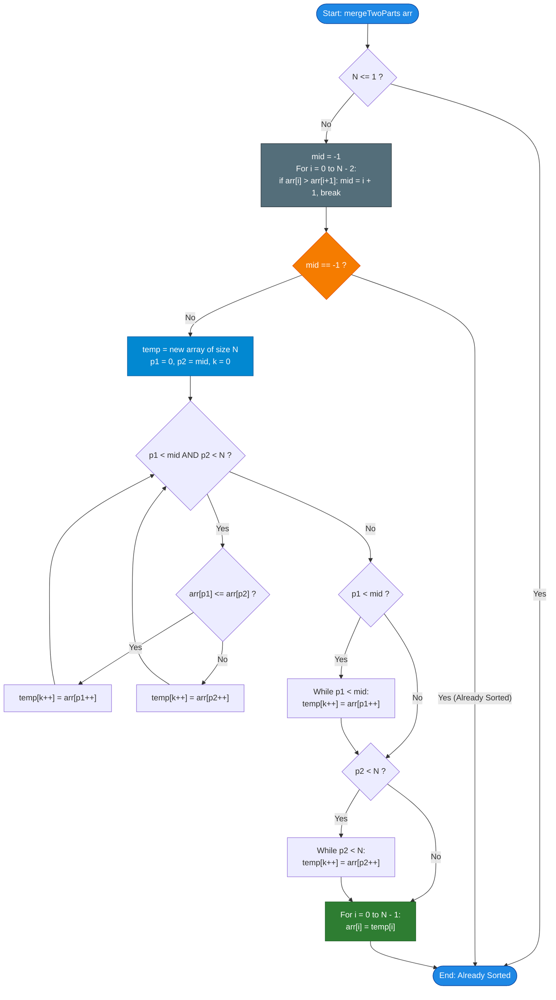

# GeeksforGeeks Problem of the Day: Sort Two Parts Sorted (Sort the Half Sorted)

- **Problem Link:** [GeeksforGeeks - Sort Two Parts Sorted](https://www.geeksforgeeks.org/problems/sort-the-half-sorted2157/1)
- **Difficulty:** Easy
- **Topic Tags:** Two-Pointer Algorithm, Sorting, Merge Sort Subroutine, Array Manipulation
- **Target Audience:** POTD Solvers, Computer Science Students, Competitive Programmers, Technical Interview Preparation (Amazon, Microsoft, Adobe, etc.)

---

## 1. Problem Statement

Given an integer array `arr[]` where two parts around a break point are individually sorted, merge them into a single sorted array. The break point can be anywhere in the array, including at the beginning or end.

The function must modify the input array `arr[]` **in-place** (or using an auxiliary buffer and copying back) to be completely sorted in non-decreasing order.

---

## 2. Examples & Explanations

### Example 1
- **Input:** `arr = [2, 3, 8, -1, 7, 10]`
- **Output:** `[-1, 2, 3, 7, 8, 10]`
- **Explanation:**
  - Notice that $2 \le 3 \le 8$, and then $8 > -1$.
  - Part 1 is `[2, 3, 8]` (indices $0 \dots 2$), which is sorted.
  - Part 2 is `[-1, 7, 10]` (indices $3 \dots 5$), which is sorted.
  - Merging both sorted parts yields `[-1, 2, 3, 7, 8, 10]`.

### Example 2
- **Input:** `arr = [-4, 6, 9, -1, 3]`
- **Output:** `[-4, -1, 3, 6, 9]`
- **Explanation:**
  - Break point occurs after index $2$ ($9 > -1$).
  - Part 1: `[-4, 6, 9]`.
  - Part 2: `[-1, 3]`.
  - Merging them gives `[-4, -1, 3, 6, 9]`.

### Example 3
- **Input:** `arr = [10, 20, 30]`
- **Output:** `[10, 20, 30]`
- **Explanation:**
  - The entire array is already sorted in non-decreasing order.
  - No inversion point exists; one part spans the entire array and the other part is empty.
  - The array remains unchanged: `[10, 20, 30]`.

---

## 3. Constraints & Complexity Targets

- **Constraints:**
  - $1 \le \text{arr.size()} \le 10^6$
  - $-10^5 \le \text{arr}[i] \le 10^5$
- **Expected Time Complexity:** $\mathcal{O}(N)$
- **Expected Auxiliary Space:** $\mathcal{O}(N)$

---

## 4. Visual Architecture & The Two-Pointer Merge Model

### The Anatomy of the Array

The input array contains at most **one point of inversion**:
$$\exists \, \text{mid} \in [1, N-1] \quad \text{such that} \quad \text{arr}[\text{mid} - 1] > \text{arr}[\text{mid}]$$

```
Array Layout:
Index:     0        1       ...    mid - 1       mid      mid + 1   ...    N - 1
         ┌─────────────────────────────────┐   ┌───────────────────────────────┐
Values:  │   Sorted Subarray 1 (Part 1)    │ > │  Sorted Subarray 2 (Part 2)   │
         └─────────────────────────────────┘   └───────────────────────────────┘
                       ↑                                       ↑
                    Pointer p1                              Pointer p2
```

### The Two-Stage Execution

1. **Stage 1 — Locate Break Point (`mid`):**
   - Single linear scan from left to right: find the first index $i$ where `arr[i] > arr[i + 1]`.
   - If found, `mid = i + 1`.
   - If no such inversion is found throughout the entire array, the array is **already sorted** $\implies$ return immediately in $\mathcal{O}(N)$ time!
2. **Stage 2 — Merge Two Sorted Subarrays:**
   - Initialize two pointers: $p_1 = 0$ (start of Part 1) and $p_2 = \text{mid}$ (start of Part 2).
   - Compare `arr[p1]` and `arr[p2]`. Write the smaller element to an auxiliary buffer `temp[]` and advance the corresponding pointer.
   - Once one pointer is exhausted, append the remaining elements.
   - Copy `temp[]` back to `arr[]`.



---

## 5. Step-by-Step Simulation & Trace Table

### Tracing Example 1: `arr = [2, 3, 8, -1, 7, 10]` ($N = 6$)

#### Step 1: Detect Break Point
- $i = 0$: $\text{arr}[0] = 2 \le \text{arr}[1] = 3$ (Valid)
- $i = 1$: $\text{arr}[1] = 3 \le \text{arr}[2] = 8$ (Valid)
- $i = 2$: $\text{arr}[2] = 8 > \text{arr}[3] = -1$ $\implies$ **Break Point!**  
  $\text{mid} = 2 + 1 = \mathbf{3}$.
  - Part 1: `arr[0..2] = [2, 3, 8]`
  - Part 2: `arr[3..5] = [-1, 7, 10]`

#### Step 2: Two-Pointer Merge

| Step | Pointer $p_1$ (`arr[p1]`) | Pointer $p_2$ (`arr[p2]`) | Comparison | Element Selected | `temp` Array State | Next Pointer Action |
| :---: | :---: | :---: | :---: | :---: | :--- | :---: |
| **1** | $p_1 = 0$ ($2$) | $p_2 = 3$ ($-1$) | $2 > -1$ | **$-1$** | `[-1]` | $p_2 \to 4$ |
| **2** | $p_1 = 0$ ($2$) | $p_2 = 4$ ($7$) | $2 \le 7$ | **$2$** | `[-1, 2]` | $p_1 \to 1$ |
| **3** | $p_1 = 1$ ($3$) | $p_2 = 4$ ($7$) | $3 \le 7$ | **$3$** | `[-1, 2, 3]` | $p_1 \to 2$ |
| **4** | $p_1 = 2$ ($8$) | $p_2 = 4$ ($7$) | $8 > 7$ | **$7$** | `[-1, 2, 3, 7]` | $p_2 \to 5$ |
| **5** | $p_1 = 2$ ($8$) | $p_2 = 5$ ($10$) | $8 \le 10$ | **$8$** | `[-1, 2, 3, 7, 8]` | $p_1 \to 3$ (Exhausted) |
| **6** | $p_1 = 3$ (Done) | $p_2 = 5$ ($10$) | Remaining | **$10$** | `[-1, 2, 3, 7, 8, 10]` | $p_2 \to 6$ (Exhausted) |

Final copy back to `arr`: `[-1, 2, 3, 7, 8, 10]`.

---

## 6. Algorithm Flowchart



---

## 7. From Naive to Pro: Algorithmic Progression

### Method 1: Naive (Generic Sorting Algorithm)
- **Concept:** Disregard the pre-sorted property of the two halves and execute a standard generic sort (`std::sort`, `Arrays.sort`, etc.).
- **Why it is suboptimal:**
  - Time Complexity: $\mathcal{O}(N \log N)$
  - Completely misses the problem's underlying structure.
  - In technical interviews, using generic sorting when linear merging is expected is considered an incomplete solution.
- **Pseudocode:**
```text
function mergeTwoParts_Naive(arr):
    sort(arr) // O(N log N)
```

---

### Method 2: Better (Two-Pointer Merge with Full Auxiliary Buffer)
- **Concept:** Identify the break point `mid`. Use two pointers $p_1$ and $p_2$ to merge elements into an auxiliary array `temp[N]`, then copy back.
- **Time Complexity:** $\mathcal{O}(N)$ (Linear scan to find `mid` + linear merge + linear copy back).
- **Auxiliary Space:** $\mathcal{O}(N)$.
- **Pseudocode:**
```text
function mergeTwoParts_FullBuffer(arr):
    n = length(arr)
    mid = -1
    for i from 0 to n - 2:
        if arr[i] > arr[i + 1]:
            mid = i + 1
            break
            
    if mid == -1: return // already sorted
    
    temp = array of size n
    p1 = 0, p2 = mid, k = 0
    
    while p1 < mid and p2 < n:
        if arr[p1] <= arr[p2]:
            temp[k++] = arr[p1++]
        else:
            temp[k++] = arr[p2++]
            
    while p1 < mid: temp[k++] = arr[p1++]
    while p2 < n:   temp[k++] = arr[p2++]
    
    for i from 0 to n - 1:
        arr[i] = temp[i]
```

---

### Method 3: Pro Approach (Half-Buffer Merge / Copy Left Part Only)
- **Concept:** 
  - Instead of allocating $N$ space, only copy the first half `arr[0 .. mid-1]` into an auxiliary buffer `left[]` of size $\text{mid}$.
  - Merge `left[]` and `arr[mid .. N-1]` directly into `arr[0 .. N-1]`.
  - **Key Optimization:** Once `left[]` is exhausted, all remaining elements in `arr[p2 .. N-1]` are **already in their correct final positions**! No trailing copies needed.
- **Time Complexity:** $\mathcal{O}(N)$
- **Auxiliary Space:** $\mathcal{O}(\text{mid}) \le \mathcal{O}(N)$ (Reduced memory pressure).
- **Pseudocode:**
```text
function mergeTwoParts_HalfBuffer(arr):
    n = length(arr)
    mid = -1
    for i from 0 to n - 2:
        if arr[i] > arr[i + 1]:
            mid = i + 1
            break
            
    if mid == -1: return
    
    left = copy of arr[0 .. mid - 1] // size mid
    p1 = 0, p2 = mid, k = 0
    
    while p1 < length(left) and p2 < n:
        if left[p1] <= arr[p2]:
            arr[k++] = left[p1++]
        else:
            arr[k++] = arr[p2++]
            
    while p1 < length(left):
        arr[k++] = left[p1++]
    // Remaining elements in arr[p2..n-1] are already in-place!
```

---

## 8. Complexity Comparison Table

| Metric | Method 1: Generic Sorting | Method 2: Two-Pointer (Full Buffer) | Method 3: Pro (Half-Buffer) |
| :--- | :--- | :--- | :--- |
| **Time Complexity** | $\mathcal{O}(N \log N)$ | $\mathbf{\mathcal{O}(N)}$ | $\mathbf{\mathcal{O}(N)}$ |
| **Auxiliary Space** | $\mathcal{O}(1)$ or $\mathcal{O}(\log N)$ | $\mathcal{O}(N)$ | $\mathbf{\mathcal{O}(\text{mid})} \le \mathcal{O}(N)$ |
| **Number of Element Moves** | $\approx N \log N$ comparisons | $2N$ element assignments | $\mathbf{N + \text{mid}}$ assignments |
| **Already Sorted Detection** | Requires full sort run | **Instant $\mathcal{O}(N)$ early exit** | **Instant $\mathcal{O}(N)$ early exit** |
| **Interview Assessment** | Suboptimal ($\mathcal{O}(N \log N)$) | **Optimal Expected Solution** | **Advanced Space-Savvy Refinement** |

---

## 9. Comprehensive Corner Cases Handled

1. **Already Sorted Array (`[10, 20, 30]`):**
   - No adjacent pair satisfies `arr[i] > arr[i + 1]`.
   - `mid` remains `-1`, and the function terminates early without allocating memory.
2. **Single-Element Array (`[1]`):**
   - $N \le 1$ triggers immediate return.
3. **Two-Element Inversion (`[5, 1]`):**
   - Break point at index $1$. Merges into `[1, 5]`.
4. **Break Point at the Very Beginning (`[10, 1, 2, 3]`):**
   - Part 1 has length $1$ (`[10]`), Part 2 has length $3$ (`[1, 2, 3]`).
   - Merges cleanly into `[1, 2, 3, 10]`.
5. **Break Point at the Very End (`[1, 2, 3, 0]`):**
   - Part 1 has length $3$ (`[1, 2, 3]`), Part 2 has length $1$ (`[0]`).
   - Merges cleanly into `[0, 1, 2, 3]`.
6. **Arrays with Duplicate Values (`[2, 2, 8, 2, 2, 8]`):**
   - The strict comparison `arr[i] > arr[i + 1]` safely ignores non-strictly increasing duplicates, pinpointing the true inversion point.
   - The `<=` comparison during merge preserves element stability.
7. **Negative Integers Mixed with Positive (`[-4, 6, 9, -1, 3]`):**
   - Handled seamlessly across the full signed integer range $[-10^5, 10^5]$.

---

## 10. Complete Multi-Language Implementations

### Java (21)

```java
class Solution {
    /**
     * Merges two individually sorted parts of an array into a single sorted array.
     * Strategy: Two-Pointer Merge with Auxiliary Buffer
     * Time Complexity: O(N)
     * Space Complexity: O(N)
     */
    public void mergeTwoParts(int[] arr) {
        int n = arr.length;
        if (n <= 1) return;

        // 1. Find the break point where the second sorted part begins
        int mid = -1;
        for (int i = 0; i < n - 1; i++) {
            if (arr[i] > arr[i + 1]) {
                mid = i + 1;
                break;
            }
        }

        // If no break point was found, array is already sorted
        if (mid == -1) return;

        // 2. Merge the two sorted subarrays using two pointers
        int[] temp = new int[n];
        int p1 = 0;
        int p2 = mid;
        int k = 0;

        while (p1 < mid && p2 < n) {
            if (arr[p1] <= arr[p2]) {
                temp[k++] = arr[p1++];
            } else {
                temp[k++] = arr[p2++];
            }
        }

        while (p1 < mid) {
            temp[k++] = arr[p1++];
        }

        while (p2 < n) {
            temp[k++] = arr[p2++];
        }

        // 3. Copy the merged sorted elements back to the original array
        System.arraycopy(temp, 0, arr, 0, n);
    }
}
```

---

### Python3

```python
class Solution:
    def mergeTwoParts(self, arr):
        """
        Merges two individually sorted parts of an array into a single sorted array.
        Strategy: Two-Pointer Merge with Auxiliary Buffer
        Time Complexity: O(N)
        Space Complexity: O(N)
        """
        n = len(arr)
        if n <= 1:
            return

        # 1. Locate the break point
        mid = -1
        for i in range(n - 1):
            if arr[i] > arr[i + 1]:
                mid = i + 1
                break

        # If already sorted, no operation needed
        if mid == -1:
            return

        # 2. Merge two sorted halves using two pointers
        temp = [0] * n
        p1 = 0
        p2 = mid
        k = 0

        while p1 < mid and p2 < n:
            if arr[p1] <= arr[p2]:
                temp[k] = arr[p1]
                p1 += 1
            else:
                temp[k] = arr[p2]
                p2 += 1
            k += 1

        while p1 < mid:
            temp[k] = arr[p1]
            p1 += 1
            k += 1

        while p2 < n:
            temp[k] = arr[p2]
            p2 += 1
            k += 1

        # 3. Copy back to original array in-place
        for i in range(n):
            arr[i] = temp[i]
```

---

### C++ (17)

```cpp
#include <vector>

using namespace std;

class Solution {
  public:
    /**
     * Merges two individually sorted parts of an array into a single sorted array.
     * Strategy: Two-Pointer Merge with Auxiliary Buffer
     * Time Complexity: O(N)
     * Space Complexity: O(N)
     */
    void mergeTwoParts(vector<int>& arr) {
        int n = arr.size();
        if (n <= 1) return;

        // 1. Locate the partition break point
        int mid = -1;
        for (int i = 0; i < n - 1; ++i) {
            if (arr[i] > arr[i + 1]) {
                mid = i + 1;
                break;
            }
        }

        // If no inversion point exists, array is already sorted
        if (mid == -1) return;

        // 2. Merge two sorted subarrays using auxiliary buffer
        vector<int> temp(n);
        int p1 = 0, p2 = mid, k = 0;

        while (p1 < mid && p2 < n) {
            if (arr[p1] <= arr[p2]) {
                temp[k++] = arr[p1++];
            } else {
                temp[k++] = arr[p2++];
            }
        }

        while (p1 < mid) {
            temp[k++] = arr[p1++];
        }

        while (p2 < n) {
            temp[k++] = arr[p2++];
        }

        // 3. Copy merged elements back to original array
        for (int i = 0; i < n; ++i) {
            arr[i] = temp[i];
        }
    }
};
```

---

### C#

```csharp
class Solution {
    /**
     * Merges two individually sorted parts of an array into a single sorted array.
     * Strategy: Two-Pointer Merge with Auxiliary Buffer
     * Time Complexity: O(N)
     * Space Complexity: O(N)
     */
    public void mergeTwoParts(int[] arr) {
        int n = arr.Length;
        if (n <= 1) return;

        // 1. Find the break point where the second sorted part begins
        int mid = -1;
        for (int i = 0; i < n - 1; i++) {
            if (arr[i] > arr[i + 1]) {
                mid = i + 1;
                break;
            }
        }

        // If no break point was found, array is already sorted
        if (mid == -1) return;

        // 2. Merge the two sorted subarrays using two pointers
        int[] temp = new int[n];
        int p1 = 0;
        int p2 = mid;
        int k = 0;

        while (p1 < mid && p2 < n) {
            if (arr[p1] <= arr[p2]) {
                temp[k++] = arr[p1++];
            } else {
                temp[k++] = arr[p2++];
            }
        }

        while (p1 < mid) {
            temp[k++] = arr[p1++];
        }

        while (p2 < n) {
            temp[k++] = arr[p2++];
        }

        // 3. Copy back to original array
        for (int i = 0; i < n; i++) {
            arr[i] = temp[i];
        }
    }
}
```

---

### Javascript (Node v22)

```javascript
/**
 * @param {number[]} arr
 * @return {void}
 */
class Solution {
    /**
     * Merges two individually sorted parts of an array into a single sorted array.
     * Strategy: Two-Pointer Merge with Auxiliary Buffer
     * Time Complexity: O(N)
     * Space Complexity: O(N)
     */
    mergeTwoParts(arr) {
        const n = arr.length;
        if (n <= 1) return;

        // 1. Find the break point
        let mid = -1;
        for (let i = 0; i < n - 1; i++) {
            if (arr[i] > arr[i + 1]) {
                mid = i + 1;
                break;
            }
        }

        // If no break point, array is already sorted
        if (mid === -1) return;

        // 2. Two-pointer merge into typed array buffer for maximum performance
        const temp = new Int32Array(n);
        let p1 = 0, p2 = mid, k = 0;

        while (p1 < mid && p2 < n) {
            if (arr[p1] <= arr[p2]) {
                temp[k++] = arr[p1++];
            } else {
                temp[k++] = arr[p2++];
            }
        }

        while (p1 < mid) {
            temp[k++] = arr[p1++];
        }

        while (p2 < n) {
            temp[k++] = arr[p2++];
        }

        // 3. Write back in-place
        for (let i = 0; i < n; i++) {
            arr[i] = temp[i];
        }
    }
}
```
