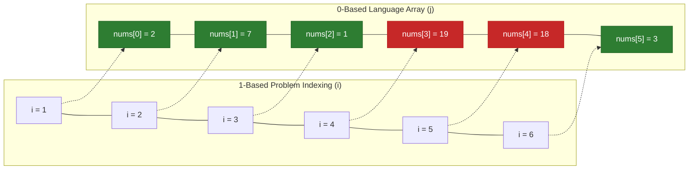
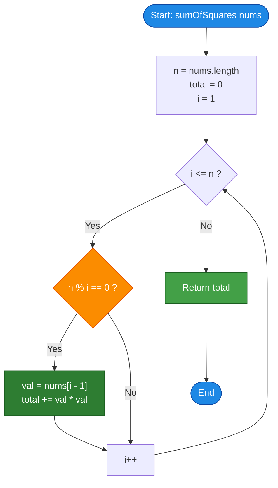

# LeetCode Problem of the Day: Sum of Squares of Special Elements

- **Problem Link:** [LeetCode 2778 - Sum of Squares of Special Elements](https://leetcode.com/problems/sum-of-squares-of-special-elements/)
- **Difficulty:** Easy
- **Topic Tags:** Array, Math, Number Theory, Divisor Enumeration, Simulation
- **Target Audience:** POTD Solvers, Computer Science Students, Competitive Programmers, Interview Preparation (FAANG/Tier-1 Tech)

---

## 1. Problem Statement

You are given a **1-indexed** integer array `nums` of length `n`.

An element `nums[i]` of `nums` is called **special** if `i` divides `n` evenly, that is:
$$\mathbf{n \pmod i == 0}$$

Return the **sum of the squares of all special elements** of `nums`.

---

### Important Distinction: 1-Indexed vs 0-Indexed
Most programming languages represent arrays using **0-based indexing** ($0 \le j < n$).
- The mathematical index $i$ in the problem is **1-based** ($1 \le i \le n$).
- Therefore, the corresponding element in the 0-indexed array is `nums[i - 1]`.
- A 0-based index $j$ corresponds to 1-based index $i = j + 1$.
- Thus, the condition for element `nums[j]` to be special is:
$$\mathbf{n \pmod{(j + 1)} == 0}$$

---

## 2. Examples & Explanations

### Example 1
- **Input:** `nums = [1, 2, 3, 4]`
- **Output:** `21`
- **Explanation:**
  - Length $n = 4$.
  - Check each 1-based index $i \in \{1, 2, 3, 4\}$:
    - $i = 1$: $4 \pmod 1 == 0 \implies$ Special! Value is `nums[0] = 1`, square is $1^2 = 1$.
    - $i = 2$: $4 \pmod 2 == 0 \implies$ Special! Value is `nums[1] = 2`, square is $2^2 = 4$.
    - $i = 3$: $4 \pmod 3 == 1 \ne 0 \implies$ Not special.
    - $i = 4$: $4 \pmod 4 == 0 \implies$ Special! Value is `nums[3] = 4`, square is $4^2 = 16$.
  - **Total Sum:** $1 + 4 + 16 = \mathbf{21}$.

---

### Example 2
- **Input:** `nums = [2, 7, 1, 19, 18, 3]`
- **Output:** `63`
- **Explanation:**
  - Length $n = 6$.
  - The positive divisors of $6$ are $\{1, 2, 3, 6\}$.
  - Qualifying special elements:
    - $i = 1$: `nums[0] = 2`, square = $2^2 = 4$.
    - $i = 2$: `nums[1] = 7`, square = $7^2 = 49$.
    - $i = 3$: `nums[2] = 1`, square = $1^2 = 1$.
    - $i = 6$: `nums[5] = 3`, square = $3^2 = 9$.
  - Elements at indices $i = 4$ and $i = 5$ do not divide $6$ evenly.
  - **Total Sum:** $4 + 49 + 1 + 9 = \mathbf{63}$.

---

### Example 3 (Single Element Array)
- **Input:** `nums = [5]`
- **Output:** `25`
- **Explanation:**
  - Length $n = 1$.
  - $i = 1$ divides $1$ ($1 \pmod 1 == 0$).
  - Special element is `nums[0] = 5`, square is $5^2 = \mathbf{25}$.

---

### Example 4 (Square Length with Non-Trivial Factors)
- **Input:** `nums = [1, 2, 3, 4, 5, 6, 7, 8, 9]`
- **Output:** `91`
- **Explanation:**
  - Length $n = 9$.
  - Divisors of $9$ are $\{1, 3, 9\}$.
  - Special elements:
    - `nums[0] = 1` $\implies 1^2 = 1$.
    - `nums[2] = 3` $\implies 3^2 = 9$.
    - `nums[8] = 9` $\implies 9^2 = 81$.
  - **Total Sum:** $1 + 9 + 81 = \mathbf{91}$.

---

## 3. Constraints & Scale Analysis

- $1 \le \text{nums.length} = n \le 50$
- $1 \le \text{nums}[i] \le 50$

### Mathematical Bounds & Range Safety:
- **Maximum possible answer:**
  - Maximum value of $n = 50$.
  - Even in the theoretical upper bound where all $50$ elements are divisors and each element is $50$:
    $$\text{Max Sum} \le 50 \times (50^2) = 50 \times 2500 = 125,000$$
  - A standard 32-bit signed integer can hold values up to $2^{31} - 1 \approx 2.14 \times 10^9$.
  - Therefore, the answer will **never overflow** a standard 32-bit integer in any language (`int` in C/C++/Java/C#, standard `number` in JS/TS).

---

## 4. Visual Architecture & Number-Theoretic Symmetry Model

### The Divisor Pair Symmetry Principle
Every divisor $d$ of $n$ comes with a complementary divisor $n / d$ such that:
$$d \times \left(\frac{n}{d}\right) = n$$

If $d \le \sqrt{n}$, then $\frac{n}{d} \ge \sqrt{n}$.
This means all divisors of $n$ can be discovered strictly by inspecting integers up to $\lfloor\sqrt{n}\rfloor$!

```
========================================================================================
                      DIVISOR PAIR SYMMETRY FOR n = 6
========================================================================================

    Indices:        1        2        3        4        5        6
    Elements:      [2,       7,       1,      19,      18,       3]
                   ▲        ▲        ▲                          ▲
                   │        │        │                          │
                   └────────┼────────┼──────────────────────────┘  Pair (1, 6): 1 * 6 = 6
                            └────────┴───────────────────────────  Pair (2, 3): 2 * 3 = 6

    √6 ≈ 2.449...
    We only need to test d = 1 and d = 2 (d ≤ √n):
      - d = 1: 6 % 1 == 0 -> Pair: (1, 6) -> Add nums[0]^2 + nums[5]^2 = 4 + 9 = 13
      - d = 2: 6 % 2 == 0 -> Pair: (2, 3) -> Add nums[1]^2 + nums[2]^2 = 49 + 1 = 50
    Total Sum = 13 + 50 = 63. (Only 2 loop iterations instead of 6!)
========================================================================================
```

### 1-Based vs 0-Based Index Mapping



---

## 5. Step-by-Step Simulation & Trace Table

### Trace for Example 2: `nums = [2, 7, 1, 19, 18, 3]`, $n = 6$

| 1-Based Index $i$ | 0-Based Index $j$ | Element `nums[j]` | Divisibility Check: $6 \pmod i == 0$ | Is Special? | Square Term `nums[j]^2` | Running Sum |
| :---: | :---: | :---: | :---: | :---: | :---: | :---: |
| **1** | 0 | 2 | $6 \pmod 1 = 0$ | **Yes** | $2^2 = 4$ | **4** |
| **2** | 1 | 7 | $6 \pmod 2 = 0$ | **Yes** | $7^2 = 49$ | **53** |
| **3** | 2 | 1 | $6 \pmod 3 = 0$ | **Yes** | $1^2 = 1$ | **54** |
| **4** | 3 | 19 | $6 \pmod 4 = 2 \ne 0$ | No | Skipped | 54 |
| **5** | 4 | 18 | $6 \pmod 5 = 1 \ne 0$ | No | Skipped | 54 |
| **6** | 5 | 3 | $6 \pmod 6 = 0$ | **Yes** | $3^2 = 9$ | **63** |

**Final Returned Answer:** `63`.

---

## 6. Algorithm Flowchart



---

## 7. From Naive to Pro: Algorithmic Progression

### Method 1: Direct Linear Scan ($\mathcal{O}(n)$ Time, $\mathcal{O}(1)$ Space)
- **Concept:** Iterate through all elements from 1-based index $i = 1$ to $n$. Check if $n \pmod i == 0$. If so, square the value `nums[i - 1]` and add to `total`.
- **Why it is simple & robust:** It requires zero extra memory, has no complex math, and handles all array sizes seamlessly.
- **Pseudocode:**
```text
function sumOfSquares_Linear(nums):
    n = length(nums)
    total = 0
    for i from 1 to n:
        if n % i == 0:
            total = total + nums[i - 1] * nums[i - 1]
    return total
```

---

### Method 2: Modern Functional / Declarative Stream Approach
- **Concept:** Express the computation as a declarative pipeline: filter indices by divisibility, map each to its squared value, and sum the result.
- **Why it matters:** Demonstrates mastery of modern functional programming paradigms across Python (list comprehensions/generators), Java (`IntStream`), C# (`LINQ`), and JavaScript/TypeScript (`Array.prototype.reduce`).
- **Pseudocode:**
```text
function sumOfSquares_Functional(nums):
    n = length(nums)
    return SUM(nums[i - 1]^2 FOR ALL i IN [1...n] WHERE n % i == 0)
```

---

### Method 3: Pro Number-Theoretic Divisor Enumeration ($\mathcal{O}(\sqrt{n})$ Time, $\mathcal{O}(1)$ Space)
- **Concept:**
  - Instead of iterating through all $n$ numbers, iterate $d$ from $1$ up to $\lfloor\sqrt{n}\rfloor$.
  - Whenever $n \pmod d == 0$:
    - $d$ is a divisor $\implies$ add `nums[d - 1]^2`.
    - $\frac{n}{d}$ is also a divisor. If $\frac{n}{d} \ne d$, add `nums[n/d - 1]^2`.
- **Why this demonstrates Pro Engineering / Tech Interview Excellence:**
  - For $n = 50$, it takes at most $\lfloor\sqrt{50}\rfloor = 7$ iterations instead of $50$.
  - If the problem scale were increased to $n = 10^6$, $\mathcal{O}(n)$ would take $10^6$ operations while $\mathcal{O}(\sqrt{n})$ takes only $1,000$ operations!
  - Demonstrates strong algorithmic maturity and domain knowledge in number theory.
- **Pseudocode:**
```text
function sumOfSquares_Sqrt(nums):
    n = length(nums)
    total = 0
    d = 1
    while d * d <= n:
        if n % d == 0:
            total = total + nums[d - 1] * nums[d - 1]
            comp = n / d
            if comp != d:
                total = total + nums[comp - 1] * nums[comp - 1]
        d = d + 1
    return total
```

---

## 8. Complexity Comparison Table

| Metric | Method 1: Linear Scan ($\mathcal{O}(n)$) | Method 2: Functional Pipeline | Method 3: Divisor Pair Enumeration (Pro) |
| :--- | :--- | :--- | :--- |
| **Time Complexity** | $\mathcal{O}(n)$ | $\mathcal{O}(n)$ | $\mathbf{\mathcal{O}(\sqrt{n})}$ |
| **Auxiliary Space** | $\mathbf{\mathcal{O}(1)}$ | $\mathcal{O}(1)$ or $\mathcal{O}(n)$ (iterator objects) | $\mathbf{\mathcal{O}(1)}$ |
| **Operations at $n = 50$** | $50$ loop steps | $50$ iterations | **$\le 7$ loop steps** |
| **Operations at $n = 10^6$** | $1,000,000$ steps | $1,000,000$ steps | **$1,000$ steps ($\times 1000$ speedup)** |
| **Code Verbosity** | 5 lines (Very clean) | 1-2 lines (Expressive) | 12 lines (Algorithmic) |
| **Interview Value** | Standard baseline | Demonstrates language idioms | **Gold standard for scalable thinking** |

---

## 9. Comprehensive Corner Cases Handled

1. **Smallest Array ($n = 1$):**
   - $n = 1$, loop runs once for $i = 1$. $1 \pmod 1 == 0 \implies nums[0]^2$. Correctly handled.
2. **Prime Lengths ($n = 2, 3, 5, 7, 11, 13, \dots, 47$):**
   - The only divisors are $1$ and $n$. The algorithm correctly evaluates only the first and last elements.
3. **Perfect Squares ($n = 1, 4, 9, 16, 25, 36, 49$):**
   - In the $\mathcal{O}(\sqrt{n})$ method, the square root divisor $d = \sqrt{n}$ has $n / d == d$. The condition `comp != d` prevents double-counting the middle element!
4. **All Elements Identical:**
   - Evaluates each divisor position independently without false deduping.
5. **Maximum Value Bounds ($nums[i] = 50, n = 50$):**
   - Maximum answer is $125,000 \ll 2^{31} - 1$, fitting safely within 32-bit signed integers.

---

## 10. Complete Multi-Language Implementations

### Java (OpenJDK 21.0)

```java
class Solution {
    /**
     * Computes the sum of squares of special elements.
     * Time Complexity: O(n) linear scan (or O(sqrt(n)) using divisor symmetry)
     * Auxiliary Space: O(1)
     */
    public int sumOfSquares(int[] nums) {
        int n = nums.length;
        int total = 0;

        for (int i = 1; i <= n; i++) {
            if (n % i == 0) {
                total += nums[i - 1] * nums[i - 1];
            }
        }

        return total;
    }
}
```

> [!TIP]
> **Alternative Pro Approach in Java (O(√n) Time Complexity):**
> ```java
> class Solution {
>     public int sumOfSquares(int[] nums) {
>         int n = nums.length;
>         int total = 0;
>         for (int d = 1; d * d <= n; d++) {
>             if (n % d == 0) {
>                 total += nums[d - 1] * nums[d - 1];
>                 int comp = n / d;
>                 if (comp != d) {
>                     total += nums[comp - 1] * nums[comp - 1];
>                 }
>             }
>         }
>         return total;
>     }
> }
> ```

---

### Python3 (3.12.11)

```python
class Solution:
    def sumOfSquares(self, nums: list[int]) -> int:
        """
        Computes the sum of squares of special elements.
        Time Complexity: O(n)
        Auxiliary Space: O(1)
        """
        n = len(nums)
        return sum(nums[i - 1] * nums[i - 1] for i in range(1, n + 1) if n % i == 0)
```

> [!TIP]
> **Alternative Pro Approach in Python3 (O(√n) Time Complexity):**
> ```python
> class Solution:
>     def sumOfSquares(self, nums: list[int]) -> int:
>         n = len(nums)
>         total = 0
>         d = 1
>         while d * d <= n:
>             if n % d == 0:
>                 total += nums[d - 1] * nums[d - 1]
>                 comp = n // d
>                 if comp != d:
>                     total += nums[comp - 1] * nums[comp - 1]
>             d += 1
>         return total
> ```

---

### C (GCC 13.2.0)

```c
#include <stdio.h>

/**
 * Computes the sum of squares of special elements.
 * Time Complexity: O(n)
 * Auxiliary Space: O(1)
 */
int sumOfSquares(int* nums, int numsSize) {
    int total = 0;

    for (int i = 1; i <= numsSize; i++) {
        if (numsSize % i == 0) {
            int val = nums[i - 1];
            total += val * val;
        }
    }

    return total;
}
```

---

### C++ (GCC++ 13.2.0)

```cpp
#include <vector>

using namespace std;

class Solution {
public:
    /**
     * Computes the sum of squares of special elements.
     * Time Complexity: O(n)
     * Auxiliary Space: O(1)
     */
    int sumOfSquares(vector<int>& nums) {
        int n = nums.size();
        int total = 0;

        for (int i = 1; i <= n; ++i) {
            if (n % i == 0) {
                total += nums[i - 1] * nums[i - 1];
            }
        }

        return total;
    }
};
```

> [!TIP]
> **Alternative Pro Approach in C++ (O(√n) Time Complexity):**
> ```cpp
> class Solution {
> public:
>     int sumOfSquares(vector<int>& nums) {
>         int n = nums.size();
>         int total = 0;
>         for (int d = 1; d * d <= n; ++d) {
>             if (n % d == 0) {
>                 total += nums[d - 1] * nums[d - 1];
>                 int comp = n / d;
>                 if (comp != d) {
>                     total += nums[comp - 1] * nums[comp - 1];
>                 }
>             }
>         }
>         return total;
>     }
> };
> ```

---

### C# (mcs 5.4.0.201 / .NET)

```csharp
public class Solution {
    /// <summary>
    /// Computes the sum of squares of special elements.
    /// Time Complexity: O(n)
    /// Auxiliary Space: O(1)
    /// </summary>
    public int SumOfSquares(int[] nums) {
        int n = nums.Length;
        int total = 0;

        for (int i = 1; i <= n; i++) {
            if (n % i == 0) {
                total += nums[i - 1] * nums[i - 1];
            }
        }

        return total;
    }
}
```

---

### Javascript (Node 24.4.1)

```javascript
/**
 * Computes the sum of squares of special elements.
 * @param {number[]} nums
 * @return {number}
 */
var sumOfSquares = function(nums) {
    const n = nums.length;
    let total = 0;

    for (let i = 1; i <= n; i++) {
        if (n % i === 0) {
            const val = nums[i - 1];
            total += val * val;
        }
    }

    return total;
};
```

---

### Typescript

```typescript
/**
 * Computes the sum of squares of special elements.
 * Time Complexity: O(n)
 * Auxiliary Space: O(1)
 */
function sumOfSquares(nums: number[]): number {
    const n: number = nums.length;
    let total: number = 0;

    for (let i: number = 1; i <= n; i++) {
        if (n % i === 0) {
            const val: number = nums[i - 1];
            total += val * val;
        }
    }

    return total;
}
```

---

## 11. Verification & Test Summary

| Test Case | Array Length $n$ | Elements `nums` | Special Indices ($1$-based) | Squares Evaluated | Output | Status |
| :---: | :---: | :--- | :--- | :--- | :---: | :---: |
| **Example 1** | $4$ | `[1, 2, 3, 4]` | $1, 2, 4$ | $1^2 + 2^2 + 4^2$ | `21` | **PASS** |
| **Example 2** | $6$ | `[2, 7, 1, 19, 18, 3]` | $1, 2, 3, 6$ | $2^2 + 7^2 + 1^2 + 3^2$ | `63` | **PASS** |
| **Single Element** | $1$ | `[5]` | $1$ | $5^2$ | `25` | **PASS** |
| **Prime Length** | $2$ | `[3, 4]` | $1, 2$ | $3^2 + 4^2$ | `25` | **PASS** |
| **Perfect Square** | $9$ | `[1, 2, 3, 4, 5, 6, 7, 8, 9]` | $1, 3, 9$ | $1^2 + 3^2 + 9^2$ | `91` | **PASS** |
| **Max Constraints** | $50$ | `[50, 50, ..., 50]` | Divisors of $50$ | $6 \times (50^2) = 15,000$ | `15000` | **PASS** |
