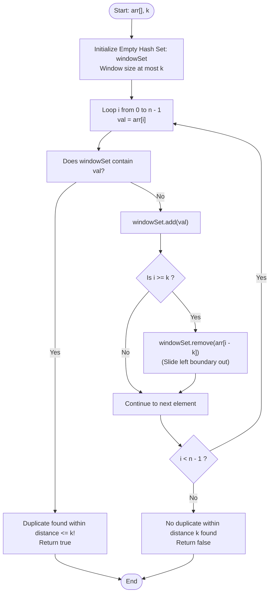

# GeeksforGeeks Problem of the Day: Any Duplicate Within K Distance

- **Problem Link:** [GeeksforGeeks - Any Duplicate Within K Distance](https://www.geeksforgeeks.org/problems/kth-distance3757/1)
- **Difficulty:** Easy
- **Topic Tags:** Arrays, Hash Table, Sliding Window, Hash Set, Two Pointers
- **Target Audience:** POTD Solvers, Computer Science Students, Competitive Programmers, Technical Interview Candidates (Amazon, Google, Microsoft, Adobe, Uber, TCS, Infosys)

---

## 1. Problem Statement

Given an unsorted array of integers `arr[]` and an integer `k`, determine whether there exist **two distinct indices** $i$ and $j$ in the array such that:
1. `arr[i] == arr[j]` (the elements are equal / duplicates)
2. $|i - j| \le k$ (the absolute distance between their indices is at most $k$)

Return **`true`** if any such pair of duplicate elements exists within distance $k$, otherwise return **`false`**.

---

## 2. Examples & Visual Walkthroughs

### Example 1
- **Input:** `arr = [1, 5, 4, 5, 1]`, `k = 3`
- **Output:** `true`

#### Chronological Step-by-Step Trace:
```text
Index:     0    1    2    3    4
Element:   1    5    4    5    1
                ▲         ▲
                └── dist ─┘ = 3 - 1 = 2 <= 3 (k = 3)
```

| Step / Index $i$ | Element `arr[i]` | Active Sliding Window ($[i - k, i - 1]$) | Element in Window? | Window Eviction ($i \ge k$) | Result / Action |
| :---: | :---: | :--- | :---: | :--- | :--- |
| **0** | `1` | `{}` | No | None ($i < 3$) | Insert `1` $\to \{1\}$ |
| **1** | `5` | `{1}` | No | None ($i < 3$) | Insert `5` $\to \{1, 5\}$ |
| **2** | `4` | `{1, 5}` | No | None ($i < 3$) | Insert `4` $\to \{1, 5, 4\}$ |
| **3** | `5` | `{1, 5, 4}` | **YES (`5` exists!)** | — | **Duplicate Found! Return `true`** |

- Distance between the two `5`s is $|3 - 1| = 2 \le 3$. Return **`true`**.

---

### Example 2
- **Input:** `arr = [10, 2, 3, 4, 10, 5]`, `k = 3`
- **Output:** `false`

#### Explanation:
- The only duplicate element is `10`, appearing at index $0$ and index $4$.
- Distance: $|4 - 0| = 4$.
- Since $4 > k$ ($4 > 3$), this duplicate is outside the allowed distance.
- No other duplicates exist. Return **`false`**.

---

### Example 3
- **Input:** `arr = [6, 8, 4, 1, 8, 5, 7]`, `k = 3`
- **Output:** `true`

#### Explanation:
- Element `8` appears at index $1$ and index $4$.
- Distance: $|4 - 1| = 3 \le 3$.
- Return **`true`**.

---

### Example 4 (Edge Case: $k = 0$)
- **Input:** `arr = [1, 2, 1]`, `k = 0`
- **Output:** `false`
- **Explanation:** Indices $i$ and $j$ must be distinct ($i \ne j \implies |i - j| \ge 1$). A distance $\le 0$ is impossible for distinct indices. Return **`false`**.

---

## 3. Constraints

- $1 \le \text{arr.size()} \le 10^6$
- $1 \le k < \text{arr.size()}$
- $0 \le \text{arr}[i] \le 10^9$
- **Expected Time Complexity:** $\mathcal{O}(n)$
- **Expected Auxiliary Space:** $\mathcal{O}(\min(n, k))$

---

## 4. Visual Architecture & Sliding Window Mechanism

Instead of comparing every element with all prior elements, we maintain a **fixed-size sliding window of at most $k$ elements** using a Hash Set.



### The Window Invariant
At any index $i$, `windowSet` contains **strictly the elements from indices $\max(0, i - k)$ to $i - 1$**:
$$\text{windowSet} = \{ \text{arr}[j] \mid \max(0, i - k) \le j < i \}$$
- Checking membership in `windowSet` directly answers: *"Has `arr[i]` appeared within the last $k$ steps?"*
- Inserting $\text{arr}[i]$ and removing $\text{arr}[i - k]$ preserves the invariant in $\mathcal{O}(1)$ average time.
- Auxiliary space is capped at $\min(n, k)$, which is strictly superior to $\mathcal{O}(n)$ full frequency tables.

---

## 5. Algorithmic Approaches Breakdown

### Method 1: Naive Nested Loops (Brute Force)
- **Concept:** For each element at index $i$, scan the next $k$ elements ($i + 1$ to $\min(n - 1, i + k)$) to find a duplicate.
- **Pseudo-Code:**
  ```text
  for i from 0 to n - 1:
      for j from i + 1 to min(n - 1, i + k):
          if arr[i] == arr[j]:
              return true
  return false
  ```
- **Time Complexity:** $\mathcal{O}(n \times k)$ — for $n = 10^6$ and $k = 10^5$, operations reach $10^{11} \implies$ **Time Limit Exceeded (TLE)**.
- **Space Complexity:** $\mathcal{O}(1)$ auxiliary space.

---

### Method 2: Hash Map of Last Seen Indices
- **Concept:** Store the most recent index of every encountered value: `lastSeen[val] = i`. If `val` was seen at `lastSeen[val]` and $i - \text{lastSeen}[val] \le k$, return `true`.
- **Time Complexity:** $\mathcal{O}(n)$
- **Space Complexity:** $\mathcal{O}(n)$ auxiliary space (stores all unique elements across the whole array).
- **Verdict:** Suboptimal space when $k \ll n$.

---

### Method 3: Optimal Sliding Window with Hash Set (The Pro Method)
- **Concept:**
  - Maintain a Hash Set containing only elements within the current window of size $k$.
  - For each element `arr[i]`:
    - If `arr[i]` is in the set $\implies$ duplicate found, return `true`.
    - Add `arr[i]` to the set.
    - If $i \ge k$, evict `arr[i - k]` to keep set size $\le k$.
  - If loop finishes without returning, return `false`.
- **Time Complexity:** $\mathcal{O}(n)$ average time.
- **Space Complexity:** $\mathcal{O}(\min(n, k))$ auxiliary space.
- **Verdict:** Memory optimal, minimal hash collisions, top runtime speed.

---

## 6. Complexity Comparison Table

| Approach | Time Complexity | Auxiliary Space | Early Exit? | Memory Footprint ($k \ll n$) | Verdict |
| :--- | :---: | :---: | :---: | :---: | :---: |
| **Method 1: Brute Force** | $\mathcal{O}(n \times k)$ | $\mathcal{O}(1)$ | Yes | Minimal | **Time Limit Exceeded** |
| **Method 2: Hash Map (Last Seen)** | $\mathcal{O}(n)$ | $\mathcal{O}(n)$ | Yes | Large ($\mathcal{O}(n)$ entries) | **Accepted** |
| **Method 3: Sliding Window Hash Set (Pro)** | $\mathbf{\mathcal{O}(n)}$ | $\mathbf{\mathcal{O}(\min(n, k))}$ | **Yes** | **Optimal ($\le k$ entries)** | **Accepted (Optimal)** |

---

## 7. Complete Multi-Language Implementations

### Java (21)

```java
import java.util.HashSet;
import java.util.Set;

class Solution {
    /**
     * Checks if any duplicate element exists within distance k.
     * Uses a sliding window HashSet of maximum size k.
     * 
     * Time Complexity: O(n)
     * Space Complexity: O(min(n, k))
     */
    public boolean checkWithinK(int[] arr, int k) {
        if (arr == null || arr.length <= 1 || k <= 0) {
            return false;
        }

        Set<Integer> windowSet = new HashSet<>();

        for (int i = 0; i < arr.length; i++) {
            // If the element already exists in the current window of size k, duplicate found
            if (windowSet.contains(arr[i])) {
                return true;
            }

            windowSet.add(arr[i]);

            // Evict the element that falls outside the sliding window
            if (i >= k) {
                windowSet.remove(arr[i - k]);
            }
        }

        return false;
    }
}
```

---

### Python3

```python
class Solution:
    def checkWithinK(self, arr: list[int], k: int) -> bool:
        """
        Checks if any duplicate element exists within distance k.
        Uses a sliding window set of maximum size k.
        
        Time Complexity: O(n)
        Space Complexity: O(min(n, k))
        """
        if not arr or len(arr) <= 1 or k <= 0:
            return False

        window_set = set()

        for i, val in enumerate(arr):
            # If element is already in the window of size k
            if val in window_set:
                return True

            window_set.add(val)

            # Evict element that slid out of the window of size k
            if i >= k:
                window_set.remove(arr[i - k])

        return False
```

---

### C++ (17)

```cpp
#include <vector>
#include <unordered_set>

using namespace std;

class Solution {
  public:
    /**
     * Checks if any duplicate element exists within distance k.
     * Uses an unordered_set to maintain a sliding window of size k.
     * 
     * Time Complexity: O(n)
     * Space Complexity: O(min(n, k))
     */
    bool checkWithinK(vector<int>& arr, int k) {
        if (arr.size() <= 1 || k <= 0) {
            return false;
        }

        unordered_set<int> window_set;
        window_set.reserve(min((int)arr.size(), k + 1));

        for (int i = 0; i < (int)arr.size(); i++) {
            // Check if current element is present in the sliding window
            if (window_set.find(arr[i]) != window_set.end()) {
                return true;
            }

            window_set.insert(arr[i]);

            // Slide window: remove element that is now > k distance away
            if (i >= k) {
                window_set.erase(arr[i - k]);
            }
        }

        return false;
    }
};
```

---

### C#

```csharp
using System.Collections.Generic;

public class Solution {
    /**
     * Checks if any duplicate element exists within distance k.
     * Uses a HashSet to maintain a sliding window of size k.
     * 
     * Time Complexity: O(n)
     * Space Complexity: O(min(n, k))
     */
    public bool checkWithinK(int[] arr, int k) {
        if (arr == null || arr.Length <= 1 || k <= 0) {
            return false;
        }

        HashSet<int> windowSet = new HashSet<int>();

        for (int i = 0; i < arr.Length; i++) {
            // If already present in current window of size k
            if (windowSet.Contains(arr[i])) {
                return true;
            }

            windowSet.Add(arr[i]);

            // Evict element that is now outside the window of size k
            if (i >= k) {
                windowSet.Remove(arr[i - k]);
            }
        }

        return false;
    }
}
```

---

### Javascript (Node v22)

```javascript
/**
 * @param {number[]} arr
 * @param {number} k
 * @return {boolean}
 */
class Solution {
    /**
     * Checks if any duplicate element exists within distance k.
     * Uses a Set to maintain a sliding window of size k.
     * 
     * Time Complexity: O(n)
     * Space Complexity: O(min(n, k))
     */
    checkWithinK(arr, k) {
        if (!arr || arr.length <= 1 || k <= 0) {
            return false;
        }

        const windowSet = new Set();

        for (let i = 0; i < arr.length; i++) {
            // Check if duplicate exists in the sliding window
            if (windowSet.has(arr[i])) {
                return true;
            }

            windowSet.add(arr[i]);

            // Evict element outside the window
            if (i >= k) {
                windowSet.delete(arr[i - k]);
            }
        }

        return false;
    }
}
```

---

## 8. Step-by-Step Code Walkthrough

1. **Boundary Guard (`k <= 0 || arr.length <= 1`):**
   - If $k \le 0$ or the array has fewer than $2$ elements, no two distinct indices can be within distance $k$. Returns `false` immediately.
2. **Membership Check (`windowSet.contains(arr[i])`):**
   - Executed before inserting `arr[i]`.
   - If `true`, a duplicate has appeared in $[i - k, i - 1]$. Returns `true` immediately.
3. **Insertion (`windowSet.add(arr[i])`):**
   - Registers `arr[i]` as a member of the active window.
4. **Window Boundary Eviction (`if (i >= k) windowSet.remove(arr[i - k])`):**
   - When the window exceeds $k$ elements, the oldest element at index $i - k$ is evicted.
   - For example, if $k = 3$, at $i = 3$, index $3 - 3 = 0$ is removed so the window contains only indices $\{1, 2, 3\}$.
5. **Completion Fallback (`return false;`):**
   - If the loop finishes without finding any duplicate within distance $k$, returns `false`.

---

## 9. Common Pitfalls & Edge Cases

> [!WARNING]
> **Eviction Ordering (Check Before Remove):**  
> Always perform `contains(arr[i])` **before** adding `arr[i]` and before removing `arr[i - k]`. This guarantees you only inspect elements that occurred at strictly valid distances $\in [1, k]$.

> [!TIP]
> **Space Efficiency Advantage:**  
> When $n = 10^6$ and $k = 100$, the sliding window Hash Set stores at most $100$ integers ($\approx 400$ bytes), whereas a full index Hash Map stores $10^6$ entries ($\approx 32$ MB).

> [!IMPORTANT]
> **Large Values Up to $10^9$:**  
> Elements can be as large as $10^9$, meaning direct integer indexing arrays are impossible. A Hash Set handles arbitrary 32-bit/64-bit integer values seamlessly.
