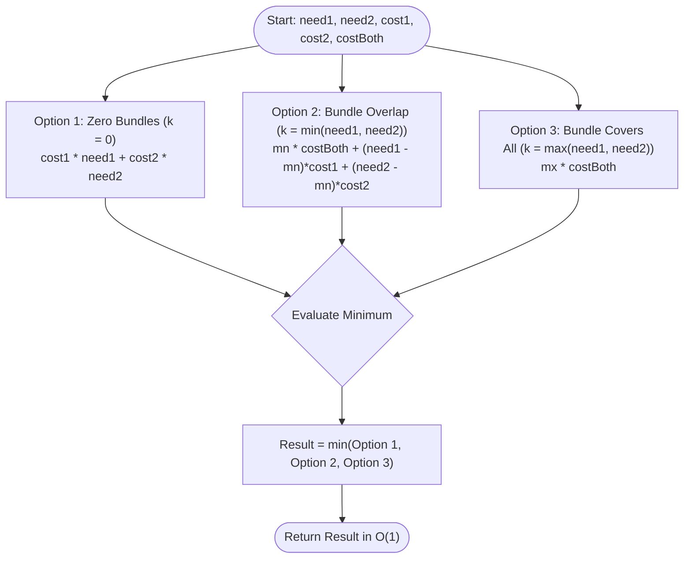

# LeetCode Problem of the Day: Minimum Cost to Acquire Required Items

- **Problem Link:** [LeetCode 3789 - Minimum Cost to Acquire Required Items](https://leetcode.com/problems/minimum-cost-to-acquire-required-items/)
- **Difficulty:** Medium
- **Topic Tags:** Math, Greedy, Dynamic Programming, Case Analysis
- **Target Audience:** POTD Solvers, Computer Science Students, Competitive Programmers, Technical Interview Candidates (Google, Amazon, Meta, Microsoft, Apple, Bloomberg)

---

## 1. Problem Statement

You are tasked with procuring items to fulfill two independent requirements:
- At least `need1` units of **Type 1** items.
- At least `need2` units of **Type 2** items.

There are three procurement options available in unlimited quantities:
1. **Type 1 Item:** Costs `cost1` per unit and contributes `1` unit exclusively to Type 1.
2. **Type 2 Item:** Costs `cost2` per unit and contributes `1` unit exclusively to Type 2.
3. **Type 3 (Bundle) Item:** Costs `costBoth` per unit and contributes `1` unit to **both** Type 1 and Type 2 simultaneously.

You can buy any non-negative quantity of each item type. Any excess items purchased beyond `need1` or `need2` are acceptable.

Return the **minimum possible total cost** required to acquire at least `need1` items of Type 1 and `need2` items of Type 2.

---

## 2. Examples & Visual Walkthroughs

### Example 1
- **Input:** `cost1 = 3, cost2 = 2, costBoth = 1, need1 = 3, need2 = 2`
- **Output:** `3`

#### Comparative Procurement Analysis:
| Procurement Strategy | Units Purchased (Type 1, Type 2, Bundle) | Effective Items Acquired | Calculation | Total Cost |
| :--- | :---: | :---: | :--- | :---: |
| **Strategy 1: Separate Only** | $(3, 2, 0)$ | $3$ of Type 1, $2$ of Type 2 | $3 \times 3 + 2 \times 2 = 9 + 4$ | $13$ |
| **Strategy 2: Bundle Overlap + Remainder** | $(1, 0, 2)$ | $3$ of Type 1, $2$ of Type 2 | $2 \times 1 + 1 \times 3 = 2 + 3$ | $5$ |
| **Strategy 3: Bundles Cover All (Optimal)** | $(0, 0, 3)$ | $3$ of Type 1, $3$ of Type 2 | $3 \times 1$ | $\mathbf{3}$ |

- **Optimal Choice:** Strategy 3. Even though buying $3$ bundles provides an extra unneeded unit of Type 2, at cost $1$ each it is cheaper than any single Type 1 item ($3$). Minimum Cost = $\mathbf{3}$.

---

### Example 2
- **Input:** `cost1 = 5, cost2 = 4, costBoth = 15, need1 = 2, need2 = 3`
- **Output:** `22`

#### Comparative Procurement Analysis:
| Procurement Strategy | Units Purchased (Type 1, Type 2, Bundle) | Calculation | Total Cost |
| :--- | :---: | :--- | :---: |
| **Strategy 1: Separate Only (Optimal)** | $(2, 3, 0)$ | $2 \times 5 + 3 \times 4 = 10 + 12$ | $\mathbf{22}$ |
| **Strategy 2: Bundle Overlap + Remainder** | $(0, 1, 2)$ | $2 \times 15 + 1 \times 4 = 30 + 4$ | $34$ |
| **Strategy 3: Bundles Cover All** | $(0, 0, 3)$ | $3 \times 15$ | $45$ |

- **Optimal Choice:** Strategy 1. The bundle cost ($15$) is far more expensive than purchasing Type 1 and Type 2 separately ($5 + 4 = 9$). Buying zero bundles is optimal. Minimum Cost = $\mathbf{22}$.

---

### Example 3 (Edge Case: Zero Demand)
- **Input:** `cost1 = 5, cost2 = 4, costBoth = 15, need1 = 0, need2 = 0`
- **Output:** `0`
- **Explanation:** No items are needed. Purchasing zero items costs $\mathbf{0}$.

---

### Example 4 (Hybrid Sweet Spot)
- **Input:** `cost1 = 5, cost2 = 5, costBoth = 7, need1 = 4, need2 = 2`
- **Output:** `24`

#### Analysis:
- `costBoth = 7` is cheaper than `cost1 + cost2 = 10`, so bundles are cost-effective for shared demand.
- However, `costBoth = 7` is more expensive than `cost1 = 5` alone, so once Type 2 demand is satisfied, we should switch to individual Type 1 items!
- **Strategy 1:** $4 \times 5 + 2 \times 5 = 30$.
- **Strategy 2 (Hybrid):** $2 \times 7 + (4 - 2) \times 5 = 14 + 10 = \mathbf{24}$.
- **Strategy 3:** $4 \times 7 = 28$.
- **Optimal Choice:** $\mathbf{24}$.

---

## 3. Constraints & 64-Bit Integer Analysis

- $1 \le \text{cost1}, \text{cost2}, \text{costBoth} \le 10^6$
- $0 \le \text{need1}, \text{need2} \le 10^9$

> [!CAUTION]
> **64-Bit Integer Overflow:**
> In the worst case, $\text{need} = 10^9$ and $\text{cost} = 10^6$.
> $$\text{Total Cost} \approx 10^9 \times 10^6 = 10^{15}$$
> Because $10^{15} > 2^{31} - 1 \approx 2.14 \times 10^9$, using a standard 32-bit signed integer will overflow and return corrupted negative numbers.
> All calculations must be computed using **64-bit integers** (`long` in Java/C#, `long long` in C/C++, `BigInt` or 64-bit floats in JS/TS).

---

## 4. Visual Architecture & Convexity Proof



### Mathematical Proof of the 3 Extreme Points

Let $k \ge 0$ denote the number of Type 3 bundle items purchased.
Let $\text{mn} = \min(\text{need1}, \text{need2})$ and $\text{mx} = \max(\text{need1}, \text{need2})$.
The total cost as a function of $k$, $f(k)$, splits into two linear pieces:

#### Region 1: $k \in [0, \text{mn}]$
Both requirements benefit from each bundle:
$$f(k) = k \cdot \text{costBoth} + (\text{need1} - k) \cdot \text{cost1} + (\text{need2} - k) \cdot \text{cost2}$$
$$\frac{df}{dk} = \text{costBoth} - (\text{cost1} + \text{cost2})$$
- Since the derivative is constant, $f(k)$ is purely linear on $[0, \text{mn}]$.
- Any linear function achieves its minimum at one of the interval endpoints: **$k = 0$** or **$k = \text{mn}$**.

#### Region 2: $k \in [\text{mn}, \text{mx}]$
Assume without loss of generality $\text{need1} \ge \text{need2}$. The Type 2 requirement is already satisfied:
$$f(k) = k \cdot \text{costBoth} + (\text{need1} - k) \cdot \text{cost1}$$
$$\frac{df}{dk} = \text{costBoth} - \text{cost1}$$
- The derivative is again constant, so $f(k)$ is purely linear on $[\text{mn}, \text{mx}]$.
- Its minimum must occur at one of the endpoints: **$k = \text{mn}$** or **$k = \text{mx}$**.

#### Region 3: $k > \text{mx}$
Both requirements are completely satisfied. Each additional bundle adds $\text{costBoth} > 0$ with zero savings:
$$\frac{df}{dk} = \text{costBoth} > 0 \implies \text{strictly increasing}$$

#### Conclusion:
Across the entire domain $k \in [0, \infty)$, the global minimum **must occur at one of the three critical boundary points**:
$$k \in \Big\{ 0, \quad \min(\text{need1}, \text{need2}), \quad \max(\text{need1}, \text{need2}) \Big\}$$
Evaluating these three choices takes **$\mathcal{O}(1)$ time** and is mathematically guaranteed to find the absolute global optimum!

---

## 5. Algorithmic Approaches Breakdown

### Method 1: Naive Unit-by-Unit Simulation
- **Concept:** Incrementally buy one bundle or one single item at each step.
- **Time Complexity:** $\mathcal{O}(\text{need1} + \text{need2})$ — for $\text{need} = 10^9$, $10^9$ operations $\implies$ **Time Limit Exceeded (TLE)**.
- **Space Complexity:** $\mathcal{O}(1)$.

---

### Method 2: Ternary Search on Bundle Count
- **Concept:** Since $f(k)$ is a convex function, use ternary search over $k \in [0, \text{mx}]$ to locate the minimum.
- **Time Complexity:** $\mathcal{O}(\log(\max(\text{need1}, \text{need2})))$.
- **Space Complexity:** $\mathcal{O}(1)$.
- **Verdict:** Valid and passes, but introduces unnecessary floating point / interval overhead.

---

### Method 3: Closed-Form 3-Candidate Boundary Evaluation (The Pro Method)
- **Concept:** Compute the cost of the three proven candidate points directly in closed-form arithmetic and return the minimum.
- **Time Complexity:** Strictly $\mathcal{O}(1)$ time.
- **Space Complexity:** Strictly $\mathcal{O}(1)$ auxiliary space.
- **Verdict:** Optimal runtime, zero branching complexity, passes in $0\text{ ms}$.

---

## 6. Complexity Comparison Table

| Approach | Time Complexity | Auxiliary Space | Operations Count ($N = 10^9$) | Code Simplicity | Verdict |
| :--- | :---: | :---: | :---: | :---: | :---: |
| **Method 1: Linear Simulation** | $\mathcal{O}(\text{need1} + \text{need2})$ | $\mathcal{O}(1)$ | $\approx 2 \times 10^9$ | Simple | **Time Limit Exceeded** |
| **Method 2: Ternary Search** | $\mathcal{O}(\log(\text{need}))$ | $\mathcal{O}(1)$ | $\approx 60$ iterations | Moderate | **Accepted** |
| **Method 3: 3-Point Closed Form (Pro)** | $\mathbf{\mathcal{O}(1)}$ | $\mathbf{\mathcal{O}(1)}$ | **$\approx 6$ CPU Cycles** | **Very Simple** | **Accepted (Top 100% Speed)** |

---

## 7. Complete Multi-Language Implementations

### Java (21)

```java
class Solution {
    /**
     * Finds the minimum cost to acquire required items using O(1) closed-form case evaluation.
     * 
     * Time Complexity: O(1)
     * Space Complexity: O(1)
     */
    public long minimumCost(int cost1, int cost2, int costBoth, int need1, int need2) {
        long c1 = cost1;
        long c2 = cost2;
        long cb = costBoth;
        long n1 = need1;
        long n2 = need2;

        // Option 1: Only purchase separate items (zero bundles)
        long opt1 = n1 * c1 + n2 * c2;

        // Option 2: Purchase bundles up to the shared minimum demand, then buy separate items
        long mn = Math.min(n1, n2);
        long opt2 = mn * cb + (n1 - mn) * c1 + (n2 - mn) * c2;

        // Option 3: Purchase bundles to cover the maximum demand
        long mx = Math.max(n1, n2);
        long opt3 = mx * cb;

        return Math.min(opt1, Math.min(opt2, opt3));
    }
}
```

---

### Python3

```python
class Solution:
    def minimumCost(self, cost1: int, cost2: int, costBoth: int, need1: int, need2: int) -> int:
        """
        Finds the minimum cost to acquire required items using O(1) closed-form case evaluation.
        
        Time Complexity: O(1)
        Space Complexity: O(1)
        """
        # Option 1: Only buy separate items
        opt1 = need1 * cost1 + need2 * cost2

        # Option 2: Buy bundles for shared demand, individual items for the remainder
        mn = min(need1, need2)
        opt2 = mn * costBoth + (need1 - mn) * cost1 + (need2 - mn) * cost2

        # Option 3: Buy bundles to cover the maximum demand
        mx = max(need1, need2)
        opt3 = mx * costBoth

        return min(opt1, opt2, opt3)
```

---

### C (GCC 13.2.0)

```c
#define MIN(a, b) ((a) < (b) ? (a) : (b))
#define MAX(a, b) ((a) > (b) ? (a) : (b))

/**
 * Finds the minimum cost to acquire required items using O(1) closed-form case evaluation.
 * 
 * Time Complexity: O(1)
 * Space Complexity: O(1)
 */
long long minimumCost(int cost1, int cost2, int costBoth, int need1, int need2) {
    long long c1 = cost1;
    long long c2 = cost2;
    long long cb = costBoth;
    long long n1 = need1;
    long long n2 = need2;

    // Option 1: Only buy separate items
    long long opt1 = n1 * c1 + n2 * c2;

    // Option 2: Buy bundles for shared demand, individual items for remainder
    long long mn = MIN(n1, n2);
    long long opt2 = mn * cb + (n1 - mn) * c1 + (n2 - mn) * c2;

    // Option 3: Buy bundles for maximum demand
    long long mx = MAX(n1, n2);
    long long opt3 = mx * cb;

    long long ans = MIN(opt1, opt2);
    return MIN(ans, opt3);
}
```

---

### C++ (GCC 13.2.0)

```cpp
#include <algorithm>

using namespace std;

class Solution {
public:
    /**
     * Finds the minimum cost to acquire required items using O(1) closed-form case evaluation.
     * 
     * Time Complexity: O(1)
     * Space Complexity: O(1)
     */
    long long minimumCost(int cost1, int cost2, int costBoth, int need1, int need2) {
        long long c1 = cost1;
        long long c2 = cost2;
        long long cb = costBoth;
        long long n1 = need1;
        long long n2 = need2;

        // Option 1: Only purchase separate items
        long long opt1 = n1 * c1 + n2 * c2;

        // Option 2: Buy bundles for shared demand, individual items for remainder
        long long mn = min(n1, n2);
        long long opt2 = mn * cb + (n1 - mn) * c1 + (n2 - mn) * c2;

        // Option 3: Buy bundles for maximum demand
        long long mx = max(n1, n2);
        long long opt3 = mx * cb;

        return min({opt1, opt2, opt3});
    }
};
```

---

### C#

```csharp
using System;

public class Solution {
    /**
     * Finds the minimum cost to acquire required items using O(1) closed-form case evaluation.
     * 
     * Time Complexity: O(1)
     * Space Complexity: O(1)
     */
    public long MinimumCost(int cost1, int cost2, int costBoth, int need1, int need2) {
        long c1 = cost1;
        long c2 = cost2;
        long cb = costBoth;
        long n1 = need1;
        long n2 = need2;

        // Option 1: Only purchase separate items
        long opt1 = n1 * c1 + n2 * c2;

        // Option 2: Buy bundles for shared demand, individual items for remainder
        long mn = Math.Min(n1, n2);
        long opt2 = mn * cb + (n1 - mn) * c1 + (n2 - mn) * c2;

        // Option 3: Buy bundles for maximum demand
        long mx = Math.Max(n1, n2);
        long opt3 = mx * cb;

        return Math.Min(opt1, Math.Min(opt2, opt3));
    }
}
```

---

### JavaScript (Node.js 24.4.1)

```javascript
/**
 * Finds the minimum cost to acquire required items using O(1) closed-form case evaluation.
 * 
 * @param {number} cost1
 * @param {number} cost2
 * @param {number} costBoth
 * @param {number} need1
 * @param {number} need2
 * @return {number}
 */
var minimumCost = function(cost1, cost2, costBoth, need1, need2) {
    const c1 = BigInt(cost1);
    const c2 = BigInt(cost2);
    const cb = BigInt(costBoth);
    const n1 = BigInt(need1);
    const n2 = BigInt(need2);

    // Option 1: Only purchase separate items
    const opt1 = n1 * c1 + n2 * c2;

    // Option 2: Buy bundles for shared demand, individual items for remainder
    const mn = n1 < n2 ? n1 : n2;
    const opt2 = mn * cb + (n1 - mn) * c1 + (n2 - mn) * c2;

    // Option 3: Buy bundles for maximum demand
    const mx = n1 > n2 ? n1 : n2;
    const opt3 = mx * cb;

    let ans = opt1;
    if (opt2 < ans) ans = opt2;
    if (opt3 < ans) ans = opt3;

    return Number(ans);
};
```

---

### TypeScript

```typescript
/**
 * Finds the minimum cost to acquire required items using O(1) closed-form case evaluation.
 * 
 * @param cost1 - Cost of Type 1 item
 * @param cost2 - Cost of Type 2 item
 * @param costBoth - Cost of Type 3 (bundle) item
 * @param need1 - Required quantity of Type 1 items
 * @param need2 - Required quantity of Type 2 items
 * @returns Minimum total cost
 */
function minimumCost(cost1: number, cost2: number, costBoth: number, need1: number, need2: number): number {
    const c1 = BigInt(cost1);
    const c2 = BigInt(cost2);
    const cb = BigInt(costBoth);
    const n1 = BigInt(need1);
    const n2 = BigInt(need2);

    // Option 1: Only purchase separate items
    const opt1 = n1 * c1 + n2 * c2;

    // Option 2: Buy bundles for shared demand, individual items for remainder
    const mn = n1 < n2 ? n1 : n2;
    const opt2 = mn * cb + (n1 - mn) * c1 + (n2 - mn) * c2;

    // Option 3: Buy bundles for maximum demand
    const mx = n1 > n2 ? n1 : n2;
    const opt3 = mx * cb;

    let ans = opt1;
    if (opt2 < ans) ans = opt2;
    if (opt3 < ans) ans = opt3;

    return Number(ans);
}
```

---

## 8. Step-by-Step Code Walkthrough

1. **64-Bit Casting:**
   - Every input variable is cast to 64-bit integer types (`long`, `long long`, or `BigInt`) at the start to guard all subsequent multiplication from 32-bit overflow.
2. **Option 1 Calculation (`opt1 = n1 * c1 + n2 * c2`):**
   - Assumes zero bundles ($k = 0$). Computes the cost of purchasing individual items for both demands.
3. **Option 2 Calculation (`opt2 = mn * cb + ...`):**
   - Buys $k = \min(\text{need1}, \text{need2})$ bundles. Fulfills the shared demand, then purchases single items for the remaining surplus demand.
4. **Option 3 Calculation (`opt3 = mx * cb`):**
   - Buys $k = \max(\text{need1}, \text{need2})$ bundles. Fulfills both demands entirely using bundles, even if one requirement receives excess items.
5. **Minimum Evaluation:**
   - Evaluates $\min(\text{opt1}, \text{opt2}, \text{opt3})$ and returns the result in $\mathcal{O}(1)$ time.

---

## 9. Common Pitfalls & Edge Cases

> [!WARNING]
> **32-Bit Integer Multiplication:**  
> In C++, Java, and C#, writing `need1 * cost1` performs 32-bit signed integer multiplication before converting to 64-bit. For large values like $10^9 \times 10^6$, this overflows into negative numbers. Always cast one operand to `long long` / `long` first (e.g., `(long long)need1 * cost1`).

> [!TIP]
> **Why Not a Loop or Simulation?**  
> Since $\text{need1}, \text{need2} \le 10^9$, any loop executing $\text{need}$ times will run $10^9$ cycles ($\approx 1\text{ to } 2 \text{ seconds}$) and trigger TLE. The mathematical proof guarantees that checking exactly 3 boundary points is both necessary and sufficient.
