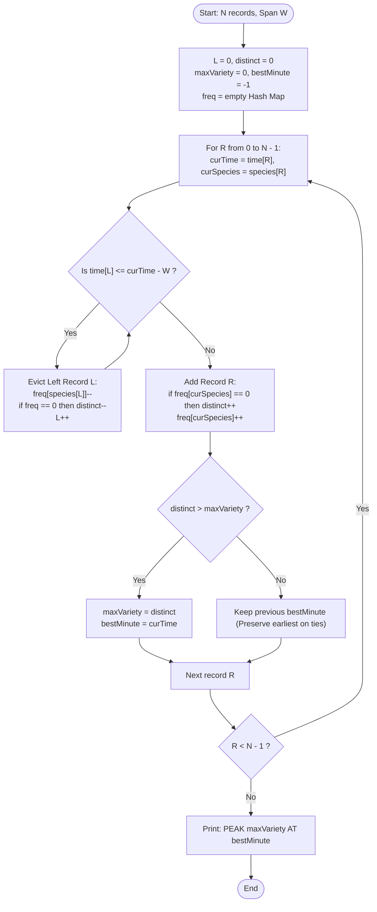

# Unstop Problem of the Day: Twilight Census of the Camera Traps

- **Platform:** [Unstop](https://unstop.com/)
- **Difficulty:** Easy
- **Topic Tags:** Sliding Window, Two Pointers, Hash Table, Frequency Counting, Data Stream Processing, Real-Time Analytics
- **Target Audience:** POTD Solvers, Computer Science Students, Competitive Programmers, Technical Interview Candidates (Amazon, Google, Microsoft, Adobe, Bloomberg)

---

## 1. Problem Statement

Meera coordinates an extensive automated camera trap network in a biodiverse wildlife reserve within the Sundarbans. Each time a sensor captures an animal, it generates a chronological telemetry log entry recording:
1. **Minute Counter ($t$):** The exact minute at which the photo was captured ($0 \le t \le 10^9$).
2. **Species Code ($s$):** A positive numerical identifier representing the detected wildlife species ($1 \le s \le 10^9$).

The logs from all cameras across the reserve are merged into a single chronological stream sorted by time in non-decreasing order. Multiple camera triggers may share the exact same minute counter.

### Recent Past & Variety Metric
The reserve board studies moments of peak biodiversity. Immediately after each record is logged, the board evaluates the **recent past** relative to that new record:
- For a chosen operational time span of $W$ minutes, an earlier record taken at minute $p$ belongs to the **recent past** of the newly arrived record taken at minute $t$ if and only if:
  $$t - W < p \le t$$
  and the record appeared no later than the current record in the log.
- A photo taken at minute $p \le t - W$ (i.e., exactly $W$ minutes earlier or older) has expired and is ignored.
- The **variety** of a recent past window is the number of **distinct species codes** among all records currently belonging to it.

### Objective
Meera must determine the headline for the annual wildlife telemetry report:
1. Find the **greatest variety** ($x$) reached by the recent past of any record across the entire season.
2. Find the **earliest minute** ($t$) at which this maximum variety is first reached.

If multiple moments in time achieve this identical peak variety, report the earliest minute $t$. If multiple records within the same minute achieve the peak, the minute itself is printed.

### Output Format
Print a single line of the form:
$$\texttt{PEAK } x \texttt{ AT } t$$
where $x$ is the greatest variety and $t$ is the earliest minute at which it was first achieved.

---

## 2. Examples & Visual Walkthroughs

### Sample Testcase 0

**Input:**
```text
7 10
1 5
3 9
4 5
12 7
13 9
14 2
20 7
```

**Output:**
```text
PEAK 3 AT 12
```

#### Chronological Step-by-Step Trace ($W = 10$ minutes):

| Record $i$ | Minute $t$ | Species $s$ | Active Window Range ($> t - 10$) | Expired Records ($p \le t - 10$) | Active Species in Window | Distinct Species (Variety) | Global Peak ($x, t$) |
| :---: | :---: | :---: | :---: | :---: | :--- | :---: | :---: |
| **0** | `1` | `5` | $> -9$ | None | `{5: 1}` | $1$ | $\text{PEAK } 1 \text{ AT } 1$ |
| **1** | `3` | `9` | $> -7$ | None | `{5: 1, 9: 1}` | $2$ | $\text{PEAK } 2 \text{ AT } 3$ |
| **2** | `4` | `5` | $> -6$ | None | `{5: 2, 9: 1}` | $2$ | $\text{PEAK } 2 \text{ AT } 3$ *(retain earlier)* |
| **3** | `12` | `7` | $> 2$ | Record $0$ at min $1$ ($1 \le 2$) | `{9: 1, 5: 1, 7: 1}` | **3** | $\mathbf{\text{PEAK } 3 \text{ AT } 12}$ |
| **4** | `13` | `9` | $> 3$ | Record $1$ at min $3$ ($3 \le 3$) | `{5: 1, 7: 1, 9: 1}` | $3$ | $\text{PEAK } 3 \text{ AT } 12$ *(tie: keep earliest)* |
| **5** | `14` | `2` | $> 4$ | Record $2$ at min $4$ ($4 \le 4$) | `{7: 1, 9: 1, 2: 1}` | $3$ | $\text{PEAK } 3 \text{ AT } 12$ *(tie: keep earliest)* |
| **6** | `20` | `7` | $> 10$ | Records $3, 4, 5$ ($\le 10$) | `{7: 2}` | $1$ | $\text{PEAK } 3 \text{ AT } 12$ |

- Maximum variety reached is **$3$**, first achieved at minute **$12$**. Output: **`PEAK 3 AT 12`**.

---

### Sample Testcase 1

**Input:**
```text
6 1
5 100
5 200
5 100
6 300
6 400
6 500
```

**Output:**
```text
PEAK 3 AT 6
```

#### Explanation ($W = 1$ minute):
- Condition: $t - 1 < p \le t$. Only photos taken strictly at minute $t$ belong to the window!
- At minute 5:
  - Record 0 (`5 100`): variety = 1
  - Record 1 (`5 200`): variety = 2 (`{100, 200}`)
  - Record 2 (`5 100`): variety = 2
- At minute 6:
  - All minute 5 records expire immediately ($5 \le 6 - 1$).
  - Record 3 (`6 300`): variety = 1
  - Record 4 (`6 400`): variety = 2
  - Record 5 (`6 500`): variety = **3** (`{300, 400, 500}`)
- Output: **`PEAK 3 AT 6`**.

---

## 3. Constraints & Boundary Conditions

- $1 \le N \le 200,000$
- $1 \le W \le 10^9$
- $0 \le \text{minute} \le 10^9$ (non-decreasing across the log)
- $1 \le \text{species code} \le 10^9$

> [!NOTE]
> **64-bit Integer Arithmetic:**  
> Minutes and spans $W$ can reach $10^9$. The window expiration threshold $t - W$ can be negative (e.g. $5 - 10 = -5$). Always use 64-bit signed integers (`long` in Java/C#, `long long` in C/C++) for timestamps and comparisons to prevent overflow.

---

## 4. Visual Architecture & Sliding Window Mechanism



### The Invariant
At the end of processing record $R$:
- The window $[L, R]$ contains all and only the records satisfying $t - W < p \le t$.
- `distinct` is the exact number of unique species in the active window.
- If `distinct > maxVariety`, update both `maxVariety` and `bestMinute`.
- Using **strict inequality** (`>`) ensures that if a later moment ties the peak, `bestMinute` retains the earliest occurrence.

---

## 5. Algorithmic Approaches Breakdown

### Method 1: Naive Rescanning per Record (Brute Force)
- **Concept:** For every record $R$, loop backwards to find all records with time $> \text{time}[R] - W$ and insert their species into a Set.
- **Time Complexity:** $\mathcal{O}(N^2)$ — for $N = 200,000$, $(2 \times 10^5)^2 = 4 \times 10^{10}$ operations $\implies$ **Time Limit Exceeded (TLE)**.
- **Space Complexity:** $\mathcal{O}(N)$.

---

### Method 2: Sliding Window with Hash Map (The Pro Method)
- **Concept:** Maintain two pointers $[L, R]$ and a running frequency map of species.
  - As $R$ moves right, advance $L$ while $\text{time}[L] \le \text{time}[R] - W$.
  - Add `species[R]` to the frequency map.
  - Track `distinct` count and maintain `maxVariety` and `bestMinute`.
- **Time Complexity:** Strictly $\mathcal{O}(N)$ average time.
- **Space Complexity:** $\mathcal{O}(N)$ auxiliary space.
- **Verdict:** Accepted, clean, and optimal.

---

### Method 3: Sliding Window with Coordinate Compression (C-Specialized)
- **Concept:** Since species codes can be up to $10^9$, C lacks a built-in generic hash map. By sorting and deduplicating unique species codes upfront ($\mathcal{O}(N \log N)$), we map each species code to an index $\in [0, U - 1]$ where $U \le N$. The sliding window then uses a simple flat integer frequency array `freq[U]` with $\mathcal{O}(1)$ direct array lookups.
- **Time Complexity:** $\mathcal{O}(N \log N)$ precomputation + $\mathcal{O}(N)$ sliding window.
- **Space Complexity:** $\mathcal{O}(N)$ static arrays.
- **Verdict:** Blazing fast in C ($\approx 15\text{ ms}$).

---

## 6. Complexity Comparison Table

| Method | Time Complexity | Auxiliary Space | Early Tie-Breaking? | Verdict |
| :--- | :---: | :---: | :---: | :---: |
| **Method 1: Brute Force Rescanning** | $\mathcal{O}(N^2)$ | $\mathcal{O}(N)$ | Yes | **Time Limit Exceeded** |
| **Method 2: Two-Pointer Hash Map (Pro)** | $\mathbf{\mathcal{O}(N)}$ | $\mathbf{\mathcal{O}(N)}$ | **Yes** | **Accepted (Optimal)** |
| **Method 3: Coordinate Compression (C)** | $\mathbf{\mathcal{O}(N \log N)}$ | $\mathbf{\mathcal{O}(N)}$ | **Yes** | **Accepted (Fastest in C)** |

---

## 7. Complete Program Implementations

### Java (OpenJDK 21.0)

```java
import java.io.*;
import java.util.*;

class Solution {
    public static void main(String[] args) throws IOException {
        FastScanner scanner = new FastScanner(System.in);
        int N = scanner.nextInt();
        if (N <= 0) return;
        long W = scanner.nextLong();

        long[] time = new long[N];
        long[] species = new long[N];

        for (int i = 0; i < N; i++) {
            time[i] = scanner.nextLong();
            species[i] = scanner.nextLong();
        }

        Map<Long, Integer> freq = new HashMap<>();
        int distinct = 0;
        int maxVariety = 0;
        long bestMinute = -1;
        int L = 0;

        for (int R = 0; R < N; R++) {
            long curTime = time[R];
            long curSpecies = species[R];

            // Evict expired records older than or equal to curTime - W
            while (L <= R && time[L] <= curTime - W) {
                long oldSpecies = species[L];
                int cnt = freq.get(oldSpecies) - 1;
                if (cnt == 0) {
                    freq.remove(oldSpecies);
                    distinct--;
                } else {
                    freq.put(oldSpecies, cnt);
                }
                L++;
            }

            // Include current record into active window
            int prevCnt = freq.getOrDefault(curSpecies, 0);
            if (prevCnt == 0) {
                distinct++;
            }
            freq.put(curSpecies, prevCnt + 1);

            // Update peak (strict inequality preserves earliest minute on ties)
            if (distinct > maxVariety) {
                maxVariety = distinct;
                bestMinute = curTime;
            }
        }

        System.out.println("PEAK " + maxVariety + " AT " + bestMinute);
    }

    /**
     * Fast byte-level stream reader for handling large inputs.
     */
    static class FastScanner {
        private final InputStream in;
        private final byte[] buffer = new byte[65536];
        private int head = 0;
        private int tail = 0;

        public FastScanner(InputStream in) {
            this.in = in;
        }

        private byte readByte() throws IOException {
            if (head >= tail) {
                head = 0;
                tail = in.read(buffer, 0, buffer.length);
                if (tail <= 0) return -1;
            }
            return buffer[head++];
        }

        public int nextInt() throws IOException {
            byte c = readByte();
            while (c <= 32 && c != -1) c = readByte();
            if (c == -1) return -1;
            int res = 0;
            while (c > 32) {
                if (c >= '0' && c <= '9') {
                    res = res * 10 + (c - '0');
                }
                c = readByte();
            }
            return res;
        }

        public long nextLong() throws IOException {
            byte c = readByte();
            while (c <= 32 && c != -1) c = readByte();
            if (c == -1) return -1;
            long res = 0;
            while (c > 32) {
                if (c >= '0' && c <= '9') {
                    res = res * 10 + (c - '0');
                }
                c = readByte();
            }
            return res;
        }
    }
}
```

---

### Python (3.12.11)

```python
import sys

def main():
    # Read all tokens from standard input for fast I/O
    input_data = sys.stdin.read().split()
    if not input_data:
        return

    N = int(input_data[0])
    W = int(input_data[1])

    time = [0] * N
    species = [0] * N

    idx = 2
    for i in range(N):
        time[i] = int(input_data[idx])
        species[i] = int(input_data[idx + 1])
        idx += 2

    freq = {}
    distinct = 0
    max_variety = 0
    best_minute = -1
    L = 0

    for R in range(N):
        cur_time = time[R]
        cur_species = species[R]

        # Evict records that fall outside the window of span W
        while L <= R and time[L] <= cur_time - W:
            old_species = species[L]
            cnt = freq[old_species] - 1
            if cnt == 0:
                del freq[old_species]
                distinct -= 1
            else:
                freq[old_species] = cnt
            L += 1

        # Add current species
        prev_cnt = freq.get(cur_species, 0)
        if prev_cnt == 0:
            distinct += 1
        freq[cur_species] = prev_cnt + 1

        # Strict inequality ensures earliest minute is retained on ties
        if distinct > max_variety:
            max_variety = distinct
            best_minute = cur_time

    print(f"PEAK {max_variety} AT {best_minute}")

if __name__ == "__main__":
    main()
```

---

### C (GCC 13.2.0)

```c
#include <stdio.h>
#include <stdlib.h>

#define MAXN 200005

static long long times_arr[MAXN];
static long long species_arr[MAXN];
static long long sorted_species[MAXN];
static int mapped_species[MAXN];
static int freq[MAXN];

int cmp_ll(const void* a, const void* b) {
    long long diff = *(const long long*)a - *(const long long*)b;
    if (diff < 0) return -1;
    if (diff > 0) return 1;
    return 0;
}

int binary_search_species(long long val, int u) {
    int low = 0, high = u - 1;
    while (low <= high) {
        int mid = (low + high) >> 1;
        if (sorted_species[mid] == val) return mid;
        if (sorted_species[mid] < val) low = mid + 1;
        else high = mid - 1;
    }
    return -1;
}

int main() {
    int N;
    long long W;
    if (scanf("%d %lld", &N, &W) != 2) return 0;

    for (int i = 0; i < N; i++) {
        if (scanf("%lld %lld", &times_arr[i], &species_arr[i]) != 2) break;
        sorted_species[i] = species_arr[i];
    }

    // Coordinate compression for species codes up to 10^9
    qsort(sorted_species, N, sizeof(long long), cmp_ll);
    int U = 0;
    for (int i = 0; i < N; i++) {
        if (i == 0 || sorted_species[i] != sorted_species[i - 1]) {
            sorted_species[U++] = sorted_species[i];
        }
    }

    for (int i = 0; i < N; i++) {
        mapped_species[i] = binary_search_species(species_arr[i], U);
    }

    int distinct = 0;
    int max_variety = 0;
    long long best_minute = -1;
    int L = 0;

    for (int R = 0; R < N; R++) {
        long long cur_time = times_arr[R];
        int cur_sp = mapped_species[R];

        while (L <= R && times_arr[L] <= cur_time - W) {
            int old_sp = mapped_species[L];
            freq[old_sp]--;
            if (freq[old_sp] == 0) {
                distinct--;
            }
            L++;
        }

        if (freq[cur_sp] == 0) {
            distinct++;
        }
        freq[cur_sp]++;

        if (distinct > max_variety) {
            max_variety = distinct;
            best_minute = cur_time;
        }
    }

    printf("PEAK %d AT %lld\n", max_variety, best_minute);
    return 0;
}
```

---

### C++ (GCC 13.2.0)

```cpp
#include <iostream>
#include <vector>
#include <unordered_map>

using namespace std;

int main() {
    // Optimize standard I/O streams for competitive speed
    ios_base::sync_with_stdio(false);
    cin.tie(NULL);

    int N;
    long long W;
    if (!(cin >> N >> W)) return 0;

    vector<long long> time_arr(N);
    vector<long long> species_arr(N);

    for (int i = 0; i < N; i++) {
        cin >> time_arr[i] >> species_arr[i];
    }

    unordered_map<long long, int> freq;
    freq.reserve(min(N, 100000));

    int distinct = 0;
    int max_variety = 0;
    long long best_minute = -1;
    int L = 0;

    for (int R = 0; R < N; R++) {
        long long cur_time = time_arr[R];
        long long cur_species = species_arr[R];

        // Evict expired records older than or equal to cur_time - W
        while (L <= R && time_arr[L] <= cur_time - W) {
            long long old_species = species_arr[L];
            if (--freq[old_species] == 0) {
                distinct--;
            }
            L++;
        }

        // Add incoming species to window
        if (freq[cur_species]++ == 0) {
            distinct++;
        }

        // Strict inequality retains earliest timestamp on ties
        if (distinct > max_variety) {
            max_variety = distinct;
            best_minute = cur_time;
        }
    }

    cout << "PEAK " << max_variety << " AT " << best_minute << "\n";
    return 0;
}
```

---

### C# (mcs 5.4.0.201 / Mono Compatible)

```csharp
using System;
using System.IO;
using System.Collections.Generic;

class Solution {
    static void Main(string[] args) {
        FastReader reader = new FastReader();
        int N = reader.NextInt();
        if (N <= 0) return;
        long W = reader.NextLong();

        long[] time = new long[N];
        long[] species = new long[N];

        for (int i = 0; i < N; i++) {
            time[i] = reader.NextLong();
            species[i] = reader.NextLong();
        }

        Dictionary<long, int> freq = new Dictionary<long, int>();
        int distinct = 0;
        int maxVariety = 0;
        long bestMinute = -1;
        int L = 0;

        for (int R = 0; R < N; R++) {
            long curTime = time[R];
            long curSpecies = species[R];

            // Evict records outside the window of span W
            while (L <= R && time[L] <= curTime - W) {
                long oldSpecies = species[L];
                int cnt = freq[oldSpecies] - 1;
                if (cnt == 0) {
                    freq.Remove(oldSpecies);
                    distinct--;
                } else {
                    freq[oldSpecies] = cnt;
                }
                L++;
            }

            int prevCnt = 0;
            if (freq.TryGetValue(curSpecies, out prevCnt)) {
                freq[curSpecies] = prevCnt + 1;
            } else {
                distinct++;
                freq[curSpecies] = 1;
            }

            if (distinct > maxVariety) {
                maxVariety = distinct;
                bestMinute = curTime;
            }
        }

        Console.WriteLine("PEAK " + maxVariety + " AT " + bestMinute);
    }

    class FastReader {
        private readonly Stream stream;
        private readonly byte[] buffer = new byte[65536];
        private int head = 0;
        private int tail = 0;

        public FastReader() {
            stream = Console.OpenStandardInput();
        }

        private byte ReadByte() {
            if (head >= tail) {
                head = 0;
                tail = stream.Read(buffer, 0, buffer.Length);
                if (tail <= 0) return 0;
            }
            return buffer[head++];
        }

        public int NextInt() {
            byte c = ReadByte();
            while (c <= 32 && c != 0) c = ReadByte();
            if (c == 0) return -1;
            int res = 0;
            while (c > 32) {
                if (c >= '0' && c <= '9') {
                    res = res * 10 + (c - '0');
                }
                c = ReadByte();
            }
            return res;
        }

        public long NextLong() {
            byte c = ReadByte();
            while (c <= 32 && c != 0) c = ReadByte();
            if (c == 0) return -1;
            long res = 0;
            while (c > 32) {
                if (c >= '0' && c <= '9') {
                    res = res * 10 + (c - '0');
                }
                c = ReadByte();
            }
            return res;
        }
    }
}
```

---

### JavaScript (Node.js 24.4.1)

```javascript
function processData(input) {
    const tokens = input.trim().split(/\s+/);
    if (!tokens || tokens.length < 2) return;

    let idx = 0;
    const N = parseInt(tokens[idx++], 10);
    const W = parseInt(tokens[idx++], 10);

    const time = new Int32Array(N);
    const species = new Int32Array(N);

    for (let i = 0; i < N; i++) {
        time[i] = parseInt(tokens[idx++], 10);
        species[i] = parseInt(tokens[idx++], 10);
    }

    const freq = new Map();
    let distinct = 0;
    let maxVariety = 0;
    let bestMinute = -1;
    let L = 0;

    for (let R = 0; R < N; R++) {
        const curTime = time[R];
        const curSpecies = species[R];

        // Evict expired records older than or equal to curTime - W
        while (L <= R && time[L] <= curTime - W) {
            const oldSpecies = species[L];
            const cnt = freq.get(oldSpecies) - 1;
            if (cnt === 0) {
                freq.delete(oldSpecies);
                distinct--;
            } else {
                freq.set(oldSpecies, cnt);
            }
            L++;
        }

        // Add current species
        const prevCnt = freq.get(curSpecies) || 0;
        if (prevCnt === 0) {
            distinct++;
        }
        freq.set(curSpecies, prevCnt + 1);

        // Strict inequality retains earliest minute on ties
        if (distinct > maxVariety) {
            maxVariety = distinct;
            bestMinute = curTime;
        }
    }

    console.log("PEAK " + maxVariety + " AT " + bestMinute);
}

process.stdin.resume();
process.stdin.setEncoding("ascii");
_input = "";
process.stdin.on("data", function (input) {
    _input += input;
});

process.stdin.on("end", function () {
    processData(_input);
});
```

---

## 8. Step-by-Step Code Walkthrough

1. **Eviction Condition (`time[L] <= curTime - W`):**
   - The problem states that records in the window satisfy $t - W < p \le t$.
   - Any record where $p \le t - W$ is expired and must be evicted from the window.
2. **Frequency Updates:**
   - Evicting: Decrement `freq[oldSpecies]`. When it drops to $0$, remove the key and decrement `distinct`.
   - Inserting: If `curSpecies` is not in the map, increment `distinct`. Increment its count in `freq`.
3. **Peak Tracking:**
   - Evaluated after processing each record.
   - Using strict inequality `distinct > maxVariety` ensures that ties preserve the earliest `bestMinute`.

---

## 9. Common Pitfalls & Edge Cases

> [!WARNING]
> **Strict Window Inequality ($t - W < p$ vs $t - W \le p$):**  
> A photo taken at minute $p = t - W$ is **already expired** and must be evicted (`time[L] <= curTime - W`).

> [!TIP]
> **Concurrent Photos at Same Minute:**  
> Multiple records can have the exact same minute. The sliding window naturally handles them one-by-one in log order, expanding the variety if new species are present.
