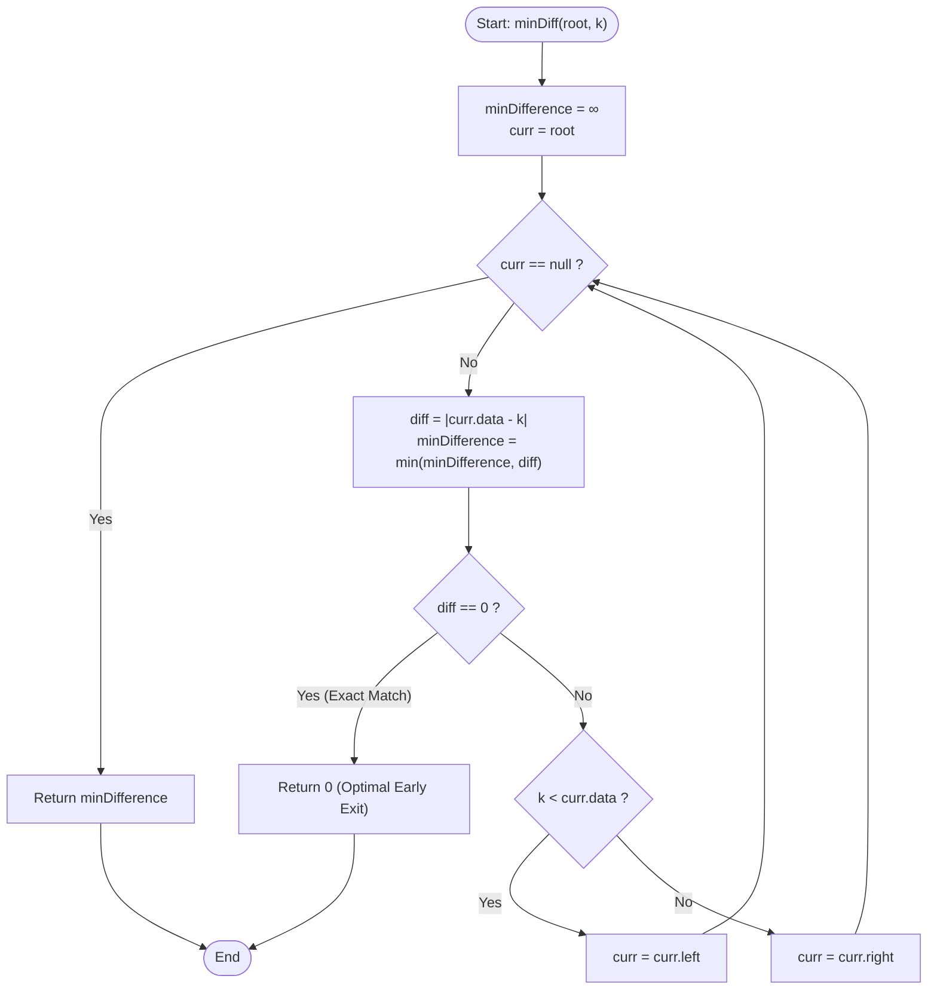

# GeeksforGeeks Problem of the Day: Closest in BST

- **Problem Link:** [GeeksforGeeks - Closest in BST](https://www.geeksforgeeks.org/problems/find-the-closest-element-in-bst/1)
- **Difficulty:** Medium
- **Topic Tags:** Binary Search Tree, Tree, Binary Search, Divide and Conquer, Algorithms
- **Target Audience:** POTD Solvers, Computer Science Students, Competitive Programmers, Technical Interview Candidates (Amazon, Microsoft, Google, Samsung, Adobe)

---

## 1. Problem Statement

Given the `root` of a **Binary Search Tree (BST)** and an integer `k`, your task is to find the **minimum absolute difference** between `k` and the value of any node in the BST.

Mathematically, find:
$$\min_{u \in \text{BST}} |u.\text{data} - k|$$

A Binary Search Tree is a binary tree where for every node:
1. All values in the node's **left subtree** are strictly less than the node's value: $\forall v \in \text{left}(u), v.\text{data} < u.\text{data}$.
2. All values in the node's **right subtree** are strictly greater than the node's value: $\forall v \in \text{right}(u), v.\text{data} > u.\text{data}$.
3. Both left and right subtrees must also be binary search trees.

Return the integer representing the smallest absolute difference found in the tree.

---

## 2. Examples & Visual Walkthroughs

### Example 1

#### Input Tree:
```text
          10
        /    \
       2      11
     /   \ 
    1     5
        /   \
       3     6
        \
         4
```
- **Target:** `k = 13`
- **Output:** `2`

#### Traversal Trace:
1. Start at `root = 10`:
   - Difference: $|10 - 13| = 3$. Minimum difference so far = $3$.
   - Since $13 > 10$, all nodes in left subtree have values $< 10$, which are further away from $13$.
   - Move **Right** to node `11`.
2. At node `11`:
   - Difference: $|11 - 13| = 2$. Minimum difference so far = $\min(3, 2) = 2$.
   - Since $13 > 11$, move **Right**.
3. Node `11` has no right child (`right == null`). Traversal terminates.
4. **Final Result:** $\mathbf{2}$ (achieved at node `11`).

---

### Example 2

#### Input Tree:
```text
          8
        /   \
       1     9
        \     \
         4     10
        /
       3
```
- **Target:** `k = 9`
- **Output:** `0`

#### Traversal Trace:
1. Start at `root = 8`:
   - Difference: $|8 - 9| = 1$. Minimum difference so far = $1$.
   - Since $9 > 8$, move **Right** to node `9`.
2. At node `9`:
   - Difference: $|9 - 9| = 0$.
   - Since difference is $0$, no smaller absolute difference can ever exist.
   - **Early Return:** Immediately return $\mathbf{0}$.

---

### Example 3 (Target Smaller Than All Elements)

#### Input Tree:
```text
        20
       /  \
     10    30
```
- **Target:** `k = 4`
- **Output:** `6` (achieved at node `10`, since $|10 - 4| = 6$).
- **Path Taken:** $20 \to 10 \to \text{null}$.

---

### Example 4 (Target Larger Than All Elements)

#### Input Tree:
```text
        20
       /  \
     10    30
```
- **Target:** `k = 45`
- **Output:** `15` (achieved at node `30`, since $|30 - 45| = 15$).
- **Path Taken:** $20 \to 30 \to \text{null}$.

---

## 3. Constraints

- $1 \le \text{Number of Nodes } N \le 10^5$
- $1 \le \text{node.data} \le 10^5$
- $1 \le k \le 10^5$
- **Expected Time Complexity:** $\mathcal{O}(h)$, where $h$ is the height of the BST ($\mathcal{O}(\log N)$ for balanced BST, $\mathcal{O}(N)$ for skewed tree).
- **Expected Auxiliary Space:** $\mathcal{O}(1)$ iterative approach, or $\mathcal{O}(h)$ recursive call stack.

---

## 4. Visual Architecture & Search Invariant

### The Subtree Elimination Invariant

Why can we discard an entire subtree at each step without missing a potentially closer node?

```text
                     Current Node (u)
                       [u.data = 10]
                      /             \
            Left Subtree             Right Subtree
          (All values < 10)        (All values > 10)
```

Suppose target $k = 13$ ($k > u.\text{data}$):
- For any node $v$ in the **left subtree**:
  $$v.\text{data} < u.\text{data} < k \implies k - v.\text{data} > k - u.\text{data}$$
  Therefore:
  $$|v.\text{data} - k| > |u.\text{data} - k|$$
- Every single node in the left subtree is strictly farther from $k$ than $u$ itself!
- Thus, searching the left subtree is completely redundant and guaranteed to yield no improvement over $u$.
- **Conclusion:** We only ever need to follow a **single downward path** of length at most $h$ (the tree height).

---

### Algorithmic Flowchart



---

## 5. Algorithmic Approaches Breakdown

### Method 1: Naive Full Tree Traversal (Brute Force DFS/BFS)
- **Concept:** Disregard the BST ordering property and visit every node in the tree using preorder, inorder, or level-order traversal. Compute $|node.\text{data} - k|$ for every node and record the minimum.
- **Pseudo-Code:**
  ```text
  function minDiffNaive(root, k):
      minDiff = ∞
      queue = [root]
      while queue is not empty:
          curr = queue.pop()
          minDiff = min(minDiff, abs(curr.data - k))
          if curr.left: queue.push(curr.left)
          if curr.right: queue.push(curr.right)
      return minDiff
  ```
- **Time Complexity:** $\mathcal{O}(N)$ — visits all $N$ nodes even in a perfectly balanced tree.
- **Space Complexity:** $\mathcal{O}(N)$ auxiliary space for queue/recursion.
- **Verdict:** Inefficient for large trees ($N = 10^5$), fails to leverage the $\mathcal{O}(h)$ BST search capability.

---

### Method 2: Recursive BST Traversal
- **Concept:** Leverage the BST property recursively. Update `minDiff` with current node's difference, and recurse into `curr.left` if $k < curr.\text{data}$, or `curr.right` if $k > curr.\text{data}$.
- **Pseudo-Code:**
  ```text
  function helper(node, k, minDiff):
      if node is null:
          return minDiff
      minDiff = min(minDiff, abs(node.data - k))
      if node.data == k:
          return 0
      if k < node.data:
          return helper(node.left, k, minDiff)
      else:
          return helper(node.right, k, minDiff)
  ```
- **Time Complexity:** $\mathcal{O}(h)$ — at most $h$ recursive calls.
- **Space Complexity:** $\mathcal{O}(h)$ auxiliary space due to runtime call stack frames. For deep skewed trees, this risks stack overflow.

---

### Method 3: Iterative BST Traversal (The Pro Method)
- **Concept:**
  1. Initialize `minDiff = INT_MAX` and pointer `curr = root`.
  2. While `curr != null`:
     - Calculate $\text{diff} = |curr.\text{data} - k|$.
     - Update $\text{minDiff} = \min(\text{minDiff}, \text{diff})$.
     - If $\text{diff} == 0$, return $0$ immediately (early exit).
     - If $k < curr.\text{data}$, move to `curr.left`.
     - Else, move to `curr.right`.
  3. Return `minDiff`.
- **Time Complexity:** $\mathcal{O}(h)$ where $h$ is tree height. Balanced BST: $\mathcal{O}(\log N)$, Skewed BST: $\mathcal{O}(N)$.
- **Space Complexity:** $\mathbf{\mathcal{O}(1)}$ — strictly constant memory with no call stack or heap allocations.
- **Verdict:** Optimal runtime and optimal memory.

---

## 6. Complexity Comparison Table

| Feature | Method 1: Naive Full Tree Traversal | Method 2: Recursive BST Traversal | Method 3: Iterative BST Traversal (Pro) |
| :--- | :---: | :---: | :---: |
| **Time Complexity (Balanced BST)** | $\mathcal{O}(N)$ | $\mathcal{O}(\log N)$ | $\mathbf{\mathcal{O}(\log N)}$ |
| **Time Complexity (Skewed BST)** | $\mathcal{O}(N)$ | $\mathcal{O}(N)$ | $\mathbf{\mathcal{O}(N)}$ |
| **Auxiliary Space** | $\mathcal{O}(N)$ | $\mathcal{O}(h)$ (Call Stack) | $\mathbf{\mathcal{O}(1)}$ (Constant) |
| **Risk of Stack Overflow?** | Yes (on deep trees) | Yes (on skewed trees) | **Zero (Iterative)** |
| **Early Exit on Exact Match?** | No | Yes | **Yes** |
| **Production Ready?** | No | Acceptable | **Optimal** |

---

## 7. Step-by-Step Simulation Table

Let's simulate the Pro Iterative approach on the tree from **Example 1** with target $k = 13$:
- **Tree Nodes:** $10, 2, 11, 1, 5, 3, 6, 4$
- **Target:** $k = 13$

| Step | Current Node `curr` | `curr.data` | Target $k$ | $\text{diff} = |\text{data} - k|$ | `minDifference` Updated | Comparison ($k$ vs `data`) | Next Move |
| :---: | :---: | :---: | :---: | :---: | :---: | :---: | :---: |
| **1** | Root | `10` | `13` | $|10 - 13| = 3$ | $\min(\infty, 3) = \mathbf{3}$ | $13 > 10$ | Move to `curr.right` |
| **2** | Right Child | `11` | `13` | $|11 - 13| = 2$ | $\min(3, 2) = \mathbf{2}$ | $13 > 11$ | Move to `curr.right` |
| **3** | Null Child | `null` | `13` | — | Loop terminates | — | Exit loop |

- **Final Answer:** `minDifference = 2`.
- Total nodes inspected: **only 2 nodes** out of 8 total nodes!

---

## 8. Complete Multi-Language Implementations

### Java (21)

```java
/* Structure of a Binary Search Tree node
class Node {
    int data;
    Node left, right;

    public Node(int val) {
        data = val;
        left = right = null;
    }
}
*/

class Solution {
    /**
     * Finds the minimum absolute difference between any node's value and k in a BST.
     * Uses iterative traversal to achieve O(1) auxiliary space and O(h) time.
     * 
     * @param root The root node of the Binary Search Tree
     * @param k The target integer value
     * @return Minimum absolute difference found
     */
    public int minDiff(Node root, int k) {
        int minDifference = Integer.MAX_VALUE;
        Node curr = root;

        while (curr != null) {
            int currentDiff = Math.abs(curr.data - k);
            
            // Update the closest difference seen so far
            if (currentDiff < minDifference) {
                minDifference = currentDiff;
            }

            // Early exit: 0 is the theoretical minimum absolute difference
            if (minDifference == 0) {
                return 0;
            }

            // BST Navigation:
            // If target k is less than current node's data,
            // any node closer to k must reside in the left subtree.
            if (k < curr.data) {
                curr = curr.left;
            } else {
                curr = curr.right;
            }
        }

        return minDifference;
    }
}
```

---

### Python3

```python
'''
Structure of a Binary Search Tree node
class Node:
    def __init__(self, val):
        self.data = val
        self.right = self.left = None
'''

class Solution:
    def minDiff(self, root: 'Node', k: int) -> int:
        """
        Finds the minimum absolute difference between any node in the BST and target k.
        
        Time Complexity: O(h) where h is the height of the BST
        Auxiliary Space: O(1)
        """
        min_difference = float('inf')
        curr = root

        while curr is not None:
            current_diff = abs(curr.data - k)

            # Update the minimum difference found so far
            if current_diff < min_difference:
                min_difference = current_diff

            # Early exit: distance cannot be less than 0
            if min_difference == 0:
                return 0

            # Navigate according to BST ordering property
            if k < curr.data:
                curr = curr.left
            else:
                curr = curr.right

        return int(min_difference)
```

---

### C++ (17)

```cpp
/* Structure of a Binary Search Tree node
class Node {
  public:
    int data;
    Node* left;
    Node* right;

    Node(int val) {
        data = val;
        left = right = nullptr;
    }
};
*/

#include <climits>
#include <cmath>
#include <algorithm>

class Solution {
  public:
    /**
     * Finds the minimum absolute difference between any node's value and k in a BST.
     * Iterative descent ensures O(h) time complexity with zero dynamic heap or stack overhead.
     * 
     * @param root Pointer to root of BST
     * @param k Target integer
     * @return Minimum absolute difference
     */
    int minDiff(Node *root, int k) {
        int min_difference = INT_MAX;
        Node *curr = root;

        while (curr != nullptr) {
            int current_diff = std::abs(curr->data - k);

            // Update the closest difference encountered
            if (current_diff < min_difference) {
                min_difference = current_diff;
            }

            // Optimal early exit: absolute difference cannot be negative
            if (min_difference == 0) {
                return 0;
            }

            // BST navigation: prune opposite subtree
            if (k < curr->data) {
                curr = curr->left;
            } else {
                curr = curr->right;
            }
        }

        return min_difference;
    }
};
```

---

### C#

```csharp
/* Structure of a Binary Search Tree node
class Node {
    public int data;
    public Node left;
    public Node right;

    public Node(int val) {
        this.data = val;
        this.left = this.right = null;
    }
}
*/

using System;

class Solution {
    /// <summary>
    /// Finds the minimum absolute difference between any node's data and target k in a BST.
    /// Operates iteratively in O(h) time and O(1) auxiliary space.
    /// </summary>
    /// <param name="root">Root of the Binary Search Tree</param>
    /// <param name="k">Target value</param>
    /// <returns>Minimum absolute difference</returns>
    public int minDiff(Node root, int k) {
        int minDifference = int.MaxValue;
        Node curr = root;

        while (curr != null) {
            int currentDiff = Math.Abs(curr.data - k);

            if (currentDiff < minDifference) {
                minDifference = currentDiff;
            }

            // Early termination on exact match
            if (minDifference == 0) {
                return 0;
            }

            // Branch left or right according to BST rules
            if (k < curr.data) {
                curr = curr.left;
            } else {
                curr = curr.right;
            }
        }

        return minDifference;
    }
}
```

---

### Javascript (Node v22)

```javascript
/* Structure of a Binary Search Tree node
class Node {
    constructor(val) {
        this.data = val;
        this.left = null;
        this.right = null;
    }
}
*/

/**
 * @param {Node} root
 * @param {number} k
 * @return {number}
 */
class Solution {
    /**
     * Finds the minimum absolute difference between any node in the BST and target k.
     * Iterative traversal achieves O(h) time and O(1) auxiliary space.
     */
    minDiff(root, k) {
        let minDifference = Number.MAX_SAFE_INTEGER;
        let curr = root;

        while (curr !== null) {
            const currentDiff = Math.abs(curr.data - k);

            if (currentDiff < minDifference) {
                minDifference = currentDiff;
            }

            // Early termination on exact match
            if (minDifference === 0) {
                return 0;
            }

            // Traverse left or right based on BST invariant
            if (k < curr.data) {
                curr = curr.left;
            } else {
                curr = curr.right;
            }
        }

        return minDifference;
    }
}
```

---

## 9. Edge Cases & Verification

1. **Exact Key Exists in Tree:**
   - E.g., Tree contains node `9`, $k = 9$.
   - Difference $|9 - 9| = 0$. Early exit immediately stops further traversal, achieving $\mathcal{O}(1)$ to $\mathcal{O}(h)$ optimal exit.
2. **Target Smaller Than Minimum Element:**
   - E.g., Tree values are $[10, 20, 30]$, $k = 2$.
   - Traversal moves continually left: $20 \to 10 \to \text{null}$.
   - Minimum difference is recorded at the leftmost leaf (node `10`, diff = $8$). Correctly handled.
3. **Target Larger Than Maximum Element:**
   - E.g., Tree values are $[10, 20, 30]$, $k = 50$.
   - Traversal moves continually right: $20 \to 30 \to \text{null}$.
   - Minimum difference is recorded at the rightmost leaf (node `30`, diff = $20$). Correctly handled.
4. **Single-Node Tree:**
   - Traversal checks root, updates `minDifference = |root.data - k|`, moves to child (`null`), and exits with the exact difference.
5. **Skewed Tree (Worst-case Height $h = N$):**
   - The iterative loop simply acts like a single linked list traversal. Because it uses $\mathcal{O}(1)$ space, no recursion stack overflow can occur regardless of tree depth.

---

## 10. Summary & Takeaways

- **BST Advantage:** Instead of inspecting all $N$ elements, the binary search tree property allows cutting the candidate search space in half at each step, matching the performance of binary search on a sorted array.
- **Constant Memory Footprint:** The iterative approach removes the $\mathcal{O}(h)$ call stack penalty of recursive implementations, delivering $\mathcal{O}(1)$ auxiliary space.
- **Early Exit:** Checking `minDifference == 0` halts the traversal the instant an exact match is discovered.
