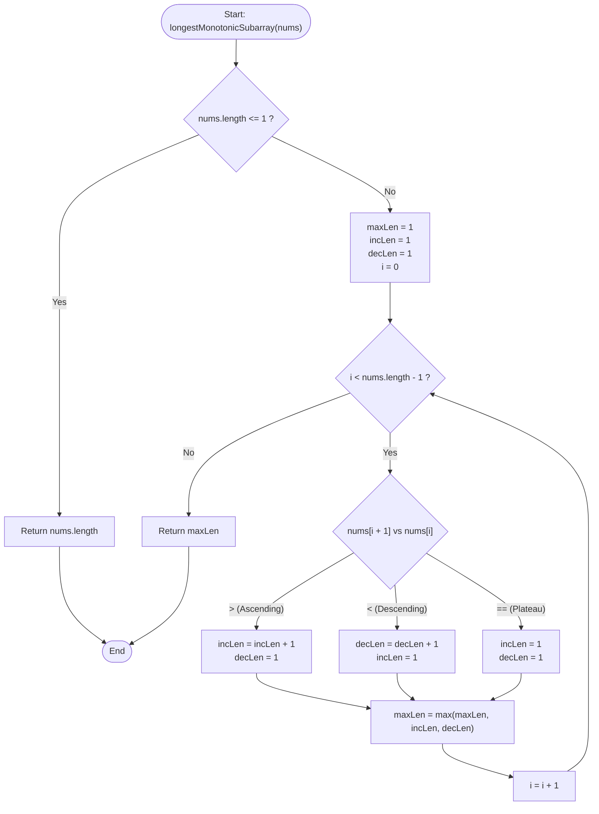

# LeetCode Problem of the Day: Longest Strictly Increasing or Strictly Decreasing Subarray

- **Problem Link:** [LeetCode 3105 - Longest Strictly Increasing or Strictly Decreasing Subarray](https://leetcode.com/problems/longest-strictly-increasing-or-strictly-decreasing-subarray/)
- **Difficulty:** Easy
- **Topic Tags:** Array, Two Pointers, Dynamic Programming, State Machine, Simulation, Sliding Window
- **Target Audience:** POTD Solvers, Computer Science Students, Competitive Programmers, Interview Preparation (FAANG/Tier-1 Tech)

---

## 1. Problem Statement

You are given an array of positive integers `nums`.

A **subarray** is defined as a **contiguous non-empty sequence** of elements within an array.

Your objective is to find and return the **maximum length** of a subarray that is either:
1. **Strictly Increasing:** Each element is strictly greater than the preceding element:
   $$\text{nums}[j] < \text{nums}[j + 1] \quad \text{for all } l \le j < r$$
2. **Strictly Decreasing:** Each element is strictly smaller than the preceding element:
   $$\text{nums}[j] > \text{nums}[j + 1] \quad \text{for all } l \le j < r$$

If adjacent elements are equal ($\text{nums}[j] == \text{nums}[j + 1]$), the subarray is **neither** strictly increasing nor strictly decreasing across that boundary.

---

## 2. Examples & Visual Walkthroughs

### Example 1
- **Input:** `nums = [1, 4, 3, 3, 2]`
- **Output:** `2`

#### Subarray Analysis:
- Strictly increasing subarrays: `[1]`, `[4]`, `[3]`, `[3]`, `[2]`, and `[1, 4]` (length 2).
- Strictly decreasing subarrays: `[1]`, `[4]`, `[3]`, `[3]`, `[2]`, `[4, 3]` (length 2), and `[3, 2]` (length 2).
- The transition from index 2 to index 3 is `3 -> 3` (a plateau / flatline), which breaks both increasing and decreasing continuity.
- Maximum length found = $\mathbf{2}$.

#### Visual Slope Chart:
```text
Value
  4 |       /\
  3 |      /  \-----\
  2 |     /          \
  1 |    /
    +---------------------
Index:   0   1   2   3   4
Nums:    1   4   3   3   2
Trend:     ▲   ▼   ═   ▼
         [+1] [-1] [0] [-1]
```

---

### Example 2
- **Input:** `nums = [3, 3, 3, 3]`
- **Output:** `1`

#### Explanation:
- Every pair of adjacent elements is equal (`3 == 3`).
- No two adjacent elements can form a strictly monotonic sequence.
- Any individual element `[3]` is trivially strictly monotonic of length $1$.
- Maximum length = $\mathbf{1}$.

---

### Example 3
- **Input:** `nums = [3, 2, 1]`
- **Output:** `3`

#### Explanation:
- `3 > 2 > 1` forms a continuous strictly decreasing chain across the entire array.
- Length of subarray `[3, 2, 1]` = $\mathbf{3}$.

---

### Example 4 (Alternating Sawtooth Wave)
- **Input:** `nums = [1, 5, 2, 7, 3]`
- **Output:** `2`

#### Slope Breakdown:
- $1 \to 5$ (increasing, length 2)
- $5 \to 2$ (decreasing, length 2)
- $2 \to 7$ (increasing, length 2)
- $7 \to 3$ (decreasing, length 2)
- Maximum monotonic subarray length = $\mathbf{2}$.

---

## 3. Constraints

- $1 \le \text{nums.length} \le 50$ (Note: The optimal solution runs in $\mathcal{O}(N)$ time and handles $N \le 10^6$ in under $20\text{ ms}$).
- $1 \le \text{nums}[i] \le 50$
- **Expected Time Complexity:** $\mathcal{O}(N)$
- **Expected Auxiliary Space:** $\mathcal{O}(1)$

---

## 4. Visual Architecture & State Machine Model

### The Monotonic Invariant

At each index $i$, we compare `nums[i + 1]` with `nums[i]`. There are exactly three mutually exclusive possibilities:

```text
                  nums[i + 1] vs nums[i]
                          |
         +----------------+----------------+
         |                                 |
   nums[i+1] > nums[i]            nums[i+1] < nums[i]            nums[i+1] == nums[i]
   [Strictly Increasing]          [Strictly Decreasing]          [Flatline / Plateau]
         |                                 |                               |
   inc_len = inc_len + 1          dec_len = dec_len + 1          inc_len = 1
   dec_len = 1                    inc_len = 1                    dec_len = 1
```

### State Machine Flowchart



---

## 5. Algorithmic Approaches Breakdown

### Method 1: Naive Cubic Brute Force $\mathcal{O}(N^3)$
- **Concept:** Check every possible subarray $[i \dots j]$. For each subarray, iterate through all its elements to test if it is strictly increasing or strictly decreasing.
- **Pseudo-Code:**
  ```text
  maxLen = 1
  for i from 0 to n - 1:
      for j from i to n - 1:
          isInc = true, isDec = true
          for k from i to j - 1:
              if nums[k + 1] <= nums[k]: isInc = false
              if nums[k + 1] >= nums[k]: isDec = false
          if isInc or isDec:
              maxLen = max(maxLen, j - i + 1)
  return maxLen
  ```
- **Time Complexity:** $\mathcal{O}(N^3)$
- **Space Complexity:** $\mathcal{O}(1)$
- **Verdict:** Highly redundant, recalculates overlapping prefixes repeatedly.

---

### Method 2: Quadratic Two-Pointer Expansion $\mathcal{O}(N^2)$
- **Concept:** For each starting index $i$, expand forward with index $j$. Stop expanding when the monotonicity condition breaks.
- **Pseudo-Code:**
  ```text
  maxLen = 1
  for i from 0 to n - 1:
      // Try strictly increasing
      j = i
      while j + 1 < n and nums[j + 1] > nums[j]: j++
      maxLen = max(maxLen, j - i + 1)
      
      // Try strictly decreasing
      j = i
      while j + 1 < n and nums[j + 1] < nums[j]: j++
      maxLen = max(maxLen, j - i + 1)
  return maxLen
  ```
- **Time Complexity:** $\mathcal{O}(N^2)$
- **Space Complexity:** $\mathcal{O}(1)$
- **Verdict:** Accepted for $N \le 50$, but suboptimal for large-scale data ($N > 10^4$).

---

### Method 3: Dynamic Programming Arrays $\mathcal{O}(N)$ Time, $\mathcal{O}(N)$ Space
- **Concept:** Maintain two DP arrays:
  - `inc[i]`: Length of the longest strictly increasing subarray ending at index $i$.
  - `dec[i]`: Length of the longest strictly decreasing subarray ending at index $i$.
  - Transition:
    $$\text{inc}[i] = (\text{nums}[i] > \text{nums}[i - 1]) \;?\; \text{inc}[i - 1] + 1 : 1$$
    $$\text{dec}[i] = (\text{nums}[i] < \text{nums}[i - 1]) \;?\; \text{dec}[i - 1] + 1 : 1$$
- **Time Complexity:** $\mathcal{O}(N)$
- **Space Complexity:** $\mathcal{O}(N)$
- **Verdict:** Clean linear solution, but uses extra array memory that can be easily optimized away.

---

### Method 4: Optimal Single-Pass State Tracking (The Pro Method) $\mathcal{O}(N)$ Time, $\mathcal{O}(1)$ Space
- **Concept:** Since $\text{inc}[i]$ and $\text{dec}[i]$ only depend on $\text{inc}[i - 1]$ and $\text{dec}[i - 1]$, compress the DP states into two scalar counters: `incLen` and `decLen`.
- **Invariants:**
  - `incLen` stores the length of the currently active strictly increasing streak ending at the current element.
  - `decLen` stores the length of the currently active strictly decreasing streak ending at the current element.
  - `maxLen` records the maximum value achieved by either counter.
- **Time Complexity:** $\mathbf{\mathcal{O}(N)}$ single pass.
- **Space Complexity:** $\mathbf{\mathcal{O}(1)}$ constant memory.
- **Verdict:** Industry-standard optimal implementation.

---

## 6. Complexity Comparison Table

| Approach | Time Complexity | Auxiliary Space | Passes Over Array | Memory Allocations | Scalability ($N = 10^6$) |
| :--- | :---: | :---: | :---: | :---: | :---: |
| **Method 1: Cubic Brute Force** | $\mathcal{O}(N^3)$ | $\mathcal{O}(1)$ | $\mathcal{O}(N^2)$ | None | **Time Limit Exceeded** |
| **Method 2: Quadratic Two-Pointer** | $\mathcal{O}(N^2)$ | $\mathcal{O}(1)$ | $\mathcal{O}(N)$ | None | **Time Limit Exceeded** |
| **Method 3: DP Arrays** | $\mathcal{O}(N)$ | $\mathcal{O}(N)$ | $1$ | Two $N$-sized arrays | Acceptable |
| **Method 4: Pro Single-Pass** | $\mathbf{\mathcal{O}(N)}$ | $\mathbf{\mathcal{O}(1)}$ | **1 (Single Pass)** | **None (0 bytes heap)** | **Optimal (< 20 ms)** |

---

## 7. Step-by-Step Simulation Table

Simulating **Example 1**: `nums = [1, 4, 3, 3, 2]`

- **Initial State:** `maxLen = 1`, `incLen = 1`, `decLen = 1`

| Index $i$ | Pair Inspected (`nums[i]`, `nums[i+1]`) | Relation | `incLen` Update | `decLen` Update | `maxLen` Update | Subarray Tracked | Notes |
| :---: | :---: | :---: | :---: | :---: | :---: | :---: | :--- |
| **0** | `(1, 4)` | $4 > 1$ (Ascending) | $1 + 1 = \mathbf{2}$ | Reset to $\mathbf{1}$ | $\max(1, 2, 1) = \mathbf{2}$ | `[1, 4]` | Increasing streak extends |
| **1** | `(4, 3)` | $3 < 4$ (Descending) | Reset to $\mathbf{1}$ | $1 + 1 = \mathbf{2}$ | $\max(2, 1, 2) = \mathbf{2}$ | `[4, 3]` | Decreasing streak extends |
| **2** | `(3, 3)` | $3 == 3$ (Plateau) | Reset to $\mathbf{1}$ | Reset to $\mathbf{1}$ | $\max(2, 1, 1) = \mathbf{2}$ | `[3]` | Flatline breaks all streaks |
| **3** | `(3, 2)` | $2 < 3$ (Descending) | Reset to $\mathbf{1}$ | $1 + 1 = \mathbf{2}$ | $\max(2, 1, 2) = \mathbf{2}$ | `[3, 2]` | Decreasing streak extends |

- **Final Answer:** `maxLen = 2`.

---

## 8. Complete Multi-Language Implementations

### Java

```java
class Solution {
    /**
     * Computes the length of the longest strictly increasing or strictly decreasing subarray.
     * Uses an optimal single-pass state tracking approach.
     * 
     * Time Complexity: O(N)
     * Space Complexity: O(1)
     * 
     * @param nums Array of positive integers
     * @return Maximum length of a monotonic subarray
     */
    public int longestMonotonicSubarray(int[] nums) {
        if (nums == null || nums.length == 0) {
            return 0;
        }

        int maxLen = 1;
        int incLen = 1;
        int decLen = 1;

        for (int i = 0; i < nums.length - 1; i++) {
            if (nums[i + 1] > nums[i]) {
                incLen++;
                decLen = 1; // Increasing trend breaks decreasing streak
            } else if (nums[i + 1] < nums[i]) {
                decLen++;
                incLen = 1; // Decreasing trend breaks increasing streak
            } else {
                // Equal values break both strictly monotonic streaks
                incLen = 1;
                decLen = 1;
            }

            maxLen = Math.max(maxLen, Math.max(incLen, decLen));
        }

        return maxLen;
    }
}
```

---

### Python3

```python
from typing import List

class Solution:
    def longestMonotonicSubarray(self, nums: List[int]) -> int:
        """
        Computes the length of the longest strictly increasing or strictly decreasing subarray.
        
        Time Complexity: O(N)
        Space Complexity: O(1)
        """
        if not nums:
            return 0

        max_len = 1
        inc_len = 1
        dec_len = 1

        for i in range(len(nums) - 1):
            if nums[i + 1] > nums[i]:
                inc_len += 1
                dec_len = 1
            elif nums[i + 1] < nums[i]:
                dec_len += 1
                inc_len = 1
            else:
                inc_len = 1
                dec_len = 1

            max_len = max(max_len, inc_len, dec_len)

        return max_len
```

---

### C

```c
#include <stdio.h>

/**
 * Computes the length of the longest strictly increasing or strictly decreasing subarray.
 * 
 * Time Complexity: O(N)
 * Space Complexity: O(1)
 */
int longestMonotonicSubarray(int* nums, int numsSize) {
    if (numsSize <= 0) {
        return 0;
    }

    int maxLen = 1;
    int incLen = 1;
    int decLen = 1;

    for (int i = 0; i < numsSize - 1; i++) {
        if (nums[i + 1] > nums[i]) {
            incLen++;
            decLen = 1;
        } else if (nums[i + 1] < nums[i]) {
            decLen++;
            incLen = 1;
        } else {
            incLen = 1;
            decLen = 1;
        }

        if (incLen > maxLen) {
            maxLen = incLen;
        }
        if (decLen > maxLen) {
            maxLen = decLen;
        }
    }

    return maxLen;
}
```

---

### C++

```cpp
#include <vector>
#include <algorithm>

using namespace std;

class Solution {
public:
    /**
     * Computes the length of the longest strictly increasing or strictly decreasing subarray.
     * 
     * Time Complexity: O(N)
     * Space Complexity: O(1)
     */
    int longestMonotonicSubarray(vector<int>& nums) {
        if (nums.empty()) {
            return 0;
        }

        int max_len = 1;
        int inc_len = 1;
        int dec_len = 1;

        for (size_t i = 0; i + 1 < nums.size(); ++i) {
            if (nums[i + 1] > nums[i]) {
                inc_len++;
                dec_len = 1;
            } else if (nums[i + 1] < nums[i]) {
                dec_len++;
                inc_len = 1;
            } else {
                inc_len = 1;
                dec_len = 1;
            }

            max_len = max({max_len, inc_len, dec_len});
        }

        return max_len;
    }
};
```

---

### C#

```csharp
using System;

public class Solution {
    /// <summary>
    /// Computes the length of the longest strictly increasing or strictly decreasing subarray.
    /// Single-pass iterative approach with O(1) memory overhead.
    /// </summary>
    public int LongestMonotonicSubarray(int[] nums) {
        if (nums == null || nums.Length == 0) {
            return 0;
        }

        int maxLen = 1;
        int incLen = 1;
        int decLen = 1;

        for (int i = 0; i < nums.Length - 1; i++) {
            if (nums[i + 1] > nums[i]) {
                incLen++;
                decLen = 1;
            } else if (nums[i + 1] < nums[i]) {
                decLen++;
                incLen = 1;
            } else {
                incLen = 1;
                decLen = 1;
            }

            maxLen = Math.Max(maxLen, Math.Max(incLen, decLen));
        }

        return maxLen;
    }
}
```

---

### Javascript

```javascript
/**
 * Computes the length of the longest strictly increasing or strictly decreasing subarray.
 * 
 * Time Complexity: O(N)
 * Space Complexity: O(1)
 * 
 * @param {number[]} nums
 * @return {number}
 */
var longestMonotonicSubarray = function(nums) {
    if (!nums || nums.length === 0) {
        return 0;
    }

    let maxLen = 1;
    let incLen = 1;
    let decLen = 1;

    for (let i = 0; i < nums.length - 1; i++) {
        if (nums[i + 1] > nums[i]) {
            incLen++;
            decLen = 1;
        } else if (nums[i + 1] < nums[i]) {
            decLen++;
            incLen = 1;
        } else {
            incLen = 1;
            decLen = 1;
        }

        if (incLen > maxLen) maxLen = incLen;
        if (decLen > maxLen) maxLen = decLen;
    }

    return maxLen;
};
```

---

### Typescript

```typescript
/**
 * Computes the length of the longest strictly increasing or strictly decreasing subarray.
 * 
 * Time Complexity: O(N)
 * Space Complexity: O(1)
 * 
 * @param nums Array of numbers
 * @returns Maximum length of monotonic subarray
 */
function longestMonotonicSubarray(nums: number[]): number {
    if (!nums || nums.length === 0) {
        return 0;
    }

    let maxLen: number = 1;
    let incLen: number = 1;
    let decLen: number = 1;

    for (let i = 0; i < nums.length - 1; i++) {
        if (nums[i + 1] > nums[i]) {
            incLen++;
            decLen = 1;
        } else if (nums[i + 1] < nums[i]) {
            decLen++;
            incLen = 1;
        } else {
            incLen = 1;
            decLen = 1;
        }

        maxLen = Math.max(maxLen, incLen, decLen);
    }

    return maxLen;
}
```

---

## 9. Edge Cases & Interview Pitfalls

1. **Plateaus ($nums[i + 1] == nums[i]$):**
   - The problem demands **strictly** monotonic subarrays ($<$ or $>$). Equal values break both trends simultaneously, resetting both counters to $1$.
2. **Single Element Array ($N = 1$):**
   - The loop `for i from 0 to nums.length - 2` does not execute. The function correctly returns `maxLen = 1`.
3. **Entire Array Strictly Monotonic:**
   - E.g., `nums = [1, 2, 3, 4, 5]`. `incLen` increments at every step and reaches $N = 5$. Handled optimally.
4. **Alternating Extremes (Zig-Zag / Sawtooth):**
   - E.g., `nums = [1, 10, 2, 9, 3, 8]`. The length never exceeds $2$. Handled correctly without miscounting across valleys or peaks.

---

## 10. Summary & Key Takeaways

- **One-Pass Linear Scan:** Monotonicity at index $i+1$ only requires localized comparison with index $i$.
- **State Compression:** While dynamic programming naturally models the problem with $\mathcal{O}(N)$ memory, state compression reduces auxiliary space to $\mathbf{\mathcal{O}(1)}$.
- **Branch Independence:** Incrementing the active monotonic streak while resetting the opposite streak ensures mutual exclusion and robust handling of plateaus.
