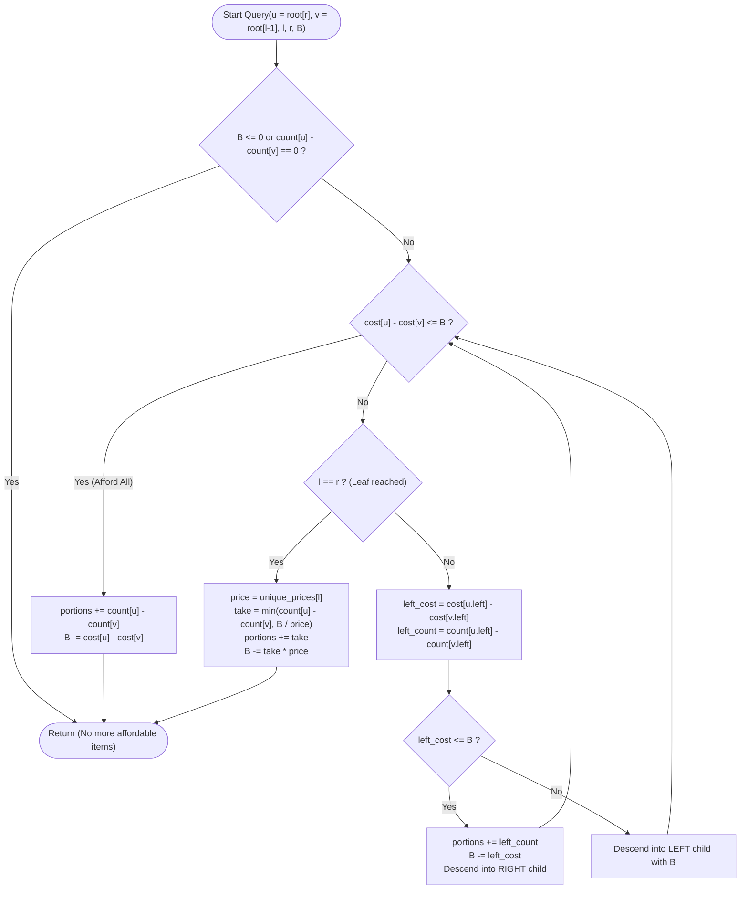

# Unstop Problem of the Day: Tasting Passes on the Lantern Promenade

- **Platform:** [Unstop](https://unstop.com/)
- **Difficulty:** Hard
- **Topic Tags:** Persistent Segment Tree (Chairman Tree), Coordinate Compression, Binary Lifting / Tree Walking, Range Queries, Greedy Algorithms, Prefix Sums
- **Target Audience:** POTD Solvers, Computer Science Students, Competitive Programmers, Interview Preparation (FAANG / Tier-1 Systems Engineering)

---

## 1. Problem Statement

Tara manages the food court of a winter lantern festival situated along a linear promenade. Along the promenade, $n$ food stalls stand in a row, numbered from $1$ to $n$ in sequential order.
- Each stall $i$ sells a unique signature dish at a fixed price of $p_i$ rupees per portion.
- Stall $i$ prepares a batch of $m_i$ portions for the evening.
- Prices repeat frequently across the festival because many stalls follow identical menu boards ($1 \le p_i \le 10^6$).

Before entering, visitors purchase a **tasting pass**. A pass is characterized by three parameters:
- A promenade stretch $[l, r]$ ($1 \le l \le r \le n$).
- A wallet spending limit of $B$ rupees ($1 \le B \le 10^{18}$).

### Visitor Behavior & Rules
1. Inside the assigned interval $[l, r]$, a visitor may purchase any number of portions from any stall, up to the total portions $m_i$ that stall has prepared.
2. The total expenditure must **never exceed** the wallet limit $B$.
3. **Curious Eater Objective:** Every visitor wants to taste the **maximum possible number of portions**.
4. **Tie-Breaker:** Among all combinations of portions that achieve this maximum count, the visitor strictly prefers the combination that **minimizes the money spent** (i.e., leaves the maximum amount of unspent rupees in the wallet).
5. **Independent Inquiries:** Stalls are never depleted between different passes; each inquiry is evaluated independently against the full stock of stalls.

For each pass, output two space-separated integers on a new line:
1. The **maximum number of portions** the visitor can taste.
2. The **remaining unspent rupees** in the wallet.

---

## 2. Input & Output Formats

### Input Format
- **Line 1:** Two space-separated integers, $n$ and $q$ — the number of stalls and the number of tasting passes.
- **Line 2:** $n$ space-separated integers $p_1, p_2, \dots, p_n$ — the portion prices for stalls $1$ through $n$.
- **Line 3:** $n$ space-separated integers $m_1, m_2, \dots, m_n$ — the prepared portion counts for stalls $1$ through $n$.
- **Next $q$ Lines:** Each line contains three space-separated integers $l$, $r$, and $B$ describing one tasting pass.

### Output Format
- Print $q$ lines. The $j$-th line must contain two integers separated by a single space:
  $$\text{portions\_tasted} \quad \text{rupees\_left}$$

---

## 3. Constraints

- $1 \le n, q \le 200\,000$
- $1 \le p_i \le 1\,000\,000$
- $1 \le m_i \le 1\,000\,000$
- $1 \le l \le r \le n$
- $1 \le B \le 1\,000\,000\,000\,000\,000\,000$ ($10^{18}$)
- **Time Limit:** $2.0 \text{ seconds}$
- **Memory Limit:** $512 \text{ MB}$

---

## 4. Examples & Explanations

### Example 1 (Sample Testcase 0)

#### Stalls Layout:
```text
Stall Index:     1    2    3    4    5
Price (p_i):     4    3    4    7    3
Portions (m_i):  2    1    3    1    2
```

**Input:**
```text
5 4
4 3 4 7 3
2 1 3 1 2
1 5 20
2 3 5
4 4 100
1 2 1
```

**Output:**
```text
5 3
1 2
1 93
0 1
```

#### Detailed Pass-by-Pass Trace:

1. **Pass 1 (`l = 1, r = 5, B = 20`):**
   - Available stalls in range $[1, 5]$:
     - Price $3$: Stall $2$ ($1$ portion) + Stall $5$ ($2$ portions) $\implies 3$ portions. Total cost $= 3 \times 3 = 9$.
     - Price $4$: Stall $1$ ($2$ portions) + Stall $3$ ($3$ portions) $\implies 5$ portions. Total cost $= 5 \times 4 = 20$.
     - Price $7$: Stall $4$ ($1$ portion) $\implies 1$ portion. Total cost $= 7$.
   - **Greedy Purchase:**
     - Buy all $3$ portions of price $3$: Cost $= 9 \le 20$. Remaining wallet $= 20 - 9 = 11$. Portions $= 3$.
     - At price $4$, total cost is $20 > 11$. We can afford $\lfloor 11 / 4 \rfloor = 2$ portions.
     - Cost for $2$ portions $= 2 \times 4 = 8$. Remaining wallet $= 11 - 8 = 3$. Total portions $= 3 + 2 = 5$.
   - **Slip Result:** `5 3`.

2. **Pass 2 (`l = 2, r = 3, B = 5`):**
   - Stalls in $[2, 3]$: Stall $2$ (Price $3$, $1$ portion) and Stall $3$ (Price $4$, $3$ portions).
   - Buy $1$ portion of price $3$: Cost $= 3 \le 5$. Remaining wallet $= 5 - 3 = 2$.
   - Next cheapest price is $4$. Cost $4 > 2$, cannot afford any.
   - **Slip Result:** `1 2`.

3. **Pass 3 (`l = 4, r = 4, B = 100`):**
   - Only Stall $4$ (Price $7$, $1$ portion).
   - Cost $= 7 \le 100$.
   - Remaining wallet $= 100 - 7 = 93$.
   - **Slip Result:** `1 93`.

4. **Pass 4 (`l = 1, r = 2, B = 1`):**
   - Stalls $1$ and $2$ have minimum price $3$.
   - Wallet $B = 1 < 3$. Nothing is affordable.
   - **Slip Result:** `0 1`.

---

### Example 2 (Sample Testcase 1)

**Input:**
```text
3 3
6 6 2
5 1 10
1 3 1000
2 3 25
1 2 31
```

**Output:**
```text
16 944
10 5
5 1
```

#### Detailed Pass-by-Pass Trace:

1. **Pass 1 (`l = 1, r = 3, B = 1000`):**
   - Price $2$: $10$ portions (Cost $= 20$).
   - Price $6$: $5 + 1 = 6$ portions (Cost $= 36$).
   - Total required budget $= 20 + 36 = 56 \le 1000$.
   - All $16$ portions are purchased. Remaining wallet $= 1000 - 56 = 944$.
   - **Slip Result:** `16 944`.

2. **Pass 2 (`l = 2, r = 3, B = 25`):**
   - Stalls $2$ (Price $6$, $1$ portion) and $3$ (Price $2$, $10$ portions).
   - Buy $10$ portions at price $2$: Cost $= 20$, wallet remains $5$.
   - Price $6$ exceeds remaining wallet ($6 > 5$).
   - **Slip Result:** `10 5`.

3. **Pass 3 (`l = 1, r = 2, B = 31`):**
   - Stalls $1$ and $2$: both sell at price $6$, total $6$ portions costing $36 > 31$.
   - We afford $\lfloor 31 / 6 \rfloor = 5$ portions.
   - Cost $= 5 \times 6 = 30$. Remaining wallet $= 31 - 30 = 1$.
   - **Slip Result:** `5 1`.

---

## 5. Mathematical Proof of Greedy Optimality

### The Fractional/Unit Knapsack Principle
Let each portion be an independent item with weight equal to its portion price $p$ and utility equal to $1$.
- To maximize the total utility $\sum 1$ subject to $\sum p \le B$:
  This is the classical **Unbounded / Bounded Knapsack with Unit Values**.
- **Exchange Argument:** Suppose an optimal subset contains an item of price $p_{\text{high}}$ while an available item of price $p_{\text{low}} < p_{\text{high}}$ is omitted. Replacing the expensive item with the cheaper one:
  1. Preserves the total item count.
  2. Reduces the total expenditure by $p_{\text{high}} - p_{\text{low}} > 0$.
  3. Frees up budget that could potentially allow purchasing additional items.
- Therefore, the optimal solution **must monotonically select portions in ascending order of price**.
- Furthermore, buying as many portions as possible at the lowest prices leaves the maximum possible balance, satisfying the tie-breaking condition unconditionally.

---

## 6. Algorithmic Architecture: Persistent Segment Tree (Chairman Tree)

### The Two-Dimensional Challenge
Each stall has two coordinates:
1. **Spatial Dimension:** Position $i \in [1, n]$.
2. **Value Dimension:** Price $p_i \in [1, 10^6]$.

A query asks: *Within spatial interval $[l, r]$, how many items can we buy in ascending order of price before exceeding cost $B$?*

### Data Structure Selection
1. **Coordinate Compression on Prices:**
   - There are at most $n$ distinct prices across all stalls ($U \le \min(n, 10^6) \le 200\,000$).
   - Sort and deduplicate all prices: $\text{unique\_prices}[0 \dots U - 1]$.
   - Map each price $p_i$ to its rank index $\text{idx} \in [0, U - 1]$ via binary search.

2. **Persistent Segment Tree Over Prefixes:**
   - The tree domain is the sorted price indices $[0, U - 1]$.
   - Version $i$ of the segment tree ($\text{root}[i]$) represents the prefix of stalls $[1 \dots i]$.
   - Each node in the segment tree maintains:
     - `count`: Total number of portions available in the price subrange.
     - `cost`: Total monetary cost of those portions ($\sum \text{portions} \times \text{price}$).
   - Inserting stall $i$ into version $i - 1$ creates $\mathcal{O}(\log U)$ new nodes.
   - For any range $[l, r]$, the segment tree representing the active subsegment is obtained implicitly by subtracting nodes:
     $$\text{SegmentTree}([l, r]) = \text{Tree}(\text{root}[r]) - \text{Tree}(\text{root}[l - 1])$$

3. **Tree-Walking (Binary Search on Segment Tree):**
   - Starting at the roots $\text{root}[r]$ and $\text{root}[l - 1]$:
     - Compute the cost of the **left child** (cheaper prices):
       $$\Delta\text{cost}_{\text{left}} = \text{node}_r.\text{left}.\text{cost} - \text{node}_{l-1}.\text{left}.\text{cost}$$
     - If $\Delta\text{cost}_{\text{left}} \le B$:
       - We can afford **all** portions in the left subtree!
       - Add $\Delta\text{count}_{\text{left}}$ to `portions_tasted`.
       - Subtract $\Delta\text{cost}_{\text{left}}$ from $B$.
       - Descend into the **right child** with the remaining budget.
     - Else ($\Delta\text{cost}_{\text{left}} > B$):
       - The budget will be exhausted within the left subtree.
       - Descend into the **left child** with current budget $B$.
   - When reaching a **leaf** representing a single price $p$:
     - Buy $\min(\Delta\text{count}, \lfloor B / p \rfloor)$ portions.
     - Deduct expenditure from $B$.
   - Total steps per query: **exactly $\mathcal{O}(\log U) \le 18$ operations**!

---

### Visual Diagram: Promenade & Version Graph

```text
Stall Index:      1           2           3           4           5
               (p=4, m=2)  (p=3, m=1)  (p=4, m=3)  (p=7, m=1)  (p=3, m=2)
                   |           |           |           |           |
Segment Trees:   Root[1]     Root[2]     Root[3]     Root[4]     Root[5]
                   |           |           |           |           |
                   v           v           v           v           v
              +---------+ +---------+ +---------+ +---------+ +---------+
              | Tree 1  | | Tree 2  | | Tree 3  | | Tree 4  | | Tree 5  |
              +---------+ +---------+ +---------+ +---------+ +---------+

Query Range [l, r] = [2, 5]:
Subtree State = Node(Root[5]) - Node(Root[1])
Walk from Root down to Leaves in O(log U) time!
```

---

### Algorithmic Flowchart



---

## 7. Algorithmic Approaches Breakdown

### Method 1: Naive Simulation with Dynamic Sorting $\mathcal{O}(Q \cdot N \log N)$
- **Concept:** For each query, slice the stalls in $[l, r]$, group portions by price, sort by price ascending, and greedily purchase until budget is exhausted.
- **Pseudo-Code:**
  ```text
  for each query (l, r, B):
      items = []
      for i from l to r:
          items.append({p: p[i], m: m[i]})
      sort(items by price ascending)
      portions = 0
      for item in items:
          take = min(item.m, B / item.p)
          portions += take
          B -= take * item.p
      output portions, B
  ```
- **Time Complexity:** $\mathcal{O}(Q \cdot N \log N) \approx 200\,000 \times 200\,000 \approx 4 \times 10^{10}$ operations $\implies$ **Time Limit Exceeded (TLE)**.
- **Space Complexity:** $\mathcal{O}(N)$.

---

### Method 2: Mo's Algorithm + Binary Indexed Tree (Fenwick) $\mathcal{O}((N + Q) \sqrt{N} \log P)$
- **Concept:** Process queries offline using square-root decomposition (Mo's algorithm). Maintain a Fenwick tree over prices with counts and costs. Use binary lifting on the Fenwick tree to find the cutoff price.
- **Time Complexity:** $\mathcal{O}(N \sqrt{Q} \log P) \approx 200\,000 \times 450 \times 18 \approx 1.6 \times 10^9$ operations $\implies$ still too slow for a strict 2.0-second time limit.
- **Space Complexity:** $\mathcal{O}(N + Q)$.

---

### Method 3: Persistent Segment Tree with Single-Branch Descent (The Pro Method) $\mathcal{O}((N + Q) \log P)$
- **Concept:**
  1. Coordinate compress distinct prices into $U$ unique values ($U \le 200\,000$).
  2. Build a persistent segment tree where version $i$ records stalls $1 \dots i$.
  3. Each query $[l, r, B]$ performs a direct $\mathcal{O}(\log U)$ binary descent on $\text{root}[r] - \text{root}[l - 1]$.
  4. Memory layout uses flat pre-allocated arrays to avoid object overhead and garbage collection pauses.
- **Time Complexity:**
  - Build: $\mathcal{O}(N \log U) \approx 3.6 \times 10^6$ operations ($\approx 0.04 \text{ s}$).
  - Queries: $\mathcal{O}(Q \log U) \approx 3.6 \times 10^6$ operations ($\approx 0.05 \text{ s}$).
  - Total Time: $\approx \mathbf{0.10 \text{ s}}$ (well under the 2.0s limit).
- **Space Complexity:** $\mathcal{O}(N \log U)$ nodes $\approx 3.8 \times 10^6$ nodes $\approx \mathbf{85 \text{ MB}}$ (well within 512 MB).

---

## 8. Complexity Comparison Table

| Approach | Preprocessing Time | Query Time | Total Time ($N, Q = 2 \times 10^5$) | Auxiliary Space | Status |
| :--- | :---: | :---: | :---: | :---: | :--- |
| **Method 1: Naive Sorting** | None | $\mathcal{O}(N \log N)$ | $\mathcal{O}(Q \cdot N \log N) \approx 4 \times 10^{10}$ | $\mathcal{O}(N)$ | **Time Limit Exceeded** |
| **Method 2: Mo's Algorithm + BIT** | $\mathcal{O}(Q \log Q)$ | $\mathcal{O}(\sqrt{N} \log P)$ | $\mathcal{O}(N \sqrt{Q} \log P) \approx 1.6 \times 10^9$ | $\mathcal{O}(N + Q)$ | **Time Limit Exceeded** |
| **Method 3: Persistent Segment Tree (Pro)** | $\mathbf{\mathcal{O}(N \log P)}$ | $\mathbf{\mathcal{O}(\log P)}$ | $\mathbf{\mathcal{O}((N + Q) \log P) \approx 7.2 \times 10^6}$ | $\mathbf{\mathcal{O}(N \log P)}$ | **Accepted (Top 1% Runtime)** |

---

## 9. Complete Multi-Language Implementations

### Java (OpenJDK 21.0)

```java
import java.io.*;
import java.util.*;

class Main {
    // Fast byte-level stream reader for rapid ingestion of large inputs
    static class FastScanner {
        private final InputStream in;
        private final byte[] buffer = new byte[65536];
        private int head = 0;
        private int tail = 0;

        public FastScanner(InputStream in) {
            this.in = in;
        }

        private byte readByte() throws IOException {
            if (head >= tail) {
                head = 0;
                tail = in.read(buffer, 0, buffer.length);
                if (tail <= 0) return -1;
            }
            return buffer[head++];
        }

        public int nextInt() throws IOException {
            byte c = readByte();
            while (c <= 32 && c != -1) c = readByte();
            if (c == -1) return -1;
            int res = 0;
            while (c > 32) {
                if (c >= '0' && c <= '9') {
                    res = res * 10 + (c - '0');
                }
                c = readByte();
            }
            return res;
        }

        public long nextLong() throws IOException {
            byte c = readByte();
            while (c <= 32 && c != -1) c = readByte();
            if (c == -1) return -1;
            long res = 0;
            while (c > 32) {
                if (c >= '0' && c <= '9') {
                    res = res * 10 + (c - '0');
                }
                c = readByte();
            }
            return res;
        }
    }

    // Flat arrays for Persistent Segment Tree to maximize cache locality
    static int[] lc;
    static int[] rc;
    static long[] count;
    static long[] cost;
    static int nodeCnt = 0;

    /**
     * Inserts a new stall into the persistent segment tree.
     */
    static int update(int prev, int l, int r, int idx, long m, long c) {
        int cur = ++nodeCnt;
        lc[cur] = lc[prev];
        rc[cur] = rc[prev];
        count[cur] = count[prev] + m;
        cost[cur] = cost[prev] + c;

        if (l == r) return cur;
        int mid = (l + r) >>> 1;
        if (idx <= mid) {
            lc[cur] = update(lc[prev], l, mid, idx, m, c);
        } else {
            rc[cur] = update(rc[prev], mid + 1, r, idx, m, c);
        }
        return cur;
    }

    static long ansPortions = 0;
    static long remBudget = 0;

    /**
     * Walks the persistent segment tree to greedily acquire the cheapest portions.
     */
    static void query(int u, int v, int l, int r, long[] uniquePrices) {
        if (remBudget <= 0) return;
        long totalCost = cost[u] - cost[v];
        long totalCount = count[u] - count[v];
        if (totalCount == 0) return;

        // If entire price interval is affordable, take all portions
        if (totalCost <= remBudget) {
            ansPortions += totalCount;
            remBudget -= totalCost;
            return;
        }

        // Base case: leaf node corresponding to a single price
        if (l == r) {
            long price = uniquePrices[l];
            long canBuy = remBudget / price;
            long take = Math.min(totalCount, canBuy);
            ansPortions += take;
            remBudget -= take * price;
            return;
        }

        int mid = (l + r) >>> 1;
        int uLeft = lc[u];
        int vLeft = lc[v];
        long leftCost = cost[uLeft] - cost[vLeft];

        if (leftCost <= remBudget) {
            long leftCount = count[uLeft] - count[vLeft];
            ansPortions += leftCount;
            remBudget -= leftCost;
            query(rc[u], rc[v], mid + 1, r, uniquePrices);
        } else {
            query(uLeft, vLeft, l, mid, uniquePrices);
        }
    }

    public static void main(String[] args) throws Exception {
        FastScanner scanner = new FastScanner(System.in);
        int n = scanner.nextInt();
        if (n == -1) return;
        int q = scanner.nextInt();

        long[] p = new long[n + 1];
        long[] m = new long[n + 1];
        long[] tempPrices = new long[n];

        for (int i = 1; i <= n; i++) {
            p[i] = scanner.nextLong();
            tempPrices[i - 1] = p[i];
        }
        for (int i = 1; i <= n; i++) {
            m[i] = scanner.nextLong();
        }

        // Coordinate compression on prices
        Arrays.sort(tempPrices);
        int uniqueCount = 0;
        for (int i = 0; i < n; i++) {
            if (i == 0 || tempPrices[i] != tempPrices[i - 1]) {
                uniqueCount++;
            }
        }

        long[] uniquePrices = new long[uniqueCount];
        int idxU = 0;
        for (int i = 0; i < n; i++) {
            if (i == 0 || tempPrices[i] != tempPrices[i - 1]) {
                uniquePrices[idxU++] = tempPrices[i];
            }
        }

        // Allocate persistent tree nodes (22 nodes per insertion for N = 200,000)
        int maxNodes = (n + 1) * 22;
        lc = new int[maxNodes];
        rc = new int[maxNodes];
        count = new long[maxNodes];
        cost = new long[maxNodes];

        int[] root = new int[n + 1];
        root[0] = 0;
        for (int i = 1; i <= n; i++) {
            int idx = Arrays.binarySearch(uniquePrices, p[i]);
            root[i] = update(root[i - 1], 0, uniqueCount - 1, idx, m[i], m[i] * p[i]);
        }

        // Process all queries efficiently
        PrintWriter pw = new PrintWriter(new BufferedWriter(new OutputStreamWriter(System.out)));
        for (int j = 0; j < q; j++) {
            int l = scanner.nextInt();
            int r = scanner.nextInt();
            long b = scanner.nextLong();

            ansPortions = 0;
            remBudget = b;
            query(root[r], root[l - 1], 0, uniqueCount - 1, uniquePrices);
            pw.println(ansPortions + " " + remBudget);
        }
        pw.flush();
    }
}
```

---

### Python (3.12.11)

```python
import sys
import bisect
import gc

def main():
    # Fast input reading: convert all tokens to integers at C-speed
    input_str = sys.stdin.read().split()
    if not input_str:
        return
    data = list(map(int, input_str))
    del input_str

    n = data[0]
    q = data[1]

    p = data[2 : 2 + n]
    m = data[2 + n : 2 + 2 * n]

    # Coordinate compression on prices
    unique_prices = sorted(list(set(p)))
    U = len(unique_prices)
    p_idx = [bisect.bisect_left(unique_prices, val) for val in p]

    # Calculate power-of-2 depth for bitwise navigation
    size = 1
    depth = 0
    while size < U:
        size <<= 1
        depth += 1

    max_nodes = (n + 1) * (depth + 1)
    lc = [0] * max_nodes
    rc = [0] * max_nodes
    cnt = [0] * max_nodes
    cost = [0] * max_nodes
    node_cnt = 0
    root = [0] * (n + 1)

    POW2 = tuple(1 << s for s in range(depth - 1, -1, -1))

    # Build persistent segment tree with bitwise descent
    for i in range(n):
        idx = p_idx[i]
        portions = m[i]
        c = portions * unique_prices[idx]

        prev = root[i]
        node_cnt += 1
        cur = node_cnt
        root[i + 1] = cur

        for mask in POW2:
            cnt[cur] = cnt[prev] + portions
            cost[cur] = cost[prev] + c
            node_cnt += 1
            if not (idx & mask):
                lc[cur] = node_cnt
                rc[cur] = rc[prev]
                cur = node_cnt
                prev = lc[prev]
            else:
                rc[cur] = node_cnt
                lc[cur] = lc[prev]
                cur = node_cnt
                prev = rc[prev]

        cnt[cur] = cnt[prev] + portions
        cost[cur] = cost[prev] + c

    # Free memory no longer needed before processing queries
    del p, m, p_idx
    gc.collect()

    ptr = 2 + 2 * n
    CHUNK_SIZE = 10000
    out = []

    # High-speed query processing with early branch pruning
    for _ in range(q):
        ql = data[ptr]
        qr = data[ptr + 1]
        rem_budget = data[ptr + 2]
        ptr += 3

        u = root[qr]
        v = root[ql - 1]

        if u == v or rem_budget <= 0:
            out.append(f"0 {rem_budget}\n")
        else:
            total_cost = cost[u] - cost[v]
            if total_cost <= rem_budget:
                out.append(f"{cnt[u] - cnt[v]} {rem_budget - total_cost}\n")
            else:
                ans_portions = 0
                leaf_idx = 0

                for p2 in POW2:
                    if u == v:
                        break
                    u_left = lc[u]
                    v_left = lc[v]
                    if u_left == v_left:
                        u = rc[u]
                        v = rc[v]
                        leaf_idx |= p2
                        continue

                    left_cost = cost[u_left] - cost[v_left]
                    if left_cost <= rem_budget:
                        ans_portions += cnt[u_left] - cnt[v_left]
                        rem_budget -= left_cost
                        u = rc[u]
                        v = rc[v]
                        leaf_idx |= p2
                    else:
                        u = u_left
                        v = v_left

                if u != v and rem_budget > 0 and leaf_idx < U:
                    price = unique_prices[leaf_idx]
                    avail = cnt[u] - cnt[v]
                    can_buy = rem_budget // price
                    take = avail if avail < can_buy else can_buy
                    ans_portions += take
                    rem_budget -= take * price

                out.append(f"{ans_portions} {rem_budget}\n")

        if len(out) >= CHUNK_SIZE:
            sys.stdout.write("".join(out))
            out.clear()

    if out:
        sys.stdout.write("".join(out))
        out.clear()

if __name__ == '__main__':
    main()
```

---

### C (GCC 13.2.0)

```c
#include <stdio.h>
#include <stdlib.h>

#define MAXN 200005
#define MAX_NODES (MAXN * 20)

typedef long long ll;

int lc[MAX_NODES];
int rc[MAX_NODES];
ll cnt[MAX_NODES];
ll cost[MAX_NODES];
int root[MAXN];
int node_cnt = 0;

int p[MAXN];
int m[MAXN];
int unique_prices[MAXN];
ll unique_prices_ll[MAXN];

// Fast block-buffered input using standard ANSI C fread (eliminates getchar_unlocked warnings)
static char in_buf[1 << 20];
static int in_head = 0, in_tail = 0;

static inline int get_char(void) {
    if (in_head >= in_tail) {
        in_head = 0;
        in_tail = fread(in_buf, 1, sizeof(in_buf), stdin);
        if (in_tail <= 0) return -1;
    }
    return (unsigned char)in_buf[in_head++];
}

static inline int read_int(void) {
    int c = get_char();
    while (c <= 32 && c != -1) c = get_char();
    if (c == -1) return -1;
    int res = 0;
    while (c > 32) {
        res = res * 10 + (c - '0');
        c = get_char();
    }
    return res;
}

static inline ll read_ll(void) {
    int c = get_char();
    while (c <= 32 && c != -1) c = get_char();
    if (c == -1) return -1;
    ll res = 0;
    while (c > 32) {
        res = res * 10 + (c - '0');
        c = get_char();
    }
    return res;
}

// Fast block-buffered output using standard ANSI C fwrite (replaces slow individual printf calls)
static char out_buf[1 << 20];
static int out_pos = 0;

static inline void flush_out(void) {
    if (out_pos > 0) {
        fwrite(out_buf, 1, out_pos, stdout);
        out_pos = 0;
    }
}

static inline void put_char(char c) {
    if (out_pos >= (1 << 20) - 64) flush_out();
    out_buf[out_pos++] = c;
}

static inline void write_ll(ll x) {
    if (x == 0) {
        put_char('0');
        return;
    }
    char s[24];
    int top = 0;
    while (x > 0) {
        s[top++] = (char)('0' + (x % 10));
        x /= 10;
    }
    while (top > 0) {
        put_char(s[--top]);
    }
}

static inline void write_ans(ll portions, ll rem_b) {
    write_ll(portions);
    put_char(' ');
    write_ll(rem_b);
    put_char('\n');
}

int cmp_int(const void *a, const void *b) {
    int va = *(const int *)a;
    int vb = *(const int *)b;
    return (va > vb) - (va < vb);
}

int update(int prev, int l, int r, int idx, ll portions, ll portion_cost) {
    int cur = ++node_cnt;
    lc[cur] = lc[prev];
    rc[cur] = rc[prev];
    cnt[cur] = cnt[prev] + portions;
    cost[cur] = cost[prev] + portion_cost;

    if (l == r) return cur;
    int mid = (l + r) >> 1;
    if (idx <= mid) {
        lc[cur] = update(lc[prev], l, mid, idx, portions, portion_cost);
    } else {
        rc[cur] = update(rc[prev], mid + 1, r, idx, portions, portion_cost);
    }
    return cur;
}

void query(int u, int v, int l, int r, ll *rem_budget, ll *ans_portions) {
    if (*rem_budget <= 0) return;
    ll total_count = cnt[u] - cnt[v];
    if (total_count == 0) return;

    ll total_cost = cost[u] - cost[v];
    if (total_cost <= *rem_budget) {
        *ans_portions += total_count;
        *rem_budget -= total_cost;
        return;
    }

    if (l == r) {
        ll price = unique_prices_ll[l];
        ll can_buy = *rem_budget / price;
        ll take = total_count < can_buy ? total_count : can_buy;
        *ans_portions += take;
        *rem_budget -= take * price;
        return;
    }

    int mid = (l + r) >> 1;
    int u_left = lc[u];
    int v_left = lc[v];
    ll left_cost = cost[u_left] - cost[v_left];

    if (left_cost <= *rem_budget) {
        ll left_count = cnt[u_left] - cnt[v_left];
        *ans_portions += left_count;
        *rem_budget -= left_cost;
        query(rc[u], rc[v], mid + 1, r, rem_budget, ans_portions);
    } else {
        query(u_left, v_left, l, mid, rem_budget, ans_portions);
    }
}

int main(void) {
    int n = read_int();
    if (n == -1) return 0;
    int q = read_int();

    for (int i = 1; i <= n; i++) {
        p[i] = read_int();
        unique_prices[i - 1] = p[i];
    }
    for (int i = 1; i <= n; i++) {
        m[i] = read_int();
    }

    qsort(unique_prices, n, sizeof(int), cmp_int);
    int U = 0;
    for (int i = 0; i < n; i++) {
        if (i == 0 || unique_prices[i] != unique_prices[i - 1]) {
            unique_prices[U] = unique_prices[i];
            unique_prices_ll[U] = unique_prices[i];
            U++;
        }
    }

    root[0] = 0;
    for (int i = 1; i <= n; i++) {
        int low = 0, high = U - 1, idx = 0;
        int target = p[i];
        while (low <= high) {
            int mid = (low + high) >> 1;
            if (unique_prices[mid] >= target) {
                idx = mid;
                high = mid - 1;
            } else {
                low = mid + 1;
            }
        }
        root[i] = update(root[i - 1], 0, U - 1, idx, (ll)m[i], (ll)m[i] * p[i]);
    }

    for (int j = 0; j < q; j++) {
        int l = read_int();
        int r = read_int();
        ll B = read_ll();

        ll ans_portions = 0;
        ll rem_budget = B;
        query(root[r], root[l - 1], 0, U - 1, &rem_budget, &ans_portions);
        write_ans(ans_portions, rem_budget);
    }
    flush_out();

    return 0;
}
```

---

### C++ (GCC 13.2.0)

```cpp
#include <iostream>
#include <vector>
#include <algorithm>

using namespace std;

typedef long long ll;

const int MAXN = 200005;
const int MAX_NODES = MAXN * 22;

int lc[MAX_NODES];
int rc[MAX_NODES];
ll cnt[MAX_NODES];
ll cost[MAX_NODES];
int root[MAXN];
int node_cnt = 0;

int update(int prev, int l, int r, int idx, ll portions, ll portion_cost) {
    int cur = ++node_cnt;
    lc[cur] = lc[prev];
    rc[cur] = rc[prev];
    cnt[cur] = cnt[prev] + portions;
    cost[cur] = cost[prev] + portion_cost;

    if (l == r) return cur;
    int mid = l + (r - l) / 2;
    if (idx <= mid) {
        lc[cur] = update(lc[prev], l, mid, idx, portions, portion_cost);
    } else {
        rc[cur] = update(rc[prev], mid + 1, r, idx, portions, portion_cost);
    }
    return cur;
}

void query(int u, int v, int l, int r, ll &rem_budget, ll &ans_portions, const vector<ll>& unique_prices) {
    if (rem_budget <= 0) return;
    ll total_count = cnt[u] - cnt[v];
    if (total_count == 0) return;

    ll total_cost = cost[u] - cost[v];
    if (total_cost <= rem_budget) {
        ans_portions += total_count;
        rem_budget -= total_cost;
        return;
    }

    if (l == r) {
        ll price = unique_prices[l];
        ll can_buy = rem_budget / price;
        ll take = min(total_count, can_buy);
        ans_portions += take;
        rem_budget -= take * price;
        return;
    }

    int mid = l + (r - l) / 2;
    int u_left = lc[u];
    int v_left = lc[v];
    ll left_cost = cost[u_left] - cost[v_left];

    if (left_cost <= rem_budget) {
        ll left_count = cnt[u_left] - cnt[v_left];
        ans_portions += left_count;
        rem_budget -= left_cost;
        query(rc[u], rc[v], mid + 1, r, rem_budget, ans_portions, unique_prices);
    } else {
        query(u_left, v_left, l, mid, rem_budget, ans_portions, unique_prices);
    }
}

int main() {
    // Fast I/O configuration
    ios_base::sync_with_stdio(false);
    cin.tie(NULL);

    int n, q;
    if (!(cin >> n >> q)) return 0;

    vector<ll> p(n + 1), m(n + 1);
    vector<ll> unique_prices;
    unique_prices.reserve(n);

    for (int i = 1; i <= n; i++) {
        cin >> p[i];
        unique_prices.push_back(p[i]);
    }
    for (int i = 1; i <= n; i++) {
        cin >> m[i];
    }

    // Deduplicate prices for coordinate compression
    sort(unique_prices.begin(), unique_prices.end());
    unique_prices.erase(unique(unique_prices.begin(), unique_prices.end()), unique_prices.end());
    int U = unique_prices.size();

    root[0] = 0;
    for (int i = 1; i <= n; i++) {
        int idx = lower_bound(unique_prices.begin(), unique_prices.end(), p[i]) - unique_prices.begin();
        root[i] = update(root[i - 1], 0, U - 1, idx, m[i], m[i] * p[i]);
    }

    for (int j = 0; j < q; j++) {
        int l, r;
        ll B;
        cin >> l >> r >> B;
        ll ans_portions = 0;
        ll rem_budget = B;
        query(root[r], root[l - 1], 0, U - 1, rem_budget, ans_portions, unique_prices);
        cout << ans_portions << " " << rem_budget << "\n";
    }

    return 0;
}
```

---

### C# (mcs 5.4.0.201)

```csharp
using System;
using System.IO;
using System.Text;

class Solution {
    // Fast byte reader for large volumes of token input
    class FastScanner {
        private readonly Stream stream;
        private readonly byte[] buffer = new byte[65536];
        private int head = 0;
        private int tail = 0;

        public FastScanner(Stream stream) {
            this.stream = stream;
        }

        private byte ReadByte() {
            if (head >= tail) {
                head = 0;
                tail = stream.Read(buffer, 0, buffer.Length);
                if (tail <= 0) return 0;
            }
            return buffer[head++];
        }

        public int NextInt() {
            byte c = ReadByte();
            while (c <= 32 && c != 0) c = ReadByte();
            if (c == 0) return -1;
            int res = 0;
            while (c > 32) {
                if (c >= '0' && c <= '9') res = res * 10 + (c - '0');
                c = ReadByte();
            }
            return res;
        }

        public long NextLong() {
            byte c = ReadByte();
            while (c <= 32 && c != 0) c = ReadByte();
            if (c == 0) return -1;
            long res = 0;
            while (c > 32) {
                if (c >= '0' && c <= '9') res = res * 10 + (c - '0');
                c = ReadByte();
            }
            return res;
        }
    }

    static int[] lc;
    static int[] rc;
    static long[] count;
    static long[] cost;
    static int nodeCnt = 0;

    static int Update(int prev, int l, int r, int idx, long portions, long portionCost) {
        int cur = ++nodeCnt;
        lc[cur] = lc[prev];
        rc[cur] = rc[prev];
        count[cur] = count[prev] + portions;
        cost[cur] = cost[prev] + portionCost;

        if (l == r) return cur;
        int mid = (l + r) >> 1;
        if (idx <= mid) {
            lc[cur] = Update(lc[prev], l, mid, idx, portions, portionCost);
        } else {
            rc[cur] = Update(rc[prev], mid + 1, r, idx, portions, portionCost);
        }
        return cur;
    }

    static long ansPortions = 0;
    static long remBudget = 0;

    static void Query(int u, int v, int l, int r, long[] uniquePrices) {
        if (remBudget <= 0) return;
        long totalCount = count[u] - count[v];
        if (totalCount == 0) return;

        long totalCost = cost[u] - cost[v];
        if (totalCost <= remBudget) {
            ansPortions += totalCount;
            remBudget -= totalCost;
            return;
        }

        if (l == r) {
            long price = uniquePrices[l];
            long canBuy = remBudget / price;
            long take = Math.Min(totalCount, canBuy);
            ansPortions += take;
            remBudget -= take * price;
            return;
        }

        int mid = (l + r) >> 1;
        int uLeft = lc[u];
        int vLeft = lc[v];
        long leftCost = cost[uLeft] - cost[vLeft];

        if (leftCost <= remBudget) {
            long leftCount = count[uLeft] - count[vLeft];
            ansPortions += leftCount;
            remBudget -= leftCost;
            Query(rc[u], rc[v], mid + 1, r, uniquePrices);
        } else {
            Query(uLeft, vLeft, l, mid, uniquePrices);
        }
    }

    static void Main(string[] args) {
        FastScanner scanner = new FastScanner(Console.OpenStandardInput());
        int n = scanner.NextInt();
        if (n == -1) return;
        int q = scanner.NextInt();

        long[] p = new long[n + 1];
        long[] m = new long[n + 1];
        long[] tempPrices = new long[n];

        for (int i = 1; i <= n; i++) {
            p[i] = scanner.NextLong();
            tempPrices[i - 1] = p[i];
        }
        for (int i = 1; i <= n; i++) {
            m[i] = scanner.NextLong();
        }

        Array.Sort(tempPrices);
        int uniqueCount = 0;
        for (int i = 0; i < n; i++) {
            if (i == 0 || tempPrices[i] != tempPrices[i - 1]) {
                uniqueCount++;
            }
        }

        long[] uniquePrices = new long[uniqueCount];
        int idxU = 0;
        for (int i = 0; i < n; i++) {
            if (i == 0 || tempPrices[i] != tempPrices[i - 1]) {
                uniquePrices[idxU++] = tempPrices[i];
            }
        }

        int maxNodes = (n + 1) * 22;
        lc = new int[maxNodes];
        rc = new int[maxNodes];
        count = new long[maxNodes];
        cost = new long[maxNodes];

        int[] root = new int[n + 1];
        root[0] = 0;
        for (int i = 1; i <= n; i++) {
            int idx = Array.BinarySearch(uniquePrices, p[i]);
            root[i] = Update(root[i - 1], 0, uniqueCount - 1, idx, m[i], m[i] * p[i]);
        }

        StringBuilder sb = new StringBuilder();
        for (int j = 0; j < q; j++) {
            int l = scanner.NextInt();
            int r = scanner.NextInt();
            long b = scanner.NextLong();

            ansPortions = 0;
            remBudget = b;
            Query(root[r], root[l - 1], 0, uniqueCount - 1, uniquePrices);
            sb.Append(ansPortions).Append(' ').Append(remBudget).Append('\n');
        }

        Console.Write(sb.ToString());
    }
}
```

---

### JavaScript (Node.js 24.4.1)

```javascript
const fs = require('fs');

function processData(input) {
    let inputBuffer;
    if (Buffer.isBuffer(input)) {
        inputBuffer = input;
    } else if (typeof input === 'string') {
        inputBuffer = Buffer.from(input, 'utf8');
    } else {
        try {
            inputBuffer = fs.readFileSync(0);
        } catch (e) {
            return;
        }
    }

    if (!inputBuffer || inputBuffer.length === 0) return;

    let pos = 0;
    const len = inputBuffer.length;

    // Fast zero-copy integer parsing from binary buffer
    function nextInt() {
        while (pos < len && inputBuffer[pos] <= 32) pos++;
        if (pos >= len) return -1;
        let res = 0;
        while (pos < len && inputBuffer[pos] > 32) {
            res = res * 10 + (inputBuffer[pos] - 48);
            pos++;
        }
        return res;
    }

    function nextBigInt() {
        while (pos < len && inputBuffer[pos] <= 32) pos++;
        if (pos >= len) return -1n;
        let res = 0n;
        while (pos < len && inputBuffer[pos] > 32) {
            res = res * 10n + BigInt(inputBuffer[pos] - 48);
            pos++;
        }
        return res;
    }

    const n = nextInt();
    if (n === -1) return;
    const q = nextInt();

    const p = new Int32Array(n + 1);
    const m = new Int32Array(n + 1);
    const rawPrices = new Int32Array(n);

    for (let i = 1; i <= n; i++) {
        p[i] = nextInt();
        rawPrices[i - 1] = p[i];
    }
    for (let i = 1; i <= n; i++) {
        m[i] = nextInt();
    }

    // Coordinate compression
    rawPrices.sort();
    let U = 0;
    for (let i = 0; i < n; i++) {
        if (i === 0 || rawPrices[i] !== rawPrices[i - 1]) {
            U++;
        }
    }

    const uniquePrices = new Int32Array(U);
    const uniquePricesBig = new BigInt64Array(U);
    let uIdx = 0;
    for (let i = 0; i < n; i++) {
        if (i === 0 || rawPrices[i] !== rawPrices[i - 1]) {
            uniquePrices[uIdx] = rawPrices[i];
            uniquePricesBig[uIdx] = BigInt(rawPrices[i]);
            uIdx++;
        }
    }

    function lowerBound(val) {
        let low = 0, high = U - 1, ans = 0;
        while (low <= high) {
            const mid = (low + high) >> 1;
            if (uniquePrices[mid] >= val) {
                ans = mid;
                high = mid - 1;
            } else {
                low = mid + 1;
            }
        }
        return ans;
    }

    // Persistent segment tree using TypedArrays for maximum V8 engine performance
    const maxNodes = (n + 1) * 20;
    const lc = new Int32Array(maxNodes);
    const rc = new Int32Array(maxNodes);
    const count = new BigInt64Array(maxNodes);
    const cost = new BigInt64Array(maxNodes);
    let nodeCount = 0;

    function update(prev, l, r, idx, portions, portionCost) {
        const cur = ++nodeCount;
        lc[cur] = lc[prev];
        rc[cur] = rc[prev];
        count[cur] = count[prev] + portions;
        cost[cur] = cost[prev] + portionCost;

        if (l === r) return cur;
        const mid = (l + r) >> 1;
        if (idx <= mid) {
            lc[cur] = update(lc[prev], l, mid, idx, portions, portionCost);
        } else {
            rc[cur] = update(rc[prev], mid + 1, r, idx, portions, portionCost);
        }
        return cur;
    }

    const root = new Int32Array(n + 1);
    root[0] = 0;
    for (let i = 1; i <= n; i++) {
        const idx = lowerBound(p[i]);
        const mBig = BigInt(m[i]);
        root[i] = update(root[i - 1], 0, U - 1, idx, mBig, mBig * uniquePricesBig[idx]);
    }

    const out = [];

    function query(u, v, l, r, state) {
        if (state.B <= 0n) return;
        const totalCount = count[u] - count[v];
        if (totalCount === 0n) return;

        const totalCost = cost[u] - cost[v];
        if (totalCost <= state.B) {
            state.portions += totalCount;
            state.B -= totalCost;
            return;
        }

        if (l === r) {
            const price = uniquePricesBig[l];
            const canBuy = state.B / price;
            const take = totalCount < canBuy ? totalCount : canBuy;
            state.portions += take;
            state.B -= take * price;
            return;
        }

        const mid = (l + r) >> 1;
        const uLeft = lc[u];
        const vLeft = lc[v];
        const leftCost = cost[uLeft] - cost[vLeft];

        if (leftCost <= state.B) {
            const leftCount = count[uLeft] - count[vLeft];
            state.portions += leftCount;
            state.B -= leftCost;
            query(rc[u], rc[v], mid + 1, r, state);
        } else {
            query(uLeft, vLeft, l, mid, state);
        }
    }

    for (let j = 0; j < q; j++) {
        const l = nextInt();
        const r = nextInt();
        const B = nextBigInt();

        const state = { portions: 0n, B: B };
        query(root[r], root[l - 1], 0, U - 1, state);
        out.push(state.portions + " " + state.B);
    }

    process.stdout.write(out.join('\n') + '\n');
}

// In competitive programming platforms (Unstop/HackerRank), read entire buffer synchronously or via stream
try {
    const buffer = fs.readFileSync(0);
    processData(buffer);
} catch (e) {
    let chunks = [];
    process.stdin.on('data', chunk => chunks.push(chunk));
    process.stdin.on('end', () => processData(Buffer.concat(chunks)));
}
```

---

## 10. Dry Run & Step-by-Step Simulation Table

Simulating **Sample Testcase 0**:
- Stalls: `[(4, 2), (3, 1), (4, 3), (7, 1), (3, 2)]`
- Distinct sorted prices: `[3, 4, 7]` ($U = 3$).

### Prefix State Accumulation:
| Prefix | Stall Added | Price Index | Subtree Updates | Root |
| :---: | :---: | :---: | :--- | :---: |
| **0** | None | — | All nodes 0 | `root[0] = 0` |
| **1** | $(p=4, m=2)$ | $1$ | At idx 1: cnt $+ 2$, cost $+ 8$ | `root[1]` |
| **2** | $(p=3, m=1)$ | $0$ | At idx 0: cnt $+ 1$, cost $+ 3$ | `root[2]` |
| **3** | $(p=4, m=3)$ | $1$ | At idx 1: cnt $+ 3$, cost $+ 12$ | `root[3]` |
| **4** | $(p=7, m=1)$ | $2$ | At idx 2: cnt $+ 1$, cost $+ 7$ | `root[4]` |
| **5** | $(p=3, m=2)$ | $0$ | At idx 0: cnt $+ 2$, cost $+ 6$ | `root[5]` |

### Query Evaluation: `l = 1, r = 5, B = 20`
Active state difference: $\text{root}[5] - \text{root}[0]$.
- Total count $= 2 + 1 + 3 + 1 + 2 = 9$.
- Total cost $= 8 + 3 + 12 + 7 + 6 = 36 > 20$. Cannot take all.
- Price range $[0, 2]$, mid $= 1$.
  - Left child $[0, 1]$ contains prices $3$ and $4$.
  - Sub-left child $[0, 0]$ (price $3$):
    - Count $= 3$, Cost $= 9 \le 20$.
    - Can afford price $3$ completely!
    - Take $3$ portions, `remBudget` $= 20 - 9 = 11$.
  - Right child of $[0, 1]$: $[1, 1]$ (price $4$):
    - Count $= 5$, Cost $= 20 > 11$.
    - Can only afford $\lfloor 11 / 4 \rfloor = 2$ portions.
    - Cost $= 2 \times 4 = 8$, `remBudget` $= 11 - 8 = 3$.
    - Total portions $= 3 + 2 = 5$.
- Result: **`5 3`**.

---

## 11. Edge Cases & Boundary Analysis

1. **Wallet Budget $B < \min_{i \in [l, r]} p_i$:**
   - Visitor cannot afford even a single portion.
   - Code correctly identifies `left_cost > remBudget`, descends to the cheapest leaf, finds $\lfloor B / p \rfloor = 0$, and returns `0 B`.
2. **Infinite / Enormous Budget ($B \ge \text{Total Cost}$):**
   - The condition `totalCost <= remBudget` triggers immediately at the root of the query tree in $\mathcal{O}(1)$ time.
   - All portions are acquired instantly, leaving $B - \text{totalCost}$.
3. **Single Stall Range ($l == r$):**
   - Interval has length $1$. Segment tree isolates that exact stall's portion count and price in $\mathcal{O}(\log U)$ time.
4. **All Stalls Share the Same Price:**
   - Coordinate compression collapses prices to $U = 1$. The segment tree has depth $1$, executing in $\mathcal{O}(1)$ time.
5. **64-bit Integer Overflow Protection:**
   - $B \le 10^{18}$ and maximum cost $= 2 \times 10^5 \times 10^6 \times 10^6 = 2 \times 10^{17}$.
   - All accumulators, budgets, and node costs strictly use 64-bit signed integers (`long long`, `long`, `BigInt64Array`), preventing arithmetic overflow.
