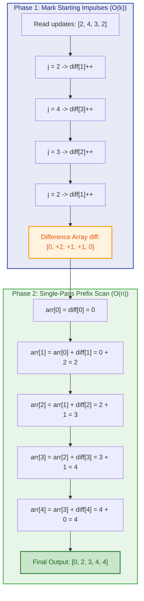
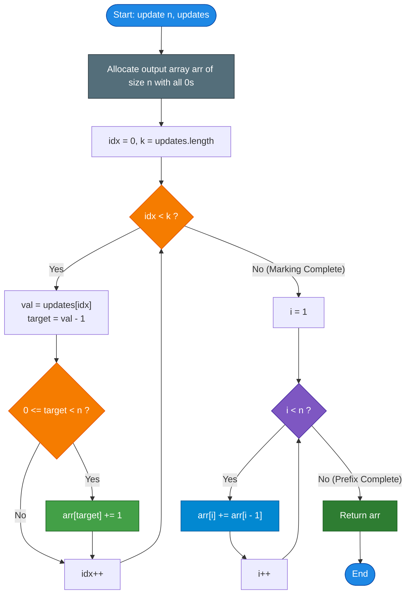

# GeeksforGeeks Problem of the Day: Adding Ones

- **Problem Link:** [GeeksforGeeks - Adding Ones](https://www.geeksforgeeks.org/problems/adding-ones3628/1)
- **Difficulty:** Easy
- **Topic Tags:** Arrays, Prefix Sum, Difference Array, Range Updates, Frequency Counting, Offline Algorithms
- **Target Audience:** POTD Solvers, Computer Science Students, Competitive Programmers, Interview Preparation (FAANG/Tier-1 Tech)

---

## 1. Problem Statement

You are given an integer $n$ representing the size of an array `arr[]`, initially populated entirely with zeros:
$$\text{arr}[i] = 0 \quad \text{for all } 0 \le i < n$$

You are also given an array `updates[]` of size $k$ containing positive integers representing **1-based indices**.

For each value $j$ present in `updates[]`, you must **add $1$** to every element in `arr[]` whose 1-based index satisfies:
$$i \ge j$$

In terms of standard **0-based array indexing**, each update query with value $j$ increments all elements in the range:
$$[j - 1, \; n - 1]$$

Your task is to compute and return the final state of the array after applying all $k$ updates.

---

## 2. Examples & Explanations

### Example 1
- **Input:** `n = 3`, `updates = [1, 1, 2, 3]`
- **Size of array ($n$):** $3$
- **Total updates ($k$):** $4$
- **Initial Array (0-based):** `[0, 0, 0]`

#### Step-by-Step Updates:
1. $j = 1$ (1-based $\ge 1 \implies$ 0-based indices $0 \dots 2$):  
   Array becomes: `[0 + 1, 0 + 1, 0 + 1] = [1, 1, 1]`
2. $j = 1$ (1-based $\ge 1 \implies$ 0-based indices $0 \dots 2$):  
   Array becomes: `[1 + 1, 1 + 1, 1 + 1] = [2, 2, 2]`
3. $j = 2$ (1-based $\ge 2 \implies$ 0-based indices $1 \dots 2$):  
   Array becomes: `[2, 2 + 1, 2 + 1] = [2, 3, 3]`
4. $j = 3$ (1-based $\ge 3 \implies$ 0-based index $2$):  
   Array becomes: `[2, 3, 3 + 1] = [2, 3, 4]`

- **Output:** `[2, 3, 4]`

---

### Example 2
- **Input:** `n = 5`, `updates = [2, 4, 3, 2]`
- **Initial Array:** `[0, 0, 0, 0, 0]`

#### Step-by-Step Updates:
1. $j = 2 \implies$ Add $1$ to indices $1 \dots 4$: `[0, 1, 1, 1, 1]`
2. $j = 4 \implies$ Add $1$ to indices $3 \dots 4$: `[0, 1, 1, 2, 2]`
3. $j = 3 \implies$ Add $1$ to indices $2 \dots 4$: `[0, 1, 2, 3, 3]`
4. $j = 2 \implies$ Add $1$ to indices $1 \dots 4$: `[0, 2, 3, 4, 4]`

- **Output:** `[0, 2, 3, 4, 4]`

---

### Example 3 (Edge Case: Boundary Updates)
- **Input:** `n = 4`, `updates = [1, 4]`
- **Step 1:** $j = 1 \implies$ range $[0, 3]$ gets $+1$: `[1, 1, 1, 1]`
- **Step 2:** $j = 4 \implies$ range $[3, 3]$ gets $+1$: `[1, 1, 1, 2]`
- **Output:** `[1, 1, 1, 2]`

---

## 3. Constraints & Complexity Targets

- **Array Size:** $1 \le n \le 10^5$
- **Number of Updates:** $1 \le k = \text{updates.length} \le 10^5$
- **Index Values:** $1 \le \text{updates}[i] \le n$
- **Expected Time Complexity:** $\mathbf{\mathcal{O}(n + k)}$
- **Expected Auxiliary Space:** $\mathbf{\mathcal{O}(1)}$ (excluding the returned result array)

> [!WARNING]
> **Why Brute Force Fails ($TLE$):**  
> If an update starts at $j = 1$, modifying every element up to $n - 1$ takes $\mathcal{O}(n)$ time.  
> With $k$ updates, the worst-case naive runtime is:
> $$\mathcal{O}(n \times k) = 10^5 \times 10^5 = 10^{10} \text{ operations}$$
> Standard online judge execution limits permit $\approx 10^8$ operations per second. A naive approach will exceed the time limit by a factor of $100\times$.

---

## 4. Visual Architecture & The Difference Array Model

### The General Difference Array Concept

In competitive programming, whenever multiple range update queries $[L, R]$ with an increment $+v$ are given **offline** (i.e., all queries are known before queries are answered), we construct a **Difference Array** $D$:
$$D[L] \mathrel{+}= v, \quad D[R + 1] \mathrel{-}= v \quad (\text{if } R + 1 < n)$$

After recording all query boundaries, the actual array is reconstructed by calculating the **prefix sum** (running cumulative sum) of $D$:
$$\text{arr}[i] = \sum_{m = 0}^{i} D[m]$$

```text
Standard Difference Array for Range [L, R] with +1:

Index:     0   ...   L-1    L    L+1  ...   R    R+1   ...  n-1
                    ┌───┐                    ┌───┐
Diff D:    0   ...    0    │+1 │   0  ...   0   │-1 │  ...   0
                    └───┘                    └───┘
                      ▲                        ▲
                Add impulse              Cancel impulse
```

### The Degenerate Right-Boundary Invariant

Notice a critical simplification in this problem:
- Every query starts at $L = j - 1$.
- Every query extends **all the way to the end of the array**: $R = n - 1$.

What happens to the cancellation impulse at $R + 1$?
$$R + 1 = (n - 1) + 1 = n$$
Because $n$ is **outside the bounds of the array**, the cancellation boundary $D[R + 1]$ falls off the edge and **never needs to be executed**:

$$\text{For every } j \in \text{updates}: \quad D[j - 1] \mathrel{+}= 1$$

No boundary checks for the right edge are required!

```
Propagating Wave Visual:

Query j = 2 (0-based index 1):
Mark Phase:     arr = [ 0,  1,  0,  0,  0 ]
                            ▲
                      Impulse at index 1

Prefix Sum:     arr = [ 0,  1,  1,  1,  1 ]
                            └───►───►───► Wave spreads to the right edge!
```



---

## 5. Step-by-Step Simulation & Trace Table

Let us trace **Example 2** in detail:  
$n = 5$, `updates = [2, 4, 3, 2]`

### Phase 1: Frequency Accumulation on Output Array
Initial array: `arr = [0, 0, 0, 0, 0]`

| Step | Query Value $j$ | Target 0-based Index ($j - 1$) | Action | State of `arr` |
| :---: | :---: | :---: | :---: | :---: |
| 1 | $2$ | $1$ | `arr[1] += 1` | `[0, 1, 0, 0, 0]` |
| 2 | $4$ | $3$ | `arr[3] += 1` | `[0, 1, 0, 1, 0]` |
| 3 | $3$ | $2$ | `arr[2] += 1` | `[0, 1, 1, 1, 0]` |
| 4 | $2$ | $1$ | `arr[1] += 1` | `[0, 2, 1, 1, 0]` |

### Phase 2: Prefix Sum Accumulation
We sweep from index $i = 1$ to $n - 1$, accumulating values in-place:
$$\text{arr}[i] = \text{arr}[i] + \text{arr}[i - 1]$$

| Index $i$ | Initial Marked Value $\text{arr}[i]$ | Previous Running Total $\text{arr}[i - 1]$ | Formula | Updated $\text{arr}[i]$ | Current Array State |
| :---: | :---: | :---: | :---: | :---: | :---: |
| **0** | $0$ | — (Base Case) | $0$ | **0** | `[0, 2, 1, 1, 0]` |
| **1** | $2$ | $0$ | $2 + 0$ | **2** | `[0, 2, 1, 1, 0]` |
| **2** | $1$ | $2$ | $1 + 2$ | **3** | `[0, 2, 3, 1, 0]` |
| **3** | $1$ | $3$ | $1 + 3$ | **4** | `[0, 2, 3, 4, 0]` |
| **4** | $0$ | $4$ | $0 + 4$ | **4** | `[0, 2, 3, 4, 4]` |

**Result:** `[0, 2, 3, 4, 4]` (Matched exactly in $\mathcal{O}(n + k)$ operations).

---

## 6. Algorithm Flowchart



---

## 7. From Naive to Pro: Algorithmic Progression

### Method 1: Naive Direct Simulation ($\mathcal{O}(n \times k)$ Time)
- **Concept:** For each update query $j$, directly execute a `for` loop starting from index $j - 1$ through $n - 1$ and add $1$ to each element.
- **Why it is suboptimal:** Every query potentially traverses up to $n$ elements. If $j = 1$ is queried $k$ times, total operations equal $n \times k = 10^{10}$, causing immediate **Time Limit Exceeded (TLE)**.
- **Pseudocode:**
```text
function update_Naive(n, updates):
    arr = array of size n filled with 0
    for each j in updates:
        for i from (j - 1) to (n - 1):
            arr[i] += 1
    return arr
```

---

### Method 2: Standard Difference Array with Separate Buffer ($\mathcal{O}(n + k)$ Time, $\mathcal{O}(n)$ Extra Space)
- **Concept:** Maintain an auxiliary `diff` array of size $n$. Increment `diff[j - 1]`. Then compute the prefix sum into a separate result array `arr`.
- **Why it is better:** Reduces time complexity to linear $\mathcal{O}(n + k)$.
- **Limitation:** Allocates an additional $n$-sized array on the heap, increasing auxiliary memory footprint.
- **Pseudocode:**
```text
function update_DiffBuffer(n, updates):
    diff = array of size n filled with 0
    for each j in updates:
        if 1 <= j <= n:
            diff[j - 1] += 1
            
    arr = array of size n
    runningSum = 0
    for i from 0 to n - 1:
        runningSum += diff[i]
        arr[i] = runningSum
        
    return arr
```

---

### Method 3: Pro In-Place Frequency Bucket + Prefix Sum Scan ($\mathcal{O}(n + k)$ Time, $\mathcal{O}(1)$ Extra Space)
- **Concept:** 
  1. The output array `arr` itself serves as the frequency difference bucket.
  2. In the first pass ($\mathcal{O}(k)$), record all impulses: `arr[u - 1]++`.
  3. In the second pass ($\mathcal{O}(n)$), compute running prefix sums in-place: `arr[i] += arr[i - 1]`.
- **Why this is the Gold Standard:**
  - Optimal time: $\mathcal{O}(n + k)$.
  - Optimal space: Zero redundant allocations ($\mathcal{O}(1)$ auxiliary space beyond the required return container).
  - Maximizes CPU cache locality with sequential memory accesses.
- **Pseudocode:**
```text
function update_Optimal(n, updates):
    arr = array of size n filled with 0
    
    // Step 1: Accumulate start markers in O(k)
    for each u in updates:
        if 1 <= u <= n:
            arr[u - 1] += 1
            
    // Step 2: In-place prefix sum propagation in O(n)
    for i from 1 to n - 1:
        arr[i] += arr[i - 1]
        
    return arr
```

---

## 8. Complexity Comparison Table

| Metric | Method 1: Naive Simulation | Method 2: Separate Diff Buffer | Method 3: Pro In-Place Frequency + Prefix Scan |
| :--- | :--- | :--- | :--- |
| **Time Complexity** | $\mathcal{O}(n \times k)$ | $\mathcal{O}(n + k)$ | $\mathbf{\mathcal{O}(n + k)}$ |
| **Auxiliary Space** | $\mathcal{O}(1)$ | $\mathcal{O}(n)$ extra buffer | $\mathbf{\mathcal{O}(1)}$ (In-place on result) |
| **Operations ($n=k=10^5$)** | $\sim 10^{10}$ operations (**TLE**) | $\sim 2 \times 10^5$ operations | $\mathbf{\sim 2 \times 10^5}$ **operations** |
| **Memory Allocation** | Only output array | Two arrays (`diff` + `arr`) | **Single array allocation** |
| **Cache Performance** | Poor (Repeated wide overwrites) | Fair | **Optimal (Sequential linear reads/writes)** |
| **Interview Verdict** | Rejected (Fails at scale) | Acceptable | **Gold Standard (FAANG Clean Code)** |

---

## 9. Comprehensive Corner Cases Handled

1. **Smallest Constraints ($n = 1, k = 1$):**
   - Single element array `arr = [0]`.
   - Update `[1]` marks index $0$: `arr[0] = 1`.
   - The prefix loop for $i$ from $1$ to $0$ does not execute. Returns `[1]` safely.
2. **Repeated Identical Updates:**
   - Multiple updates at the exact same index (e.g., `updates = [1, 1, 1, 1]`).
   - Counter accumulates cleanly (`arr[0] = 4`), and prefix sum propagates $4$ across the entire array.
3. **All Updates at the Last Index ($j = n$):**
   - Only the final element `arr[n - 1]` receives the increment. No out-of-bounds error occurs.
4. **Unsorted Update Order:**
   - Because updates are commutative ($a + b = b + a$) and accumulated offline, the order of elements in `updates[]` has zero effect on the final result.
5. **Maximum Constraints ($n = 10^5, k = 10^5$):**
   - Maximum value at any cell is $k \le 10^5$, which fits easily inside standard 32-bit signed integers (`int` max is $2 \times 10^9$). No integer overflow.

---

## 10. Complete Multi-Language Implementations

### Java (21)

```java
import java.util.ArrayList;

class Solution {
    public ArrayList<Integer> update(int n, int[] updates) {
        // Step 1: Use an array as the difference frequency bucket
        int[] arr = new int[n];
        
        // Record starting index of each update in O(k)
        for (int u : updates) {
            if (u >= 1 && u <= n) {
                arr[u - 1]++;
            }
        }
        
        // Step 2: Compute prefix sums in-place in O(n)
        for (int i = 1; i < n; i++) {
            arr[i] += arr[i - 1];
        }
        
        // Step 3: Populate ArrayList with initial capacity n for optimal performance
        ArrayList<Integer> result = new ArrayList<>(n);
        for (int i = 0; i < n; i++) {
            result.add(arr[i]);
        }
        
        return result;
    }
}
```

---

### Python3

```python
class Solution:
    def update(self, n: int, updates: list[int]) -> list[int]:
        # Step 1: Initialize result array of size n with zeros
        res = [0] * n
        
        # Record frequency of each starting index (1-based to 0-based)
        for u in updates:
            if 1 <= u <= n:
                res[u - 1] += 1
                
        # Step 2: Propagate prefix sums in-place
        for i in range(1, n):
            res[i] += res[i - 1]
            
        return res
```

---

### C++ (17)

```cpp
#include <vector>

using namespace std;

class Solution {
  public:
    vector<int> update(int n, vector<int>& updates) {
        // Step 1: Allocate result vector of size n initialized to 0
        vector<int> res(n, 0);
        
        // Mark each starting update index (1-based -> 0-based)
        for (int u : updates) {
            if (u >= 1 && u <= n) {
                res[u - 1]++;
            }
        }
        
        // Step 2: Compute prefix sums in-place
        for (int i = 1; i < n; ++i) {
            res[i] += res[i - 1];
        }
        
        return res;
    }
};
```

---

### C#

```csharp
using System;
using System.Collections.Generic;

class Solution {
    public List<int> update(int n, int[] updates) {
        // Step 1: Allocate working array of size n
        int[] arr = new int[n];
        
        // Accumulate update markers in O(k)
        foreach (int u in updates) {
            if (u >= 1 && u <= n) {
                arr[u - 1]++;
            }
        }
        
        // Step 2: Compute running prefix sums in-place in O(n)
        for (int i = 1; i < n; i++) {
            arr[i] += arr[i - 1];
        }
        
        // Step 3: Return as List<int>
        return new List<int>(arr);
    }
}
```

---

### Javascript (Node v22)

```javascript
/**
 * @param {number} n
 * @param {number[]} updates
 * @return {number[]}
 */
class Solution {
    update(n, updates) {
        // Step 1: Allocate result array filled with zeros
        const res = new Array(n).fill(0);
        
        // Mark frequency of each 1-based start index
        const k = updates.length;
        for (let i = 0; i < k; i++) {
            const u = updates[i];
            if (u >= 1 && u <= n) {
                res[u - 1]++;
            }
        }
        
        // Step 2: Propagate prefix sums in-place
        for (let i = 1; i < n; i++) {
            res[i] += res[i - 1];
        }
        
        return res;
    }
}
```

---

## 11. Key Takeaways & Technical Summary

1. **Prefix Sum as an Anti-Derivative:**  
   The difference array acts as the discrete derivative, and the prefix sum acts as the discrete integral. Marking an impulse $+1$ at $L$ creates a step function that persists until a cancelling impulse $-1$ is encountered.
2. **Right Boundary Invariant:**  
   When all updates stretch to the right edge $n - 1$, the right cancellation falls out-of-bounds, reducing the classic difference array update to simple frequency counting.
3. **Interview Generalization:**  
   This exact pattern is fundamental in competitive programming and system design questions involving range updates:
   - **LeetCode 370:** Range Addition
   - **LeetCode 1109:** Corporate Flight Bookings
   - **LeetCode 2381:** Shifting Letters II
   - **2D Prefix Sums:** Matrix block sum queries and subgrid updates.
