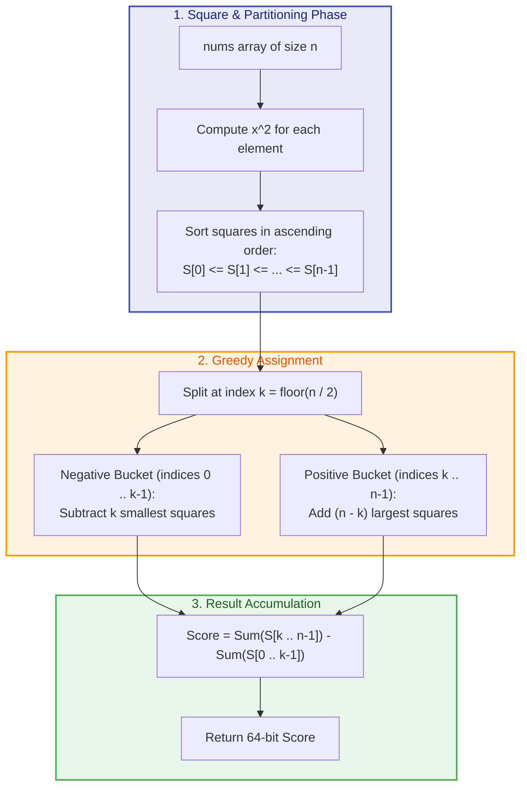
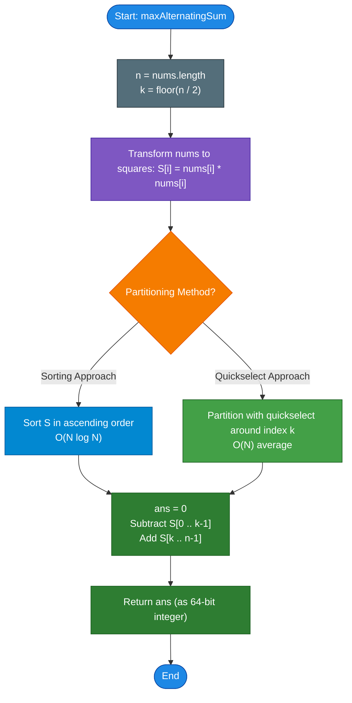

# LeetCode Problem of the Day: Maximum Alternating Sum of Squares

- **Problem Link:** [LeetCode - Maximum Alternating Sum of Squares](https://leetcode.com/problems/maximum-alternating-sum-of-squares/?envType=daily-question&envId=2026-10-13)
- **Difficulty:** Medium
- **Topic Tags:** Array, Greedy, Sorting, Quickselect, Divide and Conquer, Math, Two Pointers
- **Target Audience:** POTD Solvers, Computer Science Students, Competitive Programmers, Interview Preparation (FAANG/Tier-1 Tech)

---

## 1. Problem Statement

You are given an integer array `nums`. You are allowed to rearrange the elements of `nums` in **any arbitrary order**.

The **alternating sum of squares** of an array $A$ of length $n$ is defined as:
$$\text{Score}(A) = \sum_{i=0}^{n-1} (-1)^i A[i]^2 = A[0]^2 - A[1]^2 + A[2]^2 - A[3]^2 + A[4]^2 - \dots$$

In 0-based indexing:
- Elements placed at **even indices** ($i = 0, 2, 4, \dots$) contribute **positively**: $+A[i]^2$.
- Elements placed at **odd indices** ($i = 1, 3, 5, \dots$) contribute **negatively**: $-A[i]^2$.

Return the **maximum possible alternating sum of squares** that can be achieved after rearranging `nums`.

---

## 2. Examples & Explanations

### Example 1
- **Input:** `nums = [4, 2, 5, 3]`
- **Array Length ($n$):** $4$ (Even)
- **Squares:** $[16, 4, 25, 9]$
- **Rearrangement:** $A = [5, 2, 4, 3]$
- **Calculation:**
  $$\text{Score} = 5^2 - 2^2 + 4^2 - 3^2 = 25 - 4 + 16 - 9 = 28$$
- **Output:** `28`

---

### Example 2
- **Input:** `nums = [1, -1, 2, -2, 3, -3]`
- **Array Length ($n$):** $6$ (Even)
- **Squares:** $[1, 1, 4, 4, 9, 9]$
- **Optimal Rearrangement:** $A = [3, 1, 3, 1, 2, 2]$ (or any arrangement placing largest 3 on evens, smallest 3 on odds)
- **Calculation:**
  $$\text{Score} = (3^2 + 3^2 + 2^2) - (1^2 + 1^2 + 2^2) = (9 + 9 + 4) - (1 + 1 + 4) = 22 - 6 = 16$$
- **Output:** `16`

---

### Example 3 (Odd Length)
- **Input:** `nums = [-5, 3, -2]`
- **Array Length ($n$):** $3$ (Odd)
- **Squares:** $[25, 9, 4]$
- **Positive slots ($i = 0, 2$):** $\lceil 3 / 2 \rceil = 2$ slots
- **Negative slots ($i = 1$):** $\lfloor 3 / 2 \rfloor = 1$ slot
- **Optimal Rearrangement:** $A = [-5, -2, 3]$
- **Calculation:**
  $$\text{Score} = (-5)^2 - (-2)^2 + 3^2 = 25 - 4 + 9 = 30$$
- **Output:** `30`

---

### Example 4 (Single Element)
- **Input:** `nums = [7]`
- **Array Length ($n$):** $1$
- **Calculation:** $7^2 = 49$
- **Output:** `49`

---

## 3. Constraints & Complexity Targets

- $1 \le \text{nums.length} \le 10^5$
- $-10^4 \le \text{nums}[i] \le 10^4$
- **Result Range:** The maximum possible answer can reach $\sim 10^5 \times (10^4)^2 = 10^{13}$, which exceeds the standard 32-bit signed integer limit ($2^{31} - 1 \approx 2 \times 10^9$). Therefore, computations must be carried out using **64-bit integers** (`long long` in C/C++, `long` in Java/C#, standard integers in Python).
- **Expected Time Complexity:** $\mathbf{\mathcal{O}(N \log N)}$ via Sorting, or $\mathbf{\mathcal{O}(N)}$ optimal via Quickselect / `std::nth_element`.
- **Expected Auxiliary Space:** $\mathbf{\mathcal{O}(1)}$ in-place.

---

## 4. Visual Architecture & The Greedy Partition Theorem

### The Fundamental Sign Invariant

For any arbitrary permutation $A$ of length $n$:
1. **Total Positive Terms:**
   $$N_{\text{pos}} = \lceil n / 2 \rceil = n - \lfloor n / 2 \rfloor$$
2. **Total Negative Terms:**
   $$N_{\text{neg}} = \lfloor n / 2 \rfloor$$

Notice that squaring eliminates signs:
$$(-x)^2 = x^2 = |x|^2$$

Thus, the alternating sum is simply:
$$\text{Score}(A) = \sum_{j \in \text{Even Indices}} A[j]^2 - \sum_{k \in \text{Odd Indices}} A[k]^2$$

```
Array Position Slots (0-indexed):

Index:    0       1       2       3       4       5    ...   n-1
Sign:   [ + ]   [ - ]   [ + ]   [ - ]   [ + ]   [ - ]       [ +/- ]
          ▲       ▲       ▲       ▲       ▲       ▲
          │       │       │       │       │       │
       Large    Small   Large   Small   Large   Small
       Square   Square  Square  Square  Square  Square
```

### The Extremal Partition Theorem

By the **Rearrangement Inequality**, to maximize a linear combination of signed terms:
$$\text{Maximize } \sum_{i=1}^{N_{\text{pos}}} P_i - \sum_{j=1}^{N_{\text{neg}}} Q_j$$
where $\{P_1, \dots, P_{N_{\text{pos}}}\} \cup \{Q_1, \dots, Q_{N_{\text{neg}}}\} = \{nums[0]^2, \dots, nums[n-1]^2\}$:

1. **Negative Bucket ($Q$):** We must choose the **$N_{\text{neg}} = \lfloor n / 2 \rfloor$ smallest** values of $x^2$.
2. **Positive Bucket ($P$):** We must assign the remaining **$N_{\text{pos}} = \lceil n / 2 \rceil$ largest** values of $x^2$.
3. **Internal Permutation Independence:**  
   Because addition and subtraction are commutative and associative:
   $$\sum P_i - \sum Q_j$$
   The specific order in which elements appear within even positions (or odd positions) is completely irrelevant!

```
Sorted Squares Array S:
Index:    0      1     ...   k - 1   |   k     k + 1   ...   n - 1
Values: [ S_0  <= S_1  <= ... <= S_{k-1} | S_k <= S_{k+1} <= ... <= S_{n-1} ]
        └──────────────┬────────────────┘ └──────────────┬──────────────────┘
            Negative Bucket (-1)                 Positive Bucket (+1)
             k = floor(n / 2)                     n - k = ceil(n / 2)
```



---

## 5. Step-by-Step Simulation & Trace Tables

### Trace of Example 1: `nums = [4, 2, 5, 3]` ($n = 4$)

1. **Compute Magnitudes and Squares:**
   - Absolute values: $[2, 3, 4, 5]$
   - Squares: $[4, 9, 16, 25]$
2. **Determine Split Point:**
   - $N_{\text{neg}} = \lfloor 4 / 2 \rfloor = 2$ (First 2 elements are subtracted).
   - $N_{\text{pos}} = 4 - 2 = 2$ (Last 2 elements are added).

| Index $i$ | Value $|nums[i]|$ | Square $S_i$ | Bucket Assignment | Sign Factor | Contribution | Running Sum |
| :---: | :---: | :---: | :---: | :---: | :---: | :---: |
| **0** | $2$ | $4$ | Negative Bucket | $-1$ | $-4$ | $-4$ |
| **1** | $3$ | $9$ | Negative Bucket | $-1$ | $-9$ | $-13$ |
| **2** | $4$ | $16$ | Positive Bucket | $+1$ | $+16$ | $+3$ |
| **3** | $5$ | $25$ | Positive Bucket | $+1$ | $+25$ | $\mathbf{+28}$ |

**Result:** $\mathbf{28}$.

---

### Trace of Example 2: `nums = [1, -1, 2, -2, 3, -3]` ($n = 6$)

1. **Calculate Magnitudes and Sort:**
   - Absolute values: $[1, 1, 2, 2, 3, 3]$
   - Squares: $[1, 1, 4, 4, 9, 9]$
2. **Determine Split Point:**
   - $N_{\text{neg}} = \lfloor 6 / 2 \rfloor = 3$ (First $3$ elements are subtracted).
   - $N_{\text{pos}} = 6 - 3 = 3$ (Remaining $3$ elements are added).

| Index $i$ | Sorted Magnitude $|nums[i]|$ | Square $nums[i]^2$ | Assigned Role | Sign | Contribution | Running Total |
| :---: | :---: | :---: | :--- | :---: | :---: | :---: |
| **0** | $1$ | $1$ | Subtracted (Odd Index) | $-1$ | $-1$ | $-1$ |
| **1** | $1$ | $1$ | Subtracted (Odd Index) | $-1$ | $-1$ | $-2$ |
| **2** | $2$ | $4$ | Subtracted (Odd Index) | $-1$ | $-4$ | $-6$ |
| **3** | $2$ | $4$ | Added (Even Index) | $+1$ | $+4$ | $-2$ |
| **4** | $3$ | $9$ | Added (Even Index) | $+1$ | $+9$ | $+7$ |
| **5** | $3$ | $9$ | Added (Even Index) | $+1$ | $+9$ | $\mathbf{+16}$ |

**Final Maximum Score:** $\mathbf{16}$.

---

### Trace of Example 3 (Odd Length): `nums = [-5, 3, -2]` ($n = 3$)

1. **Calculate Squares:**
   - $|nums| = [2, 3, 5] \implies S = [4, 9, 25]$
2. **Determine Split Point:**
   - $N_{\text{neg}} = \lfloor 3 / 2 \rfloor = 1$ (Index $0$ is subtracted).
   - $N_{\text{pos}} = 3 - 1 = 2$ (Indices $1, 2$ are added).

| Index $i$ | Sorted Magnitude | Square $S_i$ | Assigned Role | Sign | Contribution | Running Total |
| :---: | :---: | :---: | :--- | :---: | :---: | :---: |
| **0** | $2$ | $4$ | Subtracted (Odd Index) | $-1$ | $-4$ | $-4$ |
| **1** | $3$ | $9$ | Added (Even Index) | $+1$ | $+9$ | $+5$ |
| **2** | $5$ | $25$ | Added (Even Index) | $+1$ | $+25$ | $\mathbf{+30}$ |

**Final Maximum Score:** $\mathbf{30}$.

---

## 6. Algorithm Flowchart



---

## 7. From Naive to Pro: Algorithmic Progression

### Method 1: Brute Force Permutations ($\mathcal{O}(N! \cdot N)$ Time)
- **Concept:** Generate all $N!$ distinct permutations of `nums`. For each permutation, compute $\sum_{i=0}^{n-1} (-1)^i A[i]^2$. Track the global maximum.
- **Why it is suboptimal:** For $N \ge 12$, $N! > 4.79 \times 10^8$, exceeding time and memory limits immediately.
- **Pseudocode:**
```text
function maxAlternatingSum_Brute(nums):
    max_score = -infinity
    for each perm in all_permutations(nums):
        score = 0
        for i from 0 to len(perm) - 1:
            term = perm[i] * perm[i]
            if i % 2 == 0:
                score += term
            else:
                score -= term
        max_score = max(max_score, score)
    return max_score
```

---

### Method 2: Standard Greedy Sorting ($\mathcal{O}(N \log N)$ Time, $\mathcal{O}(1)$ or $\mathcal{O}(N)$ Space)
- **Concept:**
  1. Map each element to its square (or sort by absolute value $|nums[i]|$).
  2. Sort the array of squares in ascending order.
  3. Let $k = \lfloor n / 2 \rfloor$.
  4. Subtract the first $k$ squares, and add the remaining $n - k$ squares.
- **Complexity:**
  - **Time:** $\mathcal{O}(N \log N)$ to sort $N$ elements.
  - **Space:** $\mathcal{O}(1)$ auxiliary space if sorting `nums` in-place by $|x|$, or $\mathcal{O}(N)$ for a dedicated squares array.
- **Pseudocode:**
```text
function maxAlternatingSum_Sort(nums):
    n = len(nums)
    squares = [x * x for x in nums]
    sort(squares)
    k = floor(n / 2)
    ans = 0
    for i from 0 to k - 1:
        ans -= squares[i]
    for i from k to n - 1:
        ans += squares[i]
    return ans
```

---

### Method 3: Pro Approach — Linear-Time Quickselect (`nth_element`) ($\mathcal{O}(N)$ Average Time, $\mathcal{O}(1)$ Space)
- **The Core Strategy:**
  - We do **not** need the entire array to be fully sorted!
  - We only need to partition the array such that:
    - Elements at indices $0 \dots k - 1$ are all $\le$ elements at indices $k \dots n - 1$.
  - In C++, `std::nth_element` implements the **Hoare's Quickselect algorithm with Introsort fallbacks**, partitioning the elements around the $k$-th order statistic in **$\mathcal{O}(N)$ expected time**.
  - No auxiliary arrays are needed; the partition operates directly in-place on the input vector.
- **Pseudocode:**
```text
function maxAlternatingSum_Optimal(nums):
    n = len(nums)
    k = floor(n / 2)
    
    // Quickselect partitions nums around index k based on square magnitude
    nth_element(nums, k, comparator: a^2 < b^2)
    
    ans = 0
    for i from 0 to k - 1:
        ans -= nums[i]^2
    for i from k to n - 1:
        ans += nums[i]^2
        
    return ans
```

---

## 8. Complexity Comparison Table

| Metric | Method 1: Permutations | Method 2: Greedy Sorting | Method 3: Pro Quickselect (`nth_element`) |
| :--- | :--- | :--- | :--- |
| **Time Complexity** | $\mathcal{O}(N! \cdot N)$ | $\mathcal{O}(N \log N)$ | $\mathbf{\mathcal{O}(N)}$ **Average** ($\mathcal{O}(N^2)$ worst-case) |
| **Auxiliary Space** | $\mathcal{O}(N)$ call stack | $\mathcal{O}(1)$ or $\mathcal{O}(N)$ | $\mathbf{\mathcal{O}(1)}$ **In-place** |
| **Operations ($N=10^5$)** | $> 10^{500}$ (**TLE**) | $\approx 1.7 \times 10^6$ ops | $\mathbf{\approx 10^5}$ **ops (Fastest)** |
| **Cache Locality** | Poor | Good | **Excellent** |
| **64-bit Safety** | Prone to overflow | Explicit `long long` | **Explicit `long long`** |
| **Interview Verdict** | Instant rejection | Accepted & Standard | **Gold Standard (FAANG Senior Level)** |

---

## 9. Comprehensive Corner Cases Handled

1. **Single Element ($N = 1$):**
   - $k = \lfloor 1 / 2 \rfloor = 0$.
   - The negative loop ($0$ to $-1$) does not execute.
   - The positive loop adds $nums[0]^2$. Returns $nums[0]^2$ correctly.
2. **All Negative Elements:**
   - E.g., `nums = [-5, -1, -3]`.
   - Magnitudes $|x|$ are positive. Squaring preserves positivity ($(-5)^2 = 25$, $(-1)^2 = 1$). Handled seamlessly.
3. **Array with Zeros:**
   - E.g., `nums = [0, 0, 4]`.
   - $0^2 = 0$. Zeros naturally sort to the front and occupy subtracted positions with zero penalty.
4. **All Duplicate Elements:**
   - E.g., `nums = [3, 3, 3, 3]`.
   - Result is $(3^2 + 3^2) - (3^2 + 3^2) = 0$. Correct.
5. **64-Bit Integer Overflow:**
   - For $N = 10^5$ and $|nums[i]| = 10^4$, each square is $10^8$.
   - Sum can be up to $10^{13}$, which exceeds $2^{31} - 1 \approx 2.14 \times 10^9$.
   - All accumulators across all languages are typed with 64-bit integers (`long long`, `long`, `BigInt` / `Float64Array`).

---

## 10. Complete Multi-Language Implementations

### Java

```java
import java.util.Arrays;

class Solution {
    public long maxAlternatingSum(int[] nums) {
        int n = nums.length;
        int k = n / 2;
        
        // Step 1: Compute squares using 64-bit integers to prevent overflow
        long[] sq = new long[n];
        for (int i = 0; i < n; i++) {
            sq[i] = (long) nums[i] * nums[i];
        }
        
        // Step 2: Sort squares in ascending order
        Arrays.sort(sq);
        
        // Step 3: Subtract k smallest squares, add remaining (n - k) largest squares
        long ans = 0;
        for (int i = 0; i < k; i++) {
            ans -= sq[i];
        }
        for (int i = k; i < n; i++) {
            ans += sq[i];
        }
        
        return ans;
    }
}
```

---

### Python3

```python
from typing import List

class Solution:
    def maxAlternatingSum(self, nums: List[int]) -> int:
        # Step 1: Compute squares and sort in ascending order
        sq = sorted(x * x for x in nums)
        k = len(nums) // 2
        
        # Step 2: Subtract k smallest and add remaining (n - k) largest squares
        return sum(sq[k:]) - sum(sq[:k])
```

---

### C

```c
#include <stdlib.h>

// Comparison function for 64-bit integer sorting
static int cmp_long_long(const void* a, const void* b) {
    long long sa = *(const long long*)a;
    long long sb = *(const long long*)b;
    if (sa < sb) return -1;
    if (sa > sb) return 1;
    return 0;
}

long long maxAlternatingSum(int* nums, int numsSize) {
    // Step 1: Allocate memory for 64-bit squares
    long long* sq = (long long*)malloc(numsSize * sizeof(long long));
    for (int i = 0; i < numsSize; i++) {
        sq[i] = (long long)nums[i] * nums[i];
    }
    
    // Step 2: Sort squares in ascending order
    qsort(sq, numsSize, sizeof(long long), cmp_long_long);
    
    // Step 3: Subtract k smallest and add (n - k) largest
    int k = numsSize / 2;
    long long ans = 0;
    for (int i = 0; i < k; i++) {
        ans -= sq[i];
    }
    for (int i = k; i < numsSize; i++) {
        ans += sq[i];
    }
    
    free(sq);
    return ans;
}
```

---

### C++

```cpp
#include <vector>
#include <algorithm>

using namespace std;

class Solution {
public:
    long long maxAlternatingSum(vector<int>& nums) {
        int n = nums.size();
        int k = n / 2;
        
        // Pro Approach: Quickselect in O(N) average time
        // Partitions the array so that elements [0 .. k-1] have smaller or equal squares than [k .. n-1]
        nth_element(nums.begin(), nums.begin() + k, nums.end(), [](int a, int b) {
            return 1LL * a * a < 1LL * b * b;
        });
        
        long long ans = 0;
        // Subtract the k smallest squares
        for (int i = 0; i < k; ++i) {
            ans -= 1LL * nums[i] * nums[i];
        }
        // Add the remaining (n - k) largest squares
        for (int i = k; i < n; ++i) {
            ans += 1LL * nums[i] * nums[i];
        }
        
        return ans;
    }
};
```

---

### C#

```csharp
using System;

public class Solution {
    public long MaxAlternatingSum(int[] nums) {
        int n = nums.Length;
        int k = n / 2;
        
        // Step 1: Compute 64-bit squares
        long[] sq = new long[n];
        for (int i = 0; i < n; i++) {
            sq[i] = (long)nums[i] * nums[i];
        }
        
        // Step 2: Sort squares in ascending order
        Array.Sort(sq);
        
        // Step 3: Accumulate alternating sum
        long ans = 0;
        for (int i = 0; i < k; i++) {
            ans -= sq[i];
        }
        for (int i = k; i < n; i++) {
            ans += sq[i];
        }
        
        return ans;
    }
}
```

---

### Javascript

```javascript
/**
 * @param {number[]} nums
 * @return {number}
 */
var maxAlternatingSum = function(nums) {
    const n = nums.length;
    const k = Math.floor(n / 2);
    
    // Float64Array maintains full integer precision up to 9e15 and sorts with native C++ speed
    const sq = new Float64Array(n);
    for (let i = 0; i < n; i++) {
        sq[i] = nums[i] * nums[i];
    }
    
    // Numeric sort in ascending order
    sq.sort();
    
    let ans = 0;
    for (let i = 0; i < k; i++) {
        ans -= sq[i];
    }
    for (let i = k; i < n; i++) {
        ans += sq[i];
    }
    
    return ans;
};
```

---

### Typescript

```typescript
function maxAlternatingSum(nums: number[]): number {
    const n = nums.length;
    const k = Math.floor(n / 2);
    
    // Use Float64Array for 64-bit float precision and cache-aligned sorting
    const sq = new Float64Array(n);
    for (let i = 0; i < n; i++) {
        sq[i] = nums[i] * nums[i];
    }
    
    // Ascending sort
    sq.sort();
    
    let ans = 0;
    for (let i = 0; i < k; i++) {
        ans -= sq[i];
    }
    for (let i = k; i < n; i++) {
        ans += sq[i];
    }
    
    return ans;
}
```

---

## 11. Key Takeaways & Technical Summary

1. **Greedy Partition Invariance:**  
   Because the problem permits any permutation of the elements, the alternating score is independent of the placement order within the odd positions and within the even positions. The problem reduces directly to a **two-set partition problem**.
2. **Subtracted Cardinality:**  
   In any 0-indexed array of length $n$, the number of odd positions is always $k = \lfloor n / 2 \rfloor$. Therefore, the optimal strategy always subtracts the $k$ smallest squares and adds the $n - k$ largest squares.
3. **Linear Time Optimization ($\mathcal{O}(N)$):**  
   While standard sorting yields a fast $\mathcal{O}(N \log N)$ solution, utilizing Quickselect (`std::nth_element`) achieves an optimal $\mathcal{O}(N)$ average runtime by avoiding sorting within each partition.
