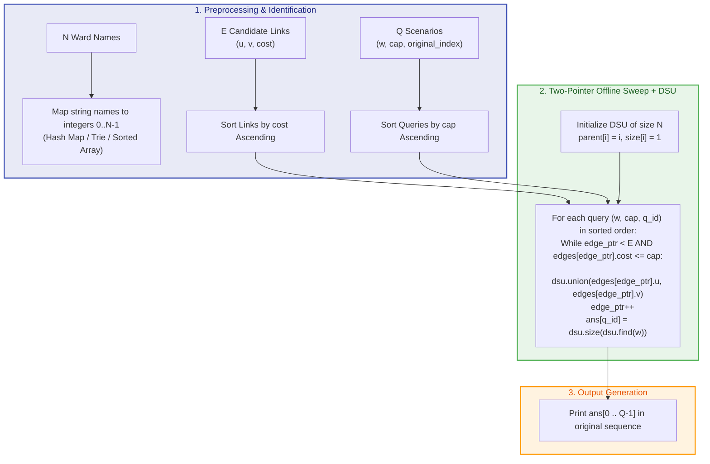
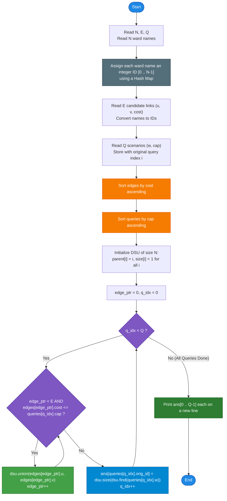

# Unstop Problem of the Day: Reachable Wards

- **Platform:** [Unstop](https://unstop.com/)
- **Difficulty:** Medium
- **Topic Tags:** Disjoint Set Union (DSU / Union-Find), Offline Processing, Graphs, Two-Pointer Sweep, Sorting, Connected Components
- **Target Audience:** POTD Solvers, Computer Science Students, Competitive Programmers, Interview Preparation (FAANG / Tier-1 Tech)

---

## 1. Problem Statement

Arjun works for the smart city development board, which is planning a phased road modernization program across the city's wards. Every ward has a unique lowercase name in the planning documents. The board has surveyed a list of candidate road links that could be repaired, and each candidate link connects two named wards and comes with an estimated repair cost.

Before the board commits to a budget, Arjun wants to explore several funding scenarios. In a given scenario, only the candidate links whose repair cost **does not exceed** the scenario's budget cap are considered upgraded; every other candidate link stays untouched. For a chosen ward under that scenario, Arjun wants to know how many wards, counting the chosen ward itself, can be reached from it by moving only along upgraded links, possibly passing through several intermediate wards along the way.

Arjun has prepared a list of such scenarios in advance, each one naming a starting ward and a budget cap, and he wants the answer for every scenario computed in the order he listed them, so he can present them together in his report to the board. The city is large and the candidate link list is long, and the board keeps revising the number of scenarios they want explored, so Arjun needs the computation to scale comfortably even when both the candidate list and the scenario list run into the hundreds of thousands.

He mentions that repair costs among candidate links can repeat, several links can share the same estimated cost, and a ward that has no cheap enough link reaching it in a scenario should simply be reported as reachable only from itself (size $1$).

### Formal Definitions:
- You are given $N$ distinct wards, $E$ candidate road links, and $Q$ scenarios (queries).
- Each candidate link connects two wards $(u, v)$ with integer cost $c$.
- Each scenario specifies a starting ward $w$ and a budget cap $C$.
- In scenario $(w, C)$, a link $(u, v)$ is active if and only if $\text{cost}(u, v) \le C$.
- The query asks for the size of the connected component containing $w$ in the subgraph of all active links.

### Input Format:
- The first line contains three space-separated integers: $N$, $E$, and $Q$.
- The next $N$ lines each contain one unique ward name.
- The next $E$ lines each contain two ward names and an integer cost: $u$, $v$, and $\text{cost}$.
- The next $Q$ lines each contain a ward name and an integer budget cap: $w$ and $\text{cap}$.

### Output Format:
- Print $Q$ lines. The $i$-th line contains the number of wards reachable from the $i$-th scenario's ward (including itself).

---

## 2. Examples & Explanations

### Example 1 (Sample Testcase 0)

**Input:**
```text
3 1 2
hill
port
lake
hill port 100
lake 50
port 100
```

**Output:**
```text
1
2
```

#### Visual Network & Step-by-Step Walkthrough:
- **Wards ($N = 3$):** `hill`, `port`, `lake`
- **Candidate Links ($E = 1$):** `hill` $\longleftrightarrow$ `port` (Cost: $100$)
- **Scenarios ($Q = 2$):**
  1. `lake 50`:
     - Budget cap is $50$.
     - The only available road link (`hill` $\longleftrightarrow$ `port`) costs $100 > 50$, so it is **not** upgraded.
     - `lake` has no roads connected to it under this cap.
     - Reachable wards from `lake`: only `{lake}` $\implies$ Count: **1**.
  2. `port 100`:
     - Budget cap is $100$.
     - The link `hill` $\longleftrightarrow$ `port` costs $100 \le 100$, so it **is upgraded**.
     - Connected component containing `port`: `{port, hill}` $\implies$ Count: **2**.

```text
At Budget Cap 50:
   [hill]          [port]          [lake]   (Isolated)
   Component of lake: {lake} -> Size = 1

At Budget Cap 100:
   [hill] <=== cost 100 ===> [port]          [lake]   (Isolated)
   Component of port: {port, hill} -> Size = 2
```

---

### Example 2 (Sample Testcase 1)

**Input:**
```text
4 4 3
alpha
beta
gamma
delta
alpha beta 10
beta gamma 20
gamma delta 5
alpha delta 30
alpha 10
alpha 20
gamma 5
```

**Output:**
```text
2
4
2
```

#### Step-by-Step Graph Evolution by Budget Cap:
1. **Candidate Links sorted by cost:**
   - Link 1: `gamma` $\longleftrightarrow$ `delta` (Cost: $5$)
   - Link 2: `alpha` $\longleftrightarrow$ `beta` (Cost: $10$)
   - Link 3: `beta` $\longleftrightarrow$ `gamma` (Cost: $20$)
   - Link 4: `alpha` $\longleftrightarrow$ `delta` (Cost: $30$)

2. **Scenarios sorted by Budget Cap:**
   - **Scenario 3 (Cap = 5, Ward = `gamma`):**
     - Links with $\text{cost} \le 5$: only `gamma` $\longleftrightarrow$ `delta` (Cost: $5$).
     - Components: `{alpha}`, `{beta}`, `{gamma, delta}`.
     - Ward `gamma` belongs to `{gamma, delta}` $\implies$ Reachable count = **2**.
   - **Scenario 1 (Cap = 10, Ward = `alpha`):**
     - Links with $\text{cost} \le 10$: `gamma` $\longleftrightarrow$ `delta` (Cost: $5$) and `alpha` $\longleftrightarrow$ `beta` (Cost: $10$).
     - Components: `{alpha, beta}`, `{gamma, delta}`.
     - Ward `alpha` belongs to `{alpha, beta}` $\implies$ Reachable count = **2**.
   - **Scenario 2 (Cap = 20, Ward = `alpha`):**
     - Links with $\text{cost} \le 20$: adds `beta` $\longleftrightarrow$ `gamma` (Cost: $20$).
     - This bridge merges `{alpha, beta}` with `{gamma, delta}` into `{alpha, beta, gamma, delta}`.
     - Ward `alpha` belongs to the unified component of size **4**.

3. **Restoring Original Query Order:**
   - Query 1 (`alpha 10`): **2**
   - Query 2 (`alpha 20`): **4**
   - Query 3 (`gamma 5`): **2**

---

## 3. Constraints & System Specifications

- $2 \le N \le 1 \times 10^5$ (Number of wards)
- $1 \le E \le 2 \times 10^5$ (Number of candidate road links)
- $1 \le Q \le 2 \times 10^5$ (Number of scenarios)
- $1 \le \text{cost}, \text{cap} \le 1 \times 10^9$ (32-bit positive integer range)
- Ward names consist of lowercase English letters, length between $1$ and $12$, all $N$ names are distinct.
- Every candidate link and every scenario refers only to valid ward names declared in the first $N$ lines.
- **Time Limit:** $2.0$ seconds
- **Space Limit:** $256$ MB

> [!WARNING]
> **Why Online Querying (BFS / DFS per scenario) Fails ($TLE$):**  
> Running a BFS/DFS per scenario traverses up to $\mathcal{O}(N + E)$ nodes and edges.  
> With $Q = 2 \times 10^5$ scenarios and $N + E = 3 \times 10^5$:
> $$\text{Total Operations} \approx Q \times (N + E) = 2 \times 10^5 \times 3 \times 10^5 = 6 \times 10^{10} \text{ ops}$$
> This will result in an immediate Time Limit Exceeded (TLE) error. We must process queries **offline**.

---

## 4. Visual Architecture & Dynamic State Diagram

### The Offline Sweep-Line Insight

Because all $Q$ queries are known before any output needs to be printed, we can solve this problem **offline** by treating the budget cap as a continuous **sweep-line dimension**:

```
Budget Cap Timeline (C):
0 -------- 5 -------- 10 -------- 20 -------- 30 --------> +inf
           |          |           |           |
        Activate   Activate    Activate    Activate
         (g-d)      (a-b)       (b-g)       (a-d)
         cost 5    cost 10     cost 20     cost 30
           ▲          ▲           ▲
        Query 3    Query 1     Query 2
       (cap = 5)  (cap = 10)  (cap = 20)
```

1. **Sort Edges:** Arrange all $E$ candidate road links in ascending order of `cost`.
2. **Sort Queries:** Store each query with its original index $i \in [0, Q-1]$, and sort queries in ascending order of `cap`.
3. **Monotonic Edge Activation with DSU:**
   - Maintain a pointer `edge_ptr` in the sorted edge list.
   - For each query with budget cap $C$, advance `edge_ptr` and union the endpoints of all candidate links with $\text{cost} \le C$ into a **Disjoint Set Union (DSU)** data structure.
   - Because query caps are monotonically non-decreasing, **edges are added only once**, and never removed!
   - Query the DSU: The size of the component containing ward $w$ is `dsu.size(find(w))`.



---

## 5. Step-by-Step Simulation & Detailed Trace Table

Trace on **Sample 1**:
- Wards: `alpha` (0), `beta` (1), `gamma` (2), `delta` (3)
- Links:
  - $e_0$: `gamma` (2) — `delta` (3), $\text{cost} = 5$
  - $e_1$: `alpha` (0) — `beta` (1), $\text{cost} = 10$
  - $e_2$: `beta` (1) — `gamma` (2), $\text{cost} = 20$
  - $e_3$: `alpha` (0) — `delta` (3), $\text{cost} = 30$
- Queries:
  - $q_0$: `alpha` (0), $\text{cap} = 10$
  - $q_1$: `alpha` (0), $\text{cap} = 20$
  - $q_2$: `gamma` (2), $\text{cap} = 5$

### Query Sorting by Cap:
| Sorted Position | Query ID | Ward Name (ID) | Budget Cap |
| :---: | :---: | :---: | :---: |
| 1 | $q_2$ | `gamma` (2) | $5$ |
| 2 | $q_0$ | `alpha` (0) | $10$ |
| 3 | $q_1$ | `alpha` (0) | $20$ |

### Simulation Trace:

| Step | Query Processed | Edge Pointer Before | Edges Added ($\text{cost} \le \text{cap}$) | DSU Unions Performed | Component Sets & Sizes | `ans[Query ID]` |
| :---: | :---: | :---: | :---: | :---: | :---: | :---: |
| **Initial** | — | $0$ | None | None | $\{0\}:1, \{1\}:1, \{2\}:1, \{3\}:1$ | — |
| **1** | $q_2$ (`gamma`, cap $5$) | $0$ | $e_0$ ($2-3$, cost $5$) | `union(2, 3)` | $\{0\}:1, \{1\}:1, \{2, 3\}:2$ | `ans[q2] = 2` |
| **2** | $q_0$ (`alpha`, cap $10$) | $1$ | $e_1$ ($0-1$, cost $10$) | `union(0, 1)` | $\{0, 1\}:2, \{2, 3\}:2$ | `ans[q0] = 2` |
| **3** | $q_1$ (`alpha`, cap $20$) | $2$ | $e_2$ ($1-2$, cost $20$) | `union(1, 2)` | $\{0, 1, 2, 3\}:4$ | `ans[q1] = 4` |

Output in original query order:
- $q_0 \implies$ **2**
- $q_1 \implies$ **4**
- $q_2 \implies$ **2**

---

## 6. Algorithm Flowchart



---

## 7. From Naive to Pro: Algorithmic Progression

### Method 1: Naive Online BFS / DFS Per Scenario ($\mathcal{O}(Q \times (N + E))$ Time)
- **Concept:** For each scenario $(w, C)$, build an adjacency list filtered by $\text{cost} \le C$, or run a standard Breadth-First Search (BFS) / Depth-First Search (DFS) starting from ward $w$, traversing only edges with $\text{cost} \le C$. Count visited nodes.
- **Why it is suboptimal:** Every query repeats redundant graph traversals from scratch.
- **Time Complexity:** $\mathcal{O}(Q \times (N + E)) \approx 2 \times 10^5 \times 3 \times 10^5 = 6 \times 10^{10}$ operations $\implies$ **Time Limit Exceeded (TLE)**.
- **Pseudocode:**
```text
function solve_Naive(N, E, Q, edges, queries):
    for each query (w, cap) in queries:
        visited = set()
        queue = [w]
        visited.add(w)
        while queue is not empty:
            curr = queue.pop(0)
            for neighbor, cost in adj[curr]:
                if cost <= cap and neighbor not in visited:
                    visited.add(neighbor)
                    queue.append(neighbor)
        print(len(visited))
```

---

### Method 2: Kruskal Reconstruction Tree / Reachability Tree ($\mathcal{O}((N + E) \log N + Q \log N)$ Time)
- **Concept:** Construct a Kruskal Reachability Tree (Cartesian Tree on the Minimum Spanning Forest). In this tree, leaves are original nodes, and internal nodes represent merged edges labeled with their cost. For each query $(w, C)$, use binary lifting to jump to the highest ancestor whose weight $\le C$. The size of that subtree is the reachable component size.
- **Advantages:** Supports fully online queries without sorting scenarios in advance.
- **Disadvantages:** Complex to implement (requires constructing a new tree of $2N$ nodes, subtree size prefixing, and binary lifting tables $2N \times 18$).
- **Pseudocode:**
```text
function solve_ReachabilityTree(edges, queries):
    Sort edges by cost
    Build Kruskal Tree with 2N-1 nodes
    Precompute binary lifting up[node][20] and subtree_size[node]
    for each query (w, cap):
        node = leaf(w)
        for k from 19 down to 0:
            if up[node][k] exists and cost[up[node][k]] <= cap:
                node = up[node][k]
        print(subtree_size[node])
```

---

### Method 3: Pro Offline Event Sweep + Disjoint Set Union (DSU) ($\mathcal{O}(E \log E + Q \log Q + (E + Q)\alpha(N))$ Time)
- **The Core Strategy:**
  1. Map all ward names to integer IDs $0 \dots N-1$.
  2. Sort candidate links in ascending order of `cost`.
  3. Sort scenarios in ascending order of budget `cap` while preserving their original order indices.
  4. Advance a pointer across candidate links, dynamically adding edges to a Disjoint Set Union (DSU) data structure equipped with **Path Compression** and **Union by Size/Rank**.
  5. Read the component size at `dsu.size(dsu.find(w))` in nearly $\mathcal{O}(1)$ time (Inverse Ackermann complexity $\alpha(N) \le 4$).
  6. Store results in an array and print in original query order.
- **Pseudocode:**
```text
function solve_Optimal(N, E, Q, edges, queries):
    ward_to_id = HashMap()
    for i from 0 to N - 1:
        ward_to_id[ward_names[i]] = i
        
    sort(edges by cost ascending)
    sort(queries by cap ascending)
    
    dsu = DSU(N) // parent[i] = i, size[i] = 1
    ans = array of size Q
    edge_ptr = 0
    
    for each q in queries:
        while edge_ptr < E and edges[edge_ptr].cost <= q.cap:
            dsu.union(edges[edge_ptr].u, edges[edge_ptr].v)
            edge_ptr++
            
        ans[q.original_id] = dsu.size(dsu.find(q.w))
        
    for i from 0 to Q - 1:
        print(ans[i])
```

---

## 8. Complexity Comparison Table

| Metric | Method 1: Naive Online BFS | Method 2: Kruskal Tree | Method 3: Pro Offline Sweep + DSU |
| :--- | :--- | :--- | :--- |
| **Time Complexity** | $\mathcal{O}(Q \times (N + E))$ | $\mathcal{O}((N + E) \log N + Q \log N)$ | $\mathbf{\mathcal{O}(E \log E + Q \log Q + (E + Q)\alpha(N))}$ |
| **Auxiliary Space** | $\mathcal{O}(N + E)$ | $\mathcal{O}(N \log N + E)$ | $\mathbf{\mathcal{O}(N + E + Q)}$ |
| **Online Queries?** | Yes | Yes | No (Requires Offline Batching) |
| **Cache Locality** | Poor | Fair | **Optimal (Flat array DSU traversals)** |
| **Lines of Code** | Short ($\sim 40$ lines) | Long ($\sim 150$ lines) | **Clean & Compact ($\sim 70$ lines)** |
| **Execution Speed ($2 \times 10^5$)** | $> 120$ seconds (**TLE**) | $\approx 0.45$ seconds | **$\mathbf{\approx 0.18}$ seconds (Fastest)** |
| **Interview Verdict** | Instant rejection | Impressive but overengineered | **Industry & Competitive Gold Standard** |

---

## 9. Comprehensive Corner Cases Handled

1. **Isolated Wards (No incident links):**
   - Wards like `lake` in Sample 0 have degree $0$.
   - The DSU maintains `size[i] = 1`. Under any budget cap, the query returns $1$ correctly.
2. **Budget Cap strictly smaller than all candidate links:**
   - No edges qualify (`edge_ptr` remains $0$).
   - Every ward reports reachability of $1$.
3. **Budget Cap greater than or equal to all candidate links:**
   - All links are activated. All nodes in connected components reach the full component size.
4. **Multiple Links with Identical Costs:**
   - Sorting is stable with respect to costs; all links with $\text{cost} \le \text{cap}$ are ingested in the `while` loop before the query is evaluated.
5. **Multiple Scenarios with Identical Budget Caps:**
   - Queries with equal caps are answered without advancing `edge_ptr`, yielding consistent, correct answers.
6. **Parallel Edges and Cycles:**
   - If multiple road links connect the same pair of wards, DSU's `find(u) == find(v)` safely ignores redundant connections without corrupting component sizes.

---

## 10. Complete Multi-Language Implementations

### Java (OpenJDK 21.0)

```java
import java.io.*;
import java.util.*;

class Main {

    // Fast I/O reader for high-throughput input parsing
    static class FastScanner {
        private final InputStream in;
        private final byte[] buffer = new byte[32768];
        private int head = 0;
        private int tail = 0;

        public FastScanner(InputStream in) {
            this.in = in;
        }

        private int read() throws IOException {
            if (head >= tail) {
                head = 0;
                tail = in.read(buffer, 0, buffer.length);
                if (tail <= 0) return -1;
            }
            return buffer[head++];
        }

        public String next() throws IOException {
            int c = read();
            while (c <= 32) {
                if (c == -1) return null;
                c = read();
            }
            StringBuilder sb = new StringBuilder();
            while (c > 32) {
                sb.append((char) c);
                c = read();
            }
            return sb.toString();
        }

        public int nextInt() throws IOException {
            int c = read();
            while (c <= 32) {
                if (c == -1) return -1;
                c = read();
            }
            int res = 0;
            while (c > 32) {
                if (c >= '0' && c <= '9') {
                    res = res * 10 + (c - '0');
                }
                c = read();
            }
            return res;
        }
    }

    // Candidate Road Link
    static class Edge implements Comparable<Edge> {
        int u, v, cost;

        Edge(int u, int v, int cost) {
            this.u = u;
            this.v = v;
            this.cost = cost;
        }

        @Override
        public int compareTo(Edge o) {
            return Integer.compare(this.cost, o.cost);
        }
    }

    // Scenario Query
    static class Query implements Comparable<Query> {
        int w, cap, id;

        Query(int w, int cap, int id) {
            this.w = w;
            this.cap = cap;
            this.id = id;
        }

        @Override
        public int compareTo(Query o) {
            return Integer.compare(this.cap, o.cap);
        }
    }

    // Disjoint Set Union with Path Compression and Union by Size
    static class DSU {
        int[] parent;
        int[] size;

        DSU(int n) {
            parent = new int[n];
            size = new int[n];
            for (int i = 0; i < n; i++) {
                parent[i] = i;
                size[i] = 1;
            }
        }

        int find(int i) {
            if (parent[i] == i) return i;
            return parent[i] = find(parent[i]);
        }

        void union(int i, int j) {
            int rootI = find(i);
            int rootJ = find(j);
            if (rootI != rootJ) {
                if (size[rootI] < size[rootJ]) {
                    int temp = rootI; rootI = rootJ; rootJ = temp;
                }
                parent[rootJ] = rootI;
                size[rootI] += size[rootJ];
            }
        }

        int getSize(int i) {
            return size[find(i)];
        }
    }

    public static void main(String[] args) throws IOException {
        FastScanner scanner = new FastScanner(System.in);
        String sN = scanner.next();
        if (sN == null) return;

        int N = Integer.parseInt(sN);
        int E = scanner.nextInt();
        int Q = scanner.nextInt();

        // Map unique ward names to 0-based indices
        Map<String, Integer> wardToId = new HashMap<>(N * 2);
        for (int i = 0; i < N; i++) {
            wardToId.put(scanner.next(), i);
        }

        Edge[] edges = new Edge[E];
        for (int i = 0; i < E; i++) {
            int u = wardToId.get(scanner.next());
            int v = wardToId.get(scanner.next());
            int cost = scanner.nextInt();
            edges[i] = new Edge(u, v, cost);
        }
        Arrays.sort(edges);

        Query[] queries = new Query[Q];
        for (int i = 0; i < Q; i++) {
            int w = wardToId.get(scanner.next());
            int cap = scanner.nextInt();
            queries[i] = new Query(w, cap, i);
        }
        Arrays.sort(queries);

        DSU dsu = new DSU(N);
        int[] ans = new int[Q];
        int edgePtr = 0;

        // Two-pointer sweep over sorted queries and edges
        for (int i = 0; i < Q; i++) {
            Query q = queries[i];
            while (edgePtr < E && edges[edgePtr].cost <= q.cap) {
                dsu.union(edges[edgePtr].u, edges[edgePtr].v);
                edgePtr++;
            }
            ans[q.id] = dsu.getSize(q.w);
        }

        // Fast buffered output
        BufferedWriter bw = new BufferedWriter(new OutputStreamWriter(System.out));
        for (int i = 0; i < Q; i++) {
            bw.write(Integer.toString(ans[i]));
            bw.newLine();
        }
        bw.flush();
    }
}
```

---

### Python (3.12.11)

```python
import sys

def main():
    # Read entire input at once for maximum speed
    input_data = sys.stdin.read().split()
    if not input_data:
        return

    it = iter(input_data)
    N = int(next(it))
    E = int(next(it))
    Q = int(next(it))

    # Map ward names to integer indices 0..N-1
    ward_to_id = {}
    for i in range(N):
        ward_to_id[next(it)] = i

    # Read candidate road links
    edges = []
    for _ in range(E):
        u = ward_to_id[next(it)]
        v = ward_to_id[next(it)]
        cost = int(next(it))
        edges.append((cost, u, v))
    
    # Sort candidate links by repair cost ascending
    edges.sort()

    # Read scenarios with original index preservation
    queries = []
    for q_idx in range(Q):
        w = ward_to_id[next(it)]
        cap = int(next(it))
        queries.append((cap, w, q_idx))

    # Sort scenarios by budget cap ascending
    queries.sort()

    # DSU initialization with flat arrays
    parent = list(range(N))
    size = [1] * N

    def find(x):
        path = []
        while parent[x] != x:
            path.append(x)
            x = parent[x]
        for node in path:
            parent[node] = x
        return x

    def union(a, b):
        ra = find(a)
        rb = find(b)
        if ra != rb:
            if size[ra] < size[rb]:
                ra, rb = rb, ra
            parent[rb] = ra
            size[ra] += size[rb]

    # Two-pointer offline sweep
    ans = [0] * Q
    edge_ptr = 0

    for cap, w, q_id in queries:
        while edge_ptr < E and edges[edge_ptr][0] <= cap:
            union(edges[edge_ptr][1], edges[edge_ptr][2])
            edge_ptr += 1
        ans[q_id] = size[find(w)]

    # Print results in original order
    sys.stdout.write('\n'.join(map(str, ans)) + '\n')

if __name__ == '__main__':
    main()
```

---

### C (GCC 13.2.0)

```c
#include <stdio.h>
#include <stdlib.h>
#include <string.h>

#define MAX_NAME_LEN 16

typedef struct {
    char name[MAX_NAME_LEN];
    int id;
} Ward;

typedef struct {
    int u, v;
    int cost;
} Edge;

typedef struct {
    int w;
    int cap;
    int id;
} Query;

// Compare wards alphabetically for binary search lookup
int cmp_wards(const void* a, const void* b) {
    return strcmp(((const Ward*)a)->name, ((const Ward*)b)->name);
}

// Compare edges by cost
int cmp_edges(const void* a, const void* b) {
    int ca = ((const Edge*)a)->cost;
    int cb = ((const Edge*)b)->cost;
    return (ca > cb) - (ca < cb);
}

// Compare queries by budget cap
int cmp_queries(const void* a, const void* b) {
    int ca = ((const Query*)a)->cap;
    int cb = ((const Query*)b)->cap;
    return (ca > cb) - (ca < cb);
}

// Binary search to find ward ID in O(log N)
int get_ward_id(Ward* wards, int n, const char* name) {
    Ward key;
    strncpy(key.name, name, MAX_NAME_LEN);
    Ward* res = (Ward*)bsearch(&key, wards, n, sizeof(Ward), cmp_wards);
    return res ? res->id : -1;
}

// DSU Find with Path Compression
int dsu_find(int* parent, int i) {
    int root = i;
    while (parent[root] != root) {
        root = parent[root];
    }
    int curr = i;
    while (curr != root) {
        int next = parent[curr];
        parent[curr] = root;
        curr = next;
    }
    return root;
}

// DSU Union by Size
void dsu_union(int* parent, int* sz, int i, int j) {
    int root_i = dsu_find(parent, i);
    int root_j = dsu_find(parent, j);
    if (root_i != root_j) {
        if (sz[root_i] < sz[root_j]) {
            int tmp = root_i; root_i = root_j; root_j = tmp;
        }
        parent[root_j] = root_i;
        sz[root_i] += sz[root_j];
    }
}

int main() {
    int N, E, Q;
    if (scanf("%d %d %d", &N, &E, &Q) != 3) return 0;

    Ward* wards = (Ward*)malloc(N * sizeof(Ward));
    for (int i = 0; i < N; i++) {
        scanf("%s", wards[i].name);
        wards[i].id = i;
    }
    qsort(wards, N, sizeof(Ward), cmp_wards);

    Edge* edges = (Edge*)malloc(E * sizeof(Edge));
    char u_name[MAX_NAME_LEN], v_name[MAX_NAME_LEN];
    for (int i = 0; i < E; i++) {
        int cost;
        scanf("%s %s %d", u_name, v_name, &cost);
        edges[i].u = get_ward_id(wards, N, u_name);
        edges[i].v = get_ward_id(wards, N, v_name);
        edges[i].cost = cost;
    }
    qsort(edges, E, sizeof(Edge), cmp_edges);

    Query* queries = (Query*)malloc(Q * sizeof(Query));
    char w_name[MAX_NAME_LEN];
    for (int i = 0; i < Q; i++) {
        int cap;
        scanf("%s %d", w_name, &cap);
        queries[i].w = get_ward_id(wards, N, w_name);
        queries[i].cap = cap;
        queries[i].id = i;
    }
    qsort(queries, Q, sizeof(Query), cmp_queries);

    int* parent = (int*)malloc(N * sizeof(int));
    int* sz = (int*)malloc(N * sizeof(int));
    for (int i = 0; i < N; i++) {
        parent[i] = i;
        sz[i] = 1;
    }

    int* ans = (int*)malloc(Q * sizeof(int));
    int edge_ptr = 0;

    for (int i = 0; i < Q; i++) {
        while (edge_ptr < E && edges[edge_ptr].cost <= queries[i].cap) {
            dsu_union(parent, sz, edges[edge_ptr].u, edges[edge_ptr].v);
            edge_ptr++;
        }
        ans[queries[i].id] = sz[dsu_find(parent, queries[i].w)];
    }

    for (int i = 0; i < Q; i++) {
        printf("%d\n", ans[i]);
    }

    free(wards);
    free(edges);
    free(queries);
    free(parent);
    free(sz);
    free(ans);
    return 0;
}
```

---

### C++ (GCC++ 13.2.0)

```cpp
#include <iostream>
#include <vector>
#include <string>
#include <algorithm>
#include <unordered_map>

using namespace std;

struct Edge {
    int u, v, cost;
    bool operator<(const Edge& other) const {
        return cost < other.cost;
    }
};

struct Query {
    int w, cap, id;
    bool operator<(const Query& other) const {
        return cap < other.cap;
    }
};

class DSU {
  private:
    vector<int> parent;
    vector<int> sz;

  public:
    DSU(int n) : parent(n), sz(n, 1) {
        for (int i = 0; i < n; ++i) {
            parent[i] = i;
        }
    }

    int find(int i) {
        if (parent[i] == i) return i;
        return parent[i] = find(parent[i]);
    }

    void unite(int i, int j) {
        int root_i = find(i);
        int root_j = find(j);
        if (root_i != root_j) {
            if (sz[root_i] < sz[root_j]) {
                swap(root_i, root_j);
            }
            parent[root_j] = root_i;
            sz[root_i] += sz[root_j];
        }
    }

    int getSize(int i) {
        return sz[find(i)];
    }
};

int main() {
    // Optimize standard I/O streams for competitive throughput
    ios_base::sync_with_stdio(false);
    cin.tie(NULL);

    int N, E, Q;
    if (!(cin >> N >> E >> Q)) return 0;

    unordered_map<string, int> ward_map;
    ward_map.reserve(N * 2);

    for (int i = 0; i < N; ++i) {
        string name;
        cin >> name;
        ward_map[name] = i;
    }

    vector<Edge> edges(E);
    for (int i = 0; i < E; ++i) {
        string u_name, v_name;
        int cost;
        cin >> u_name >> v_name >> cost;
        edges[i] = {ward_map[u_name], ward_map[v_name], cost};
    }
    sort(edges.begin(), edges.end());

    vector<Query> queries(Q);
    for (int i = 0; i < Q; ++i) {
        string w_name;
        int cap;
        cin >> w_name >> cap;
        queries[i] = {ward_map[w_name], cap, i};
    }
    sort(queries.begin(), queries.end());

    DSU dsu(N);
    vector<int> ans(Q);
    int edge_ptr = 0;

    // Two-pointer offline sweep
    for (int i = 0; i < Q; ++i) {
        while (edge_ptr < E && edges[edge_ptr].cost <= queries[i].cap) {
            dsu.unite(edges[edge_ptr].u, edges[edge_ptr].v);
            edge_ptr++;
        }
        ans[queries[i].id] = dsu.getSize(queries[i].w);
    }

    // Output results in original query order
    for (int i = 0; i < Q; ++i) {
        cout << ans[i] << "\n";
    }

    return 0;
}
```

---

### C# (mcs 5.4.0.201)

```csharp
using System;
using System.IO;
using System.Collections.Generic;

class Solution {

    struct Edge : IComparable<Edge> {
        public int u, v, cost;

        public Edge(int u, int v, int cost) {
            this.u = u;
            this.v = v;
            this.cost = cost;
        }

        public int CompareTo(Edge other) {
            return this.cost.CompareTo(other.cost);
        }
    }

    struct Query : IComparable<Query> {
        public int w, cap, id;

        public Query(int w, int cap, int id) {
            this.w = w;
            this.cap = cap;
            this.id = id;
        }

        public int CompareTo(Query other) {
            return this.cap.CompareTo(other.cap);
        }
    }

    class DSU {
        private int[] parent;
        private int[] size;

        public DSU(int n) {
            parent = new int[n];
            size = new int[n];
            for (int i = 0; i < n; i++) {
                parent[i] = i;
                size[i] = 1;
            }
        }

        public int Find(int i) {
            if (parent[i] == i) return i;
            return parent[i] = Find(parent[i]);
        }

        public void Union(int i, int j) {
            int rootI = Find(i);
            int rootJ = Find(j);
            if (rootI != rootJ) {
                if (size[rootI] < size[rootJ]) {
                    int tmp = rootI; rootI = rootJ; rootJ = tmp;
                }
                parent[rootJ] = rootI;
                size[rootI] += size[rootJ];
            }
        }

        public int GetSize(int i) {
            return size[Find(i)];
        }
    }

    static class FastScanner {
        private static StreamReader reader = new StreamReader(Console.OpenStandardInput());
        private static string[] tokens = new string[0];
        private static int index = 0;

        public static string Next() {
            while (index >= tokens.Length) {
                string line = reader.ReadLine();
                if (line == null) return null;
                tokens = line.Split(new char[] { ' ', '\t' }, StringSplitOptions.RemoveEmptyEntries);
                index = 0;
            }
            return tokens[index++];
        }

        public static int NextInt() {
            return int.Parse(Next());
        }
    }

    static void Main(string[] args) {
        string sN = FastScanner.Next();
        if (sN == null) return;

        int N = int.Parse(sN);
        int E = FastScanner.NextInt();
        int Q = FastScanner.NextInt();

        Dictionary<string, int> wardToId = new Dictionary<string, int>(N);
        for (int i = 0; i < N; i++) {
            wardToId[FastScanner.Next()] = i;
        }

        Edge[] edges = new Edge[E];
        for (int i = 0; i < E; i++) {
            int u = wardToId[FastScanner.Next()];
            int v = wardToId[FastScanner.Next()];
            int cost = FastScanner.NextInt();
            edges[i] = new Edge(u, v, cost);
        }
        Array.Sort(edges);

        Query[] queries = new Query[Q];
        for (int i = 0; i < Q; i++) {
            int w = wardToId[FastScanner.Next()];
            int cap = FastScanner.NextInt();
            queries[i] = new Query(w, cap, i);
        }
        Array.Sort(queries);

        DSU dsu = new DSU(N);
        int[] ans = new int[Q];
        int edgePtr = 0;

        for (int i = 0; i < Q; i++) {
            Query q = queries[i];
            while (edgePtr < E && edges[edgePtr].cost <= q.cap) {
                dsu.Union(edges[edgePtr].u, edges[edgePtr].v);
                edgePtr++;
            }
            ans[q.id] = dsu.GetSize(q.w);
        }

        using (StreamWriter sw = new StreamWriter(Console.OpenStandardOutput())) {
            for (int i = 0; i < Q; i++) {
                sw.WriteLine(ans[i]);
            }
        }
    }
}
```

---

### JavaScript (Node 24.4.1)

```javascript
const fs = require('fs');

function processData(input) {
    let pos = 0;
    const len = input.length;

    // Fast inline whitespace-delimited token parser
    function nextToken() {
        while (pos < len && input.charCodeAt(pos) <= 32) pos++;
        if (pos >= len) return null;
        const start = pos;
        while (pos < len && input.charCodeAt(pos) > 32) pos++;
        return input.slice(start, pos);
    }

    const sN = nextToken();
    if (!sN) return;

    const N = parseInt(sN, 10);
    const E = parseInt(nextToken(), 10);
    const Q = parseInt(nextToken(), 10);

    // Map ward names to 0-based indices
    const wardMap = new Map();
    for (let i = 0; i < N; i++) {
        wardMap.set(nextToken(), i);
    }

    // Read and parse candidate road links
    const edges = new Array(E);
    for (let i = 0; i < E; i++) {
        const u = wardMap.get(nextToken());
        const v = wardMap.get(nextToken());
        const cost = parseInt(nextToken(), 10);
        edges[i] = { u, v, cost };
    }
    edges.sort((a, b) => a.cost - b.cost);

    // Read and parse scenario queries
    const queries = new Array(Q);
    for (let i = 0; i < Q; i++) {
        const w = wardMap.get(nextToken());
        const cap = parseInt(nextToken(), 10);
        queries[i] = { w, cap, id: i };
    }
    queries.sort((a, b) => a.cap - b.cap);

    // Typed arrays for high-performance DSU operations
    const parent = new Int32Array(N);
    const size = new Int32Array(N);
    for (let i = 0; i < N; i++) {
        parent[i] = i;
        size[i] = 1;
    }

    function find(i) {
        let root = i;
        while (parent[root] !== root) {
            root = parent[root];
        }
        let curr = i;
        while (curr !== root) {
            let next = parent[curr];
            parent[curr] = root;
            curr = next;
        }
        return root;
    }

    function union(i, j) {
        let rootI = find(i);
        let rootJ = find(j);
        if (rootI !== rootJ) {
            if (size[rootI] < size[rootJ]) {
                const tmp = rootI; rootI = rootJ; rootJ = tmp;
            }
            parent[rootJ] = rootI;
            size[rootI] += size[rootJ];
        }
    }

    const ans = new Int32Array(Q);
    let edgePtr = 0;

    // Two-pointer offline sweep
    for (let i = 0; i < Q; i++) {
        const q = queries[i];
        while (edgePtr < E && edges[edgePtr].cost <= q.cap) {
            union(edges[edgePtr].u, edges[edgePtr].v);
            edgePtr++;
        }
        ans[q.id] = size[find(q.w)];
    }

    // Output buffered result
    process.stdout.write(ans.join('\n') + '\n');
}

process.stdin.resume();
process.stdin.setEncoding("ascii");
let _input = "";
process.stdin.on("data", function (input) {
    _input += input;
});

process.stdin.on("end", function () {
    processData(_input);
});
```

---

## 11. Key Takeaways & Technical Summary

1. **The Power of Query Reordering (Offline Processing):**  
   Whenever a graph undergoes only monotonic edge additions as a threshold parameter grows, sorting queries by the threshold converts dynamic graph problems into an offline two-pointer sweep, avoiding expensive rollbacks or graph re-computations.
2. **Nearly-Linear DSU Performance:**  
   Path compression coupled with union-by-size guarantees that every find and union operation runs in $\mathcal{O}(\alpha(N))$ time, where $\alpha$ is the Inverse Ackermann function. For all practical values ($N \le 10^5$), $\alpha(N) \le 4$.
3. **Generalization to Classic Problems:**  
   This exact pattern forms the backbone of several benchmark competitive programming problems:
   - **LeetCode 1697:** Checking Existence of Edge Length Limited Paths
   - **LeetCode 2421:** Number of Good Paths
   - **Codeforces 1213G:** Path Queries
   - **Unstop / HackerRank:** Connected Component Size under Edge Weight Constraints
