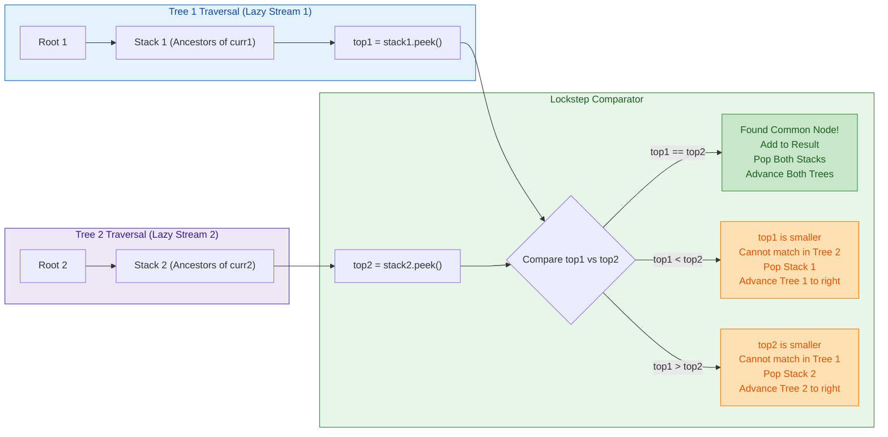
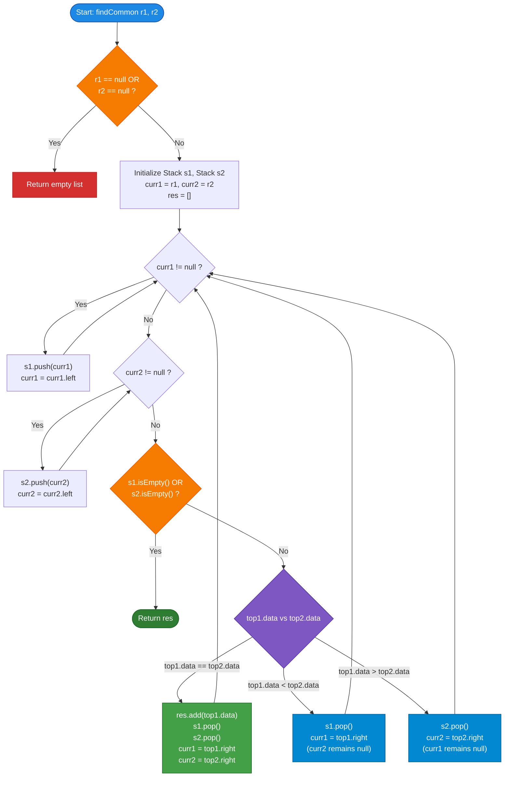

# GeeksforGeeks Problem of the Day: Common Nodes in Two BSTs

- **Problem Link:** [GeeksforGeeks - Common Nodes in Two BSTs](https://www.geeksforgeeks.org/problems/print-common-nodes-in-bst/1)
- **Difficulty:** Medium
- **Topic Tags:** Binary Search Tree, Tree, Stack, Two Pointers, Traversal, Data Structures, Algorithms
- **Target Audience:** POTD Solvers, Computer Science Students, Competitive Programmers, Technical Interview Candidates (Amazon, Microsoft, Google, Adobe, Flipkart, Walmart)

---

## 1. Problem Statement

Given the root nodes of two **Binary Search Trees (BSTs)**, `r1` and `r2`, find all the nodes that are **common in both BSTs** (i.e., elements whose values appear in both trees).

The output must be returned as a list of integers sorted in **strictly ascending order**.

### Mathematical Formulation
Let $\mathcal{T}_1$ and $\mathcal{T}_2$ be two Binary Search Trees with node value sets:
$$\mathcal{S}_1 = \{ u.\text{data} \mid u \in \mathcal{T}_1 \}, \quad \mathcal{S}_2 = \{ v.\text{data} \mid v \in \mathcal{T}_2 \}$$

We are required to compute the set intersection:
$$\mathcal{S}_{\text{common}} = \mathcal{S}_1 \cap \mathcal{S}_2$$

and output the elements in monotonically increasing order:
$$\mathcal{S}_{\text{common}} = \langle x_1, x_2, \dots, x_k \rangle \quad \text{such that } x_1 < x_2 < \dots < x_k$$

### Key Properties of a Binary Search Tree (BST)
For every node $u$ in a valid BST:
1. Every node $v$ in the **left subtree** satisfies: $v.\text{data} < u.\text{data}$.
2. Every node $w$ in the **right subtree** satisfies: $w.\text{data} > u.\text{data}$.
3. An **in-order traversal** $(\text{Left} \to \text{Node} \to \text{Right})$ produces node values in **monotonically strictly increasing order**.

---

## 2. Examples & Visual Walkthroughs

### Example 1

#### Input Trees:

```text
       Tree 1 (r1)                       Tree 2 (r2)
           5                                 10
         /   \                             /    \
        1     10                          7      20
       / \    /                          / \
      0   4  7                          4   9
              \
               9
```

- **Tree 1 In-order:** `[0, 1, 4, 5, 7, 9, 10]`
- **Tree 2 In-order:** `[4, 7, 9, 10, 20]`
- **Set Intersection:** $\{4, 7, 9, 10\}$
- **Output:** `[4, 7, 9, 10]`

#### Visual Comparison:

```text
Tree 1:   0 --- 1 --- [4] --- 5 --- [7] --- [9] --- [10]
                       |             |       |        |
Tree 2:               [4] --------- [7] --- [9] --- [10] --- 20

Common Elements:       4             7       9       10
```

---

### Example 2

#### Input Trees:

```text
       Tree 1 (r1)                       Tree 2 (r2)
          10                                  2
         /  \                                / \
        2    11                             1   3
       / \
      1   3
```

- **Tree 1 In-order:** `[1, 2, 3, 10, 11]`
- **Tree 2 In-order:** `[1, 2, 3]`
- **Set Intersection:** $\{1, 2, 3\}$
- **Output:** `[1, 2, 3]`

---

### Example 3 (Disjoint BSTs)

#### Input Trees:

```text
       Tree 1 (r1)                       Tree 2 (r2)
           2                                  7
          / \                                / \
         1   3                              6   8
```

- **Tree 1 In-order:** `[1, 2, 3]`
- **Tree 2 In-order:** `[6, 7, 8]`
- **Set Intersection:** $\emptyset$
- **Output:** `[]` (Empty list)

---

### Example 4 (Empty / Null Tree)

- **Tree 1:** `null`
- **Tree 2:** Root with node `5`
- **Output:** `[]`

---

## 3. Constraints

- $1 \le \text{Number of Nodes in } \mathcal{T}_1, \mathcal{T}_2 \le 10^5$
- $1 \le \text{node.data} \le 10^9$
- **Expected Time Complexity:** $\mathcal{O}(N_1 + N_2)$
- **Expected Auxiliary Space:** $\mathcal{O}(h_1 + h_2)$ where $h_1$ and $h_2$ denote the heights of $\mathcal{T}_1$ and $\mathcal{T}_2$ respectively ($\mathcal{O}(\log N_1 + \log N_2)$ for balanced trees, $\mathcal{O}(N_1 + N_2)$ in worst-case skewed trees).

---

## 4. Visual Architecture: Dual-Iterator Lockstep Traversal

The optimal solution avoids storing all elements in full arrays. Instead, it treats each BST as a **lazy sorted stream** using an explicit stack for in-order traversal.



### Key Invariant
At any point during the concurrent traversal:
1. `stack1.peek()` holds the **smallest unprocessed value** in $\mathcal{T}_1$.
2. `stack2.peek()` holds the **smallest unprocessed value** in $\mathcal{T}_2$.
3. By comparing these two minimum values:
   - If they are equal, we found a match. Both streams advance.
   - If `top1.data < top2.data`, `top1.data` is strictly smaller than any remaining element in $\mathcal{T}_2$ (since all future elements from $\mathcal{T}_2$ will be $\ge \text{top2.data}$). Thus, `top1.data` can **never match**. We safely discard `top1` and advance $\mathcal{T}_1$.
   - If `top1.data > top2.data`, by symmetry, `top2.data` can never match. We discard `top2` and advance $\mathcal{T}_2$.
4. Traversal terminates as soon as **either tree is exhausted**, because no remaining element in the other tree could possibly have a match.

---

## 5. Step-by-Step Simulation & State Trace Table

Let us trace **Example 1**:
- $\mathcal{T}_1$: Nodes $\{5, 1, 10, 0, 4, 7, 9\}$
- $\mathcal{T}_2$: Nodes $\{10, 7, 20, 4, 9\}$

| Step | `curr1` | `curr2` | `Stack 1` (Top $\to$ Bottom) | `Stack 2` (Top $\to$ Bottom) | Values Compared | Action Taken | Common Output |
| :---: | :---: | :---: | :---: | :---: | :---: | :---: | :---: |
| **0** | `5` | `10` | `[]` | `[]` | — | Push left paths: $5 \to 1 \to 0$ and $10 \to 7 \to 4$ | `[]` |
| **1** | `null` | `null` | `[0, 1, 5]` | `[4, 7, 10]` | `0` vs `4` | $0 < 4 \implies$ Pop `0`, `curr1 = 0.right` (`null`) | `[]` |
| **2** | `null` | `null` | `[1, 5]` | `[4, 7, 10]` | `1` vs `4` | $1 < 4 \implies$ Pop `1`, `curr1 = 1.right` (`4`) | `[]` |
| **3** | `4` | `null` | `[4, 5]` | `[4, 7, 10]` | `4` vs `4` | $4 == 4 \implies$ **Match!** Add `4`, Pop both, `curr1 = 4.right` (`null`), `curr2 = 4.right` (`null`) | `[4]` |
| **4** | `null` | `null` | `[5]` | `[7, 10]` | `5` vs `7` | $5 < 7 \implies$ Pop `5`, `curr1 = 5.right` (`10`) | `[4]` |
| **5** | `10` | `null` | `[7, 10]` | `[7, 10]` | `7` vs `7` | Push left of `10` ($7$). $7 == 7 \implies$ **Match!** Add `7`, Pop both, `curr1 = 7.right` (`9`), `curr2 = 7.right` (`9`) | `[4, 7]` |
| **6** | `9` | `9` | `[9, 10]` | `[9, 10]` | `9` vs `9` | Push $9$ on both. $9 == 9 \implies$ **Match!** Add `9`, Pop both, `curr1 = 9.right` (`null`), `curr2 = 9.right` (`null`) | `[4, 7, 9]` |
| **7** | `null` | `null` | `[10]` | `[10]` | `10` vs `10` | $10 == 10 \implies$ **Match!** Add `10`, Pop both, `curr1 = 10.right` (`null`), `curr2 = 10.right` (`20`) | `[4, 7, 9, 10]` |
| **8** | `null` | `20` | `[]` | `[20]` | — | Push `20` to Stack 2. Stack 1 is now **empty**! | `[4, 7, 9, 10]` |
| **9** | `null` | `null` | `[]` | `[20]` | — | **Terminate** (Stack 1 exhausted; no further matches possible). | **`[4, 7, 9, 10]`** |

---

## 6. Algorithm Flowchart



---

## 7. From Naive to Pro: Algorithmic Progression

### Trade-off Matrix

| Method | Time Complexity | Auxiliary Space | Pros | Cons |
| :--- | :---: | :---: | :--- | :--- |
| **Method 1: Naive (In-order + BST Search)** | $\mathcal{O}(N_1 \cdot h_2)$ | $\mathcal{O}(h_1)$ | Very simple to code | Slow for skewed trees ($\mathcal{O}(N_1 N_2)$ worst case) |
| **Method 2: Better (In-order + Hash Set)** | $\mathcal{O}(N_1 + N_2)$ | $\mathcal{O}(N_1)$ | Clean $\mathcal{O}(N)$ average time | Hash overhead, high space $\mathcal{O}(N_1)$ |
| **Method 3: Better (Two In-order Arrays + Two Pointers)** | $\mathcal{O}(N_1 + N_2)$ | $\mathcal{O}(N_1 + N_2)$ | Simple two-pointer merge | Allocates full arrays for both trees |
| **Method 4: Pro (Simultaneous Two-Stack In-order)** | $\mathbf{\mathcal{O}(N_1 + N_2)}$ | $\mathbf{\mathcal{O}(h_1 + h_2)}$ | **Optimal time & space, zero array overhead** | Requires iterative stack control |

---

### Method 1: Naive (In-order Traversal of $\mathcal{T}_1$ + BST Search in $\mathcal{T}_2$)

- **Concept:** Traverse $\mathcal{T}_1$ in-order. For each visited value, perform standard binary search in $\mathcal{T}_2$.
- **Pseudocode:**
```text
function findCommon_Naive(r1, r2):
    res = []
    
    function search(root, target):
        curr = root
        while curr != null:
            if curr.data == target: return true
            else if target < curr.data: curr = curr.left
            else: curr = curr.right
        return false

    function inorder(node):
        if node == null: return
        inorder(node.left)
        if search(r2, node.data):
            res.append(node.data)
        inorder(node.right)

    inorder(r1)
    return res
```
- **Complexity:**
  - **Time:** $\mathcal{O}(N_1 \cdot h_2)$ (Worst-case $\mathcal{O}(N_1 \cdot N_2)$ if $\mathcal{T}_2$ is a degenerate linked list).
  - **Space:** $\mathcal{O}(h_1)$ for recursion stack.

---

### Method 2: Better (In-order Traversal + Hash Set)

- **Concept:** Store all nodes of $\mathcal{T}_1$ in a Hash Set. Then traverse $\mathcal{T}_2$ in-order; if a node's value exists in the set, append it to `res`. Since $\mathcal{T}_2$ is traversed in-order, the matches are collected in sorted order.
- **Pseudocode:**
```text
function findCommon_HashSet(r1, r2):
    set1 = new HashSet()
    res = []

    function populate(node):
        if node == null: return
        set1.add(node.data)
        populate(node.left)
        populate(node.right)

    function inorder(node):
        if node == null: return
        inorder(node.left)
        if set1.contains(node.data):
            res.append(node.data)
        inorder(node.right)

    populate(r1)
    inorder(r2)
    return res
```
- **Complexity:**
  - **Time:** $\mathcal{O}(N_1 + N_2)$ average.
  - **Space:** $\mathcal{O}(N_1)$ for hash set.

---

### Method 3: Better (Two Full In-order Arrays + Two-Pointer Intersection)

- **Concept:** Extract the full in-order arrays for both trees: `arr1` (size $N_1$) and `arr2` (size $N_2$). Both arrays are sorted. Use standard two-pointer intersection.
- **Pseudocode:**
```text
function findCommon_TwoArrays(r1, r2):
    arr1 = [], arr2 = [], res = []
    
    inorder(r1, arr1)
    inorder(r2, arr2)
    
    i = 0, j = 0
    while i < length(arr1) and j < length(arr2):
        if arr1[i] == arr2[j]:
            res.append(arr1[i])
            i++, j++
        else if arr1[i] < arr2[j]:
            i++
        else:
            j++
            
    return res
```
- **Complexity:**
  - **Time:** $\mathcal{O}(N_1 + N_2)$.
  - **Space:** $\mathcal{O}(N_1 + N_2)$ to store all nodes in heap memory.

---

### Method 4: Pro Approach (Simultaneous Two-Stack Lockstep Traversal)

- **Strategy:** Merge the two in-order traversals **on the fly** using two explicit stacks without storing full lists in memory.
- **Why this is optimal:**
  - **Time:** Exactly $\mathcal{O}(N_1 + N_2)$ — every node is pushed and popped at most once.
  - **Auxiliary Space:** Only $\mathcal{O}(h_1 + h_2)$. For balanced trees, this uses only $\mathcal{O}(\log N_1 + \log N_2)$ memory!
  - **Early Termination:** As soon as one tree is completely exhausted, the algorithm stops immediately without needing to visit remaining nodes of the second tree.
- **Pseudocode:**
```text
function findCommon_Optimal(r1, r2):
    s1 = new Stack(), s2 = new Stack()
    curr1 = r1, curr2 = r2
    res = []

    while true:
        while curr1 != null:
            s1.push(curr1)
            curr1 = curr1.left
            
        while curr2 != null:
            s2.push(curr2)
            curr2 = curr2.left

        if s1.isEmpty() or s2.isEmpty():
            break

        top1 = s1.peek()
        top2 = s2.peek()

        if top1.data == top2.data:
            res.append(top1.data)
            s1.pop()
            s2.pop()
            curr1 = top1.right
            curr2 = top2.right
        else if top1.data < top2.data:
            s1.pop()
            curr1 = top1.right
        else:
            s2.pop()
            curr2 = top2.right

    return res
```

---

## 8. Multi-Language Implementations (Pro Method)

### Java (21)

```java
/* Structure of a Binary Search Tree node
class Node {
  public int data;
  public Node left;
  public Node right;

  public Node(int val) {
      data = val;
      left = right = null;
  }
};
*/

import java.util.ArrayList;
import java.util.ArrayDeque;
import java.util.Deque;

class Solution {
    // Function to find the nodes that are common in both BSTs.
    public ArrayList<Integer> findCommon(Node r1, Node r2) {
        ArrayList<Integer> res = new ArrayList<>();
        if (r1 == null || r2 == null) {
            return res;
        }

        // Deque used as an efficient stack without synchronization overhead
        Deque<Node> s1 = new ArrayDeque<>();
        Deque<Node> s2 = new ArrayDeque<>();
        Node curr1 = r1;
        Node curr2 = r2;

        while (true) {
            // Push all left descendants of current node in Tree 1
            while (curr1 != null) {
                s1.push(curr1);
                curr1 = curr1.left;
            }

            // Push all left descendants of current node in Tree 2
            while (curr2 != null) {
                s2.push(curr2);
                curr2 = curr2.left;
            }

            // If either stack is empty, no further common elements can exist
            if (s1.isEmpty() || s2.isEmpty()) {
                break;
            }

            Node top1 = s1.peek();
            Node top2 = s2.peek();

            if (top1.data == top2.data) {
                // Match found: append to result and advance both trees
                res.add(top1.data);
                s1.pop();
                s2.pop();
                curr1 = top1.right;
                curr2 = top2.right;
            } else if (top1.data < top2.data) {
                // top1 is smaller than top2; advance Tree 1 to catch up
                s1.pop();
                curr1 = top1.right;
            } else {
                // top2 is smaller than top1; advance Tree 2 to catch up
                s2.pop();
                curr2 = top2.right;
            }
        }

        return res;
    }
}
```

---

### Python3

```python
''' 
Structure of a Binary Search Tree node
class Node:
    def __init__(self, val):
        self.data = val
        self.left = None
        self.right = None
'''

class Solution:
    # Function to find the nodes that are common in both BSTs.
    def findCommon(self, r1: 'Node', r2: 'Node') -> list[int]:
        res = []
        if not r1 or not r2:
            return res

        s1 = []
        s2 = []
        curr1 = r1
        curr2 = r2

        while True:
            # Traverse to the leftmost node in Tree 1
            while curr1:
                s1.append(curr1)
                curr1 = curr1.left

            # Traverse to the leftmost node in Tree 2
            while curr2:
                s2.append(curr2)
                curr2 = curr2.left

            # If either stack is exhausted, no further matches are possible
            if not s1 or not s2:
                break

            top1 = s1[-1]
            top2 = s2[-1]

            if top1.data == top2.data:
                # Common element found: record value and advance both trees
                res.append(top1.data)
                s1.pop()
                s2.pop()
                curr1 = top1.right
                curr2 = top2.right
            elif top1.data < top2.data:
                # Value in Tree 1 is smaller: discard top1 and explore its right subtree
                s1.pop()
                curr1 = top1.right
            else:
                # Value in Tree 2 is smaller: discard top2 and explore its right subtree
                s2.pop()
                curr2 = top2.right

        return res
```

---

### C (gcc 5.4)

```c
/* Structure of a Binary Search Tree node
struct Node {
    int data;
    struct Node* left;
    struct Node* right;
};
*/

#include <stdlib.h>

// Function to find common nodes in two BSTs.
// Results are populated into res[] and resSize stores total common nodes count.
void findCommon(struct Node* r1, struct Node* r2, int res[], int* resSize) {
    *resSize = 0;
    if (r1 == NULL || r2 == NULL) {
        return;
    }

    // Dynamic stacks with auto-resizing capacity
    int cap1 = 1024, cap2 = 1024;
    int top1 = 0, top2 = 0;
    struct Node** s1 = (struct Node**)malloc(cap1 * sizeof(struct Node*));
    struct Node** s2 = (struct Node**)malloc(cap2 * sizeof(struct Node*));

    struct Node* curr1 = r1;
    struct Node* curr2 = r2;

    while (1) {
        // Traverse to leftmost node of current subtree in Tree 1
        while (curr1 != NULL) {
            if (top1 >= cap1) {
                cap1 *= 2;
                s1 = (struct Node**)realloc(s1, cap1 * sizeof(struct Node*));
            }
            s1[top1++] = curr1;
            curr1 = curr1->left;
        }

        // Traverse to leftmost node of current subtree in Tree 2
        while (curr2 != NULL) {
            if (top2 >= cap2) {
                cap2 *= 2;
                s2 = (struct Node**)realloc(s2, cap2 * sizeof(struct Node*));
            }
            s2[top2++] = curr2;
            curr2 = curr2->left;
        }

        // Terminate if either stack is exhausted
        if (top1 == 0 || top2 == 0) {
            break;
        }

        struct Node* n1 = s1[top1 - 1];
        struct Node* n2 = s2[top2 - 1];

        if (n1->data == n2->data) {
            res[(*resSize)++] = n1->data;
            top1--;
            top2--;
            curr1 = n1->right;
            curr2 = n2->right;
        } else if (n1->data < n2->data) {
            top1--;
            curr1 = n1->right;
        } else {
            top2--;
            curr2 = n2->right;
        }
    }

    free(s1);
    free(s2);
}
```

---

### C++ (17)

```cpp
/* Structure of a Binary Search Tree node
class Node {
  public:
    int data;
    Node* left;
    Node* right;

    Node(int val) {
        data = val;
        left = right = nullptr;
    }
};
*/

#include <vector>
#include <stack>

using namespace std;

class Solution {
  public:
    // Function to find the nodes that are common in both BSTs.
    vector<int> findCommon(Node* r1, Node* r2) {
        vector<int> res;
        if (!r1 || !r2) {
            return res;
        }

        stack<Node*> s1;
        stack<Node*> s2;
        Node* curr1 = r1;
        Node* curr2 = r2;

        while (true) {
            // Push left descendants of current node in Tree 1
            while (curr1 != nullptr) {
                s1.push(curr1);
                curr1 = curr1->left;
            }

            // Push left descendants of current node in Tree 2
            while (curr2 != nullptr) {
                s2.push(curr2);
                curr2 = curr2->left;
            }

            // If either stack is empty, traversal can terminate early
            if (s1.empty() || s2.empty()) {
                break;
            }

            Node* top1 = s1.top();
            Node* top2 = s2.top();

            if (top1->data == top2->data) {
                // Match found
                res.push_back(top1->data);
                s1.pop();
                s2.pop();
                curr1 = top1->right;
                curr2 = top2->right;
            } else if (top1->data < top2->data) {
                // top1 is smaller: pop and advance Tree 1
                s1.pop();
                curr1 = top1->right;
            } else {
                // top2 is smaller: pop and advance Tree 2
                s2.pop();
                curr2 = top2->right;
            }
        }

        return res;
    }
};
```

---

### C#

```csharp
/* Structure of a Binary Search Tree node
class Node {
    public int data;
    public Node left, right;

    public Node(int val) {
        data = val;
        left = null;
        right = null;
    }
};
*/

using System;
using System.Collections.Generic;

class Solution {
    // Function to find the nodes that are common in both BSTs.
    public List<int> findCommon(Node r1, Node r2) {
        List<int> res = new List<int>();
        if (r1 == null || r2 == null) {
            return res;
        }

        Stack<Node> s1 = new Stack<Node>();
        Stack<Node> s2 = new Stack<Node>();
        Node curr1 = r1;
        Node curr2 = r2;

        while (true) {
            // Traverse down left branch of Tree 1
            while (curr1 != null) {
                s1.Push(curr1);
                curr1 = curr1.left;
            }

            // Traverse down left branch of Tree 2
            while (curr2 != null) {
                s2.Push(curr2);
                curr2 = curr2.left;
            }

            // If either tree has no more nodes to compare, terminate
            if (s1.Count == 0 || s2.Count == 0) {
                break;
            }

            Node top1 = s1.Peek();
            Node top2 = s2.Peek();

            if (top1.data == top2.data) {
                res.Add(top1.data);
                s1.Pop();
                s2.Pop();
                curr1 = top1.right;
                curr2 = top2.right;
            } else if (top1.data < top2.data) {
                s1.Pop();
                curr1 = top1.right;
            } else {
                s2.Pop();
                curr2 = top2.right;
            }
        }

        return res;
    }
}
```

---

### Javascript (Node v22)

```javascript
/* Structure of a Binary Search Tree node
class Node {
    constructor(val) {
        this.data = val;
        this.left = null;
        this.right = null;
    }
};
*/

/**
 * @param {Node} r1
 * @param {Node} r2
 * @return {Number[]}
 */
class Solution {
    // Function to find the nodes that are common in both BSTs.
    findCommon(r1, r2) {
        const res = [];
        if (r1 === null || r2 === null) {
            return res;
        }

        const s1 = [];
        const s2 = [];
        let curr1 = r1;
        let curr2 = r2;

        while (true) {
            // Push all left descendants of current node in Tree 1
            while (curr1 !== null) {
                s1.push(curr1);
                curr1 = curr1.left;
            }

            // Push all left descendants of current node in Tree 2
            while (curr2 !== null) {
                s2.push(curr2);
                curr2 = curr2.left;
            }

            // If either stack is empty, no further common elements can exist
            if (s1.length === 0 || s2.length === 0) {
                break;
            }

            const top1 = s1[s1.length - 1];
            const top2 = s2[s2.length - 1];

            if (top1.data === top2.data) {
                res.push(top1.data);
                s1.pop();
                s2.pop();
                curr1 = top1.right;
                curr2 = top2.right;
            } else if (top1.data < top2.data) {
                s1.pop();
                curr1 = top1.right;
            } else {
                s2.pop();
                curr2 = top2.right;
            }
        }

        return res;
    }
}
```

---

## 9. Complexity Analysis

### Time Complexity: $\mathcal{O}(N_1 + N_2)$
- **Pushing Nodes:** Each node of $\mathcal{T}_1$ is visited and pushed onto Stack $s_1$ at most once. Each node of $\mathcal{T}_2$ is visited and pushed onto Stack $s_2$ at most once.
- **Popping Nodes:** Each node is popped from its stack at most once when it is either matched or discarded.
- **Comparison & Iteration:** Each iteration performs $\mathcal{O}(1)$ work (top peek, integer comparison, stack pop, pointer assignment).
- Therefore, the total number of operations across both trees is bounded by:
  $$\mathcal{T}_{\text{total}} = 2 \cdot N_1 + 2 \cdot N_2 = \mathcal{O}(N_1 + N_2)$$
- In cases where one tree is significantly smaller than the other (e.g. $N_2 \ll N_1$ with smaller range), the algorithm terminates as soon as $\mathcal{T}_2$ finishes, taking even less than $\mathcal{O}(N_1 + N_2)$ time.

### Auxiliary Space Complexity: $\mathcal{O}(h_1 + h_2)$
- At any point in time, Stack $s_1$ contains nodes along a single root-to-leaf path in $\mathcal{T}_1$. Hence, its size is strictly bounded by the height of $\mathcal{T}_1$: $|s_1| \le h_1$.
- Similarly, Stack $s_2$ contains nodes along a single root-to-leaf path in $\mathcal{T}_2$: $|s_2| \le h_2$.
- **Balanced BSTs (e.g., AVL / Red-Black):** $h_1 \approx \log_2 N_1$ and $h_2 \approx \log_2 N_2$, giving optimal **$\mathcal{O}(\log N_1 + \log N_2)$** auxiliary space!
- **Worst Case (Degenerate Skewed Trees):** $h_1 = N_1, h_2 = N_2 \implies \mathcal{O}(N_1 + N_2)$.
- Contrast this with the array-based approach which **always** requires $\mathcal{O}(N_1 + N_2)$ heap space regardless of tree balance.

---

## 10. Edge Cases & Interview Insights

### Critical Edge Cases
1. **Empty Trees (`r1 == null` or `r2 == null`):**
   - The initial guard clause immediately returns an empty list `[]`.
2. **Completely Disjoint Trees:**
   - E.g., $\max(\mathcal{T}_1) < \min(\mathcal{T}_2)$.
   - All nodes of $\mathcal{T}_1$ are popped and discarded before any match is evaluated. Stack $s_1$ empties, loop breaks cleanly, returns `[]`.
3. **Identical Trees:**
   - At every step, `top1.data == top2.data`.
   - Both stacks advance in lockstep, outputting the entire in-order sequence of the tree.
4. **Different Heights / Asymmetric Shapes:**
   - Handled seamlessly because each stack operates independently and only advances when required by the comparator.
5. **Single Node Trees:**
   - Directly tested and handled without any out-of-bounds or null pointer dereferences.

### Common Pitfalls to Avoid
- **Synchronized Stack in Java:** Avoid using `java.util.Stack` because its methods are `synchronized` (thread-safe), which adds unnecessary locking overhead. Always prefer `ArrayDeque` or `Deque` in competitive programming and interviews.
- **Prematurely advancing both pointers on inequality:** When `top1.data < top2.data`, you must **only** pop $s_1$ and advance `curr1 = top1.right`. Do **not** pop $s_2$, because `top2.data` might still match a larger element that will appear later in $\mathcal{T}_1$!
- **Null Checks before Right Child Assignment:** Do not check `if (top.right != null)` before assigning `curr = top.right`. If `top.right` is `null`, assigning `curr = null` is intended and correctly prevents unwanted pushes in the next iteration.

### Interview Follow-up: $\mathcal{O}(1)$ Space using Morris Traversal?
- Can we solve this in $\mathcal{O}(1)$ auxiliary space?
- **Yes!** By threading the trees using **Morris In-order Traversal** (temporary right-child pointers to in-order successors), we can generate a lazy stream of in-order elements with $\mathcal{O}(1)$ additional memory. However, Morris traversal temporarily modifies tree pointers, requiring restoring them before termination, making concurrent lockstep control substantially more complex. The dual-stack approach is the industry-standard expected solution in technical interviews.
