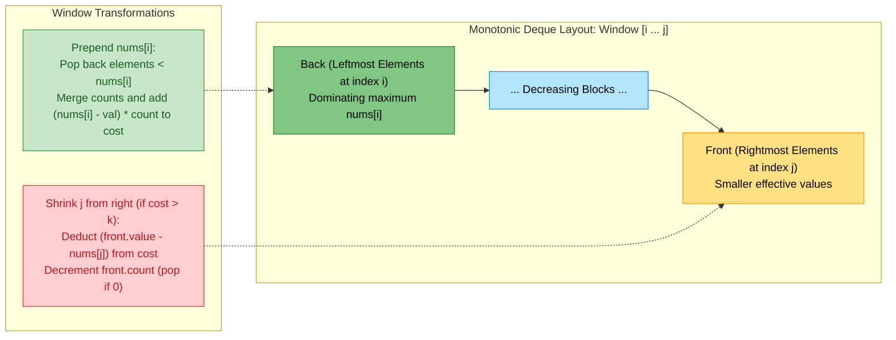
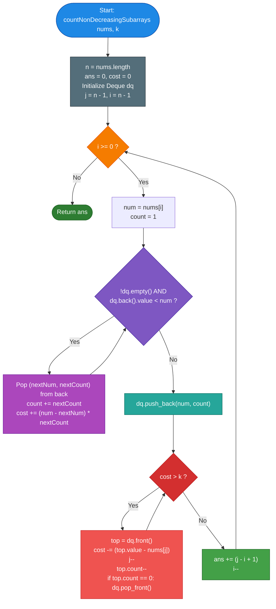

# LeetCode Problem of the Day: Count Non-Decreasing Subarrays After K Operations

- **Problem Link:** [LeetCode 3420 - Count Non-Decreasing Subarrays After K Operations](https://leetcode.com/problems/count-non-decreasing-subarrays-after-k-operations/)
- **Difficulty:** Hard
- **Topic Tags:** Array, Stack, Monotonic Stack, Sliding Window, Two Pointers, Monotonic Deque
- **Target Audience:** POTD Solvers, Computer Science Students, Competitive Programmers, Technical Interview Candidates (Google, Meta, Microsoft, Amazon, Citadel, Jane Street)

---

## 1. Problem Statement

You are given an array `nums` of $n$ integers and an integer $k$.

For each contiguous subarray of `nums`, you can perform **up to $k$ operations** on it. In each operation, you can increment any element of the subarray by $1$.

Each subarray is evaluated **independently**, meaning any modifications made to one subarray do not affect other subarrays.

Return the total **number of subarrays** that can be made **non-decreasing** using at most $k$ operations.

An array $A$ of length $m$ is said to be **non-decreasing** if:
$$A[0] \le A[1] \le A[2] \le \dots \le A[m - 1]$$

---

### Mathematical Formulation

Consider a candidate contiguous subarray $nums[l \dots r]$ spanning indices $l \le m \le r$.

To transform $nums[l \dots r]$ into a non-decreasing sequence $nums'[l \dots r]$ using the minimum possible number of increment operations:
1. The first element $nums'[l]$ is left unchanged: $nums'[l] = nums[l]$.
2. For each subsequent position $m \in [l + 1, r]$, to satisfy $nums'[m] \ge nums'[m - 1]$, every element must be elevated to at least the running prefix maximum encountered so far:
   $$nums'[m] = \max_{l \le p \le m} nums[p]$$
3. The minimum operations required for subarray $[l, r]$ is the sum of differences:
   $$\text{Cost}(l, r) = \sum_{m = l}^r \left( \max_{l \le p \le m} nums[p] - nums[m] \right)$$

A subarray $[l, r]$ is valid if and only if:
$$\text{Cost}(l, r) \le k$$

We need to compute:
$$\text{Ans} = \sum_{l = 0}^{n - 1} \sum_{r = l}^{n - 1} \mathbb{I}(\text{Cost}(l, r) \le k)$$

---

## 2. Examples & Visual Walkthroughs

### Example 1

- **Input:** `nums = [6, 3, 1, 2, 4, 4]`, `k = 7`
- **Output:** `17`

#### Analysis of All 21 Subarrays ($N = 6$):
Total possible subarrays $= \frac{6 \times 7}{2} = 21$.

Let us examine the costs for subarrays starting at index $0$ (`nums[0] = 6`):
- `[6]`: Cost $= 0 \le 7$ $\implies$ **Valid**
- `[6, 3]`: Needs $3 \to 6$ (Cost $= 3 \le 7$) $\implies$ **Valid**
- `[6, 3, 1]`: Needs $3 \to 6, 1 \to 6$ (Cost $= 3 + 5 = 8 > 7$) $\implies$ **Invalid**
- `[6, 3, 1, 2]`: Cost $= 3 + 5 + 4 = 12 > 7$ $\implies$ **Invalid**
- `[6, 3, 1, 2, 4]`: Cost $= 3 + 5 + 4 + 2 = 14 > 7$ $\implies$ **Invalid**
- `[6, 3, 1, 2, 4, 4]`: Cost $= 3 + 5 + 4 + 2 + 2 = 16 > 7$ $\implies$ **Invalid**

Only $4$ subarrays out of $21$ require more than $k = 7$ operations:
`[6, 3, 1]`, `[6, 3, 1, 2]`, `[6, 3, 1, 2, 4]`, and `[6, 3, 1, 2, 4, 4]`.
$$\text{Valid Subarrays} = 21 - 4 = \mathbf{17}$$

---

### Example 2

- **Input:** `nums = [6, 3, 1, 3, 6]`, `k = 4`
- **Output:** `12`

#### Subarray Breakdown:
- **1-element subarrays (5):** All valid (Cost $= 0$).
- **2-element subarrays (4):**
  - `[6, 3]`: Cost $= 3 \le 4$ (Valid)
  - `[3, 1]`: Cost $= 2 \le 4$ (Valid)
  - `[1, 3]`: Cost $= 0 \le 4$ (Valid)
  - `[3, 6]`: Cost $= 0 \le 4$ (Valid)
- **3-element subarrays (3):**
  - `[6, 3, 1]`: Cost $= 3 + 5 = 8 > 4$ (Invalid)
  - `[3, 1, 3]`: Cost $= 2 + 0 = 2 \le 4$ (Valid)
  - `[1, 3, 6]`: Cost $= 0 \le 4$ (Valid)
- **4-element subarrays (2):**
  - `[6, 3, 1, 3]`: Cost $= 3 + 5 + 3 = 11 > 4$ (Invalid)
  - `[3, 1, 3, 6]`: Cost $= 2 + 0 + 0 = 2 \le 4$ (Valid)
- **5-element subarray (1):**
  - `[6, 3, 1, 3, 6]`: Cost $= 3 + 5 + 3 + 0 = 11 > 4$ (Invalid)

$$\text{Total Valid} = 5 + 4 + 2 + 1 = \mathbf{12}$$

---

## 3. Constraints

- $1 \le n = \text{nums.length} \le 10^5$
- $1 \le \text{nums}[i] \le 10^9$
- $1 \le k \le 10^9$
- **Expected Time Complexity:** $\mathcal{O}(n)$
- **Expected Auxiliary Space:** $\mathcal{O}(n)$

---

## 4. Visual Architecture: The Reverse Sliding Window & Monotonic Deque

### Why Forward (Left-to-Right) Sliding Window Fails
In a traditional sliding window:
- Expanding $r \to r + 1$ adds $nums[r+1]$.
- However, when the cost exceeds $k$ and we shrink from the left ($l \to l + 1$), removing $nums[l]$ alters the prefix maximum for **all** elements in the window.
- If $nums[l]$ was the dominant maximum, all subsequent elements that were leveled up to $nums[l]$ now collapse down to a smaller new maximum! Tracking these cascading drops dynamically in $\mathcal{O}(1)$ time from left to right is notoriously difficult.

### The Reverse Breakthrough: Right-to-Left Traversal
Instead of moving left-to-right, we **iterate the left pointer $i$ backwards** from $n - 1$ down to $0$, maintaining a valid right boundary $j$:

1. When we prepend $nums[i]$ to the subarray $nums[i+1 \dots j]$:
   - $nums[i]$ becomes the new prefix maximum for all subsequent elements that are smaller than $nums[i]$ until an element $\ge nums[i]$ is reached.
   - Any group of elements currently capped at a smaller value $v < nums[i]$ is now lifted to $nums[i]$.
   - The extra cost to lift a group of $c$ elements from $v$ to $nums[i]$ is simply:
     $$\Delta \text{Cost} = (nums[i] - v) \times c$$
   - These elements merge with $nums[i]$ into a single consolidated block of size $c + 1$ with effective value $nums[i]$.

2. This behavior maps onto a **Monotonic Decreasing Deque**:
   - The deque stores pairs: `(effective_value, count)`.
   - Elements are ordered by `effective_value` from the rightmost elements (at the **front**) to the leftmost elements (at the **back**).



### Invariant and Window Validity
- For each fixed left index $i$, if $j$ is the largest index such that $\text{Cost}(i, j) \le k$, then **every** subarray $nums[i \dots m]$ with $i \le m \le j$ is also valid (since shortening the right side can never increase cost).
- Therefore, exactly **$(j - i + 1)$** valid subarrays start at index $i$.

---

## 5. Step-by-Step Simulation & State Trace Table

Let us trace **Example 1**: `nums = [6, 3, 1, 2, 4, 4]`, $k = 7$.
Array length $n = 6$. Start with $j = 5$, `ans = 0`, `cost = 0`.

| $i$ | `nums[i]` | Merge Actions in Deque (Back) | Deque State (Front $\to$ Back) | `cost` | Shrink $j$ Actions (Front) | $j$ | Subarrays Added $(j - i + 1)$ | Total `ans` |
| :---: | :---: | :--- | :--- | :---: | :--- | :---: | :---: | :---: |
| **5** | `4` | Push `(4, 1)` | `[(4, 1)]` | 0 | None ($0 \le 7$) | 5 | $5 - 5 + 1 = 1$ | **1** |
| **4** | `4` | $4 \not< 4 \implies$ Push `(4, 1)` | `[(4, 1), (4, 1)]` | 0 | None ($0 \le 7$) | 5 | $5 - 4 + 1 = 2$ | **3** |
| **3** | `2` | $4 \not< 2 \implies$ Push `(2, 1)` | `[(4, 1), (4, 1), (2, 1)]` | 0 | None ($0 \le 7$) | 5 | $5 - 3 + 1 = 3$ | **6** |
| **2** | `1` | $2 \not< 1 \implies$ Push `(1, 1)` | `[(4, 1), (4, 1), (2, 1), (1, 1)]` | 0 | None ($0 \le 7$) | 5 | $5 - 2 + 1 = 4$ | **10** |
| **1** | `3` | Pop `(1, 1)` $\implies \text{cost} += 2$<br/>Pop `(2, 1)` $\implies \text{cost} += 1$<br/>Push `(3, 3)` | `[(4, 1), (4, 1), (3, 3)]` | 3 | None ($3 \le 7$) | 5 | $5 - 1 + 1 = 5$ | **15** |
| **0** | `6` | Pop `(3, 3)` $\implies \text{cost} += 9$<br/>Pop `(4, 1)` $\implies \text{cost} += 2$<br/>Pop `(4, 1)` $\implies \text{cost} += 2$<br/>Push `(6, 6)` | `[(6, 6)]` | 16 | **Shrink ($16 > 7$):**<br/>$j=5$: sub $6-4=2 \implies$ cost $14$, $j=4$<br/>$j=4$: sub $6-4=2 \implies$ cost $12$, $j=3$<br/>$j=3$: sub $6-2=4 \implies$ cost $8$, $j=2$<br/>$j=2$: sub $6-1=5 \implies$ cost $3 \le 7$, $j=1$ | 1 | $1 - 0 + 1 = 2$ | **17** |

**Final Answer:** `ans = 17`.

---

## 6. Algorithm Flowchart



---

## 7. From Naive to Pro: Algorithmic Progression

### Trade-off Matrix

| Method | Time Complexity | Auxiliary Space | Feasibility for $n = 10^5$ | Key Bottleneck |
| :--- | :---: | :---: | :---: | :--- |
| **Method 1: Naive Cubic Brute Force** | $\mathcal{O}(n^3)$ | $\mathcal{O}(1)$ | TLE ($10^{15}$ ops) | Recomputes every prefix max from scratch |
| **Method 2: Incremental Quadratic Search** | $\mathcal{O}(n^2)$ | $\mathcal{O}(1)$ | TLE ($10^{10}$ ops) | Tests every possible $(l, r)$ pair |
| **Method 3: Binary Search + Segment Tree** | $\mathcal{O}(n \log^2 n)$ | $\mathcal{O}(n)$ | Borderline TLE ($\approx 3 \times 10^7$ ops) | High constant factors, complex NGE tree |
| **Method 4: Pro Reverse Monotonic Deque** | $\mathbf{\mathcal{O}(n)}$ | $\mathbf{\mathcal{O}(n)}$ | **Optimal ($\approx 10^5$ ops, $< 50\text{ms}$)** | **Linear single-pass sliding window** |

---

### Method 1: Naive Cubic Brute Force $\mathcal{O}(n^3)$
- **Concept:** For every subarray $[l, r]$, simulate the operation count by running a forward loop that tracks the running maximum.
- **Pseudocode:**
```text
function countSubarrays_Cubic(nums, k):
    ans = 0
    n = length(nums)
    for l from 0 to n - 1:
        for r from l to n - 1:
            cost = 0
            curr_max = nums[l]
            for m from l to r:
                curr_max = max(curr_max, nums[m])
                cost += (curr_max - nums[m])
            if cost <= k:
                ans++
    return ans
```

---

### Method 2: Better Incremental Check $\mathcal{O}(n^2)$
- **Concept:** Notice that as $r$ increases for a fixed $l$, `curr_max` and `cost` accumulate incrementally.
- **Pseudocode:**
```text
function countSubarrays_Quadratic(nums, k):
    ans = 0
    n = length(nums)
    for l from 0 to n - 1:
        cost = 0
        curr_max = nums[l]
        for r from l to n - 1:
            curr_max = max(curr_max, nums[r])
            cost += (curr_max - nums[r])
            if cost <= k:
                ans++
            else:
                break // Cost only increases as r expands
    return ans
```

---

### Method 3: Binary Search on Window with Segment Tree $\mathcal{O}(n \log^2 n)$
- **Concept:** Since $\text{Cost}(l, r)$ monotonically increases with $r$, use binary search on $r \in [l, n-1]$.
- To compute $\text{Cost}(l, r)$ in $\mathcal{O}(\log n)$ time, use a Segment Tree combined with Next Greater Element (NGE) pointers.
- Still requires $\mathcal{O}(n \log^2 n)$ or $\mathcal{O}(n \log n)$ time with substantial implementation complexity.

---

### Method 4: Pro Approach — Reverse Sliding Window with Monotonic Deque $\mathcal{O}(n)$
- **The Core Strategy:**
  1. Iterate $i$ from $n - 1$ down to $0$.
  2. Maintain a monotonic decreasing deque from front (right side of window) to back (left side of window).
  3. Prepending $nums[i]$ pops and absorbs all smaller elements from the back, adding $(nums[i] - \text{val}) \times \text{count}$ to `cost`.
  4. If `cost > k`, shrink the window from the right ($j$) by subtracting $(\text{front.val} - nums[j])$ from `cost`.
  5. Add $(j - i + 1)$ to `ans`.
  6. Using flat arrays for the deque yields cache-optimal execution with zero dynamic allocation overhead.
- **Pseudocode:**
```text
function countNonDecreasingSubarrays_Optimal(nums, k):
    n = length(nums)
    ans = 0, cost = 0
    dq = empty deque // stores [value, count]
    j = n - 1

    for i from n - 1 down to 0:
        num = nums[i]
        count = 1

        while not dq.is_empty() and dq.back().value < num:
            popped = dq.pop_back()
            count += popped.count
            cost += (num - popped.value) * popped.count

        dq.push_back([num, count])

        while cost > k:
            cost -= (dq.front().value - nums[j])
            j--
            dq.front().count--
            if dq.front().count == 0:
                dq.pop_front()

        ans += (j - i + 1)

    return ans
```

---

## 8. Multi-Language Implementations (Pro Method)

### Java

```java
class Solution {
    public long countNonDecreasingSubarrays(int[] nums, int k) {
        int n = nums.length;
        long ans = 0;
        long cost = 0;

        // High-performance flat array implementation of a double-ended queue
        int[] val = new int[n];
        int[] cnt = new int[n];
        int head = 0;
        int tail = 0;

        int j = n - 1;

        // Traverse backwards from right to left
        for (int i = n - 1; i >= 0; --i) {
            int num = nums[i];
            int count = 1;

            // Absorb and level up all elements smaller than nums[i]
            while (tail > head && val[tail - 1] < num) {
                tail--;
                int nextNum = val[tail];
                int nextCount = cnt[tail];
                count += nextCount;
                cost += (long) (num - nextNum) * nextCount;
            }

            // Push the merged block to the back of the deque
            val[tail] = num;
            cnt[tail] = count;
            tail++;

            // Shrink the window from the right (front of deque) if cost exceeds k
            while (cost > k) {
                cost -= (long) (val[head] - nums[j]);
                j--;
                cnt[head]--;
                if (cnt[head] == 0) {
                    head++;
                }
            }

            // All subarrays starting at index i and ending in [i, j] are valid
            ans += (long) (j - i + 1);
        }

        return ans;
    }
}
```

---

### Python3

```python
from collections import deque

class Solution:
    def countNonDecreasingSubarrays(self, nums: list[int], k: int) -> int:
        n = len(nums)
        ans = 0
        cost = 0
        # Deque stores [effective_value, count] in strictly decreasing order from front to back
        dq = deque()

        j = n - 1
        for i in range(n - 1, -1, -1):
            num = nums[i]
            count = 1

            # Merge all smaller elements to the right under the new dominating value nums[i]
            while dq and dq[-1][0] < num:
                next_num, next_count = dq.pop()
                count += next_count
                cost += (num - next_num) * next_count

            dq.append([num, count])

            # Shrink window from the right if cost exceeds k
            while cost > k:
                rightmost_num, rightmost_count = dq[0]
                cost -= (rightmost_num - nums[j])
                j -= 1
                if rightmost_count > 1:
                    dq[0][1] -= 1
                else:
                    dq.popleft()

            # Add all valid subarrays starting at index i
            ans += (j - i + 1)

        return ans
```

---

### C

```c
#include <stdlib.h>

long long countNonDecreasingSubarrays(int* nums, int numsSize, int k) {
    long long ans = 0;
    long long cost = 0;

    // Use two contiguous heap arrays to represent the monotonic deque
    int* val = (int*)malloc(numsSize * sizeof(int));
    int* cnt = (int*)malloc(numsSize * sizeof(int));
    int head = 0, tail = 0;

    int j = numsSize - 1;

    for (int i = numsSize - 1; i >= 0; --i) {
        int num = nums[i];
        int count = 1;

        // Pop elements smaller than current num from the back
        while (tail > head && val[tail - 1] < num) {
            tail--;
            int nextNum = val[tail];
            int nextCount = cnt[tail];
            count += nextCount;
            cost += (long long)(num - nextNum) * nextCount;
        }

        val[tail] = num;
        cnt[tail] = count;
        tail++;

        // Shrink the window from the front (rightmost end of subarray)
        while (cost > k) {
            cost -= (long long)(val[head] - nums[j]);
            j--;
            cnt[head]--;
            if (cnt[head] == 0) {
                head++;
            }
        }

        ans += (long long)(j - i + 1);
    }

    free(val);
    free(cnt);
    return ans;
}
```

---

### C++

```cpp
#include <vector>

using namespace std;

class Solution {
public:
    long long countNonDecreasingSubarrays(vector<int>& nums, int k) {
        int n = nums.size();
        long long ans = 0;
        long long cost = 0;

        // Flat array-backed deque for maximum cache locality and speed
        vector<int> val(n);
        vector<int> cnt(n);
        int head = 0;
        int tail = 0;

        int j = n - 1;

        for (int i = n - 1; i >= 0; --i) {
            int num = nums[i];
            int count = 1;

            // Merge smaller elements from the back of the deque
            while (tail > head && val[tail - 1] < num) {
                tail--;
                int nextNum = val[tail];
                int nextCount = cnt[tail];
                count += nextCount;
                cost += static_cast<long long>(num - nextNum) * nextCount;
            }

            val[tail] = num;
            cnt[tail] = count;
            tail++;

            // Shrink window from the right if budget k is exceeded
            while (cost > k) {
                cost -= static_cast<long long>(val[head] - nums[j]);
                j--;
                cnt[head]--;
                if (cnt[head] == 0) {
                    head++;
                }
            }

            ans += static_cast<long long>(j - i + 1);
        }

        return ans;
    }
};
```

---

### C#

```csharp
public class Solution {
    public long CountNonDecreasingSubarrays(int[] nums, int k) {
        int n = nums.Length;
        long ans = 0;
        long cost = 0;

        int[] val = new int[n];
        int[] cnt = new int[n];
        int head = 0;
        int tail = 0;

        int j = n - 1;

        for (int i = n - 1; i >= 0; --i) {
            int num = nums[i];
            int count = 1;

            // Merge smaller elements from the back
            while (tail > head && val[tail - 1] < num) {
                tail--;
                int nextNum = val[tail];
                int nextCount = cnt[tail];
                count += nextCount;
                cost += (long)(num - nextNum) * nextCount;
            }

            val[tail] = num;
            cnt[tail] = count;
            tail++;

            // Shrink from the right
            while (cost > k) {
                cost -= (long)(val[head] - nums[j]);
                j--;
                cnt[head]--;
                if (cnt[head] == 0) {
                    head++;
                }
            }

            ans += (long)(j - i + 1);
        }

        return ans;
    }
}
```

---

### Javascript

```javascript
/**
 * @param {number[]} nums
 * @param {number} k
 * @return {number}
 */
var countNonDecreasingSubarrays = function(nums, k) {
    const n = nums.length;
    let ans = 0;
    let cost = 0;

    // Fast typed arrays for O(1) non-blocking queue operations
    const val = new Int32Array(n);
    const cnt = new Int32Array(n);
    let head = 0;
    let tail = 0;

    let j = n - 1;

    for (let i = n - 1; i >= 0; --i) {
        const num = nums[i];
        let count = 1;

        while (tail > head && val[tail - 1] < num) {
            tail--;
            const nextNum = val[tail];
            const nextCount = cnt[tail];
            count += nextCount;
            cost += (num - nextNum) * nextCount;
        }

        val[tail] = num;
        cnt[tail] = count;
        tail++;

        while (cost > k) {
            cost -= (val[head] - nums[j]);
            j--;
            cnt[head]--;
            if (cnt[head] === 0) {
                head++;
            }
        }

        ans += (j - i + 1);
    }

    return ans;
};
```

---

### Typescript

```typescript
function countNonDecreasingSubarrays(nums: number[], k: number): number {
    const n: number = nums.length;
    let ans: number = 0;
    let cost: number = 0;

    const val: Int32Array = new Int32Array(n);
    const cnt: Int32Array = new Int32Array(n);
    let head: number = 0;
    let tail: number = 0;

    let j: number = n - 1;

    for (let i: number = n - 1; i >= 0; --i) {
        const num: number = nums[i];
        let count: number = 1;

        while (tail > head && val[tail - 1] < num) {
            tail--;
            const nextNum: number = val[tail];
            const nextCount: number = cnt[tail];
            count += nextCount;
            cost += (num - nextNum) * nextCount;
        }

        val[tail] = num;
        cnt[tail] = count;
        tail++;

        while (cost > k) {
            cost -= (val[head] - nums[j]);
            j--;
            cnt[head]--;
            if (cnt[head] === 0) {
                head++;
            }
        }

        ans += (j - i + 1);
    }

    return ans;
}
```

---

## 9. Complexity Analysis

### Time Complexity: $\mathcal{O}(n)$
- **Left Pointer ($i$):** Moves strictly backwards from $n - 1$ down to $0$, taking exactly $n$ steps.
- **Right Pointer ($j$):** Starts at $n - 1$ and only moves leftwards (decrements). It can decrement at most $n$ times across the entire algorithm.
- **Deque Insertions & Deletions:** Each element $nums[i]$ enters the deque at index `tail` at most once. Each block is merged/popped from `tail` at most once, and popped from `head` at most once.
- **Overall Amortized Time:** Every operation is amortized $\mathcal{O}(1)$, resulting in guaranteed strictly linear time:
  $$\mathcal{T}_{\text{total}} = \mathcal{O}(n)$$

### Auxiliary Space Complexity: $\mathcal{O}(n)$
- The monotonic deque stores at most $n$ distinct blocks `(effective_value, count)`.
- Using flat arrays (`val` and `cnt` of size $n$), auxiliary space is bounded by $2 \times n \times 4\text{ bytes} \approx 800\text{ KB}$ for $n = 10^5$.
- No recursive call stack or auxiliary tree structures are needed.
  $$\mathcal{S}_{\text{total}} = \mathcal{O}(n)$$

---

## 10. Edge Cases & Interview Tips

### Critical Edge Cases
1. **Already Non-Decreasing Array (e.g., `[1, 2, 3, 4, 5]`):**
   - No elements are ever leveled up. `cost` remains $0$ throughout.
   - For every $i$, $j = n - 1$. Total answer $= \frac{n(n+1)}{2}$. Handled cleanly without any pops.
2. **Strictly Decreasing Array (e.g., `[5, 4, 3, 2, 1]`):**
   - Each new element prepended on the left dominates everything to its right.
   - Deque quickly absorbs all elements into a single block with value $nums[i]$. `cost` grows rapidly and forces $j$ to shrink. Handled correctly.
3. **Array with All Identical Elements (e.g., `[3, 3, 3, 3]`):**
   - Cost is always $0 \le k$. Correctly yields $\frac{n(n+1)}{2}$.
4. **Single Element Array ($n = 1$):**
   - Cost is $0$, answer is always $1$.
5. **Very Large $k$ ($k \ge 10^{14}$):**
   - Every subarray is valid. Handled without overflow because `ans` and `cost` use 64-bit integers.

### 64-Bit Integer Overflow Safeguard
- For $n = 10^5$, total subarrays can reach $\frac{10^5 \times 10^5}{2} = 5 \times 10^9 > 2^{31} - 1$.
- `cost` can reach $n \times \max(nums) \approx 10^5 \times 10^9 = 10^{14} > 2^{31} - 1$.
- **Always use 64-bit integers (`long` / `long long`)** for both `ans` and `cost`. Ensure multiplications like `(long)(num - nextNum) * nextCount` cast operands before multiplying to prevent 32-bit truncation.
