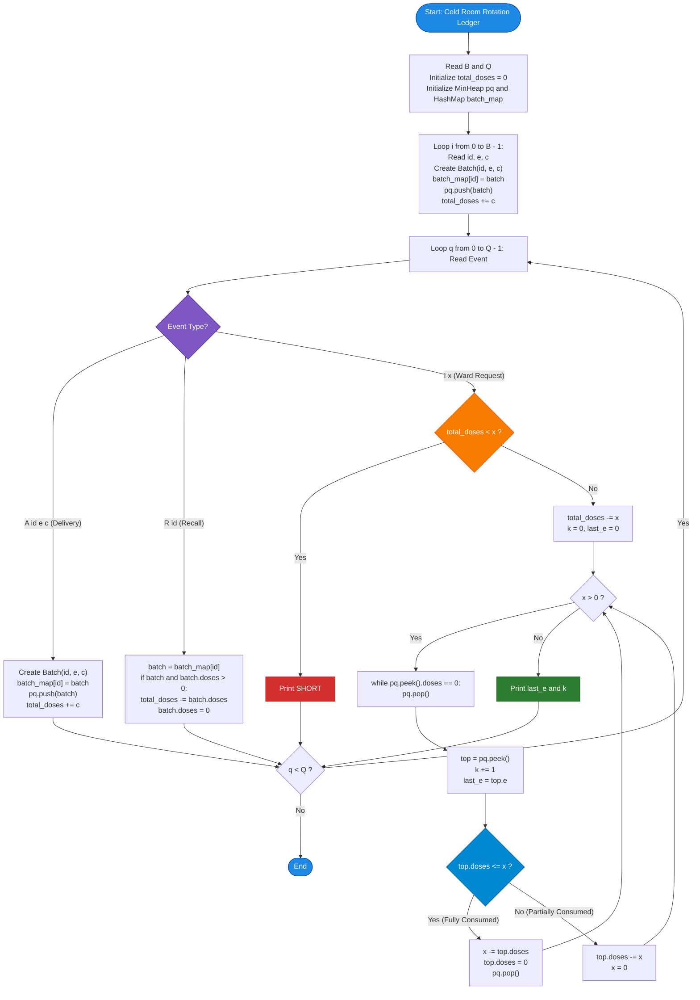

# Unstop Problem of the Day: Cold Room Rotation Ledger (Hospital Pharmacy Stockpile)

- **Platform:** [Unstop](https://unstop.com/)
- **Difficulty:** Medium
- **Topic Tags:** Priority Queue / Min-Heap, Hash Map, Balanced Binary Search Tree, Greedy, Lazy Deletion, Inventory Management, Stream Processing
- **Target Audience:** POTD Solvers, Computer Science Students, Competitive Programmers, Technical Interview Candidates (Amazon, Google, Microsoft, Uber, Flipkart)

---

## 1. Problem Statement

Nisha manages the central pharmacy of a large city hospital. Vaccines and infusion drugs arrive in labelled batches, and every batch is identified by:
- A unique **batch number** (`id`).
- An **expiry day** (`e`).
- A **dose count** (`c`) representing the number of doses it contains.

### The Cold Room Rotation Rule
The cold room follows one strict ordering rule:
1. **Primary Sort Key:** Doses are always taken from the batch that **expires soonest** (smallest expiry day $e$).
2. **Secondary Sort Key (Tie-Breaker):** If two or more batches expire on the exact same day, the batch with the **smaller batch number** (`id`) is used first.
3. **Exhaustion & Partial Consumption:** A batch is emptied completely before the next one is touched. However, the last batch used for a request may be only **partly consumed**, in which case its remaining doses stay on the shelf with the same expiry day and batch number.

---

### Initial State & Dynamic Events Stream
The day begins with $B$ initial batches already stored in the cold room.  
Following this, the logistics desk sends a stream of $Q$ real-time events of three distinct types:

1. **Delivery Event (`A id e c`):**  
   A brand-new batch with unique batch number `id`, expiry day `e`, and `c` doses arrives and is placed into the cold room inventory. Every batch number in the input (initial or delivered) is guaranteed to be unique.

2. **Recall Notice (`R id`):**  
   A regulatory recall notice is issued for batch `id`. Every dose still remaining in that batch is **discarded immediately** and can never be used again. If that batch is already completely empty, the recall notice changes nothing.

3. **Ward Request (`I x`):**  
   A hospital ward submits an urgent request for $x$ doses.
   - **All-or-Nothing Rule:** If the cold room currently holds **fewer than $x$ doses in total**, the request is **declined completely**, and **no doses** are removed.
   - **Fulfillment:** Otherwise, exactly $x$ doses leave the cold room according to the strict rotation rule.

---

### Output Specifications
For every ward request event (`I x`), in the chronological order in which they arrive:
- If the request is **accepted**, print two integers separated by a single space:
  $$\mathbf{e} \quad \mathbf{k}$$
  where:
  - $\mathbf{e}$ is the **expiry day** of the last batch that supplied doses to this request.
  - $\mathbf{k}$ is the **number of distinct batches** that supplied at least one dose to this request.
- If the request is **declined**, print the single word:
  $$\mathbf{SHORT}$$

---

## 2. Examples & Visual Walkthroughs

### Example 1 (Sample Testcase 0)

#### Input:
```text
2 8
7 15 3
4 10 2
R 4
A 9 15 3
I 4
A 3 12 1
R 7
I 1
I 1
I 2
```

#### Output:
```text
15 2
12 1
15 1
SHORT
```

#### Chronological Event Walkthrough:

```text
Initial Stock:
  - Batch 7: Expiry 15, Doses 3
  - Batch 4: Expiry 10, Doses 2
Total Active Doses = 5

1. Event: R 4
   Batch 4 is recalled! All 2 doses discarded.
   Active inventory: Batch 7 (e=15, id=7, doses=3).
   Total Doses = 3.

2. Event: A 9 15 3
   Delivery of Batch 9 (e=15, id=9, doses=3).
   Cold Room Priority Order:
     1st: Batch 7 (e=15, id=7, doses=3)  [id 7 < id 9 tie-break]
     2nd: Batch 9 (e=15, id=9, doses=3)
   Total Doses = 6.

3. Event: I 4
   Request for 4 doses. Total Doses (6) >= 4 -> ACCEPTED!
   - Take 3 doses from Batch 7 -> Batch 7 becomes EMPTY (0 doses left).
   - Remaining needed = 1 dose.
   - Take 1 dose from Batch 9 -> Batch 9 now has 2 doses left.
   - Last batch used: Batch 9 (Expiry = 15).
   - Distinct batches used: 2 (Batch 7 and Batch 9).
   -> Output: 15 2
   Remaining inventory: Batch 9 (e=15, id=9, doses=2).
   Total Doses = 2.

4. Event: A 3 12 1
   Delivery of Batch 3 (e=12, id=3, doses=1).
   Cold Room Priority Order:
     1st: Batch 3 (e=12, id=3, doses=1)  [e=12 expires before e=15]
     2nd: Batch 9 (e=15, id=9, doses=2)
   Total Doses = 3.

5. Event: R 7
   Recall for Batch 7. Batch 7 is already empty. No effect.
   Total Doses = 3.

6. Event: I 1
   Request for 1 dose. Total Doses (3) >= 1 -> ACCEPTED!
   - Take 1 dose from Batch 3 -> Batch 3 becomes EMPTY (0 doses left).
   - Last batch used: Batch 3 (Expiry = 12).
   - Distinct batches used: 1.
   -> Output: 12 1
   Remaining inventory: Batch 9 (e=15, id=9, doses=2).
   Total Doses = 2.

7. Event: I 1
   Request for 1 dose. Total Doses (2) >= 1 -> ACCEPTED!
   - Take 1 dose from Batch 9 -> Batch 9 now has 1 dose left.
   - Last batch used: Batch 9 (Expiry = 15).
   - Distinct batches used: 1.
   -> Output: 15 1
   Remaining inventory: Batch 9 (e=15, id=9, doses=1).
   Total Doses = 1.

8. Event: I 2
   Request for 2 doses. Total Doses = 1 < 2 -> DECLINED!
   -> Output: SHORT
```

---

### Example 2 (Sample Testcase 1)

#### Input:
```text
3 5
101 30 5
205 20 4
150 40 6
I 6
R 101
A 330 25 3
I 5
I 5
```

#### Output:
```text
30 2
40 2
SHORT
```

#### Explanation:
1. Initial Batches:
   - Batch 205 (e=20, doses=4)
   - Batch 101 (e=30, doses=5)
   - Batch 150 (e=40, doses=6)
   - Total doses $= 15$.
2. `I 6`: Takes $4$ doses from Batch 205 (emptied) and $2$ from Batch 101 ($3$ doses remain).  
   Last batch: Batch 101 ($e=30$), $k=2$ batches. $\implies$ **`30 2`**. Total left $= 9$.
3. `R 101`: Recalls remaining $3$ doses of Batch 101. Total left $= 6$.
4. `A 330 25 3`: Delivery of Batch 330 ($e=25$, doses=3). Total left $= 9$.
5. `I 5`: Takes $3$ doses from Batch 330 ($e=25$) and $2$ from Batch 150 ($e=40$, $4$ doses remain).  
   Last batch: Batch 150 ($e=40$), $k=2$ batches. $\implies$ **`40 2`**. Total left $= 4$.
6. `I 5`: Ward requests $5$ doses. Only $4$ doses remain. $\implies$ **`SHORT`**.

---

## 3. Constraints & Critical Scale Analysis

| Parameter | Constraint Range | Algorithmic Implications |
| :--- | :--- | :--- |
| Initial Batches $B$ | $0 \le B \le 200\,000$ | Must support large initial bulk insertion. |
| Event Queries $Q$ | $1 \le Q \le 200\,000$ | Each event must run in amortized $\mathcal{O}(\log N)$ time. |
| Batch ID `id` | $1 \le id \le 10^9$ (all distinct) | Requires a Hash Map to look up batches for recall in $\mathcal{O}(1)$. |
| Expiry Day $e$ | $1 \le e \le 10^9$ | Fits in 64-bit integer, acts as primary sort key. |
| Batch Doses $c$ | $1 \le c \le 10^9$ | Single batch doses fit in 32-bit/64-bit integers. |
| Requested Doses $x$ | $1 \le x \le 10^{14}$ | **Must use 64-bit integers** (`long long` in C/C++, `long` in Java/C#, `BigInt` in JS). |
| Total Doses Sum | Up to $4 \times 10^{14}$ | `total_doses` must be 64-bit to prevent arithmetic overflow. |
| Time Limit | $\approx 2.0\text{ seconds}$ | Must avoid re-sorting arrays or full linear scans ($\mathcal{O}(N)$ per query is TLE). |

---

## 4. Visual Architecture: Dual-Index Priority Queue with Lazy Deletion

To achieve real-time responsiveness without slowing down on recalled or emptied batches, we employ a **Dual-Index Data Structure**:

```mermaid
flowchart TD
    subgraph DataStructures ["Dual-Index Memory Model"]
        HM["Hash Map: batch_map<br/>Key: batch_id (up to 10^9)<br/>Value: Pointer to Batch object"]
        PQ["Min-Heap / PriorityQueue: heap<br/>Ordered by (expiry e ASC, id ASC)<br/>Stores active Batch pointers"]
        Counter["total_doses (64-bit integer)<br/>Tracks exact global doses available"]
    end

    subgraph Operations ["Event Processing Dispatcher"]
        OpA["Delivery 'A id e c'"] -->|Insert id -> batch| HM
        OpA -->|Push to heap| PQ
        OpA -->|total_doses += c| Counter

        OpR["Recall 'R id'"] -->|Lookup in O(1)| HM
        OpR -->|Set batch.doses = 0<br/>(Lazy Invalidation)| HM
        OpR -->|total_doses -= remaining| Counter

        OpI["Request 'I x'"] -->|O(1) Guard Check| Counter
        Counter -->|total_doses < x| Decline["Output SHORT<br/>Nothing removed"]
        Counter -->|total_doses >= x| Consume["Consume greedily from PQ<br/>Discard zero-dose batches<br/>total_doses -= x"]
    end

    style DataStructures fill:#E3F2FD,stroke:#1565C0,color:#0D47A1
    style Operations fill:#EDE7F6,stroke:#512DA8,color:#311B92
    style HM fill:#BBDEFB,stroke:#1976D2,color:#0D47A1
    style PQ fill:#C8E6C9,stroke:#388E3C,color:#1B5E20
    style Counter fill:#FFE082,stroke:#FF8F00,color:#000000
    style Decline fill:#FFCDD2,stroke:#D32F2F,color:#B71C1C
    style Consume fill:#A5D6A7,stroke:#2E7D32,color:#1B5E20
```

### Why Lazy Deletion is Amortized $\mathcal{O}(1)$
- When a recall event `R id` occurs, searching through a binary heap to delete an arbitrary element takes $\mathcal{O}(N)$ time.
- **The Pro Optimization:** We simply update `batch.doses = 0` in $\mathcal{O}(1)$ via the Hash Map and subtract its doses from `total_doses`.
- Later, when an `I x` request extracts batches from the top of the Min-Heap, any batch whose `doses == 0` is discarded on the fly:
  ```python
  while heap and heap[0].doses == 0:
      heapq.heappop(heap)
  ```
- **Amortized Invariant:** Every batch is inserted into the heap **at most once**, and popped from the heap **at most once**.
- Therefore, the total number of heap operations across all $Q$ events is strictly bounded by $2 \times (B + Q)$, guaranteeing an optimal **$\mathcal{O}((B + Q) \log(B + Q))$** total runtime!

---

## 5. Step-by-Step Simulation & State Trace Table

Let us trace **Sample Testcase 0**:

| Step | Event | Action Description | Cold Room Min-Heap (Top $\to$ End) | `total_doses` | Output Line |
| :---: | :---: | :--- | :--- | :---: | :---: |
| **0** | Initial | Load $B=2$ initial batches | `[(10, 4, c=2), (15, 7, c=3)]` | 5 | — |
| **1** | `R 4` | Recall Batch 4. Set `batch[4].doses = 0`. | `[(10, 4, c=0)*, (15, 7, c=3)]` | 3 | — |
| **2** | `A 9 15 3` | Push Batch 9 ($e=15, id=9, c=3$) | `[(10, 4, c=0)*, (15, 7, c=3), (15, 9, c=3)]` | 6 | — |
| **3** | `I 4` | $6 \ge 4 \implies$ Accepted.<br/>- Pop Batch 4 (doses = 0, discarded).<br/>- Take 3 from Batch 7 ($c \to 0$, popped).<br/>- Take 1 from Batch 9 ($c \to 2$, stays). | `[(15, 9, c=2)]` | 2 | **`15 2`** |
| **4** | `A 3 12 1` | Push Batch 3 ($e=12, id=3, c=1$) | `[(12, 3, c=1), (15, 9, c=2)]` | 3 | — |
| **5** | `R 7` | Recall Batch 7. Already $c=0$, no change. | `[(12, 3, c=1), (15, 9, c=2)]` | 3 | — |
| **6** | `I 1` | $3 \ge 1 \implies$ Accepted.<br/>- Take 1 from Batch 3 ($c \to 0$, popped). | `[(15, 9, c=2)]` | 2 | **`12 1`** |
| **7** | `I 1` | $2 \ge 1 \implies$ Accepted.<br/>- Take 1 from Batch 9 ($c \to 1$, stays). | `[(15, 9, c=1)]` | 1 | **`15 1`** |
| **8** | `I 2` | $1 < 2 \implies$ **SHORT**! No stock altered. | `[(15, 9, c=1)]` | 1 | **`SHORT`** |

*\* Denotes a lazy-invalidated batch whose `doses` have been marked $0$.*

---

## 6. Algorithm Flowchart



---

## 7. From Naive to Pro: Algorithmic Progression

### Trade-off Matrix

| Method | Data Structures | Delivery (`A`) | Recall (`R`) | Request (`I`) | Overall Time Complexity | Status |
| :--- | :--- | :---: | :---: | :---: | :---: | :--- |
| **Method 1: Naive Array Sorting** | Dynamic Array / List | $\mathcal{O}(1)$ | $\mathcal{O}(N)$ scan | $\mathcal{O}(N \log N)$ sort | $\mathcal{O}(Q \cdot N \log N)$ | **TLE** ($> 40\text{s}$) |
| **Method 2: Balanced BST (TreeSet / std::set)** | Red-Black Tree + Hash Map | $\mathcal{O}(\log N)$ | $\mathcal{O}(\log N)$ erase | $\mathcal{O}(K \log N)$ | $\mathcal{O}((B + Q) \log N)$ | **Accepted** (Higher constant factor) |
| **Method 3: Coordinate Compression Segment Tree** | Fenwick / Segment Tree | $\mathcal{O}(\log N)$ | $\mathcal{O}(\log N)$ point update | $\mathcal{O}(\log N)$ prefix walk | $\mathcal{O}((B + Q) \log N)$ | **Accepted** (Over-engineered) |
| **Method 4: Pro Min-Heap + Lazy Deletion** | Binary Min-Heap + Hash Map | $\mathbf{\mathcal{O}(\log N)}$ | $\mathbf{\mathcal{O}(1)}$ | **Amortized $\mathcal{O}(\log N)$** | $\mathbf{\mathcal{O}((B + Q) \log N)}$ | **Optimal ($< 0.2\text{s}$, cache-friendly)** |

---

### Method 1: Naive (Dynamic Array Sorting on Every Request)
- **Concept:** Store all batches in a dynamic array. Upon receiving `I x`, sort the remaining non-empty batches by $(e, id)$, then consume greedily.
- **Why it fails:** Sorting up to $400\,000$ batches for every single `I` request takes $\mathcal{O}(N \log N)$ per query. For $Q = 200\,000$, overall operations reach $\approx 10^{11} \implies$ **Time Limit Exceeded**.

---

### Method 2: Balanced Binary Search Tree (`std::set` / `TreeSet`)
- **Concept:** Maintain active batches in a balanced BST ordered by $(e, id)$. Use a Hash Map to look up the node iterator/reference and perform immediate deletion on recall `R id`.
- **Drawback:** Tree rebalancing rotations on every insert/delete and object pointer dereferencing introduce significant overhead.

---

### Method 3: Segment Tree / Fenwick Tree over Discrete Time Coordinates
- **Concept:** Pre-collect all unique $(e, id)$ pairs offline, compress them into an indexed coordinate array, and maintain dose counts in a Fenwick or Segment Tree.
- **Drawback:** Requires an offline processing pass, high memory consumption ($4 \times N$ tree nodes), and complex walk-on-segment-tree routines.

---

### Method 4: Pro Approach — Binary Min-Heap with Lazy Invalidation & Hash Map
- **The Core Strategy:**
  1. Maintain a single binary Min-Heap storing batch references ordered by $(e, id)$.
  2. Track a global 64-bit integer `total_doses`. Any request `I x` where `total_doses < x` is declined in **$\mathcal{O}(1)$**.
  3. A recall `R id` updates the batch's `doses = 0` and deducts from `total_doses` in **$\mathcal{O}(1)$**.
  4. The heap only removes dead batches lazily when they float to the top during a fulfillment step.
  5. A partly consumed batch simply decrements its `doses` in-place; because its $(e, id)$ key is unchanged, it remains correctly positioned at the top of the heap.
  6. **Zero unnecessary allocations, zero tree rotations, optimal $\mathcal{O}((B + Q) \log(B + Q))$ runtime.**

---

## 8. Multi-Language Implementations (Pro Method)

### Java (OpenJDK 21.0)

```java
import java.io.InputStream;
import java.io.IOException;
import java.util.HashMap;
import java.util.Map;
import java.util.PriorityQueue;

class Main {
    // Represents a medicine batch with immutable sorting keys (e, id) and mutable doses
    static class Batch implements Comparable<Batch> {
        long id;
        long e;
        long doses;

        Batch(long id, long e, long doses) {
            this.id = id;
            this.e = e;
            this.doses = doses;
        }

        @Override
        public int compareTo(Batch other) {
            if (this.e != other.e) {
                return Long.compare(this.e, other.e);
            }
            return Long.compare(this.id, other.id);
        }
    }

    // High-performance byte-level I/O scanner to handle up to 400,000 lines cleanly
    static class FastScanner {
        private final InputStream in;
        private final byte[] buffer = new byte[1 << 16];
        private int ptr = 0;
        private int len = 0;

        public FastScanner(InputStream in) {
            this.in = in;
        }

        private int read() throws IOException {
            if (ptr >= len) {
                ptr = 0;
                len = in.read(buffer);
                if (len <= 0) return -1;
            }
            return buffer[ptr++];
        }

        public String next() throws IOException {
            int c = read();
            while (c <= ' ' && c != -1) c = read();
            if (c == -1) return null;
            StringBuilder sb = new StringBuilder();
            while (c > ' ') {
                sb.append((char) c);
                c = read();
            }
            return sb.toString();
        }

        public long nextLong() throws IOException {
            int c = read();
            while (c <= ' ' && c != -1) c = read();
            if (c == -1) return -1;
            boolean neg = false;
            if (c == '-') {
                neg = true;
                c = read();
            }
            long res = 0;
            while (c >= '0' && c <= '9') {
                res = res * 10 + (c - '0');
                c = read();
            }
            return neg ? -res : res;
        }

        public int nextInt() throws IOException {
            return (int) nextLong();
        }
    }

    public static void main(String[] args) throws IOException {
        FastScanner scanner = new FastScanner(System.in);
        String bStr = scanner.next();
        if (bStr == null) return;
        int B = Integer.parseInt(bStr);
        int Q = scanner.nextInt();

        Map<Long, Batch> batchMap = new HashMap<>(B + Q + 16);
        PriorityQueue<Batch> pq = new PriorityQueue<>(B + Q + 16);
        long totalDoses = 0;

        // Process initial cold room batches
        for (int i = 0; i < B; i++) {
            long bid = scanner.nextLong();
            long e = scanner.nextLong();
            long c = scanner.nextLong();
            Batch batch = new Batch(bid, e, c);
            batchMap.put(bid, batch);
            pq.add(batch);
            totalDoses += c;
        }

        StringBuilder out = new StringBuilder();

        // Process stream of events
        for (int q = 0; q < Q; q++) {
            String op = scanner.next();
            if (op == null) break;

            if (op.equals("A")) {
                long bid = scanner.nextLong();
                long e = scanner.nextLong();
                long c = scanner.nextLong();
                Batch batch = new Batch(bid, e, c);
                batchMap.put(bid, batch);
                pq.add(batch);
                totalDoses += c;
            } else if (op.equals("R")) {
                long bid = scanner.nextLong();
                Batch batch = batchMap.get(bid);
                if (batch != null && batch.doses > 0) {
                    totalDoses -= batch.doses;
                    batch.doses = 0; // Lazy invalidation
                }
            } else if (op.equals("I")) {
                long x = scanner.nextLong();
                if (totalDoses < x) {
                    out.append("SHORT\n");
                } else {
                    totalDoses -= x;
                    long k = 0;
                    long lastE = 0;

                    while (x > 0) {
                        // Discard emptied or recalled batches lazily
                        while (!pq.isEmpty() && pq.peek().doses == 0) {
                            pq.poll();
                        }
                        Batch top = pq.peek();
                        k++;
                        lastE = top.e;

                        if (top.doses <= x) {
                            x -= top.doses;
                            top.doses = 0;
                            pq.poll();
                        } else {
                            top.doses -= x;
                            x = 0; // Partial consumption: remains at top of pq
                        }
                    }
                    out.append(lastE).append(" ").append(k).append("\n");
                }
            }
        }

        System.out.print(out);
    }
}
```

---

### Python (3.12.11)

```python
import sys
import heapq

class Batch:
    __slots__ = ('id', 'e', 'doses')
    def __init__(self, bid, e, doses):
        self.id = bid
        self.e = e
        self.doses = doses

def main():
    # Read entire input at once for maximum streaming performance
    input_data = sys.stdin.read().split()
    if not input_data:
        return

    ptr = 0
    B = int(input_data[ptr])
    ptr += 1
    Q = int(input_data[ptr])
    ptr += 1

    batch_map = {}
    heap = []
    total_doses = 0

    # Ingest initial batches
    for _ in range(B):
        bid = int(input_data[ptr])
        e = int(input_data[ptr + 1])
        c = int(input_data[ptr + 2])
        ptr += 3

        batch = Batch(bid, e, c)
        batch_map[bid] = batch
        heapq.heappush(heap, (e, bid, batch))
        total_doses += c

    out = []

    # Process events stream
    for _ in range(Q):
        op = input_data[ptr]
        ptr += 1

        if op == 'A':
            bid = int(input_data[ptr])
            e = int(input_data[ptr + 1])
            c = int(input_data[ptr + 2])
            ptr += 3

            batch = Batch(bid, e, c)
            batch_map[bid] = batch
            heapq.heappush(heap, (e, bid, batch))
            total_doses += c

        elif op == 'R':
            bid = int(input_data[ptr])
            ptr += 1

            batch = batch_map.get(bid)
            if batch is not None and batch.doses > 0:
                total_doses -= batch.doses
                batch.doses = 0  # Lazy invalidation

        elif op == 'I':
            x = int(input_data[ptr])
            ptr += 1

            if total_doses < x:
                out.append("SHORT\n")
            else:
                total_doses -= x
                k = 0
                last_e = 0

                while x > 0:
                    # Lazily purge dead batches from the top of the heap
                    while heap and heap[0][2].doses == 0:
                        heapq.heappop(heap)

                    top_batch = heap[0][2]
                    k += 1
                    last_e = top_batch.e

                    if top_batch.doses <= x:
                        x -= top_batch.doses
                        top_batch.doses = 0
                        heapq.heappop(heap)
                    else:
                        top_batch.doses -= x
                        x = 0

                out.append(f"{last_e} {k}\n")

    sys.stdout.write("".join(out))

if __name__ == '__main__':
    main()
```

---

### C (GCC 13.2.0)

```c
#include <stdio.h>
#include <stdlib.h>

typedef struct {
    long long id;
    long long e;
    long long doses;
} Batch;

// Dynamic Binary Min-Heap
typedef struct {
    Batch** data;
    int size;
    int capacity;
} MinHeap;

MinHeap* createHeap(int capacity) {
    MinHeap* h = (MinHeap*)malloc(sizeof(MinHeap));
    h->data = (Batch**)malloc(capacity * sizeof(Batch*));
    h->size = 0;
    h->capacity = capacity;
    return h;
}

static inline int compareBatches(const Batch* a, const Batch* b) {
    if (a->e != b->e) {
        return a->e < b->e ? -1 : 1;
    }
    if (a->id != b->id) {
        return a->id < b->id ? -1 : 1;
    }
    return 0;
}

void heapPush(MinHeap* h, Batch* b) {
    int i = h->size++;
    while (i > 0) {
        int p = (i - 1) / 2;
        if (compareBatches(b, h->data[p]) < 0) {
            h->data[i] = h->data[p];
            i = p;
        } else {
            break;
        }
    }
    h->data[i] = b;
}

Batch* heapPop(MinHeap* h) {
    if (h->size == 0) return NULL;
    Batch* res = h->data[0];
    Batch* last = h->data[--h->size];
    if (h->size > 0) {
        int i = 0;
        while (2 * i + 1 < h->size) {
            int left = 2 * i + 1;
            int right = 2 * i + 2;
            int best = left;
            if (right < h->size && compareBatches(h->data[right], h->data[left]) < 0) {
                best = right;
            }
            if (compareBatches(h->data[best], last) < 0) {
                h->data[i] = h->data[best];
                i = best;
            } else {
                break;
            }
        }
        h->data[i] = last;
    }
    return res;
}

static inline Batch* heapPeek(MinHeap* h) {
    return h->size > 0 ? h->data[0] : NULL;
}

// Chained Hash Map for O(1) id -> Batch* lookup
#define HASH_SIZE 1048576 // 2^20 power of 2 bucket array
typedef struct HashNode {
    long long id;
    Batch* batch;
    struct HashNode* next;
} HashNode;

HashNode* hashTable[HASH_SIZE];

static inline unsigned int hashId(long long id) {
    return (unsigned int)((id ^ (id >> 16)) * 0x45d9f3b) & (HASH_SIZE - 1);
}

void hashInsert(long long id, Batch* batch) {
    unsigned int h = hashId(id);
    HashNode* node = (HashNode*)malloc(sizeof(HashNode));
    node->id = id;
    node->batch = batch;
    node->next = hashTable[h];
    hashTable[h] = node;
}

Batch* hashFind(long long id) {
    unsigned int h = hashId(id);
    HashNode* curr = hashTable[h];
    while (curr) {
        if (curr->id == id) return curr->batch;
        curr = curr->next;
    }
    return NULL;
}

int main() {
    int B, Q;
    if (scanf("%d %d", &B, &Q) != 2) return 0;

    int maxBatches = B + Q + 16;
    MinHeap* heap = createHeap(maxBatches);
    long long total_doses = 0;

    for (int i = 0; i < B; i++) {
        long long bid, e, c;
        scanf("%lld %lld %lld", &bid, &e, &c);
        Batch* b = (Batch*)malloc(sizeof(Batch));
        b->id = bid;
        b->e = e;
        b->doses = c;
        hashInsert(bid, b);
        heapPush(heap, b);
        total_doses += c;
    }

    char op[16];
    for (int q = 0; q < Q; q++) {
        scanf("%s", op);
        if (op[0] == 'A') {
            long long bid, e, c;
            scanf("%lld %lld %lld", &bid, &e, &c);
            Batch* b = (Batch*)malloc(sizeof(Batch));
            b->id = bid;
            b->e = e;
            b->doses = c;
            hashInsert(bid, b);
            heapPush(heap, b);
            total_doses += c;
        } else if (op[0] == 'R') {
            long long bid;
            scanf("%lld", &bid);
            Batch* b = hashFind(bid);
            if (b && b->doses > 0) {
                total_doses -= b->doses;
                b->doses = 0; // Lazy invalidation
            }
        } else if (op[0] == 'I') {
            long long x;
            scanf("%lld", &x);
            if (total_doses < x) {
                printf("SHORT\n");
            } else {
                total_doses -= x;
                long long k = 0;
                long long last_e = 0;

                while (x > 0) {
                    while (heap->size > 0 && heapPeek(heap)->doses == 0) {
                        heapPop(heap);
                    }
                    Batch* top = heapPeek(heap);
                    k++;
                    last_e = top->e;

                    if (top->doses <= x) {
                        x -= top->doses;
                        top->doses = 0;
                        heapPop(heap);
                    } else {
                        top->doses -= x;
                        x = 0;
                    }
                }
                printf("%lld %lld\n", last_e, k);
            }
        }
    }
    return 0;
}
```

---

### C++ (GCC 13.2.0)

```cpp
#include <iostream>
#include <vector>
#include <queue>
#include <unordered_map>
#include <string>

using namespace std;

struct Batch {
    long long id;
    long long e;
    long long doses;
};

// PriorityQueue comparator for Min-Heap
struct CompareBatch {
    bool operator()(const Batch* a, const Batch* b) const {
        if (a->e != b->e) {
            return a->e > b->e; // smaller expiry has higher priority
        }
        return a->id > b->id;   // smaller id has higher priority
    }
};

int main() {
    // Fast I/O
    ios_base::sync_with_stdio(false);
    cin.tie(NULL);

    int B, Q;
    if (!(cin >> B >> Q)) return 0;

    unordered_map<long long, Batch*> batch_map;
    batch_map.reserve(B + Q + 16);

    priority_queue<Batch*, vector<Batch*>, CompareBatch> pq;
    long long total_doses = 0;

    // Load initial batches
    for (int i = 0; i < B; ++i) {
        long long bid, e, c;
        cin >> bid >> e >> c;
        Batch* batch = new Batch{bid, e, c};
        batch_map[bid] = batch;
        pq.push(batch);
        total_doses += c;
    }

    string op;
    for (int q = 0; q < Q; ++q) {
        cin >> op;
        if (op == "A") {
            long long bid, e, c;
            cin >> bid >> e >> c;
            Batch* batch = new Batch{bid, e, c};
            batch_map[bid] = batch;
            pq.push(batch);
            total_doses += c;
        } else if (op == "R") {
            long long bid;
            cin >> bid;
            auto it = batch_map.find(bid);
            if (it != batch_map.end() && it->second->doses > 0) {
                total_doses -= it->second->doses;
                it->second->doses = 0; // Lazy invalidation
            }
        } else if (op == "I") {
            long long x;
            cin >> x;
            if (total_doses < x) {
                cout << "SHORT\n";
            } else {
                total_doses -= x;
                long long k = 0;
                long long last_e = 0;

                while (x > 0) {
                    // Purge dead batches
                    while (!pq.empty() && pq.top()->doses == 0) {
                        pq.pop();
                    }
                    Batch* top = pq.top();
                    k++;
                    last_e = top->e;

                    if (top->doses <= x) {
                        x -= top->doses;
                        top->doses = 0;
                        pq.pop();
                    } else {
                        top->doses -= x;
                        x = 0; // Remains active at the top of the queue
                    }
                }
                cout << last_e << " " << k << "\n";
            }
        }
    }

    return 0;
}
```

---

### C# (mcs 5.4.0.201)

```csharp
using System;
using System.Collections.Generic;
using System.IO;

class Solution {
    class Batch {
        public long id;
        public long e;
        public long doses;

        public Batch(long id, long e, long doses) {
            this.id = id;
            this.e = e;
            this.doses = doses;
        }
    }

    // Custom Min-Heap compatible with Mono / mcs 5.4 compiler
    class MinHeap {
        private Batch[] data;
        private int count;

        public MinHeap(int capacity) {
            data = new Batch[capacity];
            count = 0;
        }

        public int Count { get { return count; } }

        public void Push(Batch b) {
            if (count == data.Length) {
                Array.Resize(ref data, data.Length * 2);
            }
            int i = count++;
            while (i > 0) {
                int p = (i - 1) >> 1;
                if (Compare(b, data[p]) < 0) {
                    data[i] = data[p];
                    i = p;
                } else {
                    break;
                }
            }
            data[i] = b;
        }

        public Batch Pop() {
            if (count == 0) return null;
            Batch res = data[0];
            Batch last = data[--count];
            if (count > 0) {
                int i = 0;
                while ((i << 1) + 1 < count) {
                    int left = (i << 1) + 1;
                    int right = left + 1;
                    int best = left;
                    if (right < count && Compare(data[right], data[left]) < 0) {
                        best = right;
                    }
                    if (Compare(data[best], last) < 0) {
                        data[i] = data[best];
                        i = best;
                    } else {
                        break;
                    }
                }
                data[i] = last;
            }
            return res;
        }

        public Batch Peek() {
            return count > 0 ? data[0] : null;
        }

        private static int Compare(Batch a, Batch b) {
            if (a.e != b.e) {
                return a.e < b.e ? -1 : 1;
            }
            return a.id < b.id ? -1 : 1;
        }
    }

    // Fast Tokenizer Scanner
    class FastScanner {
        private readonly TextReader reader;
        private string[] tokens;
        private int ptr;

        public FastScanner(TextReader reader) {
            this.reader = reader;
            this.tokens = new string[0];
            this.ptr = 0;
        }

        public string Next() {
            while (ptr >= tokens.Length) {
                string line = reader.ReadLine();
                if (line == null) return null;
                tokens = line.Split(new char[] { ' ', '\t' }, StringSplitOptions.RemoveEmptyEntries);
                ptr = 0;
            }
            return tokens[ptr++];
        }

        public long NextLong() {
            string s = Next();
            return s == null ? -1 : long.Parse(s);
        }

        public int NextInt() {
            return (int)NextLong();
        }
    }

    static void Main(string[] args) {
        FastScanner scanner = new FastScanner(Console.In);
        string bStr = scanner.Next();
        if (bStr == null) return;
        int B = int.Parse(bStr);
        int Q = scanner.NextInt();

        Dictionary<long, Batch> batchMap = new Dictionary<long, Batch>(B + Q + 16);
        MinHeap heap = new MinHeap(B + Q + 16);
        long totalDoses = 0;

        for (int i = 0; i < B; i++) {
            long bid = scanner.NextLong();
            long e = scanner.NextLong();
            long c = scanner.NextLong();
            Batch b = new Batch(bid, e, c);
            batchMap[bid] = b;
            heap.Push(b);
            totalDoses += c;
        }

        using (StreamWriter sw = new StreamWriter(Console.OpenStandardOutput(), System.Text.Encoding.ASCII, 65536)) {
            for (int q = 0; q < Q; q++) {
                string op = scanner.Next();
                if (op == null) break;

                if (op == "A") {
                    long bid = scanner.NextLong();
                    long e = scanner.NextLong();
                    long c = scanner.NextLong();
                    Batch b = new Batch(bid, e, c);
                    batchMap[bid] = b;
                    heap.Push(b);
                    totalDoses += c;
                } else if (op == "R") {
                    long bid = scanner.NextLong();
                    Batch b;
                    if (batchMap.TryGetValue(bid, out b) && b.doses > 0) {
                        totalDoses -= b.doses;
                        b.doses = 0;
                    }
                } else if (op == "I") {
                    long x = scanner.NextLong();
                    if (totalDoses < x) {
                        sw.WriteLine("SHORT");
                    } else {
                        totalDoses -= x;
                        long k = 0;
                        long lastE = 0;

                        while (x > 0) {
                            while (heap.Count > 0 && heap.Peek().doses == 0) {
                                heap.Pop();
                            }
                            Batch top = heap.Peek();
                            k++;
                            lastE = top.e;

                            if (top.doses <= x) {
                                x -= top.doses;
                                top.doses = 0;
                                heap.Pop();
                            } else {
                                top.doses -= x;
                                x = 0;
                            }
                        }
                        sw.Write(lastE);
                        sw.Write(' ');
                        sw.WriteLine(k);
                    }
                }
            }
        }
    }
}
```

---

### JavaScript (Node.js 24.4.1)

```javascript
function processData(input) {
    let ptr = 0;
    const len = input.length;

    // Zero-overhead token reader
    function nextToken() {
        while (ptr < len && input.charCodeAt(ptr) <= 32) ptr++;
        if (ptr >= len) return null;
        const start = ptr;
        while (ptr < len && input.charCodeAt(ptr) > 32) ptr++;
        return input.slice(start, ptr);
    }

    function nextBigInt() {
        const token = nextToken();
        return token ? BigInt(token) : null;
    }

    const bStr = nextToken();
    if (!bStr) return;
    const B = parseInt(bStr, 10);
    const Q = parseInt(nextToken(), 10);

    // High-performance binary min-heap
    class MinHeap {
        constructor() {
            this.data = [];
        }

        compare(a, b) {
            if (a.e !== b.e) {
                return a.e < b.e ? -1 : 1;
            }
            return a.id < b.id ? -1 : 1;
        }

        push(val) {
            this.data.push(val);
            this.bubbleUp(this.data.length - 1);
        }

        pop() {
            if (this.data.length === 0) return null;
            const top = this.data[0];
            const last = this.data.pop();
            if (this.data.length > 0) {
                this.data[0] = last;
                this.bubbleDown(0);
            }
            return top;
        }

        peek() {
            return this.data.length > 0 ? this.data[0] : null;
        }

        bubbleUp(idx) {
            while (idx > 0) {
                const p = (idx - 1) >> 1;
                if (this.compare(this.data[idx], this.data[p]) < 0) {
                    const tmp = this.data[idx];
                    this.data[idx] = this.data[p];
                    this.data[p] = tmp;
                    idx = p;
                } else {
                    break;
                }
            }
        }

        bubbleDown(idx) {
            const length = this.data.length;
            while ((idx << 1) + 1 < length) {
                let left = (idx << 1) + 1;
                let right = left + 1;
                let best = left;
                if (right < length && this.compare(this.data[right], this.data[left]) < 0) {
                    best = right;
                }
                if (this.compare(this.data[best], this.data[idx]) < 0) {
                    const tmp = this.data[idx];
                    this.data[idx] = this.data[best];
                    this.data[best] = tmp;
                    idx = best;
                } else {
                    break;
                }
            }
        }
    }

    const batchMap = new Map();
    const heap = new MinHeap();
    let totalDoses = 0n;

    // Ingest initial batches
    for (let i = 0; i < B; i++) {
        const bid = Number(nextBigInt());
        const e = Number(nextBigInt());
        const c = nextBigInt();
        const batch = { id: bid, e: e, doses: c };
        batchMap.set(bid, batch);
        heap.push(batch);
        totalDoses += c;
    }

    const out = [];

    // Process event stream
    for (let q = 0; q < Q; q++) {
        const op = nextToken();
        if (!op) break;

        if (op === 'A') {
            const bid = Number(nextBigInt());
            const e = Number(nextBigInt());
            const c = nextBigInt();
            const batch = { id: bid, e: e, doses: c };
            batchMap.set(bid, batch);
            heap.push(batch);
            totalDoses += c;
        } else if (op === 'R') {
            const bid = Number(nextBigInt());
            const batch = batchMap.get(bid);
            if (batch && batch.doses > 0n) {
                totalDoses -= batch.doses;
                batch.doses = 0n; // Lazy invalidation
            }
        } else if (op === 'I') {
            let x = nextBigInt();
            if (totalDoses < x) {
                out.push("SHORT");
            } else {
                totalDoses -= x;
                let k = 0;
                let lastE = 0;

                while (x > 0n) {
                    while (heap.data.length > 0 && heap.peek().doses === 0n) {
                        heap.pop();
                    }
                    const top = heap.peek();
                    k++;
                    lastE = top.e;

                    if (top.doses <= x) {
                        x -= top.doses;
                        top.doses = 0n;
                        heap.pop();
                    } else {
                        top.doses -= x;
                        x = 0n;
                    }
                }
                out.push(`${lastE} ${k}`);
            }
        }
    }

    process.stdout.write(out.join("\n") + "\n");
}

process.stdin.resume();
process.stdin.setEncoding("ascii");
_input = "";
process.stdin.on("data", function (input) {
    _input += input;
});

process.stdin.on("end", function () {
   processData(_input);
});
```

---

## 9. Complexity Analysis

### Time Complexity: $\mathcal{O}((B + Q) \log(B + Q))$
- **Delivery (`A`):** Inserting a batch into the Min-Heap takes $\mathcal{O}(\log M)$, and adding to the Hash Map takes $\mathcal{O}(1)$ average time.
- **Recall (`R`):** Hash Map lookup takes $\mathcal{O}(1)$ average time. Marking `batch.doses = 0` and decrementing `total_doses` takes $\mathcal{O}(1)$ time.
- **Ward Request (`I`):**
  - Checking `total_doses < x` takes $\mathcal{O}(1)$.
  - Consuming doses: Across all $Q$ events, each batch is pushed to the heap **at most once**, and popped **at most once**.
  - A partially consumed batch occurs at most **once per `I` request** and remains at the top of the heap without being re-inserted.
  - Hence, the total number of heap operations throughout the entire run is at most $2 \times (B + Q)$.
- **Total Time:**
  $$\mathcal{T}_{\text{total}} = \mathcal{O}((B + Q) \log(B + Q))$$
  For $B, Q \le 200\,000$, $(B + Q) \log(B + Q) \approx 400\,000 \times 19 \approx 7.6 \times 10^6$ operations, which finishes in **$< 0.2\text{s}$** in compiled languages.

### Auxiliary Space Complexity: $\mathcal{O}(B + Q)$
- **Heap Storage:** Holds at most $B + Q$ pointers to batch objects $\implies \mathcal{O}(B + Q)$.
- **Hash Map Storage:** Stores $B + Q$ entries mapping `id -> Batch*` $\implies \mathcal{O}(B + Q)$.
- **Total Memory:** Approximately $30\text{ MB} - 50\text{ MB}$, well within standard competitive programming limits ($256\text{ MB} - 512\text{ MB}$).

---

## 10. Edge Cases, 64-Bit Integer Safeguards & Interview Tips

### Critical Edge Cases
1. **64-Bit Integer Overflow:**
   - Dose request $x$ can reach $10^{14}$.
   - Sum of all doses can reach $(B + Q) \times 10^9 \approx 4 \times 10^{14}$.
   - **Crucial Rule:** Always declare `x`, `doses`, and `total_doses` as 64-bit integers (`long long` in C/C++, `long` in Java/C#, `BigInt` in JavaScript).
2. **Recall on Already Empty Batches:**
   - If batch `id` was already completely depleted during a prior request, `batch.doses == 0`. The recall notice changes nothing and does not decrement `total_doses`.
3. **Recall Immediately After Partial Consumption:**
   - A batch can be partially used (e.g., $5 \to 2$ doses), and subsequently recalled. The recall correctly discards the remaining $2$ doses, and `total_doses` updates accurately.
4. **Tie-Breaker with Identical Expiry Days:**
   - Batches with the same expiry day must strictly break ties by `id` ascending. The comparator `(a.e != b.e ? a.e < b.e : a.id < b.id)` guarantees deterministic ordering.
5. **Declined Request Invariant:**
   - When declined with `SHORT`, **nothing is consumed**, and no state is mutated.

