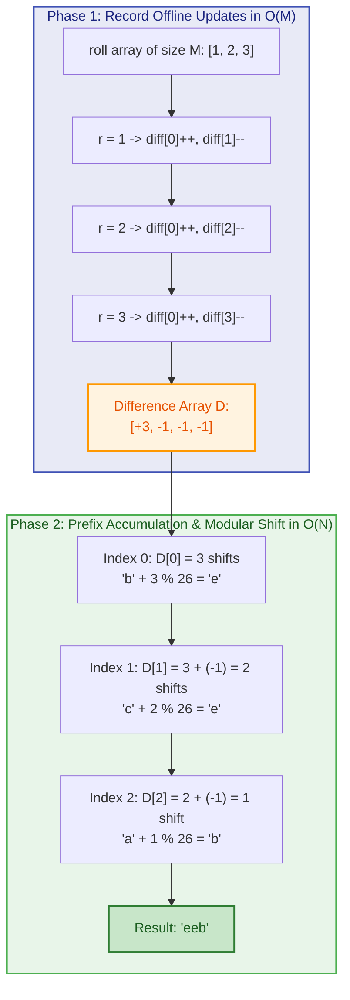
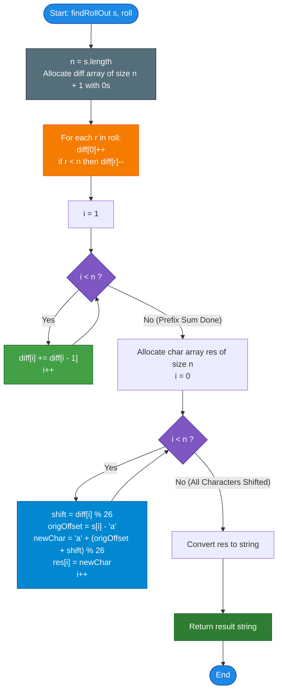

# GeeksforGeeks Problem of the Day: Roll the Characters of a String

- **Problem Link:** [GeeksforGeeks - Roll the Characters of a String](https://www.geeksforgeeks.org/problems/roll-the-characters-of-a-string2127/1)
- **Difficulty:** Medium
- **Topic Tags:** Strings, Prefix Sum, Difference Array, Suffix Sum, Range Updates, Modular Arithmetic, Offline Algorithms
- **Target Audience:** POTD Solvers, Computer Science Students, Competitive Programmers, Interview Preparation (FAANG/Tier-1 Tech)

---

## 1. Problem Statement

Given a string `s` of length $N$ consisting of lowercase English letters and an array `roll` of size $M$ containing positive integers.

A **"roll"** operation on a character means shifting it cyclically forward to the next character in the English alphabet:
- `'a'` becomes `'b'`
- `'b'` becomes `'c'`
- $\dots$
- `'y'` becomes `'z'`
- `'z'` wraps around and becomes `'a'`

For each value $r$ present in `roll[]`, you must roll the **first $r$ characters** of the string `s` (i.e., all characters in the 0-based index range $[0, r - 1]$) by **1 step**.

Your task is to compute and return the final modified string after applying all $M$ roll operations.

---

## 2. Examples & Explanations

### Example 1
- **Input:** `s = "bca"`, `roll = [1, 2, 3]`
- **String Length ($N$):** $3$
- **Total Roll Operations ($M$):** $3$

#### Chronological Step-by-Step Simulation:
1. **Initial String:** `"bca"`
2. **Operation 1 ($r = 1$):** Roll first $1$ character (index $0$):
   - `s[0]` ('b' $\to$ 'c')
   - String becomes: `"cca"`
3. **Operation 2 ($r = 2$):** Roll first $2$ characters (indices $0, 1$):
   - `s[0]` ('c' $\to$ 'd')
   - `s[1]` ('c' $\to$ 'd')
   - String becomes: `"dda"`
4. **Operation 3 ($r = 3$):** Roll first $3$ characters (indices $0, 1, 2$):
   - `s[0]` ('d' $\to$ 'e')
   - `s[1]` ('d' $\to$ 'e')
   - `s[2]` ('a' $\to$ 'b')
   - String becomes: `"eeb"`

- **Output:** `"eeb"`

---

### Example 2 (Cyclic Wrap-Around)
- **Input:** `s = "z"`, `roll = [1]`
- **Explanation:**
  - `s[0] = 'z'` is rolled by $1$ step.
  - Since `'z'` wraps cyclically back to the start of the alphabet, `'z'` $\to$ `'a'`.
- **Output:** `"a"`

---

### Example 3 (Cascading Full String Rolls)
- **Input:** `s = "vwxyz"`, `roll = [1, 2, 3, 4, 5]`
- **Explanation of Total Accumulated Shifts:**
  - Index $0$ ('v'): rolled in all $5$ operations $\implies$ 'v' $+ 5 = $ **'a'**
  - Index $1$ ('w'): rolled in operations $2, 3, 4, 5$ ($4$ shifts) $\implies$ 'w' $+ 4 = $ **'a'**
  - Index $2$ ('x'): rolled in operations $3, 4, 5$ ($3$ shifts) $\implies$ 'x' $+ 3 = $ **'a'**
  - Index $3$ ('y'): rolled in operations $4, 5$ ($2$ shifts) $\implies$ 'y' $+ 2 = $ **'a'**
  - Index $4$ ('z'): rolled only in operation $5$ ($1$ shift) $\implies$ 'z' $+ 1 = $ **'a'**
- **Output:** `"aaaaa"`

---

## 3. Constraints & Complexity Targets

- **String Length:** $1 \le |s| = N \le 10^5$
- **Number of Operations:** $1 \le |roll| = M \le 10^5$
- **Roll Values:** $1 \le roll[i] \le N$
- **Character Set:** Lowercase English alphabets (`'a'` through `'z'`)
- **Expected Time Complexity:** $\mathbf{\mathcal{O}(N + M)}$
- **Expected Auxiliary Space:** $\mathbf{\mathcal{O}(N)}$

> [!WARNING]
> **Why Naive Simulation Fails ($TLE$):**  
> If each roll query with $r = N$ is simulated with a direct inner loop updating all characters from index $0$ to $N - 1$, the worst-case time complexity is:
> $$\mathcal{O}(N \times M) = 10^5 \times 10^5 = 10^{10} \text{ operations}$$
> Online judges allow roughly $\approx 10^8$ operations per second. A naive approach exceeds this threshold by a factor of $100\times$, resulting in an immediate **Time Limit Exceeded (TLE)** error.

---

## 4. Visual Architecture & Range Update Models

### Perspective 1: The Difference Array & Prefix Sum Model

Every roll operation $r$ adds $+1$ shift to the prefix range $[0, r - 1]$.  
In a standard **Difference Array** $D$ of size $N + 1$:
- Add $+1$ at the start index: $D[0] \mathrel{+}= 1$
- Subtract $-1$ right after the end of the range: $D[r] \mathrel{-}= 1$ (if $r < N$)

After marking all $M$ operations in $\mathcal{O}(M)$ time, computing the running **prefix sum** of $D$ gives the exact number of shifts for every index $i \in [0, N - 1]$:
$$\text{shifts}[i] = \sum_{j=0}^{i} D[j]$$

```text
Range Update for Prefix [0, r-1] in Difference Array D:

Index:     0       1      ...     r-1       r       r+1    ...    N-1
         ┌───┐                            ┌───┐
Diff D:  │+1 │     0      ...      0     │-1 │       0    ...      0
         └───┘                            └───┘
           ▲                                ▲
     Start of Range                 End of Range + 1
```

---

### Perspective 2: Suffix Sum over Prefix Right-Endpoints

Notice the beautiful dual property of prefix roll operations:
- A roll of length $r$ affects all indices $i \le r - 1$.
- Therefore, a character at index $i$ is affected by every roll operation whose parameter satisfies:
  $$r - 1 \ge i \iff r > i$$

If we record a frequency array `freq` of the right-endpoints ($r - 1$):
$$\text{freq}[r - 1] \mathrel{+}= 1 \quad \text{for each } r \in roll$$

Then the total number of shifts at index $i$ is simply the **suffix sum** (cumulative sum from right to left) from $i$ to $N - 1$:
$$\text{shifts}[i] = \sum_{j = i}^{N - 1} \text{freq}[j]$$

```text
Suffix Accumulation Visual (Sweeping Right-to-Left):

Index:         0         1         2         ...       N-1
Freq:       freq[0]   freq[1]   freq[2]      ...     freq[N-1]
               ▲         ▲         ▲                    ▲
               │         │         │                    │
Shifts:      <───+─────<───+─────<───+─────────────── Running Sum
             shifts[0] shifts[1] shifts[2]           shifts[N-1]
```



---

## 5. Step-by-Step Simulation & Trace Table

Let us trace **Example 1**: `s = "bca"`, `roll = [1, 2, 3]` ($N = 3, M = 3$)

### Step 1: Difference Array Population
Initialize `diff` array of size $N + 1 = 4$ with all zeros: `[0, 0, 0, 0]`.

| Operation | Query $r$ | Range Affected | Action on `diff` | Array State `diff` |
| :---: | :---: | :---: | :---: | :---: |
| **Initial** | — | — | — | `[0, 0, 0, 0]` |
| **1** | $r = 1$ | $[0, 0]$ | `diff[0]++`, `diff[1]--` | `[1, -1, 0, 0]` |
| **2** | $r = 2$ | $[0, 1]$ | `diff[0]++`, `diff[2]--` | `[2, -1, -1, 0]` |
| **3** | $r = 3$ | $[0, 2]$ | `diff[0]++`, `diff[3]--` | `[3, -1, -1, -1]` |

---

### Step 2: Prefix Sum & Character Shifting

| Index $i$ | Original Char `s[i]` | Diff Value `diff[i]` | Prefix Sum (Total Shifts) | Shift Modulo $26$ | Calculation: $((\text{ord} - 'a' + \text{shift}) \pmod{26}) + 'a'$ | Resulting Character |
| :---: | :---: | :---: | :---: | :---: | :---: | :---: |
| **0** | `'b'` | $+3$ | $3$ | $3 \pmod{26} = 3$ | $(1 + 3) \pmod{26} = 4 \implies$ `'e'` | **`'e'`** |
| **1** | `'c'` | $-1$ | $3 + (-1) = 2$ | $2 \pmod{26} = 2$ | $(2 + 2) \pmod{26} = 4 \implies$ `'e'` | **`'e'`** |
| **2** | `'a'` | $-1$ | $2 + (-1) = 1$ | $1 \pmod{26} = 1$ | $(0 + 1) \pmod{26} = 1 \implies$ `'b'` | **`'b'`** |

**Final Output String:** `"eeb"`

---

## 6. Algorithm Flowchart



---

## 7. From Naive to Pro: Algorithmic Progression

### Method 1: Naive Simulation ($\mathcal{O}(N \times M)$ Time)
- **Concept:** Iterate through each roll operation $r$ in `roll[]`. For each operation, run an inner loop from index $0$ to $r - 1$, shifting each character forward by $1$.
- **Why it is suboptimal:** If $r \approx N$ for all $M$ queries, the inner loop executes $N$ times for each of the $M$ queries $\implies \mathcal{O}(N \times M) = 10^{10}$ operations, triggering **Time Limit Exceeded (TLE)**.
- **Pseudocode:**
```text
function findRollOut_Naive(s, roll):
    chars = array of characters in s
    for each r in roll:
        for i from 0 to min(r, length(s)) - 1:
            chars[i] = 'a' + (chars[i] - 'a' + 1) % 26
    return string(chars)
```

---

### Method 2: Standard Difference Array with Prefix Sum ($\mathcal{O}(N + M)$ Time, $\mathcal{O}(N)$ Space)
- **Concept:** Record start and end boundaries of the interval $[0, r - 1]$ in a difference array `diff` of size $N + 1$. Compute running prefix sum in a forward pass, then apply the total modulo $26$ shift to each character.
- **Time Complexity:** $\mathcal{O}(N + M)$
- **Auxiliary Space:** $\mathcal{O}(N)$ for the difference array.
- **Pseudocode:**
```text
function findRollOut_DiffArray(s, roll):
    n = length(s)
    diff = array of size n + 1 filled with 0
    
    for each r in roll:
        diff[0] += 1
        if r < n:
            diff[r] -= 1
            
    for i from 1 to n - 1:
        diff[i] += diff[i - 1]
        
    chars = array of characters in s
    for i from 0 to n - 1:
        shift = diff[i] % 26
        chars[i] = 'a' + (chars[i] - 'a' + shift) % 26
        
    return string(chars)
```

---

### Method 3: Pro Approach — Frequency Bucket with Suffix Cumulative Sweep ($\mathcal{O}(N + M)$ Time, $\mathcal{O}(N)$ Space)
- **The Core Strategy:**
  - Count how many roll operations end at or beyond index $i$.
  - Record endpoint frequencies: `count[r - 1]++` for each $r \in roll$.
  - Traverse the string in **reverse order (from $N - 1$ down to $0$)** maintaining a single `runningSum` accumulator.
  - At each index $i$, `runningSum += count[i]` directly gives the total shift count for $s[i]$!
  - In-place transformation without needing a full-sized forward prefix buffer. Highly cache-friendly.
- **Pseudocode:**
```text
function findRollOut_OptimalSuffix(s, roll):
    n = length(s)
    count = array of size n filled with 0
    for each r in roll:
        if r > 0:
            count[min(r, n) - 1] += 1
            
    chars = array of characters in s
    runningSum = 0
    for i from n - 1 down to 0:
        runningSum += count[i]
        shift = runningSum % 26
        chars[i] = 'a' + (chars[i] - 'a' + shift) % 26
        
    return string(chars)
```

---

## 8. Complexity Comparison Table

| Metric | Method 1: Naive Simulation | Method 2: Difference Array + Prefix Sum | Method 3: Pro Suffix Cumulative Sweep |
| :--- | :--- | :--- | :--- |
| **Time Complexity** | $\mathcal{O}(N \times M)$ | $\mathbf{\mathcal{O}(N + M)}$ | $\mathbf{\mathcal{O}(N + M)}$ |
| **Auxiliary Space** | $\mathcal{O}(1)$ (in-place) | $\mathcal{O}(N)$ (`diff` buffer) | $\mathbf{\mathcal{O}(N)}$ (`count` buffer) |
| **Operations ($N=M=10^5$)** | $\sim 10^{10}$ (**TLE**) | $\sim 2 \times 10^5$ operations | $\mathbf{\sim 2 \times 10^5}$ **operations** |
| **Passes over String** | $M$ full/partial passes | 2 forward passes | **1 single backward pass** |
| **Cache Locality** | Poor | Good | **Optimal (Linear sequential writes)** |
| **Interview Verdict** | Immediate rejection | Accepted & Standard | **Gold Standard (FAANG Clean Code)** |

---

## 9. Comprehensive Corner Cases Handled

1. **Alphabet Wrap-Around ('z' $\to$ 'a'):**
   - The modular shift formula `((c - 'a' + shift) % 26) + 'a'` ensures smooth cyclic wrap-around without negative numbers or special case branches.
2. **Shifts Exceeding 26:**
   - When multiple roll operations accumulate, total shifts at an index can exceed $26$ (e.g., $10^5$ shifts). `shift % 26` reduces any integer shift to $[0, 25]$.
3. **Single Character String ($N = 1$):**
   - $r = 1$ updates index $0$. Bounds check `r < n` correctly avoids out-of-bounds indexing.
4. **Operations with $r \ge N$:**
   - Any roll with $r \ge N$ affects the entire string. `diff[r]` decrement is safely skipped when $r \ge N$.
5. **Repeated Identical Roll Values:**
   - Handled naturally; multiple increments at index $0$ simply sum up.

---

## 10. Complete Multi-Language Implementations

### Java (21)

```java
class Solution {
    public String findRollOut(String s, int[] roll) {
        int n = s.length();
        
        // Difference array to record range updates
        int[] diff = new int[n + 1];
        
        // Step 1: Mark range boundaries in O(M)
        for (int r : roll) {
            if (r > 0) {
                diff[0]++;
                if (r < n) {
                    diff[r]--;
                }
            }
        }
        
        // Step 2: Accumulate prefix sums in O(N)
        for (int i = 1; i < n; i++) {
            diff[i] += diff[i - 1];
        }
        
        // Step 3: Apply modular character shifts in O(N)
        char[] chars = s.toCharArray();
        for (int i = 0; i < n; i++) {
            int shift = diff[i] % 26;
            chars[i] = (char) ('a' + (chars[i] - 'a' + shift) % 26);
        }
        
        return new String(chars);
    }
}
```

---

### Python3

```python
class Solution:
    def findRollOut(self, s: str, roll: list[int]) -> str:
        n = len(s)
        
        # Step 1: Build difference array of size n + 1
        diff = [0] * (n + 1)
        for r in roll:
            if r > 0:
                diff[0] += 1
                if r < n:
                    diff[r] -= 1
                    
        # Step 2: Compute prefix sums in-place
        for i in range(1, n):
            diff[i] += diff[i - 1]
            
        # Step 3: Apply character shifts with cyclic wrap-around
        res = []
        base = ord('a')
        for i in range(n):
            shift = diff[i] % 26
            new_char = chr((ord(s[i]) - base + shift) % 26 + base)
            res.append(new_char)
            
        return "".join(res)
```

---

### C++ (17)

```cpp
#include <string>
#include <vector>

using namespace std;

class Solution {
  public:
    string findRollOut(string& s, vector<int>& roll) {
        int n = s.size();
        
        // Difference array of size n + 1
        vector<int> diff(n + 1, 0);
        
        // Step 1: Record range updates in O(M)
        for (int r : roll) {
            if (r > 0) {
                diff[0]++;
                if (r < n) {
                    diff[r]--;
                }
            }
        }
        
        // Step 2: Compute running prefix sum in O(N)
        for (int i = 1; i < n; ++i) {
            diff[i] += diff[i - 1];
        }
        
        // Step 3: Shift characters in-place
        for (int i = 0; i < n; ++i) {
            int shift = diff[i] % 26;
            s[i] = 'a' + (s[i] - 'a' + shift) % 26;
        }
        
        return s;
    }
};
```

---

### C#

```csharp
using System;

class Solution {
    public string findRollOut(string s, int[] roll) {
        int n = s.Length;
        
        // Difference array
        int[] diff = new int[n + 1];
        
        // Step 1: Mark range boundaries
        foreach (int r in roll) {
            if (r > 0) {
                diff[0]++;
                if (r < n) {
                    diff[r]--;
                }
            }
        }
        
        // Step 2: Compute running prefix sums
        for (int i = 1; i < n; i++) {
            diff[i] += diff[i - 1];
        }
        
        // Step 3: Apply modular character transformation
        char[] chars = s.ToCharArray();
        for (int i = 0; i < n; i++) {
            int shift = diff[i] % 26;
            chars[i] = (char)('a' + (chars[i] - 'a' + shift) % 26);
        }
        
        return new string(chars);
    }
}
```

---

### Javascript (Node v22)

```javascript
/**
 * @param {string} s
 * @param {number[]} roll
 * @return {string}
 */
class Solution {
    findRollOut(s, roll) {
        const n = s.length;
        
        // Typed array for high-performance integer operations
        const diff = new Int32Array(n + 1);
        
        // Step 1: Mark range boundaries in O(M)
        const m = roll.length;
        for (let i = 0; i < m; i++) {
            const r = roll[i];
            if (r > 0) {
                diff[0]++;
                if (r < n) {
                    diff[r]--;
                }
            }
        }
        
        // Step 2: Compute prefix sums in O(N)
        for (let i = 1; i < n; i++) {
            diff[i] += diff[i - 1];
        }
        
        // Step 3: Shift characters using CharCode
        const res = new Array(n);
        for (let i = 0; i < n; i++) {
            const shift = diff[i] % 26;
            const newCode = ((s.charCodeAt(i) - 97 + shift) % 26) + 97;
            res[i] = String.fromCharCode(newCode);
        }
        
        return res.join('');
    }
}
```

---

## 11. Key Takeaways & Technical Summary

1. **Prefix Range Updates as Difference Array Boundaries:**  
   Every interval update of the form $[0, r - 1]$ with increment $+1$ is represented by an impulse $+1$ at $0$ and a cancellation $-1$ at $r$.
2. **Prefix Sum as Wave Propagation:**  
   The cumulative prefix sum sweeps across the array, causing the $+1$ impulse to propagate continuously until it meets the $-1$ cancellation barrier at index $r$.
3. **Equivalence to Suffix Sum:**  
   Sweeping backwards from index $N - 1$ down to $0$ with endpoint frequency counting yields the exact same total shifts in a single reverse pass, highlighting the deep duality between prefix and suffix scans.
4. **Universal Competitive Pattern:**  
   This core difference array / modular shift pattern is identical to:
   - **LeetCode 848:** Shifting Letters
   - **LeetCode 2381:** Shifting Letters II
   - **GFG POTD:** Adding Ones
