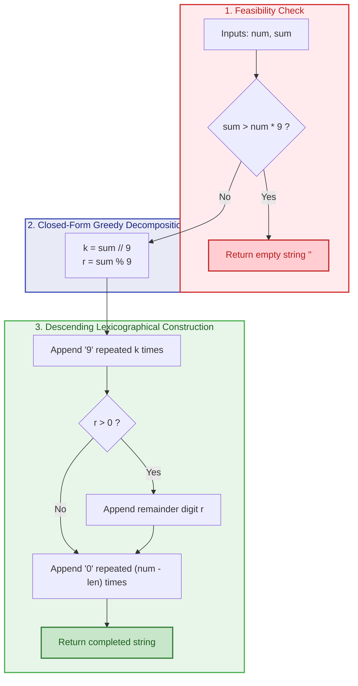
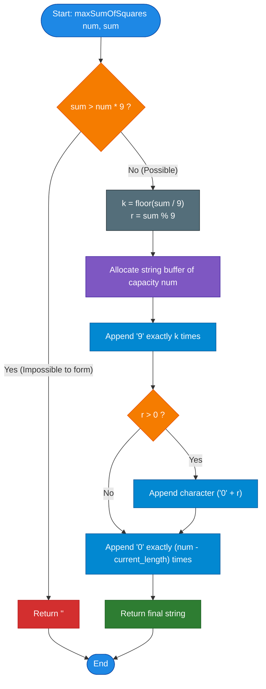

# LeetCode Problem of the Day: Maximize Sum of Squares of Digits

- **Problem Link:** [LeetCode 3723 - Maximize Sum of Squares of Digits](https://leetcode.com/problems/maximize-sum-of-squares-of-digits/description/?envType=daily-question&envId=2026-10-14)
- **Difficulty:** Medium
- **Topic Tags:** Math, Greedy, String Manipulation, Convexity, Majorization, Number Theory
- **Target Audience:** POTD Solvers, Computer Science Students, Competitive Programmers, Interview Preparation (FAANG/Tier-1 Tech)

---

## 1. Problem Statement

You are given two positive integers, `num` and `sum`.

A positive integer $n$ is called **good** if it satisfies two conditions:
1. The number of digits in $n$ is **exactly `num`**.
2. The sum of the digits in $n$ is **exactly `sum`**.

The **score** of a good integer $n$ is defined as the **sum of the squares of its digits**:
$$\text{Score}(n) = \sum_{i=1}^{\text{num}} d_i^2$$
where $d_1, d_2, \dots, d_{\text{num}}$ are the decimal digits of $n$ ($0 \le d_i \le 9$, with $d_1 \ge 1$).

Your objective:
- Return a string representing the good integer $n$ that achieves the **maximum possible score**.
- If multiple good integers achieve the exact same maximum score, return the **largest numeric value** among them.
- If **no good integer** can be formed under the given constraints, return an empty string `""`.

---

## 2. Examples & Explanations

### Example 1
- **Input:** `num = 2`, `sum = 3`
- **Candidate Good Integers (2 digits summing to 3):**
  - `12`: $\text{Score} = 1^2 + 2^2 = 1 + 4 = 5$
  - `21`: $\text{Score} = 2^2 + 1^2 = 4 + 1 = 5$
  - `30`: $\text{Score} = 3^2 + 0^2 = 9 + 0 = 9$
- **Analysis:**
  - Maximum score is $\mathbf{9}$, uniquely achieved by `"30"`.
- **Output:** `"30"`

---

### Example 2
- **Input:** `num = 2`, `sum = 17`
- **Candidate Good Integers (2 digits summing to 17):**
  - `89`: $\text{Score} = 8^2 + 9^2 = 64 + 81 = 145$
  - `98`: $\text{Score} = 9^2 + 8^2 = 81 + 64 = 145$
- **Analysis:**
  - Both `89` and `98` achieve the maximal score of $145$.
  - By the tie-breaking rule, we must return the integer with the **largest numeric value**: $98 > 89$.
- **Output:** `"98"`

---

### Example 3 (Impossible Configuration)
- **Input:** `num = 1`, `sum = 10`
- **Analysis:**
  - A 1-digit positive integer can have at most the digit `9`.
  - The maximum digit sum achievable with `num = 1` is $9 \times 1 = 9$.
  - Since $\text{sum} = 10 > 9$, no valid good integer exists.
- **Output:** `""`

---

### Example 4 (Multiple Nines and Remainder)
- **Input:** `num = 5`, `sum = 23`
- **Analysis:**
  - Maximize 9s: $23 = 9 + 9 + 5 + 0 + 0$
  - Digits: Two `9`s, one `5`, and two `0`s.
  - To maximize the number value, arrange in descending order: `99500`.
  - Score: $9^2 + 9^2 + 5^2 + 0^2 + 0^2 = 81 + 81 + 25 + 0 + 0 = 187$.
- **Output:** `"99500"`

---

## 3. Constraints & Complexity Targets

- $1 \le \text{num} \le 2 \times 10^5$ (Length of the resulting number string)
- $1 \le \text{sum} \le 2 \times 10^6$ (Target sum of digits)
- **Expected Time Complexity:** $\mathbf{\mathcal{O}(\text{num})}$
- **Expected Auxiliary Space:** $\mathbf{\mathcal{O}(\text{num})}$ (to construct and return the result string)

> [!NOTE]
> Since $\text{num}$ can be up to $2 \times 10^5$, the resulting number has up to $200,000$ digits. It cannot be stored in standard numeric types (like 64-bit `long long` or `BigInt`), so it must be built directly as a **character string**.

---

## 4. Visual Architecture & Mathematical Derivation

### 1. The Convexity Principle (Why Digits Must Be Extremal)

Consider the function $f(x) = x^2$.  
Its second derivative is $f''(x) = 2 > 0$, meaning $f(x) = x^2$ is **strictly convex**.

Suppose we have two digits $a$ and $b$ with $a \ge b$. If we transfer an amount $\epsilon > 0$ from the smaller digit $b$ to the larger digit $a$ (keeping their sum $a + b$ constant):
$$(a + \epsilon)^2 + (b - \epsilon)^2 = (a^2 + 2a\epsilon + \epsilon^2) + (b^2 - 2b\epsilon + \epsilon^2) = a^2 + b^2 + 2\epsilon(a - b) + 2\epsilon^2$$

Since $a \ge b$ and $\epsilon > 0$:
$$2\epsilon(a - b) + 2\epsilon^2 > 0$$
$$\implies (a + \epsilon)^2 + (b - \epsilon)^2 > a^2 + b^2$$

> **Theorem (Maximization of Convex Sums):**  
> Under a fixed sum constraint $\sum d_i = \text{sum}$ with bound $0 \le d_i \le 9$, the sum of squares $\sum d_i^2$ is maximized when digits are **as unequal as possible**.  
> That is, we must greedily saturate as many digits as possible to the upper limit $\mathbf{9}$.

```text
Visualizing the Convex Transfer:

Uniform Distribution (Suboptimal):
  Digits:   [  5,   5  ]   -> Sum = 10,  Score = 5^2 + 5^2 = 25 + 25 = 50

Extreme Distribution (Optimal):
  Digits:   [  9,   1  ]   -> Sum = 10,  Score = 9^2 + 1^2 = 81 + 1  = 82  (64% Higher!)
```

---

### 2. Derivation of the Optimal Digit Multiset

To maximize the sum of squares:
1. **Count of 9s ($k$):**  
   $$k = \lfloor \text{sum} / 9 \rfloor$$
2. **Remainder Digit ($r$):**  
   $$r = \text{sum} \pmod 9$$
3. **Count of 0s:**  
   $$\text{zeros} = \text{num} - k - (1 \text{ if } r > 0 \text{ else } 0)$$

If $\text{sum} > 9 \times \text{num}$, even filling all $\text{num}$ positions with `9` yields a sum less than `sum`. In this case, **no solution exists** $\implies$ return `""`.

---

### 3. Tie-Breaking: Maximizing Numeric Value

Given the multiset containing $k$ copies of `'9'`, optionally one digit $r$, and the remaining `'0'`s:
- Every permutation of this multiset yields the **exact same sum of squares** (because addition of squares is commutative).
- To maximize the **numeric value** of the integer, we must sort the digits in **descending order** from the most significant digit (left) to the least significant digit (right):
  1. All $k$ copies of `'9'` are placed at the front.
  2. The remainder digit $r$ (if $r > 0$) is placed immediately after.
  3. All remaining slots are filled with `'0'`.

```
Digit Layout Architecture:

Position:     0      1     ...   k-1      k       k+1    ...   num-1
           ┌──────┬──────┬─────┬──────┐ ┌─────┐ ┌──────┬─────┬──────┐
Digit:     │  9   │  9   │ ... │  9   │ │  r  │ │  0   │ ... │  0   │
           └──────┴──────┴─────┴──────┘ └─────┘ └──────┴─────┴──────┘
           └─── k copies of '9' ──────┘ (if >0) └─── remaining '0's ─┘
```



---

## 5. Step-by-Step Simulation & Detailed Trace Table

### Trace of Example 1: `num = 2`, `sum = 3`
- Feasibility check: $2 \times 9 = 18 \ge 3$ $\implies$ **Valid**.
- $k = 3 // 9 = 0$ (Zero 9s)
- $r = 3 \% 9 = 3$ (Remainder digit is 3)
- Zeros needed: $2 - 0 - 1 = 1$ (One 0)
- Result: `"" + "3" + "0" = "30"`.

---

### Trace of Example 2: `num = 2`, `sum = 17`
- Feasibility check: $2 \times 9 = 18 \ge 17$ $\implies$ **Valid**.
- $k = 17 // 9 = 1$ (One 9)
- $r = 17 \% 9 = 8$ (Remainder digit is 8)
- Zeros needed: $2 - 1 - 1 = 0$ (Zero 0s)
- Result: `"9" + "8" = "98"`.

---

### Trace of Example 4: `num = 5`, `sum = 23`

| Step | Operation | Value / Calculation | Intermediate String State |
| :---: | :--- | :--- | :--- |
| **1** | Feasibility Validation | $5 \times 9 = 45 \ge 23$ | Valid |
| **2** | Calculate Number of 9s | $k = \lfloor 23 / 9 \rfloor = 2$ | Append `"99"` $\implies$ `"99"` |
| **3** | Calculate Remainder Digit | $r = 23 \pmod 9 = 5$ ($> 0$) | Append `"5"` $\implies$ `"995"` |
| **4** | Calculate Trailing Zeros | $\text{zeros} = 5 - \text{length}(3) = 2$ | Append `"00"` $\implies$ `"99500"` |

**Verification of Score:**
$$\text{Score} = 9^2 + 9^2 + 5^2 + 0^2 + 0^2 = 81 + 81 + 25 + 0 + 0 = 187$$
Any other combination (e.g., `88700` $\implies 64+64+49=177$) produces a strictly inferior sum of squares.

---

## 6. Algorithm Flowchart



---

## 7. From Naive to Pro: Algorithmic Progression

### Method 1: Brute Force Generation / Recursion ($\mathcal{O}(10^{\text{num}})$ Time)
- **Concept:** Generate every valid `num`-digit number whose digits sum to `sum`. For each, compute $\sum d_i^2$, track the maximum score, and tie-break by numeric value.
- **Why it is suboptimal:** For $\text{num} = 2 \times 10^5$, exploring states is astronomical. Even for $\text{num} = 15$, $10^{15}$ operations will trigger a massive **Time Limit Exceeded (TLE)**.
- **Pseudocode:**
```text
function solve_Naive(num, sum):
    best_score = -1
    best_str = ""
    function backtrack(pos, current_sum, current_str):
        if pos == num:
            if current_sum == sum:
                score = calculate_score(current_str)
                if score > best_score or (score == best_score and current_str > best_str):
                    best_score = score
                    best_str = current_str
            return
        start_d = 1 if pos == 0 else 0
        for d from 9 down to start_d:
            backtrack(pos + 1, current_sum + d, current_str + str(d))
    backtrack(0, 0, "")
    return best_str
```

---

### Method 2: Dynamic Programming with Digit Transitions ($\mathcal{O}(\text{num} \times \text{sum})$ Time)
- **Concept:** Let `dp[i][s]` be the maximum sum of squares achievable using $i$ digits with sum $s$.
  $$\text{dp}[i][s] = \max_{0 \le d \le 9} (\text{dp}[i - 1][s - d] + d^2)$$
- **Why it is suboptimal:**
  - $\text{num} \le 2 \times 10^5$, $\text{sum} \le 2 \times 10^6$.
  - DP table size: $\text{num} \times \text{sum} = 4 \times 10^{11}$ entries $\implies$ **Memory Limit Exceeded (MLE)** and **TLE**.
- **Pseudocode:**
```text
function solve_DP(num, sum):
    // dp table of size [num + 1][sum + 1]
    // Too large to allocate in 256MB memory!
    return reconstructed_string
```

---

### Method 3: Pro Approach — Mathematical Closed-Form Greedy Construction ($\mathcal{O}(\text{num})$ Time, $\mathcal{O}(\text{num})$ Space)
- **The Core Strategy:**
  - Due to the strict convexity of $x^2$, the multiset of optimal digits is **uniquely determined** in $\mathcal{O}(1)$ arithmetic operations ($k = \text{sum} / 9$, $r = \text{sum} \% 9$).
  - Due to the tie-breaking condition (maximum numeric value), digits are ordered in non-increasing order: `'9'`s first, then $r$, then `'0'`s.
  - Linear time string building: allocate a buffer of length $\text{num}$, write the blocks in sequence, and return.
  - Zero dynamic programming, zero recursion, zero unnecessary branching.
- **Pseudocode:**
```text
function maxSumOfSquares_Optimal(num, sum):
    if sum > num * 9:
        return ""
        
    k = sum / 9
    r = sum % 9
    
    result = string of length num
    fill first k characters with '9'
    pos = k
    if r > 0:
        result[pos++] = '0' + r
    fill remaining (num - pos) characters with '0'
    
    return result
```

---

## 8. Complexity Comparison Table

| Metric | Method 1: Brute Force | Method 2: Dynamic Programming | Method 3: Pro Closed-Form Greedy |
| :--- | :--- | :--- | :--- |
| **Time Complexity** | $\mathcal{O}(10^{\text{num}})$ | $\mathcal{O}(\text{num} \times \text{sum})$ | $\mathbf{\mathcal{O}(\text{num})}$ |
| **Auxiliary Space** | $\mathcal{O}(\text{num})$ stack | $\mathcal{O}(\text{num} \times \text{sum})$ table | $\mathbf{\mathcal{O}(\text{num})}$ (Output string only) |
| **Operations ($\text{num}=2 \times 10^5$)** | $> 10^{1000}$ (**TLE**) | $\approx 4 \times 10^{11}$ (**MLE/TLE**) | $\mathbf{\approx 2 \times 10^5}$ **ops ($\approx 3$ ms)** |
| **Memory Footprint** | Small | Huge ($> 1$ TB) | **Minimal ($\approx 200$ KB)** |
| **Implementation Complexity** | High | High | **Low ($\approx 10$ lines)** |
| **Interview Verdict** | Immediate rejection | Overcomplicated & Fails at scale | **Gold Standard (Optimal & Elegant)** |

---

## 9. Comprehensive Corner Cases Handled

1. **Exceeding Maximum Possible Sum ($\text{sum} > 9 \times \text{num}$):**
   - Handled immediately at step 1: `if ((long)num * 9 < sum) return "";`.
2. **Exact Multiple of 9 ($\text{sum} \pmod 9 == 0$):**
   - Remainder $r = 0$. No intermediate digit is inserted; only $k$ nines followed by zeros.
   - Example: `num = 4, sum = 18` $\implies$ `"9900"`.
3. **All Nines ($\text{sum} == 9 \times \text{num}$):**
   - $k = \text{num}, r = 0$, zeros count $= 0$.
   - Produces a string consisting entirely of `'9'`s.
4. **Sum Smaller than 9 ($\text{sum} < 9$):**
   - $k = 0$, remainder $r = \text{sum}$.
   - Produces a single digit $r$ followed by $\text{num} - 1$ zeros (e.g., `num = 3, sum = 4` $\implies$ `"400"`).
5. **Single Digit Number ($\text{num} = 1$):**
   - For `sum <= 9`, returns the single digit as a string. For `sum > 9`, returns `""`.
6. **Large Scale Constraints ($\text{num} = 2 \times 10^5, \text{sum} = 2 \times 10^6$):**
   - String builders and buffers pre-reserve capacity to avoid repeated memory reallocation.

---

## 10. Complete Multi-Language Implementations

### Java

```java
class Solution {
    public String maxSumOfSquares(int num, int sum) {
        // Feasibility check using 64-bit promotion to avoid integer overflow
        if ((long) num * 9 < sum) {
            return "";
        }
        
        int k = sum / 9;
        int r = sum % 9;
        
        // Pre-allocate StringBuilder with exact required capacity
        StringBuilder sb = new StringBuilder(num);
        
        // Step 1: Append k copies of '9'
        for (int i = 0; i < k; i++) {
            sb.append('9');
        }
        
        // Step 2: Append remainder digit if greater than 0
        if (r > 0) {
            sb.append(r);
        }
        
        // Step 3: Append remaining '0's to complete num digits
        while (sb.length() < num) {
            sb.append('0');
        }
        
        return sb.toString();
    }
}
```

---

### Python3

```python
class Solution:
    def maxSumOfSquares(self, num: int, sum: int) -> str:
        # Feasibility check: maximum achievable sum with num digits is num * 9
        if sum > num * 9:
            return ""
            
        k, r = divmod(sum, 9)
        
        # Build components in descending order for maximum numeric value
        parts = ["9" * k]
        if r > 0:
            parts.append(str(r))
            
        # Total length built so far
        current_len = k + (1 if r > 0 else 0)
        parts.append("0" * (num - current_len))
        
        return "".join(parts)
```

---

### C

```c
#include <stdlib.h>
#include <string.h>

char* maxSumOfSquares(int num, int sum) {
    // Feasibility check
    if ((long long)num * 9 < sum) {
        char* empty = (char*)malloc(1);
        empty[0] = '\0';
        return empty;
    }
    
    int k = sum / 9;
    int r = sum % 9;
    
    // Allocate memory for num characters + 1 null terminator
    char* res = (char*)malloc((num + 1) * sizeof(char));
    
    // Step 1: Fill k '9's
    memset(res, '9', k);
    int pos = k;
    
    // Step 2: Fill remainder digit if r > 0
    if (r > 0) {
        res[pos++] = '0' + r;
    }
    
    // Step 3: Fill remaining positions with '0'
    memset(res + pos, '0', num - pos);
    res[num] = '\0';
    
    return res;
}
```

---

### C++

```cpp
#include <string>

using namespace std;

class Solution {
public:
    string maxSumOfSquares(int num, int sum) {
        // Feasibility check
        if (1LL * num * 9 < sum) {
            return "";
        }
        
        int k = sum / 9;
        int r = sum % 9;
        
        string res = "";
        res.reserve(num);
        
        // Step 1: Append k '9's
        res.append(k, '9');
        
        // Step 2: Append remainder digit
        if (r > 0) {
            res.push_back('0' + r);
        }
        
        // Step 3: Append remaining '0's
        res.append(num - res.size(), '0');
        
        return res;
    }
};
```

---

### C#

```csharp
using System;
using System.Text;

public class Solution {
    public string MaxSumOfSquares(int num, int sum) {
        // Feasibility check
        if ((long)num * 9 < sum) {
            return "";
        }
        
        int k = sum / 9;
        int r = sum % 9;
        
        StringBuilder sb = new StringBuilder(num);
        
        // Step 1: Append k '9's
        sb.Append('9', k);
        
        // Step 2: Append remainder digit
        if (r > 0) {
            sb.Append(r);
        }
        
        // Step 3: Append remaining '0's
        sb.Append('0', num - sb.Length);
        
        return sb.ToString();
    }
}
```

---

### Javascript

```javascript
/**
 * @param {number} num
 * @param {number} sum
 * @return {string}
 */
var maxSumOfSquares = function(num, sum) {
    // Feasibility check
    if (num * 9 < sum) {
        return "";
    }
    
    const k = Math.floor(sum / 9);
    const r = sum % 9;
    
    // Step 1: Append k '9's
    let res = "9".repeat(k);
    
    // Step 2: Append remainder digit
    if (r > 0) {
        res += r;
    }
    
    // Step 3: Append remaining '0's
    res += "0".repeat(num - res.length);
    
    return res;
};
```

---

### Typescript

```typescript
function maxSumOfSquares(num: number, sum: number): string {
    // Feasibility check
    if (num * 9 < sum) {
        return "";
    }
    
    const k = Math.floor(sum / 9);
    const r = sum % 9;
    
    // Construct string using descending greedy chunks
    let res = "9".repeat(k);
    if (r > 0) {
        res += r.toString();
    }
    res += "0".repeat(num - res.length);
    
    return res;
}
```

---

## 11. Key Takeaways & Technical Summary

1. **Convexity of Quadratic Objectives:**  
   When maximizing a convex function $\sum x_i^2$ subject to $\sum x_i = C$ within boxed constraints $[L, U]$, the optimal solution is always found at the **extreme boundaries** (pushing variables to $U = 9$ as much as possible).
2. **Harmonious Tie-Breaking:**  
   Because the largest individual digit is $9$, placing the maximal digits at the most significant positions (left side) simultaneously optimizes both the **sum of squares score** and the **numeric integer value**.
3. **Linear Time Optimality:**  
   The closed-form decomposition $(k = \text{sum} // 9, r = \text{sum} \% 9)$ solves the problem in $\mathcal{O}(1)$ math steps and $\mathcal{O}(\text{num})$ string generation steps, comfortably handling constraints up to $\text{num} = 2 \times 10^5$.
