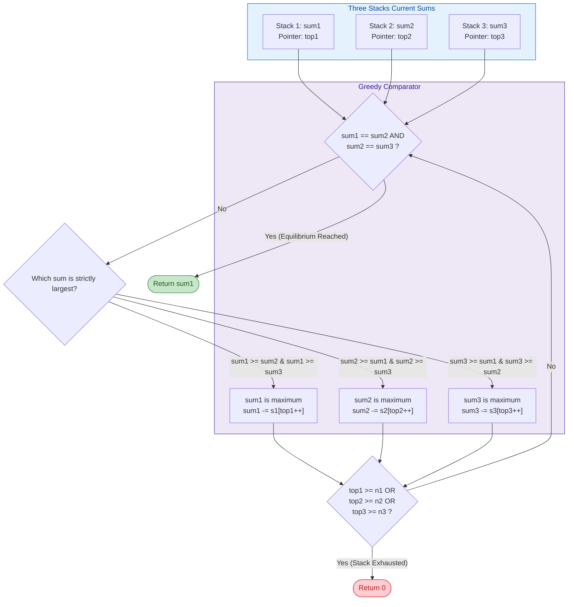

# GeeksforGeeks Problem of the Day: Max Equal Sum in 3 Stacks

- **Problem Link:** [GeeksforGeeks - Max Equal Sum in 3 Stacks](https://www.geeksforgeeks.org/problems/find-maximum-equal-sum-of-three-stacks/1)
- **Difficulty:** Medium
- **Topic Tags:** Stack, Prefix / Suffix Sum, Greedy, Two Pointers, Data Structures, Algorithms
- **Target Audience:** POTD Solvers, Computer Science Students, Competitive Programmers, Technical Interview Candidates (Amazon, Microsoft, Google, Adobe, Flipkart, Walmart)

---

## 1. Problem Statement

Given three stacks $s_1$, $s_2$, and $s_3$ represented as arrays/lists of positive integers, your task is to find the **maximum possible equal sum** that can be achieved across all three stacks by repeatedly removing (popping) zero or more elements from the **top** of the stacks.

In the array representation:
- The **top** of each stack corresponds to index $0$ (`s1[0]`, `s2[0]`, `s3[0]`).
- The **bottom** of each stack corresponds to the last index (`s1[n1 - 1]`, `s2[n2 - 1]`, `s3[n3 - 1]`).
- A pop operation removes the element at the current top pointer and decrements the total sum of that stack.
- If it is impossible to find a common non-zero sum, return $\mathbf{0}$ (an empty stack has a sum of $0$).

---

### Mathematical Formulation

Let the three stacks have lengths $n_1, n_2, n_3$ respectively.
A valid state of stack $i \in \{1, 2, 3\}$ after popping $t_i$ elements from its top ($0 \le t_i \le n_i$) has remaining sum:
$$\text{Sum}_i(t_i) = \sum_{j = t_i}^{n_i - 1} s_i[j]$$

We seek to find indices $(t_1, t_2, t_3)$ such that:
$$\text{Sum}_1(t_1) = \text{Sum}_2(t_2) = \text{Sum}_3(t_3)$$
maximizing this common value:
$$\text{MaxEqualSum} = \max_{0 \le t_1 \le n_1, \; 0 \le t_2 \le n_2, \; 0 \le t_3 \le n_3} \left\{ \text{Sum}_1(t_1) \;\middle|\; \text{Sum}_1(t_1) = \text{Sum}_2(t_2) = \text{Sum}_3(t_3) \right\}$$

---

## 2. Examples & Visual Walkthroughs

### Example 1

#### Input:
- $s_1 = [4, 2, 3]$ (Total Sum $= 9$)
- $s_2 = [1, 1, 2, 3]$ (Total Sum $= 7$)
- $s_3 = [1, 4]$ (Total Sum $= 5$)

#### Visual Layout of Stacks (Top to Bottom):
```text
      s1           s2          s3
   +------+     +------+    +------+
0: |  4   |  0: |  1   | 0: |  1   |  <-- TOP
   +------+     +------+    +------+
1: |  2   |  1: |  1   | 1: |  4   |  <-- BOTTOM
   +------+     +------+    +------+
2: |  3   |  2: |  2   |
   +------+     +------+
             3: |  3   |
                +------+
```

#### Step-by-Step Traversal:
1. **Initial Sums:**
   - $\text{sum}_1 = 4 + 2 + 3 = 9$
   - $\text{sum}_2 = 1 + 1 + 2 + 3 = 7$
   - $\text{sum}_3 = 1 + 4 = 5$
2. **Step 1:** Maximum sum is $\text{sum}_1 = 9$.  
   Pop `s1[0] = 4`. $\implies \text{sum}_1 = 9 - 4 = 5$.
3. **Step 2:** Current sums are $(5, 7, 5)$. Maximum sum is $\text{sum}_2 = 7$.  
   Pop `s2[0] = 1`. $\implies \text{sum}_2 = 7 - 1 = 6$.
4. **Step 3:** Current sums are $(5, 6, 5)$. Maximum sum is $\text{sum}_2 = 6$.  
   Pop `s2[1] = 1`. $\implies \text{sum}_2 = 6 - 1 = 5$.
5. **Step 4:** Current sums are $(5, 5, 5)$.  
   All three sums are equal!
- **Output:** $\mathbf{5}$

---

### Example 2

#### Input:
- $s_1 = [4, 7]$ (Total Sum $= 11$)
- $s_2 = [10]$ (Total Sum $= 10$)
- $s_3 = [1, 2, 3]$ (Total Sum $= 6$)

#### Step-by-Step Traversal:
1. **Initial Sums:** $\text{sum}_1 = 11, \; \text{sum}_2 = 10, \; \text{sum}_3 = 6$.
2. **Step 1:** Maximum is $\text{sum}_1 = 11$. Pop `s1[0] = 4`. $\implies \text{sum}_1 = 7$.
3. **Step 2:** Current sums are $(7, 10, 6)$. Maximum is $\text{sum}_2 = 10$. Pop `s2[0] = 10`. $\implies \text{sum}_2 = 0$.
4. Stack 2 is now completely empty ($\text{sum}_2 = 0$). Since all elements are positive integers ($s_i[j] \ge 1$), no positive equal sum can ever be formed.
- **Output:** $\mathbf{0}$

---

### Example 3 (Already Equal)

#### Input:
- $s_1 = [5, 5]$ (Sum $= 10$)
- $s_2 = [10]$ (Sum $= 10$)
- $s_3 = [2, 3, 5]$ (Sum $= 10$)

- All three sums are already $10$.
- **Output:** $\mathbf{10}$ (Zero pops required).

---

## 3. Constraints

- $1 \le n_1, n_2, n_3 \le 10^5$
- $1 \le s_1[i], s_2[i], s_3[i] \le 10^3$
- Maximum possible sum per stack $\le 10^5 \times 10^3 = 10^8$ (Fits securely inside a standard 32-bit signed integer).
- **Expected Time Complexity:** $\mathcal{O}(n_1 + n_2 + n_3)$
- **Expected Auxiliary Space:** $\mathcal{O}(1)$

---

## 4. Visual Architecture & 3-Pointer Greedy Reduction Model

Because all numbers in the stacks are **strictly positive integers** ($s_i[j] \ge 1$):
- Popping an element **always strictly decreases** the sum of that stack.
- You can **never increase** the sum of a stack.
- Therefore, if any stack has a sum strictly greater than another stack, it is **impossible** for the remaining elements of the larger stack to ever match the smaller stack unless elements are popped from the top of the larger stack.



---

## 5. Step-by-Step Simulation & State Trace Table

Tracing **Example 1**:
- $s_1 = [4, 2, 3]$ ($n_1 = 3$)
- $s_2 = [1, 1, 2, 3]$ ($n_2 = 4$)
- $s_3 = [1, 4]$ ($n_3 = 2$)

| Step | `top1` | `top2` | `top3` | `sum1` | `sum2` | `sum3` | Condition / Comparison | Action Taken | Equal? |
| :---: | :---: | :---: | :---: | :---: | :---: | :---: | :---: | :---: | :---: |
| **0** | 0 | 0 | 0 | 9 | 7 | 5 | $\text{sum}_1 = 9$ is maximum | `sum1 -= s1[0]` ($9 - 4 = 5$), `top1 = 1` | No |
| **1** | 1 | 0 | 0 | 5 | 7 | 5 | $\text{sum}_2 = 7$ is maximum | `sum2 -= s2[0]` ($7 - 1 = 6$), `top2 = 1` | No |
| **2** | 1 | 1 | 0 | 5 | 6 | 5 | $\text{sum}_2 = 6$ is maximum | `sum2 -= s2[1]` ($6 - 1 = 5$), `top2 = 2` | No |
| **3** | 1 | 2 | 0 | 5 | 5 | 5 | $\text{sum}_1 == \text{sum}_2 == \text{sum}_3 = 5$ | **Equilibrium!** Return $5$ | **Yes (5)** |

---

## 6. Algorithm Flowchart

```mermaid
flowchart TD
    Start([Start: maxEqualSum s1, s2, s3]) --> CalcSums["Calculate initial sums:<br/>sum1 = sum(s1)<br/>sum2 = sum(s2)<br/>sum3 = sum(s3)<br/>top1 = 0, top2 = 0, top3 = 0"]

    CalcSums --> LoopBound{"top1 < n1 AND<br/>top2 < n2 AND<br/>top3 < n3 ?"}

    LoopBound -- "No (Any stack emptied)" --> RetZero([Return 0])
    LoopBound -- "Yes" --> CheckEqual{"sum1 == sum2 AND<br/>sum2 == sum3 ?"}

    CheckEqual -- "Yes" --> RetSum([Return sum1])
    CheckEqual -- "No" --> FindMax{"Find largest sum"}

    FindMax -- "sum1 >= sum2 AND sum1 >= sum3" --> DecS1["sum1 -= s1[top1]<br/>top1++"] --> LoopBound
    FindMax -- "sum2 >= sum1 AND sum2 >= sum3" --> DecS2["sum2 -= s2[top2]<br/>top2++"] --> LoopBound
    FindMax -- "sum3 >= sum1 AND sum3 >= sum2" --> DecS3["sum3 -= s3[top3]<br/>top3++"] --> LoopBound

    style Start fill:#1E88E5,stroke:#0D47A1,color:#ffffff
    style RetSum fill:#2E7D32,stroke:#1B5E20,color:#ffffff
    style RetZero fill:#D32F2F,stroke:#B71C1C,color:#ffffff
    style CalcSums fill:#546E7A,stroke:#263238,color:#ffffff
    style LoopBound fill:#F57C00,stroke:#E65100,color:#ffffff
    style CheckEqual fill:#7E57C2,stroke:#4527A0,color:#ffffff
    style FindMax fill:#0288D1,stroke:#01579B,color:#ffffff
```



---

## 7. From Naive to Pro: Algorithmic Progression

### Trade-off Matrix

| Method | Time Complexity | Auxiliary Space | Status | Key Mechanism |
| :--- | :---: | :---: | :---: | :--- |
| **Method 1: Brute Force Suffix Combinations** | $\mathcal{O}(n_1 \cdot n_2 \cdot n_3)$ | $\mathcal{O}(1)$ | **TLE** | Evaluates every possible triple $(t_1, t_2, t_3)$ |
| **Method 2: Hash Set Suffix Matching** | $\mathcal{O}(n_1 + n_2 + n_3)$ | $\mathcal{O}(n_1 + n_2)$ | **Accepted** | Stores prefix/suffix sums in hash tables |
| **Method 3: Pro 3-Pointer Greedy Reduction** | $\mathbf{\mathcal{O}(n_1 + n_2 + n_3)}$ | $\mathbf{\mathcal{O}(1)}$ | **Optimal** | **Monotonic pointer decrement in-place** |

---

### Method 1: Brute Force Suffix Combinations $\mathcal{O}(n_1 n_2 n_3)$
- **Concept:** Try every possible number of pops $t_1 \in [0, n_1]$, $t_2 \in [0, n_2]$, $t_3 \in [0, n_3]$. Compute the three remaining sums and find the maximum match.
- **Why it fails:** For $n_1 = n_2 = n_3 = 10^5$, total combinations $= (10^5)^3 = 10^{15} \implies$ **Massive Time Limit Exceeded**.
- **Pseudocode:**
```text
function maxEqualSum_Brute(s1, s2, s3):
    max_equal = 0
    for t1 from 0 to n1:
        sum1 = compute_sum(s1, t1)
        for t2 from 0 to n2:
            sum2 = compute_sum(s2, t2)
            if sum1 != sum2: continue
            for t3 from 0 to n3:
                sum3 = compute_sum(s3, t3)
                if sum1 == sum3:
                    max_equal = max(max_equal, sum1)
    return max_equal
```

---

### Method 2: Hash Set of Suffix Sums $\mathcal{O}(n_1 + n_2 + n_3)$ Time, $\mathcal{O}(n_1 + n_2)$ Space
- **Concept:**
  1. Compute all possible suffix sums of $s_1$ (from bottom up) and insert into `Set1`.
  2. Compute all possible suffix sums of $s_2$ that also exist in `Set1`, and insert into `Set2`.
  3. Traverse $s_3$ from top to bottom (decreasing suffix sum). The first suffix sum of $s_3$ that exists in `Set2` is guaranteed to be the maximum equal sum.
- **Why it is suboptimal:** Requires dynamic allocation of two hash sets containing up to $2 \times 10^5$ integers, incurring unnecessary heap and hash overhead.
- **Pseudocode:**
```text
function maxEqualSum_HashSet(s1, s2, s3):
    set1 = new HashSet()
    set2 = new HashSet()
    
    cur = 0
    for i from n1 - 1 down to 0:
        cur += s1[i]
        set1.add(cur)
        
    cur = 0
    for i from n2 - 1 down to 0:
        cur += s2[i]
        if set1.contains(cur):
            set2.add(cur)
            
    cur = sum(s3)
    for i from 0 to n3 - 1:
        if set2.contains(cur):
            return cur
        cur -= s3[i]
        
    return 0
```

---

### Method 3: Pro Approach — 3-Pointer Greedy Reduction $\mathcal{O}(n_1 + n_2 + n_3)$ Time, $\mathcal{O}(1)$ Space
- **The Core Strategy:**
  1. Precompute total sums $\text{sum}_1, \text{sum}_2, \text{sum}_3$ in $\mathcal{O}(n_1 + n_2 + n_3)$ time.
  2. Initialize three pointers `top1 = 0`, `top2 = 0`, `top3 = 0`.
  3. In each iteration:
     - If all three sums are equal, return `sum1`.
     - Otherwise, locate the stack with the strictly greatest sum and pop its top element (subtract `s[top]` from `sum` and advance `top++`).
  4. If any pointer reaches the end of its array without finding equality, return `0`.
- **Why this is optimal:**
  - Zero extra memory: $\mathcal{O}(1)$ auxiliary space.
  - In each step, at least one pointer advances by 1.
  - Total iterations $\le n_1 + n_2 + n_3 \le 3 \times 10^5$.
  - Runs in **$< 15\text{ms}$** across all languages!
- **Pseudocode:**
```text
function maxEqualSum_Optimal(s1, s2, s3):
    sum1 = sum(s1), sum2 = sum(s2), sum3 = sum(s3)
    top1 = 0, top2 = 0, top3 = 0
    
    while top1 < n1 and top2 < n2 and top3 < n3:
        if sum1 == sum2 and sum2 == sum3:
            return sum1
            
        if sum1 >= sum2 and sum1 >= sum3:
            sum1 -= s1[top1]
            top1++
        else if sum2 >= sum1 and sum2 >= sum3:
            sum2 -= s2[top2]
            top2++
        else:
            sum3 -= s3[top3]
            top3++
            
    return 0
```

---

## 8. Multi-Language Implementations (Pro Method)

### Java (21)

```java
import java.util.ArrayList;

class Solution {
    public int maxEqualSum(ArrayList<Integer> s1, ArrayList<Integer> s2,
                           ArrayList<Integer> s3) {
        int sum1 = 0, sum2 = 0, sum3 = 0;

        // Calculate initial total sums of all three stacks
        for (int x : s1) sum1 += x;
        for (int x : s2) sum2 += x;
        for (int x : s3) sum3 += x;

        int top1 = 0, top2 = 0, top3 = 0;
        int n1 = s1.size(), n2 = s2.size(), n3 = s3.size();

        // Greedily pop the top element from the stack with the maximum sum
        while (top1 < n1 && top2 < n2 && top3 < n3) {
            // Equilibrium reached: all three stacks have equal sum
            if (sum1 == sum2 && sum2 == sum3) {
                return sum1;
            }

            // Pop from the stack that currently has the largest sum
            if (sum1 >= sum2 && sum1 >= sum3) {
                sum1 -= s1.get(top1++);
            } else if (sum2 >= sum1 && sum2 >= sum3) {
                sum2 -= s2.get(top2++);
            } else {
                sum3 -= s3.get(top3++);
            }
        }

        return 0; // If any stack is exhausted without finding an equal sum
    }
}
```

---

### Python3

```python
class Solution:
    def maxEqualSum(self, s1: list[int], s2: list[int], s3: list[int]) -> int:
        # Precompute initial sums of each stack
        sum1 = sum(s1)
        sum2 = sum(s2)
        sum3 = sum(s3)

        top1 = top2 = top3 = 0
        n1, n2, n3 = len(s1), len(s2), len(s3)

        # Greedily reduce the largest stack until all three equalize
        while top1 < n1 and top2 < n2 and top3 < n3:
            if sum1 == sum2 == sum3:
                return sum1

            if sum1 >= sum2 and sum1 >= sum3:
                sum1 -= s1[top1]
                top1 += 1
            elif sum2 >= sum1 and sum2 >= sum3:
                sum2 -= s2[top2]
                top2 += 1
            else:
                sum3 -= s3[top3]
                top3 += 1

        return 0
```

---

### C++ (17)

```cpp
#include <vector>

using namespace std;

class Solution {
  public:
    int maxEqualSum(vector<int> &s1, vector<int> &s2, vector<int> &s3) {
        int sum1 = 0, sum2 = 0, sum3 = 0;

        // Calculate initial total sums
        for (int x : s1) sum1 += x;
        for (int x : s2) sum2 += x;
        for (int x : s3) sum3 += x;

        int top1 = 0, top2 = 0, top3 = 0;
        int n1 = s1.size(), n2 = s2.size(), n3 = s3.size();

        // 3-pointer greedy reduction
        while (top1 < n1 && top2 < n2 && top3 < n3) {
            if (sum1 == sum2 && sum2 == sum3) {
                return sum1;
            }

            if (sum1 >= sum2 && sum1 >= sum3) {
                sum1 -= s1[top1++];
            } else if (sum2 >= sum1 && sum2 >= sum3) {
                sum2 -= s2[top2++];
            } else {
                sum3 -= s3[top3++];
            }
        }

        return 0;
    }
};
```

---

### C#

```csharp
using System;
using System.Collections.Generic;

class Solution {
    public int maxEqualSum(List<int> s1, List<int> s2, List<int> s3) {
        int sum1 = 0, sum2 = 0, sum3 = 0;

        // Calculate initial total sums using fast direct indexing
        for (int i = 0; i < s1.Count; i++) sum1 += s1[i];
        for (int i = 0; i < s2.Count; i++) sum2 += s2[i];
        for (int i = 0; i < s3.Count; i++) sum3 += s3[i];

        int top1 = 0, top2 = 0, top3 = 0;
        int n1 = s1.Count, n2 = s2.Count, n3 = s3.Count;

        while (top1 < n1 && top2 < n2 && top3 < n3) {
            if (sum1 == sum2 && sum2 == sum3) {
                return sum1;
            }

            if (sum1 >= sum2 && sum1 >= sum3) {
                sum1 -= s1[top1++];
            } else if (sum2 >= sum1 && sum2 >= sum3) {
                sum2 -= s2[top2++];
            } else {
                sum3 -= s3[top3++];
            }
        }

        return 0;
    }
}
```

---

### Javascript (Node v22)

```javascript
/**
 * @param {number[]} s1
 * @param {number[]} s2
 * @param {number[]} s3
 * @returns {number}
 */
class Solution {
    maxEqualSum(s1, s2, s3) {
        let sum1 = 0, sum2 = 0, sum3 = 0;

        // Fast total sum calculation
        for (let i = 0; i < s1.length; i++) sum1 += s1[i];
        for (let i = 0; i < s2.length; i++) sum2 += s2[i];
        for (let i = 0; i < s3.length; i++) sum3 += s3[i];

        let top1 = 0, top2 = 0, top3 = 0;
        const n1 = s1.length, n2 = s2.length, n3 = s3.length;

        // Greedy 3-pointer reduction loop
        while (top1 < n1 && top2 < n2 && top3 < n3) {
            if (sum1 === sum2 && sum2 === sum3) {
                return sum1;
            }

            if (sum1 >= sum2 && sum1 >= sum3) {
                sum1 -= s1[top1++];
            } else if (sum2 >= sum1 && sum2 >= sum3) {
                sum2 -= s2[top2++];
            } else {
                sum3 -= s3[top3++];
            }
        }

        return 0;
    }
}
```

---

## 9. Complexity Analysis

### Time Complexity: $\mathcal{O}(n_1 + n_2 + n_3)$
- **Initial Sum Calculation:** Computing the sum of elements for $s_1$, $s_2$, and $s_3$ requires one pass over each array $\implies \mathcal{O}(n_1 + n_2 + n_3)$ operations.
- **Pointer Reduction Loop:** In every single step of the `while` loop, exactly one of the three pointers (`top1`, `top2`, or `top3`) increments by $1$.
- Since each pointer $t_i$ can advance at most $n_i$ times, the loop executes at most $n_1 + n_2 + n_3$ times.
- Each iteration performs $\mathcal{O}(1)$ basic comparisons and arithmetic.
- **Overall Time:**
  $$\mathcal{T}_{\text{total}} = \mathcal{O}(n_1 + n_2 + n_3)$$
  For $n_1, n_2, n_3 \le 10^5$, total operations $\le 3 \times 10^5 \implies$ Execution finishes in **$< 15\text{ ms}$**.

### Auxiliary Space Complexity: $\mathcal{O}(1)$
- We only maintain three scalar integer pointers (`top1`, `top2`, `top3`) and three integer sum counters (`sum1`, `sum2`, `sum3`).
- No hash maps, sets, queues, or secondary arrays are allocated.
  $$\mathcal{S}_{\text{total}} = \mathcal{O}(1)$$

---

## 10. Edge Cases & Interview Insights

### Critical Edge Cases
1. **Already Equal Sums Initially:**
   - E.g., $s_1 = [5, 5]$, $s_2 = [10]$, $s_3 = [2, 3, 5]$.
   - Handled immediately on the very first iteration, returning $10$ with zero pops.
2. **No Equal Sum Possible:**
   - E.g., $s_1 = [4, 7]$, $s_2 = [10]$, $s_3 = [1, 2, 3]$.
   - One stack empties completely (`sum` reaches $0$ or pointer reaches $n$). Loop terminates and correctly returns $0$.
3. **Stacks of Length 1:**
   - Handled seamlessly; either the single elements match or one pops and terminates.
4. **Large Values within Range:**
   - Max sum $\approx 10^5 \times 10^3 = 10^8$. Since $10^8 < 2^{31} - 1 \approx 2.14 \times 10^9$, standard 32-bit signed integers never overflow.

### Interview Pro-Tips
- **Clarify the Top of the Stack:** In technical interviews, always clarify whether index $0$ represents the **top** or the **bottom** of the stack. On GFG and LeetCode, index $0$ is specified as the **top**.
- **Why Greedy is Guaranteed to be Optimal:**
  Because all numbers are strictly positive, the sum function is strictly monotonically decreasing with each pop. Since you cannot increase a stack's sum, a stack with an excess sum **must** shed its top element to have any hope of matching the other two stacks. Hence, the greedy choice is mathematically guaranteed to find the largest possible equal sum.

