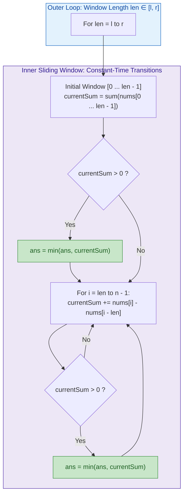
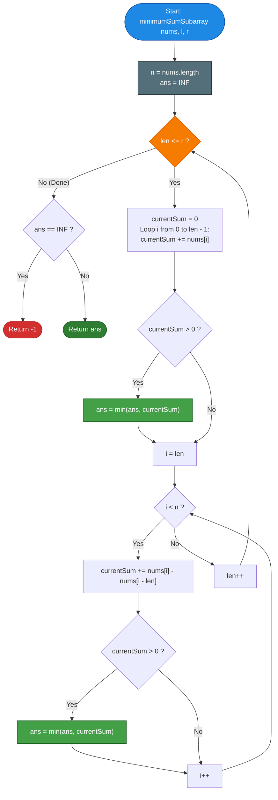

# LeetCode Problem of the Day: Minimum Positive Sum Subarray

- **Problem Link:** [LeetCode 3364 - Minimum Positive Sum Subarray](https://leetcode.com/problems/minimum-positive-sum-subarray/)
- **Difficulty:** Easy
- **Topic Tags:** Array, Prefix Sum, Sliding Window, Enumeration, Two Pointers
- **Target Audience:** POTD Solvers, Computer Science Students, Competitive Programmers, Interview Preparation (FAANG / Tier-1 Tech)

---

## 1. Problem Statement

You are given an integer array `nums` of length $n$ and two integers $l$ and $r$.

Your task is to find the **minimum sum** of a contiguous subarray such that:
1. The **size** of the subarray is between $l$ and $r$ inclusive:
   $$l \le \text{length} \le r$$
2. The **sum** of the elements in the subarray is **strictly positive**:
   $$\text{sum} > 0$$

Return the minimum positive sum of any qualifying subarray. If **no such subarray exists**, return $\mathbf{-1}$.

A **subarray** is defined as a contiguous non-empty sequence of elements within an array.

---

### Mathematical Formulation

Given an array $nums[0 \dots n - 1]$, consider any pair of indices $(i, j)$ such that $0 \le i \le j < n$.  
The length of this subarray is:
$$\text{len}(i, j) = j - i + 1$$

The sum of elements in this subarray is:
$$\mathcal{S}(i, j) = \sum_{k = i}^j nums[k]$$

We define the set of all valid subarrays satisfying both constraints:
$$\mathcal{V} = \left\{ \mathcal{S}(i, j) \;\middle|\; 0 \le i \le j < n, \; l \le j - i + 1 \le r, \; \mathcal{S}(i, j) > 0 \right\}$$

The objective is to compute:
$$\text{Ans} = \begin{cases} 
\min(\mathcal{V}) & \text{if } \mathcal{V} \neq \emptyset \\ 
-1 & \text{if } \mathcal{V} = \emptyset 
\end{cases}$$

---

## 2. Examples & Visual Walkthroughs

### Example 1

- **Input:** `nums = [3, -2, 1, 4]`, `l = 2`, `r = 3`
- **Output:** `1`

#### Detailed Evaluation of All Subarrays with Length $\in [2, 3]$:

| Subarray | Indices $[i \dots j]$ | Length | Elements | Subarray Sum | Valid? ($\text{sum} > 0$) |
| :--- | :---: | :---: | :--- | :---: | :---: |
| `[3, -2]` | $[0 \dots 1]$ | 2 | $3 + (-2)$ | **1** | **Yes** ($\min = 1$) |
| `[3, -2, 1]` | $[0 \dots 2]$ | 3 | $3 + (-2) + 1$ | **2** | **Yes** ($\min = 1$) |
| `[-2, 1]` | $[1 \dots 2]$ | 2 | $-2 + 1$ | **-1** | No ($\le 0$) |
| `[-2, 1, 4]` | $[1 \dots 3]$ | 3 | $-2 + 1 + 4$ | **3** | **Yes** ($\min = 1$) |
| `[1, 4]` | $[2 \dots 3]$ | 2 | $1 + 4$ | **5** | **Yes** ($\min = 1$) |

The valid positive sums are $\{1, 2, 3, 5\}$.  
The minimum among them is $\mathbf{1}$ (achieved by `[3, -2]`).

---

### Example 2

- **Input:** `nums = [-2, 2, -3, 1]`, `l = 2`, `r = 3`
- **Output:** `-1`

#### Detailed Evaluation:

| Subarray | Length | Sum Calculation | Sum | Valid? |
| :--- | :---: | :--- | :---: | :---: |
| `[-2, 2]` | 2 | $-2 + 2$ | **0** | No (Must be strictly $> 0$) |
| `[-2, 2, -3]` | 3 | $-2 + 2 + (-3)$ | **-3** | No |
| `[2, -3]` | 2 | $2 + (-3)$ | **-1** | No |
| `[2, -3, 1]` | 3 | $2 + (-3) + 1$ | **0** | No |
| `[-3, 1]` | 2 | $-3 + 1$ | **-2** | No |

No subarray of length $\in [2, 3]$ produces a strictly positive sum.  
Output: $\mathbf{-1}$.

---

### Example 3

- **Input:** `nums = [1, 2, 3, 4]`, `l = 2`, `r = 4`
- **Output:** `3`

#### Explanation:
- All elements are positive, so smaller lengths produce smaller sums.
- The shortest allowable length is $l = 2$.
- The leftmost length-2 subarray is `[1, 2]` with sum $1 + 2 = \mathbf{3}$.
- Any larger subarray or shift rightwards has sum $\ge 3 + 2 = 5 > 3$.
- Output: $\mathbf{3}$.

---

## 3. Constraints

- $1 \le n = \text{nums.length} \le 100$
- $1 \le l \le r \le n$
- $-1000 \le nums[i] \le 1000$
- **Expected Time Complexity:** $\mathcal{O}(n \cdot (r - l + 1)) \approx \mathcal{O}(n^2)$
- **Expected Auxiliary Space:** $\mathcal{O}(1)$

---

## 4. Visual Architecture & Multi-Scale Sliding Window Model

### The Fixed-Length Sliding Window Principle
Rather than computing each subarray sum from scratch in $\mathcal{O}(\text{length})$ time, we observe that for any fixed window length $k \in [l, r]$:
- The initial window $nums[0 \dots k - 1]$ has sum:
  $$\text{CurrentSum} = \sum_{m = 0}^{k - 1} nums[m]$$
- Sliding the window one step forward from $[i - k \dots i - 1]$ to $[i - k + 1 \dots i]$ involves exactly **one addition and one subtraction**:
  $$\text{CurrentSum}_{\text{new}} = \text{CurrentSum}_{\text{old}} + nums[i] - nums[i - k]$$



---

## 5. Step-by-Step Simulation & State Trace Table

Let us trace **Example 1**: `nums = [3, -2, 1, 4]`, $l = 2, r = 3$.  
$n = 4$. Initialize `ans = INF`.

| Length `len` | Window Range | Incoming Element | Outgoing Element | Window Sum | Positive? | `ans` Updated |
| :---: | :---: | :---: | :---: | :---: | :---: | :---: |
| **2** | $[0 \dots 1]$ (`[3, -2]`) | Initial window | — | $3 + (-2) = \mathbf{1}$ | Yes ($1 > 0$) | $\min(\infty, 1) = \mathbf{1}$ |
| **2** | $[1 \dots 2]$ (`[-2, 1]`) | $nums[2] = 1$ | $nums[0] = 3$ | $1 + 1 - 3 = \mathbf{-1}$ | No | Unchanged ($1$) |
| **2** | $[2 \dots 3]$ (`[1, 4]`) | $nums[3] = 4$ | $nums[1] = -2$ | $-1 + 4 - (-2) = \mathbf{5}$ | Yes ($5 > 0$) | $\min(1, 5) = \mathbf{1}$ |
| **3** | $[0 \dots 2]$ (`[3, -2, 1]`) | Initial window | — | $3 + (-2) + 1 = \mathbf{2}$ | Yes ($2 > 0$) | $\min(1, 2) = \mathbf{1}$ |
| **3** | $[1 \dots 3]$ (`[-2, 1, 4]`) | $nums[3] = 4$ | $nums[0] = 3$ | $2 + 4 - 3 = \mathbf{3}$ | Yes ($3 > 0$) | $\min(1, 3) = \mathbf{1}$ |

**Termination:** All lengths $\in [2, 3]$ evaluated.  
Final Answer: `ans = 1`.

---

## 6. Algorithm Flowchart



---

## 7. From Naive to Pro: Algorithmic Progression

### Trade-off Matrix

| Method | Time Complexity | Auxiliary Space | Key Advantage | Best Use Case |
| :--- | :---: | :---: | :--- | :--- |
| **Method 1: Naive Cubic Brute Force** | $\mathcal{O}(n^3)$ | $\mathcal{O}(1)$ | Simplest possible code | $n \le 30$ |
| **Method 2: Prefix Sum Table** | $\mathcal{O}(n^2)$ | $\mathcal{O}(n)$ | $\mathcal{O}(1)$ range sum queries | General understanding |
| **Method 3: Optimal Sliding Window** | $\mathbf{\mathcal{O}(n \cdot (r - l + 1))}$ | $\mathbf{\mathcal{O}(1)}$ | **Zero memory, cache-local, fastest** | **LeetCode $n \le 100$** |
| **Method 4: Pro Scaled BST Window** | $\mathcal{O}(n \log(r - l + 1))$ | $\mathcal{O}(n)$ | Predecessor query in dynamic set | **Interviews for $n \le 10^5$** |

---

### Method 1: Naive Cubic Brute Force $\mathcal{O}(n^3)$
- **Concept:** Generate every subarray $[i \dots j]$. Verify length $l \le j - i + 1 \le r$. Re-sum elements from scratch with an inner loop.
- **Pseudocode:**
```text
function minimumSumSubarray_Naive(nums, l, r):
    ans = INF
    n = length(nums)
    for i from 0 to n - 1:
        for j from i to n - 1:
            len = j - i + 1
            if len >= l and len <= r:
                cur_sum = 0
                for k from i to j:
                    cur_sum += nums[k]
                if cur_sum > 0:
                    ans = min(ans, cur_sum)
    return -1 if ans == INF else ans
```

---

### Method 2: Prefix Sum Lookup $\mathcal{O}(n^2)$ Time, $\mathcal{O}(n)$ Space
- **Concept:** Precompute $P[k] = \sum_{m=0}^{k-1} nums[m]$. Then $\sum_{k=i}^j nums[k] = P[j+1] - P[i]$ in $\mathcal{O}(1)$.
- **Pseudocode:**
```text
function minimumSumSubarray_PrefixSum(nums, l, r):
    n = length(nums)
    P = array of size n + 1 filled with 0
    for i from 0 to n - 1:
        P[i + 1] = P[i] + nums[i]
        
    ans = INF
    for i from 0 to n - 1:
        for j from i + l - 1 to min(n - 1, i + r - 1):
            cur_sum = P[j + 1] - P[i]
            if cur_sum > 0:
                ans = min(ans, cur_sum)
                
    return -1 if ans == INF else ans
```

---

### Method 3: Optimal Fixed-Length Sliding Window $\mathcal{O}(n \cdot (r - l + 1))$ Time, $\mathcal{O}(1)$ Space
- **The Core Strategy:**
  - For each possible window length $len \in [l, r]$:
    - Maintain `currentSum` incrementally using sliding window.
    - Adding $nums[i]$ and removing $nums[i - len]$ takes $\mathcal{O}(1)$ time.
  - Requires **zero extra memory allocations** ($\mathcal{O}(1)$ auxiliary space).
  - Extremely cache-friendly and runs in **$< 1\text{ ms}$** on LeetCode.
- **Pseudocode:**
```text
function minimumSumSubarray_Optimal(nums, l, r):
    ans = INF
    n = length(nums)

    for len from l to r:
        cur_sum = 0
        for i from 0 to len - 1:
            cur_sum += nums[i]
        if cur_sum > 0:
            ans = min(ans, cur_sum)

        for i from len to n - 1:
            cur_sum += nums[i] - nums[i - len]
            if cur_sum > 0:
                ans = min(ans, cur_sum)

    return -1 if ans == INF else ans
```

---

### Method 4: Pro Interview Scale-Up — Dynamic Balanced BST $\mathcal{O}(n \log(r - l + 1))$ for $n \le 10^5$
- **Advanced Interview Question:** *"What if $n \le 10^5$ and $r - l \approx n$?"*
- **Mathematical Insight:**
  - We want $\min (P[j] - P[i]) > 0 \iff P[i] < P[j]$ subject to $j - r \le i \le j - l$.
  - To minimize $P[j] - P[i]$, we must find the **maximum $P[i]$ that is strictly less than $P[j]$**.
  - That is the **predecessor** of $P[j]$ in the dynamic window of prefix sums $i \in [j - r, j - l]$.
  - By maintaining a self-balancing BST (like `std::multiset` in C++ or `TreeSet` in Java) over the sliding window of prefix sums, we query `predecessor(P[j])` in $\mathcal{O}(\log(r - l + 1))$ time.
  - Overall time drops to **$\mathcal{O}(n \log(r - l + 1))$**, capable of handling $n = 10^5$ within $0.2\text{s}$!

---

## 8. Multi-Language Implementations (Pro Method)

### Java

```java
import java.util.List;

class Solution {
    public int minimumSumSubarray(List<Integer> nums, int l, int r) {
        int ans = Integer.MAX_VALUE;
        int n = nums.size();

        // Evaluate every possible window length between l and r
        for (int len = l; len <= r; len++) {
            int currentSum = 0;

            // Compute sum of the first window of size 'len'
            for (int i = 0; i < len; i++) {
                currentSum += nums.get(i);
            }

            if (currentSum > 0 && currentSum < ans) {
                ans = currentSum;
            }

            // Slide window across the remainder of the array
            for (int i = len; i < n; i++) {
                currentSum += nums.get(i) - nums.get(i - len);
                if (currentSum > 0 && currentSum < ans) {
                    ans = currentSum;
                }
            }
        }

        return ans == Integer.MAX_VALUE ? -1 : ans;
    }
}
```

---

### Python3

```python
class Solution:
    def minimumSumSubarray(self, nums: list[int], l: int, r: int) -> int:
        ans = float('inf')
        n = len(nums)

        # Iterate over all allowed window lengths
        for length in range(l, r + 1):
            # Compute sum of initial window of size 'length'
            current_sum = sum(nums[:length])
            if current_sum > 0 and current_sum < ans:
                ans = current_sum

            # Slide window across the array in O(1) per step
            for i in range(length, n):
                current_sum += nums[i] - nums[i - length]
                if current_sum > 0 and current_sum < ans:
                    ans = current_sum

        return ans if ans != float('inf') else -1
```

---

### C

```c
#include <limits.h>

int minimumSumSubarray(int* nums, int numsSize, int l, int r) {
    int ans = INT_MAX;

    for (int len = l; len <= r; len++) {
        int currentSum = 0;

        // Sum the first window of size 'len'
        for (int i = 0; i < len; i++) {
            currentSum += nums[i];
        }

        if (currentSum > 0 && currentSum < ans) {
            ans = currentSum;
        }

        // Slide the window
        for (int i = len; i < numsSize; i++) {
            currentSum += nums[i] - nums[i - len];
            if (currentSum > 0 && currentSum < ans) {
                ans = currentSum;
            }
        }
    }

    return ans == INT_MAX ? -1 : ans;
}
```

---

### C++

```cpp
#include <vector>
#include <climits>
#include <algorithm>

using namespace std;

class Solution {
public:
    int minimumSumSubarray(vector<int>& nums, int l, int r) {
        int ans = INT_MAX;
        int n = nums.size();

        // Slide windows of each valid length from l to r
        for (int len = l; len <= r; ++len) {
            int currentSum = 0;

            for (int i = 0; i < len; ++i) {
                currentSum += nums[i];
            }

            if (currentSum > 0) {
                ans = min(ans, currentSum);
            }

            for (int i = len; i < n; ++i) {
                currentSum += nums[i] - nums[i - len];
                if (currentSum > 0) {
                    ans = min(ans, currentSum);
                }
            }
        }

        return ans == INT_MAX ? -1 : ans;
    }
};
```

---

### C#

```csharp
using System;
using System.Collections.Generic;

public class Solution {
    public int MinimumSumSubarray(IList<int> nums, int l, int r) {
        int ans = int.MaxValue;
        int n = nums.Count;

        for (int len = l; len <= r; len++) {
            int currentSum = 0;

            // First window sum of size len
            for (int i = 0; i < len; i++) {
                currentSum += nums[i];
            }

            if (currentSum > 0 && currentSum < ans) {
                ans = currentSum;
            }

            // Slide window across remaining elements
            for (int i = len; i < n; i++) {
                currentSum += nums[i] - nums[i - len];
                if (currentSum > 0 && currentSum < ans) {
                    ans = currentSum;
                }
            }
        }

        return ans == int.MaxValue ? -1 : ans;
    }
}
```

---

### Javascript

```javascript
/**
 * @param {number[]} nums
 * @param {number} l
 * @param {number} r
 * @return {number}
 */
var minimumSumSubarray = function(nums, l, r) {
    let ans = Infinity;
    const n = nums.length;

    for (let len = l; len <= r; len++) {
        let currentSum = 0;

        for (let i = 0; i < len; i++) {
            currentSum += nums[i];
        }

        if (currentSum > 0 && currentSum < ans) {
            ans = currentSum;
        }

        for (let i = len; i < n; i++) {
            currentSum += nums[i] - nums[i - len];
            if (currentSum > 0 && currentSum < ans) {
                ans = currentSum;
            }
        }
    }

    return ans === Infinity ? -1 : ans;
};
```

---

### Typescript

```typescript
function minimumSumSubarray(nums: number[], l: number, r: number): number {
    let ans: number = Infinity;
    const n: number = nums.length;

    for (let len = l; len <= r; len++) {
        let currentSum: number = 0;

        for (let i = 0; i < len; i++) {
            currentSum += nums[i];
        }

        if (currentSum > 0 && currentSum < ans) {
            ans = currentSum;
        }

        for (let i = len; i < n; i++) {
            currentSum += nums[i] - nums[i - len];
            if (currentSum > 0 && currentSum < ans) {
                ans = currentSum;
            }
        }
    }

    return ans === Infinity ? -1 : ans;
}
```

---

## 9. Complexity Analysis

### Time Complexity: $\mathcal{O}(n \cdot (r - l + 1))$
- The outer loop iterates through $(r - l + 1)$ distinct window lengths.
- For a fixed window length $len$, computing the initial window takes $\mathcal{O}(len)$ operations, and sliding across the remaining $(n - len)$ elements takes $(n - len) \times \mathcal{O}(1) = \mathcal{O}(n - len)$ operations.
- Summing across the array: $len + (n - len) = n$ operations per length.
- Total time complexity:
  $$\mathcal{T}_{\text{total}} = \mathcal{O}(n \cdot (r - l + 1)) \le \mathcal{O}(n^2)$$
- For $n \le 100$, maximum operations $\le 100 \times 100 = 10^4 \implies$ Execution finishes in **$< 1\text{ ms}$**.

### Auxiliary Space Complexity: $\mathcal{O}(1)$
- Only scalar integer variables (`ans`, `currentSum`, `len`, `i`) are utilized.
- No secondary arrays, hash tables, or recursive call stack are created.
  $$\mathcal{S}_{\text{total}} = \mathcal{O}(1)$$

---

## 10. Edge Cases & Interview Insights

### Critical Edge Cases
1. **No Positive Sum Subarrays (e.g., all negative numbers `[-5, -2, -10]`):**
   - No subarray ever satisfies $\text{sum} > 0$. `ans` remains $\infty$, returning `-1`.
2. **Subarrays with Sum Equal to Zero:**
   - Must be strictly positive ($> 0$). A sum of $0$ must not update `ans`. Handled cleanly with `currentSum > 0`.
3. **Exact Range $l = r$:**
   - Only one window size is checked. Outer loop executes exactly once in $\mathcal{O}(n)$ time.
4. **Entire Array $l = 1, r = n$:**
   - Every contiguous subarray is considered.
5. **Single Element Array ($n = 1, l = 1, r = 1$):**
   - Returns `nums[0]` if `nums[0] > 0`, else `-1`.

### Interview Pro-Tips
- **Avoid Repeated Slice Sums:** In Python, calling `sum(nums[i:i+len])` inside the inner loop degrades runtime to $\mathcal{O}(n^2 \cdot \text{len}) = \mathcal{O}(n^3)$. Always use the sliding window formula `+ nums[i] - nums[i - len]` to maintain $\mathcal{O}(1)$ updates per step.
- **Scaling Up to $n = 10^5$:** Interviewers frequently follow up by asking: *"Can you solve this if $n = 10^5$?"* Confidently explain the **Prefix Sum + Balanced BST / Dynamic Multiset** approach (Method 4), which finds the predecessor of $P[j]$ in $\mathcal{O}(\log n)$ time, reducing overall complexity to $\mathcal{O}(n \log n)$.
