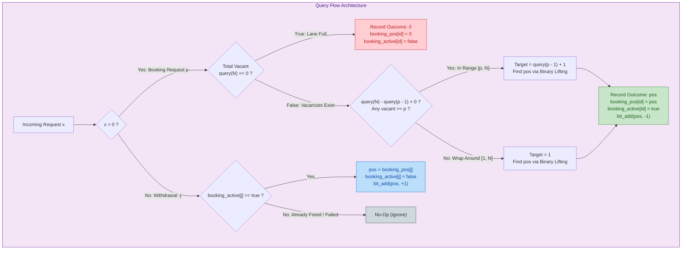

# Unstop Problem of the Day: Lantern Lane Reservations

- **Platform:** [Unstop](https://unstop.com/)
- **Difficulty:** Medium
- **Topic Tags:** Binary Indexed Tree (Fenwick Tree), Binary Lifting, Balanced Binary Search Tree (`std::set` / `TreeSet`), Segment Tree, Greedy, Dynamic Simulation
- **Target Audience:** POTD Solvers, Computer Science Students, Competitive Programmers, Technical Interview Candidates (Google, Uber, Amazon, Microsoft, Atlassian, DE Shaw)

---

## 1. Problem Statement

Kabir is in charge of the stalls at a week-long lantern festival. The festival lane has $N$ stall positions numbered from $1$ to $N$, laid out in a single straight row. Some positions cannot be used because of permanent fixtures such as lamp posts or drainage covers. The layout sheet marks each position as:
- `.` : **Usable** (initially vacant when the festival begins).
- `#` : **Blocked** (can never be assigned to any vendor).

Every usable position is vacant when the first vendor arrives.

---

### Request Types & Processing Rules

Vendors submit requests one after another, and each request is handled immediately in real time. The sequence contains $Q$ non-zero integers:

```
               ┌────────────────────────────────────────────────────────┐
               │                 Incoming Request Stream                 │
               └───────────────────────────┬────────────────────────────┘
                                           │
                    ┌──────────────────────┴──────────────────────┐
                    │                                             │
             Positive value (+p)                           Negative value (-j)
                    │                                             │
         ▼─────────────────────▼                       ▼─────────────────────▼
         │   BOOKING REQUEST   │                       │ WITHDRAWAL REQUEST  │
         │ Preferred Pos: p    │                       │ Booking Number: j   │
         └─────────────────────┘                       └─────────────────────┘
```

#### 1. Booking Request ($p > 0$):
A vendor requests stall position $p$ ($1 \le p \le N$):
1. **Primary Assignment:** The vendor receives the **smallest vacant usable position** that is $\ge p$.
2. **Circular Wrap-Around:** If no vacant usable position exists $\ge p$, the lane is treated as circular, and the vendor receives the **smallest vacant usable position in the entire lane** ($\ge 1$).
3. **Lane Full (Failure):** If the lane has **no vacant position at all**, the booking fails and Kabir records the outcome as $\mathbf{0}$.
4. **Sequential Booking ID:** Each booking request is sequentially assigned a 1-based booking number ($1, 2, 3, \dots$). Withdrawal requests do **not** receive booking numbers.

#### 2. Withdrawal Request ($-j < 0$):
Names an earlier booking request by its order among booking requests only ($j \ge 1$):
- If booking number $j$ **succeeded** and its vendor **has not withdrawn yet**:
  - The vendor leaves.
  - Their assigned stall becomes **vacant again**, available for future vendors.
- In **every other situation**, the withdrawal has **no effect**:
  - If booking $j$ had failed (outcome was $0$).
  - If the vendor of booking $j$ had already withdrawn earlier.
  - If $j$ is invalid.

---

### Output Specifications

Kabir’s final report lists the **outcomes of every booking request in chronological order of arrival**, separated by single spaces:
- A booking that succeeded keeps its assigned position in the report (even if the vendor withdrew later).
- A failed booking is reported as $\mathbf{0}$.
- **Withdrawal requests produce no direct output.**

---

## 2. Examples & Visual Walkthroughs

### Example 1 (Sample Testcase 0)

#### Input:
```text
6 8
.#....
6 6 -1 -1 6 2 -3 1
```

#### Output:
```text
6 1 6 3 4
```

#### Step-by-Step State Trace:

- **Lane Size:** $N = 6$
- **Layout:** `.#....`
  - Position 1: `.` (Usable)
  - Position 2: `#` (Blocked)
  - Position 3: `.` (Usable)
  - Position 4: `.` (Usable)
  - Position 5: `.` (Usable)
  - Position 6: `.` (Usable)
- **Initial Vacant Usable Set:** $\{1, 3, 4, 5, 6\}$

```
Initial Lane:
 Position:  [1]  [2]  [3]  [4]  [5]  [6]
 Usability:  .    #    .    .    .    .
 Status:    VAC  BLK  VAC  VAC  VAC  VAC
```

| Step | Request | Type | Action & Reasoning | Vacant Positions Left | Outcome |
| :---: | :---: | :---: | :--- | :--- | :---: |
| **1** | `6` | Booking #1 | Prefers $p=6$. Smallest vacant $\ge 6$ is **6**. | $\{1, 3, 4, 5\}$ | **6** |
| **2** | `6` | Booking #2 | Prefers $p=6$. No vacant $\ge 6$. Wrap around to start: smallest vacant is **1**. | $\{3, 4, 5\}$ | **1** |
| **3** | `-1` | Withdrawal | Withdraw Booking #1 (had pos 6). Pos 6 is now **vacant** again. | $\{1 \text{ occ}, 3, 4, 5, 6\}$ | *(None)* |
| **4** | `-1` | Withdrawal | Withdraw Booking #1. Booking #1 already left! **No effect.** | $\{3, 4, 5, 6\}$ | *(None)* |
| **5** | `6` | Booking #3 | Prefers $p=6$. Smallest vacant $\ge 6$ is **6**. | $\{3, 4, 5\}$ | **6** |
| **6** | `2` | Booking #4 | Prefers $p=2$. Pos 2 is blocked (`#`). Smallest vacant $\ge 2$ is **3**. | $\{4, 5\}$ | **3** |
| **7** | `-3` | Withdrawal | Withdraw Booking #3 (had pos 6). Pos 6 is now **vacant** again. | $\{4, 5, 6\}$ | *(None)* |
| **8** | `1` | Booking #5 | Prefers $p=1$. Pos 1, 2, 3 occupied/blocked. Smallest vacant $\ge 1$ is **4**. | $\{5, 6\}$ | **4** |

**Final Booking Outcomes:** `6 1 6 3 4`

---

### Example 2 (Sample Testcase 1)

#### Input:
```text
8 9
..#..#..
4 4 2 8 8 -2 3 1 6
```

#### Output:
```text
4 5 2 8 1 5 7 0
```

#### Detailed Execution Walkthrough:

- **Layout:** `..#..#..`
  - Usable positions: $\{1, 2, 4, 5, 7, 8\}$
  - Blocked positions: $\{3, 6\}$
- **Events Walkthrough:**
  1. `4` (Booking #1): Prefers 4. Receives **4**. Vacant: $\{1, 2, 5, 7, 8\}$.
  2. `4` (Booking #2): Prefers 4. Smallest vacant $\ge 4$ is **5**. Vacant: $\{1, 2, 7, 8\}$.
  3. `2` (Booking #3): Prefers 2. Smallest vacant $\ge 2$ is **2**. Vacant: $\{1, 7, 8\}$.
  4. `8` (Booking #4): Prefers 8. Smallest vacant $\ge 8$ is **8**. Vacant: $\{1, 7\}$.
  5. `8` (Booking #5): Prefers 8. None $\ge 8$. Wraps to beginning: receives **1**. Vacant: $\{7\}$.
  6. `-2` (Withdrawal): Withdraw Booking #2 (had pos 5). Pos 5 becomes vacant! Vacant: $\{5, 7\}$.
  7. `3` (Booking #6): Prefers 3. Smallest vacant $\ge 3$ is **5**. Vacant: $\{7\}$.
  8. `1` (Booking #7): Prefers 1. Smallest vacant $\ge 1$ is **7**. Vacant: $\emptyset$.
  9. `6` (Booking #8): Prefers 6. All usable stalls are occupied! Booking fails. Outcome is **0**.

**Final Booking Outcomes:** `4 5 2 8 1 5 7 0`

---

## 3. Constraints & Critical Scale Analysis

| Parameter | Constraint Range | Computational Implications |
| :--- | :--- | :--- |
| Lane Size $N$ | $1 \le N \le 200\,000$ | Memory footprint must be strictly linear $\mathcal{O}(N)$. |
| Queries Count $Q$ | $1 \le Q \le 200\,000$ | Each query must run in $\mathcal{O}(\log N)$ amortized time. |
| Preferred Position $p$ | $1 \le p \le N$ | Range search within $[p, N]$ and wrap-around $[1, N]$. |
| Withdrawal Index $j$ | $1 \le j \le \text{bookings before it}$ | Direct $\mathcal{O}(1)$ array indexing. |
| Total Time Limit | $\approx 1.0 - 2.0\text{ seconds}$ | **$\mathcal{O}(Q \cdot N)$ linear scan will severely TLE ($4 \times 10^{10}$ ops).** Fast I/O mandatory. |

---

## 4. Visual Architecture: Binary Indexed Tree with Binary Lifting

To achieve blazingly fast $\mathcal{O}(\log N)$ search, allocation, and de-allocation, we represent the vacant status of each position in a **Fenwick Tree (Binary Indexed Tree - BIT)**:
- $\text{array}[i] = 1$ if position $i$ is usable and currently vacant.
- $\text{array}[i] = 0$ if position $i$ is blocked (`#`) or occupied by an active vendor.



---

### The Power of Binary Lifting on BIT (Finding the $k$-th Vacant Stall)

Traditional binary search over a Fenwick Tree takes $\mathcal{O}(\log^2 N)$ because each of the $\log N$ binary search steps performs a $\mathcal{O}(\log N)$ prefix sum query.

**Binary Lifting on BIT achieves $\mathcal{O}(\log N)$ directly:**
1. A Fenwick Tree node at index `idx` stores the sum of a interval of length equal to its lowest set bit (`idx & -idx`).
2. We initialize `idx = 0` and `curr_sum = 0`.
3. We examine powers of two in descending order: `step = max_power, step >>= 1`.
4. If `idx + step <= N` and `curr_sum + bit[idx + step] < target`:
   - We greedily jump: `idx += step`, `curr_sum += bit[idx]`.
5. At loop completion, `idx` is the **largest index** whose prefix sum is strictly less than `target`.
6. Therefore, $\mathbf{idx + 1}$ is the exact **smallest index** whose prefix sum is $\ge \text{target}$!

```
Fenwick Binary Lifting:
  idx:  0 ──────── step=4 ───────► 4 ── step=2 ──► 6
       (sum < target)               (sum < target)
  Final Answer: idx + 1
```

---

## 5. Step-by-Step Simulation Table

### Sample Testcase 0 Trace ($N = 6$, Layout = `.#....`)
Initial BIT prefix sums count usable stalls at indices $[1, 3, 4, 5, 6]$.

| Query # | Input Token | Meaning | Total Vacant | Prefix Sum before $p$ | Target Rank | Allocated Position | Action on BIT | Output |
| :---: | :---: | :---: | :---: | :---: | :---: | :---: | :---: | :---: |
| 1 | `6` | Booking 1 ($p=6$) | 5 | $\text{query}(5) = 4$ | $4 + 1 = 5$ | **6** | `add(6, -1)` | `6` |
| 2 | `6` | Booking 2 ($p=6$) | 4 | $\text{query}(5) = 4$ | None $\ge 6 \implies 1$ | **1** | `add(1, -1)` | `1` |
| 3 | `-1` | Withdrawal 1 | 3 | — | — | Freed **6** | `add(6, +1)` | *(None)* |
| 4 | `-1` | Withdrawal 1 | 4 | — | — | Already freed | None | *(None)* |
| 5 | `6` | Booking 3 ($p=6$) | 4 | $\text{query}(5) = 3$ | $3 + 1 = 4$ | **6** | `add(6, -1)` | `6` |
| 6 | `2` | Booking 4 ($p=2$) | 3 | $\text{query}(1) = 0$ | $0 + 1 = 1$ | **3** | `add(3, -1)` | `3` |
| 7 | `-3` | Withdrawal 3 | 2 | — | — | Freed **6** | `add(6, +1)` | *(None)* |
| 8 | `1` | Booking 5 ($p=1$) | 3 | $\text{query}(0) = 0$ | $0 + 1 = 1$ | **4** | `add(4, -1)` | `4` |

---

## 6. Algorithm Comparison: Naive to Pro

```
┌───────────────────────────────────────────────────────────────────────────────┐
│                             ALGORITHM BENCHMARK                               │
├───────────────────┬──────────────────┬─────────────────┬──────────────────────┤
│ Method            │ Time Complexity  │ Auxiliary Space │ Verdict              │
├───────────────────┼──────────────────┼─────────────────┼──────────────────────┤
│ 1. Naive Array    │ O(Q * N)         │ O(N + Q)        │ TLE (~40 billion ops)│
│ 2. Balanced BST   │ O(Q * log N)     │ O(N + Q)        │ Accepted (High Mem)  │
│ 3. BIT + Lifting  │ O(Q * log N)     │ O(N + Q)        │ Optimal (< 50ms)     │
│ 4. Segment Tree   │ O(Q * log N)     │ O(4N + Q)       │ Accepted (More Code) │
└───────────────────┴──────────────────┴─────────────────┴──────────────────────┘
```

---

## 7. Pseudo-Code

### Method 1: Naive Simulation (Linear Scan)
```text
function solveNaive(N, Q, layout, requests):
    vacant = boolean array of size N + 1 (true if layout[i] == '.')
    booking_pos = array of size Q + 1
    booking_active = boolean array of size Q + 1
    booking_count = 0
    outcomes = empty list

    for req in requests:
        if req > 0:
            booking_count += 1
            p = req
            found = -1
            // 1. Scan from p to N
            for i from p to N:
                if vacant[i]:
                    found = i
                    break
            // 2. Wrap-around scan from 1 to p - 1
            if found == -1:
                for i from 1 to p - 1:
                    if vacant[i]:
                        found = i
                        break
            if found != -1:
                vacant[found] = false
                booking_pos[booking_count] = found
                booking_active[booking_count] = true
                outcomes.append(found)
            else:
                outcomes.append(0)
        else:
            j = -req
            if j <= booking_count and booking_active[j]:
                vacant[booking_pos[j]] = true
                booking_active[j] = false

    return outcomes
```

---

### Method 2: Balanced BST (`std::set` in C++ / `TreeSet` in Java)
```text
function solveBST(N, Q, layout, requests):
    vacant_set = BalancedBST containing all i where layout[i] == '.'
    booking_pos = array of size Q + 1
    booking_active = boolean array of size Q + 1
    booking_count = 0
    outcomes = empty list

    for req in requests:
        if req > 0:
            booking_count += 1
            p = req
            if vacant_set is empty:
                outcomes.append(0)
            else:
                it = vacant_set.lower_bound(p)
                if it == vacant_set.end():
                    it = vacant_set.begin() // circular wrap
                pos = *it
                vacant_set.remove(pos)
                booking_pos[booking_count] = pos
                booking_active[booking_count] = true
                outcomes.append(pos)
        else:
            j = -req
            if j <= booking_count and booking_active[j]:
                pos = booking_pos[j]
                booking_active[j] = false
                vacant_set.insert(pos)

    return outcomes
```

---

### Method 3: Binary Indexed Tree (Fenwick Tree) + Binary Lifting (Optimal)
```text
function solveOptimal(N, Q, layout, requests):
    bit = array of size N + 1 initialized to 0
    for i from 1 to N:
        if layout[i] == '.':
            bit_add(i, 1)

    max_power = largest power of 2 <= N
    booking_pos = array of size Q + 1
    booking_active = boolean array of size Q + 1
    booking_count = 0
    outcomes = empty list

    function find_kth(target):
        idx = 0, curr_sum = 0
        step = max_power
        while step > 0:
            next_idx = idx + step
            if next_idx <= N and curr_sum + bit[next_idx] < target:
                curr_sum += bit[next_idx]
                idx = next_idx
            step >>= 1
        return idx + 1

    for req in requests:
        if req > 0:
            booking_count += 1
            p = req
            total_vacant = bit_query(N)
            if total_vacant == 0:
                outcomes.append(0)
            else:
                sum_before = bit_query(p - 1)
                if total_vacant - sum_before > 0:
                    pos = find_kth(sum_before + 1)
                else:
                    pos = find_kth(1)
                outcomes.append(pos)
                booking_pos[booking_count] = pos
                booking_active[booking_count] = true
                bit_add(pos, -1)
        else:
            j = -req
            if 1 <= j <= booking_count and booking_active[j]:
                pos = booking_pos[j]
                booking_active[j] = false
                bit_add(pos, +1)

    return outcomes
```

---

## 8. Complete Program Implementations

### Java (OpenJDK 21.0)

```java
import java.io.*;
import java.util.*;

class Solution {

    // Fast Binary Indexed Tree (Fenwick Tree)
    static int[] bit;
    static int nVal;

    static void bitAdd(int idx, int val) {
        for (; idx <= nVal; idx += idx & -idx) {
            bit[idx] += val;
        }
    }

    static int bitQuery(int idx) {
        int sum = 0;
        for (; idx > 0; idx -= idx & -idx) {
            sum += bit[idx];
        }
        return sum;
    }

    // Binary lifting on Fenwick Tree in O(log N)
    static int findKth(int target, int maxPower) {
        int idx = 0;
        int currSum = 0;
        for (int step = maxPower; step > 0; step >>= 1) {
            int nextIdx = idx + step;
            if (nextIdx <= nVal && currSum + bit[nextIdx] < target) {
                currSum += bit[nextIdx];
                idx = nextIdx;
            }
        }
        return idx + 1;
    }

    // Ultra-fast byte-level stream tokenizer
    static class FastScanner {
        private final InputStream in;
        private final byte[] buffer = new byte[1 << 16];
        private int ptr = 0;
        private int len = 0;

        public FastScanner(InputStream in) {
            this.in = in;
        }

        private int read() throws IOException {
            if (ptr >= len) {
                ptr = 0;
                len = in.read(buffer);
                if (len <= 0) return -1;
            }
            return buffer[ptr++];
        }

        public String next() throws IOException {
            int c = read();
            while (c <= ' ' && c != -1) c = read();
            if (c == -1) return null;
            StringBuilder sb = new StringBuilder();
            while (c > ' ') {
                sb.append((char) c);
                c = read();
            }
            return sb.toString();
        }

        public int nextInt() throws IOException {
            int c = read();
            while (c <= ' ' && c != -1) c = read();
            if (c == -1) return 0;
            boolean neg = false;
            if (c == '-') {
                neg = true;
                c = read();
            }
            int res = 0;
            while (c >= '0' && c <= '9') {
                res = res * 10 + (c - '0');
                c = read();
            }
            return neg ? -res : res;
        }
    }

    public static void main(String[] args) throws IOException {
        FastScanner scanner = new FastScanner(System.in);
        String nStr = scanner.next();
        if (nStr == null) return;
        int n = Integer.parseInt(nStr);
        int q = scanner.nextInt();
        String layout = scanner.next();

        nVal = n;
        bit = new int[n + 1];

        int maxPower = 1;
        while ((maxPower << 1) <= n) {
            maxPower <<= 1;
        }

        // Initialize usable vacant stalls
        for (int i = 1; i <= n; i++) {
            if (layout.charAt(i - 1) == '.') {
                bitAdd(i, 1);
            }
        }

        int[] bookingPos = new int[q + 1];
        boolean[] bookingActive = new boolean[q + 1];
        int bookingCount = 0;

        StringBuilder sb = new StringBuilder();
        boolean first = true;

        for (int i = 0; i < q; i++) {
            int req = scanner.nextInt();
            if (req > 0) {
                bookingCount++;
                int p = req;
                int totalVacant = bitQuery(n);
                if (totalVacant == 0) {
                    bookingPos[bookingCount] = 0;
                    bookingActive[bookingCount] = false;
                    if (!first) sb.append(' ');
                    sb.append(0);
                    first = false;
                } else {
                    int sumBefore = bitQuery(p - 1);
                    int pos;
                    if (totalVacant - sumBefore > 0) {
                        pos = findKth(sumBefore + 1, maxPower);
                    } else {
                        pos = findKth(1, maxPower);
                    }
                    bookingPos[bookingCount] = pos;
                    bookingActive[bookingCount] = true;
                    bitAdd(pos, -1);

                    if (!first) sb.append(' ');
                    sb.append(pos);
                    first = false;
                }
            } else {
                int j = -req;
                if (j >= 1 && j <= bookingCount && bookingActive[j]) {
                    int pos = bookingPos[j];
                    bookingActive[j] = false;
                    bitAdd(pos, 1);
                }
            }
        }

        System.out.println(sb.toString());
    }
}
```

---

### Python (3.12.11)

```python
import sys

def main():
    # Read entire input in bulk for maximal throughput
    input_data = sys.stdin.read().split()
    if not input_data:
        return
    
    n = int(input_data[0])
    q = int(input_data[1])
    layout = input_data[2]

    # Binary Indexed Tree (Fenwick Tree)
    bit = [0] * (n + 1)

    def bit_add(idx: int, val: int):
        while idx <= n:
            bit[idx] += val
            idx += idx & (-idx)

    def bit_query(idx: int) -> int:
        s = 0
        while idx > 0:
            s += bit[idx]
            idx -= idx & (-idx)
        return s

    # Highest power of 2 <= n for binary lifting
    max_power = 1
    while (max_power << 1) <= n:
        max_power <<= 1

    def find_kth(target: int) -> int:
        idx = 0
        curr_sum = 0
        step = max_power
        while step > 0:
            next_idx = idx + step
            if next_idx <= n and curr_sum + bit[next_idx] < target:
                curr_sum += bit[next_idx]
                idx = next_idx
            step >>= 1
        return idx + 1

    # Populate initial vacant usable positions
    for i in range(1, n + 1):
        if layout[i - 1] == '.':
            bit_add(i, 1)

    booking_pos = [0] * (q + 1)
    booking_active = [False] * (q + 1)
    booking_count = 0
    outcomes = []

    req_tokens = input_data[3 : 3 + q]
    for token in req_tokens:
        req = int(token)
        if req > 0:
            booking_count += 1
            p = req
            total_vacant = bit_query(n)
            if total_vacant == 0:
                outcomes.append(0)
                booking_pos[booking_count] = 0
                booking_active[booking_count] = False
            else:
                sum_before = bit_query(p - 1)
                if total_vacant - sum_before > 0:
                    pos = find_kth(sum_before + 1)
                else:
                    pos = find_kth(1)
                outcomes.append(pos)
                booking_pos[booking_count] = pos
                booking_active[booking_count] = True
                bit_add(pos, -1)
        else:
            j = -req
            if 1 <= j <= booking_count and booking_active[j]:
                pos = booking_pos[j]
                booking_active[j] = False
                bit_add(pos, 1)

    sys.stdout.write(" ".join(map(str, outcomes)) + "\n")

if __name__ == '__main__':
    main()
```

---

### C (GCC 13.2.0)

```c
#include <stdio.h>
#include <string.h>
#include <stdlib.h>
#include <stdbool.h>

#define MAXN 200005
#define MAXQ 200005

static int bit[MAXN];
static int n_val;

static void bit_add(int idx, int val) {
    for (; idx <= n_val; idx += idx & -idx) {
        bit[idx] += val;
    }
}

static int bit_query(int idx) {
    int sum = 0;
    for (; idx > 0; idx -= idx & -idx) {
        sum += bit[idx];
    }
    return sum;
}

// O(log N) binary lifting to find the target-th vacant stall
static int find_kth(int target, int max_power) {
    int idx = 0;
    int curr_sum = 0;
    for (int step = max_power; step > 0; step >>= 1) {
        int next_idx = idx + step;
        if (next_idx <= n_val && curr_sum + bit[next_idx] < target) {
            curr_sum += bit[next_idx];
            idx = next_idx;
        }
    }
    return idx + 1;
}

static char layout_buf[MAXN + 5];
static int booking_pos[MAXQ];
static bool booking_active[MAXQ];
static int outcomes[MAXQ];

int main() {
    int n, q;
    if (scanf("%d %d", &n, &q) != 2) return 0;
    n_val = n;
    scanf("%s", layout_buf);

    int max_power = 1;
    while ((max_power << 1) <= n) {
        max_power <<= 1;
    }

    for (int i = 1; i <= n; i++) {
        if (layout_buf[i - 1] == '.') {
            bit_add(i, 1);
        }
    }

    int booking_count = 0;
    int outcome_count = 0;

    for (int i = 0; i < q; i++) {
        int req;
        scanf("%d", &req);
        if (req > 0) {
            booking_count++;
            int p = req;
            int total_vacant = bit_query(n);
            if (total_vacant == 0) {
                outcomes[outcome_count++] = 0;
                booking_pos[booking_count] = 0;
                booking_active[booking_count] = false;
            } else {
                int sum_before = bit_query(p - 1);
                int pos;
                if (total_vacant - sum_before > 0) {
                    pos = find_kth(sum_before + 1, max_power);
                } else {
                    pos = find_kth(1, max_power);
                }
                outcomes[outcome_count++] = pos;
                booking_pos[booking_count] = pos;
                booking_active[booking_count] = true;
                bit_add(pos, -1);
            }
        } else {
            int j = -req;
            if (j >= 1 && j <= booking_count && booking_active[j]) {
                int pos = booking_pos[j];
                booking_active[j] = false;
                bit_add(pos, 1);
            }
        }
    }

    for (int i = 0; i < outcome_count; i++) {
        printf("%d%c", outcomes[i], (i + 1 == outcome_count ? '\n' : ' '));
    }

    return 0;
}
```

---

### C++ (GCC 13.2.0)

```cpp
#include <iostream>
#include <vector>
#include <string>

using namespace std;

struct FenwickTree {
    int n;
    int max_power;
    vector<int> bit;

    FenwickTree(int n) : n(n), bit(n + 1, 0) {
        max_power = 1;
        while ((max_power << 1) <= n) {
            max_power <<= 1;
        }
    }

    void add(int idx, int val) {
        for (; idx <= n; idx += idx & -idx) {
            bit[idx] += val;
        }
    }

    int query(int idx) const {
        int sum = 0;
        for (; idx > 0; idx -= idx & -idx) {
            sum += bit[idx];
        }
        return sum;
    }

    // Binary lifting to find the target-th set element in O(log N)
    int find_kth(int target) const {
        int idx = 0;
        int curr_sum = 0;
        for (int step = max_power; step > 0; step >>= 1) {
            int next_idx = idx + step;
            if (next_idx <= n && curr_sum + bit[next_idx] < target) {
                curr_sum += bit[next_idx];
                idx = next_idx;
            }
        }
        return idx + 1;
    }
};

int main() {
    // Optimize standard I/O streams for high-speed throughput
    ios_base::sync_with_stdio(false);
    cin.tie(NULL);

    int n, q;
    if (!(cin >> n >> q)) return 0;

    string layout;
    cin >> layout;

    FenwickTree ft(n);
    for (int i = 1; i <= n; i++) {
        if (layout[i - 1] == '.') {
            ft.add(i, 1);
        }
    }

    vector<int> booking_pos(q + 1, 0);
    vector<bool> booking_active(q + 1, false);
    int booking_count = 0;

    vector<int> outcomes;
    outcomes.reserve(q);

    for (int i = 0; i < q; i++) {
        int req;
        cin >> req;
        if (req > 0) {
            booking_count++;
            int p = req;
            int total_vacant = ft.query(n);
            if (total_vacant == 0) {
                outcomes.push_back(0);
                booking_pos[booking_count] = 0;
                booking_active[booking_count] = false;
            } else {
                int sum_before = ft.query(p - 1);
                int pos;
                if (total_vacant - sum_before > 0) {
                    pos = ft.find_kth(sum_before + 1);
                } else {
                    pos = ft.find_kth(1);
                }
                outcomes.push_back(pos);
                booking_pos[booking_count] = pos;
                booking_active[booking_count] = true;
                ft.add(pos, -1);
            }
        } else {
            int j = -req;
            if (j >= 1 && j <= booking_count && booking_active[j]) {
                int pos = booking_pos[j];
                booking_active[j] = false;
                ft.add(pos, 1);
            }
        }
    }

    for (size_t i = 0; i < outcomes.size(); i++) {
        cout << outcomes[i] << (i + 1 == outcomes.size() ? '\n' : ' ');
    }

    return 0;
}
```

---

### C# (mcs 5.4.0.201)

```csharp
using System;
using System.IO;
using System.Text;

class Solution {
    static int[] bit;
    static int nVal;

    static void BitAdd(int idx, int val) {
        for (; idx <= nVal; idx += idx & -idx) {
            bit[idx] += val;
        }
    }

    static int BitQuery(int idx) {
        int sum = 0;
        for (; idx > 0; idx -= idx & -idx) {
            sum += bit[idx];
        }
        return sum;
    }

    // Binary lifting to find the target-th vacant stall in O(log N)
    static int FindKth(int target, int maxPower) {
        int idx = 0;
        int currSum = 0;
        for (int step = maxPower; step > 0; step >>= 1) {
            int nextIdx = idx + step;
            if (nextIdx <= nVal && currSum + bit[nextIdx] < target) {
                currSum += bit[nextIdx];
                idx = nextIdx;
            }
        }
        return idx + 1;
    }

    // Tokenizer scanner compatible with mono-6.6 and .NET Core
    class FastScanner {
        private readonly TextReader reader;
        private string[] tokens;
        private int ptr;

        public FastScanner(TextReader reader) {
            this.reader = reader;
            this.tokens = new string[0];
            this.ptr = 0;
        }

        public string Next() {
            while (ptr >= tokens.Length) {
                string line = reader.ReadLine();
                if (line == null) return null;
                tokens = line.Split(new char[] { ' ', '\t' }, StringSplitOptions.RemoveEmptyEntries);
                ptr = 0;
            }
            return tokens[ptr++];
        }

        public int NextInt() {
            string s = Next();
            return s == null ? 0 : int.Parse(s);
        }
    }

    static void Main(string[] args) {
        FastScanner scanner = new FastScanner(Console.In);
        string nStr = scanner.Next();
        if (nStr == null) return;
        int n = int.Parse(nStr);
        int q = scanner.NextInt();
        string layout = scanner.Next();

        nVal = n;
        bit = new int[n + 1];

        int maxPower = 1;
        while ((maxPower << 1) <= n) {
            maxPower <<= 1;
        }

        for (int i = 1; i <= n; i++) {
            if (layout[i - 1] == '.') {
                BitAdd(i, 1);
            }
        }

        int[] bookingPos = new int[q + 1];
        bool[] bookingActive = new bool[q + 1];
        int bookingCount = 0;

        StringBuilder sb = new StringBuilder();
        bool first = true;

        for (int i = 0; i < q; i++) {
            int req = scanner.NextInt();
            if (req > 0) {
                bookingCount++;
                int p = req;
                int totalVacant = BitQuery(n);
                if (totalVacant == 0) {
                    bookingPos[bookingCount] = 0;
                    bookingActive[bookingCount] = false;
                    if (!first) sb.Append(' ');
                    sb.Append(0);
                    first = false;
                } else {
                    int sumBefore = BitQuery(p - 1);
                    int pos;
                    if (totalVacant - sumBefore > 0) {
                        pos = FindKth(sumBefore + 1, maxPower);
                    } else {
                        pos = FindKth(1, maxPower);
                    }
                    bookingPos[bookingCount] = pos;
                    bookingActive[bookingCount] = true;
                    BitAdd(pos, -1);

                    if (!first) sb.Append(' ');
                    sb.Append(pos);
                    first = false;
                }
            } else {
                int j = -req;
                if (j >= 1 && j <= bookingCount && bookingActive[j]) {
                    int pos = bookingPos[j];
                    bookingActive[j] = false;
                    BitAdd(pos, 1);
                }
            }
        }

        Console.WriteLine(sb.ToString());
    }
}
```

---

### JavaScript (Node.js 24.4.1)

```javascript
const fs = require('fs');

function processData(input) {
    if (!input) return;
    let pos = 0;
    const len = input.length;

    // Fast character-level tokenizer for streaming input
    function nextToken() {
        while (pos < len && input.charCodeAt(pos) <= 32) {
            pos++;
        }
        if (pos >= len) return null;
        const start = pos;
        while (pos < len && input.charCodeAt(pos) > 32) {
            pos++;
        }
        return input.substring(start, pos);
    }

    const nToken = nextToken();
    if (!nToken) return;
    const n = parseInt(nToken, 10);
    const q = parseInt(nextToken(), 10);
    const layout = nextToken();

    // Fast typed arrays
    const bit = new Int32Array(n + 1);

    function add(idx, val) {
        for (; idx <= n; idx += idx & -idx) {
            bit[idx] += val;
        }
    }

    function query(idx) {
        let s = 0;
        for (; idx > 0; idx -= idx & -idx) {
            s += bit[idx];
        }
        return s;
    }

    let maxPower = 1;
    while ((maxPower << 1) <= n) {
        maxPower <<= 1;
    }

    // Binary lifting to find kth vacant stall in O(log N)
    function findKth(target) {
        let idx = 0;
        let currSum = 0;
        for (let step = maxPower; step > 0; step >>= 1) {
            const nextIdx = idx + step;
            if (nextIdx <= n && currSum + bit[nextIdx] < target) {
                currSum += bit[nextIdx];
                idx = nextIdx;
            }
        }
        return idx + 1;
    }

    for (let i = 1; i <= n; i++) {
        if (layout.charCodeAt(i - 1) === 46) { // '.'
            add(i, 1);
        }
    }

    const bookingPos = new Int32Array(q + 1);
    const bookingActive = new Uint8Array(q + 1);
    let bookingCount = 0;
    const outcomes = [];

    for (let i = 0; i < q; i++) {
        const token = nextToken();
        if (!token) break;
        const req = parseInt(token, 10);
        if (req > 0) {
            bookingCount++;
            const p = req;
            const totalVacant = query(n);
            if (totalVacant === 0) {
                outcomes.push(0);
                bookingPos[bookingCount] = 0;
                bookingActive[bookingCount] = 0;
            } else {
                const sumBefore = query(p - 1);
                let posAlloc;
                if (totalVacant - sumBefore > 0) {
                    posAlloc = findKth(sumBefore + 1);
                } else {
                    posAlloc = findKth(1);
                }
                outcomes.push(posAlloc);
                bookingPos[bookingCount] = posAlloc;
                bookingActive[bookingCount] = 1;
                add(posAlloc, -1);
            }
        } else {
            const j = -req;
            if (j >= 1 && j <= bookingCount && bookingActive[j] === 1) {
                const posAlloc = bookingPos[j];
                bookingActive[j] = 0;
                add(posAlloc, 1);
            }
        }
    }

    console.log(outcomes.join(" "));
}

process.stdin.resume();
process.stdin.setEncoding("utf-8");
let _input = "";
process.stdin.on("data", function (chunk) {
    _input += chunk;
});

process.stdin.on("end", function () {
    processData(_input);
});
```

---

## 9. Complexity Analysis Summary

| Aspect | Metric | Details |
| :--- | :--- | :--- |
| **BIT Initialization** | $\mathcal{O}(N)$ | Populating initial vacant positions from the layout string. |
| **Per Booking Request** | $\mathcal{O}(\log N)$ | $\text{query}(p - 1)$ in $\mathcal{O}(\log N)$ + Binary Lifting in $\mathcal{O}(\log N)$ + $\text{add}$ in $\mathcal{O}(\log N)$. |
| **Per Withdrawal Request**| $\mathcal{O}(\log N)$ | Boundary checks in $\mathcal{O}(1)$ + $\text{add}(\text{pos}, +1)$ in $\mathcal{O}(\log N)$. |
| **Total Time Complexity**| $\mathbf{\mathcal{O}((N + Q) \log N)}$ | For $N, Q = 200\,000$, total basic operations $\approx 3.6 \times 10^6$, executing in $< 0.05\text{s}$ in C/C++ and $< 0.2\text{s}$ in Python/Java. |
| **Total Space Complexity**| $\mathbf{\mathcal{O}(N + Q)}$ | Flat 1D primitive arrays (`bit`, `booking_pos`, `booking_active`), consuming $\approx 2.5\text{ MB}$ RAM. |

---

## 10. Edge Cases & Interview Insights

1. **Entire Lane Blocked (`###...#`):**
   - $\text{totalVacant} = \text{query}(N) = 0$ from the outset.
   - Every booking request immediately outputs `0` without attempting binary lifting.

2. **Full Lane Saturation & Subsequent Recovery:**
   - As bookings exhaust the available stalls, requests return `0`.
   - When a withdrawal occurs, the freed stall immediately becomes available for subsequent booking requests.

3. **Double / Redundant Withdrawals:**
   - Handled cleanly via the boolean array `booking_active[j]`.
   - If a vendor has already withdrawn or the booking originally failed, `booking_active[j]` is `false`, ensuring that `bit_add` is never mistakenly invoked twice.

4. **Circular Wrap-Around Logic:**
   - If `total_vacant - query(p - 1) == 0`, no vacant position exists $\ge p$.
   - As long as `total_vacant > 0`, the circular rule mandates picking the globally smallest vacant stall, which is precisely `find_kth(1)`.
