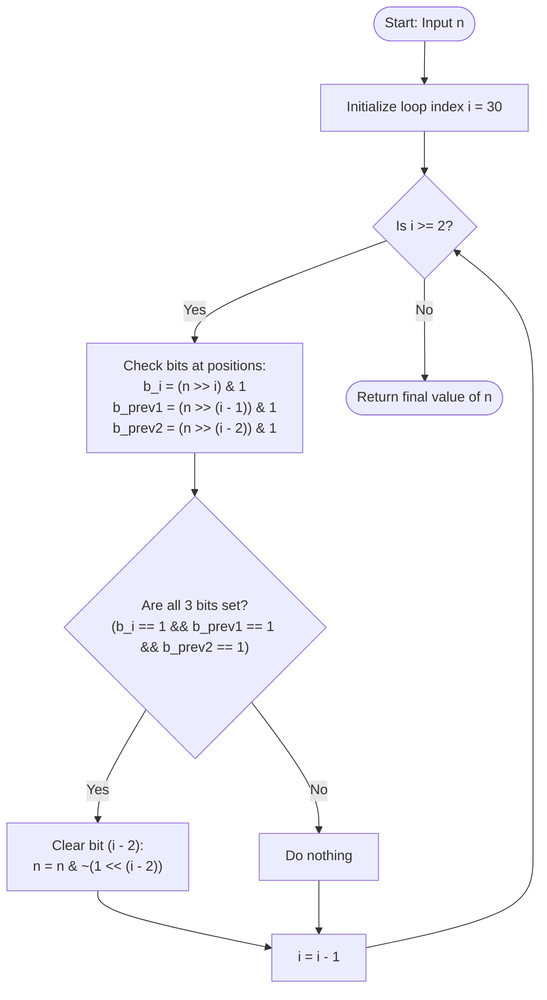

# GeeksforGeeks Problem of the Day: Maximum Without 3 Consecutive Set Bits (Geek Hates Too Many 1s)

- **Problem Link:** [GeeksforGeeks - Geek Hates Too Many 1s](https://www.geeksforgeeks.org/problems/geek-hates-too-many-1s--170647/1)
- **Difficulty:** Medium
- **Topic Tags:** Bit Manipulation, Greedy Algorithms, Number Theory
- **Target Audience:** POTD Solvers, Computer Science Students, Competitive Programmers, Technical Interview Preparation (FAANG/Tier-1 Tech)

---

## 1. Problem Statement

Given a non-negative integer $n$. You are allowed to perform the following operation any number of times:
- Choose any bit position that is currently set (`1`) in the binary representation of $n$ and turn it into an unset bit (`0`). Note that you **cannot** turn an unset bit (`0`) into a set bit (`1`).

Your objective is to find the **maximum possible value** of $n$ such that its binary representation **does not contain any three consecutive set bits** (i.e., the substring `"111"` does not appear anywhere in its binary representation).

---

## 2. Examples & Explanations

### Example 1
- **Input:** `n = 2`
- **Binary of `n`:** `10_2`
- **Explanation:**
  - The binary representation is `10_2`.
  - It contains only one set bit and no consecutive set bits at all.
  - Thus, no bit needs to be unset.
- **Output:** `2`

---

### Example 2
- **Input:** `n = 7`
- **Binary of `n`:** `111_2` (Bits at positions $2, 1, 0$)
- **Explanation:**
  - Bits at positions $2$, $1$, and $0$ are all `1`, which forms three consecutive set bits: `"111"`.
  - To eliminate the three consecutive set bits while keeping the numerical value as large as possible, we must unset the bit that contributes the least value among the three candidates ($2^2 = 4$, $2^1 = 2$, $2^0 = 1$).
  - Unsetting bit $0$ ($2^0 = 1$) yields `110_2` ($6$).
  - If we unset bit $1$, we would get `101_2` ($5$).
  - If we unset bit $2$, we would get `011_2` ($3$).
  - The maximum valid value is `6`.
- **Output:** `6`

---

### Example 3 (Chain of Consecutive Bits)
- **Input:** `n = 15`
- **Binary of `n`:** `1111_2` (Bits at positions $3, 2, 1, 0$)
- **Explanation:**
  - We scan from MSB to LSB.
  - At bit position $3$, the window of three bits is $(3, 2, 1) = (1, 1, 1)$.
  - We unset the lowest bit in this window, which is bit $1$.
  - Binary becomes: `1101_2` ($13$).
  - Now, check remaining positions:
    - Window $(2, 1, 0) = (1, 0, 1) \to$ Valid (not three `1`s).
    - Window $(1, 0, -) \to$ Valid.
  - No three consecutive bits are `1`. Value is $13$.
- **Output:** `13`

---

### Example 4 (Large Block of 1s)
- **Input:** `n = 63`
- **Binary of `n`:** `111111_2` (6 set bits: positions $5, 4, 3, 2, 1, 0$)
- **Explanation:**
  - Window $(5, 4, 3) = (1, 1, 1) \implies$ Unset bit $3$. Binary becomes `110111_2`.
  - Window $(4, 3, 2) = (1, 0, 1) \implies$ Valid.
  - Window $(3, 2, 1) = (0, 1, 1) \implies$ Valid.
  - Window $(2, 1, 0) = (1, 1, 1) \implies$ Unset bit $0$. Binary becomes `110110_2`.
  - Final binary: `110110_2` $= 32 + 16 + 4 + 2 = 54$.
- **Output:** `54`

---

## 3. Constraints & Complexity Targets

- **Value Range:** $0 \le n \le 10^9 < 2^{30}$
- **Number of Bits:** Maximum 30 bits for standard signed 32-bit positive integers (up to bit position 29 or 30).
- **Time Complexity Target:** $\mathcal{O}(\log n) = \mathcal{O}(1)$ operations (since maximum bits is bounded by 32).
- **Auxiliary Space Target:** $\mathcal{O}(1)$ constant memory.

---

## 4. Visual Architecture & Bitwise Greedy Window Theorem

### 4.1 The Bit Weight Principle
In binary representation, each bit $i$ contributes $2^i$ to the total value:

$$\text{Value} = \sum_{i=0}^{k} b_i \cdot 2^i, \quad b_i \in \{0, 1\}$$

Because $2^i > \sum_{j=0}^{i-1} 2^j$, any higher bit is strictly more valuable than the sum of all lower bits combined:
- Keeping higher bits set is always strictly superior to preserving lower bits.
- Therefore, we must process bits in **descending order** (from Most Significant Bit to Least Significant Bit).

```
Bit Position:     30  29  28  ...   i    i-1   i-2   i-3  ...   2   1   0
Bit Value:       2^30 ...          2^i  2^(i-1) 2^(i-2) ...     4   2   1
Importance:      [================ HIGHEST PRIORITY ================> LOWEST]
```

---

### 4.2 The Triplet Conflict & Barrier Property
When scanning from left to right (MSB down to LSB), suppose we detect three consecutive `1`s at indices $(i, i-1, i-2)$:

```
           i     i-1    i-2    i-3
Bits:    [ 1  |   1   |  1  ]   ?
```

We must clear at least one of these three bits to break the triplet `"111"`. We have three choices:
1. **Clear bit $i$ ($2^i$):** Loses the largest value. Suboptimal.
2. **Clear bit $i-1$ ($2^{i-1}$):** Loses more value than bit $i-2$. Suboptimal.
3. **Clear bit $i-2$ ($2^{i-2}$):** **Optimal.**
   - It loses the minimal numerical value ($\Delta = 2^{i-2}$).
   - Furthermore, setting bit $i-2 = 0$ acts as a **structural firewall / barrier**:
     - Window $(i-1, i-2, i-3)$ becomes $(1, 0, ?)$ — guaranteed safe!
     - Window $(i-2, i-3, i-4)$ becomes $(0, ?, ?)$ — guaranteed safe!
   - This single zero effectively shields the next two potential windows from forming triplets.

```
Before:
Position:    i      i-1     i-2     i-3     i-4
Bits:      [ 1 ]   [ 1 ]   [ 1 ]   [ 1 ]   [ 1 ]
             \_______ _______/
                     v
             Triplet detected!

Action: Clear bit (i - 2)

After:
Position:    i      i-1     i-2     i-3     i-4
Bits:      [ 1 ]   [ 1 ]   [ 0 ]   [ 1 ]   [ 1 ]
                            ^^^
                  Protective Firewall (0)
```

---

## 5. Step-by-Step Simulation & Detailed Trace Table

### Detailed Trace for $n = 63$ (`111111_2`)

| Step | Bit $i$ | Window $(i, i-1, i-2)$ | Bits $(b_i, b_{i-1}, b_{i-2})$ | Condition Met? | Action Taken | Modified Value $n$ | Binary Representation |
| :---: | :---: | :---: | :---: | :---: | :---: | :---: | :---: |
| 1 | 30 down to 6 | $(i, i-1, i-2)$ | $(0, 0, 0)$ | No | None | 63 | `000...0111111` |
| 2 | 5 | $(5, 4, 3)$ | $(1, 1, 1)$ | **Yes (Triplet)** | Clear bit $3$ (`n &= ~(1<<3)`) | $63 - 8 = 55$ | `...0110111` |
| 3 | 4 | $(4, 3, 2)$ | $(1, 0, 1)$ | No | None | 55 | `...0110111` |
| 4 | 3 | $(3, 2, 1)$ | $(0, 1, 1)$ | No | None | 55 | `...0110111` |
| 5 | 2 | $(2, 1, 0)$ | $(1, 1, 1)$ | **Yes (Triplet)** | Clear bit $0$ (`n &= ~(1<<0)`) | $55 - 1 = 54$ | `...0110110` |
| End | - | - | - | - | Algorithm Terminates | **54** | `110110_2` |

---

## 6. Algorithmic Flowchart



---

## 7. From Naive to Pro: Algorithmic Progression

### Method 1: Naive Decrement & Verification (Brute Force)
- **Concept:** Start from $x = n$. In a loop, test if $x$ can be formed by unsetting bits of $n$ (i.e., `(x & n) == x`) and check whether $x$ contains `"111"` in binary. If valid, return $x$; otherwise, decrement $x$ by 1.
- **Limitation:** In the worst case where $n = 10^9$, searching backwards could take millions of iterations $\mathcal{O}(n)$, causing **Time Limit Exceeded (TLE)**.

#### Pseudo-Code:
```text
function maxValueNaive(n):
    for x from n down to 0:
        if (x & n) == x:  // x is formed only by turning 1s to 0s
            if not hasThreeConsecutiveOnes(x):
                return x
```

---

### Method 2: Bit-Array / String Transformation
- **Concept:** Convert integer $n$ into a 32-element boolean or integer array representing its binary bits. Scan from left to right (index 30 down to 2). When `arr[i] == 1 && arr[i-1] == 1 && arr[i-2] == 1`, set `arr[i-2] = 0`. Finally, reconstruct the integer from the bit array.
- **Complexity:** Time $\mathcal{O}(1)$, Space $\mathcal{O}(1)$ (fixed 32 elements).

#### Pseudo-Code:
```text
function maxValueArray(n):
    bits = array of size 32 initialized to 0
    for i from 0 to 31:
        bits[i] = (n >> i) & 1
    
    for i from 31 down to 2:
        if bits[i] == 1 and bits[i-1] == 1 and bits[i-2] == 1:
            bits[i-2] = 0
            
    result = 0
    for i from 0 to 31:
        if bits[i] == 1:
            result += (1 << i)
    return result
```

---

### Method 3: In-Place Bitwise Window Masking (Optimal Pro Method)
- **Concept:** Operate directly on the integer variable $n$ using bit shifts and bitwise AND with a negated mask.
  - Test bit $k$: `(n >> k) & 1`
  - Clear bit $k$: `n &= ~(1 << k)`
- **Loop Bounds:** From $i = 30$ down to $i = 2$ (since $10^9 < 2^{30}$, bit 30 is the highest bit of interest for non-negative 32-bit signed integers).
- **Time Complexity:** Exactly 29 constant-time iterations $\implies \mathcal{O}(1)$.
- **Space Complexity:** $\mathcal{O}(1)$ auxiliary space.

#### Pseudo-Code:
```text
function maxValue(n):
    for i from 30 down to 2:
        bit_i     = (n >> i) & 1
        bit_prev1 = (n >> (i - 1)) & 1
        bit_prev2 = (n >> (i - 2)) & 1
        
        if bit_i == 1 and bit_prev1 == 1 and bit_prev2 == 1:
            // Unset bit at position (i - 2)
            n = n & ~(1 << (i - 2))
            
    return n
```

---

## 8. Complexity Comparison Table

| Approach | Time Complexity | Space Complexity | Status |
| :--- | :---: | :---: | :---: |
| **Method 1: Decrement & Verify** | $\mathcal{O}(n)$ | $\mathcal{O}(1)$ | ❌ TLE ($n \le 10^9$) |
| **Method 2: Bit Array Reconstruction** | $\mathcal{O}(32) = \mathcal{O}(1)$ | $\mathcal{O}(32) = \mathcal{O}(1)$ |  Accepted (Minor overhead) |
| **Method 3: In-Place Bitwise Mask (Pro)** | $\mathcal{O}(32) = \mathcal{O}(1)$ | $\mathcal{O}(1)$ |  Optimal & Most Efficient |

---

## 9. Comprehensive Corner Cases Handled

1. **$n = 0, 1, 2$ (Fewer than 3 bits total):**
   - No 3-bit window can be formed. The algorithm loop runs harmlessly and returns $n$ unmodified.
2. **Powers of Two ($n = 2^k$ e.g., $1, 2, 4, 8, 16, \dots$):**
   - Exactly one set bit exists. No consecutive set bits possible. Output is $n$.
3. **Alternating Bits ($n = 5$ (`101_2`), $n = 10$ (`1010_2`), $n = 21$ (`10101_2`)):**
   - No window contains three set bits. Output is $n$.
4. **All Set Bits ($n = 7$ (`111_2`), $n = 15$ (`1111_2`), $n = 31$ (`11111_2`)):**
   - Correctly clears bits to retain maximum value ($7 \to 6$, $15 \to 13$, $31 \to 27$).
5. **Upper Constraint Boundary ($n = 10^9 < 2^{30}$):**
   - 30-bit scanning completely covers all potential bits without 32-bit signed overflow issues.

---

## 10. Complete Multi-Language Implementations

### Java (21)

```java
/**
 * Problem: Maximum Without 3 Consecutive Set Bits (Geek Hates Too Many 1s)
 * Language: Java 21
 * Time Complexity: O(1)
 * Space Complexity: O(1)
 */
class Solution {
    public int maxValue(int n) {
        // Iterate through all possible bit positions from MSB down to 2.
        // For a 32-bit signed integer, bit 30 is the highest bit (as n <= 10^9 < 2^30).
        for (int i = 30; i >= 2; i--) {
            // Check if bits at i, i - 1, and i - 2 are all set (1)
            int bit1 = (n >> i) & 1;
            int bit2 = (n >> (i - 1)) & 1;
            int bit3 = (n >> (i - 2)) & 1;

            if (bit1 == 1 && bit2 == 1 && bit3 == 1) {
                // Greedily clear the least significant bit of the triplet (bit i - 2)
                // to minimize the reduction in numerical value and break the chain.
                n &= ~(1 << (i - 2));
            }
        }
        return n;
    }
}
```

---

### Python3

```python
"""
Problem: Maximum Without 3 Consecutive Set Bits (Geek Hates Too Many 1s)
Language: Python 3
Time Complexity: O(1)
Space Complexity: O(1)
"""
class Solution:
    def maxValue(self, n: int) -> int:
        """
        Greedily scans bits from MSB (30) down to LSB (2).
        Whenever three consecutive set bits are detected,
        clears the lowest bit of the triplet to preserve maximum value.
        """
        for i in range(30, 1, -1):
            bit1 = (n >> i) & 1
            bit2 = (n >> (i - 1)) & 1
            bit3 = (n >> (i - 2)) & 1

            if bit1 == 1 and bit2 == 1 and bit3 == 1:
                # Clear bit at position i - 2
                n &= ~(1 << (i - 2))

        return n
```

---

### C++ (17)

```cpp
/**
 * Problem: Maximum Without 3 Consecutive Set Bits (Geek Hates Too Many 1s)
 * Language: C++ 17
 * Time Complexity: O(1)
 * Space Complexity: O(1)
 */
class Solution {
public:
    int maxValue(int n) {
        // Scan bit positions from MSB (30) down to 2
        for (int i = 30; i >= 2; --i) {
            int bit1 = (n >> i) & 1;
            int bit2 = (n >> (i - 1)) & 1;
            int bit3 = (n >> (i - 2)) & 1;

            // When three consecutive bits are 1
            if (bit1 == 1 && bit2 == 1 && bit3 == 1) {
                // Clear the bit at index (i - 2)
                n &= ~(1 << (i - 2));
            }
        }
        return n;
    }
};
```

---

### C#

```csharp
/**
 * Problem: Maximum Without 3 Consecutive Set Bits (Geek Hates Too Many 1s)
 * Language: C#
 * Time Complexity: O(1)
 * Space Complexity: O(1)
 */
class Solution {
    public int maxValue(int n) {
        // Scan bit positions from MSB (30) down to 2
        for (int i = 30; i >= 2; i--) {
            int bit1 = (n >> i) & 1;
            int bit2 = (n >> (i - 1)) & 1;
            int bit3 = (n >> (i - 2)) & 1;

            if (bit1 == 1 && bit2 == 1 && bit3 == 1) {
                // Unset the lowest bit among the three
                n &= ~(1 << (i - 2));
            }
        }
        return n;
    }
}
```

---

### Javascript (Node v22)

```javascript
/**
 * Problem: Maximum Without 3 Consecutive Set Bits (Geek Hates Too Many 1s)
 * Language: Javascript (Node v22)
 * Time Complexity: O(1)
 * Space Complexity: O(1)
 * 
 * @param {number} n
 * @return {number}
 */
class Solution {
    maxValue(n) {
        // Bitwise operations in JavaScript operate on 32-bit signed integers
        for (let i = 30; i >= 2; i--) {
            const bit1 = (n >> i) & 1;
            const bit2 = (n >> (i - 1)) & 1;
            const bit3 = (n >> (i - 2)) & 1;

            if (bit1 === 1 && bit2 === 1 && bit3 === 1) {
                // Clear bit at position (i - 2)
                n &= ~(1 << (i - 2));
            }
        }
        return n;
    }
}
```

---

## 11. Key Takeaways & Technical Summary

1. **Greedy Choice Property:** Preserving higher-order bits is strictly prioritized over preserving lower-order bits because $2^i > \sum_{j=0}^{i-1} 2^j$.
2. **Optimal Bit to Flip:** When three consecutive `1`s occur at $(i, i-1, i-2)$, flipping bit $i-2$ incurs the minimum arithmetic loss ($2^{i-2}$) and acts as a separator preventing subsequent consecutive triplets.
3. **Constant Time & Space:** Since integer inputs are bounded by $10^9 < 2^{30}$, the bit loop executes at most 29 times, guaranteeing $\mathcal{O}(1)$ time and $\mathcal{O}(1)$ space.
