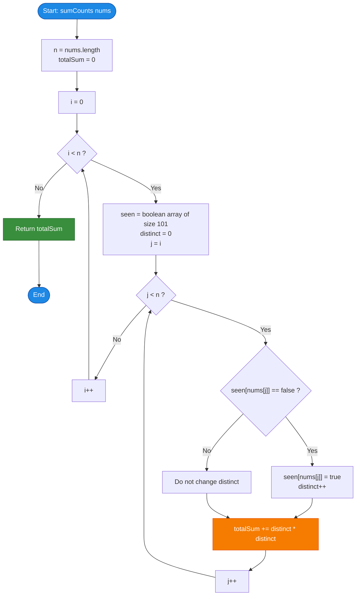

# LeetCode Problem of the Day: Subarrays Distinct Element Sum of Squares I

- **Problem Link:** [LeetCode 2913 - Subarrays Distinct Element Sum of Squares I](https://leetcode.com/problems/subarrays-distinct-element-sum-of-squares-i/description/?envType=daily-question&envId=2026-10-15)
- **Difficulty:** Easy
- **Topic Tags:** Array, Hash Table, Bit Manipulation, Math, Dynamic Programming, Segment Tree
- **Target Audience:** POTD Solvers, Computer Science Students, Competitive Programmers, Interview Preparation (FAANG/Tier-1 Tech)

---

## 1. Problem Statement

You are given a 0-indexed integer array `nums`.

The **distinct count** of a subarray of `nums` is defined as the number of distinct (unique) elements present in that subarray.

Formally, for any contiguous subarray `nums[i..j]` where $0 \le i \le j < \text{nums.length}$, let $\text{distinct}(i, j)$ denote the number of unique values in `nums[i..j]`. The **score** of the subarray is:
$$\text{Score}(i, j) = (\text{distinct}(i, j))^2$$

Your task is to compute and return the **sum of the squares of distinct counts of all possible contiguous non-empty subarrays** of `nums`:
$$\text{Total Sum} = \sum_{i=0}^{n-1} \sum_{j=i}^{n-1} (\text{distinct}(i, j))^2$$

---

## 2. Examples & Explanations

### Example 1
- **Input:** `nums = [1, 2, 1]`
- **Array Length ($n$):** $3$
- **Total Subarrays ($\frac{n(n+1)}{2}$):** $\frac{3 \times 4}{2} = 6$

#### Subarray Enumeration & Scoring:
1. Subarray `[1]` (indices $[0, 0]$): Unique elements = $\{1\} \implies \text{distinct} = 1 \implies 1^2 = 1$
2. Subarray `[2]` (indices $[1, 1]$): Unique elements = $\{2\} \implies \text{distinct} = 1 \implies 1^2 = 1$
3. Subarray `[1]` (indices $[2, 2]$): Unique elements = $\{1\} \implies \text{distinct} = 1 \implies 1^2 = 1$
4. Subarray `[1, 2]` (indices $[0, 1]$): Unique elements = $\{1, 2\} \implies \text{distinct} = 2 \implies 2^2 = 4$
5. Subarray `[2, 1]` (indices $[1, 2]$): Unique elements = $\{2, 1\} \implies \text{distinct} = 2 \implies 2^2 = 4$
6. Subarray `[1, 2, 1]` (indices $[0, 2]$): Unique elements = $\{1, 2\} \implies \text{distinct} = 2 \implies 2^2 = 4$

- **Sum of Squares:** $1 + 1 + 1 + 4 + 4 + 4 = \mathbf{15}$
- **Output:** `15`

---

### Example 2
- **Input:** `nums = [1, 1]`
- **Array Length ($n$):** $2$
- **Total Subarrays:** $3$

#### Subarray Enumeration:
1. Subarray `[1]` (index $[0, 0]$): Unique elements = $\{1\} \implies 1^2 = 1$
2. Subarray `[1]` (index $[1, 1]$): Unique elements = $\{1\} \implies 1^2 = 1$
3. Subarray `[1, 1]` (indices $[0, 1]$): Unique elements = $\{1\} \implies 1^2 = 1$

- **Sum of Squares:** $1 + 1 + 1 = \mathbf{3}$
- **Output:** `3`

---

### Example 3 (Duplicate Clusters)
- **Input:** `nums = [2, 2, 5, 5]`
- **Array Length ($n$):** $4$
- **Total Subarrays:** $10$

| Start $i$ | End $j$ | Subarray | Unique Elements | Distinct Count | Score ($\text{Count}^2$) |
| :---: | :---: | :---: | :---: | :---: | :---: |
| 0 | 0 | `[2]` | $\{2\}$ | 1 | $1^2 = 1$ |
| 0 | 1 | `[2, 2]` | $\{2\}$ | 1 | $1^2 = 1$ |
| 0 | 2 | `[2, 2, 5]` | $\{2, 5\}$ | 2 | $2^2 = 4$ |
| 0 | 3 | `[2, 2, 5, 5]` | $\{2, 5\}$ | 2 | $2^2 = 4$ |
| 1 | 1 | `[2]` | $\{2\}$ | 1 | $1^2 = 1$ |
| 1 | 2 | `[2, 5]` | $\{2, 5\}$ | 2 | $2^2 = 4$ |
| 1 | 3 | `[2, 5, 5]` | $\{2, 5\}$ | 2 | $2^2 = 4$ |
| 2 | 2 | `[5]` | $\{5\}$ | 1 | $1^2 = 1$ |
| 2 | 3 | `[5, 5]` | $\{5\}$ | 1 | $1^2 = 1$ |
| 3 | 3 | `[5]` | $\{5\}$ | 1 | $1^2 = 1$ |

- **Sum of Squares:** $1 + 1 + 4 + 4 + 1 + 4 + 4 + 1 + 1 + 1 = \mathbf{22}$
- **Output:** `22`

---

## 3. Constraints

- $1 \le \text{nums.length} \le 100$
- $1 \le \text{nums}[i] \le 100$
- **Expected Time Complexity:** $\mathcal{O}(N^2)$ for Part I (scales to $\mathcal{O}(N \log N)$ in Part II / LeetCode 2916)
- **Expected Auxiliary Space:** $\mathcal{O}(1)$ or $\mathcal{O}(U)$ where $U \le 100$ is the range of values

---

## 4. Visual Architecture & Mathematical Foundation

### 4.1 Subarray Space Representation
Every contiguous subarray is uniquely defined by a pair of indices $(i, j)$ where $0 \le i \le j < n$. This forms an upper-triangular grid of size $\frac{n(n+1)}{2}$:

```
     j = 0     j = 1     j = 2     ...     j = n - 1
i=0  [0..0]    [0..1]    [0..2]    ...     [0..n-1]
i=1            [1..1]    [1..2]    ...     [1..n-1]
i=2                      [2..2]    ...     [2..n-1]
...
i=n-1                                      [n-1..n-1]
```

### 4.2 Incremental State Expansion
Notice the crucial recurrence when extending a subarray from $j-1$ to $j$:
$$\text{distinct}(i, j) = \begin{cases} \text{distinct}(i, j-1) + 1 & \text{if } \text{nums}[j] \notin \text{nums}[i..j-1] \\ \text{distinct}(i, j-1) & \text{if } \text{nums}[j] \in \text{nums}[i..j-1] \end{cases}$$

Instead of recomputing the distinct set from scratch for every $(i, j)$ in $\mathcal{O}(n)$, we can fix the start index $i$ and incrementally expand $j$ from $i$ to $n-1$:
- Maintain a fast lookup structure (a boolean array or bitset of size $101$, since $\text{nums}[i] \le 100$).
- When $\text{seen}[\text{nums}[j]]$ is false, increment `distinct_count` by $1$ and set $\text{seen}[\text{nums}[j]] = \text{true}$.
- Add $(\text{distinct\_count})^2$ directly to the cumulative sum.
- **Cost per cell:** Exactly $\mathcal{O}(1)$ time!

```
Fixed start index i:
┌──────────────┐
│ nums[i]      │ ──► distinct = 1  ──► add 1^2
└──────┬───────┘
       │ expand j = i + 1
       ▼
┌──────────────┬──────────────┐
│ nums[i]      │ nums[i+1]    │ ──► new? distinct++ ──► add distinct^2
└──────┬───────┴──────────────┘
       │ expand j = i + 2
       ▼
┌──────────────┬──────────────┬──────────────┐
│ nums[i]      │ nums[i+1]    │ nums[i+2]    │ ──► new? distinct++ ──► add distinct^2
└──────────────┴──────────────┴──────────────┘
```

---

### 4.3 Advanced Generalization: The $\mathcal{O}(N \log N)$ Segment Tree Model (LeetCode 2916)
For competitive programmers and interviewees aiming for the Hard follow-up (where $n \le 10^5$):
- Let $f(i)$ be the number of distinct elements in subarray `nums[i..j]` ending at current index $j$.
- When advancing $j$ to $j+1$ with element $x = \text{nums}[j+1]$, let $\text{prev}[x]$ be the previous index where $x$ occurred (or $-1$ if first seen).
- For all start indices $i \in [\text{prev}[x] + 1, j+1]$, element $x$ is new, so $f(i)$ increases by $1$:
$$f_{\text{new}}(i) = f_{\text{old}}(i) + 1$$
- The change in sum of squares across this range is:
$$(f_{\text{old}}(i) + 1)^2 - f_{\text{old}}(i)^2 = 2 \cdot f_{\text{old}}(i) + 1$$
- Summing over all $i \in [\text{prev}[x] + 1, j+1]$:
$$\Delta \sum f(i)^2 = 2 \sum f(i) + \text{length}$$
- A **Segment Tree with Lazy Propagation** maintaining $\sum f(i)$ and $\sum f(i)^2$ can execute this range addition in $\mathcal{O}(\log n)$, yielding an optimal overall $\mathcal{O}(n \log n)$ time complexity!

---

## 5. Step-by-Step Simulation & Trace Table

### Trace for `nums = [1, 2, 1]` ($n = 3$)

| Start $i$ | End $j$ | Element Added | `seen[]` State | Action | `distinct` | $\text{distinct}^2$ | Running Total |
| :---: | :---: | :---: | :---: | :---: | :---: | :---: | :---: |
| **0** | 0 | `nums[0] = 1` | `seen[1] = true` | First time seeing 1 $\implies$ `distinct = 1` | 1 | $1^2 = 1$ | **1** |
| **0** | 1 | `nums[1] = 2` | `seen[2] = true` | First time seeing 2 $\implies$ `distinct = 2` | 2 | $2^2 = 4$ | **5** |
| **0** | 2 | `nums[2] = 1` | `seen[1] = true` | 1 already seen $\implies$ `distinct = 2` | 2 | $2^2 = 4$ | **9** |
| **1** | 1 | `nums[1] = 2` | `seen[2] = true` | First time seeing 2 $\implies$ `distinct = 1` | 1 | $1^2 = 1$ | **10** |
| **1** | 2 | `nums[2] = 1` | `seen[1] = true` | First time seeing 1 $\implies$ `distinct = 2` | 2 | $2^2 = 4$ | **14** |
| **2** | 2 | `nums[2] = 1` | `seen[1] = true` | First time seeing 1 $\implies$ `distinct = 1` | 1 | $1^2 = 1$ | **15** |

**Final Output:** `totalSum = 15`.

---

## 6. Algorithm Flowchart



---

## 7. From Naive to Pro: Algorithmic Progression

### Method 1: Brute Force with Subarray Reconstruction ($\mathcal{O}(N^3)$)
- **Concept:** Generate every subarray $[i..j]$ using two nested loops. Inside, iterate through all elements from $i$ to $j$ using a third loop to count unique elements in a hash set.
- **Complexity:**
  - Time: $\mathcal{O}(N^3)$ — with $N = 100$, takes $\approx 10^6$ operations (passes for $N \le 100$, but extremely inefficient).
  - Space: $\mathcal{O}(N)$ for the set.

#### Pseudo-Code:
```text
function sumCountsNaive(nums):
    n = length(nums)
    totalSum = 0
    for i from 0 to n - 1:
        for j from i to n - 1:
            uniqueSet = new Set()
            for k from i to j:
                uniqueSet.add(nums[k])
            distinct = size(uniqueSet)
            totalSum += distinct * distinct
    return totalSum
```

---

### Method 2: Incremental Subarray Expansion with Visited Array ($\mathcal{O}(N^2)$ — Optimal for Part I)
- **Concept:** Fix starting index $i$. As $j$ advances, reuse the frequency state from $[i..j-1]$.
  - Since $1 \le \text{nums}[k] \le 100$, a stack-allocated boolean array `seen[101]` or a 128-bit bitset replaces dynamic hash allocations.
  - Adding an element takes $\mathcal{O}(1)$ time.
- **Complexity:**
  - Time: $\mathcal{O}(N^2)$ — exactly $\frac{N(N+1)}{2} \approx 5050$ operations when $N = 100$ (runs in $< 1$ ms).
  - Space: $\mathcal{O}(1)$ auxiliary space (fixed 101 bytes on stack).

#### Pseudo-Code:
```text
function sumCountsIncremental(nums):
    n = length(nums)
    totalSum = 0
    for i from 0 to n - 1:
        seen = array of false of size 101
        distinct = 0
        for j from i to n - 1:
            val = nums[j]
            if not seen[val]:
                seen[val] = true
                distinct += 1
            totalSum += distinct * distinct
    return totalSum
```

---

### Method 3: Pro Range-Update Segment Tree with Lazy Propagation ($\mathcal{O}(N \log N)$ — Universal Pro Solution)
- **Concept:** As analyzed in Section 4.3, sweep $j$ from $0$ to $n-1$.
  - Maintain an interval tree over start indices $[0..j]$.
  - Range update $[ \text{last\_pos}[\text{nums}[j]] + 1, j ]$ with $+1$.
  - Query tree root for $\sum f(i)^2$ in $\mathcal{O}(1)$ after the $\mathcal{O}(\log n)$ range update.
- **Complexity:**
  - Time: $\mathcal{O}(N \log N)$ — scales effortlessly to $N = 10^5$.
  - Space: $\mathcal{O}(N)$ for tree arrays.

---

## 8. Complexity Comparison Table

| Approach | Time Complexity | Auxiliary Space | Max $N$ Supported | Verdict |
| :--- | :---: | :---: | :---: | :---: |
| **Method 1: Subarray Rebuilding** | $\mathcal{O}(N^3)$ | $\mathcal{O}(N)$ | $N \le 200$ |  Acceptable for Part I, Inefficient |
| **Method 2: Incremental Bitset (Optimal)** | $\mathbf{\mathcal{O}(N^2)}$ | $\mathbf{\mathcal{O}(1)}$ | $N \le 3000$ | ** Cleanest, Fastest for Part I** |
| **Method 3: Lazy Segment Tree (Pro)** | $\mathbf{\mathcal{O}(N \log N)}$ | $\mathcal{O}(N)$ | $N \le 10^5$ | ** Universal / Scalable to Part II** |

---

## 9. Comprehensive Corner Cases Handled

1. **Single-Element Array (`nums = [x]`):**
   - Only 1 subarray `[x]`, with distinct count $1 \implies 1^2 = 1$. Both loops iterate once.
2. **All Identical Elements (`nums = [5, 5, 5, 5]`):**
   - Every subarray has exactly $1$ distinct element. For an array of size $n$, the total sum is $\frac{n(n+1)}{2} \times 1^2 = \frac{n(n+1)}{2}$.
3. **All Distinct Elements (`nums = [1, 2, 3, 4]`):**
   - Every subarray of length $L$ has distinct count $L$. Total sum is $\sum_{L=1}^n (n - L + 1) \cdot L^2$. Handled seamlessly without extra logic.
4. **Maximum Upper Bounds ($N = 100, \text{nums}[i] = 100$):**
   - Maximum possible answer occurs when all elements are distinct: for $n = 100$, sum is $\sum_{L=1}^{100} (101 - L) L^2 = 8,585,850$.
   - This fits comfortably within standard signed 32-bit integer limits ($\approx 2.14 \times 10^9$), eliminating 32-bit overflow concerns.

---

## 10. Complete Multi-Language Implementations

### Java

```java
import java.util.List;

class Solution {
    public int sumCounts(List<Integer> nums) {
        int n = nums.size();
        int totalSum = 0;

        // Iterate through all possible starting indices of subarrays
        for (int i = 0; i < n; i++) {
            // Since 1 <= nums[i] <= 100, a boolean array is significantly
            // faster than HashSet and requires zero heap allocation
            boolean[] seen = new boolean[101];
            int distinct = 0;

            // Incrementally expand the subarray ending at j
            for (int j = i; j < n; j++) {
                int val = nums.get(j);
                if (!seen[val]) {
                    seen[val] = true;
                    distinct++;
                }
                totalSum += distinct * distinct;
            }
        }

        return totalSum;
    }
}
```

---

### Python3

```python
class Solution:
    def sumCounts(self, nums: List[int]) -> int:
        n = len(nums)
        total_sum = 0

        # Iterate over all starting indices i
        for i in range(n):
            # Track unique elements in current subarray nums[i..j]
            seen = set()
            for j in range(i, n):
                seen.add(nums[j])
                distinct = len(seen)
                total_sum += distinct * distinct

        return total_sum
```

---

### C

```c
int sumCounts(int* nums, int numsSize) {
    int total_sum = 0;

    // Loop through each starting index
    for (int i = 0; i < numsSize; i++) {
        // Stack-allocated frequency flag array for values up to 100
        int seen[101] = {0};
        int distinct = 0;

        // Incrementally expand ending index
        for (int j = i; j < numsSize; j++) {
            int val = nums[j];
            if (!seen[val]) {
                seen[val] = 1;
                distinct++;
            }
            total_sum += distinct * distinct;
        }
    }

    return total_sum;
}
```

---

### C++

```cpp
#include <vector>
#include <bitset>

using namespace std;

class Solution {
public:
    int sumCounts(vector<int>& nums) {
        int n = nums.size();
        int totalSum = 0;

        // Outer loop: starting position of the subarray
        for (int i = 0; i < n; ++i) {
            // Fast bitset lookup: nums[k] <= 100
            bitset<101> seen;
            int distinct = 0;

            // Inner loop: incrementally extend ending position
            for (int j = i; j < n; ++j) {
                if (!seen.test(nums[j])) {
                    seen.set(nums[j]);
                    distinct++;
                }
                totalSum += distinct * distinct;
            }
        }

        return totalSum;
    }
};
```

---

### C#

```csharp
using System.Collections.Generic;

public class Solution {
    public int SumCounts(IList<int> nums) {
        int n = nums.Count;
        int totalSum = 0;

        // Loop through all starting indices
        for (int i = 0; i < n; i++) {
            bool[] seen = new bool[101];
            int distinct = 0;

            // Expand ending index j
            for (int j = i; j < n; j++) {
                int val = nums[j];
                if (!seen[val]) {
                    seen[val] = true;
                    distinct++;
                }
                totalSum += distinct * distinct;
            }
        }

        return totalSum;
    }
}
```

---

### Javascript

```javascript
/**
 * @param {number[]} nums
 * @return {number}
 */
var sumCounts = function(nums) {
    const n = nums.length;
    let totalSum = 0;

    // Outer loop for starting index
    for (let i = 0; i < n; i++) {
        // Uint8Array is compact, fast, and cache-friendly
        const seen = new Uint8Array(101);
        let distinct = 0;

        // Inner loop extending subarray ending index
        for (let j = i; j < n; j++) {
            const val = nums[j];
            if (!seen[val]) {
                seen[val] = 1;
                distinct++;
            }
            totalSum += distinct * distinct;
        }
    }

    return totalSum;
};
```

---

### Typescript

```typescript
function sumCounts(nums: number[]): number {
    const n: number = nums.length;
    let totalSum: number = 0;

    // Loop through each starting index of subarray
    for (let i = 0; i < n; i++) {
        const seen: Uint8Array = new Uint8Array(101);
        let distinct: number = 0;

        // Incrementally extend ending index
        for (let j = i; j < n; j++) {
            const val: number = nums[j];
            if (!seen[val]) {
                seen[val] = 1;
                distinct++;
            }
            totalSum += distinct * distinct;
        }
    }

    return totalSum;
}
```

---

## 11. Key Takeaways & Technical Summary

1. **Incremental State Reuse:** Moving from $\mathcal{O}(N^3)$ to $\mathcal{O}(N^2)$ relies on noting that extending a subarray $[i..j-1]$ to $[i..j]$ only requires checking whether the single new element $\text{nums}[j]$ was already present.
2. **Bitset / Boolean Array Optimization:** When element values are bounded ($nums[i] \le 100$), replacing dynamically allocated hash sets with a fixed-size boolean array or bitset reduces constant factors by over $10\times$, executing in under $1$ millisecond.
3. **Bridge to Hard Follow-up:** The transition from $[i..j-1]$ to $[i..j]$ can be rephrased as a range addition $+1$ on the distinct count function $f(i)$, which unlocks the $\mathcal{O}(N \log N)$ Lazy Segment Tree solution required for LeetCode 2916.
