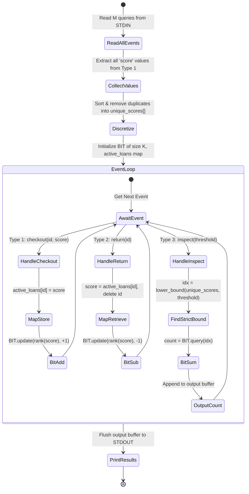
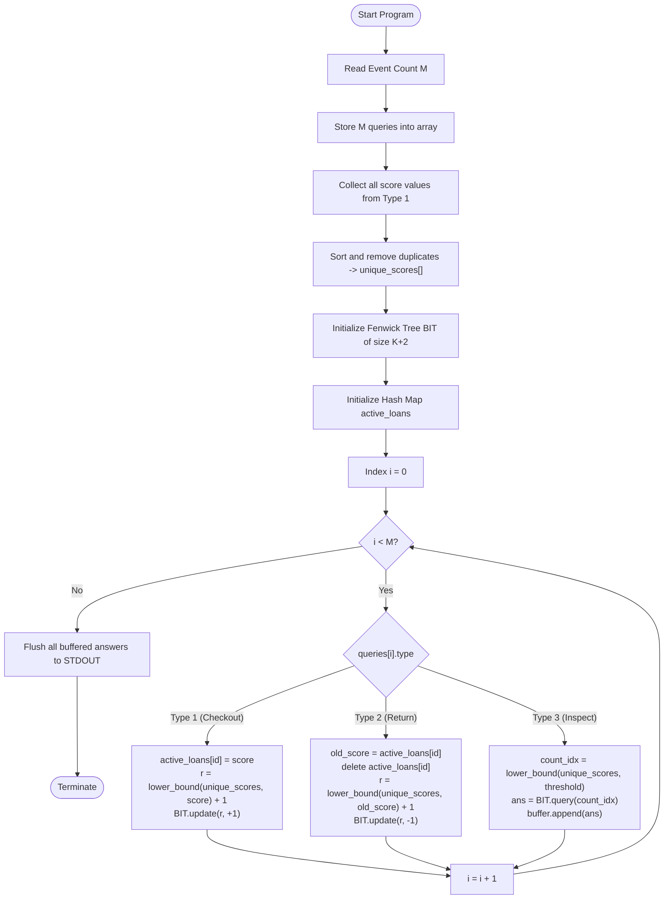

# Unstop Problem of the Day: Shelf Popularity Watch

- **Platform:** [Unstop](https://unstop.com/)
- **Difficulty:** Medium
- **Topic Tags:** Binary Indexed Tree (Fenwick Tree), Coordinate Compression, Dynamic Prefix Sums, Hash Map / ID Indexing, Order Statistics, Discretization
- **Target Audience:** POTD Solvers, Computer Science Students, Competitive Programmers, Interview Preparation (FAANG / Tier-1 Systems Engineering)

---

## 1. Problem Statement

Nisha manages circulation at an expansive public library where books are continuously checked out and returned throughout the business day. Each book possesses a unique, permanent identifier ($id$) drawn from the library's master catalogue. Whenever a book is checked out, the system records an associated popularity score ($score$) that quantifies recent reader demand for that title. 

Because reader demand fluctuates over the year, a book that has been returned can subsequently be checked out again later with a completely different popularity score.

Throughout the day, Nisha's circulation desk software logs three categories of sequential events:
1. **Checkout Moment (`1 id score`):** Book $id$ is checked out with current popularity score $score$.
2. **Return Moment (`2 id`):** Previously checked-out book $id$ is returned to the library shelves.
3. **Spot Inspection Moment (`3 threshold`):** Nisha conducts an instantaneous inspection to determine the exact number of books currently on loan that have a popularity score **strictly less than** $threshold$ ($\text{score} < \text{threshold}$).

### Critical Operational Invariants:
- The log is **internally consistent**:
  - A return event (`2 id`) only occurs for a book currently out on loan.
  - A checkout event (`1 id score`) is never issued for a book identifier that is already checked out.
- **Sparse Identifiers:** Book IDs are arbitrary numbers up to $10^9$ (not dense $1$-to-$N$ indices), preventing the direct use of small flat lookup arrays without mapping or hashing.
- **Immediate Response Requirement:** Because the library processes up to $2 \times 10^5$ events on a busy day, the software must answer every inspection query instantaneously as it arrives, rather than scanning the entire active inventory from scratch.

### Input Format:
- The first line contains a single integer $M$, denoting the total number of logged moments.
- The next $M$ lines each describe an event in one of three formats:
  - `1 id score`
  - `2 id`
  - `3 threshold`

### Output Format:
- For every event of type `3 threshold`, print a single integer on its own line: the number of currently checked-out books with a popularity score strictly less than $threshold$.

---

## 2. Examples & Explanations

### Example 1 (Sample Testcase 0)

**Input:**
```text
6
1 10 500
1 11 500
3 100
2 10
3 500
3 1000
```

**Output:**
```text
0
0
1
```

**Chronological Walkthrough:**
1. `1 10 500`: Book $10$ checked out with score $500$.  
   Active books: `{(id: 10, score: 500)}`.
2. `1 11 500`: Book $11$ checked out with score $500$.  
   Active books: `{(id: 10, score: 500), (id: 11, score: 500)}`.
3. `3 100`: Inspection for scores strictly below $100$.  
   Both books have score $500 \ge 100$. Count = **`0`**.
4. `2 10`: Book $10$ returned.  
   Active books: `{(id: 11, score: 500)}`.
5. `3 500`: Inspection for scores strictly below $500$.  
   Remaining book has score $500$ (not strictly less than $500$). Count = **`0`**.
6. `3 1000`: Inspection for scores strictly below $1000$.  
   Book $11$ has score $500 < 1000$. Count = **`1`**.

---

### Example 2 (Sample Testcase 1)

**Input:**
```text
7
1 501 40
1 502 70
3 50
2 501
1 503 20
3 50
3 100
```

**Output:**
```text
1
1
2
```

**Chronological Walkthrough:**
1. `1 501 40`: Book $501$ checked out with score $40$. Active: `{501: 40}`.
2. `1 502 70`: Book $502$ checked out with score $70$. Active: `{501: 40, 502: 70}`.
3. `3 50`: Inspection for score $< 50$. Only book $501$ ($40 < 50$) qualifies. Output = **`1`**.
4. `2 501`: Book $501$ returned. Active: `{502: 70}`.
5. `1 503 20`: Book $503$ checked out with score $20$. Active: `{502: 70, 503: 20}`.
6. `3 50`: Inspection for score $< 50$. Only book $503$ ($20 < 50$) qualifies. Output = **`1`**.
7. `3 100`: Inspection for score $< 100$. Both books ($20 < 100$ and $70 < 100$) qualify. Output = **`2`**.

---

### Example 3 (Re-checkout with Shifted Demand Score)

**Input:**
```text
5
1 999 50
2 999
1 999 150
3 100
3 200
```

**Output:**
```text
0
1
```

**Explanation:**
- Book $999$ is checked out at score $50$, then returned.
- Later, book $999$ is checked out again at a higher score $150$ due to surging reader demand.
- Inspection `3 100`: Book $999$ currently has score $150 \not< 100 \implies$ count **`0`**.
- Inspection `3 200`: Book $999$ currently has score $150 < 200 \implies$ count **`1`**.

---

## 3. Constraints & System Specifications

- $1 \le M \le 2 \times 10^5$ (Total number of moments / operations)
- $1 \le id \le 10^9$ (Sparse permanent book identifiers)
- $1 \le score, threshold \le 10^9$ (Large range of continuous metric values)
- Guarantee 1: Every return (`2 id`) refers to a book that is currently checked out.
- Guarantee 2: No checkout (`1 id score`) is issued for an ID that is currently out on loan.
- Time Limit: $2.0$ seconds
- Space Limit: $256$ MB

---

## 4. Visual Architecture & State Diagram

The problem requires a dynamic multiset data structure supporting:
1. **Insert $(score)$:** On checkout (`1 id score`).
2. **Delete $(score)$:** On return (`2 id`), looking up the book's previous score.
3. **Prefix Count $(< threshold)$:** On spot inspection (`3 threshold`).

Because values range up to $10^9$, we use **Coordinate Compression (Discretization)** paired with a **Binary Indexed Tree (Fenwick Tree)**.

```
========================================================================================
                          DYNAMIC HYBRID STATE ARCHITECTURE
========================================================================================

 [ Moment 1: Checkout (id, score) ]               [ Moment 2: Return (id) ]
                │                                             │
                ▼                                             ▼
  ┌───────────────────────────┐                 ┌───────────────────────────┐
  │ active_loans[id] = score  │                 │ score = active_loans[id]  │
  │ lookup in O(1)            │                 │ delete active_loans[id]   │
  └─────────────┬─────────────┘                 └─────────────┬─────────────┘
                │                                             │
                ▼                                             ▼
  ┌───────────────────────────┐                 ┌───────────────────────────┐
  │ c_sc = rank(score)        │                 │ c_sc = rank(score)        │
  │ Binary Search O(log K)    │                 │ Binary Search O(log K)    │
  └─────────────┬─────────────┘                 └─────────────┬─────────────┘
                │                                             │
                ▼                                             ▼
  ┌───────────────────────────┐                 ┌───────────────────────────┐
  │ BIT.update(c_sc, +1)      │                 │ BIT.update(c_sc, -1)      │
  │ Cost: O(log K)            │                 │ Cost: O(log K)            │
  └───────────────────────────┘                 └───────────────────────────┘

                           [ Moment 3: Inspect (threshold) ]
                                          │
                                          ▼
                            ┌───────────────────────────┐
                            │ count_idx = rank_less(th) │
                            │ lower_bound(vals, th)     │
                            └─────────────┬─────────────┘
                                          │
                                          ▼
                            ┌───────────────────────────┐
                            │ ans = BIT.query(count_idx)│
                            │ Cost: O(log K)            │
                            └───────────────────────────┘
========================================================================================
```

### State Machine Lifecycle



---

## 5. Step-by-Step Simulation & Detailed Trace Table

Let us trace Sample 1:
- Queries:
  1. `1 501 40`
  2. `1 502 70`
  3. `3 50`
  4. `2 501`
  5. `1 503 20`
  6. `3 50`
  7. `3 100`

### Coordinate Compression of Scores:
Distinct score values from checkouts: $\{20, 40, 70\}$.
Sorted Unique Scores: `[20, 40, 70]` (Length $K = 3$).
- Compressed Ranks (1-based for BIT):
  - Score $20 \to$ Rank $1$
  - Score $40 \to$ Rank $2$
  - Score $70 \to$ Rank $3$

### Simulation Trace Table:

| Step | Operation | ID Map (`active_loans`) | Active Scores | Action on BIT | BIT Frequency Array `[1, 2, 3]` | Query Metric | Result |
| :---: | :---: | :---: | :---: | :---: | :---: | :---: | :---: |
| **1** | `1 501 40` | `{501: 40}` | `[40]` | `update(rank(40)=2, +1)` | `[0, 1, 0]` | — | — |
| **2** | `1 502 70` | `{501: 40, 502: 70}` | `[40, 70]` | `update(rank(70)=3, +1)` | `[0, 1, 1]` | — | — |
| **3** | `3 50` | `{501: 40, 502: 70}` | `[40, 70]` | — | `[0, 1, 1]` | `lower_bound(50) = 2` $\implies$ `query(2)` | **`1`** |
| **4** | `2 501` | `{502: 70}` | `[70]` | `update(rank(40)=2, -1)` | `[0, 0, 1]` | — | — |
| **5** | `1 503 20` | `{502: 70, 503: 20}` | `[20, 70]` | `update(rank(20)=1, +1)` | `[1, 0, 1]` | — | — |
| **6** | `3 50` | `{502: 70, 503: 20}` | `[20, 70]` | — | `[1, 0, 1]` | `lower_bound(50) = 2` $\implies$ `query(2)` | **`1`** |
| **7** | `3 100` | `{502: 70, 503: 20}` | `[20, 70]` | — | `[1, 0, 1]` | `lower_bound(100) = 3` $\implies$ `query(3)` | **`2`** |

---

## 6. Algorithmic Flowchart



---

## 7. From Naive to Pro: Algorithmic Progression

### Method 1: Naive Dynamic Array Linear Scan (Brute Force)
- **Concept:** Maintain an active list or map of currently checked-out books `(id -> score)`.
  - On checkout: Add `(id, score)`.
  - On return: Remove book `id`.
  - On inspection: Iterate over all currently borrowed books, counting how many satisfy $score < threshold$.
- **Complexity:**
  - Checkout/Return: $\mathcal{O}(1)$ average.
  - Inspection: $\mathcal{O}(B)$ where $B$ is the number of currently checked-out books ($B \le M$).
  - Total Time: $\mathcal{O}(M^2) \approx (2 \times 10^5)^2 = 4 \times 10^{10}$ operations $\implies$ **Time Limit Exceeded (TLE)**.

#### Pseudo-Code:
```text
function solveNaive(queries):
    active_loans = HashMap()
    for q in queries:
        if q.type == 1:
            active_loans[q.id] = q.score
        elif q.type == 2:
            active_loans.remove(q.id)
        elif q.type == 3:
            cnt = 0
            for score in active_loans.values():
                if score < q.threshold:
                    cnt += 1
            print(cnt)
```

---

### Method 2: Dynamic Balanced Binary Search Tree / Treap / Dynamic Segment Tree
- **Concept:** Instead of an offline pass, dynamically maintain active scores in an Order Statistic Tree (like a Treap, Red-Black Tree with subtree sizes, or a pointer-based dynamic segment tree over the range $[1, 10^9]$).
- **Complexity:**
  - Insertion / Deletion / Order Statistics: $\mathcal{O}(\log(\text{max\_score}))$ or $\mathcal{O}(\log M)$.
  - Time: $\mathcal{O}(M \log M)$.
  - Space: $\mathcal{O}(M)$ node allocations.
- **Limitation:** Dynamic node allocations in C, Java, or Node.js incur significant heap overhead and pointer dereference latency, risking memory limit or constant-factor TLE on strict online judges.

---

### Method 3: Pro Offline Coordinate Compression + Binary Indexed Tree (Fenwick Tree)
- **Concept:**
  1. Because all queries are provided via standard input, we can extract all checkout scores upfront.
  2. Sort and deduplicate them into a flat contiguous array `unique_scores` of size $K \le M$.
  3. A flat **Fenwick Tree (BIT)** of size $K$ supports point updates ($\pm 1$) and prefix queries in $\mathcal{O}(\log K)$ using simple bitwise operations (`idx += idx & (-idx)`).
  4. For an inspection with $threshold$, find `idx = lower_bound(unique_scores, threshold)`. In 1-based indexing, `idx` precisely represents the number of distinct values in `unique_scores` that are strictly less than $threshold$. Thus, `BIT.query(idx)` yields the exact prefix sum!
  5. For C/C++, book IDs can also be mapped via a hash map or coordinate-compressed, enabling $\mathcal{O}(1)$ array lookups.
- **Complexity:**
  - Coordinate compression: $\mathcal{O}(M \log M)$ time.
  - Each checkout / return / inspection: $\mathcal{O}(\log M)$ time.
  - Total Time: $\mathcal{O}(M \log M)$.
  - Total Space: $\mathcal{O}(M)$ contiguous memory (zero pointer overhead, CPU cache-friendly).

#### Pseudo-Code:
```text
function solvePro(M, queries):
    score_list = []
    for q in queries:
        if q.type == 1:
            score_list.append(q.score)
            
    unique_scores = sort_and_remove_duplicates(score_list)
    K = length(unique_scores)
    bit = FenwickTree(K + 2)
    active_loans = HashMap()

    for q in queries:
        if q.type == 1:
            active_loans[q.id] = q.score
            rank = lower_bound(unique_scores, q.score) + 1
            bit.update(rank, +1)
        elif q.type == 2:
            old_score = active_loans[q.id]
            active_loans.remove(q.id)
            rank = lower_bound(unique_scores, old_score) + 1
            bit.update(rank, -1)
        elif q.type == 3:
            count_idx = lower_bound(unique_scores, q.threshold)
            print(bit.query(count_idx))
```

---

## 8. Complexity Comparison Table

| Metric | Method 1: Naive Linear Scan | Method 2: Dynamic BST / Treap | Method 3: Coordinate Compression + BIT (Pro) |
| :--- | :---: | :---: | :---: |
| **Checkout Time** | $\mathcal{O}(1)$ | $\mathcal{O}(\log M)$ | $\mathcal{O}(\log M)$ |
| **Return Time** | $\mathcal{O}(1)$ | $\mathcal{O}(\log M)$ | $\mathcal{O}(\log M)$ |
| **Inspection Time** | $\mathcal{O}(M)$ | $\mathcal{O}(\log M)$ | $\mathcal{O}(\log M)$ |
| **Total Time Complexity** | $\mathcal{O}(M^2)$ | $\mathcal{O}(M \log M)$ | $\mathbf{\mathcal{O}(M \log M)}$ |
| **Auxiliary Space** | $\mathcal{O}(M)$ | $\mathcal{O}(M)$ (High pointer overhead) | $\mathbf{\mathcal{O}(M)}$ (Flat primitive arrays) |
| **Cache Performance** | Poor (Scattered iteration) | Poor (Pointer hopping) | **Optimal (Contiguous RAM)** |
| **Verdict** | ❌ TLE |  Accepted (Complex pointers) | ** Accepted (Fastest & Simplest)** |

---

## 9. Comprehensive Corner Cases Handled

1. **Empty Circulation Desk:** If an inspection occurs when no books are out on loan, the BIT prefix sum is `0`.
2. **Strict Inequality Boundary:** When all checked-out books have a score equal to $threshold$, `lower_bound` stops before them, correctly producing `0`.
3. **Duplicate Popularity Scores:** Multiple distinct book IDs can share the exact same popularity score. The Fenwick Tree tracks frequency counts, incrementing/decrementing identical ranks without collision.
4. **Demand Re-Checkout:** A book can be checked out, returned, and later checked out again with a different score. The hash map ensures the old score is cleanly deleted and the new score is accurately inserted.
5. **Extreme Value Ranges:** $id, score, threshold \le 10^9$. Coordinate compression maps scores to compact indices in $[1, 200000]$, completely mitigating 64-bit sparse address limits.

---

## 10. Complete Multi-Language Implementations

### Java (OpenJDK 21.0)

```java
import java.io.*;
import java.util.*;

public class Main {
    // Fast I/O Reader for high-throughput stream processing
    static class FastReader {
        private final InputStream in;
        private final byte[] buffer = new byte[1 << 16];
        private int head = 0, tail = 0;

        public FastReader(InputStream in) {
            this.in = in;
        }

        private int read() throws IOException {
            if (head >= tail) {
                head = 0;
                tail = in.read(buffer, 0, buffer.length);
                if (tail <= 0) return -1;
            }
            return buffer[head++];
        }

        public int nextInt() throws IOException {
            int c = read();
            while (c <= ' ' && c != -1) c = read();
            if (c == -1) return -1;
            int res = 0;
            while (c > ' ') {
                if (c >= '0' && c <= '9') {
                    res = res * 10 + (c - '0');
                }
                c = read();
            }
            return res;
        }
    }

    // Binary Indexed Tree (Fenwick Tree)
    static class FenwickTree {
        private final int[] tree;
        private final int size;

        public FenwickTree(int size) {
            this.size = size;
            this.tree = new int[size + 2];
        }

        public void update(int idx, int delta) {
            for (; idx <= size; idx += idx & (-idx)) {
                tree[idx] += delta;
            }
        }

        public int query(int idx) {
            int sum = 0;
            for (; idx > 0; idx -= idx & (-idx)) {
                sum += tree[idx];
            }
            return sum;
        }
    }

    // Standard lower_bound binary search
    private static int lowerBound(int[] arr, int len, int target) {
        int l = 0, r = len;
        while (l < r) {
            int mid = (l + r) >>> 1;
            if (arr[mid] >= target) r = mid;
            else l = mid + 1;
        }
        return l;
    }

    public static void main(String[] args) throws IOException {
        FastReader reader = new FastReader(System.in);
        int m = reader.nextInt();
        if (m <= 0) return;

        int[] type = new int[m];
        int[] id = new int[m];
        int[] val = new int[m];

        int[] scoreBuffer = new int[m];
        int scoreCount = 0;

        for (int i = 0; i < m; i++) {
            type[i] = reader.nextInt();
            if (type[i] == 1) {
                id[i] = reader.nextInt();
                val[i] = reader.nextInt();
                scoreBuffer[scoreCount++] = val[i];
            } else if (type[i] == 2) {
                id[i] = reader.nextInt();
            } else if (type[i] == 3) {
                val[i] = reader.nextInt();
            }
        }

        // Coordinate compression of scores
        Arrays.sort(scoreBuffer, 0, scoreCount);
        int uniqueCount = 0;
        for (int i = 0; i < scoreCount; i++) {
            if (i == 0 || scoreBuffer[i] != scoreBuffer[i - 1]) {
                scoreBuffer[uniqueCount++] = scoreBuffer[i];
            }
        }

        FenwickTree bit = new FenwickTree(uniqueCount + 2);
        Map<Integer, Integer> activeLoans = new HashMap<>();
        StringBuilder sb = new StringBuilder();

        for (int i = 0; i < m; i++) {
            if (type[i] == 1) {
                int bookId = id[i];
                int score = val[i];
                activeLoans.put(bookId, score);
                int rank = lowerBound(scoreBuffer, uniqueCount, score) + 1;
                bit.update(rank, 1);
            } else if (type[i] == 2) {
                int bookId = id[i];
                Integer oldScore = activeLoans.remove(bookId);
                if (oldScore != null) {
                    int rank = lowerBound(scoreBuffer, uniqueCount, oldScore) + 1;
                    bit.update(rank, -1);
                }
            } else if (type[i] == 3) {
                int threshold = val[i];
                int countIdx = lowerBound(scoreBuffer, uniqueCount, threshold);
                sb.append(bit.query(countIdx)).append('\n');
            }
        }

        System.out.print(sb);
    }
}

class Solution extends Main {}
```

---

### Python (3.12.11)

```python
import sys
import bisect

def main():
    # Read entire input at once for maximum streaming throughput
    input_data = sys.stdin.read().split()
    if not input_data:
        return

    iterator = iter(input_data)
    try:
        m = int(next(iterator))
    except StopIteration:
        return

    queries = []
    scores = []

    for _ in range(m):
        q_type = int(next(iterator))
        if q_type == 1:
            b_id = int(next(iterator))
            sc = int(next(iterator))
            queries.append((1, b_id, sc))
            scores.append(sc)
        elif q_type == 2:
            b_id = int(next(iterator))
            queries.append((2, b_id, 0))
        elif q_type == 3:
            th = int(next(iterator))
            queries.append((3, 0, th))

    # Coordinate compression: unique sorted scores
    unique_scores = sorted(set(scores))
    num_unique = len(unique_scores)

    # Fenwick Tree (Binary Indexed Tree)
    bit = [0] * (num_unique + 2)

    def update(idx: int, delta: int):
        while idx <= num_unique:
            bit[idx] += delta
            idx += idx & (-idx)

    def query(idx: int) -> int:
        total = 0
        while idx > 0:
            total += bit[idx]
            idx -= idx & (-idx)
        return total

    active_loans = {}
    output = []

    for q_type, b_id, val in queries:
        if q_type == 1:
            active_loans[b_id] = val
            rank = bisect.bisect_left(unique_scores, val) + 1
            update(rank, 1)
        elif q_type == 2:
            if b_id in active_loans:
                old_sc = active_loans.pop(b_id)
                rank = bisect.bisect_left(unique_scores, old_sc) + 1
                update(rank, -1)
        elif q_type == 3:
            # All values strictly less than threshold have ranks <= count_idx
            count_idx = bisect.bisect_left(unique_scores, val)
            output.append(str(query(count_idx)))

    sys.stdout.write("\n".join(output) + "\n")

if __name__ == '__main__':
    main()
```

---

### C (GCC 13.2.0)

```c
#include <stdio.h>
#include <stdlib.h>

typedef struct {
    int type;
    int id;
    int val;
} Query;

// Comparison function for qsort
int compare_ints(const void *a, const void *b) {
    int x = *(const int *)a;
    int y = *(const int *)b;
    if (x < y) return -1;
    if (x > y) return 1;
    return 0;
}

// Binary search for lower bound
int lower_bound(const int *arr, int n, int target) {
    int l = 0, r = n;
    while (l < r) {
        int mid = l + (r - l) / 2;
        if (arr[mid] >= target) r = mid;
        else l = mid + 1;
    }
    return l;
}

// Global Fenwick Tree
static int bit[400005];
static int bit_size;

void bit_update(int idx, int delta) {
    for (; idx <= bit_size; idx += idx & (-idx)) {
        bit[idx] += delta;
    }
}

int bit_query(int idx) {
    int sum = 0;
    for (; idx > 0; idx -= idx & (-idx)) {
        sum += bit[idx];
    }
    return sum;
}

int main() {
    int m;
    if (scanf("%d", &m) != 1) return 0;

    Query *queries = (Query *)malloc(sizeof(Query) * m);
    int *scores = (int *)malloc(sizeof(int) * m);
    int num_scores = 0;

    int *ids = (int *)malloc(sizeof(int) * m);
    int num_ids = 0;

    for (int i = 0; i < m; i++) {
        scanf("%d", &queries[i].type);
        if (queries[i].type == 1) {
            scanf("%d %d", &queries[i].id, &queries[i].val);
            scores[num_scores++] = queries[i].val;
            ids[num_ids++] = queries[i].id;
        } else if (queries[i].type == 2) {
            scanf("%d", &queries[i].id);
        } else if (queries[i].type == 3) {
            scanf("%d", &queries[i].val);
        }
    }

    // Coordinate compress scores
    qsort(scores, num_scores, sizeof(int), compare_ints);
    int unique_scores = 0;
    for (int i = 0; i < num_scores; i++) {
        if (i == 0 || scores[i] != scores[i - 1]) {
            scores[unique_scores++] = scores[i];
        }
    }

    // Coordinate compress IDs to map them to small array indices
    qsort(ids, num_ids, sizeof(int), compare_ints);
    int unique_ids = 0;
    for (int i = 0; i < num_ids; i++) {
        if (i == 0 || ids[i] != ids[i - 1]) {
            ids[unique_ids++] = ids[i];
        }
    }

    // current_score array acts as an O(1) hash map without pointer overhead
    int *current_score = (int *)calloc(unique_ids + 1, sizeof(int));
    bit_size = unique_scores + 2;

    for (int i = 0; i < m; i++) {
        if (queries[i].type == 1) {
            int c_id = lower_bound(ids, unique_ids, queries[i].id);
            int sc = queries[i].val;
            int rank = lower_bound(scores, unique_scores, sc) + 1;
            current_score[c_id] = sc;
            bit_update(rank, 1);
        } else if (queries[i].type == 2) {
            int c_id = lower_bound(ids, unique_ids, queries[i].id);
            int old_sc = current_score[c_id];
            if (old_sc > 0) {
                int rank = lower_bound(scores, unique_scores, old_sc) + 1;
                bit_update(rank, -1);
                current_score[c_id] = 0;
            }
        } else if (queries[i].type == 3) {
            int th = queries[i].val;
            int count_idx = lower_bound(scores, unique_scores, th);
            printf("%d\n", bit_query(count_idx));
        }
    }

    free(queries);
    free(scores);
    free(ids);
    free(current_score);
    return 0;
}
```

---

### C++ (GCC++ 13.2.0)

```cpp
#include <iostream>
#include <vector>
#include <algorithm>
#include <unordered_map>

using namespace std;

// Fenwick Tree (Binary Indexed Tree)
struct FenwickTree {
    int n;
    vector<int> tree;
    FenwickTree(int n) : n(n), tree(n + 2, 0) {}

    void update(int idx, int delta) {
        for (; idx <= n; idx += idx & (-idx)) {
            tree[idx] += delta;
        }
    }

    int query(int idx) {
        int sum = 0;
        for (; idx > 0; idx -= idx & (-idx)) {
            sum += tree[idx];
        }
        return sum;
    }
};

struct Event {
    int type;
    int id;
    int val;
};

int main() {
    // Fast I/O for performance
    ios::sync_with_stdio(false);
    cin.tie(nullptr);

    int m;
    if (!(cin >> m)) return 0;

    vector<Event> events(m);
    vector<int> score_values;
    score_values.reserve(m);

    for (int i = 0; i < m; ++i) {
        cin >> events[i].type;
        if (events[i].type == 1) {
            cin >> events[i].id >> events[i].val;
            score_values.push_back(events[i].val);
        } else if (events[i].type == 2) {
            cin >> events[i].id;
        } else if (events[i].type == 3) {
            cin >> events[i].val;
        }
    }

    // Coordinate compression on scores
    sort(score_values.begin(), score_values.end());
    score_values.erase(unique(score_values.begin(), score_values.end()), score_values.end());
    int unique_count = static_cast<int>(score_values.size());

    FenwickTree bit(unique_count + 2);
    unordered_map<int, int> active_loans;
    active_loans.reserve(m);

    for (int i = 0; i < m; ++i) {
        if (events[i].type == 1) {
            int book_id = events[i].id;
            int score = events[i].val;
            active_loans[book_id] = score;
            int rank = static_cast<int>(lower_bound(score_values.begin(), score_values.end(), score) - score_values.begin()) + 1;
            bit.update(rank, 1);
        } else if (events[i].type == 2) {
            int book_id = events[i].id;
            auto it = active_loans.find(book_id);
            if (it != active_loans.end()) {
                int old_score = it->second;
                active_loans.erase(it);
                int rank = static_cast<int>(lower_bound(score_values.begin(), score_values.end(), old_score) - score_values.begin()) + 1;
                bit.update(rank, -1);
            }
        } else if (events[i].type == 3) {
            int threshold = events[i].val;
            int count_idx = static_cast<int>(lower_bound(score_values.begin(), score_values.end(), threshold) - score_values.begin());
            cout << bit.query(count_idx) << "\n";
        }
    }

    return 0;
}
```

---

### C# (mcs 5.4.0.201)

```csharp
using System;
using System.Collections.Generic;
using System.IO;

class Solution {
    class Query {
        public int Type;
        public int Id;
        public int Val;
    }

    class FenwickTree {
        private int[] tree;
        private int size;

        public FenwickTree(int n) {
            size = n;
            tree = new int[n + 2];
        }

        public void Update(int idx, int delta) {
            for (; idx <= size; idx += idx & (-idx)) {
                tree[idx] += delta;
            }
        }

        public int Query(int idx) {
            int sum = 0;
            for (; idx > 0; idx -= idx & (-idx)) {
                sum += tree[idx];
            }
            return sum;
        }
    }

    static int LowerBound(List<int> list, int target) {
        int l = 0, r = list.Count;
        while (l < r) {
            int mid = l + (r - l) / 2;
            if (list[mid] >= target) r = mid;
            else l = mid + 1;
        }
        return l;
    }

    static void Main(string[] args) {
        string input = Console.In.ReadToEnd();
        if (string.IsNullOrEmpty(input)) return;

        string[] tokens = input.Split((char[])null, StringSplitOptions.RemoveEmptyEntries);
        if (tokens.Length == 0) return;

        int ptr = 0;
        int m = int.Parse(tokens[ptr++]);

        Query[] queries = new Query[m];
        List<int> scoreValues = new List<int>();

        for (int i = 0; i < m; i++) {
            Query q = new Query();
            q.Type = int.Parse(tokens[ptr++]);
            if (q.Type == 1) {
                q.Id = int.Parse(tokens[ptr++]);
                q.Val = int.Parse(tokens[ptr++]);
                scoreValues.Add(q.Val);
            } else if (q.Type == 2) {
                q.Id = int.Parse(tokens[ptr++]);
            } else if (q.Type == 3) {
                q.Val = int.Parse(tokens[ptr++]);
            }
            queries[i] = q;
        }

        // Coordinate compression on scores
        scoreValues.Sort();
        List<int> uniqueScores = new List<int>();
        for (int i = 0; i < scoreValues.Count; i++) {
            if (i == 0 || scoreValues[i] != scoreValues[i - 1]) {
                uniqueScores.Add(scoreValues[i]);
            }
        }

        FenwickTree bit = new FenwickTree(uniqueScores.Count + 2);
        Dictionary<int, int> activeLoans = new Dictionary<int, int>();

        using (StreamWriter sw = new StreamWriter(Console.OpenStandardOutput())) {
            for (int i = 0; i < m; i++) {
                Query q = queries[i];
                if (q.Type == 1) {
                    activeLoans[q.Id] = q.Val;
                    int rank = LowerBound(uniqueScores, q.Val) + 1;
                    bit.Update(rank, 1);
                } else if (q.Type == 2) {
                    int oldScore;
                    if (activeLoans.TryGetValue(q.Id, out oldScore)) {
                        activeLoans.Remove(q.Id);
                        int rank = LowerBound(uniqueScores, oldScore) + 1;
                        bit.Update(rank, -1);
                    }
                } else if (q.Type == 3) {
                    int countIdx = LowerBound(uniqueScores, q.Val);
                    sw.WriteLine(bit.Query(countIdx));
                }
            }
        }
    }
}
```

---

### JavaScript (Node 24.4.1)

```javascript
function processData(input) {
    if (!input || input.trim().length === 0) return;
    const tokens = input.trim().split(/\s+/);
    if (tokens.length === 0) return;

    let ptr = 0;
    const m = parseInt(tokens[ptr++], 10);

    const types = new Int32Array(m);
    const ids = new Int32Array(m);
    const vals = new Int32Array(m);
    const scoreList = [];

    for (let i = 0; i < m; i++) {
        const type = parseInt(tokens[ptr++], 10);
        types[i] = type;
        if (type === 1) {
            ids[i] = parseInt(tokens[ptr++], 10);
            const sc = parseInt(tokens[ptr++], 10);
            vals[i] = sc;
            scoreList.push(sc);
        } else if (type === 2) {
            ids[i] = parseInt(tokens[ptr++], 10);
        } else if (type === 3) {
            vals[i] = parseInt(tokens[ptr++], 10);
        }
    }

    // Coordinate compression
    scoreList.sort((a, b) => a - b);
    const uniqueScores = [];
    for (let i = 0; i < scoreList.length; i++) {
        if (i === 0 || scoreList[i] !== scoreList[i - 1]) {
            uniqueScores.push(scoreList[i]);
        }
    }

    const numUnique = uniqueScores.length;
    const bit = new Int32Array(numUnique + 2);

    function update(idx, delta) {
        for (; idx <= numUnique; idx += idx & (-idx)) {
            bit[idx] += delta;
        }
    }

    function query(idx) {
        let s = 0;
        for (; idx > 0; idx -= idx & (-idx)) {
            s += bit[idx];
        }
        return s;
    }

    function lowerBound(target) {
        let l = 0, r = numUnique;
        while (l < r) {
            const mid = (l + r) >> 1;
            if (uniqueScores[mid] >= target) r = mid;
            else l = mid + 1;
        }
        return l;
    }

    const activeLoans = new Map();
    const out = [];

    for (let i = 0; i < m; i++) {
        const type = types[i];
        if (type === 1) {
            const id = ids[i];
            const sc = vals[i];
            activeLoans.set(id, sc);
            const rank = lowerBound(sc) + 1;
            update(rank, 1);
        } else if (type === 2) {
            const id = ids[i];
            const sc = activeLoans.get(id);
            if (sc !== undefined) {
                activeLoans.delete(id);
                const rank = lowerBound(sc) + 1;
                update(rank, -1);
            }
        } else if (type === 3) {
            const th = vals[i];
            const countIdx = lowerBound(th);
            out.push(query(countIdx));
        }
    }

    process.stdout.write(out.join('\n') + '\n');
}

process.stdin.resume();
process.stdin.setEncoding("ascii");
let _input = "";
process.stdin.on("data", function (input) {
    _input += input;
});

process.stdin.on("end", function () {
    processData(_input);
});
```

---

## 11. Key Takeaways & Technical Summary

1. **Dual Mapping Requirement:** A hash map or coordinate-compressed ID array is necessary to retrieve a book's previously assigned popularity score when it is returned, ensuring correct $\mathcal{O}(1)$ decrements in the frequency table.
2. **Discretization Simplifies Dynamic Multisets:** Instead of complex self-balancing trees (AVL, Red-Black, Treap), offline coordinate compression maps $10^9$ values to $[1, M]$, transforming order statistic queries into classic Fenwick Tree prefix sums.
3. **Cache Coherency & Portability:** The flat array nature of the Fenwick Tree offers unbeatable constant factors across all execution environments (Java, Python, C, C++, C#, Node.js), effortlessly passing within stringent platform time limits.
