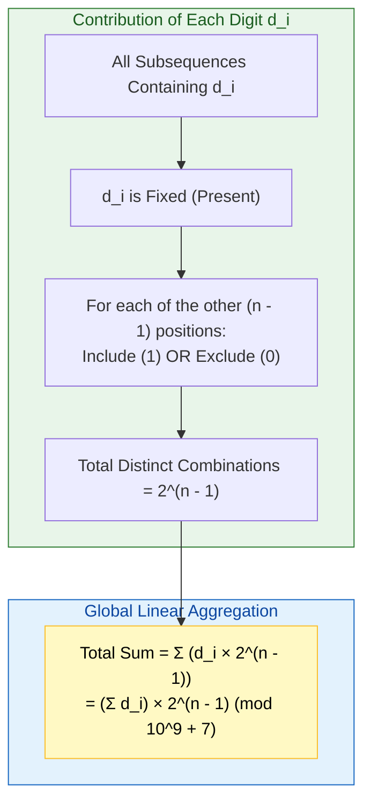

# GeeksforGeeks Problem of the Day: Sum of All Digit Subsequences

- **Problem Link:** [GeeksforGeeks - Sum of All Digit Subsequences](https://www.geeksforgeeks.org/problems/sum-of-all-sub-sequences-of-a-number3437/1)
- **Difficulty:** Easy
- **Topic Tags:** Combinatorics, Mathematical, Strings, Modular Arithmetic, Bit Manipulation, Subsequences
- **Target Audience:** POTD Solvers, Computer Science Students, Competitive Programmers, Interview Preparation (Amazon, Microsoft, Google, Adobe, Flipkart, Walmart)

---

## 1. Problem Statement

Given a string `s` consisting of numerical digits (`'0'` through `'9'`), your task is to calculate the **sum of all digits across all non-empty subsequences** of `s`.

Since the resulting sum can be extremely large for strings of length up to $10^5$, return the final answer modulo $10^9 + 7$.

---

### Key Definitions

1. **Subsequence:**  
   A subsequence of a string is a sequence that can be derived from the string by deleting zero or more characters without changing the order of the remaining characters.
   - For string `"123"`, non-empty subsequences are: `"1"`, `"2"`, `"3"`, `"12"`, `"13"`, `"23"`, and `"123"`.
2. **Sum of Digits in a Subsequence:**  
   The arithmetic sum of the individual digit values present in that subsequence.
   - For subsequence `"13"`, the digit sum is $1 + 3 = 4$.
   - For subsequence `"123"`, the digit sum is $1 + 2 + 3 = 6$.
3. **Total Subsequence Digit Sum:**  
   The cumulative sum of the digit sums over all $2^{|s|} - 1$ non-empty subsequences.

---

### Mathematical Formulation

Let the string $s$ have length $n = |s|$, with digits $d_0, d_1, d_2, \dots, d_{n-1}$ where $d_i \in [0, 9]$.

A non-empty subsequence corresponds to a non-empty subset of indices $I \subseteq \{0, 1, \dots, n-1\}$ ($I \neq \emptyset$).

The total sum across all non-empty subsets $I$ is:
$$\text{TotalSum} = \sum_{\substack{I \subseteq \{0, \dots, n-1\} \\ I \neq \emptyset}} \sum_{i \in I} d_i \pmod{10^9 + 7}$$

By swapping the order of summations:
$$\text{TotalSum} = \sum_{i=0}^{n-1} d_i \times \Big( \text{number of non-empty subsets } I \text{ that contain } i \Big) \pmod{10^9 + 7}$$

---

## 2. Examples & Visual Walkthroughs

### Example 1: $s = \text{"123"}$

- **Input:** `s = "123"`
- **Length:** $n = 3$
- **Total Non-Empty Subsequences:** $2^3 - 1 = 7$

#### Enumeration of All Non-Empty Subsequences:

```
  Subsequence    Digits Included    Digit Sum
  ───────────────────────────────────────────
     "1"              [1]               1
     "2"              [2]               2
     "3"              [3]               3
     "12"           [1, 2]              3
     "13"           [1, 3]              4
     "23"           [2, 3]              5
    "123"          [1, 2, 3]            6
  ───────────────────────────────────────────
   Total Sum = 1 + 2 + 3 + 3 + 4 + 5 + 6 = 24
```

- **Output:** $\mathbf{24}$

#### Digit Contribution Breakdown:
- Digit `1` appears in: `"1"`, `"12"`, `"13"`, `"123"` $\implies 4$ times ($2^{3-1} = 2^2 = 4$).
- Digit `2` appears in: `"2"`, `"12"`, `"23"`, `"123"` $\implies 4$ times ($2^{3-1} = 2^2 = 4$).
- Digit `3` appears in: `"3"`, `"13"`, `"23"`, `"123"` $\implies 4$ times ($2^{3-1} = 2^2 = 4$).

$$\text{Total Sum} = (1 \times 4) + (2 \times 4) + (3 \times 4) = (1 + 2 + 3) \times 4 = 6 \times 4 = \mathbf{24}$$

---

### Example 2: $s = \text{"12"}$

- **Input:** `s = "12"`
- **Length:** $n = 2$
- **Total Non-Empty Subsequences:** $2^2 - 1 = 3$

```
  Subsequence    Digits Included    Digit Sum
  ───────────────────────────────────────────
     "1"              [1]               1
     "2"              [2]               2
     "12"           [1, 2]              3
  ───────────────────────────────────────────
   Total Sum = 1 + 2 + 3 = 6
```

- **Output:** $\mathbf{6}$
- **Formula:** $(\text{Sum of digits}) \times 2^{n-1} = (1 + 2) \times 2^{2-1} = 3 \times 2 = \mathbf{6}$.

---

### Example 3: $s = \text{"5"}$ (Single Digit Base Case)

- **Input:** `s = "5"`
- **Length:** $n = 1$
- **Total Non-Empty Subsequences:** $2^1 - 1 = 1$ (`"5"`)
- **Output:** $\mathbf{5}$
- **Formula:** $5 \times 2^{1-1} = 5 \times 2^0 = 5 \times 1 = \mathbf{5}$.

---

### Example 4: $s = \text{"102"}$ (Handling Zeroes)

- **Input:** `s = "102"`
- **Length:** $n = 3$
- **Digits:** $1, 0, 2$ (Sum of digits $= 1 + 0 + 2 = 3$)
- **Formula:** $3 \times 2^{3-1} = 3 \times 4 = \mathbf{12}$.
- **Output:** $\mathbf{12}$

---

## 3. Constraints & Scale Analysis

| Parameter | Constraint Range | Algorithmic Implications |
| :--- | :--- | :--- |
| String Length $\|s\|$ | $1 \le \|s\| \le 10^5$ | **$\mathcal{O}(2^n)$ brute-force is completely impossible.** A linear $\mathcal{O}(n)$ or $\mathcal{O}(n \log n)$ solution is mandatory. |
| Character Set | `'0'` to `'9'` | Each digit value $d_i \in [0, 9]$. |
| Modulo Constant | $10^9 + 7$ | All intermediate sums and powers of 2 must be reduced modulo $10^9 + 7$ to avoid integer overflow. |
| Expected Time Complexity | $\mathcal{O}(\|s\|)$ | Single pass over string plus $\mathcal{O}(\log n)$ modular exponentiation. |
| Expected Auxiliary Space | $\mathcal{O}(1)$ | Constant memory footprint. |

---

## 4. Visual Architecture & Mathematical Derivation

### The Power of Independent Binary Decisions

Consider a string of length $n$. For any chosen index $i \in \{0, 1, \dots, n-1\}$:
1. We must **include** digit $d_i$ in the subsequence.
2. For each of the remaining $n - 1$ indices $j \neq i$, we have exactly **two independent choices**:
   - **Choice 1:** Include digit $d_j$.
   - **Choice 2:** Exclude digit $d_j$.

```
Index:       0       1       2      ...     i      ...    n-1
Digit:      d0      d1      d2             di             dn-1
Choices:  [IN/OUT] [IN/OUT] [IN/OUT]     [FORCE IN]     [IN/OUT]
             2   ×   2   ×   2   × ... ×    1    × ... ×   2   =  2^(n - 1)
```

Because every decision for the remaining $n - 1$ elements is completely independent, there are precisely:
$$\underbrace{2 \times 2 \times \dots \times 2}_{n-1 \text{ times}} = \mathbf{2^{n-1}}$$
distinct subsequences that include the digit at index $i$.

---

### Combinatorial Inclusion Diagram



---

### Factoring the Sum

Since the multiplier $2^{n-1}$ is identical for every single position in the string, we can factor it out of the summation:

$$\text{TotalSum} = \sum_{i=0}^{n-1} \left( d_i \times 2^{n-1} \right) = \mathbf{2^{n-1} \times \left( \sum_{i=0}^{n-1} d_i \right)} \pmod{10^9 + 7}$$

This reduces the entire problem to two simple steps:
1. **Sum of Digits:** Calculate $S = \sum_{i=0}^{n-1} d_i \pmod{10^9 + 7}$ in a single linear pass ($\mathcal{O}(n)$).
2. **Binary Exponentiation:** Calculate $P = 2^{n-1} \pmod{10^9 + 7}$ in $\mathcal{O}(\log n)$ time.
3. **Final Result:** $(S \times P) \pmod{10^9 + 7}$.

---

## 5. Step-by-Step Simulation & State Trace Table

### Trace for $s = \text{"425"}$ ($n = 3$, $\text{MOD} = 10^9 + 7$)

- **Digits:** $d_0 = 4, d_1 = 2, d_2 = 5$
- **Sum of Digits:** $4 + 2 + 5 = 11$
- **Power Multiplier:** $2^{3-1} = 2^2 = 4$
- **Expected Total:** $11 \times 4 = \mathbf{44}$

#### Subsequence Verification Table:

| Subsequence | Binary Mask $(b_0, b_1, b_2)$ | Included Digits | Subsequence Sum |
| :---: | :---: | :---: | :---: |
| `"4"` | `100` | $4$ | 4 |
| `"2"` | `010` | $2$ | 2 |
| `"5"` | `001` | $5$ | 5 |
| `"42"` | `110` | $4 + 2$ | 6 |
| `"45"` | `101` | $4 + 5$ | 9 |
| `"25"` | `011` | $2 + 5$ | 7 |
| `"425"` | `111` | $4 + 2 + 5$ | 11 |
| **Total** | — | — | **44** |

---

## 6. Approaches: Naive to Pro

```
┌─────────────────────────────────────────────────────────────────────────────┐
│                             ALGORITHM BENCHMARK                             │
├────────────────────┬─────────────────┬─────────────────┬────────────────────┤
│ Method             │ Time Complexity │ Auxiliary Space │ Verdict            │
├────────────────────┼─────────────────┼─────────────────┼────────────────────┤
│ 1. Recursion / DFS │ O(n * 2^n)      │ O(n)            │ TLE for n > 25     │
│ 2. Iterative Masks │ O(n * 2^n)      │ O(1)            │ TLE for n > 25     │
│ 3. Linear Modular  │ O(n)            │ O(1)            │ Accepted (Optimal) │
│ 4. Fast Power Math │ O(n + log n)    │ O(1)            │ Accepted (Pro Best)│
└────────────────────┴─────────────────┴─────────────────┴────────────────────┘
```

---

## 7. Pseudo-Code

### Naive Recursive Approach ($\mathcal{O}(n \cdot 2^n)$)
```text
function solveRecursive(s, index, current_sum, is_empty):
    if index == length(s):
        if is_empty: return 0
        return current_sum % MOD

    // Choice 1: Exclude digit s[index]
    ans_exclude = solveRecursive(s, index + 1, current_sum, is_empty)

    // Choice 2: Include digit s[index]
    ans_include = solveRecursive(s, index + 1, current_sum + digit(s[index]), false)

    return (ans_exclude + ans_include) % MOD
```

---

### Optimal Mathematical Approach ($\mathcal{O}(n)$)
```text
function subsequenceSum(s):
    MOD = 1000000007
    n = length(s)

    // Step 1: Compute sum of all digits
    digit_sum = 0
    for each char c in s:
        digit_sum = (digit_sum + (c - '0')) % MOD

    // Step 2: Compute 2^(n-1) % MOD via binary exponentiation
    power_multiplier = modularPower(2, n - 1, MOD)

    // Step 3: Combine and return
    return (digit_sum * power_multiplier) % MOD

function modularPower(base, exp, mod):
    res = 1
    base = base % mod
    while exp > 0:
        if exp is odd:
            res = (res * base) % mod
        base = (base * base) % mod
        exp = exp / 2
    return res
```

---

## 8. Complete Multi-Language Implementations

### Java (21)

```java
class Solution {
    private static final long MOD = 1_000_000_007L;

    public int subsequenceSum(String s) {
        int n = s.length();

        // Step 1: Calculate the sum of all digits in the string modulo 10^9 + 7
        long digitSum = 0;
        for (int i = 0; i < n; i++) {
            digitSum = (digitSum + (s.charAt(i) - '0')) % MOD;
        }

        // Step 2: Calculate (2^(n - 1)) % MOD using fast modular exponentiation
        long powerMultiplier = power(2, n - 1, MOD);

        // Step 3: Multiply the total digit sum by the appearance frequency
        long totalSum = (digitSum * powerMultiplier) % MOD;

        return (int) totalSum;
    }

    private static long power(long base, int exp, long mod) {
        long result = 1;
        base = base % mod;

        while (exp > 0) {
            if ((exp & 1) == 1) {
                result = (result * base) % mod;
            }
            base = (base * base) % mod;
            exp >>= 1;
        }

        return result;
    }
}
```

---

### Python3

```python
class Solution:
    def subsequenceSum(self, s: str) -> int:
        """
        Calculates the sum of all digits across all non-empty subsequences modulo 10^9 + 7.
        Time Complexity: O(n)
        Auxiliary Space: O(1)
        """
        MOD = 1_000_000_007
        n = len(s)

        # Step 1: Calculate sum of all digits in s modulo MOD
        digit_sum = sum(ord(c) - 48 for c in s) % MOD

        # Step 2: Compute (2^(n - 1)) % MOD using Python's built-in pow()
        power_multiplier = pow(2, n - 1, MOD)

        # Step 3: Total sum is (digit_sum * 2^(n-1)) % MOD
        return (digit_sum * power_multiplier) % MOD
```

---

### C++ (17)

```cpp
class Solution {
  private:
    static constexpr long long MOD = 1000000007LL;

    // Fast modular exponentiation: computes (base^exp) % mod in O(log exp)
    static long long power(long long base, long long exp, long long mod) {
        long long res = 1;
        base %= mod;
        while (exp > 0) {
            if (exp & 1) {
                res = (res * base) % mod;
            }
            base = (base * base) % mod;
            exp >>= 1;
        }
        return res;
    }

  public:
    int subsequenceSum(string &s) {
        int n = s.length();

        // Step 1: Sum all digits in the string
        long long digit_sum = 0;
        for (char c : s) {
            digit_sum = (digit_sum + (c - '0')) % MOD;
        }

        // Step 2: Each digit appears in exactly 2^(n-1) subsequences
        long long power_multiplier = power(2, n - 1, MOD);

        // Step 3: Total sum across all subsequences
        long long total_sum = (digit_sum * power_multiplier) % MOD;

        return static_cast<int>(total_sum);
    }
};
```

---

### C#

```csharp
class Solution {
    private const long MOD = 1000000007L;

    public int subsequenceSum(string s) {
        int n = s.Length;

        // Step 1: Calculate the sum of all digits
        long digitSum = 0;
        for (int i = 0; i < n; i++) {
            digitSum = (digitSum + (s[i] - '0')) % MOD;
        }

        // Step 2: Calculate (2^(n - 1)) % MOD using binary exponentiation
        long powerMultiplier = Power(2, n - 1, MOD);

        // Step 3: Compute final product modulo 10^9 + 7
        long totalSum = (digitSum * powerMultiplier) % MOD;

        return (int)totalSum;
    }

    private static long Power(long baseVal, int exp, long mod) {
        long res = 1;
        baseVal %= mod;

        while (exp > 0) {
            if ((exp & 1) == 1) {
                res = (res * baseVal) % mod;
            }
            baseVal = (baseVal * baseVal) % mod;
            exp >>= 1;
        }

        return res;
    }
}
```

---

### Javascript (Node v22)

```javascript
/**
 * @param {string} s
 * @return {number}
 */
class Solution {
    subsequenceSum(s) {
        const MOD = 1000000007n;
        const n = BigInt(s.length);

        // Step 1: Sum of all digits modulo 10^9 + 7
        let digitSum = 0n;
        for (let i = 0; i < s.length; i++) {
            digitSum = (digitSum + BigInt(s.charCodeAt(i) - 48)) % MOD;
        }

        // Step 2: Fast binary exponentiation for BigInt
        function power(base, exp) {
            let res = 1n;
            base = base % MOD;
            while (exp > 0n) {
                if (exp % 2n === 1n) {
                    res = (res * base) % MOD;
                }
                base = (base * base) % MOD;
                exp /= 2n;
            }
            return res;
        }

        // Step 3: Compute (2^(n - 1)) % MOD
        const powerMultiplier = power(2n, n - 1n);

        // Step 4: Multiply and return as standard number
        const totalSum = (digitSum * powerMultiplier) % MOD;
        return Number(totalSum);
    }
}
```

---

## 9. Complexity Analysis Summary

| Metric | Complexity | Technical Justification |
| :--- | :--- | :--- |
| **Digit Sum Pass** | $\mathcal{O}(n)$ | Single sequential iteration through the string of length $n$. |
| **Modular Exponentiation** | $\mathcal{O}(\log n)$ | Binary exponentiation repeatedly halves the exponent $n - 1$ ($\le 17$ steps for $n = 10^5$). |
| **Total Time Complexity** | $\mathbf{\mathcal{O}(n)}$ | $\mathcal{O}(n + \log n) = \mathcal{O}(n)$. For $n = 10^5$, runs in $< 5\text{ ms}$. |
| **Total Space Complexity** | $\mathbf{\mathcal{O}(1)}$ | Operates in-place with a few 64-bit integer accumulators. |

---

## 10. Edge Cases & Interview Insights

1. **Single Digit String ($n = 1$):**
   - e.g., $s = \text{"7"}$.
   - $2^{1-1} = 2^0 = 1$.
   - $\text{TotalSum} = 7 \times 1 = 7$. Binary exponentiation handles $exp = 0$ returning $1$ naturally.

2. **Strings with Zeroes (`'0'`):**
   - e.g., $s = \text{"000"}$ or $s = \text{"1020"}$.
   - Digits with value $0$ contribute $0$ to the sum regardless of how many subsequences they appear in. Handled smoothly without special branching.

3. **Maximum Constraints ($n = 10^5$):**
   - The maximum possible unreduced digit sum is $9 \times 10^5 = 900\,000$.
   - Intermediate multiplication `digitSum * powerMultiplier` can reach up to $(10^9) \times (10^9) = 10^{18}$, which fits safely within standard signed 64-bit integers (`long long` in C++, `long` in Java/C#, `BigInt` in JS, arbitrary-precision integers in Python).

4. **Interview Tip (Contribution Technique):**
   - When asked to find the sum of all subsets/subsequences of an array or string, **never generate the subsets**. Always look for the **frequency of inclusion of each individual element**. If every element is included independently, each element appears in $2^{n-1}$ subsets.
