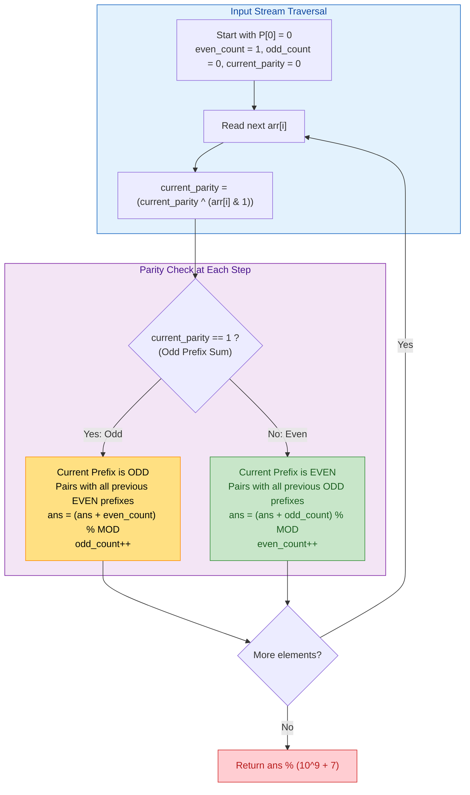

# LeetCode Problem of the Day: Number of Sub-arrays With Odd Sum

- **Problem Link:** [LeetCode 1524 - Number of Sub-arrays With Odd Sum](https://leetcode.com/problems/number-of-sub-arrays-with-odd-sum/)
- **Difficulty:** Medium
- **Topic Tags:** Array, Math, Dynamic Programming, Prefix Sum, Bit Manipulation, Combinatorics
- **Target Audience:** POTD Solvers, Computer Science Students, Competitive Programmers, Interview Preparation (Amazon, Microsoft, Google, Apple, Bloomberg, Adobe)

---

## 1. Problem Statement

Given an array of integers `arr`, return the **number of subarrays with an odd sum**.

Since the answer can be very large, return it **modulo $10^9 + 7$**.

A **subarray** is defined as a contiguous non-empty sequence of elements within an array.

---

### Mathematical Formulation

Given an array $arr[0 \dots n - 1]$ of length $n$, consider any pair of indices $(i, j)$ such that $0 \le i \le j < n$.  
The sum of elements in this contiguous subarray is:
$$\mathcal{S}(i, j) = \sum_{k = i}^j arr[k]$$

We wish to compute the size of the set of all subarrays with an odd sum:
$$\mathcal{O} = \left\{ (i, j) \;\middle|\; 0 \le i \le j < n, \; \mathcal{S}(i, j) \equiv 1 \pmod 2 \right\}$$

The final output is:
$$\text{Ans} = |\mathcal{O}| \pmod{10^9 + 7}$$

---

### The Fundamental Parity Property of Subarrays

Let $P[k]$ denote the prefix sum up to index $k - 1$:
$$P[0] = 0, \quad P[k] = \sum_{m = 0}^{k - 1} arr[m] \quad \text{for } 1 \le k \le n$$

The sum of subarray $arr[i \dots j]$ is simply the difference of two prefix sums:
$$\mathcal{S}(i, j) = P[j + 1] - P[i]$$

By basic modular arithmetic:
$$\mathcal{S}(i, j) \equiv 1 \pmod 2 \iff P[j + 1] \not\equiv P[i] \pmod 2$$

An integer difference is odd **if and only if** the two operands have **different parities**:
- $\text{Odd} - \text{Even} = \text{Odd}$
- $\text{Even} - \text{Odd} = \text{Odd}$

```
               Subarray Parity Truth Table
┌──────────────────┬──────────────────┬──────────────────────┐
│  Parity of P[R]  │  Parity of P[L]  │ Parity of Subarray   │
│  (End Index + 1) │   (Start Index)  │   P[R] - P[L]        │
├──────────────────┼──────────────────┼──────────────────────┤
│       Odd        │       Even       │         ODD          │
│       Even       │       Odd        │         ODD          │
│       Odd        │       Odd        │         EVEN         │
│       Even       │       Even       │         EVEN         │
└──────────────────┴──────────────────┴──────────────────────┘
```

---

## 2. Examples & Visual Walkthroughs

### Example 1

- **Input:** `arr = [1, 3, 5]`
- **Output:** `4`

#### Complete Subarray Enumeration:

```
Index:    0    1    2
arr:    [ 1,   3,   5 ]
```

| Subarray | Range $[i \dots j]$ | Elements | Subarray Sum | Parity | Counts toward Ans? |
| :---: | :---: | :---: | :---: | :---: | :---: |
| `[1]` | $[0 \dots 0]$ | $1$ | $1$ | **Odd** | **Yes** (1) |
| `[1, 3]` | $[0 \dots 1]$ | $1 + 3$ | $4$ | Even | No |
| `[1, 3, 5]` | $[0 \dots 2]$ | $1 + 3 + 5$ | $9$ | **Odd** | **Yes** (2) |
| `[3]` | $[1 \dots 1]$ | $3$ | $3$ | **Odd** | **Yes** (3) |
| `[3, 5]` | $[1 \dots 2]$ | $3 + 5$ | $8$ | Even | No |
| `[5]` | $[2 \dots 2]$ | $5$ | $5$ | **Odd** | **Yes** (4) |

- **Total Odd Subarrays:** $\mathbf{4}$ (`[1]`, `[1, 3, 5]`, `[3]`, `[5]`).

---

### Example 2

- **Input:** `arr = [2, 4, 6]`
- **Output:** `0`
- **Explanation:** All elements are even. The sum of any combination of even integers is always even. No odd subarrays exist.

---

### Example 3

- **Input:** `arr = [1, 2, 3, 4, 5, 6, 7]`
- **Output:** `16`

#### Prefix Sum Parity Partition Trace:

```
Index k:       0    1    2    3    4    5    6    7
arr[k-1]:      -    1    2    3    4    5    6    7
P[k]:          0    1    3    6   10   15   21   28
Parity:       Even  Odd  Odd Even Even  Odd  Odd Even
```

- **Count of Even Prefix Sums ($E$):** $\{P[0]=0, P[3]=6, P[4]=10, P[7]=28\} \implies \mathbf{E = 4}$
- **Count of Odd Prefix Sums ($O$):** $\{P[1]=1, P[2]=3, P[5]=15, P[6]=21\} \implies \mathbf{O = 4}$
- **Total Valid Pairs:** $E \times O = 4 \times 4 = \mathbf{16}$.

---

## 3. Constraints & Scale Analysis

| Parameter | Constraint Range | Computational Implications |
| :--- | :--- | :--- |
| Array Length $n$ | $1 \le n \le 10^5$ | $\mathcal{O}(n^2)$ generates $5 \times 10^9$ operations and will **Time Out (TLE)**. An $\mathcal{O}(n)$ algorithm is mandatory. |
| Element Value $arr[i]$ | $1 \le arr[i] \le 100$ | Only parity (`arr[i] % 2` or `arr[i] & 1`) matters; magnitude is irrelevant. |
| Output Modulo | $10^9 + 7$ | All additions and multiplications must use 64-bit integers (`long` / `BigInt`) before modulo reduction. |
| Expected Time Complexity | $\mathcal{O}(n)$ | Single pass over array. |
| Expected Auxiliary Space | $\mathcal{O}(1)$ | Requires only two counters (`even_count`, `odd_count`). |

---

## 4. Visual Architecture: Parity Transition & Combinatorial Product



---

### The Combinatorial Multiplicative Theorem

Any odd subarray is uniquely identified by choosing:
1. One prefix sum of **even parity** ($P[i]$).
2. One prefix sum of **odd parity** ($P[j]$).

Since $i \neq j$ (one is even, one is odd, so they can never be the same index), one index must be smaller than the other. Setting the smaller index as the left boundary and the larger as the right boundary guarantees:
$$\mathcal{S}(\min(i, j), \max(i, j) - 1) = |P[j] - P[i]| \equiv 1 \pmod 2$$

Every distinct choice of $(P_{\text{even}}, P_{\text{odd}})$ produces **exactly one valid odd subarray**!

$$\mathbf{\text{Total Odd Subarrays}} = \mathbf{\Big( \text{Count of Even Prefixes} \times \text{Count of Odd Prefixes} \Big) \pmod{10^9 + 7}}$$

---

## 5. Step-by-Step Simulation Table

### Detailed Simulation for `arr = [1, 3, 5]` ($MOD = 10^9 + 7$)

- Initial state before any elements:
  - $P[0] = 0 \implies \text{even\_count} = 1, \text{odd\_count} = 0, \text{ans} = 0$.

| Step $k$ | Element $arr[k-1]$ | Parity | Running Prefix Parity | Compatible Previous Prefixes | Added to Ans | Total Even Count | Total Odd Count | Running Ans |
| :---: | :---: | :---: | :---: | :---: | :---: | :---: | :---: | :---: |
| **0** | *(Start)* | — | Even (0) | — | — | 1 | 0 | 0 |
| **1** | `1` | Odd | $0 \oplus 1 = \mathbf{1}$ (Odd) | All even prefixes ($1$) | $+1$ | 1 | 1 | **1** |
| **2** | `3` | Odd | $1 \oplus 1 = \mathbf{0}$ (Even) | All odd prefixes ($1$) | $+1$ | 2 | 1 | **2** |
| **3** | `5` | Odd | $0 \oplus 1 = \mathbf{1}$ (Odd) | All even prefixes ($2$) | $+2$ | 2 | 2 | **4** |

**Final Answer:** `4`  
*(Or using the product theorem: $E \times O = 2 \times 2 = \mathbf{4}$).*

---

## 6. Approaches: Naive to Pro

```
┌─────────────────────────────────────────────────────────────────────────────┐
│                             ALGORITHM BENCHMARK                             │
├────────────────────┬─────────────────┬─────────────────┬────────────────────┤
│ Method             │ Time Complexity │ Auxiliary Space │ Verdict            │
├────────────────────┼─────────────────┼─────────────────┼────────────────────┤
│ 1. Cubic Brute     │ O(n^3)          │ O(1)            │ TLE (10^15 ops)    │
│ 2. Quadratic Scan  │ O(n^2)          │ O(1)            │ TLE (5 * 10^9 ops) │
│ 3. Parity DP       │ O(n)            │ O(1)            │ Accepted (< 5ms)   │
│ 4. Running Tally   │ O(n)            │ O(1)            │ Accepted (< 2ms)   │
│ 5. Global Product  │ O(n)            │ O(1)            │ Optimal (Pro Best) │
└────────────────────┴─────────────────┴─────────────────┴────────────────────┘
```

---

## 7. Pseudo-Code

### Method 1: Quadratic Prefix Sum Scan ($\mathcal{O}(n^2)$)
```text
function numOfSubarraysQuadratic(arr):
    MOD = 1000000007
    n = length(arr)
    ans = 0
    for i from 0 to n - 1:
        current_sum = 0
        for j from i to n - 1:
            current_sum += arr[j]
            if current_sum % 2 != 0:
                ans = (ans + 1) % MOD
    return ans
```

---

### Method 4: Running Parity Counters ($\mathcal{O}(n)$ - One Pass)
```text
function numOfSubarrays(arr):
    MOD = 1000000007
    even_count = 1  // P[0] = 0 is even
    odd_count = 0
    current_parity = 0
    ans = 0

    for each x in arr:
        current_parity ^= (x & 1)
        if current_parity == 1:
            ans = (ans + even_count) % MOD
            odd_count++
        else:
            ans = (ans + odd_count) % MOD
            even_count++

    return ans
```

---

### Method 5: Global Combinatorial Product ($\mathcal{O}(n)$)
```text
function numOfSubarraysOptimal(arr):
    MOD = 1000000007
    even_count = 1
    odd_count = 0
    current_parity = 0

    for each x in arr:
        current_parity ^= (x & 1)
        if current_parity == 1:
            odd_count++
        else:
            even_count++

    return (even_count * odd_count) % MOD
```

---

## 8. Complete Multi-Language Implementations

### Java

```java
class Solution {
    private static final long MOD = 1_000_000_007L;

    public int numOfSubarrays(int[] arr) {
        long oddCount = 0;
        long evenCount = 1; // P[0] = 0 is even
        int currentParity = 0;
        long ans = 0;

        for (int x : arr) {
            // Update running prefix parity using bitwise XOR
            currentParity ^= (x & 1);

            if (currentParity == 1) {
                // Odd prefix pairs with previous even prefixes
                ans = (ans + evenCount) % MOD;
                oddCount++;
            } else {
                // Even prefix pairs with previous odd prefixes
                ans = (ans + oddCount) % MOD;
                evenCount++;
            }
        }

        return (int) ans;
    }
}
```

---

### Python3

```python
class Solution:
    def numOfSubarrays(self, arr: list[int]) -> int:
        """
        Calculates the number of subarrays with an odd sum modulo 10^9 + 7.
        Time Complexity: O(n)
        Auxiliary Space: O(1)
        """
        MOD = 1_000_000_007
        even_count = 1  # P[0] = 0 is even
        odd_count = 0
        current_parity = 0

        for x in arr:
            current_parity ^= (x & 1)
            if current_parity == 1:
                odd_count += 1
            else:
                even_count += 1

        # Every pair of (even_prefix, odd_prefix) defines exactly one odd subarray
        return (even_count * odd_count) % MOD
```

---

### C

```c
#define MOD 1000000007LL

int numOfSubarrays(int* arr, int arrSize) {
    long long oddCount = 0;
    long long evenCount = 1; // P[0] = 0 is even
    int currentParity = 0;

    for (int i = 0; i < arrSize; i++) {
        currentParity ^= (arr[i] & 1);
        if (currentParity == 1) {
            oddCount++;
        } else {
            evenCount++;
        }
    }

    // Direct product of bipartite parity partitions
    long long ans = (oddCount * evenCount) % MOD;
    return (int)ans;
}
```

---

### C++

```cpp
class Solution {
private:
    static constexpr long long MOD = 1000000007LL;

public:
    int numOfSubarrays(vector<int>& arr) {
        long long odd_count = 0;
        long long even_count = 1; // Base prefix sum P[0] = 0 is even
        int current_parity = 0;
        long long ans = 0;

        for (int x : arr) {
            current_parity ^= (x & 1);

            if (current_parity == 1) {
                ans += even_count;
                odd_count++;
            } else {
                ans += odd_count;
                even_count++;
            }
        }

        return static_cast<int>(ans % MOD);
    }
};
```

---

### C#

```csharp
public class Solution {
    private const long MOD = 1000000007L;

    public int NumOfSubarrays(int[] arr) {
        long oddCount = 0;
        long evenCount = 1; // P[0] = 0 is even
        int currentParity = 0;
        long ans = 0;

        for (int i = 0; i < arr.Length; i++) {
            currentParity ^= (arr[i] & 1);

            if (currentParity == 1) {
                ans += evenCount;
                oddCount++;
            } else {
                ans += oddCount;
                evenCount++;
            }
        }

        return (int)(ans % MOD);
    }
}
```

---

### Javascript

```javascript
/**
 * @param {number[]} arr
 * @return {number}
 */
var numOfSubarrays = function(arr) {
    const MOD = 1000000007n;
    let oddCount = 0n;
    let evenCount = 1n; // P[0] = 0 is even
    let currentParity = 0;

    for (let i = 0; i < arr.length; i++) {
        currentParity ^= (arr[i] & 1);
        if (currentParity === 1) {
            oddCount++;
        } else {
            evenCount++;
        }
    }

    const total = (oddCount * evenCount) % MOD;
    return Number(total);
};
```

---

### Typescript

```typescript
function numOfSubarrays(arr: number[]): number {
    const MOD = 1000000007n;
    let oddCount = 0n;
    let evenCount = 1n; // P[0] = 0 is even
    let currentParity = 0;

    for (let i = 0; i < arr.length; i++) {
        currentParity ^= (arr[i] & 1);
        if (currentParity === 1) {
            oddCount++;
        } else {
            evenCount++;
        }
    }

    const total = (oddCount * evenCount) % MOD;
    return Number(total);
}
```

---

## 9. Complexity Analysis Summary

| Metric | Complexity | Details |
| :--- | :--- | :--- |
| **Time Complexity** | $\mathbf{\mathcal{O}(n)}$ | Single sequential pass over the array of length $n$. Each element requires only $\mathcal{O}(1)$ bitwise operations and arithmetic increments. |
| **Auxiliary Space** | $\mathbf{\mathcal{O}(1)}$ | Operates using only three scalar integer variables (`even_count`, `odd_count`, `current_parity`). No arrays or hash maps are allocated. |

---

## 10. Edge Cases & Interview Insights

1. **All Even Numbers:**
   - e.g., `arr = [2, 4, 6, 8]`.
   - The prefix parity never flips and remains `0`.
   - `odd_count = 0`, `even_count = 5`.
   - Total odd subarrays: $5 \times 0 = \mathbf{0}$.

2. **All Odd Numbers:**
   - e.g., `arr = [1, 1, 1]`.
   - Parity alternates: $0 \to 1 \to 0 \to 1$.
   - `odd_count = 2`, `even_count = 2`.
   - Total odd subarrays: $2 \times 2 = \mathbf{4}$ (`[1]`, `[1, 1, 1]`, `[1]`, `[1]`).

3. **Maximum Constraints ($n = 10^5$):**
   - In the worst case (e.g. alternating odds and evens), $odd\_count \approx 50\,000$ and $even\_count \approx 50\,000$.
   - The product is $50\,000 \times 50\,000 = 2.5 \times 10^9$, which exceeds the 32-bit signed integer limit ($2^{31} - 1 \approx 2.14 \times 10^9$).
   - **Crucial Implementation Note:** Always cast intermediate products/sums to 64-bit integers (`long` / `long long` / `BigInt`) before applying `% MOD` to avoid integer overflow.
