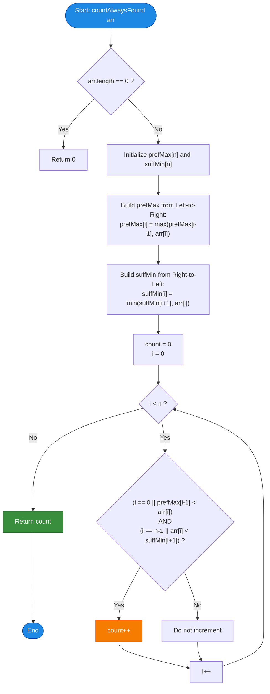

# GeeksforGeeks Problem of the Day: Successful Binary Searches Irrespective of Pivot (Count Always Found)

- **Problem Link:** [GeeksforGeeks - Count Always Found](https://www.geeksforgeeks.org/problems/count-always-found/1)
- **Difficulty:** Medium
- **Topic Tags:** Arrays, Binary Search, Prefix / Suffix Arrays, Monotonic Stack, Two Pointers, Partitioning
- **Target Audience:** POTD Solvers, Computer Science Students, Competitive Programmers, Technical Interview Preparation (FAANG/Tier-1 Tech)

---

## 1. Problem Statement

Given an array `arr` of $n$ distinct integers (the array is **not necessarily sorted**). 

Suppose you execute a generalized binary search to find an element `target = arr[i]` within the initial boundary range $[lo, hi] = [0, n - 1]$. At every step of this binary search:
- An arbitrary pivot index $p \in [lo, hi]$ is selected (the pivot is **not guaranteed** to be the exact midpoint $\lfloor\frac{lo + hi}{2}\rfloor$; it can be **any** index within $[lo, hi]$ chosen by an adversary).
- If `arr[p] == target`, the search terminates immediately and reports **found**.
- If `target < arr[p]`, the search continues strictly in the left subsegment: $hi = p - 1$.
- If `target > arr[p]`, the search continues strictly in the right subsegment: $lo = p + 1$.

An element `arr[i]` is defined as **always found** (or *universally binary searchable*) if, **regardless of the sequence of pivots chosen at every step**, the search will **always** successfully locate `arr[i]`.

Your task is to count and return the total number of elements in `arr` that are guaranteed to be always found.

---

## 2. Examples & Explanations

### Example 1
- **Input:** `arr = [3, 7, 9, 8, 15]`
- **Array Length ($n$):** $5$
- **Analysis of Each Element:**
  1. **Element $3$ (index 0):**
     - No elements to its left.
     - Elements to its right: `[7, 9, 8, 15]`. The minimum on the right is $7 > 3$.
     - Any pivot chosen to the right of $3$ will have value $> 3$, which directs the search left toward index $0$.
     - Result: **Always Found**.
  2. **Element $7$ (index 1):**
     - Left elements: `[3]`. Maximum on the left is $3 < 7$.
     - Right elements: `[9, 8, 15]`. Minimum on the right is $8 > 7$.
     - Any left pivot pushes search right; any right pivot pushes search left.
     - Result: **Always Found**.
  3. **Element $9$ (index 2):**
     - Left elements: `[3, 7]`. Maximum on the left is $7 < 9$.
     - Right elements: `[8, 15]`. Minimum on the right is $8 < 9$.
     - If index $3$ (`val = 8`) is picked as the initial pivot, since $target = 9 > 8$, search moves to $lo = 4$, completely skipping index $2$ forever!
     - Result: **Not Always Found**.
  4. **Element $8$ (index 3):**
     - Left elements: `[3, 7, 9]`. Maximum on the left is $9 > 8$.
     - If index $2$ (`val = 9`) is chosen as the pivot, $target = 8 < 9$ directs the search to $hi = 1$, losing index $3$ forever!
     - Result: **Not Always Found**.
  5. **Element $15$ (index 4):**
     - Left elements: `[3, 7, 9, 8]`. Maximum on the left is $9 < 15$.
     - No elements to its right.
     - Result: **Always Found**.
- **Valid Elements:** `[3, 7, 15]` (Count = $3$)
- **Output:** `3`

---

### Example 2
- **Input:** `arr = [2, 1, 3, 5, 4]`
- **Array Length ($n$):** $5$
- **Analysis:**
  - $2$: Right contains $1 < 2 \implies$ invalid.
  - $1$: Left contains $2 > 1 \implies$ invalid.
  - $3$: Left max is $2 < 3$, right min is $4 > 3 \implies$ **Valid**.
  - $5$: Right contains $4 < 5 \implies$ invalid.
  - $4$: Left contains $5 > 4 \implies$ invalid.
- **Valid Elements:** `[3]` (Count = $1$)
- **Output:** `1`

---

### Example 3 (Completely Sorted Array)
- **Input:** `arr = [1, 2, 3, 4, 5]`
- **Explanation:** In a strictly ascending sorted array, every element is strictly greater than all elements to its left and strictly less than all elements to its right. Every single element is universally binary searchable.
- **Output:** `5`

---

### Example 4 (Completely Reverse-Sorted Array)
- **Input:** `arr = [5, 4, 3, 2, 1]`
- **Explanation:** Every element except the first has a larger element to its left; every element except the last has a smaller element to its right. No element can survive arbitrary pivot choices.
- **Output:** `0`

---

## 3. Constraints & Complexity Targets

- $1 \le n \le 10^5$
- $-10^9 \le arr[i] \le 10^9$
- All elements in `arr` are **distinct**.
- **Time Complexity Target:** $\mathcal{O}(n)$
- **Auxiliary Space Target:** $\mathcal{O}(n)$ or $\mathcal{O}(1)$ space

---

## 4. Visual Architecture & Adversarial Binary Search Theorem

### 4.1 The Fundamental Partition Invariant
Let the target element be $X = arr[i]$. The search begins at range $[lo, hi] = [0, n - 1]$.

At each step, an adversary chooses pivot $p \in [lo, hi]$:
1. **If $p < i$ (Pivot lies to the left of $i$):**
   - For the search to proceed toward index $i$, we require $target > arr[p]$, shifting $lo = p + 1$.
   - **Adversarial Failure Case:** If there exists ANY index $j < i$ where $arr[j] > X$, the adversary can choose $p = j$ as the very first pivot. Then $target = X < arr[j]$, forcing $hi = j - 1 < i$.
   - **Catastrophic Outcome:** Index $i$ is permanently excluded from the search range $[lo, hi]$ and will **never** be reached!
   - $\implies$ **Condition 1:** $\forall j < i, \ arr[j] < arr[i] \iff \max_{0 \le j < i} arr[j] < arr[i]$.

2. **If $p > i$ (Pivot lies to the right of $i$):**
   - For the search to proceed toward index $i$, we require $target < arr[p]$, shifting $hi = p - 1$.
   - **Adversarial Failure Case:** If there exists ANY index $j > i$ where $arr[j] < X$, the adversary can choose $p = j$ as the first pivot. Then $target = X > arr[j]$, forcing $lo = j + 1 > i$.
   - **Catastrophic Outcome:** Index $i$ is permanently excluded from $[lo, hi]$!
   - $\implies$ **Condition 2:** $\forall j > i, \ arr[j] > arr[i] \iff \min_{i < j < n} arr[j] > arr[i]$.

```
Index:         0    1    ...    i-1      i      i+1    ...    n-1
Elements:   [      All < arr[i]     ] [arr[i]] [     All > arr[i]     ]
            \_______________________/          \______________________/
                       |                                   |
              max(left) < arr[i]                  min(right) > arr[i]
```

### 4.2 Sufficiency Proof
Conversely, if $\max_{j < i} arr[j] < arr[i] < \min_{j > i} arr[j]$:
- Whenever any pivot $p < i$ is selected within the current window, $arr[p] < arr[i] \implies$ search window narrows to $[p + 1, hi]$, which **always preserves $i$**.
- Whenever any pivot $p > i$ is selected within the current window, $arr[p] > arr[i] \implies$ search window narrows to $[lo, p - 1]$, which **always preserves $i$**.
- Because the window $[lo, hi]$ strictly shrinks at every step while constantly retaining $i$, the search is mathematically guaranteed to eventually pick $p = i$ and succeed!

$$\mathbf{Theorem:} \quad \text{arr}[i] \text{ is always found} \iff \max_{0 \le j < i} \text{arr}[j] < \text{arr}[i] < \min_{i < j < n} \text{arr}[j]$$

---

## 5. Step-by-Step Simulation & Detailed Trace Table

### Trace for `arr = [3, 7, 9, 8, 15]`

1. **Prefix Max Array (`prefMax[i]`):** Maximum in `arr[0..i]`
   - `prefMax[0] = 3`
   - `prefMax[1] = max(3, 7) = 7`
   - `prefMax[2] = max(7, 9) = 9`
   - `prefMax[3] = max(9, 8) = 9`
   - `prefMax[4] = max(9, 15) = 15`
   - `prefMax = [3, 7, 9, 9, 15]`

2. **Suffix Min Array (`suffMin[i]`):** Minimum in `arr[i..n-1]`
   - `suffMin[4] = 15`
   - `suffMin[3] = min(15, 8) = 8`
   - `suffMin[2] = min(8, 9) = 8`
   - `suffMin[1] = min(8, 7) = 7`
   - `suffMin[0] = min(7, 3) = 3`
   - `suffMin = [3, 7, 8, 8, 15]`

### Verification Table:

| Index $i$ | `arr[i]` | Left Max (`prefMax[i-1]`) | Right Min (`suffMin[i+1]`) | Left Condition (`leftMax < arr[i]`) | Right Condition (`arr[i] < rightMin`) | Both Valid? | Count |
| :---: | :---: | :---: | :---: | :---: | :---: | :---: | :---: |
| **0** | **3** | $-\infty$ | 7 | True (boundary) | $3 < 7 \implies$ **True** |  **YES** | **1** |
| **1** | **7** | 3 | 8 | $3 < 7 \implies$ **True** | $7 < 8 \implies$ **True** |  **YES** | **2** |
| **2** | **9** | 7 | 8 | $7 < 9 \implies$ **True** | $9 < 8 \implies$ **False** | ❌ **NO** | 2 |
| **3** | **8** | 9 | 15 | $9 < 8 \implies$ **False** | $8 < 15 \implies$ **True** | ❌ **NO** | 2 |
| **4** | **15** | 9 | $+\infty$ | $9 < 15 \implies$ **True** | True (boundary) |  **YES** | **3** |

**Final Total:** `3`.

---

## 6. Algorithmic Flowchart



---

## 7. From Naive to Pro: Algorithmic Progression

### Method 1: Brute Force Verification ($\mathcal{O}(n^2)$)
- **Concept:** For every index $i$, iterate through all indices $0 \le j < i$ to check if any $arr[j] > arr[i]$. Then iterate through all indices $i < k < n$ to check if any $arr[k] < arr[i]$.
- **Time Complexity:** $\mathcal{O}(n^2) \approx (10^5)^2 = 10^{10}$ operations $\implies$ **Time Limit Exceeded (TLE)**.
- **Space Complexity:** $\mathcal{O}(1)$.

#### Pseudo-Code:
```text
function countAlwaysFoundNaive(arr):
    n = length(arr)
    count = 0
    for i from 0 to n - 1:
        valid = true
        for j from 0 to i - 1:
            if arr[j] > arr[i]:
                valid = false; break
        if not valid: continue
        for k from i + 1 to n - 1:
            if arr[k] < arr[i]:
                valid = false; break
        if valid:
            count += 1
    return count
```

---

### Method 2: Precomputed Prefix Max & Suffix Min ($\mathcal{O}(n)$ Time, $\mathcal{O}(n)$ Space)
- **Concept:** Precompute `prefMax[i]` in a forward pass and `suffMin[i]` in a backward pass. A final linear pass checks the partition condition in $\mathcal{O}(1)$ time per element.
- **Time Complexity:** $\mathcal{O}(n)$ (3 linear passes).
- **Space Complexity:** $\mathcal{O}(n)$ for the auxiliary arrays.

#### Pseudo-Code:
```text
function countAlwaysFound(arr):
    n = length(arr)
    if n == 0: return 0
    
    prefMax = array of size n
    suffMin = array of size n
    
    prefMax[0] = arr[0]
    for i from 1 to n - 1:
        prefMax[i] = max(prefMax[i - 1], arr[i])
        
    suffMin[n - 1] = arr[n - 1]
    for i from n - 2 down to 0:
        suffMin[i] = min(suffMin[i + 1], arr[i])
        
    count = 0
    for i from 0 to n - 1:
        leftOk = (i == 0 or prefMax[i - 1] < arr[i])
        rightOk = (i == n - 1 or arr[i] < suffMin[i + 1])
        if leftOk and rightOk:
            count += 1
            
    return count
```

---

### Method 3: Pro Single-Pass Monotonic Candidate Stack ($\mathcal{O}(n)$ Time, Single Pass)
- **Concept:** Maintain a stack of candidates that currently satisfy the "greater than all previous elements" invariant.
  - Track `max_so_far`. An element $x = arr[i]$ can only be a candidate if $x > \text{max\_so\_far}$.
  - Whenever a new element $x$ is encountered, any candidate in the stack with value $> x$ is **permanently disqualified** because $x$ lies to its right and is smaller than it! Pop all elements $> x$.
  - If $x > \text{max\_so\_far}$, push $x$ to the stack and update `max_so_far = x`.
  - At the end, the stack contains exactly the elements that were never popped (smaller than all subsequent elements) and were pushed (greater than all preceding elements).
- **Time Complexity:** $\mathcal{O}(n)$ (each element pushed and popped at most once).
- **Space Complexity:** $\mathcal{O}(n)$ stack space in a single pass.

#### Pseudo-Code:
```text
function countAlwaysFoundPro(arr):
    stack = []
    max_so_far = -infinity
    
    for x in arr:
        while stack is not empty and stack.top() > x:
            stack.pop()
        if x > max_so_far:
            stack.push(x)
            max_so_far = x
            
    return size(stack)
```

---

## 8. Complexity Comparison Table

| Approach | Time Complexity | Auxiliary Space | Passes | Verdict |
| :--- | :---: | :---: | :---: | :---: |
| **Method 1: Brute Force** | $\mathcal{O}(n^2)$ | $\mathcal{O}(1)$ | $n$ | ❌ TLE ($n = 10^5$) |
| **Method 2: Prefix-Max & Suffix-Min** | $\mathbf{\mathcal{O}(n)}$ | $\mathcal{O}(n)$ | 3 | ** Optimal & Intuitive** |
| **Method 3: Monotonic Candidate Stack** | $\mathbf{\mathcal{O}(n)}$ | $\mathcal{O}(n)$ | **1** | ** Advanced Single-Pass Pro** |

---

## 9. Comprehensive Corner Cases Handled

1. **Single Element Array (`arr = [42]`):**
   - $n = 1$. Boundaries handle left and right vacuously. Output is correctly `1`.
2. **Strictly Ascending Array (`arr = [1, 2, 3, 4, 5]`):**
   - Every element satisfies the invariant. Output is $n = 5$.
3. **Strictly Descending Array (`arr = [5, 4, 3, 2, 1]`):**
   - No element can satisfy both bounds. Output is `0`.
4. **Valley / V-Shape Array (`arr = [5, 1, 6]`):**
   - Element $1$ has $5 > 1$ on left $\implies$ invalid.
   - Element $5$ has $1 < 5$ on right $\implies$ invalid.
   - Element $6$ has left max $5 < 6$ and empty right $\implies$ valid ($6$). Output is `1`.
5. **Negative Values & Large Extremes ($-10^9 \le arr[i] \le 10^9$):**
   - Handled without 32-bit integer overflow since comparisons are purely relative ($<$ and $>$).

---

## 10. Complete Multi-Language Implementations

### Java (21)

```java
/**
 * Problem: Successful Binary Searches Irrespective of Pivot
 * Language: Java 21
 * Time Complexity: O(n)
 * Space Complexity: O(n)
 */
class Solution {
    public int countAlwaysFound(int[] arr) {
        int n = arr.length;
        if (n == 0) return 0;

        // prefMax[i] stores the maximum element in arr[0...i]
        int[] prefMax = new int[n];
        prefMax[0] = arr[0];
        for (int i = 1; i < n; i++) {
            prefMax[i] = Math.max(prefMax[i - 1], arr[i]);
        }

        // suffMin[i] stores the minimum element in arr[i...n-1]
        int[] suffMin = new int[n];
        suffMin[n - 1] = arr[n - 1];
        for (int i = n - 2; i >= 0; i--) {
            suffMin[i] = Math.min(suffMin[i + 1], arr[i]);
        }

        int count = 0;
        // An element is always found if it is strictly greater than all elements to its left
        // and strictly smaller than all elements to its right.
        for (int i = 0; i < n; i++) {
            boolean leftOk = (i == 0 || prefMax[i - 1] < arr[i]);
            boolean rightOk = (i == n - 1 || arr[i] < suffMin[i + 1]);

            if (leftOk && rightOk) {
                count++;
            }
        }

        return count;
    }
}
```

---

### Python3

```python
"""
Problem: Successful Binary Searches Irrespective of Pivot
Language: Python 3
Time Complexity: O(n)
Space Complexity: O(n)
"""
class Solution:
    def countAlwaysFound(self, arr):
        n = len(arr)
        if n == 0:
            return 0

        # prefMax[i] holds max value from index 0 to i
        prefMax = [0] * n
        prefMax[0] = arr[0]
        for i in range(1, n):
            prefMax[i] = max(prefMax[i - 1], arr[i])

        # suffMin[i] holds min value from index i to n - 1
        suffMin = [0] * n
        suffMin[-1] = arr[-1]
        for i in range(n - 2, -1, -1):
            suffMin[i] = min(suffMin[i + 1], arr[i])

        count = 0
        for i in range(n):
            leftOk = (i == 0 or prefMax[i - 1] < arr[i])
            rightOk = (i == n - 1 or arr[i] < suffMin[i + 1])
            if leftOk and rightOk:
                count += 1

        return count
```

---

### C++ (17)

```cpp
/**
 * Problem: Successful Binary Searches Irrespective of Pivot
 * Language: C++ 17
 * Time Complexity: O(n)
 * Space Complexity: O(n)
 */
#include <vector>
#include <algorithm>

using namespace std;

class Solution {
public:
    int countAlwaysFound(vector<int>& arr) {
        int n = arr.size();
        if (n == 0) return 0;

        vector<int> prefMax(n);
        prefMax[0] = arr[0];
        for (int i = 1; i < n; ++i) {
            prefMax[i] = max(prefMax[i - 1], arr[i]);
        }

        vector<int> suffMin(n);
        suffMin[n - 1] = arr[n - 1];
        for (int i = n - 2; i >= 0; --i) {
            suffMin[i] = min(suffMin[i + 1], arr[i]);
        }

        int count = 0;
        for (int i = 0; i < n; ++i) {
            bool leftOk = (i == 0 || prefMax[i - 1] < arr[i]);
            bool rightOk = (i == n - 1 || arr[i] < suffMin[i + 1]);

            if (leftOk && rightOk) {
                count++;
            }
        }

        return count;
    }
};
```

---

### C#

```csharp
/**
 * Problem: Successful Binary Searches Irrespective of Pivot
 * Language: C#
 * Time Complexity: O(n)
 * Space Complexity: O(n)
 */
using System;

class Solution {
    public int countAlwaysFound(int[] arr) {
        int n = arr.Length;
        if (n == 0) return 0;

        int[] prefMax = new int[n];
        prefMax[0] = arr[0];
        for (int i = 1; i < n; i++) {
            prefMax[i] = Math.Max(prefMax[i - 1], arr[i]);
        }

        int[] suffMin = new int[n];
        suffMin[n - 1] = arr[n - 1];
        for (int i = n - 2; i >= 0; i--) {
            suffMin[i] = Math.Min(suffMin[i + 1], arr[i]);
        }

        int count = 0;
        for (int i = 0; i < n; i++) {
            bool leftOk = (i == 0 || prefMax[i - 1] < arr[i]);
            bool rightOk = (i == n - 1 || arr[i] < suffMin[i + 1]);

            if (leftOk && rightOk) {
                count++;
            }
        }

        return count;
    }
}
```

---

### Javascript (Node v22)

```javascript
/**
 * Problem: Successful Binary Searches Irrespective of Pivot
 * Language: Javascript (Node v22)
 * Time Complexity: O(n)
 * Space Complexity: O(n)
 * 
 * @param {number[]} arr
 * @return {number}
 */
class Solution {
    countAlwaysFound(arr) {
        const n = arr.length;
        if (n === 0) return 0;

        const prefMax = new Int32Array(n);
        prefMax[0] = arr[0];
        for (let i = 1; i < n; i++) {
            prefMax[i] = Math.max(prefMax[i - 1], arr[i]);
        }

        const suffMin = new Int32Array(n);
        suffMin[n - 1] = arr[n - 1];
        for (let i = n - 2; i >= 0; i--) {
            suffMin[i] = Math.min(suffMin[i + 1], arr[i]);
        }

        let count = 0;
        for (let i = 0; i < n; i++) {
            const leftOk = (i === 0 || prefMax[i - 1] < arr[i]);
            const rightOk = (i === n - 1 || arr[i] < suffMin[i + 1]);

            if (leftOk && rightOk) {
                count++;
            }
        }

        return count;
    }
}
```

---

## 11. Key Takeaways & Technical Summary

1. **Partition Leader Invariant:** An element is guaranteed to be reachable under arbitrary pivot selection if and only if it functions as a global partition barrier: $\max_{j < i} arr[j] < arr[i] < \min_{j > i} arr[j]$.
2. **Linear Precomputation:** Precomputing prefix maximums and suffix minimums eliminates the quadratic scanning overhead, reducing runtime to $\mathcal{O}(n)$.
3. **Monotonic Stack Alternative:** The problem can also be solved in a single forward pass using a monotonic candidate stack, popping elements whenever a smaller subsequent value violates the right-minimum condition.
