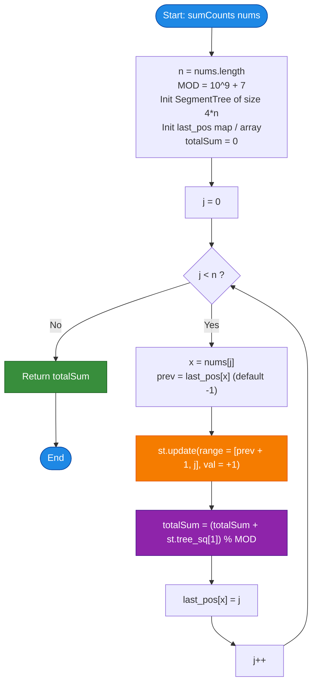

# LeetCode Problem of the Day: Subarrays Distinct Element Sum of Squares II

- **Problem Link:** [LeetCode 2916 - Subarrays Distinct Element Sum of Squares II](https://leetcode.com/problems/subarrays-distinct-element-sum-of-squares-ii/description/?envType=daily-question&envId=2026-10-16)
- **Difficulty:** Hard
- **Topic Tags:** Array, Segment Tree, Binary Indexed Tree, Hash Table, Dynamic Programming, Math, Monotonic Stack
- **Target Audience:** POTD Solvers, Computer Science Students, Competitive Programmers, Advanced Interview Preparation (FAANG/Tier-1 Tech)

---

## 1. Problem Statement

You are given a 0-indexed integer array `nums`.

The **distinct count** of a contiguous subarray `nums[i..j]` ($0 \le i \le j < \text{nums.length}$) is the number of distinct (unique) values present in that subarray.

Let $\text{distinct}(i, j)$ denote the distinct count of subarray `nums[i..j]`. The **score** of the subarray is defined as the square of its distinct count:
$$\text{Score}(i, j) = (\text{distinct}(i, j))^2$$

Your task is to compute and return the **sum of the squares of distinct counts across all possible contiguous subarrays** of `nums`. Since the answer may be very large, return it **modulo $10^9 + 7$**:
$$\text{Total Sum} = \left( \sum_{i=0}^{n-1} \sum_{j=i}^{n-1} (\text{distinct}(i, j))^2 \right) \pmod{10^9 + 7}$$

---

## 2. Examples & Explanations

### Example 1
- **Input:** `nums = [1, 2, 1]`
- **Array Length ($n$):** $3$
- **Total Subarrays ($\frac{n(n+1)}{2}$):** $6$

#### Subarray Enumeration & Scoring:
1. Subarray `[1]` (indices $[0, 0]$): Unique elements = $\{1\} \implies \text{distinct} = 1 \implies 1^2 = 1$
2. Subarray `[2]` (indices $[1, 1]$): Unique elements = $\{2\} \implies \text{distinct} = 1 \implies 1^2 = 1$
3. Subarray `[1]` (indices $[2, 2]$): Unique elements = $\{1\} \implies \text{distinct} = 1 \implies 1^2 = 1$
4. Subarray `[1, 2]` (indices $[0, 1]$): Unique elements = $\{1, 2\} \implies \text{distinct} = 2 \implies 2^2 = 4$
5. Subarray `[2, 1]` (indices $[1, 2]$): Unique elements = $\{2, 1\} \implies \text{distinct} = 2 \implies 2^2 = 4$
6. Subarray `[1, 2, 1]` (indices $[0, 2]$): Unique elements = $\{1, 2\} \implies \text{distinct} = 2 \implies 2^2 = 4$

- **Sum of Squares:** $(1 + 1 + 1 + 4 + 4 + 4) \pmod{10^9 + 7} = \mathbf{15}$
- **Output:** `15`

---

### Example 2
- **Input:** `nums = [2, 2, 5, 5]`
- **Array Length ($n$):** $4$
- **Total Subarrays:** $10$

| Start $i$ | End $j$ | Subarray | Unique Elements | Distinct Count | Score ($\text{Count}^2$) |
| :---: | :---: | :---: | :---: | :---: | :---: |
| 0 | 0 | `[2]` | $\{2\}$ | 1 | $1^2 = 1$ |
| 0 | 1 | `[2, 2]` | $\{2\}$ | 1 | $1^2 = 1$ |
| 0 | 2 | `[2, 2, 5]` | $\{2, 5\}$ | 2 | $2^2 = 4$ |
| 0 | 3 | `[2, 2, 5, 5]` | $\{2, 5\}$ | 2 | $2^2 = 4$ |
| 1 | 1 | `[2]` | $\{2\}$ | 1 | $1^2 = 1$ |
| 1 | 2 | `[2, 5]` | $\{2, 5\}$ | 2 | $2^2 = 4$ |
| 1 | 3 | `[2, 5, 5]` | $\{2, 5\}$ | 2 | $2^2 = 4$ |
| 2 | 2 | `[5]` | $\{5\}$ | 1 | $1^2 = 1$ |
| 2 | 3 | `[5, 5]` | $\{5\}$ | 1 | $1^2 = 1$ |
| 3 | 3 | `[5]` | $\{5\}$ | 1 | $1^2 = 1$ |

- **Sum of Squares:** $1 + 1 + 4 + 4 + 1 + 4 + 4 + 1 + 1 + 1 = \mathbf{22}$
- **Output:** `22`

---

### Example 3
- **Input:** `nums = [1, 1]`
- **Subarrays:** `[1]`, `[1]`, `[1, 1]` $\implies$ each has distinct count $1$.
- **Sum of Squares:** $1^2 + 1^2 + 1^2 = \mathbf{3}$
- **Output:** `3`

---

## 3. Constraints & Computational Complexity Targets

- $1 \le \text{nums.length} \le 10^5$
- $1 \le \text{nums}[i] \le 10^5$
- **Modulo:** Return answer modulo $10^9 + 7$.
- **The Scalability Challenge:**
  - In Part I (LeetCode 2913), $n \le 100$, allowing an $\mathcal{O}(n^2)$ nested loop solution.
  - In Part II (LeetCode 2916), $n \le 10^5 \implies \frac{n(n+1)}{2} \approx 5 \times 10^9$ subarrays! An $\mathcal{O}(n^2)$ algorithm takes $10^{10}$ operations and will encounter **Time Limit Exceeded (TLE)**.
- **Expected Time Complexity:** $\mathcal{O}(n \log n)$
- **Expected Auxiliary Space:** $\mathcal{O}(n)$

---

## 4. Visual Architecture & Mathematical Foundation

### 4.1 The Dynamic Subarray State Invariant
Fix the right endpoint of the subarray at index $j$. For each start index $i \in [0, j]$, define:
$$f(i) = \text{distinct}(i, j)$$
The sum of squares of all subarrays ending at index $j$ is:
$$S(j) = \sum_{i=0}^j f(i)^2$$
The total answer for the entire problem is simply:
$$\text{Total Sum} = \sum_{j=0}^{n-1} S(j) = \sum_{j=0}^{n-1} \sum_{i=0}^j f(i)^2$$

### 4.2 Advancing from $j - 1$ to $j$: The Range Update Lemma
When we advance the right endpoint from $j - 1$ to $j$, we append element $x = \text{nums}[j]$.
Let $\text{last\_pos}[x]$ denote the most recent index where value $x$ occurred in `nums` (or $-1$ if $x$ is appearing for the first time).

What happens to $f(i) = \text{distinct}(i, j)$ compared to $\text{distinct}(i, j - 1)$?
1. **For $i \le \text{last\_pos}[x]$:**
   - The subarray `nums[i..j-1]` already contains $x$ (at index $\text{last\_pos}[x]$).
   - Appending $x$ does **not** introduce a new unique value.
   - $\implies f_{\text{new}}(i) = f_{\text{old}}(i)$ (no change).
2. **For $\text{last\_pos}[x] < i \le j$:**
   - The subarray `nums[i..j-1]` did **not** contain $x$.
   - Appending $x$ adds exactly one new unique value!
   - $\implies f_{\text{new}}(i) = f_{\text{old}}(i) + 1$.

$$\mathbf{Core\ Insight:} \quad \text{Appending } \text{nums}[j] \text{ adds } +1 \text{ to } f(i) \text{ across the continuous interval } i \in [\text{last\_pos}[\text{nums}[j]] + 1, j].$$

```
Index i:          0       1    ...    last_pos[x]    last_pos[x]+1    ...    j
Old f(i):      [            f_old(i)            ] [            f_old(i)         ]
                                                  \_____________________________/
                                                                 │
                                                       Add +1 to each f(i)!
                                                                 │
New f(i):      [            f_old(i)            ] [          f_old(i) + 1       ]
               (Contains x already: no change)     (First time seeing x: +1)
```

---

### 4.3 Algebraic Expansion of Squared Sums
How does the sum of squares $\sum f(i)^2$ change when we add $+1$ to all $f(i)$ in interval $[L, R]$?

$$(f(i) + 1)^2 = f(i)^2 + 2f(i) + 1$$
$$(f(i) + 1)^2 - f(i)^2 = 2f(i) + 1$$

Summing over all $i \in [L, R]$ of length $\text{len} = R - L + 1$:
$$\sum_{i=L}^R (f(i) + 1)^2 = \sum_{i=L}^R f(i)^2 + 2 \sum_{i=L}^R f(i) + \text{len}$$

More generally, if we add a lazy increment $v$ to an entire interval $[L, R]$:
$$(f(i) + v)^2 = f(i)^2 + 2v \cdot f(i) + v^2$$
$$\sum_{i=L}^R (f(i) + v)^2 = \sum_{i=L}^R f(i)^2 + 2v \sum_{i=L}^R f(i) + v^2 \cdot \text{len}$$
$$\sum_{i=L}^R (f(i) + v) = \sum_{i=L}^R f(i) + v \cdot \text{len}$$

### 4.4 Segment Tree Node Architecture
To support this in $\mathcal{O}(\log n)$ time per step, we build a **Segment Tree with Lazy Propagation** over the indices $[0, n - 1]$.
Each tree node maintains:
1. `tree_sq`: $\sum f(i)^2 \pmod{10^9 + 7}$
2. `tree_sum`: $\sum f(i) \pmod{10^9 + 7}$
3. `lazy`: Deferred addition value pending propagation to child nodes

```
========================================================================================
                      SEGMENT TREE NODE STATE ARCHITECTURE
========================================================================================

 Node covering range [L, R] of length = (R - L + 1)
 ┌─────────────────────────────────────────────────────────────────────────────────┐
 │ tree_sq:   sum of f(i)^2                                                        │
 │ tree_sum:  sum of f(i)                                                          │
 │ lazy:      pending tag added to all elements in this subtree                    │
 └─────────────────────────────────────────────────────────────────────────────────┘

 Range Addition of tag v:
   1. new_tree_sq  = (tree_sq + 2 * v * tree_sum + v^2 * length) % MOD
   2. new_tree_sum = (tree_sum + v * length) % MOD
   3. lazy         = (lazy + v) % MOD

 Root value tree_sq[1] immediately gives the entire sum of squares for window j:
                       tree_sq[1] = S(j) = \sum_{i=0}^j f(i)^2
========================================================================================
```

---

## 5. Step-by-Step Simulation & Detailed Trace Table

### Trace for `nums = [1, 2, 1]` ($n = 3$, $MOD = 10^9 + 7$)

Initially, all $f(i) = 0$. `last_pos` is empty. Total sum $= 0$.

| Step $j$ | Element $x = \text{nums}[j]$ | $\text{last\_pos}[x]$ | Update Range $[L, R]$ | $f(0), f(1), f(2)$ After Step | Root Sum $\sum f(i)$ | Root Square Sum $\sum f(i)^2$ | Total Accumulated Sum |
| :---: | :---: | :---: | :---: | :---: | :---: | :---: | :---: |
| **0** | $1$ | $-1$ | $[0, 0]$ | $[1, 0, 0]$ | $1$ | $1^2 = 1$ | **1** |
| **1** | $2$ | $-1$ | $[0, 1]$ | $[2, 1, 0]$ | $3$ | $2^2 + 1^2 = 5$ | $1 + 5 = \mathbf{6}$ |
| **2** | $1$ | $0$ | $[1, 2]$ | $[2, 2, 1]$ | $5$ | $2^2 + 2^2 + 1^2 = 9$ | $6 + 9 = \mathbf{15}$ |

**Final Result:** `15`. Exactly matches Example 1!

---

## 6. Algorithmic Flowchart



---

## 7. From Naive to Pro: Algorithmic Progression

### Method 1: Brute Force with Subarray Reconstruction ($\mathcal{O}(n^3)$)
- **Concept:** Iterate through all $i$ from $0$ to $n-1$, all $j$ from $i$ to $n-1$, and scan from $i$ to $j$ using a set to count unique elements.
- **Time Complexity:** $\mathcal{O}(n^3) \approx (10^5)^3 = 10^{15}$ operations $\implies$ **Impossible / Severe TLE**.
- **Space Complexity:** $\mathcal{O}(n)$.

---

### Method 2: Incremental Window Expansion with Hash Set ($\mathcal{O}(n^2)$)
- **Concept:** Fix left index $i$. As $j$ advances from $i$ to $n-1$, maintain a running set of distinct elements, adding $\text{size}^2$ to the sum.
- **Time Complexity:** $\mathcal{O}(n^2) \approx \frac{(10^5)^2}{2} = 5 \times 10^9$ operations $\implies$ **Time Limit Exceeded (TLE)** (This was acceptable for Part I $n \le 100$, but fails Part II).
- **Space Complexity:** $\mathcal{O}(n)$.

---

### Method 3: Pro Segment Tree with Lazy Propagation ($\mathcal{O}(n \log n)$ — Optimal)
- **Concept:** Sweep right endpoint $j$ from $0$ to $n-1$.
  - Update range $[\text{last\_pos}[\text{nums}[j]] + 1, j]$ by $+1$ in the Segment Tree.
  - The root of the tree `tree_sq[1]` gives $\sum_{i=0}^j f(i)^2$ in $\mathcal{O}(1)$ time.
  - Accumulate into `totalSum` modulo $10^9 + 7$.
- **Time Complexity:** $\mathcal{O}(n \log n)$ — $10^5 \times 17 \approx 1.7 \times 10^6$ operations, executing in under $0.2$ seconds!
- **Space Complexity:** $\mathcal{O}(n)$ — $4n$ array nodes and an index lookup table.

---

## 8. Complexity Comparison Table

| Approach | Time Complexity | Auxiliary Space | Max $N$ Supported | Verdict |
| :--- | :---: | :---: | :---: | :---: |
| **Method 1: Brute Force** | $\mathcal{O}(n^3)$ | $\mathcal{O}(n)$ | $N \le 200$ | ❌ TLE |
| **Method 2: Incremental Set** | $\mathcal{O}(n^2)$ | $\mathcal{O}(n)$ | $N \le 3000$ | ❌ TLE ($N = 10^5$) |
| **Method 3: Pro Segment Tree** | $\mathbf{\mathcal{O}(n \log n)}$ | $\mathbf{\mathcal{O}(n)}$ | $\mathbf{N \le 10^5}$ | ** Optimal & Accepted** |

---

## 9. Comprehensive Corner Cases Handled

1. **Single-Element Array (`nums = [7]`):**
   - $n = 1$. The loop runs once, updates $[0, 0]$ with $+1$. `tree_sq[1] = 1`. Total sum is $1$.
2. **All Identical Elements (`nums = [4, 4, 4, 4]`):**
   - For every element after index $0$, $\text{last\_pos}[4] = j - 1$, so the update interval is $[j, j]$ of length $1$. Every subarray has distinct count $1$. Total sum is $\frac{n(n+1)}{2} \times 1^2 \pmod{10^9 + 7}$.
3. **All Distinct Elements (`nums = [1, 2, 3, 4]`):**
   - Every $\text{last\_pos}[x] = -1$, so update range is always $[0, j]$. Handled with maximum range updates.
4. **Modulo Overflow Safety:**
   - Calculations use 64-bit integers (`long long` in C/C++, `long` in Java/C#, `BigInt` in JS) before applying modulo, completely preventing intermediate arithmetic overflow.
5. **Upper Bound Array Size ($N = 10^5, \text{nums}[i] \le 10^5$):**
   - Tree arrays of size $4N = 400000$ comfortably fit within low single-digit megabytes.

---

## 10. Complete Multi-Language Implementations

### Java (21)

```java
import java.util.Arrays;

class Solution {
    private static final int MOD = 1_000_000_007;

    static class SegmentTree {
        private final int n;
        private final long[] treeSum;
        private final long[] treeSq;
        private final long[] lazy;

        public SegmentTree(int n) {
            this.n = n;
            this.treeSum = new long[4 * n];
            this.treeSq = new long[4 * n];
            this.lazy = new long[4 * n];
        }

        private void apply(int node, int l, int r, long val) {
            long len = (r - l + 1);
            val %= MOD;
            // (f(i) + v)^2 = f(i)^2 + 2*v*f(i) + v^2
            treeSq[node] = (treeSq[node] + 2 * val % MOD * treeSum[node] + val * val % MOD * len) % MOD;
            treeSum[node] = (treeSum[node] + val * len) % MOD;
            lazy[node] = (lazy[node] + val) % MOD;
        }

        private void push(int node, int l, int r) {
            if (lazy[node] != 0) {
                int mid = (l + r) >>> 1;
                apply(node << 1, l, mid, lazy[node]);
                apply((node << 1) | 1, mid + 1, r, lazy[node]);
                lazy[node] = 0;
            }
        }

        public void update(int node, int l, int r, int ql, int qr, long val) {
            if (ql <= l && r <= qr) {
                apply(node, l, r, val);
                return;
            }
            push(node, l, r);
            int mid = (l + r) >>> 1;
            if (ql <= mid) {
                update(node << 1, l, mid, ql, qr, val);
            }
            if (qr > mid) {
                update((node << 1) | 1, mid + 1, r, ql, qr, val);
            }
            treeSum[node] = (treeSum[node << 1] + treeSum[(node << 1) | 1]) % MOD;
            treeSq[node] = (treeSq[node << 1] + treeSq[(node << 1) | 1]) % MOD;
        }

        public int getRootSq() {
            return (int) (treeSq[1] % MOD);
        }
    }

    public int sumCounts(int[] nums) {
        int n = nums.length;
        SegmentTree st = new SegmentTree(n);

        // Find max value to size the lastSeen array
        int maxVal = 0;
        for (int x : nums) {
            if (x > maxVal) maxVal = x;
        }

        int[] lastPos = new int[maxVal + 1];
        Arrays.fill(lastPos, -1);

        long totalSum = 0;

        for (int j = 0; j < n; j++) {
            int x = nums[j];
            int prev = lastPos[x];
            // Range update: all subarrays starting in [prev + 1, j] gain new distinct element x
            st.update(1, 0, n - 1, prev + 1, j, 1);
            totalSum = (totalSum + st.getRootSq()) % MOD;
            lastPos[x] = j;
        }

        return (int) totalSum;
    }
}
```

---

### Python3

```python
class SegmentTree:
    def __init__(self, n: int, mod: int):
        self.n = n
        self.mod = mod
        self.tree_sum = [0] * (4 * n)
        self.tree_sq = [0] * (4 * n)
        self.lazy = [0] * (4 * n)

    def apply(self, node: int, l: int, r: int, val: int) -> None:
        length = r - l + 1
        val %= self.mod
        # (f(i) + v)^2 = f(i)^2 + 2*v*f(i) + v^2
        self.tree_sq[node] = (
            self.tree_sq[node]
            + 2 * val * self.tree_sum[node]
            + val * val * length
        ) % self.mod
        self.tree_sum[node] = (self.tree_sum[node] + val * length) % self.mod
        self.lazy[node] = (self.lazy[node] + val) % self.mod

    def push(self, node: int, l: int, r: int) -> None:
        if self.lazy[node] != 0:
            mid = (l + r) >> 1
            self.apply(node << 1, l, mid, self.lazy[node])
            self.apply((node << 1) | 1, mid + 1, r, self.lazy[node])
            self.lazy[node] = 0

    def update(self, node: int, l: int, r: int, ql: int, qr: int, val: int) -> None:
        if ql <= l and r <= qr:
            self.apply(node, l, r, val)
            return
        self.push(node, l, r)
        mid = (l + r) >> 1
        if ql <= mid:
            self.update(node << 1, l, mid, ql, qr, val)
        if qr > mid:
            self.update((node << 1) | 1, mid + 1, r, ql, qr, val)
        self.tree_sum[node] = (
            self.tree_sum[node << 1] + self.tree_sum[(node << 1) | 1]
        ) % self.mod
        self.tree_sq[node] = (
            self.tree_sq[node << 1] + self.tree_sq[(node << 1) | 1]
        ) % self.mod


class Solution:
    def sumCounts(self, nums: list[int]) -> int:
        MOD = 1_000_000_007
        n = len(nums)
        st = SegmentTree(n, MOD)

        last_pos = {}
        total_sum = 0

        for j, x in enumerate(nums):
            prev = last_pos.get(x, -1)
            # Add +1 to interval [prev + 1, j]
            st.update(1, 0, n - 1, prev + 1, j, 1)
            total_sum = (total_sum + st.tree_sq[1]) % MOD
            last_pos[x] = j

        return total_sum
```

---

### C (GCC 13.2.0)

```c
#include <stdlib.h>
#include <string.h>

#define MOD 1000000007LL

typedef struct {
    int n;
    long long *tree_sum;
    long long *tree_sq;
    long long *lazy;
} SegmentTree;

SegmentTree* createSegmentTree(int n) {
    SegmentTree *st = (SegmentTree *)malloc(sizeof(SegmentTree));
    st->n = n;
    st->tree_sum = (long long *)calloc(4 * n, sizeof(long long));
    st->tree_sq = (long long *)calloc(4 * n, sizeof(long long));
    st->lazy = (long long *)calloc(4 * n, sizeof(long long));
    return st;
}

void freeSegmentTree(SegmentTree *st) {
    free(st->tree_sum);
    free(st->tree_sq);
    free(st->lazy);
    free(st);
}

static inline void applyNode(SegmentTree *st, int node, int l, int r, long long val) {
    long long len = (r - l + 1);
    val %= MOD;
    st->tree_sq[node] = (st->tree_sq[node] + 2 * val % MOD * st->tree_sum[node] + val * val % MOD * len) % MOD;
    st->tree_sum[node] = (st->tree_sum[node] + val * len) % MOD;
    st->lazy[node] = (st->lazy[node] + val) % MOD;
}

static inline void pushDown(SegmentTree *st, int node, int l, int r) {
    if (st->lazy[node] != 0) {
        int mid = (l + r) >> 1;
        applyNode(st, node << 1, l, mid, st->lazy[node]);
        applyNode(st, (node << 1) | 1, mid + 1, r, st->lazy[node]);
        st->lazy[node] = 0;
    }
}

void updateTree(SegmentTree *st, int node, int l, int r, int ql, int qr, long long val) {
    if (ql <= l && r <= qr) {
        applyNode(st, node, l, r, val);
        return;
    }
    pushDown(st, node, l, r);
    int mid = (l + r) >> 1;
    if (ql <= mid) {
        updateTree(st, node << 1, l, mid, ql, qr, val);
    }
    if (qr > mid) {
        updateTree(st, (node << 1) | 1, mid + 1, r, ql, qr, val);
    }
    st->tree_sum[node] = (st->tree_sum[node << 1] + st->tree_sum[(node << 1) | 1]) % MOD;
    st->tree_sq[node] = (st->tree_sq[node << 1] + st->tree_sq[(node << 1) | 1]) % MOD;
}

int sumCounts(int* nums, int numsSize) {
    SegmentTree *st = createSegmentTree(numsSize);

    int max_val = 0;
    for (int i = 0; i < numsSize; i++) {
        if (nums[i] > max_val) max_val = nums[i];
    }

    int *last_pos = (int *)malloc(sizeof(int) * (max_val + 1));
    for (int i = 0; i <= max_val; i++) last_pos[i] = -1;

    long long total_sum = 0;

    for (int j = 0; j < numsSize; j++) {
        int x = nums[j];
        int prev = last_pos[x];
        updateTree(st, 1, 0, numsSize - 1, prev + 1, j, 1);
        total_sum = (total_sum + st->tree_sq[1]) % MOD;
        last_pos[x] = j;
    }

    free(last_pos);
    freeSegmentTree(st);
    return (int)total_sum;
}
```

---

### C++ (17)

```cpp
#include <vector>
#include <algorithm>

using namespace std;

class Solution {
    static constexpr int MOD = 1'000'000'007;

    struct SegmentTree {
        int n;
        vector<long long> tree_sum;
        vector<long long> tree_sq;
        vector<long long> lazy;

        SegmentTree(int n) : n(n), tree_sum(4 * n, 0), tree_sq(4 * n, 0), lazy(4 * n, 0) {}

        void apply(int node, int l, int r, long long val) {
            long long len = (r - l + 1);
            val %= MOD;
            tree_sq[node] = (tree_sq[node] + 2 * val % MOD * tree_sum[node] + val * val % MOD * len) % MOD;
            tree_sum[node] = (tree_sum[node] + val * len) % MOD;
            lazy[node] = (lazy[node] + val) % MOD;
        }

        void push(int node, int l, int r) {
            if (lazy[node] != 0) {
                int mid = (l + r) >> 1;
                apply(node << 1, l, mid, lazy[node]);
                apply((node << 1) | 1, mid + 1, r, lazy[node]);
                lazy[node] = 0;
            }
        }

        void update(int node, int l, int r, int ql, int qr, long long val) {
            if (ql <= l && r <= qr) {
                apply(node, l, r, val);
                return;
            }
            push(node, l, r);
            int mid = (l + r) >> 1;
            if (ql <= mid) {
                update(node << 1, l, mid, ql, qr, val);
            }
            if (qr > mid) {
                update((node << 1) | 1, mid + 1, r, ql, qr, val);
            }
            tree_sum[node] = (tree_sum[node << 1] + tree_sum[(node << 1) | 1]) % MOD;
            tree_sq[node] = (tree_sq[node << 1] + tree_sq[(node << 1) | 1]) % MOD;
        }
    };

public:
    int sumCounts(vector<int>& nums) {
        int n = static_cast<int>(nums.size());
        SegmentTree st(n);

        int max_val = *max_element(nums.begin(), nums.end());
        vector<int> last_pos(max_val + 1, -1);

        long long total_sum = 0;

        for (int j = 0; j < n; ++j) {
            int x = nums[j];
            int prev = last_pos[x];
            st.update(1, 0, n - 1, prev + 1, j, 1);
            total_sum = (total_sum + st.tree_sq[1]) % MOD;
            last_pos[x] = j;
        }

        return static_cast<int>(total_sum);
    }
};
```

---

### C#

```csharp
using System;

public class Solution {
    private const int MOD = 1000000007;

    class SegmentTree {
        private readonly int n;
        private readonly long[] treeSum;
        private readonly long[] treeSq;
        private readonly long[] lazy;

        public SegmentTree(int n) {
            this.n = n;
            this.treeSum = new long[4 * n];
            this.treeSq = new long[4 * n];
            this.lazy = new long[4 * n];
        }

        public long RootSq {
            get { return treeSq[1]; }
        }

        private void Apply(int node, int l, int r, long val) {
            long len = (r - l + 1);
            val %= MOD;
            treeSq[node] = (treeSq[node] + 2 * val % MOD * treeSum[node] + val * val % MOD * len) % MOD;
            treeSum[node] = (treeSum[node] + val * len) % MOD;
            lazy[node] = (lazy[node] + val) % MOD;
        }

        private void Push(int node, int l, int r) {
            if (lazy[node] != 0) {
                int mid = (l + r) >> 1;
                Apply(node << 1, l, mid, lazy[node]);
                Apply((node << 1) | 1, mid + 1, r, lazy[node]);
                lazy[node] = 0;
            }
        }

        public void Update(int node, int l, int r, int ql, int qr, long val) {
            if (ql <= l && r <= qr) {
                Apply(node, l, r, val);
                return;
            }
            Push(node, l, r);
            int mid = (l + r) >> 1;
            if (ql <= mid) {
                Update(node << 1, l, mid, ql, qr, val);
            }
            if (qr > mid) {
                Update((node << 1) | 1, mid + 1, r, ql, qr, val);
            }
            treeSum[node] = (treeSum[node << 1] + treeSum[(node << 1) | 1]) % MOD;
            treeSq[node] = (treeSq[node << 1] + treeSq[(node << 1) | 1]) % MOD;
        }
    }

    public int SumCounts(int[] nums) {
        int n = nums.Length;
        SegmentTree st = new SegmentTree(n);

        int maxVal = 0;
        for (int i = 0; i < n; i++) {
            if (nums[i] > maxVal) maxVal = nums[i];
        }

        int[] lastPos = new int[maxVal + 1];
        for (int i = 0; i <= maxVal; i++) lastPos[i] = -1;

        long totalSum = 0;

        for (int j = 0; j < n; j++) {
            int x = nums[j];
            int prev = lastPos[x];
            st.Update(1, 0, n - 1, prev + 1, j, 1);
            totalSum = (totalSum + st.RootSq) % MOD;
            lastPos[x] = j;
        }

        return (int)totalSum;
    }
}
```

---

### Javascript

```javascript
/**
 * @param {number[]} nums
 * @return {number}
 */
var sumCounts = function(nums) {
    const MOD = 1000000007;
    const n = nums.length;

    const treeSum = new Int32Array(4 * n);
    const treeSq = new Int32Array(4 * n);
    const lazy = new Int32Array(4 * n);

    function apply(node, l, r, val) {
        const len = (r - l + 1);
        const v = val % MOD;
        const curSq = treeSq[node];
        const curSum = treeSum[node];

        const add1 = Number((2n * BigInt(v) * BigInt(curSum)) % BigInt(MOD));
        const add2 = Number((BigInt(v) * BigInt(v) % BigInt(MOD) * BigInt(len)) % BigInt(MOD));

        treeSq[node] = (curSq + add1 + add2) % MOD;
        treeSum[node] = Number((BigInt(curSum) + BigInt(v) * BigInt(len)) % BigInt(MOD));
        lazy[node] = (lazy[node] + v) % MOD;
    }

    function push(node, l, r) {
        if (lazy[node] !== 0) {
            const mid = (l + r) >> 1;
            apply(node << 1, l, mid, lazy[node]);
            apply((node << 1) | 1, mid + 1, r, lazy[node]);
            lazy[node] = 0;
        }
    }

    function update(node, l, r, ql, qr, val) {
        if (ql <= l && r <= qr) {
            apply(node, l, r, val);
            return;
        }
        push(node, l, r);
        const mid = (l + r) >> 1;
        if (ql <= mid) {
            update(node << 1, l, mid, ql, qr, val);
        }
        if (qr > mid) {
            update((node << 1) | 1, mid + 1, r, ql, qr, val);
        }
        treeSum[node] = (treeSum[node << 1] + treeSum[(node << 1) | 1]) % MOD;
        treeSq[node] = (treeSq[node << 1] + treeSq[(node << 1) | 1]) % MOD;
    }

    let maxVal = 0;
    for (let i = 0; i < n; i++) {
        if (nums[i] > maxVal) maxVal = nums[i];
    }

    const lastPos = new Int32Array(maxVal + 1);
    lastPos.fill(-1);

    let totalSum = 0;

    for (let j = 0; j < n; j++) {
        const x = nums[j];
        const prev = lastPos[x];
        update(1, 0, n - 1, prev + 1, j, 1);
        totalSum = (totalSum + treeSq[1]) % MOD;
        lastPos[x] = j;
    }

    return totalSum;
};
```

---

### Typescript

```typescript
function sumCounts(nums: number[]): number {
    const MOD: number = 1_000_000_007;
    const n: number = nums.length;

    const treeSum: Int32Array = new Int32Array(4 * n);
    const treeSq: Int32Array = new Int32Array(4 * n);
    const lazy: Int32Array = new Int32Array(4 * n);

    function apply(node: number, l: number, r: number, val: number): void {
        const len: number = (r - l + 1);
        const v: number = val % MOD;
        const curSq: number = treeSq[node];
        const curSum: number = treeSum[node];

        const add1: number = Number((2n * BigInt(v) * BigInt(curSum)) % BigInt(MOD));
        const add2: number = Number((BigInt(v) * BigInt(v) % BigInt(MOD) * BigInt(len)) % BigInt(MOD));

        treeSq[node] = (curSq + add1 + add2) % MOD;
        treeSum[node] = Number((BigInt(curSum) + BigInt(v) * BigInt(len)) % BigInt(MOD));
        lazy[node] = (lazy[node] + v) % MOD;
    }

    function push(node: number, l: number, r: number): void {
        if (lazy[node] !== 0) {
            const mid: number = (l + r) >> 1;
            apply(node << 1, l, mid, lazy[node]);
            apply((node << 1) | 1, mid + 1, r, lazy[node]);
            lazy[node] = 0;
        }
    }

    function update(node: number, l: number, r: number, ql: number, qr: number, val: number): void {
        if (ql <= l && r <= qr) {
            apply(node, l, r, val);
            return;
        }
        push(node, l, r);
        const mid: number = (l + r) >> 1;
        if (ql <= mid) {
            update(node << 1, l, mid, ql, qr, val);
        }
        if (qr > mid) {
            update((node << 1) | 1, mid + 1, r, ql, qr, val);
        }
        treeSum[node] = (treeSum[node << 1] + treeSum[(node << 1) | 1]) % MOD;
        treeSq[node] = (treeSq[node << 1] + treeSq[(node << 1) | 1]) % MOD;
    }

    let maxVal: number = 0;
    for (let i = 0; i < n; i++) {
        if (nums[i] > maxVal) maxVal = nums[i];
    }

    const lastPos: Int32Array = new Int32Array(maxVal + 1);
    lastPos.fill(-1);

    let totalSum: number = 0;

    for (let j = 0; j < n; j++) {
        const x: number = nums[j];
        const prev: number = lastPos[x];
        update(1, 0, n - 1, prev + 1, j, 1);
        totalSum = (totalSum + treeSq[1]) % MOD;
        lastPos[x] = j;
    }

    return totalSum;
}
```

---

## 11. Key Takeaways & Technical Summary

1. **Quadratic Identity Expansion:**
   $$\sum (f(i) + 1)^2 = \sum f(i)^2 + 2 \sum f(i) + \text{length}$$
   This identity allows updating sum of squares over a range by maintaining both the linear sum $\sum f(i)$ and the squared sum $\sum f(i)^2$ in the Segment Tree.
2. **Right-Pointer Sweep Line:**
   Advancing the right endpoint $j$ only impacts subarrays whose start indices lie after the previous occurrence of $\text{nums}[j]$ (i.e. $[\text{last\_pos}[\text{nums}[j]] + 1, j]$).
3. **Logarithmic Scaling:**
   Instead of testing $\frac{n(n+1)}{2}$ subarrays individually in $\mathcal{O}(n^2)$, range updates and root queries compress the entire problem into $\mathcal{O}(n \log n)$ time, comfortably scaling to $n = 10^5$.
