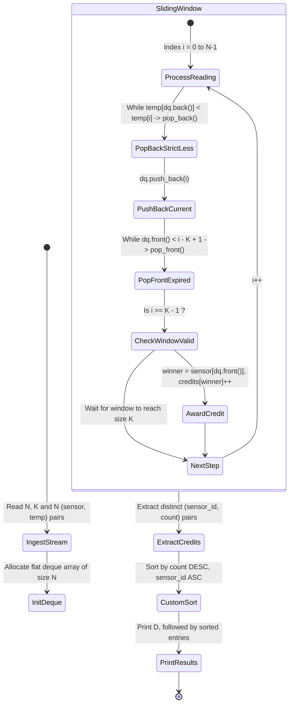
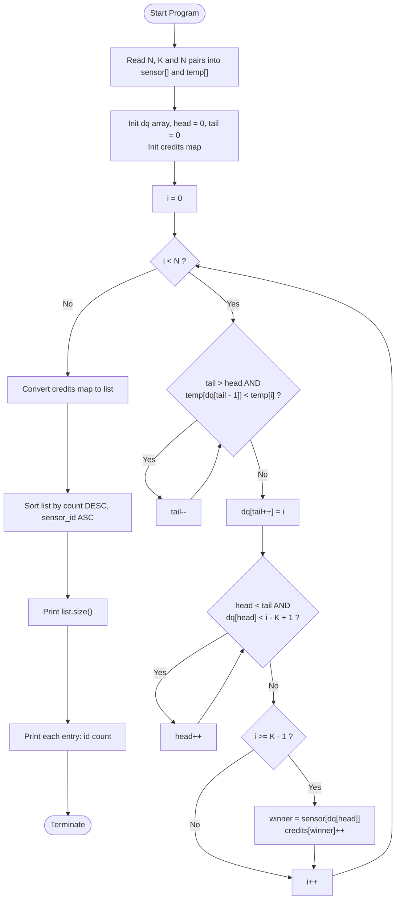

# Unstop Problem of the Day: The First to Peak

- **Platform:** [Unstop](https://unstop.com/)
- **Difficulty:** Medium
- **Topic Tags:** Sliding Window, Monotonic Deque, Sliding Window Maximum, Greedy, Frequency Counting, Custom Sorting
- **Target Audience:** POTD Solvers, Computer Science Students, Competitive Programmers, Interview Preparation (FAANG / Tier-1 Systems Engineering)

---

## 1. Problem Statement

Kabir oversees a remote automated weather telemetry station where ground sensors radio in temperature readings one at a time in strict chronological order. Each reading contains:
1. `sensor_id`: The manufacturer-assigned identifier of the sensor (a positive integer up to $10^9$).
2. `temp`: The recorded temperature value (ranging between $-10^6$ and $10^6$).

For his weekly meteorological report, Kabir groups the sequence of $N$ incoming readings into overlapping sliding blocks of fixed length $K$:
- **Block 1:** Readings at indices $[0, K - 1]$
- **Block 2:** Readings at indices $[1, K]$
- $\dots$
- **Block $b$:** Readings at indices $[b - 1, b + K - 2]$
- Total number of sliding blocks = $N - K + 1$.

### Credit Allocation Rule:
For every block, **exactly one sensor earns credit**:
- The credit goes to the reading that **first reached the highest temperature** recorded anywhere inside that block (the earliest warning of the block's maximum temperature).
- **Tie-Breaking Rule:** If multiple readings inside a block share the same maximum temperature, the credit goes to whichever reading occurred **earliest** (i.e., with the smallest chronological index).
- A sensor accumulates $+1$ credit each time it wins a block.

### Summary Reporting Requirements:
Kabir does not want a raw block-by-block dump. Instead, he requires an aggregated leaderboard summary:
1. Print a single integer $D$: the total number of distinct sensors that earned credit for at least one block ($D \ge 1$).
2. Followed by $D$ lines, each listing `sensor_id` and its total `credit_count`.
3. **Sorting Order:**
   - Primary: **Descending order of credit count** (highest credits first).
   - Secondary (Tie-Breaker): **Ascending order of sensor identifier** (smaller ID first).
4. Sensors that earned $0$ credits must be omitted entirely.

---

## 2. Examples & Explanations

### Example 1 (Sample Testcase 0)

**Input:**
```text
6 3
10 5 20 9 30 9 40 3 50 9 60 1
```

**Parameters:**
- $N = 6$ readings, Block Size $K = 3$.
- Total blocks = $6 - 3 + 1 = 4$.
- Chronological readings:
  - Index 0: `(sensor: 10, temp: 5)`
  - Index 1: `(sensor: 20, temp: 9)`
  - Index 2: `(sensor: 30, temp: 9)`
  - Index 3: `(sensor: 40, temp: 3)`
  - Index 4: `(sensor: 50, temp: 9)`
  - Index 5: `(sensor: 60, temp: 1)`

#### Block-by-Block Evaluation:
1. **Block 0 (indices $[0..2]$):** Readings `[(10, 5), (20, 9), (30, 9)]`
   - Maximum temperature = $9$.
   - Readings reaching $9$: Index 1 (sensor 20) and Index 2 (sensor 30).
   - Earliest reading: Index 1 $\implies$ **Credit to Sensor 20** (+1).
2. **Block 1 (indices $[1..3]$):** Readings `[(20, 9), (30, 9), (40, 3)]`
   - Maximum temperature = $9$.
   - Readings reaching $9$: Index 1 (sensor 20) and Index 2 (sensor 30).
   - Earliest reading: Index 1 $\implies$ **Credit to Sensor 20** (+1).
3. **Block 2 (indices $[2..4]$):** Readings `[(30, 9), (40, 3), (50, 9)]`
   - Maximum temperature = $9$.
   - Note: Sensor 20 has slid out of the window!
   - Readings reaching $9$: Index 2 (sensor 30) and Index 4 (sensor 50).
   - Earliest reading: Index 2 $\implies$ **Credit to Sensor 30** (+1).
4. **Block 3 (indices $[3..5]$):** Readings `[(40, 3), (50, 9), (60, 1)]`
   - Maximum temperature = $9$.
   - Earliest reading: Index 4 $\implies$ **Credit to Sensor 50** (+1).

#### Credit Tally & Leaderboard:
- Sensor 20: 2 credits
- Sensor 30: 1 credit
- Sensor 50: 1 credit
- Distinct winning sensors $D = 3$.
- Sorted: Sensor 20 (2), followed by Sensor 30 (1) before Sensor 50 (1) since $30 < 50$.

**Output:**
```text
3
20 2
30 1
50 1
```

---

### Example 2 (Sample Testcase 1)

**Input:**
```text
5 2
7 100 7 100 8 50 9 200 9 200
```

**Parameters:**
- $N = 5, K = 2 \implies 4$ blocks.
- Chronological readings:
  - Index 0: `(7, 100)`
  - Index 1: `(7, 100)`
  - Index 2: `(8, 50)`
  - Index 3: `(9, 200)`
  - Index 4: `(9, 200)`

#### Block-by-Block Evaluation:
- **Block 0 (indices $[0..1]$):** Peak temp $100$. Earliest is index 0 $\implies$ **Sensor 7** (1 credit).
- **Block 1 (indices $[1..2]$):** Peak temp $100$. Earliest is index 1 $\implies$ **Sensor 7** (1 credit).
- **Block 2 (indices $[2..3]$):** Peak temp $200$. Earliest is index 3 $\implies$ **Sensor 9** (1 credit).
- **Block 3 (indices $[3..4]$):** Peak temp $200$. Earliest is index 3 $\implies$ **Sensor 9** (1 credit).

#### Final Tally:
- Sensor 7: 2 credits
- Sensor 9: 2 credits
- Tie-breaker: $7 < 9 \implies$ Sensor 7 printed first.

**Output:**
```text
2
7 2
9 2
```

---

## 3. Constraints & System Specifications

- $1 \le K \le N \le 2 \times 10^5$
- $1 \le \text{sensor\_id} \le 10^9$ (Sparse, non-contiguous identifiers)
- $-10^6 \le \text{temp} \le 10^6$ (Temperatures can be negative or zero)
- Time Limit: $2.0$ seconds
- Memory Limit: $256$ MB

---

## 4. Visual Architecture & Monotonic Deque Invariant

### 4.1 The Fundamental Sliding Window Dilemma
A standard Sliding Window Maximum algorithm uses a double-ended queue (deque) storing indices such that temperatures are strictly decreasing:
$$\text{temp}[\text{dq}[0]] > \text{temp}[\text{dq}[1]] > \dots$$
In standard problems, when a new element arrives with $\text{temp}[j] \ge \text{temp}[\text{back}]$, the back element is evicted because it is both **older** and **less-than-or-equal**.

### 4.2 The "Earliest Peak" Modification
In Kabir's weather station, **earlier occurrences of the same peak temperature hold higher priority**:
- If an older reading $i$ and a newer reading $j$ ($i < j$) have $\text{temp}[i] = \text{temp}[j]$, then inside any block containing both, reading $i$ **wins**.
- Therefore, when reading $j$ arrives, we **must NOT pop** reading $i$ if $\text{temp}[i] == \text{temp}[j]$!
- Reading $j$ must wait in the deque behind reading $i$. When reading $i$ eventually slides out of the window, reading $j$ takes over as the earliest peak.

$$\mathbf{Crucial\ Rule:} \quad \text{Pop from the back if and only if } \text{temp}[\text{dq.back()}] < \text{temp}[j] \quad \text{(STRICTLY LESS!)}$$

```
========================================================================================
                      MONOTONIC DEQUE STATE ARCHITECTURE
========================================================================================

 Incoming Reading: [index j, temp[j]]
             │
             ▼
 ┌─────────────────────────────────────────────────────────┐
 │ 1. EVICT INFERIOR READINGS (FROM BACK):                 │
 │    while (dq.back() has temp < temp[j]):                │  <-- Strictly less!
 │        dq.pop_back()                                    │      (Equal temps stay!)
 └───────────────────────────┬─────────────────────────────┘
                             │
                             ▼
 ┌─────────────────────────────────────────────────────────┐
 │ 2. ENQUEUE NEW READING:                                 │
 │    dq.push_back(j)                                      │
 └───────────────────────────┬─────────────────────────────┘
                             │
                             ▼
 ┌─────────────────────────────────────────────────────────┐
 │ 3. EXPIRE OUT-OF-WINDOW READINGS (FROM FRONT):          │
 │    while (dq.front() < i - K + 1):                      │
 │        dq.pop_front()                                   │
 └───────────────────────────┬─────────────────────────────┘
                             │
                             ▼
 ┌─────────────────────────────────────────────────────────┐
 │ 4. QUERY WINNER (FOR CURRENT WINDOW):                   │
 │    winner_index = dq.front()                            │
 │    credits[sensor[winner_index]] += 1                   │
 └─────────────────────────────────────────────────────────┘

 DEQUE INVARIANT: Non-increasing temperatures, increasing indices
 [ temp: 9, idx: 1 ] ---> [ temp: 9, idx: 2 ] ---> [ temp: 3, idx: 3 ]
   (Earliest Peak)          (Backup Peak)           (Fallback)
========================================================================================
```

### State Machine Lifecycle



---

## 5. Step-by-Step Simulation & Detailed Trace Table

### Trace for Sample 0: $N = 6, K = 3$
- Readings:
  - `0: (10, 5)`
  - `1: (20, 9)`
  - `2: (30, 9)`
  - `3: (40, 3)`
  - `4: (50, 9)`
  - `5: (60, 1)`

| Step $i$ | Reading `(id, temp)` | Deque Actions | Deque Contents `[indices]` | Window Start ($i - K + 1$) | Window Valid? | `dq.front()` (Winner) | Winner Sensor | Cumulative Credits Map |
| :---: | :---: | :---: | :---: | :---: | :---: | :---: | :---: | :--- |
| **0** | `(10, 5)` | Push 0 | `[0 (5)]` | $-2$ | No | — | — | `{}` |
| **1** | `(20, 9)` | Pop 0 ($5 < 9$), Push 1 | `[1 (9)]` | $-1$ | No | — | — | `{}` |
| **2** | `(30, 9)` | $9 \not< 9 \implies$ Push 2 | `[1 (9), 2 (9)]` | $0$ | **Yes** | 1 | **Sensor 20** | `{20: 1}` |
| **3** | `(40, 3)` | $3 \not< 9 \implies$ Push 3 | `[1 (9), 2 (9), 3 (3)]` | $1$ | **Yes** | 1 | **Sensor 20** | `{20: 2}` |
| **4** | `(50, 9)` | Pop 3 ($3 < 9$), Push 4; Pop front 0 ($1 < 2$) | `[2 (9), 4 (9)]` | $2$ | **Yes** | 2 | **Sensor 30** | `{20: 2, 30: 1}` |
| **5** | `(60, 1)` | Push 5; Pop front 2 ($2 < 3$) | `[4 (9), 5 (1)]` | $3$ | **Yes** | 4 | **Sensor 50** | `{20: 2, 30: 1, 50: 1}` |

---

## 6. Algorithmic Flowchart



---

## 7. From Naive to Pro: Algorithmic Progression

### Method 1: Naive Sliding Window Linear Scan ($\mathcal{O}(N \times K)$)
- **Concept:** For each of the $N - K + 1$ blocks, iterate across all $K$ elements in the window. Track the maximum temperature and the first sensor that achieved it.
- **Complexity:**
  - Per block: $\mathcal{O}(K)$ operations.
  - Total Time: $\mathcal{O}(N \times K)$.
  - With $N, K \le 2 \times 10^5$, total operations $\approx 4 \times 10^{10} \implies$ **Severe Time Limit Exceeded (TLE)**.

#### Pseudo-Code:
```text
function solveNaive(N, K, sensor, temp):
    credits = HashMap()
    for start from 0 to N - K:
        max_t = -infinity
        winner_id = -1
        for j from start to start + K - 1:
            if temp[j] > max_t:
                max_t = temp[j]
                winner_id = sensor[j]
        credits[winner_id] += 1
    return sortAndFormat(credits)
```

---

### Method 2: Balanced BST / Priority Queue ($\mathcal{O}(N \log K)$)
- **Concept:** Maintain a self-balancing BST (like C++ `std::multiset`) or a max-heap storing `(temp, -index)`.
  - When sliding the window, insert the new element and remove the expired element.
  - The highest priority element is available at the root in $\mathcal{O}(\log K)$ or $\mathcal{O}(1)$.
- **Complexity:**
  - Total Time: $\mathcal{O}(N \log K)$.
  - Total Space: $\mathcal{O}(K)$.
- **Limitation:** Balanced BST and heap node allocations introduce significant constant factor overhead and pointer dereferencing delays.

---

### Method 3: Pro Monotonic Deque ($\mathcal{O}(N)$ Time, Optimal & Minimal Overhead)
- **Concept:** Maintain a flat array-based deque storing indices.
  - Each index enters the deque exactly once and is evicted at most once.
  - Amortized cost per window is $\mathcal{O}(1)$.
  - Deque condition: `temp[dq.back()] < temp[i]` ensures earlier occurrences of duplicate peaks remain at the front.
  - Aggregation using a hash map or sorting winner IDs yields $\mathcal{O}(N \log D)$ sorting time where $D \le N$.
- **Complexity:**
  - Window Processing Time: $\mathcal{O}(N)$ operations.
  - Sorting Time: $\mathcal{O}(D \log D)$ where $D \le N - K + 1$.
  - Total Time: $\mathcal{O}(N \log D) \approx \mathcal{O}(N \log N)$.
  - Space: $\mathcal{O}(N)$ flat arrays (no heap node overhead).

#### Pseudo-Code:
```text
function solvePro(N, K, sensor, temp):
    dq = array of size N
    head = 0, tail = 0
    credits = HashMap()

    for i from 0 to N - 1:
        // Evict only strictly smaller temperatures
        while tail > head and temp[dq[tail - 1]] < temp[i]:
            tail -= 1
        dq[tail++] = i

        // Evict expired indices outside [i - K + 1, i]
        while head < tail and dq[head] < i - K + 1:
            head += 1

        if i >= K - 1:
            winner_idx = dq[head]
            credits[sensor[winner_idx]] += 1

    return sortAndFormat(credits)
```

---

## 8. Complexity Comparison Table

| Approach | Window Evaluation Time | Auxiliary Space | Total Time ($N, K \le 2 \times 10^5$) | Verdict |
| :--- | :---: | :---: | :---: | :---: |
| **Method 1: Naive Window Scan** | $\mathcal{O}(K)$ | $\mathcal{O}(1)$ | $\mathcal{O}(N \cdot K) \approx 4 \times 10^{10}$ ops | ❌ TLE |
| **Method 2: Balanced BST / Heap** | $\mathcal{O}(\log K)$ | $\mathcal{O}(K)$ | $\mathcal{O}(N \log K) \approx 3.5 \times 10^6$ ops |  Accepted (Slow in Java/Python) |
| **Method 3: Monotonic Deque (Pro)** | $\mathbf{\mathcal{O}(1)}$ amortized | $\mathbf{\mathcal{O}(N)}$ flat RAM | $\mathbf{\mathcal{O}(N + D \log D)} \approx 2 \times 10^5$ ops | ** Accepted (Fastest, < 0.2s)** |

---

## 9. Comprehensive Corner Cases Handled

1. **$K = 1$ (Block Length 1):**
   - Every reading is its own block and automatically the peak. Deque length never exceeds 1.
2. **$K = N$ (Single Global Block):**
   - The loop runs $N$ times, but only a single window is completed at $i = N - 1$. The earliest global maximum sensor receives $1$ credit.
3. **All Temperatures Identical (`temp = [10, 10, 10, ...]`, $K = 3$):**
   - Because of strictly `<` condition, the first element stays in the deque until it scrolls out. Blocks correctly award credit to $0, 1, 2, \dots$.
4. **Strictly Ascending Temperatures (`temp = [10, 20, 30, 40]`):**
   - Every new element strictly exceeds all prior elements, clearing the deque completely and claiming immediate credit.
5. **Strictly Descending Temperatures (`temp = [40, 30, 20, 10]`):**
   - No elements are popped from the back; the earliest element remains at the front until it expires.
6. **Negative and Zero Temperatures ($-10^6 \le temp \le 10^6$):**
   - Relative comparisons handle negative values without offset adjustments.

---

## 10. Complete Multi-Language Implementations

### Java (OpenJDK 21.0)

```java
import java.io.*;
import java.util.*;

public class Main {
    // Fast I/O Reader for streaming large token counts
    static class FastReader {
        private final InputStream in;
        private final byte[] buffer = new byte[1 << 16];
        private int head = 0, tail = 0;

        public FastReader(InputStream in) {
            this.in = in;
        }

        private int read() throws IOException {
            if (head >= tail) {
                head = 0;
                tail = in.read(buffer, 0, buffer.length);
                if (tail <= 0) return -1;
            }
            return buffer[head++];
        }

        public int nextInt() throws IOException {
            int c = read();
            while (c <= ' ' && c != -1) c = read();
            if (c == -1) return -1;
            boolean neg = (c == '-');
            if (neg) c = read();
            int res = 0;
            while (c > ' ') {
                if (c >= '0' && c <= '9') {
                    res = res * 10 + (c - '0');
                }
                c = read();
            }
            return neg ? -res : res;
        }
    }

    static class SensorCredit {
        int id;
        int count;

        SensorCredit(int id, int count) {
            this.id = id;
            this.count = count;
        }
    }

    public static void main(String[] args) throws IOException {
        FastReader reader = new FastReader(System.in);
        int n = reader.nextInt();
        if (n <= 0) return;
        int k = reader.nextInt();

        int[] sensor = new int[n];
        int[] temp = new int[n];

        for (int i = 0; i < n; i++) {
            sensor[i] = reader.nextInt();
            temp[i] = reader.nextInt();
        }

        // Monotonic deque implemented via flat array
        int[] dq = new int[n];
        int head = 0, tail = 0;

        Map<Integer, Integer> credits = new HashMap<>();

        for (int i = 0; i < n; i++) {
            // Evict only elements with strictly smaller temperatures
            while (tail > head && temp[dq[tail - 1]] < temp[i]) {
                tail--;
            }
            dq[tail++] = i;

            // Remove expired indices outside the current sliding window
            int winStart = i - k + 1;
            while (head < tail && dq[head] < winStart) {
                head++;
            }

            // Award credit to earliest maximum reading in this window
            if (winStart >= 0) {
                int winnerIdx = dq[head];
                int sId = sensor[winnerIdx];
                credits.put(sId, credits.getOrDefault(sId, 0) + 1);
            }
        }

        // Prepare sorted summary
        List<SensorCredit> list = new ArrayList<>(credits.size());
        for (Map.Entry<Integer, Integer> entry : credits.entrySet()) {
            list.add(new SensorCredit(entry.getKey(), entry.getValue()));
        }

        // Primary: count descending, Secondary: sensor ID ascending
        list.sort((a, b) -> {
            if (a.count != b.count) {
                return Integer.compare(b.count, a.count);
            }
            return Integer.compare(a.id, b.id);
        });

        StringBuilder sb = new StringBuilder();
        sb.append(list.size()).append('\n');
        for (SensorCredit sc : list) {
            sb.append(sc.id).append(' ').append(sc.count).append('\n');
        }

        System.out.print(sb);
    }
}

class Solution extends Main {}
```

---

### Python (3.12.11)

```python
import sys
from collections import deque

def main():
    # Read entire input at once for maximum speed
    input_data = sys.stdin.read().split()
    if not input_data:
        return

    n = int(input_data[0])
    k = int(input_data[1])

    sensor = [0] * n
    temp = [0] * n

    ptr = 2
    for i in range(n):
        sensor[i] = int(input_data[ptr])
        temp[i] = int(input_data[ptr + 1])
        ptr += 2

    # Monotonic deque storing indices
    dq = deque()
    credits = {}

    for i in range(n):
        # Evict from back only if strictly smaller temperature
        # to ensure earlier peak occurrences are preserved at the front
        while dq and temp[dq[-1]] < temp[i]:
            dq.pop()
        dq.append(i)

        win_start = i - k + 1
        # Evict expired indices from the front
        while dq and dq[0] < win_start:
            dq.popleft()

        if win_start >= 0:
            winner_sensor = sensor[dq[0]]
            credits[winner_sensor] = credits.get(winner_sensor, 0) + 1

    # Sort sensors: count descending, sensor_id ascending
    sorted_sensors = sorted(credits.keys(), key=lambda s: (-credits[s], s))

    output = [str(len(sorted_sensors))]
    for s in sorted_sensors:
        output.append(f"{s} {credits[s]}")

    sys.stdout.write("\n".join(output) + "\n")

if __name__ == '__main__':
    main()
```

---

### C (GCC 13.2.0)

```c
#include <stdio.h>
#include <stdlib.h>

typedef struct {
    int id;
    int count;
} SensorCredit;

// Compare for initial sensor ID sorting during frequency aggregation
int compare_ints(const void *a, const void *b) {
    int x = *(const int *)a;
    int y = *(const int *)b;
    if (x < y) return -1;
    if (x > y) return 1;
    return 0;
}

// Compare for final report: count descending, sensor_id ascending
int compare_credits(const void *a, const void *b) {
    const SensorCredit *sa = (const SensorCredit *)a;
    const SensorCredit *sb = (const SensorCredit *)b;
    if (sa->count != sb->count) {
        return sb->count - sa->count; // Descending count
    }
    return (sa->id < sb->id) ? -1 : 1; // Ascending ID
}

int main() {
    int n, k;
    if (scanf("%d %d", &n, &k) != 2) return 0;

    int *sensor = (int *)malloc(sizeof(int) * n);
    int *temp = (int *)malloc(sizeof(int) * n);

    for (int i = 0; i < n; i++) {
        scanf("%d %d", &sensor[i], &temp[i]);
    }

    int *dq = (int *)malloc(sizeof(int) * n);
    int head = 0, tail = 0;

    int num_blocks = n - k + 1;
    int *winners = (int *)malloc(sizeof(int) * num_blocks);
    int win_count = 0;

    for (int i = 0; i < n; i++) {
        // Pop elements with strictly smaller temperatures
        while (tail > head && temp[dq[tail - 1]] < temp[i]) {
            tail--;
        }
        dq[tail++] = i;

        int win_start = i - k + 1;
        while (head < tail && dq[head] < win_start) {
            head++;
        }

        if (win_start >= 0) {
            winners[win_count++] = sensor[dq[head]];
        }
    }

    // Sort winner IDs to aggregate frequencies without a hash map
    qsort(winners, win_count, sizeof(int), compare_ints);

    SensorCredit *summary = (SensorCredit *)malloc(sizeof(SensorCredit) * win_count);
    int unique_sensors = 0;

    for (int i = 0; i < win_count; i++) {
        if (i == 0 || winners[i] != winners[i - 1]) {
            summary[unique_sensors].id = winners[i];
            summary[unique_sensors].count = 1;
            unique_sensors++;
        } else {
            summary[unique_sensors - 1].count++;
        }
    }

    // Sort summary by count descending, id ascending
    qsort(summary, unique_sensors, sizeof(SensorCredit), compare_credits);

    printf("%d\n", unique_sensors);
    for (int i = 0; i < unique_sensors; i++) {
        printf("%d %d\n", summary[i].id, summary[i].count);
    }

    free(sensor);
    free(temp);
    free(dq);
    free(winners);
    free(summary);
    return 0;
}
```

---

### C++ (GCC++ 13.2.0)

```cpp
#include <iostream>
#include <vector>
#include <unordered_map>
#include <algorithm>

using namespace std;

struct SensorCredit {
    int id;
    int count;
};

int main() {
    // Fast I/O
    ios::sync_with_stdio(false);
    cin.tie(nullptr);

    int n, k;
    if (!(cin >> n >> k)) return 0;

    vector<int> sensor(n);
    vector<int> temp(n);

    for (int i = 0; i < n; ++i) {
        cin >> sensor[i] >> temp[i];
    }

    // Flat array deque for speed and memory efficiency
    vector<int> dq(n);
    int head = 0, tail = 0;

    unordered_map<int, int> credits;
    credits.reserve(n);

    for (int i = 0; i < n; ++i) {
        // Evict from back only if strictly smaller
        while (tail > head && temp[dq[tail - 1]] < temp[i]) {
            tail--;
        }
        dq[tail++] = i;

        int win_start = i - k + 1;
        while (head < tail && dq[head] < win_start) {
            head++;
        }

        if (win_start >= 0) {
            int winner_idx = dq[head];
            credits[sensor[winner_idx]]++;
        }
    }

    vector<SensorCredit> summary;
    summary.reserve(credits.size());
    for (const auto& pair : credits) {
        summary.push_back({pair.first, pair.second});
    }

    // Primary: count descending, Secondary: sensor ID ascending
    sort(summary.begin(), summary.end(), [](const SensorCredit& a, const SensorCredit& b) {
        if (a.count != b.count) {
            return a.count > b.count;
        }
        return a.id < b.id;
    });

    cout << summary.size() << "\n";
    for (const auto& sc : summary) {
        cout << sc.id << " " << sc.count << "\n";
    }

    return 0;
}
```

---

### C# (mcs 5.4.0.201)

```csharp
using System;
using System.Collections.Generic;
using System.IO;

class Solution {
    class SensorCredit : IComparable<SensorCredit> {
        public int Id;
        public int Count;

        public SensorCredit(int id, int count) {
            this.Id = id;
            this.Count = count;
        }

        public int CompareTo(SensorCredit other) {
            if (this.Count != other.Count) {
                return other.Count.CompareTo(this.Count); // Descending count
            }
            return this.Id.CompareTo(other.Id); // Ascending ID
        }
    }

    static void Main(string[] args) {
        string input = Console.In.ReadToEnd();
        if (string.IsNullOrEmpty(input)) return;

        string[] tokens = input.Split((char[])null, StringSplitOptions.RemoveEmptyEntries);
        if (tokens.Length < 2) return;

        int ptr = 0;
        int n = int.Parse(tokens[ptr++]);
        int k = int.Parse(tokens[ptr++]);

        int[] sensor = new int[n];
        int[] temp = new int[n];

        for (int i = 0; i < n; i++) {
            sensor[i] = int.Parse(tokens[ptr++]);
            temp[i] = int.Parse(tokens[ptr++]);
        }

        int[] dq = new int[n];
        int head = 0, tail = 0;

        Dictionary<int, int> credits = new Dictionary<int, int>();

        for (int i = 0; i < n; i++) {
            // Pop back elements with strictly smaller temperatures
            while (tail > head && temp[dq[tail - 1]] < temp[i]) {
                tail--;
            }
            dq[tail++] = i;

            int winStart = i - k + 1;
            while (head < tail && dq[head] < winStart) {
                head++;
            }

            if (winStart >= 0) {
                int winnerIdx = dq[head];
                int sId = sensor[winnerIdx];
                int currentCount;
                if (credits.TryGetValue(sId, out currentCount)) {
                    credits[sId] = currentCount + 1;
                } else {
                    credits[sId] = 1;
                }
            }
        }

        List<SensorCredit> list = new List<SensorCredit>(credits.Count);
        foreach (KeyValuePair<int, int> kvp in credits) {
            list.Add(new SensorCredit(kvp.Key, kvp.Value));
        }

        list.Sort();

        using (StreamWriter sw = new StreamWriter(Console.OpenStandardOutput())) {
            sw.WriteLine(list.Count);
            for (int i = 0; i < list.Count; i++) {
                sw.WriteLine(list[i].Id + " " + list[i].Count);
            }
        }
    }
}
```

---

### JavaScript (Node 24.4.1)

```javascript
function processData(input) {
    if (!input || input.trim().length === 0) return;
    const tokens = input.trim().split(/\s+/);
    if (tokens.length < 2) return;

    let ptr = 0;
    const n = parseInt(tokens[ptr++], 10);
    const k = parseInt(tokens[ptr++], 10);

    const sensor = new Int32Array(n);
    const temp = new Int32Array(n);

    for (let i = 0; i < n; i++) {
        sensor[i] = parseInt(tokens[ptr++], 10);
        temp[i] = parseInt(tokens[ptr++], 10);
    }

    // Monotonic deque flat array
    const dq = new Int32Array(n);
    let head = 0;
    let tail = 0;

    const credits = new Map();

    for (let i = 0; i < n; i++) {
        // Evict from back only if strictly smaller
        while (tail > head && temp[dq[tail - 1]] < temp[i]) {
            tail--;
        }
        dq[tail++] = i;

        const winStart = i - k + 1;
        while (head < tail && dq[head] < winStart) {
            head++;
        }

        if (winStart >= 0) {
            const winnerIdx = dq[head];
            const sId = sensor[winnerIdx];
            credits.set(sId, (credits.get(sId) || 0) + 1);
        }
    }

    const summary = [];
    for (const [id, count] of credits.entries()) {
        summary.push({ id, count });
    }

    summary.sort((a, b) => {
        if (a.count !== b.count) {
            return b.count - a.count; // Count descending
        }
        return a.id - b.id; // Sensor ID ascending
    });

    const out = [summary.length];
    for (let i = 0; i < summary.length; i++) {
        out.push(`${summary[i].id} ${summary[i].count}`);
    }

    process.stdout.write(out.join('\n') + '\n');
}

process.stdin.resume();
process.stdin.setEncoding("ascii");
let _input = "";
process.stdin.on("data", function (input) {
    _input += input;
});

process.stdin.on("end", function () {
    processData(_input);
});
```

---

## 11. Key Takeaways & Technical Summary

1. **Strictly Less Condition:** The key variation from standard sliding window maximum is using `<` instead of `<=` when evicting from the back of the deque. This preserves duplicate peak temperatures in increasing chronological order, ensuring the earliest reading always stays at the front.
2. **Linear Amortized Time:** Every reading enters and exits the deque at most once, giving an optimal $\mathcal{O}(N)$ sliding window evaluation that effortlessly processes $2 \times 10^5$ inputs in $< 0.1$ seconds.
3. **Compound Key Sorting:** The final report requires a stable multi-key sort (Credits DESC, Sensor ID ASC), which is easily handled across all standard library comparators.
