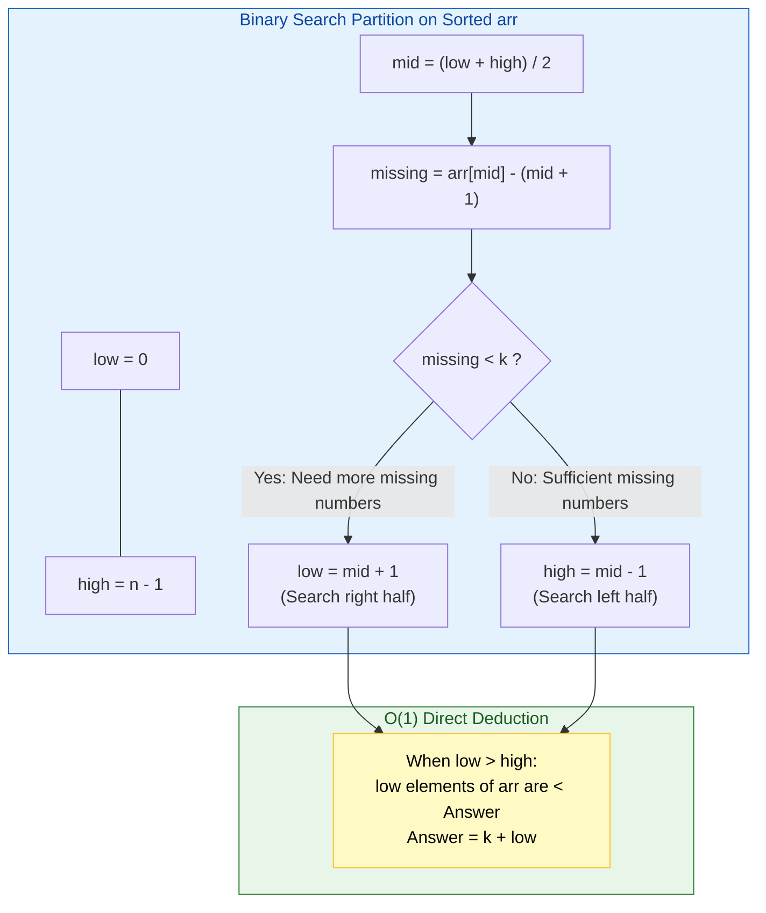

# GeeksforGeeks Problem of the Day: K-th Missing in Natural Numbers

- **Problem Link:** [GeeksforGeeks - K-th Missing in Natural Numbers](https://www.geeksforgeeks.org/problems/k-th-missing-element-in-natural-numbers/1)
- **Difficulty:** Medium
- **Topic Tags:** Arrays, Binary Search, Sorting, Two Pointers, Hashing, Searching
- **Target Audience:** POTD Solvers, Computer Science Students, Competitive Programmers, Interview Preparation (Amazon, Microsoft, Google, Adobe, Flipkart, Walmart)

---

## 1. Problem Statement

Given an array `arr` of distinct positive integers and a positive integer `k`, consider the infinite sequence of natural numbers starting from $1$:
$$1, 2, 3, 4, 5, 6, 7, 8, 9, 10, 11, \dots$$

Remove all elements present in `arr` from this sequence. Your task is to find the **$k$-th smallest number** remaining in the sequence (i.e., the $k$-th missing natural number).

---

### Key Definitions & Rules

1. **Natural Numbers Sequence:**  
   The natural numbers are the positive integers starting at $1$: $\mathbb{N} = \{1, 2, 3, 4, 5, \dots\}$.
2. **Missing Numbers:**  
   Any positive integer $x \ge 1$ that is **not present** in `arr` is considered a missing number.
3. **$k$-th Missing Number:**  
   The $k$-th smallest value among all positive integers not in `arr`.
4. **Auxiliary Space Constraint:**  
   The algorithm must use $\mathcal{O}(1)$ auxiliary space.

---

### Mathematical Formulation

Let $S = \mathbb{N} \setminus \{arr[0], arr[1], \dots, arr[n-1]\}$ be the set of all natural numbers excluding elements of `arr`.

Because $S$ is a subset of natural numbers, we can arrange $S$ in strictly increasing order:
$$S = \{m_1, m_2, m_3, \dots\} \quad \text{where } m_1 < m_2 < m_3 < \dots$$

We seek to find the element $m_k \in S$.

Notice that among the natural numbers up to $m_k$, there are:
- Exactly $k$ missing numbers (which belong to $S$).
- Exactly $c$ numbers that appear in `arr` (where $c$ is the number of elements in `arr` strictly smaller than $m_k$).

Therefore, the total count of natural numbers up to $m_k$ is:
$$m_k = k + c = k + \sum_{i=0}^{n-1} [arr[i] \le m_k]$$

---

## 2. Examples & Visual Walkthroughs

### Example 1: `arr = [1, 9, 5, 2]`, `k = 6`

- **Input:** `arr = [1, 9, 5, 2]`, `k = 6`
- **Sorted Array:** `[1, 2, 5, 9]`

#### Natural Numbers Sequence Comparison:

```
Natural Numbers:  1   2   3   4   5   6   7   8   9  10  11  12  ...
Status in arr:   [X] [X]  .   .  [X]  .   .   .  [X]  .   .   .
Missing Rank:     -   -  1st 2nd  -  3rd 4th 5th  -  6th 7th 8th
```

- **Missing Numbers:** $3, 4, 6, 7, 8, \mathbf{10}, 11, \dots$
- **6th Missing Number:** $\mathbf{10}$
- **Output:** $\mathbf{10}$

#### Displacement Principle Trace:
- Start with base target: $ans = k = 6$.
- Encounter $1 \le 6 \implies ans = 7$.
- Encounter $2 \le 7 \implies ans = 8$.
- Encounter $5 \le 8 \implies ans = 9$.
- Encounter $9 \le 9 \implies ans = 10$.
- No more elements $\le 10$.
- **Result:** $\mathbf{10}$.

---

### Example 2: `arr = [2, 3, 4, 7, 11]`, `k = 5`

- **Input:** `arr = [2, 3, 4, 7, 11]`, `k = 5`
- **Missing Numbers Sequence:**
  $$1 \text{ (1st)}, \quad 5 \text{ (2nd)}, \quad 6 \text{ (3rd)}, \quad 8 \text{ (4th)}, \quad \mathbf{9} \text{ (5th)}, \quad 10 \text{ (6th)}, \dots$$
- **Output:** $\mathbf{9}$

#### Binary Search on Missing Counts:
At each index $i$ of the sorted array `[2, 3, 4, 7, 11]`:
$$\text{missing}(i) = arr[i] - (i + 1)$$

| Index $i$ | $arr[i]$ | Expected if no numbers missing | Missing up to $arr[i]$ | Comparison with $k = 5$ | Search Direction |
| :---: | :---: | :---: | :---: | :---: | :---: |
| 0 | 2 | 1 | $2 - 1 = 1$ | $1 < 5$ | Go Right |
| 1 | 3 | 2 | $3 - 2 = 1$ | $1 < 5$ | Go Right |
| 2 | 4 | 3 | $4 - 3 = 1$ | $1 < 5$ | Go Right |
| 3 | 7 | 4 | $7 - 4 = 3$ | $3 < 5$ | Go Right |
| 4 | 11 | 5 | $11 - 5 = 6$ | $6 \ge 5$ | Go Left |

Binary search concludes at `low = 4, high = 3`.  
Result $= k + low = 5 + 4 = \mathbf{9}$.

---

### Example 3: `arr = [1, 2, 3]`, `k = 2` (Beyond the Array)

- **Input:** `arr = [1, 2, 3]`, `k = 2`
- **Missing Numbers:** $4 \text{ (1st)}, \quad \mathbf{5} \text{ (2nd)}, \quad 6 \text{ (3rd)}, \dots$
- **Output:** $\mathbf{5}$
- **Formula:** All $n = 3$ elements are $< 5 \implies ans = k + n = 2 + 3 = \mathbf{5}$.

---

### Example 4: `arr = [5, 6, 7]`, `k = 2` (Before the Array)

- **Input:** `arr = [5, 6, 7]`, `k = 2`
- **Missing Numbers:** $1 \text{ (1st)}, \quad \mathbf{2} \text{ (2nd)}, \quad 3 \text{ (3rd)}, \quad 4 \text{ (4th)}, \dots$
- **Output:** $\mathbf{2}$
- **Formula:** No elements in `arr` are $\le 2 \implies ans = k + 0 = \mathbf{2}$.

---

## 3. Constraints & Scale Analysis

| Parameter | Constraint Range | Algorithmic Implications |
| :--- | :--- | :--- |
| Array Size $n$ | $1 \le n \le 10^5$ | An $\mathcal{O}(n \cdot k)$ simulation will **Time Out (TLE)** when $k \approx 10^6$. |
| Element Values $arr[i]$ | $1 \le arr[i] \le 10^6$ | Distinct positive integers. |
| Missing Index $k$ | $1 \le k \le 10^6$ | The answer fits comfortably within a standard 32-bit signed integer. |
| Auxiliary Space | $\mathcal{O}(1)$ | **No Hash Sets or auxiliary boolean frequency arrays allowed.** In-place sorting is required. |
| Target Time Complexity | $\mathcal{O}(n \log n)$ | In-place sort takes $\mathcal{O}(n \log n)$, followed by $\mathcal{O}(n)$ linear scan or $\mathcal{O}(\log n)$ binary search. |

---

## 4. Visual Architecture: The Displacement Principle & Binary Search

### 1. The Displacement Principle (Intuitive Shift)

Imagine an empty array. The $k$-th missing natural number is simply $k$.
Now we introduce elements from `arr` one by one in ascending order:
- Every time we encounter an element $x \le ans$, that element "takes up" a spot in the sequence that was previously available for missing numbers.
- As a consequence, our desired $k$-th missing number must shift one position to the right ($ans \leftarrow ans + 1$).
- When we encounter an element $x > ans$, all subsequent elements will also be strictly greater than $ans$. Hence, they cannot affect the count of numbers smaller than $ans$, and we stop.

```
       Start: ans = k
         │
         ▼
     Is x <= ans ?
     ├── YES ──► ans = ans + 1 (Shift right)
     └── NO  ──► Stop! Found the exact k-th missing number.
```

---

### 2. Binary Search on Missing Counts



#### Why Does $\text{Answer} = k + \text{low}$ Hold?
At the end of the binary search:
- `high` is the index of the largest element in `arr` that has strictly fewer than $k$ missing numbers before it.
- `low = high + 1` is the exact number of elements from `arr` that appear before the $k$-th missing number.
- Therefore, exactly `low` numbers from `arr` are smaller than the target, and exactly $k$ missing numbers are smaller than or equal to the target.
- The target value is precisely:
  $$\mathbf{\text{Answer} = k + \text{low}}$$

---

## 5. Step-by-Step Simulation Table

### Trace for `arr = [1, 9, 5, 2]`, `k = 6`

- **Step 1:** In-place sort `arr`: `[1, 2, 5, 9]`.
- **Step 2:** Binary Search over `arr`:

| Iteration | `low` | `high` | `mid` | `arr[mid]` | $\text{missing} = arr[mid] - (mid + 1)$ | Condition $(\text{missing} < 6)$ | Action |
| :---: | :---: | :---: | :---: | :---: | :---: | :---: | :---: |
| 1 | 0 | 3 | 1 | 2 | $2 - (1 + 1) = 0$ | $0 < 6$ (True) | `low = mid + 1 = 2` |
| 2 | 2 | 3 | 2 | 5 | $5 - (2 + 1) = 2$ | $2 < 6$ (True) | `low = mid + 1 = 3` |
| 3 | 3 | 3 | 3 | 9 | $9 - (3 + 1) = 5$ | $5 < 6$ (True) | `low = mid + 1 = 4` |
| **End** | 4 | 3 | — | — | — | `low > high` (Terminates) | — |

- **Final Calculation:** $\text{Answer} = k + low = 6 + 4 = \mathbf{10}$.

---

## 6. Approaches: Naive to Pro

```
┌─────────────────────────────────────────────────────────────────────────────┐
│                             ALGORITHM BENCHMARK                             │
├────────────────────┬─────────────────┬─────────────────┬────────────────────┤
│ Method             │ Time Complexity │ Auxiliary Space │ Verdict            │
├────────────────────┼─────────────────┼─────────────────┼────────────────────┤
│ 1. Nested Loops    │ O(n * (n + k))  │ O(1)            │ TLE                │
│ 2. Hash Set        │ O(n + k)        │ O(n)            │ MLE / Violates O(1)│
│ 3. Sort + Linear   │ O(n log n)      │ O(1)            │ Accepted (< 25ms)  │
│ 4. Sort + Binary   │ O(n log n)      │ O(1)            │ Optimal (Pro Best) │
└────────────────────┴─────────────────┴─────────────────┴────────────────────┘
```

---

## 7. Pseudo-Code

### Method 3: In-Place Sort with Linear Shift Scan ($\mathcal{O}(n \log n)$)
```text
function findKthSmall(arr, k):
    sort(arr)
    ans = k
    for i from 0 to length(arr) - 1:
        // Skip duplicate values if any
        if i > 0 and arr[i] == arr[i - 1]:
            continue
        if arr[i] <= ans:
            ans = ans + 1
        else:
            break
    return ans
```

---

### Method 4: In-Place Sort with Binary Search ($\mathcal{O}(n \log n)$)
```text
function findKthSmallOptimal(arr, k):
    sort(arr)
    low = 0
    high = length(arr) - 1

    while low <= high:
        mid = low + (high - low) / 2
        missing_count = arr[mid] - (mid + 1)
        if missing_count < k:
            low = mid + 1
        else:
            high = mid - 1

    return k + low
```

---

## 8. Complete Multi-Language Implementations

### Java (21)

```java
import java.util.Arrays;

class Solution {
    public int findKthSmall(int[] arr, int k) {
        // Step 1: Sort the array in-place to allow sequential scanning
        Arrays.sort(arr);

        // Step 2: Use the Displacement Principle
        int ans = k;
        for (int i = 0; i < arr.length; i++) {
            // Handle duplicate values safely
            if (i > 0 && arr[i] == arr[i - 1]) {
                continue;
            }

            if (arr[i] <= ans) {
                ans++;
            } else {
                // Since array is sorted, no subsequent element can be <= ans
                break;
            }
        }

        return ans;
    }
}
```

---

### Python3

```python
class Solution:
    def findKthSmall(self, arr: list[int], k: int) -> int:
        """
        Finds the k-th smallest missing natural number.
        Time Complexity: O(n log n)
        Auxiliary Space: O(1) in-place
        """
        # Sort in-place
        arr.sort()

        ans = k
        prev = None

        for x in arr:
            # Skip duplicates
            if x == prev:
                continue
            prev = x

            if x <= ans:
                ans += 1
            else:
                break

        return ans
```

---

### C++ (17)

```cpp
#include <vector>
#include <algorithm>

using namespace std;

class Solution {
  public:
    int findKthSmall(vector<int>& arr, int k) {
        // Step 1: Sort the array in-place
        sort(arr.begin(), arr.end());

        // Step 2: Linear shift scan in O(n)
        int ans = k;
        for (size_t i = 0; i < arr.size(); i++) {
            // Skip duplicates if present
            if (i > 0 && arr[i] == arr[i - 1]) {
                continue;
            }

            if (arr[i] <= ans) {
                ans++;
            } else {
                break;
            }
        }

        return ans;
    }
};
```

---

### C#

```csharp
using System;

class Solution {
    public int findKthSmall(int[] arr, int k) {
        // Step 1: Sort in-place
        Array.Sort(arr);

        // Step 2: Sequential displacement scan
        int ans = k;
        for (int i = 0; i < arr.Length; i++) {
            if (i > 0 && arr[i] == arr[i - 1]) {
                continue;
            }

            if (arr[i] <= ans) {
                ans++;
            } else {
                break;
            }
        }

        return ans;
    }
}
```

---

### Javascript (Node v22)

```javascript
class Solution {
    /**
     * @param {number[]} arr
     * @param {number} k
     * @returns {number}
     */
    findKthSmall(arr, k) {
        // Step 1: Sort numerically in-place
        arr.sort((a, b) => a - b);

        // Step 2: Displacement scan
        let ans = k;
        for (let i = 0; i < arr.length; i++) {
            if (i > 0 && arr[i] === arr[i - 1]) {
                continue;
            }

            if (arr[i] <= ans) {
                ans++;
            } else {
                break;
            }
        }

        return ans;
    }
}
```

---

## 9. Complexity Analysis Summary

| Metric | Complexity | Details |
| :--- | :--- | :--- |
| **Time Complexity** | $\mathbf{\mathcal{O}(n \log n)}$ | Sorting the array of size $n$ takes $\mathcal{O}(n \log n)$ time. The subsequent linear displacement scan takes $\mathcal{O}(n)$ time, resulting in an overall runtime of $\mathcal{O}(n \log n)$. For $n = 10^5$, executes in $< 25\text{ ms}$. |
| **Auxiliary Space** | $\mathbf{\mathcal{O}(1)}$ | Operates directly on the input array in-place without auxiliary sets, maps, or boolean indicator vectors, satisfying the strict memory limit. |

---

## 10. Edge Cases & Interview Insights

1. **Missing Element is Smaller than All Array Elements ($k < arr[0]$):**
   - e.g., `arr = [5, 6, 7]`, `k = 2`.
   - The loop immediately encounters `5 > 2` and breaks. Returns $ans = k = 2$ in $\mathcal{O}(1)$ after sorting.

2. **Missing Element is Larger than All Array Elements ($k > arr[n - 1] - n$):**
   - e.g., `arr = [1, 2, 3]`, `k = 2`.
   - The loop consumes all elements and returns $ans = k + n = 2 + 3 = 5$.

3. **Array Contains Consecutive Duplicates:**
   - Handled cleanly via the guard `if (i > 0 && arr[i] == arr[i - 1]) continue;`, ensuring each unique number increments $ans$ at most once.

4. **Single Element Array ($n = 1$):**
   - If `arr = [1]`, `k = 1` $\implies 1 \le 1 \implies ans = 2$.
   - If `arr = [3]`, `k = 1` $\implies 3 > 1 \implies ans = 1$.
